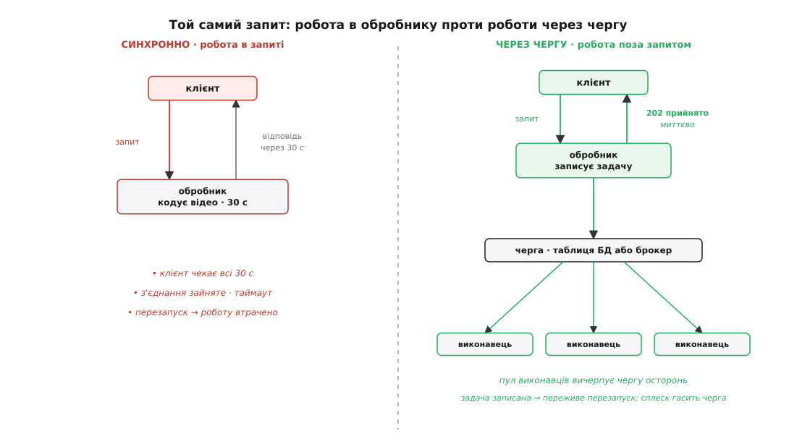
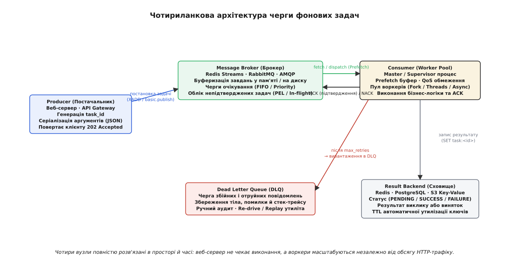
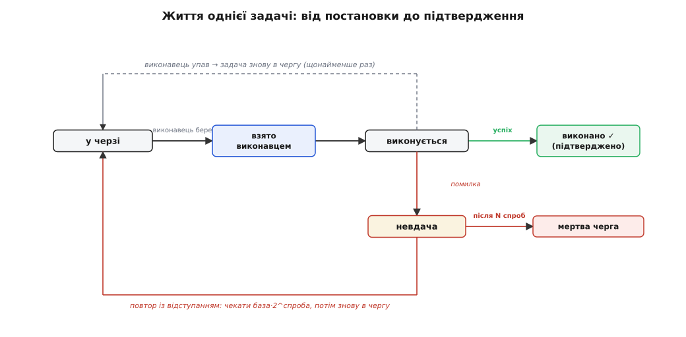
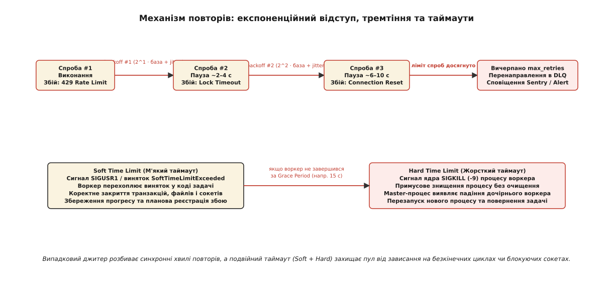
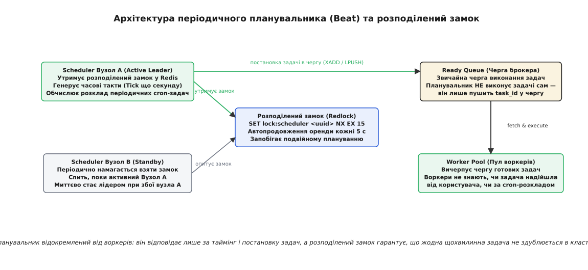
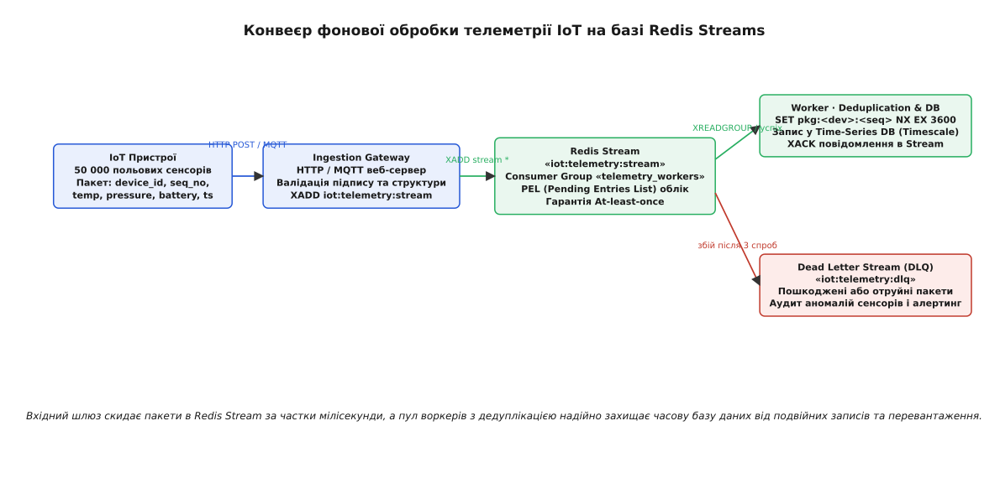

# Черга задач і фоновий робітник

<preknowlist>
- [HTTP](root:com-protocol/http) — клієнт надсилає запит і чекає на відповідь по відкритому з'єднанні; час і кількість одночасних з'єднань обмежені таймаутом і сокетами ОС.
- [Транзакції та ACID](root:sf-data/transactions-acid) — атомарний і довговічний запис: зафіксовані дані переживають апаратний збій, а рядок дістається рівно одному виконавцю.
- [Черга повідомлень](root:sf-distributed/message-queue) — окремий посередник для асинхронного обміну повідомленнями між незалежними сервісами.
- [Повтори й експоненційна витримка](root:sf-web/retries-and-backoff) — розсіювання повторних спроб у часі з наростальною паузою та випадковим тремтінням (Jitter).
- [Сесія, пул з'єднань і keep-alive](root:sf-web/sessions-and-pooling) — повторне використання відкритих TCP-каналів та обмеження пулу одночасних підключень.
</preknowlist>

Користувач натискає кнопку експорту річного фінансового звіту на десять тисяч сторінок або мобільний шлюз приймає пакет із п'ятдесяти тисяч телеметричних вимірювань від польових датчиків. Якщо веб-сервер спробує обробити ці дані безпосередньо всередині синхронного HTTP-обробника, клієнтське з'єднання зависне на тридцять або шістдесят секунд. У цей час робочий процес сервера (Worker Process) повністю заблокований: він утримує відкритий TCP-сокет, пам'ять під контекст запиту та дескриптор з'єднання з базою даних. Коли кілька сотень користувачів одночасно запускають такі операції, пул вхідних з'єднань веб-сервера вичерпується, черга `listen backlog` у ядрі операційної системи переповнюється, а проміжний зворотний проксі або балансувальник навантаження обриває з'єднання за таймаутом (`504 Gateway Timeout`).

Ще небезпечнішим є наслідок неминучих збоїв. Якщо посеред 40-секундної генерації звіту відбудеться плановий перезапуск контейнера під час розгортання нової версії (Rolling Update) або процес впаде через вичерпання ліміту пам'яті (OOM Killer), стан незавершеної операції зникне з оперативної пам'яті без жодного сліду. Клієнт отримає мережеву помилку, система не зафіксує факту невиконаного зобов'язання, а повторний клік користувача спричинить новий виток блокування ресурсів. Синхронна обробка важких задач руйнує веб-шар: вона перетворює швидкі точки входу на вузькі місця інфраструктури та втрачає роботу під час збоїв.

Вихід полягає у фундаментальному архітектурному розв'язанні: **відокремленні приймання задачі від її безпосереднього виконання**. Веб-обробник виконує лише швидку й надійну дію — фіксує намір виконати операцію у вигляді структурованого опису **задачі** (англ. *job* або *task*, від лат. *taxare* — «оцінювати, доручати») у довговічному сховищі (брокері) й негайно повертає клієнту відповідь `202 Accepted` з унікальним ідентифікатором операції. Окремий пул автономних процесів — **фонових робітників** (англ. *background workers*, лат. *operarius* — «робітник, виконавець») — асинхронно вибирає ці задачі зі сховища й виконує їх у власному темпі, повністю ізольовано від життєвого циклу HTTP-запитів.


*Синхронне виконання блокує веб-сервер і втрачає стан при перезапуску; асинхронна черга миттєво відпускає клієнта, гарантуючи виконання задач пулом воркерів.*

Це розділення має тривалу історію: [те саме відокремлення приймання від виконання](root:sf-web/background-jobs/hist-job-queues.md) еволюціонувало від систем пакетної обробки на мейнфреймах 1950-х років до сучасних розподілених черг завдань.

---

## Чотириланкова архітектура черги задач

Надійна система фонової обробки задач складається з чотирьох самостійних компонентів, розв'язаних у просторі й часі. Кожен компонент відповідає за строго визначену фазу життєвого циклу задачі.


*Чотири вузли черги фонових задач: постачальник (Producer), брокер повідомлень (Broker), пул виконавців (Worker Pool) та сховище результатів (Result Backend) із чергою відхилених задач (DLQ).*

### 1. Постачальник (Producer)
Постачальником зазвичай виступає веб-додаток, API-шлюз або фоновий процес, у якому виникає потреба виконати роботу. Producer виконує такі операції:
- **Генерація ідентифікатора:** формує глобально унікальний `task_id` (на базі UUIDv7 або KSUID, що містять монотонну часову мітку для ефективного індексування).
- **Серіалізація аргументів:** упаковує ім'я викликаної функції або типу задачі та її вхідні параметри у бінарний або текстовий формат (JSON, MessagePack, Protocol Buffers). Тіло задачі має містити мінімально необхідні дані (наприклад, `user_id` та `report_id`, а не повні об'єкти з бази даних), щоб уникнути застарівання стану на момент фактичного старту воркера.
- **Транзакційна публікація:** поміщає упаковане повідомлення в брокер черги. Якщо створення задачі супроводжується зміною бізнес-даних у реляційній базі, застосовують патерн **Transactional Outbox**: повідомлення спершу записується в таблицю `outbox` тією самою локальною транзакцією, що й бізнес-сутність, після чого окремий процес надійно ретранслює його в брокер. Це усуває стан розриву, коли рядок у базі зафіксовано, а брокер під час мережевого збою задачі так і не отримав.

### 2. Брокер повідомлень (Message Broker)
Брокер є посередником, який приймає задачі від продюсерів, буферизує їх у пам'яті або на диску та розподіляє між активними воркерами. Залежно від вимог до пропускної здатності та надійності обирають одну з трьох моделей брокерів:
- **In-memory сховища з персистентністю (Redis):** реалізують черги через списки (`LPUSH` / `BRPOP`) або через потоки Redis Streams (`XADD`, `XREADGROUP`, `XACK`). Redis дає мінімальну затримку постановки й вибірки (менше мілісекунди) та високу пропускну здатність (понад 100 000 оп/с на вузол), але вимагає ретельного налаштування скидання пам'яті на диск (AOF `fsync everysec`), щоб уникнути втрати повідомлень при збої живлення.
- **Спеціалізовані AMQP-брокери (RabbitMQ):** надають розвинену маршрутизацію (Direct, Topic, Fanout, Headers Exchanges), підтвердження доставки на рівні протоколу (`basic.ack` / `basic.nack`), пріоритетні черги та автоматичне відхилення у мертву чергу (Dead Letter Exchange). RabbitMQ зберігає повідомлення на диску й гарантує збереження черг при перезапуску брокера.
- **Реляційні бази даних (PostgreSQL):** використання звичайної таблиці бази як черги через механізм `FOR UPDATE SKIP LOCKED`. Цей підхід ідеальний для систем із помірним навантаженням (до кількох тисяч задач на секунду), оскільки дозволяє ставити задачу в чергу в тій самій ACID-транзакції, що й бізнес-дані, без введення додаткового інфраструктурного компонента. Детальна реалізація розібрана у статті [довговічна черга на таблиці бази](root:sf-web/background-jobs/proj-durable-queue.md).

### 3. Пул виконавців (Consumer / Worker Pool)
Воркер — це самостійний процес-демон, запущений на окремому сервері або в контейнері. Архітектура типового воркера організована як супервізор (Master Process), що керує пулом дочірніх виконавців:
- **Модель конкурентності:** дочірні воркери можуть бути окремими процесами ОС (Pre-fork модель, типова для Celery в Python для обходу GIL та ізоляції пам'яті), пулом потоків (Thread Pool для I/O-bound задач) або асинхронним циклом подій (AsyncIO / Node.js Event Loop у BullMQ).
- **Попереднє завантаження (Prefetch Limit):** брокер може відправляти воркеру наперед пачку з `N` повідомлень (Prefetch Count / Quality of Service — QoS), щоб усунути мережеву затримку між послідовними задачами. Проте для важких задач із непередбачуваною тривалістю виконання завищений `prefetch_count` є небезпечним: один воркер заблокує в своєму локальному буфері десять важких задач на пів години, тоді як інші воркери простоюватимуть без роботи. Для довгих задач встановлюють `prefetch_count = 1`.
- **Захист від витоків пам'яті (Worker Recycling):** процеси, що динамічно обробляють великі обсяги даних і сторонні бібліотеки, схильні до повільного накопичення пам'яті через фрагментацію купи або циклічні посилання. Супервізор відстежує кількість оброблених задач або поріг використаної RAM і примусово перезапускає дочірній процес (`max_tasks_per_child = 1000`), створюючи свіжий екземпляр без зупинки всього пулу.

### 4. Сховище результатів (Result Backend)
На відміну від брокера, який оптимізований для швидкого проходження повідомлень і видаляє задачу одразу після її підтвердження, Result Backend зберігає фінальний стан виконання:
- **Ключ:** `task:<task_id>`.
- **Значення:** статус (`PENDING`, `STARTED`, `SUCCESS`, `FAILURE`, `RETRY`), серіалізоване значення, повернуте функцією (або повний стек помилки `traceback` у разі винятку), час старту та завершення.
- **Час життя (TTL):** збережені результати повинні мати обов'язковий термін придатності (наприклад, 24 години), інакше сховище буде невпинно роздуватися мільйонами застарілих записів, які клієнти давно прочитали або проігнорували.

---

## Гарантії доставки та стан оренди повідомлення

У розподіленій системі взаємодія між брокером і воркером відбувається через ненадійну мережу. Якщо процес воркера раптово гине під час виконання коду, брокер повинен однозначно з'ясувати долю задачі.

```
                  ┌─────────────────────────────────────────────────────────┐
                  │                 Семантика доставки                      │
                  └────────────────────────────┬────────────────────────────┘
                                               │
                 ┌─────────────────────────────┴─────────────────────────────┐
                 ▼                                                           ▼
  ┌───────────────────────────────┐                           ┌───────────────────────────────┐
  │         At-most-once          │                           │         At-least-once         │
  │     (Щонайбільше один раз)    │                           │     (Щонайменше один раз)     │
  ├───────────────────────────────┤                           ├───────────────────────────────┤
  │ • auto_ack = true             │                           │ • manual_ack = true           │
  │ • Повідомлення видаляється з  │                           │ • Задача лишається в брокері  │
  │   черги ДО початку обробки    │                           │   в стані оренди (PEL/Lease)  │
  │ • Падіння воркера призводить  │                           │ • Падіння воркера повертає    │
  │   до безповоротної ВТРАТИ     │                           │   задачу іншому виконавцю     │
  │ • Ризик дублювання: 0         │                           │ • Ризик дублювання: ВИСОКИЙ   │
  └───────────────────────────────┘                           └───────────────────────────────┘
```

1. **At-most-once (щонайбільше раз):** брокер видаляє повідомлення з черги в ту саму мить, коли відправляє його через сокет воркеру (режим автопідтвердження `auto_ack=True`). Якщо через 5 мілісекунд воркер зазнає аварії ядра ОС чи падіння живлення, задача втрачена назавжди. Цей режим припустимий виключно для некритичних метрик або періодичного збору статистики, де втрата одного вимірювання дешевша за витрати на координацію.
2. **At-least-once (щонайменше раз):** брокер залишає повідомлення у внутрішньому буфері очікування — списку непідтверджених записів (Pending Entries List — PEL у Redis Streams, In-flight messages у RabbitMQ/SQS) — і встановлює ліміт часу на обробку — **оренду повідомлення** (англ. *message lease* або *visibility timeout*).
   - Воркер успішно завершує задачу й надсилає брокеру явне підтвердження (`ACK`). Брокер остаточно видаляє задачу з PEL.
   - Воркер зазнає аварії й замовкає. Час оренди спливає (наприклад, 60 секунд), брокер фіксує відсутність `ACK` і робить задачу знову видимою для інших воркерів. Інший живий воркер забирає задачу й починає виконання.

З гарантії *at-least-once* випливає фундаментальний наслідок: **задача може бути передана на виконання більше одного разу**. Якщо воркер виконав важку роботу (наприклад, списав кошти з балансу користувача), але під час відправлення фінального `ACK` брокеру впав мережевий комутатор, брокер не отримає підтвердження. Після закінчення таймауту оренди задачу буде віддано другому воркеру, який знову виконає той самий код.

> 🔧 **Навіщо це.** Не існує магічного налаштування черги, яке дає гарантію «рівно один раз» (*exactly-once*) виключно силами брокера. Надійність досягається комбінацією: брокер дає гарантію *at-least-once*, а бізнес-код воркера зобов'язаний бути **ідемпотентним** (лат. *idem potens* — «той самий результат»). Повторний виклик задачі з тими самими вхідними даними не повинен призводити до повторної зміни стану системи.

### Дедуплікація завдань на практиці
Для захисту від повторного виконання використовують два бар'єри:

1. **Дедуплікація на етапі постановки (Enqueue-time deduplication):** продюсер генерує детермінований хеш задачі (наприклад, `SHA256(task_name + sorted_arguments)`). Перед записом у чергу продюсер виконує атомарну команду в Redis:
   ```
   SET task_dedup:<hash> <task_id> NX EX 300
   ```
   Якщо ключ уже існує, це означає, що ідентична задача вже стоїть у черзі й очікує виконання. Продюсер не створює дублікат, а повертає наявний `task_id`.

2. **Дедуплікація на етапі обробки (Execution-time idempotency):** на стороні бази даних створюють таблицю `processed_tasks` з унікальним обмеженням:
   ```sql
   CREATE TABLE processed_tasks (
       idempotency_key text PRIMARY KEY,
       result          jsonb NOT NULL,
       created_at      timestamptz NOT NULL DEFAULT now()
   );
   ```
   Обробник задачі виконує бізнес-мутацію та збереження запису в `processed_tasks` всередині однієї транзакції:
   ```sql
   BEGIN;
     -- Якщо ключ уже зафіксовано, вставка завершиться помилкою унікальності
     INSERT INTO processed_tasks (idempotency_key, result)
          VALUES ('order_pay_9481', '{"status":"paid"}');
     
     UPDATE accounts SET balance = balance - 1500 WHERE user_id = 42;
   COMMIT;
   ```
   Якщо транзакція падає через порушення унікальності `idempotency_key`, воркер розуміє, що робота вже була успішно виконана іншим процесом раніше, і негайно надсилає `ACK` брокеру, запобігаючи повторному списанню коштів.

---

## Маршрутизація, пріоритети та оркестрація робочих процесів

Коли система обробляє різні за природою задачі — від миттєвої відправки SMS-коду двофакторної автентифікації до багатогодинного перекодування 4K-відео, — складання всіх завдань в одну спільну чергу призводить до блокування початку черги (**Head-of-Line Blocking**): довге відео стає попереду SMS, і користувачі чекають одноразові паролі годинами.

### 1. Пріоритезація та виділені пули черг
Для усунення блокування завдання розділяють за різними іменованими чергами з індивідуальними пулами воркерів:
- **Черга `critical` (високий пріоритет):** SMS, скидання пароля, реєстраційні листи. Виділений пул швидких воркерів гарантує затримку старту < 500 мс.
- **Черга `default` (середній пріоритет):** оновлення кешу, генерація прев'ю зображень, синхронізація з CRM.
- **Черга `bulk_low` (фоновий низький пріоритет):** збір аналітики, перекодування відео, масові розсилки. Окремий ізольований пул воркерів з обмеженням процесорних ресурсів.

Воркери можуть обслуговувати кілька черг за ваговим пріоритетом (Weighted Round-Robin): наприклад, воркер спершу вичерпує чергу `critical`, і лише коли вона порожня, переходить до `default` та `bulk_low`.

```
                    ┌────────────────────────────────────────────────────────┐
                    │               Маршрутизація черг                       │
                    └───────────────────────────┬────────────────────────────┘
                                                │
                 ┌──────────────────────────────┼─────────────────────────────┐
                 ▼                              ▼                             ▼
  ┌──────────────────────────────┐┌─────────────────────────────┐┌─────────────────────────────┐
  │      Черга «critical»        ││       Черга «default»       ││      Черга «bulk_low»       │
  │    (SMS, Auth, Webhooks)     ││  (Синхронізація, Кешування) ││     (Відео, Аналітика)      │
  └──────────────┬───────────────┘└─────────────┬───────────────┘└─────────────┬───────────────┘
                 │                              │                              │
                 ▼                              ▼                              ▼
  ┌──────────────────────────────┐┌─────────────────────────────┐┌─────────────────────────────┐
  │   Worker Pool: Critical      ││    Worker Pool: Default     ││     Worker Pool: Bulk       │
  │    (16 потоків, CPU 100%)    ││    (8 процесів, CPU 50%)    ││    (4 процеси, CPU 20%)     │
  └──────────────────────────────┘└─────────────────────────────┘└─────────────────────────────┘
```

### 2. Оркестрація робочих процесів (Workflows)
Реальні бізнес-процеси рідко складаються з однієї ізольованої дії. Черги фонових задач підтримують шаблони композиції:
- **Ланцюг (Chain / Pipeline):** послідовне виконання задач, де результат кроку `N` автоматично передається першим аргументом у крок `N+1`:
  ```
  FetchRawVideo(url) ➔ TranscodeH264(video_id) ➔ ExtractThumbnails(video_id) ➔ NotifyUser(user_id)
  ```
  Якщо будь-який проміжний крок падає з помилкою, весь ланцюг зупиняється без запуску наступних задач.
- **Віялове розгалуження та зведення (Fan-out / Fan-in / Chord):** одна батьківська задача розбиває роботу на `N` паралельних підзадач (Fan-out), а спеціальний фінальний обробник (Callback / Chord) чекає завершення всіх `N` задач для фінальної агрегації результатів (Fan-in):
  ```
  SplitDocument(doc_id)
       ├── TranslatePage(page_1) ─┐
       ├── TranslatePage(page_2) ─┼──➔ MergePdfAndNotify(doc_id)
       └── TranslatePage(page_3) ─┘
  ```
- **Група (Group):** паралельний запуск незалежних задач без спільного завершального колбеку.

---

## Обробка збоїв: Експоненційний відступ, Джитер та Мертва черга (DLQ)

Під час виконання задачі воркер може стикнутися з помилками двох типів:
- **Тимчасові збої (Transient Faults):** мікро-розрив зв'язку з базою даних, перевантаження зовнішнього API (`429 Too Many Requests`), таймаут блокування рядка. Повторне виконання через кілька секунд буде успішним.
- **Перманентні (фатальні) помилки:** невалідний формат вхідного JSON, неіснуючий `user_id`, помилка логіки коду (`TypeError`, `ZeroDivisionError`). Повторювати таку задачу без виправлення коду безглуздо.


*Життєвий цикл задачі: успішне виконання приводить до підтвердження (ACK), падіння воркера повертає задачу за таймаутом оренди, а помилка спрямовує на повтор із відступом.*

### Експоненційний відступ із випадковим тремтінням (Full Jitter)
Якщо зовнішній сервіс відповів кодом 429, неприпустимо повторювати задачу негайно. Якщо тисяча воркерів одночасно отримають відмову й повторять запит рівно через одну секунду, вони спричинять синхронний **повторний шторм** (Retry Storm), остаточно добивши сервіс.

Щоб розсіяти навантаження, застосовують алгоритм експоненційного відступу з повним тремтінням (**Full Jitter**):

```
delay = random_uniform(0, min(max_delay, base · 2^attempt))
```

```
Розрахунок інтервалу для base = 1 с, max_delay = 60 с:
Спроба 1: random_uniform(0, min(60, 1 · 2¹)) = random_uniform(0, 2)   → середня затримка 1.0 с
Спроба 2: random_uniform(0, min(60, 1 · 2²)) = random_uniform(0, 4)   → середня затримка 2.0 с
Спроба 3: random_uniform(0, min(60, 1 · 2³)) = random_uniform(0, 8)   → середня затримка 4.0 с
Спроба 4: random_uniform(0, min(60, 1 · 2⁴)) = random_uniform(0, 16)  → середня затримка 8.0 с
Спроба 5: random_uniform(0, min(60, 1 · 2⁵)) = random_uniform(0, 32)  → середня затримка 16.0 с
```

Випадковий вибір значення в діапазоні від 0 до експоненційної межі повністю розмиває синхронний пік: тисяча задач рівномірно розподіляться по часовій осі.


*Повторні спроби розсіюються експоненційним відступом із тремтінням; подвійний ліміт часу (Soft + Hard) запобігає зависанню воркерів; після вичерпання спроб задача йде в DLQ.*

### Ліміти часу виконання (Timeouts & Sandboxing)
Воркер не може працювати над однією задачею нескінченно: завислий сторонній сокет або нескінченний цикл у коді перетворить робочий процес на «зомбі», що не бере нових завдань. Для захисту пулу впроваджують двошарові таймаути:

1. **М'який ліміт часу (Soft Time Limit):** таймер операційної системи (сигнал `SIGUSR1` або внутрішній таймаут мови) спрацьовує, наприклад, через 30 секунд. Воркер перехоплює цей сигнал у вигляді спеціального винятку (`SoftTimeLimitExceeded`). Обробник має змогу коректно закрити відкриті сокети, записати проміжний прогрес у базу даних і викинути контрольовану помилку для планування повтору.
2. **Жорсткий ліміт часу (Hard Time Limit):** якщо воркер застряг у блокуючому C-виклику чи не завершився протягом 10 секунд після м'якого таймауту (на 40-й секунді), супервізор надсилає дочірньому процесу неперехоплюваний сигнал ядра `SIGKILL` (-9). Процес знищується операційною системою, вивільняючи всі ресурси, після чого супервізор негайно породжує новий чистий процес воркера.

### Черга мертвих повідомлень (Dead Letter Queue — DLQ)
Якщо задача зазнала невдачі після вичерпання максимальної кількості спроб (`attempts >= max_retries`), продовжувати спроби небезпечно. Воркер вилучає задачу з основної черги та записує її в окрему структуру — **мертву чергу (DLQ)**.

Структура повідомлення в DLQ містить повний контекст аварії:
```json
{
  "task_id": "01918a22-4c91-7d1a-8f83-a9c12b6f4e10",
  "task_name": "process_iot_telemetry",
  "payload": {"device_id": "dev_994", "seq_no": 1402, "val": -999.0},
  "failed_at": "2026-08-27T03:15:22.184Z",
  "total_attempts": 5,
  "exception_class": "SensorCalibrationError",
  "last_error": "Sensor value -999.0 exceeds physical range [-50, +150]",
  "traceback": "Traceback (most recent call last):\n  File \"worker.py\", line 84...",
  "worker_node": "worker-pool-eu-west-1a-node-03"
}
```

Завдяки DLQ система не втрачає пошкоджені повідомлення, а інженери отримують ізольований буфер для аналізу аномалій. Після виправлення бага у коді задачі з DLQ повертають в основну чергу за допомогою службової утиліти повторного вливання (**Re-drive / Replay**).

---

## Періодичні задачі та розподілений планувальник (Cron / Beat)

Багато фонових процесів повинні запускатися не за подією від користувача, а **за годинником**: очищення застарілих сесій щоночі о другій годині, генерація рахунків першого числа кожного місяця, збір метрик щоп'ять хвилин.

Поширена помилка — запускати нескінченний цикл зі `sleep(60)` всередині кожного воркера. Це призводить до хаосу: якщо в кластері працює 20 воркерів, періодична задача запуститься одночасно 20 разів.

Правильна архітектура періодичного планувальника (наприклад, Celery Beat або BullMQ Repeatable Jobs) базується на моделі **єдиного джерела часу** (Single Leader Scheduler).


*Планувальник утримує розподілений замок у Redis, генерує тіки часу й пушить готові задачі в брокер. Пул воркерів виконує їх як звичайні задачі на вимогу.*

### Принцип роботи планувальника:
1. **Ізоляція ролі:** планувальник (Scheduler) — це окремий легковажний процес, який **ніколи сам не виконує бізнес-код задач**. Його єдина функція — вести розклад (Cron-таблицю) і раз на секунду (Tick) перевіряти, які задачі досягли часу запуску.
2. **Постановка в брокер:** коли час настає, планувальник формує звичайне повідомлення задачі й поміщає його в загальну чергу брокера. Воркери підхоплюють цю задачу з черги на загальних підставах: для пулу воркерів немає різниці, чи задачу створив веб-сервер, чи вона прийшла за cron-розкладом.
3. **Висока доступність та розподілений замок (Leader Election):** щоб уникнути єдиної точки відмови (SPOF), запускають два екземпляри планувальника (Instance A та Instance B). Активним є лише той, хто успішно встановив розподілений замок у Redis:
   ```
   SET lock:scheduler:leader <instance_uuid> NX EX 15
   ```
   Активний лідер кожні 5 секунд подовжує термін дії замка. Якщо вузол A раптово вмирає, замок вичерпується за 15 секунд, після чого вузол B перехоплює лідерство й продовжує генерацію тіків без дублювання задач.

---

## Практична реалізація: Надійна система фонової обробки IoT-пакетів

Розглянемо повну виробничу реалізацію системи фонової обробки телеметрії від 50 000 польових IoT-сенсорів. 

**Архітектура рішення:**
1. **Брокер:** Redis Streams (потік `iot:telemetry:stream`) зі споживчою групою `telemetry_workers`.
2. **Воркер:** надійний цикл вибірки (`XREADGROUP`), дедуплікація за ключем пристрою та номером пакета (`SET pkg:<dev>:<seq> NX EX`), обробка метрик, явне підтвердження (`XACK`), експоненційний відступ при збоях та перенаправлення отруйних пакетів у DLQ (`iot:telemetry:dlq`).
3. **Автономне відновлення завислих повідомлень (PEL Orphan Recovery):** механізм `XAUTOCLAIM` для перехоплення задач, які зависли на воркерах, що впали понад 60 секунд тому.

:::tabs
:::code background-jobs-d/py/main.py
:::code background-jobs-d/cpp/main.cpp
:::


*Конвеєр обробки IoT-пакетів: вхідний шлюз скидає дані в Redis Stream, воркери дедуплікують пакети, а отруйні повідомлення ізолюються в DLQ.*

---

## Порівняння технологій організації черг завдань

Вибір інструменту для організації фонових черг завдань залежить від пропускної здатності, вимог до надійності та складності експлуатації інфраструктури:

| Критерій | Redis Streams / BullMQ | RabbitMQ (AMQP) | PostgreSQL (`SKIP LOCKED`) | Apache Kafka / AWS Kinesis |
| :--- | :--- | :--- | :--- | :--- |
| **Основне призначення** | Швидкі черги веб-задач та мікросервісів | Складна корпоративна маршрутизація повідомлень | Транзакційні фонові задачі всередині моноліту | Потокова обробка гігабайтних журналів подій |
| **Пропускна здатність** | Дуже висока (50k–150k задач/с на вузол) | Висока (20k–50k задач/с) | Середня (1k–5k задач/с) | Екстремальна (> 500k повідомлень/с на партицію) |
| **Затримка (Latency)** | < 1 мс | 1–5 мс | 5–20 мс | 5–15 мс (пакетна оптимізація) |
| **Транзакційна постановка** | Потребує Outbox патерну | Потребує Outbox патерну | **Рідна (ACID-транзакція з даними)** | Потребує Outbox / Debezium CDC |
| **Гарантія черги (DLQ / Retry)** | Вбудована в бібліотеки (BullMQ/Streams) | Нативна на рівні протоколу (DLX, x-dead-letter) | Реалізується запитами SQL | Обробляється окремим консьюмером / топіком |
| **Складність підтримки** | Низька (зазвичай уже є в стеку) | Середня (вимагає адміністрування кластера) | **Мінімальна (використовує наявну БД)** | Висока (ZooKeeper/KRaft, ребалансування) |

---

## Метрики та моніторинг черг фонових задач

Для забезпечення безперебійної роботи фонової інфраструктури система спостережливості (Observability) зобов'язана відстежувати чотири ключові метрики:

1. **Глибина черги (Queue Depth / Lag):** загальна кількість повідомлень, які очікують обробки в брокері. Монотонне зростання глибини черги протягом 10 хвилин свідчить про те, що темп надходження задач перевищує сумарну продуктивність воркерів. Це головний тригер для автоматичного масштабування пулу (Horizontal Pod Autoscaler — HPA за метрикою черги).
2. **Вік найстарішого повідомлення (Oldest Message Age / Processing Latency):** показує, скільки секунд минуло від моменту постановки найстарішої невиконаної задачі до поточного часу. Якщо глибина черги мала (наприклад, 50 задач), але вік найстарішої становить 40 хвилин, це сигналізує про зависання воркерів на «отруйних» задачах (Head-of-Line Blocking).
3. **Пропускна здатність (Throughput — ack/sec):** кількість успішно підтверджених задач за секунду в розрізі типів завдань. Падіння пропускної здатності при незмінній кількості воркерів сигналізує про деградацію зовнішніх залежностей (бази даних або сторонніх API).
4. **Частота збоїв (Error & DLQ Rate):** кількість задач, що завершилися винятком або потрапили в Dead Letter Queue. Сплеск цієї метрики сигналізує про помилки у новому релізі коду або аварію інтегрованого провайдера.
