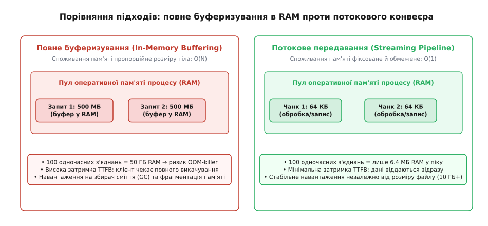
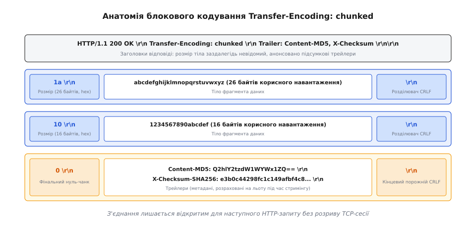
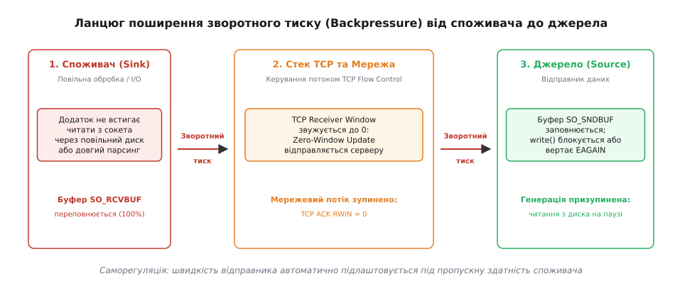

# Потокове передавання великих тіл

<preknowlist>
- [Сесія, пул з'єднань і keep-alive](root:sf-web/sessions-and-pooling) — збереження постійного TCP-з'єднання між запитами.
- [HTTP-клієнт requests](root:sf-web/requests-client) — життєвий цикл запиту, параметри stream та iter_content.
- [Кадрування повідомлень у потоці байтів TCP](root:com-protocol/tcp-message-framing) — відокремлення меж повідомлень у неперервному потоці TCP-октет.
- [Сокети TCP та UDP](root:sf-os/sockets-tcp-udp) — системні виклики send, recv, буферизація ядра та неблокуючий ввід-вивід.
</preknowlist>

Коли клієнтський додаток робить стандартний запит на завантаження або вивантаження файлу розміром у декілька гігабайтів, наївне зчитування всього тіла відповіді в оперативну пам'ять процесу призводить до миттєвої кризи ресурсів. Якщо сто паралельних робочих потоків одночасно викличуть зчитування відповіді розміром по 500 мегабайтів через виклик на зразок `response.content`, сумарна потреба у віртуальній пам'яті сягне 50 гігабайтів. Це викликає вичерпання пулу RAM, примусове втручання механізму Out-Of-Memory (OOM) killer операційної системи, колосальні паузи збирача сміття (Garbage Collection) та деградацію затримки Time-to-First-Byte (TTFB), оскільки жоден байт корисного навантаження не може бути оброблений до завершення повного завантаження.

Єдиним архітектурним порятунком від цього колапсу є потокове передавання (англ. *stream*, від прагерманського *straumaz* — неперервна течія), за якого дані обробляються не монолітним блоком, а дискретними порціями крізь невеликий проміжний буфер (від старофранцузького *buffe* — глушник удару, проміжний захисний шар) сталого розміру. Завдяки цьому просторова складність операції з лінійної `O(N)` перетворюється на константну `O(1)`, дозволяючи клієнту передавати терабайти даних у межах кількох десятків кілобайтів виділеної оперативної пам'яті.


*Порівняння підходів: накопичення всього тіла в оперативній пам'яті O(N) проти фіксованого буфера O(1) із миттєвим передаванням.*

### Пастка буферизації: чому завантаження у пам'ять ламає вебклієнт

Буферизація в оперативній пам'яті здається розробникам простою та інтуїтивною, оскільки вона приховує мережеву асинхронність за звичними інтерфейсами монолітних масивів байтів або рядків. Проте на системному рівні вона породжує декілька важких деградацій:

1. **Нелінійне навантаження на підсистему пам'яті (Memory Amplification):** при читанні сирих байтів високорівневі мови програмування (Python, JavaScript, Ruby) перетворюють байти на внутрішні структури даних або динамічні масиви. Копіювання з буфера сокета в буфер транспортної бібліотеки, потім у проміжний буфер парсера і фінальний об'єкт призводить до того, що корисний файл розміром 1 ГБ може тимчасово споживати від 2 до 4 ГБ фізичної пам'яті через службові заголовки об'єктів та фрагментацію купи (heap fragmentation).
2. **Блокування першого байта (Time to First Byte, TTFB):** при повному буферизуванні висхідний конвеєр обробки (наприклад, парсер JSON, алгоритм стиснення чи декодер мультимедіа) простоює весь час, поки файл транспортується мережею. Якщо швидкість каналу становить 10 МБ/с, а розмір файлу — 1 ГБ, програма змушена чекати понад 100 секунд, перш ніж виконати першу корисну дію над даними.
3. **Хвильове виснаження ресурсів (Thundering Herd під навантаженням):** раптовий сплеск одночасних запитів від користувачів викликає вибухове зростання споживання пам'яті процесу. Якщо ліміт пам'яті контейнера cgroups або віртуальної машини перевищено, ядро Linux надсилає сигнал `SIGKILL`, аварійно завершуючи процес і обриваючи тисячі сусідніх з'єднань, які обслуговувалися цим же екземпляром сервера.
4. **Неможливість роботи з нескінченними потоками:** при трансляції подій реального часу (Server-Sent Events), неперервних аудіо- та відеопотоків або системних журналів (логів) розмір тіла є принципово нескінченним, тому накопичення в пам'яті робить таку взаємодію технічно неможливою.

> 🔧 **Навіщо це.**
> У виробничих мікросервісних архітектурах проксі-вузли та API-шлюзи щомиті пропускають через себе гігабайти контенту. Перехід на потокову модель дозволяє утримувати споживання оперативної пам'яті контейнера на рівні менше 50 МБ навіть за одночасної передачі десятків паралельних відеопотоків або масивних файлів резервного копіювання.

### Межі тіла в HTTP: від Content-Length до блокового кодування

Транспортний протокол TCP є неструктурованим потоком байтів без внутрішніх меж повідомлень. Отримуючи неперервну послідовність октет із сокета (від англ. *socket*, старофранцузького *soc* — заглиблення, наконечник), прикладний протокол HTTP повинен мати чітке правило для визначення, де саме завершується поточне тіло і починається наступний HTTP-запит або відповідь.

У ранній специфікації HTTP/1.0 існувало два взаємовиключні механізми:
- **Фіксована довжина `Content-Length`:** сервер вказує точний розмір тіла в байтах. Клієнт відраховує цю кількість байтів із сокета, після чого вважає відповідь завершеною.
- **Закриття з'єднання (`Connection: close`):** сервер передає дані доти, доки вони є, а для сигналізації завершення закриває TCP-з'єднання.

Обидва варіанти створювали серйозні проблеми для динамічного контенту. Щоб надіслати `Content-Length`, сервер зобов'язаний був заздалегідь згенерувати відповідь повністю й підрахувати її розмір, що знову повертало до проблеми накопичення в RAM. Закриття ж TCP-сокета унеможливлювало використання постійних з'єднань `Keep-Alive`, змушуючи клієнта витрачати час на повторні тристоронні рукостискання TCP та погодження ключів TLS для кожного наступного ресурсу. Детальніше про цю кризу розповідає [історичний розвиток блокового кодування](root:sf-web/streaming-bodies/hist-chunked-transfer.md).

Для подолання цього обмеження в стандарті HTTP/1.1 було впроваджено блокове або порційне кодування — `Transfer-Encoding: chunked` (від англ. *chunk* — порція, уламок).

```
1a\r\n
abcdefghijklmnopqrstuvwxyz\r\n
10\r\n
1234567890abcdef\r\n
0\r\n
Content-MD5: Q2hlY2tzdW1WYWx1ZQ==\r\n
\r\n
```


*Формат кадрування блокового кодування: шістнадцятковий розмір, CRLF-розділювачі, корисні дані, термінальний нульовий блок і трейлери.*

Принцип роботи блокового кодування базується на внутрішньому кадруванні (від французького *cadre*, латинського *quadrum* — рамка, межа):
1. Замість загального розміру в заголовках відповіді сервер надсилає директиву `Transfer-Encoding: chunked`.
2. Тіло розбивається на окремі фрагменти. Кожен фрагмент починається з рядка з шістнадцятковим числом, що задає довжину цього фрагмента в байтах, після якого слідує розділювач `\r\n`.
3. Одразу за префіксом розміру слідують самі байти корисного навантаження вказаної довжини, які також завершуються обов'язковою послідовністю `\r\n`.
4. Завершення передавання позначається спеціальним термінальним блоком нульової довжини: `0\r\n`.
5. Після нульового блоку може розміщуватися секція трейлерів (від англійського *trail*, латинського *trahere* — тягнути слідом) — завершальних заголовків із контрольними сумами або часом обробки, після чого йде фінальний порожній рядок `\r\n`.

Блокове кодування дозволяє серверу відправляти фрагменти даних у сокет негайно в міру їхньої генерації, не накопичуючи потік у пам'яті й зберігаючи TCP-з'єднання відкритим для наступних запитів.

### Механіка сокетів і зворотний тиск (Backpressure)

Справжнє потокове передавання — це не просто читання невеликими шматками, а синхронізація швидкості виробника даних (Producer) зі швидкістю їхнього споживача (Consumer). Якщо джерело генерує байти зі швидкістю 100 МБ/с, а клієнт через повільний диск чи вузький канал зв'язку здатен приймати лише 1 МБ/с, виникає дисбаланс, який загрожує переповненням внутрішніх буферів на проміжних вузлах.

Механізм, що автоматично регулює темп роботи джерела відповідно до пропускної здатності приймача, називається зворотним тиском або бекпрешером (від англ. *backpressure* — тиск у зворотному напрямку).


*Поширення зворотного тиску: заповнення приймального буфера споживача призводить до стиснення вікна TCP Receive Window і блокування відправника.*

Зворотний тиск у мережевому стеку реалізується через багаторівневий фізичний ланцюг:

1. **Буфер прийому споживача (Socket Receive Buffer, `SO_RCVBUF`):** коли додаток клієнта зайнятий важкими обчисленнями або записом на повільний носій, він припиняє вичитувати дані з сокета через системний виклик `recv()`. Байти, що приходять із мережі, починають заповнювати виділений ядром буфер `SO_RCVBUF`.
2. **Керування потоком TCP (TCP Flow Control):** у міру заповнення буфера `SO_RCVBUF` стек TCP споживача зменшує значення доступного вікна прийому (Receive Window, `RWIN`) у кожному пакеті підтвердження `TCP ACK`. Коли буфер заповнюється повністю, клієнт відправляє серверу пакет із `RWIN = 0` (Zero-Window Update).
3. **Зупинка мережевого потоку:** отримавши нульове вікно, стек TCP відправника припиняє передавати пакети через фізичну мережу.
4. **Буфер передавання відправника (Socket Send Buffer, `SO_SNDBUF`):** генератор на боці відправника продовжує викликати `send()`, але ці байти вже не можуть піти в мережу і заповнюють буфер `SO_SNDBUF` ядра відправника.
5. **Блокування джерела:** коли буфер `SO_SNDBUF` заповнюється на 100%, черговий системний виклик `send()` або `write()` у блокуючому режимі призупиняє виконання робочого потоку відправника (або повертає помилку `EAGAIN` / `EWOULDBLOCK` у неблокуючому сокеті). Джерело перестає читати дані з диска або бази даних.

Як тільки споживач вичитує чергову порцію з сокета, буфер `SO_RCVBUF` звільняється, надсилається оновлення `TCP Window Update`, передавач надсилає порцію з `SO_SNDBUF`, а системний виклик `send()` відправника розблоковується. Весь цей замкнений контур регуляції працює самостійно на рівні операційної системи без потреби в ручному координуванні з коду прикладного рівня.

### Системне простеження та аналіз буферів ядра

Поведінку зворотного тиску та стан мережевих буферів можна безпосередньо спостерігати в операційній системі Linux за допомогою системних утиліт та інтерфейсів діагностики:

1. **Моніторинг черг сокетів через `ss`:** команда `ss -tin` відображає поточний розмір буферів відправлення та прийому сокета (поля `Send-Q` та `Recv-Q`), а також розмір вікна `rcv_wnd` та ефективний темп передавання (pacing rate). Якщо споживач не встигає читати, значення `Recv-Q` зростає до максимуму, а `rcv_wnd` наближається до нуля.
2. **Простеження системних викликів через `strace`:** виклик `strace -e trace=recvfrom,sendto,poll -p <PID>` наочно демонструє, як блокується процес при переповненні буфера. У блокуючому режимі виклик `sendto()` зависає на секунди, а в неблокуючому виникають циклічні виклики `poll()` з очікуванням події `POLLOUT`.
3. **Конфігурація автопідлаштування TCP:** ядро Linux автоматично масштабує розміри буферів згідно зі значеннями у файлах `/proc/sys/net/ipv4/tcp_rmem` та `/proc/sys/net/ipv4/tcp_wmem`, де вказано трійку значень: мінімальний розмір, типовий початковий розмір і абсолютний максимум у байтах.

### Потокове завантаження та вивантаження на клієнті

Розглянемо практичну організацію потокових конвеєрів (від англ. *pipeline*, латинського *pipa* — труба) на двох технологічних рівнях: високорівневому Python та низькорівневому системному C/C++.

#### Потокове читання та запис у Python

У бібліотеці `requests` завантаження великого файлу в потоковому режимі вимагає обов'язкової передачі параметра `stream=True`. Без нього виклик `requests.get()` вичитає все тіло у внутрішнє поле `response.content` ще до повернення керування у ваш код.

Для потокового вивантаження у запитах `POST` чи `PUT` параметру `data` передається функція-генератор (від латинського *generator* — породжувач, від *generare* — народжувати). Рушій `urllib3` ітерує генератор і надсилає кожен виділений шматок у сокет з автоматичним додаванням заголовка `Transfer-Encoding: chunked`.

:::code streaming-bodies-d/py/main.py

#### Системне потокове пересилання на C та C++

На системному рівні потокове пересилання реалізується як цикл зчитування та запису через фіксований буфер із явною обробкою часткових операцій та неблокуючих станів.

:::tabs
:::code streaming-bodies-d/c/main.c
:::code streaming-bodies-d/cpp/main.cpp
:::

Повноцінний проект із парсингом заголовків, керуванням таймаутами та конвеєризацією сокетів наведено у вставці [побудова потокового тунелю з фіксованим буфером](root:sf-web/streaming-bodies/proj-streaming-pipeline.md).

### Оптимальний вибір розміру буфера

Чому стандартним розміром робочого буфера для більшості вебсерверів та клієнтів є діапазон від 16 до 64 кілобайтів?

- **Узгодження зі сторінками пам'яті ядра:** стандартна сторінка віртуальної пам'яті архітектури x86-64 становить 4096 байтів (4 КБ). Буфер розміром 64 КБ точно кратний 16 системним сторінкам пам'яті, що мінімізує накладні витрати блоку керування пам'яттю (MMU).
- **Співвідношення з максимальним розміром кадру TLS:** рівень шифрування TLS Record Layer передає дані блоками з максимальним розміром 16 384 байти (16 КБ). Буфер розміром 64 КБ дозволяє прийняти або відправити рівно чотири повні TLS-записи без внутрішнього дроблення.
- **Ефективність використання TCP MSS:** максимальний розмір сегмента TCP (Maximum Segment Size) у стандартних мережах Ethernet становить 1460 байтів. Порція 64 КБ вміщує близько 45 повних мережевих кадрів, що забезпечує високу утилізацію мережевого адаптера при помірній кількості системних викликів.
- **Ціна завищеного буфера:** виділення буфера в 10–50 мегабайтів не додає помітного приросту пропускної здатності, проте при 10 000 паралельних з'єднань призводить до вимивання сотень гігабайтів оперативної пам'яті лише на утримання буферів сокетів.

### Бінарне кадрування HTTP/2 та HTTP/3

У протоколах HTTP/2 та HTTP/3 текстове блокове кодування було повністю скасоване. Замість префіксів розмірів у форматі шістнадцяткового тексту всі дані передаються у вигляді структурованих бінарних фреймів `DATA`.

Ключовими відмінностями нової архітектури є:
1. **Мультиплексування в одному сокеті:** у HTTP/1.1 передавання великого потоку повністю блокувало TCP-з'єднання для будь-яких інших запитів. У HTTP/2 кожне повідомлення має свій числовий ідентифікатор `Stream ID`, що дозволяє передавати паралельно сотні потокових відповідей в одному TCP-з'єднанні, перемішуючи їхні окремі фрейми.
2. **Сигналізація завершення прапорцем `END_STREAM`:** замість текстового нульового чанка `0\r\n\r\n` останній бінарний фрейм потоку містить встановлений бітовий прапорець `END_STREAM (0x1)`.
3. **Дворівневе керування вікном (Application-Level Flow Control):** HTTP/2 додає власний механізм зворотного тиску через службові фрейми `WINDOW_UPDATE`. Одержувач керує лімітом байтів як для окремого логічного потоку, так і для всього TCP-з'єднання загалом. Якщо вікно потоку вичерпано, відправник призупиняє надсилання даних саме цього потоку, продовжуючи передавати інші паралельні запити.

Детальні структури бінарних заголовків, синтаксис ABNF та правила використання трейлерів систематизовані у вставці [специфікація протоколів і системні параметри сокетів](root:sf-web/streaming-bodies/api-streaming-protocols.md).

### Пастки, безпека та крайові випадки потокового передавання

1. **Контрабанда HTTP-запитів (HTTP Request Smuggling):** якщо зловмисник надсилає запит, який містить одночасно заголовки `Content-Length` та `Transfer-Encoding: chunked`, проміжний проксі-сервер та кінцевий бекенд можуть розібрати межі повідомлення по-різному. За стандартом RFC 9112 заголовок `Transfer-Encoding` має безумовний пріоритет над `Content-Length`, а заголовок `Content-Length` повинен або видалятися проксі-сервером, або такий запит має відхилятися зі статусом 400 Bad Request.
2. **Невиявлений обрив потоку:** при використанні `Content-Length` клієнт завжди може перевірити, чи збігається кількість отриманих байтів з оголошеною довжиною. Якщо з'єднання розірвано посередині файлу, клієнт фіксує помилку `IncompleteRead`. У разі блокового кодування єдиним надійним критерієм успішного завершення є отримання термінального нульового чанка `0\r\n\r\n`. Якщо сокет закрився без нульового чанка, потік вважається пошкодженим і не може бути збережений як валідний результат.
3. **Неможливість наївних повторів (Non-replayable Streams):** якщо під час потокового надсилання даних через генератор на 80-му відсотку передавання виникає мережевий збій, клієнтський механізм повторів (Retries) не може просто викликати функцію знову. Генератор уже вичерпано, а прочитані дані вилучено з пам'яті. Для повторної спроби клієнт повинен або реалізовувати скидання покажчика джерела (наприклад, виклик `file.seek(0)`), або вимагати від прикладного рівня відтворення вхідного потоку спочатку.
4. **Тайм-аути бездіяльності сокета (Idle Socket Timeout):** якщо генератор відправника витрачає занадто багато часу на обчислення або вибірку чергової порції з бази даних, проміжні мережеві екрани, NAT-маршрутизатори або зворотні проксі можуть закрити TCP-з'єднання через відсутність мережевої активності. Потокові протоколи запобігають цьому регулярним надсиланням порожніх коментарів або байтів синхронізації (heartbeat).
5. **Сигнал SIGPIPE при раптовому закритті з'єднання клієнтом:** якщо віддалений клієнт обриває з'єднання під час потокового запису, наступний системний виклик `write()` або `send()` у сокет без спеціальних прапорців викликає надсилання процесу сигналу `SIGPIPE`. Типовою поведінкою операційної системи є негайне аварійне завершення процесу. Для захисту потоковий сервер зобов'язаний встановлювати обробник `signal(SIGPIPE, SIG_IGN)` або використовувати прапорець `MSG_NOSIGNAL` під час системного виклику, обробляючи помилку `EPIPE` на рівні коду.

### Архітектурний підсумок

Потокове передавання великих тіл розв'язує фундаментальну суперечність між обмеженістю оперативної пам'яті вузла та непередбачувано великими обсягами прикладних даних. 

Головні інваріанти надійної потокової системи:
- Споживання пам'яті має залишатися величиною `O(1)`, строго обмеженою розміром фіксованого робочого буфера (типово 16–64 КБ).
- Швидкість генерації даних повинна автоматично обмежуватися пропускною здатністю споживача через механізми зворотного тиску TCP Flow Control або HTTP/2 `WINDOW_UPDATE`.
- Межі повідомлень мають бути однозначно визначені або через фіксований `Content-Length`, або через самоописові чанки `Transfer-Encoding: chunked`, або через бінарні фрейми `DATA` з прапорцем `END_STREAM`.
- Завершення передавання має обов'язково валідуватися отриманням термінального маркера кінця потоку для запобігання збереженню обірваних або пошкоджених файлів.
