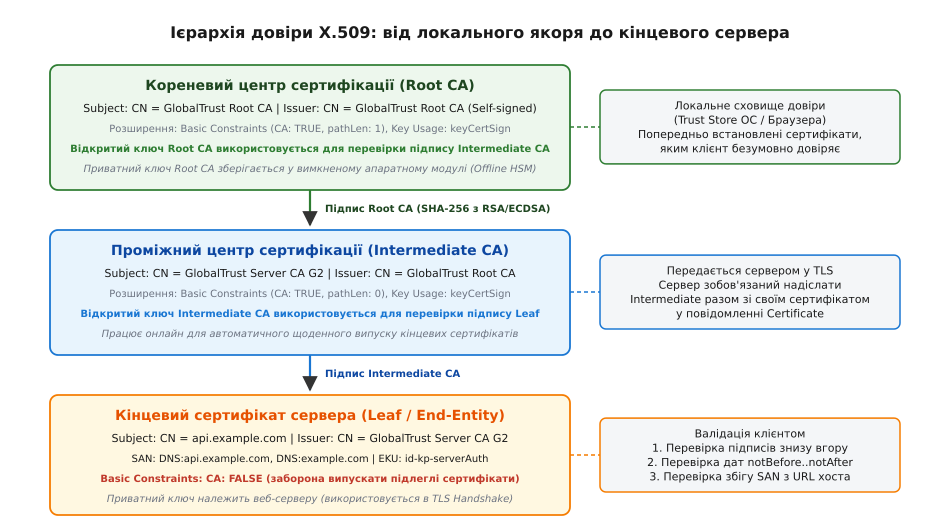
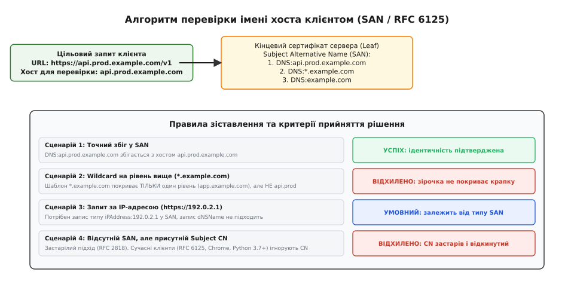
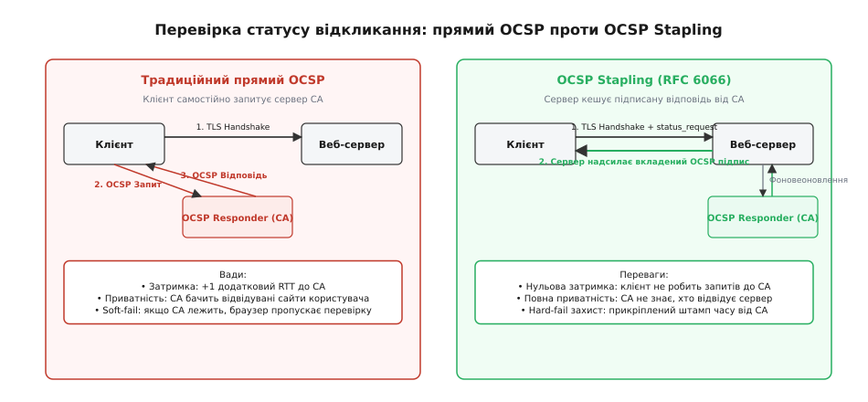
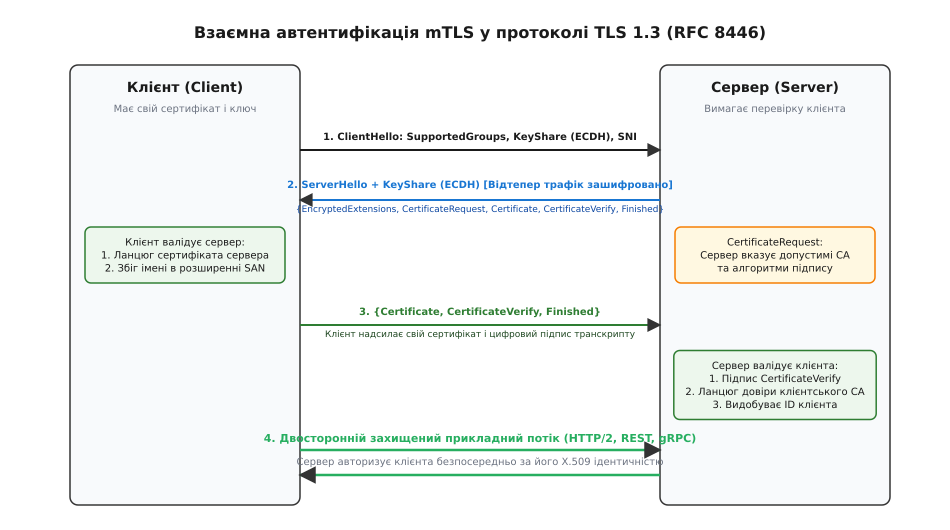

# TLS і перевірка сертифікатів

<preknowlist>
- [HTTP](root:com-protocol/http) — модель обміну «запит–відповідь», заголовки, методи та безпам'ятна природа протоколу.
- [TLS](root:sf-security/tls) — криптографічний протокол захисту транспортного рівня, симетричні та асиметричні шифри.
- [TLS Handshake](root:sf-security/tls-handshake) — фази узгодження шифрів, обміну ключами та встановлення захищеної сесії.
- [Криптографія з відкритим ключем](root:sf-security/public-key-crypto) — пари відкритого й приватного ключів та механізм цифрових підписів.
- [Хеш і цифровий підпис](root:sf-security/hash-and-digital-signature) — математична гарантія незмінності та автентичності повідомлень.
</preknowlist>

Клієнтська програма відправляє HTTP-запит до платіжного шлюзу `https://api.bank.com/v1/charge`, розв'язує DNS-ім'я в IP-адресу `198.51.100.42` і відкриває звичайний TCP-сокет. На цьому етапі весь фізичний маршрут через комутатори провайдера, магістральні маршрутизатори та бездротові точки доступу є повністю неконтрольованим. Якщо клієнт просто виконає асиметричний обмін ключами Діффі — Геллмана з тим вузлом, який відповів за цією IP-адресою, він отримає стійко зашифрований канал. Проте шифрування саме по собі не дає відповіді на головне інженерне питання: з ким саме встановлено цей канал? Зловмисник, що перехопив трафік на рівні маршрутизації (BGP-перехоплення, підміна DNS або фальшива Wi-Fi мережа), може згенерувати власну пару ключів, успішно завершити шифроване з'єднання від імені банку, розшифрувати передані номери карток і переслати запит далі до справжнього сервера.

Захист від такої атаки активного посередника (англ. *Man-in-the-Middle*, MitM) вимагає суворої процедури підтвердження ідентичності. Клієнт повинен отримати математичний доказ того, що відкритий ключ, наданий сервером під час рукостискання, дійсно належить власнику домену `api.bank.com`, цей зв'язок засвідчений довіреною третьою стороною, а сам сервер володіє відповідним приватним ключем. Цю роль виконує цифровий **сертифікат** (від середньовіч. лат. *certifico* — «засвідчую», від *certus* — «певний, надійний» + *facio* — «роблю») міжнародного стандарту X.509 та алгоритм валідації ланцюжка довіри.

## Анатомія сертифіката X.509: структури даних та розширення v3

Сертифікат X.509 — це стандартизований цифровий документ, описаний у специфікації RFC 5280, який криптографічно зв'язує відкритий ключ вузла з його реальною ідентичністю (доменним ім'ям, назвою організації чи сервісом). На фізичному рівні сертифікат кодується за допомогою нотації ASN.1 (англ. *Abstract Syntax Notation One*) та бінарного формату DER (англ. *Distinguished Encoding Rules*), який для зручності передачі та зберігання кодується в текстовий вигляд Base64 з обрамленням `-----BEGIN CERTIFICATE-----` (формат PEM, англ. *Privacy-Enhanced Mail*).

Структура сертифіката складається з трьох ключових секцій:

```
Certificate ::= SEQUENCE {
    tbsCertificate          TBSCertificate,
    signatureAlgorithm      AlgorithmIdentifier,
    signatureValue          BIT STRING
}
```

Секція `tbsCertificate` (англ. *To Be Signed* — «те, що підлягає підпису») містить усю корисну інформацію:

1. **Версія (Version):** для сучасних сертифікатів завжди `v3` (значення `2`), оскільки лише третя версія підтримує критичні розширення безпеки.
2. **Серійний номер (Serial Number):** унікальне позитивне ціле число до 20 байтів, яке випускаючий центр сертифікації присвоює кожному створеному документу для однозначної ідентифікації та відкликання.
3. **Алгоритм підпису (Signature Algorithm):** ідентифікатор криптографічної комбінації, якою підписано цей сертифікат (наприклад, `sha256WithRSAEncryption` або `ecdsa-with-SHA256`).
4. **Видавець (Issuer):** розрізнюване ім'я (англ. *Distinguished Name*, DN) центру, що створив та підписав цей сертифікат.
5. **Строк дії (Validity):** часовий інтервал із двох полів — `notBefore` (дата й час, раніше яких сертифікат не діє) та `notAfter` (момент втрати чинності).
6. **Суб'єкт (Subject):** ім'я власника сертифіката (наприклад, `CN = api.bank.com, O = Bank Corp, C = UA`).
7. **Інформація про відкритий ключ суб'єкта (Subject Public Key Info):** сам відкритий ключ сервера (модуль та експонента RSA або координати точки на еліптичній кривій ECDSA) та алгоритм, для якого він призначений.
8. **Розширення (Extensions):** метадані версії v3, що визначають права, обмеження та сфери застосування ключа.

### Критичні розширення X.509 v3

Без стандартизованих розширень клієнт не зміг би відрізнити сертифікат кінцевого сервера від сертифіката центру сертифікації, здатного підписувати чужі домени. Кожне розширення позначається глобальним об'єктним ідентифікатором (OID) та містить бінарний прапорець `critical`. Якщо клієнтський стек зустрічає невідоме розширення з прапорцем `critical = TRUE`, він зобов'язаний негайно відхилити сертифікат.

Серед десятків розширень стандарт визначає п'ять базових:

- **Базові обмеження (`Basic Constraints`, OID 2.5.29.19):** вказує, чи є власник сертифіката центром сертифікації (`cA: TRUE` або `cA: FALSE`). Якщо `cA: TRUE`, додаткове поле `pathLenConstraint` обмежує максимальну кількість проміжних центрів, які можуть стояти нижче в ієрархії. Для кінцевого веб-сервера це поле завжди зобов'язане мати значення `cA: FALSE`.
- **Призначення ключа (`Key Usage`, OID 2.5.29.15):** набір бітових прапорців, які обмежують допустимі криптографічні операції. Для сервера це зазвичай `digitalSignature` (для TLS 1.3) та `keyEncipherment` (для застарілих схем обміну RSA). Для центрів сертифікації обов'язковими є прапорці `keyCertSign` (право підписувати інші сертифікати) та `cRLSign` (право підписувати списки відкликання).
- **Розширене призначення ключа (`Extended Key Usage`, EKU, OID 2.5.29.37):** перелік OID, що визначають прикладні протоколи. Значення `id-kp-serverAuth` (1.3.6.1.5.5.7.3.1) дозволяє використовувати сертифікат для автентифікації TLS-сервера, а `id-kp-clientAuth` (1.3.6.1.5.5.7.3.2) — для взаємної автентифікації клієнта (mTLS).
- **Альтернативне ім'я суб'єкта (`Subject Alternative Name`, SAN, OID 2.5.29.17):** структурований список імен (`dNSName`, `iPAddress`, `uniformResourceIdentifier`), для яких цей сертифікат є дійсним.
- **Обмеження імен (`Name Constraints`, OID 2.5.29.30):** потужне розширення для проміжних CA, яке задає білі (`permittedSubtrees`) та чорні (`excludedSubtrees`) списки доменних просторів (наприклад, дозволяє випускати сертифікати виключно для `*.corp.internal`, блокуючи спроби підпису загальнодоступних доменів на кшталт `*.google.com`).

## Ієрархія та ланцюжок довіри: від Root CA до Leaf

Клієнтський пристрій не може зберігати відкриті ключі кожного з сотень мільйонів веб-сайтів у світі. Натомість використовується ієрархічна модель довіри (від грец. *ἱεραρχία* — «священна влада», впорядкована структура підпорядкування), де довіра передається зверху вниз за допомогою ланцюжка цифрових підписів.



*Кореневий CA підписує сертифікат проміжного CA своїм приватним ключем; проміжний CA підписує кінцевий сертифікат сервера. Клієнт перевіряє підписи знизу вгору до власного локального сховища Trust Store.*

Ієрархія будується з трьох рівнів:

1. **Кореневий центр сертифікації (Root CA):** найвища точка довіри (англ. *Trust Anchor*). Його сертифікат є самопідписаним: поле `Issuer` у ньому збігається з полем `Subject`, а цифровий підпис перевіряється його власним відкритим ключем. Приватний ключ Root CA зберігається на ізольованому від мережі комп'ютері в апаратному модулі безпеки (англ. *Hardware Security Module*, HSM) і використовується лише раз на кілька місяців для підпису проміжних центрів.
2. **Проміжний центр сертифікації (Intermediate CA):** підпорядкований орган, сертифікат якого підписаний кореневим CA (або іншим проміжним). Проміжні CA працюють онлайн в автоматизованих кластерах і щохвилини випускають кінцеві сертифікати для клієнтів. Якщо онлайн-інфраструктуру проміжного CA буде скомпрометовано, кореневий CA просто відкликає цей один проміжний сертифікат без необхідності оновлення операційних систем у мільярдів користувачів.
3. **Кінцевий сертифікат сервера (Leaf / End-Entity):** сертифікат, випущений для конкретного домену (наприклад, `api.bank.com`). Він не має права підписувати інші сертифікати (`Basic Constraints: CA: FALSE`) і використовується веб-сервером під час TLS-з'єднання.

Під час TLS-рукостискання веб-сервер надсилає клієнтові свій кінцевий сертифікат разом із повним набором усіх проміжних сертифікатів (англ. *Certificate Chain*). Кореневий сертифікат сервер зазвичай не надсилає: клієнт уже має його у своєму локальному сховищі довірених сертифікатів (англ. *Trust Store*), що постачається разом з операційною системою чи браузером.

### Перехресне підписання (Cross-Signing) та альтернативні шляхи
У реальних мережах ланцюжок не завжди є простим лінійним списком. Коли новий центр сертифікації (наприклад, Let's Encrypt із коренем `ISRG Root X1`) тільки з'являється на ринку, його корінь відсутній у старих смартфонах чи операційних системах. Щоб забезпечити миттєву сумісність, новий проміжний CA отримує **перехресний підпис** від старого, загальновизнаного кореневого центру (наприклад, `DST Root CA X3` від IdenTrust).

Клієнтський валідатор будує направлений граф шляхів довіри (DAG): якщо шлях до нового кореня не знайдено в локальному сховищі, валідатор переходить за альтернативною гілкою перехресного підпису до старого довіреного якоря. Коли старий корінь завершує свій життєвий цикл, сучасні клієнти вже мають новий корінь у своїх сховищах, що дозволяє інфраструктурі безшовно переживати зміну поколінь криптографічних ключів.

## Покроковий алгоритм валідації ланцюжка на клієнті

Отримавши масив сертифікатів від сервера, клієнтський стек TLS виконує суворий детермінований алгоритм валідації (від лат. *validus* — «сильний, дійсний, правомірний»), регламентований специфікацією RFC 5280. Якщо бодай одна перевірка на будь-якому кроці зазнає невдачі, з'єднання негайно розривається з фатальним кодом помилки TLS Alert.

### Крок 1. Побудова графа та зв'язування ланцюжка
Клієнт бере кінцевий сертифікат сервера `C[0]` і шукає його видавця `C[1]` серед надісланих проміжних сертифікатів. Поле `C[0].Issuer` має точно збігатися з `C[1].Subject`. Для однозначності зіставлення використовуються розширення `Authority Key Identifier` (AKI) сертифіката `C[0]` та `Subject Key Identifier` (SKI) сертифіката `C[1]`, які містять 160-бітні SHA-1 геші відповідних відкритих ключів. Цей процес рекурсивно повторюється вгору, доки ланцюжок не досягне кореневого сертифіката `C[n]`, наявного в локальному системному сховищі Trust Store.

### Крок 2. Перевірка часових меж
Для кожного сертифіката `C[i]` у ланцюжку клієнт порівнює поточний системний час `T_now` з полями дії:

```
T_notBefore ≤ T_now ≤ T_notAfter      [сертифікат є чинним у даний момент]
```

Якщо годинник клієнта відстає або поспішає, виникають характерні збої `CERT_NOT_YET_VALID` або `CERT_HAS_EXPIRED`. Сучасна політика безпеки CA/Browser Forum обмежує максимальний строк дії кінцевих сертифікатів до 398 днів (з тенденцією до скорочення до 90 днів для стимулювання повної автоматизації перевипуску через протокол ACME, RFC 8555).

### Крок 3. Криптографічна перевірка підписів
Для кожного зв'язку між дочірнім сертифікатом `C[i]` та його батьківським видавцем `C[i+1]` клієнт виконує математичну перевірку:

```
H = Hash(C[i].tbsCertificate)                       [обчислення дайджесту SHA-256 від бінарного DER]
IsSignatureValid = VerifySignature(C[i+1].PublicKey, H, C[i].signatureValue)
```

1. Клієнт виділяє бінарний блок `tbsCertificate` дочірнього сертифіката `C[i]` і обчислює його криптографічний геш SHA-256.
2. Клієнт бере відкритий ключ із сертифіката видавця `C[i+1]` та за допомогою алгоритму цифрового підпису (RSA чи ECDSA) перевіряє значення `C[i].signatureValue`.
3. Збіг результатів доводить, що жоден байт у сертифікаті `C[i]` не було змінено після моменту його підписання центром `C[i+1]`.

### Крок 4. Перевірка обмежень і повноважень
Клієнт інспектує розширення кожного сертифіката в ланцюжку:
- Усі вузли від `C[1]` до `C[n]` зобов'язані мати `Basic Constraints: CA: TRUE` та прапорець `Key Usage: keyCertSign`. Якщо зловмисник спробує підписати чужий домен власним кінцевим сертифікатом (`CA: FALSE`), клієнт відхилить такий ланцюжок з помилкою `INVALID_CA`.
- Глибина ланцюжка не повинна перевищувати `pathLenConstraint`. Якщо кореневий CA випустив проміжний CA з обмеженням `pathLen: 0`, цей проміжний CA має право випускати лише кінцеві сертифікати `Leaf`, але не інші проміжні центри.
- Кінцевий сертифікат `C[0]` повинен містити розширення `Extended Key Usage` зі значенням `serverAuth` (або універсальне `anyExtendedKeyUsage`).

### Крок 5. Підтвердження володіння приватним ключем
Валідний сертифікат сам по собі є публічним документом — будь-хто може завантажити публічний сертифікат `google.com`. Тому в процесі рукостискання сервер повинен довести, що володіє відповідним **приватним ключем**.

У протоколі TLS 1.3 сервер бере криптографічний геш усього попереднього стенографічного протоколу рукостискання (повідомлень `ClientHello` та `ServerHello`), підписує цей геш своїм приватним ключем і надсилає результат у повідомленні `CertificateVerify`. Клієнт перевіряє цей підпис за допомогою відкритого ключа з отриманого сертифіката `C[0]`.

## Перевірка імені хоста: від застарілого CN до сучасного SAN

Після успішного підтвердження криптографічного ланцюжка клієнт зобов'язаний виконати перевірку відповідності імені (англ. *Hostname Verification*). Сертифікат може бути абсолютно дійсним і підписаним авторитетним CA, але виданим для зовсім іншого домену (наприклад, для `attacker.com`).



*Сучасні клієнти зіставляють домен виключно з розширенням SAN. Шаблони Wildcard покривають рівно один сегмент доменного імені.*

Історично ім'я хоста розміщувалося в полі `Common Name` (CN) суб'єкта (`Subject: CN=example.com`). Проте поле CN мало фундаментальні недоліки: воно дозволяло вказати лише одне ім'я, мало обмеження довжини в 64 символи і не підтримувало розрізнення між доменними іменами та IP-адресами. Специфікація RFC 6125 та вимоги CA/Browser Forum оголосили поле CN застарілим (англ. *deprecated*).

Сучасні веб-клієнти (браузери Chrome, Firefox, бібліотеки OpenSSL 1.1+, Python 3.7+, Go, curl) працюють за суворим правилом: **якщо сертифікат містить розширення SAN, поле CN повністю ігнорується**. Якщо SAN відсутній, сертифікат відхиляється як невідповідний сучасним стандартам безпеки.

### Правила зіставлення імен за стандартом RFC 6125

1. **Точний збіг:** ім'я з URL клієнта (`api.example.com`) посимвольно (без урахування регістру ASCII) порівнюється з кожним записом типу `dNSName` у розширенні SAN.
2. **Шаблонні підстановки (Wildcard Certificates):** символ зірочки `*` дозволений лише в крайньому лівому компоненті імені (`*.example.com`).
   - Шаблон `*.example.com` підтверджує `api.example.com`, `auth.example.com` та `www.example.com`.
   - Шаблон `*.example.com` **НЕ покриває** багаторівневі піддомени: `v1.api.example.com` або `test.dev.example.com` будуть відхилені (зірочка не може замінювати крапку).
   - Шаблон `*.example.com` **НЕ покриває** сам кореневий домен `example.com`. Для його підтримки в SAN окремо додається запис `DNS:example.com`.
   - Часткові підстановки на кшталт `api-*.example.com` або підстановки для публічних суфіксів верхнього рівня (`*.co.uk`, `*.com`) суворо заборонені й відхиляються валідатором.
3. **Прямі IP-адреси:** якщо клієнт підключається безпосередньо за адресою `https://192.0.2.1/`, сертифікат повинен містити запис типу `iPAddress` (`iPAddress: 192.0.2.1`), а не `dNSName`.

## Свіжість сертифіката: CRL, OCSP та OCSP Stapling

Сертифікат може стати небезпечним задовго до завершення свого формального строку дії: приватний ключ сервера міг бути викрадений зловмисниками, сервер скомпрометовано або сертифікат випущено помилково. Для відкликання таких сертифікатів індустрія створила кілька поколінь протоколів.



*Прямий OCSP додає мережеву затримку та розкриває приватність користувача; OCSP Stapling передає підписаний статус безпосередньо в TLS-рукостисканні.*

### 1. Списки відкликання сертифікатів (CRL)
Центр сертифікації періодично формує, підписує та публікує файл списку відкликання (англ. *Certificate Revocation List*, RFC 5280). Клієнт завантажує цей список за URL-адресою, вказаною в розширенні `CRL Distribution Points`.
- **Проблема:** розміри файлів CRL для великих CA досягають десятків мегабайтів. Клієнт не може завантажувати гігабайти списків перед відкриттям кожного сайту, а локальний кеш списків швидко застаріває.

### 2. Онлайн-протокол статусу сертифіката (OCSP)
Протокол OCSP (англ. *Online Certificate Status Protocol*, RFC 6960) замінив завантаження великих списків точковими запитами. Під час перевірки сертифіката клієнт відправляє короткий HTTP-запит до сервера центру сертифікації (OCSP Responder), вказуючи серійний номер сертифіката, і отримує підписану відповідь: `good` (дійсний), `revoked` (відкликаний) або `unknown` (невідомий).
- **Проблема 1 (Затримка):** клієнт змушений виконувати додатковий мережевий запит до стороннього сервера CA перед завершенням TLS-рукостискання, що додає 100–500 мс затримки.
- **Проблема 2 (Приватність):** оператор центру сертифікації бачить IP-адресу клієнта і точний домен сайту, який користувач намагається відкрити.
- **Проблема 3 (Soft-Fail):** якщо сервер OCSP не відповідає (через збій або блокування зловмисником), більшість браузерів за замовчуванням ігнорують помилку й пропускають з'єднання (*Soft-fail*), щоб не ламати Інтернет для користувачів. Це нівелює захист проти активного зловмисника.

### 3. Прикріплення статусу (OCSP Stapling)
Архітектурним розв'язанням цієї суперечності стало розширення TLS Certificate Status Request (RFC 6066), відоме як **OCSP Stapling** (від англ. *staple* — «скріплювати скобою»).
Веб-сервер самостійно у фоновому режимі раз на кілька годин звертається до свого центру сертифікації, отримує підписану криптографічну відповідь OCSP зі штампом часу і кешує її. Коли клієнт ініціює TLS-рукостискання з розширенням `status_request`, сервер сам прикріплює («степлерить») цю підписану відповідь CA безпосередньо до повідомлення рукостискання.

Клієнт перевіряє підпис CA на OCSP-відповіді просто під час обробки пакетів TLS, не роблячи жодних зовнішніх мережевих запитів. Це забезпечує нульову затримку, повну конфіденційність дій користувача та надійну перевірку статусу.

Поряд із механізмами відкликання критичну роль у прозорості всієї інфраструктури відіграє публічний аудит випуску сертифікатів. Як саме індустрія перейшла від прихованих компрометацій CA до публічних журналів Merkle-дерев після катастрофічних атак, детально розкрито у [хроніці криз довіри та заснування Certificate Transparency після зламів DigiNotar і Comodo](root:sf-web/tls-certificates/hist-ca-breaches-and-ct.md).

## Взаємна автентифікація (mTLS): перевірка обох сторін каналу

У класичній схемі веб-безпеки автентифікація (від грец. *αὐθεντικός* — «справжній, первинний», від *αὐθέντης* — «той, хто діє сам») є односторонньою: лише сервер надає сертифікат для підтвердження своєї ідентичності. Клієнт залишається анонімним на транспортному рівні й автентифікується пізніше на рівні протоколу HTTP (через передачу паролів, Bearer-токенів у заголовках `Authorization` чи сесійних cookie).

У системах підвищеної безпеки, банківських API, міжсервісних комунікаціях мікросервісів (Service Mesh, Kubernetes, Envoy) та IoT-пристроях застосовується **взаємна автентифікація TLS (Mutual TLS, mTLS)**.



*Сервер вимагає сертифікат клієнта через CertificateRequest. Клієнт надсилає власний сертифікат і підтверджує володіння ключем через CertificateVerify.*

### Механізм роботи mTLS у протоколі TLS 1.3

1. **Запит від сервера (`CertificateRequest`):** під час рукостискання сервер надсилає спеціальне повідомлення `CertificateRequest`, де вказує перелік допустимих алгоритмів підпису та список розрізнюваних імен довірених центрів сертифікації (CA DNs), які мають право підписувати сертифікати клієнтів.
2. **Відповідь клієнта (`Certificate`):** клієнт обирає зі свого локального сховища відповідний сертифікат, виданий одним із зазначених CA, і передає його серверу.
3. **Доказ володіння ключем (`CertificateVerify`):** клієнт обчислює геш усього транскрипту рукостискання, підписує його своїм **приватним клієнтським ключем** і відправляє результат серверу.
4. **Валідація сервером:** сервер виконує повноцінну валідацію клієнтського сертифіката за тим самим алгоритмом RFC 5280: перевіряє ланцюжок до свого приватного внутрішнього CA, строк дії, наявність розширення `Extended Key Usage: clientAuth` та перевіряє цифровий підпис `CertificateVerify`.
5. **Авторизація на рівні програми:** після успішного встановлення TLS-сесії веб-сервер витягує ідентичність клієнта (наприклад, `Subject: CN=billing-service-worker-01` або SPIFFE ID `spiffe://cluster.local/ns/prod/sa/billing-app` з розширення `SAN URI`) і передає її в прикладний код. Автентифікація відбувається на апаратно-криптографічному рівні, повністю виключаючи ризик викрадення текстових паролів чи токенів з HTTP-заголовків.

Для поглибленого вивчення практичного налаштування взаємної автентифікації та генерації власного тестового центру сертифікації дивіться [практичний стенд генерації тестового PKI та реалізації клієнт-серверного зв'язку mTLS](root:sf-web/tls-certificates/proj-mtls-client-server.md).

## Інженерна практика: сховища довіри, конфігурація та небезпечні пастки

Розробники клієнтських програм регулярно стикаються з тонкощами конфігурації TLS-стеку на різних платформах.

### Системні проти прикладних сховищ довіри (Trust Stores)
- **Операційна система (Windows CryptoAPI, macOS Keychain, Linux ca-certificates):** системні бібліотеки та утиліти (curl, браузери Chrome/Edge/Safari) спираються на централізоване сховище ОС.
- **Вбудовані бандли середовищ (Mozilla CA Bundle, Python certifi, Node.js):** деякі мови та бібліотеки ігнорують сховище ОС і використовують власний статичний файл `cacert.pem` (наприклад, пакет `certifi` у Python). Це призводить до ситуації, коли корпоративний сайт відкривається у браузері (який довіряє встановленому системному CA компанії), але падає з помилкою `SSLCertVerificationError` у скрипті Python.

### Смертельна пастка: вимкнення валідації (`verify=False`)
Найпоширеніша і найнебезпечніша помилка під час розробки — вимкнення перевірки сертифікатів заради «швидкого тестування»:

```python
# КАТЕГОРИЧНО ЗАБОРОНЕНО В ПРОДАКШЕНІ:
response = requests.get("https://api.internal.corp/data", verify=False)
```

Встановлення `verify=False` у Python або `InsecureSkipVerify: true` у Go чи `CURLOPT_SSL_VERIFYPEER = 0` у C/C++ повністю вимикає всі кроки валідації RFC 5280 та перевірку SAN. Будь-який вузол у локальній мережі чи на маршруті може підставити самопідписаний сертифікат, непомітно перехопити всі сесійні токени, паролі та персональні дані користувачів.

Правильне інженерне рішення для корпоративних або тестових середовищ — не вимикати перевірку, а явно передати шлях до кореневого сертифіката внутрішнього CA: `verify="/path/to/internal-ca.crt"`.

### Закріплення сертифікатів (Certificate Pinning)
Для захисту мобільних застосунків та IoT-пристроїв від атак через скомпрометовані глобальні центри сертифікації застосовують техніку **закріплення ключів (SPKI Pinning)**. Замість довіри до всього системного сховища (яке містить понад 150 сторонніх CA), клієнт перевіряє SHA-256 геш відкритого ключа сервера (`SubjectPublicKeyInfo`). Якщо геш не збігається з зашитим у коді застосунку, з'єднання блокується, навіть якщо сертифікат підписано дійсним комерційним CA.
- *Інженерний ризик:* якщо термін дії сертифіката сервера добігає кінця, а відкритий ключ змінили без випуску оновлення мобільного застосунку, всі старі версії програми на телефонах клієнтів перестануть працювати («зацементуються»). Тому в застосунок обов'язково зашивають щонайменше один резервний відкритий ключ (Backup Pin).

Повний перелік параметрів викликів, конфігураційних прапорців валідації та числових кодів помилок OpenSSL зведено в [довіднику функцій, прапорців валідації та кодів помилок OpenSSL і модуля ssl](root:sf-web/tls-certificates/api-x509-verification.md).

## Приклади реалізації клієнтського TLS-контексту

Нижче наведено приклади створення клієнтського TLS-контексту з явним зазначенням довіреного CA бандла, обов'язковою валідацією імені хоста та конфігурацією сертифіката взаємної автентифікації (mTLS).

### Python: налаштування `ssl.SSLContext` та `requests`

:::code tls-certificates-d/py/main.py

### C та C++: налаштування OpenSSL клієнта з перевіркою CA та mTLS

:::tabs
:::code tls-certificates-d/c/main.c
:::code tls-certificates-d/cpp/main.cpp
:::

Валідація сертифікатів X.509 перетворює транспортний рівень TLS із простого інструменту шифрування байтів на цілісну криптографічну систему довіри. Сувора перевірка ланцюжків довірених кореневих центрів, зіставлення доменних імен через розширення SAN та використання взаємної автентифікації mTLS гарантують повну автентичність і захищеність веб-додатків від будь-яких спроб перехоплення трафіку в сучасних розподілених мережах.
