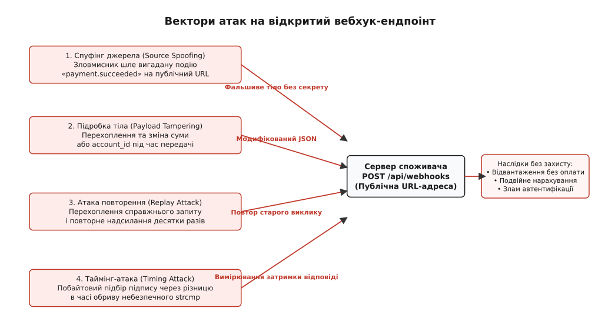
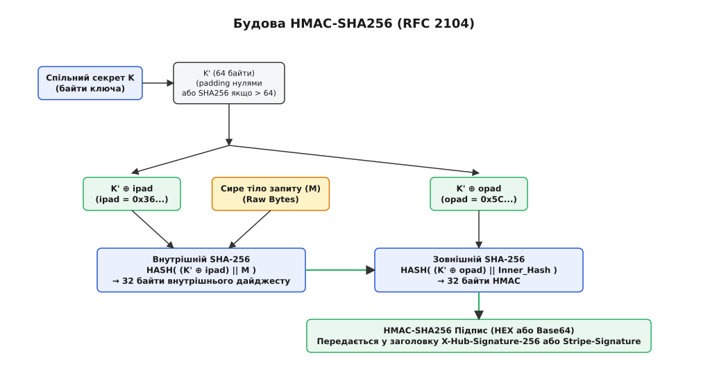
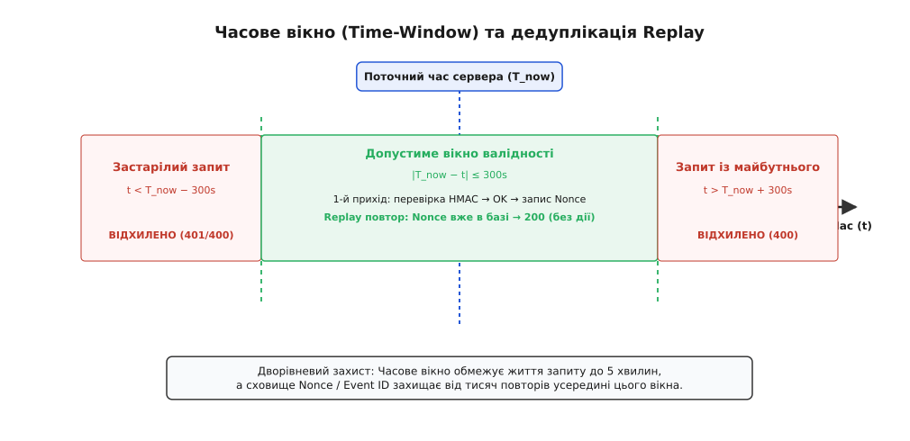
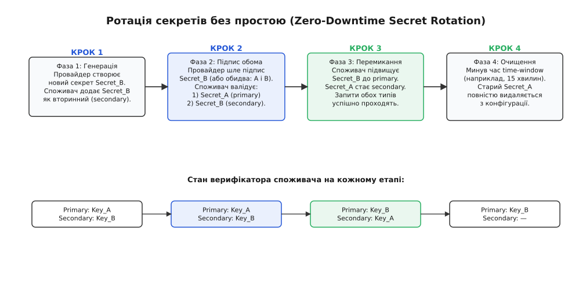

# Безпека вебхуків: HMAC-SHA256 підписи, replay attacks, time-window

<preknowlist>
- [Webhooks (бік СПОЖИВАЧА)](root:sf-web/webhooks) — вебхук як зворотний HTTP-виклик події; чому ендпоінт публічний і чому приймач має відповідати швидко.
- [Автентифікація](root:sf-security/authentication) — перевірка справжності джерела запиту та встановлення довіри.
- [Ідемпотентність методів як частина контракту](root:com-protocol/api-idempotency) — захист від подвійної обробки запиту з однаковим ідентифікатором.
- [REST](root:com-protocol/rest-api) — структура HTTP-запиту: заголовки, сире бінарне тіло, коди стану 200, 400, 401.
</preknowlist>

Сервер електронної комерції відкриває публічний маршрут `POST /api/webhooks/payments` для отримання сповіщень від платіжного шлюзу про успішні транзакції. Отримавши тіло `{"event": "payment.succeeded", "order_id": 48201, "amount": 150000}`, обробник оновлює запис у базі даних, переводить замовлення у стан «оплачено» та ініціює комплектацію товару на складі. Оскільки цей маршрут доступний з глобальної мережі, будь-який сторонній вузол може сформувати аналогічний HTTP-запит і надіслати його на ту саму адресу. Без криптографічної перевірки автентичності та цілісності сервер не здатний відрізнити справжній виклик платіжного шлюзу від підробленого пакета зловмисника, що призводить до безоплатного відвантаження товарів, спотворення фінансової звітності або вичерпання складських запасів.

Публічна природа вебхуків докорінно змінює модель безпеки веб-застосунку. У класичному клієнт-серверному виклику клієнт сам ініціює запит і перевіряє сертифікат TLS віддаленого сервера, якому довіряє. У моделі вебхуків сервер стає приймачем вхідних з'єднань від зовнішніх систем. Захищений транспорт TLS (HTTPS) шифрує трафік між вузлами та захищає його від пасивного прослуховування на магістральних маршрутизаторах, проте сам по собі HTTPS не дає відповіді на головне питання приймача: чи дійсно отриманий пакет згенерував довірений провайдер, чи його вміст не зазнав модифікацій посередниками, і чи не надсилається один і той самий легітимний пакет повторно.

Для побудови надійного приймача вебхуків інженер має нейтралізувати чотири самостійні класи загроз, кожен із яких експлуатує окрему слабкість протоколу HTTP та архітектури розподілених сповіщень.


*Чотири вектори загроз публічного вебхук-ендпоінта: фальсифікація джерела, модифікація даних, повтор легітимних запитів та побайтовий витік підпису через вимірювання часу.*

## Чотири вектори атак на відкритий ендпоінт

Перший вектор — **спуфінг джерела** (англ. source spoofing, від *spoof* — «підробляти, маскувати»). Зловмисник знаходить публічний URL обробника вебхуків через аналіз клієнтського JavaScript-коду, вичерпання назв маршрутів або витік документації. Не маючи легітимного доступу до платіжного провайдера, нападник генерує довільний JSON із подією успішного платежу та виконує `curl -X POST https://example.com/api/webhooks/payments`. Якщо обробник сліпо парсить тіло запиту й довіряє полям `amount` та `order_id`, зловмисник отримує безкоштовні послуги чи товари на будь-яку суму.

Другий вектор — **підробка тіла запиту** (англ. payload tampering). Якщо запит проходить через проміжні корпоративні проксі-сервери, балансувальники навантаження зі зняттям TLS (TLS termination) або скомпрометовані шлюзи, внутрішній чи зовнішній зловмисник (Man-in-the-Middle) може перехопити пакет і змінити його вміст. Наприклад, змінити ідентифікатор отримувача коштів `account_id` або зменшити суму повернення коштів `refund_amount`. Без контролю цілісності приймач обробить змінені дані як оригінальні.

Третій вектор — **атака повторного відтворення** (англ. replay attack). Нападник не вміє підробляти підпис і не знає секретного ключа, проте він перехоплює один цілком легітимний HTTP-запит, який платіжний провайдер надіслав на сервер (наприклад, поповнення балансу користувача на 1000 гривень). Зловмисник записує сирі байти заголовків і тіла цього запиту, після чого надсилає його копію на ендпоінт ще п'ятсот разів. Оскільки підпис у заголовку повністю відповідає тілу запиту, наївний валідатор підтверджує автентичність кожного виклику, а сервер зараховує кошти п'ятсот разів поспіль.

Четвертий вектор — **таймінг-атака на перевірку автентичності** (англ. timing attack). Коли сервер перевіряє отриманий криптографічний підпис, порівнюючи його з очікуваним еталоном через стандартні оператори порівняння рядків, операція завершується на першому незбіжному байті. Зловмисник вимірює наносекундні та мікросекундні коливання часу відповіді сервера і здатний байт за байтом підібрати правильний підпис для підробленого повідомлення, взагалі не знаючи секретного ключа.

Повний захист вебхуків досягається лише узгодженою комбінацією трьох криптографічних та алгоритмічних механізмів: симетричного підпису HMAC-SHA256, часового вікна валідності з дедуплікацією ідентифікаторів, а також алгоритму порівняння сталого часу.

## Криптографічна цілісність та автентифікація: HMAC-SHA256

Найпростіша наївна спроба захистити вебхук — домовитися з провайдером про статичний секретний пароль і передавати його у заголовку, наприклад `X-Webhook-Secret: my_secret_token_123`. Цей підхід хибний із двох причин. По-перше, статичний токен у заголовку ніяк не пов'язаний із тілом повідомлення: якщо проміжний вузол змінить вміст JSON-документа, токен усе одно залишиться правильним. По-друге, статичний токен є довгоживучим секретом, що передається у відкритому для інфраструктури вигляді при кожному запиті, що створює ризик витоку в логах балансувальників або проксі.

Потрібен механізм, який одночасно підтверджує особистість відправника і гарантує, що жоден біт тіла запиту не був змінений. У криптографії такий механізм називається кодом автентифікації повідомлень (англ. Message Authentication Code, MAC).

### Чому не можна просто хешувати ключ і повідомлення

Перша інтуїтивна ідея розробника, незнайомого з тонкощами криптографії, полягає у простому склеюванні спільного секретного ключа та тіла запиту з подальшим обчисленням звичайного дайджесту SHA-256:

```
підпис = SHA256(секретний_ключ || тіло_запиту)
```

Така конструкція є критично вразливою до **атаки подовження повідомлення** (англ. length extension attack). Більшість популярних геш-функцій сімейства SHA-1 та SHA-2 (зокрема SHA-256 та SHA-512) побудовані на основі структури Меркла — Дамґорда (Merkle–Damgård construction). У цій структурі вхідне повідомлення розбивається на блоки однакового фіксованого розміру (для SHA-256 це 64 байти, тобто 512 бітів), доповнюється спеціальним бінарним паддінгом (байт `0x80`, нульові байти та 64-бітне представлення початкової довжини), і кожен блок послідовно обробляється функцією стиснення, оновлюючи внутрішній вектор стану. Фінальний геш — це просто значення внутрішнього вектора стану після обробки останнього блоку.

Якщо зловмисник перехоплює повідомлення `M` і його геш `H = SHA256(K || M)`, він уже має точне значення внутрішніх регістрів стану геш-функції на момент завершення обчислення. Знаючи довжину вихідного масиву `K || M` (яку легко підібрати, бо довжина ключів зазвичай стандартна — 32 або 64 байти), нападник може сформувати правильний паддінг першого блоку, ініціалізувати стан нової геш-функції перехопленим значенням `H` і продовжити хешування, додавши власні байти `M_extra`.

У результаті зловмисник отримує повністю легітимний криптографічний геш для штучно сконструйованого повідомлення `K || M || padding || M_extra`, взагалі не маючи доступу до секретного ключа `K`! Якщо бекенд споживача допускає обробку додаткових полів або парсер розбирає останнє входження поля в JSON, зловмисник успішно нав'язує серверу підроблені дані.

### Конструкція HMAC за RFC 2104

Щоб повністю ліквідувати загрозу подовження повідомлення, 1996 року криптографи Міхір Белларе (Mihir Bellare), Ран Канетті (Ran Canetti) та Гуго Кравчик (Hugo Krawczyk) запропонували алгоритм HMAC (Keyed-Hash Message Authentication Code), стандартизований у RFC 2104.

HMAC використовує вкладену двохешову структуру, у якій криптографічний геш від повідомлення додатково обертається у зовнішній геш разом із трансформованим ключем. Формула HMAC визначається наступним чином:

```
HMAC(K, M) = H( (K' ⊕ opad) || H( (K' ⊕ ipad) || M ) )
```

Розберімо кожен компонент цієї формули покроково:

1. `H` — криптографічна геш-функція (у нашому випадку SHA-256 з розміром вихідного дайджесту 32 байти та розміром вхідного блоку 64 байти).
2. `K` — спільний симетричний секретний ключ довільної довжини.
3. `K'` — нормалізований ключ довжиною рівно 64 байти (один блок SHA-256). Якщо вихідний ключ `K` довший за 64 байти, його спочатку хешують `K' = H(K)` і доповнюють нульовими байтами праворуч до 64 байтів. Якщо `K` коротший або дорівнює 64 байтам, до нього просто дописують нульові байти до досягнення 64 байтів.
4. `ipad` (inner padding) — константний байтовий масив довжиною 64 байти, заповнений значенням `0x36` (у шістнадцятковому виді: `0x363636...36`).
5. `opad` (outer padding) — константний байтовий масив довжиною 64 байти, заповнений значенням `0x5C` (у шістнадцятковому виді: `0x5C5C5C...5C`).
6. `⊕` — побітова операція виключного «АБО» (XOR).
7. `||` — конкатенація (послідовне зчеплення) байтових масивів.


*Двоетапна конструкція HMAC-SHA256 з внутрішнім і зовнішнім паддінгом, що гарантує цілісність сирих байтів та унеможливлює атаку подовження повідомлення.*

Робота алгоритму розгортається у два ізольовані етапи:

На внутрішньому етапі нормалізований ключ `K'` побітово ксориться з константою `ipad`. До отриманих 64 байтів приєднується вихідне повідомлення `M` (сире тіло запиту). Від цього об'єднаного потоку обчислюється внутрішній геш `Inner_Hash = SHA256((K' ⊕ ipad) || M)`, який має фіксовану довжину 32 байти.

На зовнішньому етапі ключ `K'` ксориться з константою `opad`. До отриманих 64 байтів приєднується 32-байтний результат внутрішнього хешування `Inner_Hash`. Від цієї комбінації обчислюється фінальний геш `Outer_Hash = SHA256((K' ⊕ opad) || Inner_Hash)`.

Оскільки вхідними даними для зовнішнього хешування є фіксовані 32 байти внутрішнього дайджесту, прямий зв'язок між тілом повідомлення `M` та фінальним виходом розривається. Зловмисник не може застосувати атаку подовження повідомлення, оскільки будь-яка зміна `M` непередбачувано змінює `Inner_Hash`, а без знання `K' ⊕ opad` обчислити новий зовнішній геш математично неможливо.

Криптографічна стійкість HMAC не спирається на стійкість до колізій базової геш-функції. Навіть якщо для функції `H` знайдено теоретичні колізії (як це сталося з MD5 або SHA-1), HMAC на її основі зберігає стійкість проти підробки (модель непідробності під час атаки з адаптивним вибором повідомлень, EUF-CMA), оскільки зловмисник не контролює ні префікс, ні суфікс вхідних блоків.

### Наскрізний числовий розрахунок одного HMAC

Щоб зрозуміти кожен бітовий перехід, простежимо точний процес генерації підпису для конкретного запиту:

1. Нехай спільний секретний ключ — `whsec_k9` (довжина 8 байтів у ASCII: `0x77, 0x68, 0x73, 0x65, 0x63, 0x5f, 0x6b, 0x39`).
2. Оскільки 8 < 64, ключ доповнюється 56 нульовими байтами: `K' = [0x77, 0x68, ..., 0x39, 0x00, 0x00, ...]`.
3. Обчислюємо внутрішню маску `K' ⊕ ipad`: перший байт `0x77 ⊕ 0x36 = 0x41` (символ 'A'), другий байт `0x68 ⊕ 0x36 = 0x5E`, нульові хвости `0x00 ⊕ 0x36 = 0x36`. Отримуємо 64 байти.
4. Додаємо до цієї маски тіло повідомлення `{"paid":true}` і обчислюємо `SHA256` — на виході 32 бінарні байти `Inner_Hash`.
5. Обчислюємо зовнішню маску `K' ⊕ opad`: перший байт `0x77 ⊕ 0x5C = 0x2B`, нульові хвости `0x00 ⊕ 0x5C = 0x5C`. Отримуємо 64 байти.
6. Склеюємо 64 байти зовнішньої маски та 32 байти `Inner_Hash` (разом 96 байтів).
7. Обчислюємо фінальний `SHA256` від цих 96 байтів — отримуємо рівно 32 байти кінцевого дайджесту, які форматуються у 64 шістнадцяткові символи (HEX).

## Пастка розбору JSON: чому підпис рахують лише від сирих байтів

Найпоширеніша і водночас найнебезпечніша помилка під час реалізації верифікації HMAC у веб-фреймворках — спроба обчислити підпис від об'єкта після розбору або після його повторної серіалізації.

Розглянемо типовий сценарій: веб-сервер на Express або FastAPI автоматично розбирає вхідний HTTP-запит у JSON-об'єкт `body`. Розробник пише middleware перевірки, де бере цей об'єкт і перетворює його назад на рядок: `JSON.stringify(req.body)` або `json.dumps(body)`. Після цього обчислюється HMAC.

У більшості випадків такий підпис **не збігається**, або, що ще гірше, збігається локально на штучних тестах і раптово ламається у продакшені на випадкових запитах. Причини полягають у фундаментальних властивостях формату JSON:

1. **Порядок ключів у словниках.** Стандарт JSON (RFC 8259) стверджує, що об'єкт — це невпорядкована колекція пар ключ-значення. Провайдер міг згенерувати рядок `{"amount": 100, "currency": "UAH"}`, а середовище виконання споживача після `JSON.parse` та `JSON.stringify` збереже ключі в іншому порядку: `{"currency": "UAH", "amount": 100}`. Значення полів ідентичні, але байти відрізняються — HMAC повертає повністю інший дайджест.
2. **Пробільні символи та переноси рядків.** Провайдер міг надіслати мініфікований JSON без пробілів, або з пробілами після двокрапок `{"a": 1}`, або з символами нового рядка `\n` чи `\r\n`. Будь-який серіалізатор форматує відступи за власними правилами.
3. **Екранування спецсимволів та Unicode.** Символ слешу `/` може передаватися як `/` або як `\/`. Символ амперсанда `&` може бути записаний буквально або як `\u0026`. Кириличні літери можуть бути закодовані як UTF-8 байти (`\xd0\xbf...`) або як escape-послідовності `\u043f...`.
4. **Числа з плаваючою комою.** Число `1.0` у різних рушіях JSON може серіалізуватися як `1.0`, `1.` або `1`.

Криптографічний геш чутливий до зміни навіть одного біта. Тому **залізне правило безпеки вебхуків**:

> Підпис HMAC обчислюється виключно від **сирого бінарного буфера** (raw bytes), отриманого безпосередньо з сокета HTTP-запиту, до будь-якої спроби декодування UTF-8 чи парсингу JSON.

У середовищі Node.js для цього використовують `express.raw({ type: 'application/json' })`, у Python/FastAPI читають `await request.body()`, у Go читають сирі байти через `io.ReadAll(r.Body)`, зберігаючи їх у незмінному вигляді.

### Захист від виснаження пам'яті (Payload Buffer Exhaustion)

Оскільки для обчислення HMAC сервер змушений накопичувати повний бінарний буфер тіла запиту в оперативній пам'яті до початку його перевірки, виникає специфічний вектор відмови в обслуговуванні (DoS).

Якщо зловмисник надсилає `POST /api/webhooks` із заголовком `Content-Length: 1073741824` (1 Гігабайт) і починає повільно передавати випадкові байти, наївний сервер виділить гігабайт оперативної пам'яті під цей неперевірений буфер. Кілька десятків паралельних з'єднань призведуть до аварійної зупинки процесу через Out-Of-Memory (OOM-killer).

Правильна архітектура обмежує максимальний розмір тіла вебхука на рівні зворотного проксі (Nginx/Cloudflare) або першого рядка middleware (наприклад, не більше 1 МБ або 2 МБ):
- Nginx: `client_max_body_size 1m;`
- Express: `express.raw({ type: 'application/json', limit: '1mb' })`
- Go: `http.MaxBytesReader(w, r.Body, 1<<20)`

Усі запити, розмір яких перевищує встановлений ліміт, обриваються негайно з кодом `413 Payload Too Large`, не витрачаючи пам'ять на накопичення байтів для HMAC.

## Захист від Replay-атак: Time-Window та дедуплікація

Навіть якщо HMAC-підпис захищає тіло запиту від підробки, він сам по собі беззахисний проти атак повторного відтворення (Replay Attacks). Якщо зловмисник перехопить валідний HTTP-пакет із коректним підписом у заголовку, він може повторно викликати той самий URL тисячі разів. Оскільки тіло запиту та секретний ключ не змінилися, HMAC-підпис залишається абсолютно валідним при кожному повторі.

Для повної ліквідації повторів застосовують дворівневу систему: **часове вікно валідності** (Time-Window) та **сховище унікальних ідентифікаторів** (Nonce / Event ID Deduplication).


*Комбінація перевірки часового вікна (5 хвилин) та дедуплікації Nonce/Event ID: застарілі запити відсікаються без звернення до сховища, а дублікати у межах вікна гасяться без повторного ефекту.*

### Часове вікно валідності (Time-Window)

Щоб обмежити термін життя перехопленого повідомлення, провайдер додає до заголовка вебхука поточну мітку часу у форматі Unix Timestamp (кількість секунд з 1 січня 1970 року), наприклад `t=1719580800`.

Проте просто передати час у заголовку недостатньо — зловмисник міг би перехопити запит, оновити значення `t` на свіже і надіслати знову. Тому **провайдер зобов'язаний включити мітку часу в підписані дані HMAC**.

Загальноприйнятий індустріальний стандарт (який використовують Stripe, GitHub, Slack та Svix) формує вхідний рядок для HMAC шляхом конкатенації мітки часу, роздільника-крапки та сирого тіла запиту:

```
підписуваний_масив = timestamp || "." || raw_body_bytes
підпис = HMAC_SHA256(секретний_ключ, підписуваний_масив)
```

Заголовок вебхука при цьому містить як мітку часу, так і підпис:
```http
Stripe-Signature: t=1719580800,v1=5257a869e7ecebeda32affa62cdca3fa51cad7e77a0e56ff536d0ce8e108d8bd
```

Отримавши такий запит, приймач споживача виконує наступну перевірку часу:

1. Витягує значення `t` із заголовка. Якщо значення не є валідним цілим числом — запит відхиляється.
2. Отримує поточний час сервера `now = current_time()`.
3. Обчислює різницю `delta = now - t`.
4. Перевіряє потрапляння у допустимий часовий інтервал `tolerance` (типово 300 секунд, тобто 5 хвилин):

```
Якщо (now - t) > 300  →  ВІДХИЛИТИ (запит застарів, можливий Replay)
Якщо (t - now) > 300  →  ВІДХИЛИТИ (запит із майбутнього, розсинхронізація годинників NTP)
```

Допуск у 5 хвилин необхідний для компенсації можливого мережевого запізнення доставки пакетів та незначної розсинхронізації годинників між серверами провайдера і споживача.

### Дедуплікація за Nonce та Event ID

Часове вікно обмежує тривалість атаки п'ятьма хвилинами, але не усуває її повністю: упродовж цих 300 секунд високопродуктивний скрипт нападника може повторити перехоплений запит десятки тисяч разів.

Для остаточного блокування повторів кожен вебхук повинен містити унікальний одноразовий ідентифікатор (англ. nonce — *number used once* або `event_id`, наприклад `evt_3MtwfyLkdIwHu7ix28a3tqPa`). Оскільки цей ідентифікатор розміщений у тілі JSON або у підписаному заголовку, змінити його без порушення HMAC неможливо.

Сервер-споживач організовує перевірку ідемпотентності:

1. Споживач перевіряє HMAC-підпис від `t . raw_body`.
2. Споживач перевіряє часове вікно `|now - t| <= 300`.
3. Споживач намагається атомарно зафіксувати `event_id` у швидкому сховищі ключ-значення (наприклад, Redis) за допомогою команди з тайм-аутом життя:
   ```redis
   SET webhook:seen:evt_3MtwfyLkdIwHu7ix28a3tqPa "1" NX EX 600
   ```
   Опція `NX` гарантує, що запис створиться лише тоді, коли такого ключа ще немає. Опція `EX 600` встановлює час життя ключа 10 хвилин (удвічі більше за часове вікно валідності в 5 хвилин).
4. Якщо Redis повертає успіх (`OK`), подія нова — сервер передає її у фонову чергу обробки та повертає `200 OK`.
5. Якщо Redis повертає `nil` (ключ уже існує), це повторний виклик (Replay або штатна повторна доставка провайдера). Споживач **не виконує бізнес-логіку повторно**, а негайно повертає `200 OK`, гасячи дублікат.

Завдяки комбінації з часовим вікном, сховищу Redis не потрібно зберігати мільйони ключів за всі роки: будь-який запит, старіший за 5 хвилин, відсікається першим вартовим за міткою часу ще до запиту в пам'ять.

## Безпечне порівняння: Constant-Time Comparison

Після того як споживач зібрав підписуваний рядок і обчислив очікуваний HMAC-підпис `expected_signature`, йому залишається порівняти його з підписом `received_signature`, отриманим від клієнта.

Більшість розробників інстинктивно використовують стандартні оператори порівняння рядків:

:::tabs
```c
/* КРИТИЧНА ВРАЗЛИВІСТЬ: strcmp обривається на першому неспівпалому байті */
if (strcmp(received_signature, expected_signature) == 0) {
    /* обробка */
}
```
```cpp
// КРИТИЧНА ВРАЗЛИВІСТЬ: оператор == для std::string виконує достроковий вихід
if (received_signature == expected_signature) {
    // обробка
}
```
:::

Ці оператори оптимізовані для максимальної швидкодії: вони порівнюють байти зліва направо і здійснюють **достроковий вихід** (early exit) у момент виявлення першого незбіжного символу.

### Механізм таймінг-атаки

Припустимо, що справжній HMAC-підпис дорівнює `f7a2b9...` (довжина 64 hex-символи).

1. Зловмисник надсилає підпис, що починається на `000000...`. Порівняння падає на 0-му символі (`0` != `f`). Процесор виконує 1 ітерацію циклу, відповідь повертається за 10.000 мкс.
2. Зловмисник перебирає перший символ від `0` до `f`. Коли він надсилає `f00000...`, перший символ збігається (`f` == `f`), і порівняння падає лише на 1-му символі (`0` != `7`). Процесор виконує 2 ітерації циклу, відповідь повертається за 10.015 мкс.
3. Хоча різниця у 15 наносекунд маскується шумом комп'ютерної мережі, нападник надсилає сотні однакових запитів для кожного варіанта символу й усереднює результати статистично. Варіант `f` показує стійке математичне відхилення затримки.
4. Зафіксувавши перший символ `f`, зловмисник переходить до підбору другого символу: `f0...`, `f1...` тощо.

Повторивши операцію 64 рази по 16 спроб (загалом близько 1000 запитів), зловмисник повністю відновлює валідний HMAC-підпис для будь-якого підробленого тіла запиту, зламавши автентифікацію системи.

### Алгоритм порівняння сталого часу

Щоб унеможливити витік інформації через час виконання, порівняння криптографічних підписів повинно тривати **однаковий проміжок часу незалежно від того, скільки байтів збіглося**.

Базовий алгоритм сталого часу не перериває цикл, а побітово акумулює відмінності за допомогою операції XOR:

:::tabs
```c
int constant_time_compare(const unsigned char *a, const unsigned char *b, size_t len) {
    unsigned char result = 0;
    for (size_t i = 0; i < len; i++) {
        result |= (a[i] ^ b[i]);
    }
    return result == 0;
}
```
:::code webhook-security-d/cpp/alhorytm-porivniannia.cpp
:::

Якщо байти `a[i]` та `b[i]` однакові, `a[i] ^ b[i]` дорівнює нулю. Якщо хоча б в одній позиції байти відрізняються, результат XOR матиме одиничні біти, які через оператор `|=` зафіксуються у змінній `result`. Цикл гарантовано виконує рівно `len` кроків. Директива `volatile` у C++ запобігає небезпечним оптимізаціям компілятора, який міг би спробувати згорнути цикл у векторну інструкцію з раннім обривом.

Сучасні платформи надають готові криптографічні примітиви для порівняння сталого часу:
- Node.js: `crypto.timingSafeEqual(Buffer.from(sigA), Buffer.from(sigB))` (вимагає строго однакової довжини буферів `byteLength`).
- Python: `hmac.compare_digest(sig_a, sig_b)` (підтримує рядки ASCII та байти).
- C / OpenSSL: `CRYPTO_memcmp(sig_a, sig_b, len)` (криптографічний примітив OpenSSL, захищений від витоків часу).
- C++: `CRYPTO_memcmp` або `std::span` з константним акумулятором.

## Порівняння галузевих протоколів: Stripe, GitHub, Svix

У сучасній веб-розробці склалося кілька усталених форматів передачі підписів та метаданих вебхуків:

1. **Модель GitHub (`X-Hub-Signature-256`):**
   Провайдер підписує виключно сире тіло запиту:
   ```http
   X-Hub-Signature-256: sha256=d57c6889f14734f066d30049ae1e82e30f449401b4...
   ```
   *Переваги:* Гранична простота інтеграції.
   *Недоліки:* Відсутня мітка часу в підписуваному рядку. Захист від Replay перекладається виключно на аналіз `X-GitHub-Delivery` (UUID події) у сховищі споживача з необмеженим строком зберігання.

2. **Модель Stripe (`Stripe-Signature`):**
   Провайдер передає структурований заголовок із міткою часу та версією схеми підпису:
   ```http
   Stripe-Signature: t=1719580800,v1=5257a869e7ec...,v0=legacy_sig...
   ```
   *Переваги:* Підписується рядок `t . raw_body`, що гарантує цілісність мітки часу та підтримує часове вікно. Дозволяє передавати кілька підписів `v1` під час ротації секретів.

3. **Стандарт Standard Webhooks (Svix / W3C Draft):**
   Сучасна спроба уніфікації заголовків вебхуків у відкритий стандарт:
   - `webhook-id`: Унікальний Nonce події (`msg_2D8z...`).
   - `webhook-timestamp`: Unix-мітка часу в секундах (`1719580800`).
   - `webhook-signature`: Підпис у форматі `v1,<base64_signature>`.
   Підписуваний рядок складається як `${webhook-id}.${webhook-timestamp}.${raw_body}`, а підпис кодується у Base64 замість Hex, що скорочує розмір заголовка на 25%. Крім симетричного HMAC-SHA256, стандарт підтримує асиметричні підписи на еліптичних кривих Ed25519.

### Симетричний HMAC проти асиметричного Ed25519

Вибір між симетричним (HMAC-SHA256) та асиметричним (Ed25519 / RSA) підписом визначається архітектурою платформи:

- **HMAC-SHA256 (Симетричний):** Один спільний секретний ключ у провайдера і споживача. Обчислення займає частки мікросекунди. Проте якщо сервер споживача скомпрометовано, зловмисник викрадає секрет і може самостійно підписувати фальшиві вебхуки для цього конкретного акаунта.
- **Ed25519 (Асиметричний):** Провайдер підписує подію своїм приватним ключем, а всі тисячі споживачів перевіряють підпис публічним ключем провайдера (який можна вільно публікувати у відкритій документації або роздавати через JWKS). Споживач фізично не здатний згенерувати підпис, навіть якщо його сервер зламано. Проте перевірка асиметричного підпису потребує приблизно у 10–20 разів більше тактів процесора, ніж HMAC.

Для більшості прикладних сервісів HMAC-SHA256 залишається золотим стандартом завдяки ідеальному балансу максимальної швидкодії та простоти налаштування.

## Ротація секретів без простою (Zero-Downtime Secret Rotation)

Періодична ротація криптографічних секретів — обов'язкова вимога безпеки (відповідно до стандартів PCI-DSS та ISO 27001) та екстрений захід у разі підозри на витік ключа.

Проте якщо в конфігурації сервера просто замінити старий секрет `Key_Old` на новий `Key_New`, система неминуче зазнає простою та втрати подій:
1. Запити, відправлені провайдером за мілісекунду до ротації (in-flight requests), підписані `Key_Old`. Приймач, що вже оновився до `Key_New`, відхилить їх із помилкою 401.
2. Якщо інфраструктура споживача розгорнута на декількох серверах (rolling update), під час розгортання частина вузлів валідуватиме за старим ключем, а частина — за новим.

Для забезпечення абсолютної безперервності роботи (Zero-Downtime) верифікатор повинен підтримувати **схему з двома активними секретами** (Primary та Secondary).


*Чотирифазний життєвий цикл ротації секретів із підтримкою двох активних ключів, що усуває простої та відхилення транзитних запитів.*

Процес ротації розбивається на чотири послідовні фази:

### Фаза 1: Додавання вторинного ключа
Адміністратор або автоматизований секрет-менеджер генерує новий секрет `Secret_B`. У конфігурацію споживача додається `Secret_B` як **вторинний секрет** (Secondary Secret). Основний секрет залишається `Secret_A`.
На цьому етапі верифікатор споживача перевіряє підпис спочатку ключем `Secret_A`; якщо перевірка не пройшла, пробує ключ `Secret_B`.

### Фаза 2: Перемикання підпису на боці провайдера
У кабінеті провайдера активується новий секрет `Secret_B`. Сучасні провайдери (наприклад, Stripe) у перехідний період можуть надсилати у заголовку одразу два підписи через кому (`v1=sig_with_A, v1=sig_with_B`). Навіть якщо надсилається лише один підпис (новий `Secret_B`), споживач успішно підтвердить його завдяки наявності `Secret_B` у списку дозволених ключів.

### Фаза 3: Підвищення пріоритету нового ключа
У конфігурації споживача `Secret_B` призначається основним (Primary Secret), а `Secret_A` переводиться у статус вторинного (Secondary Secret). Тепер 99% запитів перевіряються з першої спроби за `Secret_B`, що заощаджує ресурси процесора на обчислення другого HMAC.

### Фаза 4: Видалення застарілого ключа
Після завершення максимального інтервалу часового вікна та черги повторів (наприклад, через 24 години) старий `Secret_A` повністю видаляється з конфігурації споживача та анулюється у провайдера. Жоден вебхук не втрачено.

> 🔧 **Навіщо це.** Вебхуки — це кровоносна система інтеграції сучасного бекенду з зовнішнім світом. Приймач без HMAC-підпису — це відкрита брама для фальсифікації балансів та замовлень. Приймач без контролю мітки часу та дедуплікації Nonce — це прямі фінансові збитки від Replay-атак на повторне зарахування коштів. Приймач зі звичайним `===` замість `timingSafeEqual` відкриває можливість побайтового зламу підпису через затримки мережі. Нарешті, відсутність підтримки двох активних секретів перетворює планову ротацію ключів на аварійну зупинку платіжного шлюзу з падінням транзакцій.

## Практична реалізація повного захищеного приймача

Об'єднаємо всі розглянуті рівні безпеки — роботу з сирими байтами, підпис конкатенації `timestamp . body`, перевірку 5-хвилинного часового вікна, дедуплікацію через Redis, порівняння сталого часу та підтримку ротації секретів — у повноцінний виробничий модуль.

Нижче наведено еталонну реалізацію на чотирьох популярних серверних мовах програмування.

:::tabs
:::code webhook-security-d/ts/index.ts
:::code webhook-security-d/py/main.py
:::code webhook-security-d/c/main.c
:::code webhook-security-d/cpp/praktychna-realizatsiia.cpp
:::
