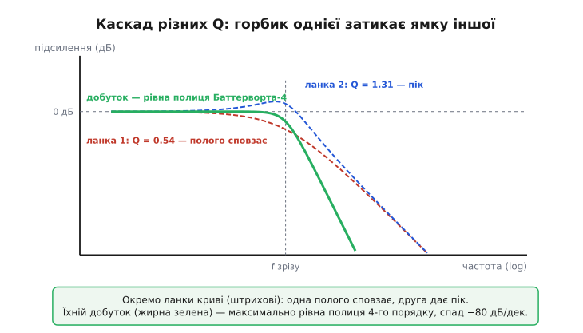

# ⚙️ Порахувати фільтр Саллена–Кі: від типу й частоти до номіналів у руці

Задача звучить буденно, але саме на ній спотикаються: «треба ФНЧ другого порядку, зріз 1 кГц, рівна полиця — які брати конденсатори?» Формули для [фільтра Саллена–Кі](root:hw-analog/active-filters) прості, та між ними й паяльником лежить смуга роботи, де гинуть розрахунки. Точного конденсатора на 14.47 нФ у природі немає — є [стандартний ряд номіналів](root:hw-components/e-series), і доведеться округлити. Округлили — і f₀ та Q **поїхали**, причому по-різному, бо залежать від ємностей не однаково. Потрібен четвертий порядок — і виявляється, що дві ланки роблять **не однаковими**, кожній свій Q із таблиці. А ще десь поряд чатують межі самого операційного підсилювача, які тиха арифметика не бачить узагалі.

Зберемо все це в один невеликий, але чесний шматок прошивки на C. Він візьме бажану частоту й тип фільтра, видасть номінали з реального ряду, чесно скаже, що з f₀ і Q вийшло **після** округлення, складе дві ланки в фільтр четвертого порядку й намалює форму характеристики числами — щоб переконатися, що вона саме така, як замовляли. Жодних бібліотек: тільки `math.h`, бо такий код має крутитися й на мікроконтролері, який сам собі добирає фільтр під різні режими роботи.

> 🔧 **Навіщо це.** Це не навчальна вправа на формули — це те, що реально економить вечір біля макетної плати. Замість того щоб уручну перебирати номінали, дивитися в калькулятор, перевіряти, чи не виліз Q за межу й чи тримається зріз там, де треба, — ви запускаєте функцію, дивитеся на стовпчик чисел і відразу бачите: оці стандартні конденсатори дають f₀ десь під тисячу герців, а Q трохи мимо цілі — тобто полиця ледь горбатиться чи провисає на частку децибела, і це прийнятно. А ще той самий код кладеться у прошивку приладу, що мусить перебудовувати вхідний фільтр під різну смугу сигналу: розрахунок — не разова дія за столом, а функція, яку викликають у польоті.

## Що саме рахуємо: дві формули й одна несиметрія

Уся арифметика тримається на двох виразах для ланки Саллена–Кі з **рівними резисторами** R1 = R2 = R (це найзручніший вибір — на складі один номінал резистора, а всю роботу роблять конденсатори):

```
f₀ = 1 / (2 · π · R · √(C1 · C2))      ← частота зрізу
Q  = ½ · √(C1 / C2)                     ← добротність
```

Ці дві формули — наша точка опору, але між ними сидить підступна несиметрія, через яку прямий розрахунок «у лоб» не працює. Дивіться: f₀ залежить від **добутку** C1·C2 (через корінь), а Q — від їхнього **відношення** C1/C2. Це означає, що задати ми хочемо f₀ і Q, а покрутити можемо C1 і C2 — і зв'язок між парами не лінійний, його треба обернути. Обернення, на щастя, виходить чисте. Якщо ввести **геометричне середнє** ємностей Cg = √(C1·C2) і **відношення** k = C1/C2, то з формул прямо:

```
Cg = 1 / (2 · π · R · f₀)              ← з рівняння для f₀
k  = (2 · Q)²                          ← з рівняння для Q

C2 = Cg / √k = Cg / (2·Q)             ← розкручуємо назад
C1 = Cg · √k = Cg · (2·Q)
```

Перевіримо логіку на крайньому випадку, щоб переконатися, що обернення правильне. Хай Q = 0.5 (та сама млява пара, що й [два пасивні RC підряд](root:hw-analog/rc-low-pass)). Тоді k = (2·0.5)² = 1, тобто C1 = C2 — обидва конденсатори однакові, відношення одиничне, як і має бути для найнижчого Q. А для Баттерворта Q = 0.707: k = (2·0.707)² = 2, тобто C1 рівно вдвічі більший за C2. Сходиться з тим, що дає теорія. Обернення працює — кодуймо.

> 🔧 **Навіщо це.** Ця несиметрія — корінь усіх подальших пасток. Бо коли ми округлимо C1 і C2 до сусідніх стандартних значень, їхній **добуток** зміниться одним відсотком, а **відношення** — зовсім іншим. Тому після округлення f₀ зміститься трохи, а Q — помітніше: вони «чутливі» до округлення по-різному. Хто це бачить, той округлює з розумом; хто ні — дивується, чому виміряна полиця провисла, хоч «усе пораховано».

## Крок перший: підбір ємностей під задані f₀ і Q

Перша функція робить рівно те, що ми щойно вивели: бере R, f₀, Q — повертає ідеальні (ще не округлені) C1 і C2. Це фундамент, на якому стоїть усе інше.

:::tabs
:::code proj-filter-design/c/krok-pershyi-pidbir.c
:::code proj-filter-design/py/krok-pershyi-pidbir.py
:::

**Підбір під Баттерворт 1 кГц.** Хочемо ФНЧ другого порядку, зріз 1000 Гц, Q = 0.70710678. Беремо ходовий резистор R = 11 кОм. Що видасть `sk_pick_caps`?

```
Cg     = 1 / (2 · π · 11000 · 1000)  = 1.4469e-8 Ф   (геом. середнє)
two_q  = 2 · 0.70710678              = 1.41421356
C1     = 1.4469e-8 · 1.41421356      = 2.0462e-8 Ф ≈ 20.5 нФ
C2     = 1.4469e-8 / 1.41421356      = 1.0231e-8 Ф ≈ 10.2 нФ
```

Виходить C1 ≈ 20.5 нФ, C2 ≈ 10.2 нФ — відношення рівно 2, як і мусить бути. Краса в тому, що жодного з цих значень **немає** у стандартному ряді: найближчі — 22 нФ і 10 нФ. І ось тут починається справжня робота.

## Крок другий: округлення до ряду E12 і чесні f₀, Q після нього

Конденсатори продають не будь-якими, а кількома десятками «круглих» значень на декаду — це [ряди переважних чисел](root:hw-components/e-series). Найходовіший для дешевих керамічних — **E12**: дванадцять значень на декаду з кроком приблизно ×1.21, кожне з допуском ±10 %. У межах однієї декади це 10, 12, 15, 18, 22, 27, 33, 39, 47, 56, 68, 82 — і далі множенням на 10. Будь-яке потрібне число доводиться **притягувати** до найближчого з цього списку.

Округлення — не косметика, а зміна схеми. Притягнули C1 з 20.5 до 22 нФ, C2 з 10.2 до 10 нФ — і це вже **інший фільтр**: інший добуток ємностей (зсунув f₀), інше відношення (зсунув Q). Чесна функція мусить не просто округлити, а **перерахувати назад**, яка f₀ і яка Q вийшли з реальних номіналів — за тими ж двома формулами, тільки тепер у прямий бік. Інакше ви проєктуєте наосліп.

:::tabs
:::code proj-filter-design/c/krok-druhyi-okruhlennia-do.c
:::code proj-filter-design/py/krok-druhyi-okruhlennia-do.py
:::

Чому округлюємо в **логарифмічному** масштабі (за відношенням `log10(m/E12[i])`), а не за простою різницею? Бо ряд E12 сам логарифмічний — його значення рівновіддалені не на шкалі чисел, а на шкалі множників, як [децибели](root:hw-analog/decibels). Між 1.0 і 1.2 проміжок 0.2; між 6.8 і 8.2 — аж 1.4. Якби округлювали за різницею, число 7.5 «упало» б до 6.8 (різниця 0.7) замість правильного 8.2 (різниця 0.7 теж, але за **множником** 8.2 ближче: 8.2/7.5 = 1.09 проти 7.5/6.8 = 1.10). На більшості значень обидва способи збігаються, але на краях декади лог-округлення чесніше відбиває, який номінал справді найближчий за допуском.

**Що вийшло для Баттерворта 1 кГц.** Проганяємо `sk_design` з бажаними f₀ = 1000, Q = 0.707, R = 11 кОм:

```
ідеал:    C1 = 20.46 нФ,  C2 = 10.23 нФ
округлено: C1 = 22 нФ,    C2 = 10 нФ        ← з ряду E12
                                            ↓ перерахунок назад
фактичні:  f0 = 1 / (2·π·11000·√(22e-9·10e-9)) = 975.5 Гц
           Q  = ½·√(22/10) = ½·√2.2 = 0.7416
```

Ось вона, плата за реальні деталі. Замовляли f₀ = 1000 Гц, Q = 0.707 — отримали f₀ = 976 Гц (нижче на 2.4 %) і Q = 0.742 (вище на 5 %). Частота зсунулася мало, добротність — помітніше: **рівно та несиметрія**, про яку ми попереджали. Q = 0.742 замість 0.707 означає, що замість ідеально рівної полиці буде ледь помітний горбик перед зрізом, частку децибела заввишки. Для більшості застосувань це дрібниця. Але тепер ви це **бачите** числом, а не виявляєте осцилографом постфактум.

> 🔧 **Навіщо це.** Хочете точніше — є дві ручки. Перша: підправити R (його ряд E24 густіший, та й послідовно-паралельно резистори комбінуються легше за конденсатори) так, щоб витягнути f₀ назад до 1000 Гц при вже округлених C. Друга: перебрати кілька пар сусідніх номіналів C1/C2 і вибрати ту, де Q найближча до цілі. Обидва прийоми — надбудова над цією ж функцією: вона дає чесну відправну точку, від якої вже доводиш до пуття.

## Крок третій: вибір типу фільтра — Баттерворт, Чебишев, Бессель

Поки що ми брали Q = 0.707 як магічне число. Звідки воно й що ставити, коли фільтр не другого порядку? Тут на сцену виходить **тип** фільтра — характер його поведінки, заданий набором добротностей. Це не вільний вибір номіналів, а готові таблиці, виведені математиками для трьох класичних компромісів:

- **Баттерворт** (англ. *Butterworth*, за іменем британського інженера Стівена Баттерворта, що описав цей клас 1930 року) — **максимально рівна** полиця: жодних брижів у смузі пропускання, зріз помірно гострий. Універсальний вибір, коли просто треба «рівно до зрізу й далі вниз».
- **Чебишев** (за іменем математика Пафнутія Чебишова; усталене написання в електроніці — *Chebyshev*) — **найгостріше коліно** ціною **брижів** у смузі пропускання. Жертвуємо рівністю полиці заради крутішого спаду зразу за зрізом. Чим більші бриж (0.5 дБ, 1 дБ, 3 дБ), тим гостріше коліно.
- **Бессель** (за іменем математика Фрідріха Бесселя; англ. *Bessel*) — **рівний [груповий час затримки](root:hw-analog/filter-group-delay)**: усі частоти проходять із майже однаковою затримкою, тож **форма імпульсу не спотворюється**. Зріз найпологіший із трьох, зате прямокутний імпульс на виході лишається прямокутним, без дзвону. Вибір для трактів, де важлива форма сигналу в часі, а не лише його спектр.

Кожен тип для фільтра заданого порядку задає **конкретні Q** (і для вищих порядків — ще й невеликі зсуви частоти кожної ланки). Інженер не виводить їх щоразу — бере з таблиці. Покладемо найходовіші у код як готові набори:

:::tabs
:::code proj-filter-design/c/krok-tretii-vybir-typu.c
:::code proj-filter-design/py/krok-tretii-vybir-typu.py
:::

Два числа в кожному рецепті варто розчитати, бо в них уся премудрість каскаду. `Q` — добротність цієї ланки. `fmul` — множник, на який її власну частоту зрізу зсувають **відносно** загальної частоти зрізу фільтра fc. У Баттерворта обидві ланки сидять на тій самій fc (fmul = 1), а Q різні: 0.541 і 1.307. У Бесселя й Чебишева зсунуті **обидва** параметри — і Q, і частота кожної ланки. Саме тому каскад **не можна** робити з двох однакових ланок: правильна форма народжується лише з правильного **поєднання** різних ланок. Числа взято зі стандартних таблиць проєктування активних фільтрів (зведення Texas Instruments, *Op Amps for Everyone*, розділ про фільтри; ті ж значення повторюють довідники Analog Devices та інші — це усталений канон, не чиясь приватна таблиця). Одна чесна заувага про точність: добротності тут — стабільні, а **множники частоти** для Бесселя й Чебишева трохи різняться від джерела до джерела, бо «частоту зрізу» fc нормують по-різному (за точкою −3 дБ, за краєм смуги брижів чи за затримкою). Тому fmul беріть із тієї ж таблиці, що й Q, а не змішуйте джерела. Для Баттерворта питання не стоїть: обидві ланки на тій самій fc, fmul = 1 беззастережно — саме тому його взято за робочий приклад.

> Чому каскад однакових ланок провисає, звідки беруться саме ці Q для кожного типу й порядку, як полюси фільтра лягають на коло й задають добротності — у статті [Q полюсів фільтра](root:hw-analog/filter-pole-q). Тут таблиці беремо готовими: тип фільтра → набір (fmul, Q) на кожну ланку.

## Крок четвертий: каскад двох ланок у фільтр 4-го порядку

Тепер головна збірна функція: бере тип фільтра й бажану частоту зрізу fc — повертає **готові ланки**, кожну з власними стандартними конденсаторами й фактичними f₀, Q. Усередині вона просто проганяє кожен рецепт через `sk_design`, помноживши частоту на `fmul` ланки.

:::tabs
:::code proj-filter-design/c/krok-chetvertyi-kaskad.c
:::code proj-filter-design/py/krok-chetvertyi-kaskad.py
:::

**Збираємо Баттерворт 4-го порядку на 1 кГц.** Викликаємо `sk_design_filter(&FT_BW4, 1000, 22000, st)` (резистор тут узяли 22 кОм, щоб конденсатори лягли в зручні десятки нанофарад):

```
Фільтр: Баттерворт-4, зріз 1000 Гц
  ланка 1:  бажано Q=0.541, f=1000 Гц
            ідеал C1=7.83 нФ,  C2=6.68 нФ  →  E12: C1=8.2 нФ,  C2=6.8 нФ
            фактичні:  f0 = 1/(2·π·22000·√(8.2e-9·6.8e-9)) = 969 Гц
                       Q  = ½·√(8.2/6.8) = 0.549
  ланка 2:  бажано Q=1.307, f=1000 Гц
            ідеал C1=18.9 нФ,  C2=2.77 нФ  →  E12: C1=18 нФ,  C2=2.7 нФ
            фактичні:  f0 = 1/(2·π·22000·√(18e-9·2.7e-9)) = 1037 Гц
                       Q  = ½·√(18/2.7) = 1.291
```

Прочитаймо результат. Перша ланка — низькодобротна (Q ≈ 0.55), друга — високодобротна (Q ≈ 1.29). Окремо друга ланка з Q = 1.3 дала б помітний пік перед зрізом; окремо перша — пологе сповзання. А **разом**, перемноживши свої характеристики, вони складаються в ідеально рівну полицю Баттерворта з удвічі крутішим спадом, ніж в однієї ланки. У цьому вся суть каскаду: горбик однієї затикає ямку іншої. І зверніть увагу на **порядок** — низький Q першим, високий другим: це не випадковість, а правило, до якого ми зараз дійдемо.


*Окремо ланка з Q = 0.54 пологенько сповзає (червона), ланка з Q = 1.31 дає пік перед зрізом (синя). Їхній добуток (зелена, жирна) — максимально рівна полиця Баттерворта 4-го порядку зі спадом −80 дБ/декаду. Горбик другої ланки рівно компенсує раннє провисання першої — ось чому каскад роблять із різних Q, а не з двох однакових.*

## Крок п'ятий: перевірити форму — функція |H(f)| у децибелах

Номінали є, фактичні f₀ і Q пораховані — але як **переконатися**, що сумарна характеристика та, що замовляли, а не щось перекошене округленням? Намалювати її числами. Магнітуда одної ланки другого порядку (ФНЧ) на частоті f задається з її f₀ і Q так:

```
        |H(f)| = 1 / √( (1 − r²)² + (r/Q)² ),  де r = f / f₀
```

Тут r — частота в одиницях частоти зрізу ланки. На дуже низьких f (r → 0) корінь дає 1 — сигнал проходить цілим. Біля r = 1 поведінка залежить від Q: при Q > 0.707 знаменник просідає й |H| **підскакує** вгору (той самий пік), при Q ≤ 0.707 — плавно сповзає. На високих f (r ≫ 1) домінує r⁴ під коренем, тож |H| падає як 1/r² — звідси −40 дБ/декаду на ланку. Магнітуда **всього каскаду** — просто **добуток** магнітуд ланок (бо ланки розв'язані [повторювачами](root:hw-analog/voltage-follower) й не вантажать одна одну, їхні коефіцієнти передачі чесно множаться). У децибелах добуток стає сумою:

:::tabs
:::code proj-filter-design/c/krok-piatyi-pereviryty.c
:::code proj-filter-design/py/krok-piatyi-pereviryty.py
:::

**Звірка форми Баттерворта-4.** Проганяємо `sk_sweep` по щойно зібраних ланках від 100 Гц до 10 кГц:

```
     f, Гц     |H|, дБ     що бачимо
       100      −0.00      полиця — рівнісінько
       300      −0.05      ще полиця, ані горбка
       700      −0.48      підходимо до зрізу
      1000      −2.99      зріз: −3 дБ (рівно як треба для Баттерворта)
      2000     −23.76      вже круто вниз
      3000     −37.96      
     10000     −79.90      майже рівно −80 дБ на декаду після зрізу
    100000    −159.91      
```

Стовпчик каже все. Полиця рівна, без піків і провалів — округлення до E12 не зіпсувало форму. На самому зрізі рівно −3 дБ, як і визначає Баттерворт. А між 3 кГц і 10 кГц (рівно декада) спад склав −79.90 − (−37.96) ≈ −42 дБ… стривайте, чому не −80? Бо на 3 кГц ми ще не вийшли на чисту асимптоту — близькі ланки ще «загинаються». Візьміть дві далекі декади, 10 кГц і 100 кГц, — і спад буде рівно −80 дБ (−159.91 − (−79.90) = −80.0), бо там уже працює чистий r⁴. Ось навіщо ця функція: вона ловить такі тонкощі очима, поки фільтр ще на папері.

> 🔧 **Навіщо це.** Ця перевірка — ваша остання лінія оборони перед паянням. Округлили номінали невдало, переплутали ланки місцями, поставили Q зависоким — характеристика відразу покаже горб, провал чи не той нахил, і ви виправите це зміною одного числа в масиві, а не випаюванням конденсатора з готової плати. А ще той самий `sk_mag_db` живе у прошивці приладу як модель: контролер може **передбачити**, що зробить його ж аналоговий фільтр із сигналом, і врахувати це в обробці.

## Складність і пастки: де чесна арифметика мовчить

Код вище чесний у межах своєї моделі. Та модель ідеалізована, і поза нею чатують чотири пастки, яких жодна формула не бачить — бо вони не в арифметиці, а в залізі.

**Скінченна смуга операційного підсилювача.** Усі формули мовчки припускають, що [повторювач](root:hw-analog/voltage-follower) ідеальний: підсилення рівно одиниця на **будь-якій** частоті. Реальний ОП цього не вміє. Його [добуток підсилення на смугу](root:hw-analog/gain-bandwidth-product) (GBW) скінченний: що вища частота, то менше підсилення лишається, а на частоті GBW воно падає до одиниці зовсім. Практичне правило: щоб ланка поводилася як розраховано, GBW підсилювача має бути **щонайменше у 50–100 разів** більший за добуток f₀·Q цієї ланки. Інакше реальний зріз поповзе вниз, Q попливе (зазвичай вгору — ОП додає свій фазовий зсув, який підкручує добротність), а на високих частотах характеристика взагалі відірветься від розрахунку. Для ланки з f₀ = 1 кГц і Q = 1.3 треба GBW хоча б кілька сотень кілогерців — копійчаний ОП це дасть; а от поставити цю ж схему на 500 кГц із тим самим ОП — отримати кашу.

Це межа, яку легко **порахувати наперед**. Додаймо до коду перевірку придатності ОП:

:::tabs
```c
// Чи годиться ОП із даним GBW для цієї ланки? Запас має бути ≥ margin (50–100).
static int sk_opamp_ok(const sk_stage *s, float gbw_hz, float margin) {
    float need = s->f0 * s->Q * margin;   // мінімально потрібний GBW
    return gbw_hz >= need;
}
// Приклад: ланка f0=1кГц, Q=1.3, margin=100 → потрібен GBW ≥ 130 кГц.
//          ОП із GBW=1 МГц проходить із величезним запасом; з 100 кГц — НІ.
```
```python
# Чи годиться ОП із даним GBW для цієї ланки? Запас має бути ≥ margin (50–100).
def sk_opamp_ok(s: SKStage, gbw_hz: float, margin: float) -> bool:
    need = s.f0 * s.Q * margin   # мінімально потрібний GBW
    return gbw_hz >= need
# Приклад: ланка f0=1кГц, Q=1.3, margin=100 → потрібен GBW ≥ 130 кГц.
#          ОП із GBW=1 МГц проходить із величезним запасом; з 100 кГц — НІ.
```
:::

**Чутливість Q до допуску конденсаторів.** Ось пастка, що прямо випливає з нашої улюбленої несиметрії. Q = ½·√(C1/C2) залежить від **відношення** ємностей, а кожен конденсатор E12 має допуск ±10 %. У найгіршому збігу C1 виявиться на +10 % більшим, а C2 — на −10 % меншим (чи навпаки). Тоді відношення C1/C2 змінюється у (1.1/0.9) ≈ 1.22 рази, а Q — як **корінь** із цього, тобто на √1.22 ≈ 1.11, тобто на ±11 %. Звучить терпимо для Баттерворта (Q зсунеться з 0.707 до ~0.78 — ще прийнятно), але для високодобротної ланки Чебишева з Q = 3.5 розкид ±11 % означає Q від 3.1 до 3.9 — а на таких Q навіть мала зміна різко піднімає чи зрізає пік, форма гуляє помітно. Тому під гострі фільтри беруть конденсатори з допуском ±5 % або ±2 % (плівкові, не дешеву кераміку), а під дуже гострі — ще й підбирають пари. Частоти зрізу це теж стосується, але слабше: f₀ залежить від **добутку**, і там похибки частково компенсуються, а не складаються.

Порахуймо цю чутливість прямо — щоб бачити, наскільки «попливе» Q при заданому допуску:

:::tabs
```c
// Найгірший розкид Q при допуску конденсаторів tol (наприклад 0.10 для ±10%).
// Повертає Q_max/Q_nom; Q_min/Q_nom = 1/цього ж (симетрично в лог-масштабі).
static float sk_q_spread(float tol) {
    // C1 більший у (1+tol), C2 менший у (1−tol): відношення росте,
    // Q = ½√(C1/C2) росте як корінь із цього зростання.
    return sqrtf((1.0f + tol) / (1.0f - tol));
}
// ±10% → Q гуляє у ±√(1.1/0.9) ≈ ±11%;  ±2% → лише ±2%.
```
```python
# Найгірший розкид Q при допуску конденсаторів tol (наприклад 0.10 для ±10%).
# Повертає Q_max/Q_nom; Q_min/Q_nom = 1/цього ж (симетрично в лог-масштабі).
def sk_q_spread(tol: float) -> float:
    # C1 більший у (1+tol), C2 менший у (1−tol): відношення росте,
    # Q = ½√(C1/C2) росте як корінь із цього зростання.
    return math.sqrt((1.0 + tol) / (1.0 - tol))
# ±10% → Q гуляє у ±√(1.1/0.9) ≈ ±11%;  ±2% → лише ±2%.
```
:::

**Запас сигналу й пік високодобротної ланки.** Високий Q означає, що ланка **піднімає** характеристику біля свого f₀ — додає підсилення на тих частотах. Для Чебишева з Q = 3.5 пік сягає ~+11 дБ над полицею, тобто майже вчетверо за напругою. Якщо вхідний сигнал має складову коло цієї частоти, на виході ланки вона вискочить учетверо більшою — і легко впреться в стелю живлення ОП, спотворившись. Звідси два наслідки. Перший: **порядок ланок у каскаді не байдужий** — низькодобротну ставлять **першою**, високодобротну **другою**. Тоді пік народжується ближче до виходу, де сигнал уже відфільтрований і на пікових частотах слабкий, тож менше шансів перевантажити ОП. Саме тому в усіх наших таблицях нижчий Q стоїть першим — це не формальність, а захист запасу. Другий наслідок: коефіцієнт передачі фільтра іноді навмисне роблять меншим за одиницю, щоб пік мав куди рости, не впираючись у шину.

**Самозбудження на краю.** Додатний зворотний зв'язок, що дає нам Q, у надлишку перетворює фільтр на [генератор](root:hw-analog/active-filters). Поки Q береться з таблиці й лишається скінченним — усе гаразд, схема стабільна. Але якщо невдалий збіг допусків, паразитна ємність розведення чи той самий брак смуги ОП **підкрутять** ефективний Q надто високо, ланка може почати дзвонити на фронтах, а в крайньому разі — завестися на власній частоті. Тому гострі ланки розводять акуратно (короткі доріжки навколо конденсатора зворотного зв'язку, земля під схемою), беруть Q із запасом і не женуться за гранично гострим коліном там, де м'якший тип фільтра впорався б спокійніше.

:::code proj-filter-design/c/skladnist-i-pastky-de.c

## Що варто винести

Проєктування фільтра Саллена–Кі — це не підстановка чисел у дві формули, а коротка дорога з кількома ямами, які варто пройти кодом раз і назавжди. Серце задачі — **обернути** дві формули: f₀ керується **добутком** C1·C2, Q — їхнім **відношенням**, тож із бажаних f₀ і Q дістаємо геометричне середнє Cg = 1/(2π·R·f₀) і відношення (2Q)², а з них — обидва конденсатори. Реальних номіналів немає, тому округлюємо до [ряду E12](root:hw-components/e-series) у логарифмічному масштабі — і **чесно перераховуємо назад**, яка f₀ і Q вийшли; через ту саму несиметрію f₀ зсувається мало, а Q помітніше. Вищі порядки будуємо каскадом **різних** ланок: тип фільтра (Баттерворт — рівно, Чебишев — гостро з брижами, Бессель — рівна затримка) задає готову таблицю (fmul, Q) на кожну ланку, причому нижчий Q ставимо **першим** заради запасу сигналу. Форму перевіряємо функцією |H(f)| = 1/√((1−r²)²+(r/Q)²), перемноживши магнітуди ланок, — стовпчик децибелів відразу показує, чи округлення не зіпсувало полицю й чи спад рівно −20 дБ/декаду на порядок. А поза арифметикою чатують чотири пастки заліза: брак смуги ОП (потрібен GBW ≥ 50–100 × f₀·Q), розкид Q від допуску конденсаторів (за відношенням — тож гострі ланки люблять ±2 % плівку), запас сигналу під пік високодобротної ланки й близькість до самозбудження. Хто тримає в одному файлі і чесний розрахунок, і ці перевірки, той кладе фільтр туди, де він блищить, і не туди, де тиха формула збрехала б.
