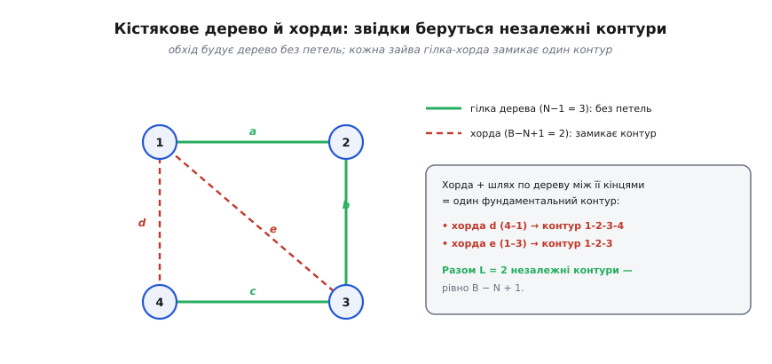
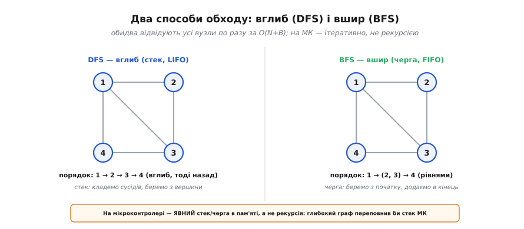

# ⚙️ Обхід графа: DFS/BFS і пошук незалежних контурів

Коло зручно бачити як [граф](root:math-combinatorics/graph-theory): вузли — точки, гілки — ребра. Формула L = B − N + 1 каже, **скільки** незалежних контурів має таке коло, але нічого не каже про те, **які саме** це контури й **як** машина їх знаходить. Топологію графа можна записати матрицями, проте симулятор кіл не починає з матриці — спершу йому треба обійти граф і відокремити «кістяк» від «зайвих» гілок. Цей обхід — той самий прийом, що лежить в основі тисяч задач на графах, від маршрутів до залежностей у складанні програм. Розберімо його так, щоб наприкінці він став робочим C, який крутиться на мікроконтролері.

### Задача

Маємо коло як граф — список вузлів і список гілок, кожна гілка з'єднує два вузли. Щоб потім скласти [рівняння кола](root:embedded/circuit-analysis), машині треба зробити три речі. По-перше, переконатися, що граф **зв'язний**: якщо схема розпалася на окремі острови, рівняння для них пишуться нарізно. По-друге, побудувати **кістякове дерево** — набір із рівно N−1 гілок, що сполучають усі вузли й **не утворюють жодної петлі**. По-третє, оголосити решту гілок — їх якраз B−(N−1) — **хордами**, бо кожна з них, додана до дерева, замикає рівно один незалежний контур. Усе це треба зробити автоматично, без ока людини, для будь-якої схеми, яку накреслив користувач.

Чому саме так? Дерево дає «скелет» без надлишку: між будь-якими двома вузлами в ньому є єдиний шлях. Щойно ми докидаємо хорду, з'являється другий шлях між її кінцями — отже, петля. Тому хорд рівно стільки, скільки незалежних контурів, і кожна вказує на свій контур пальцем. Лишається систематично відрізнити деревні гілки від хорд.

### Ідея: систематичний обхід

Представмо граф **списком суміжності**: кожному вузлу — перелік його сусідів, і поряд із кожним сусідом запам'ятовуємо **номер гілки**, якою ми до нього йдемо (це знадобиться, щоб не сплутати паралельні гілки між тими самими вузлами). Тепер пройдімо граф, **позначаючи відвідані** вузли. Логіка проста й залізна: гілка, якою ми **вперше** входимо в **новий** вузол, стає гілкою дерева; гілка, що веде у вузол, **уже відвіданий**, — це хорда, і вона замикає контур.


*Обхід будує кістякове дерево — зелені гілки a, b, c, рівно N−1 = 3, без жодної петлі. Дві гілки лишилися «зайвими»: це хорди d та e (червоні, пунктир). Кожна хорда разом зі шляхом по дереву між її кінцями дає один фундаментальний контур; разом їх B − N + 1 = 2.*

Обходити можна двома способами, і вибір між ними — це вибір **порядку**, у якому ми дістаємо вузли з «черги на відвідання». **Обхід углиб** (DFS, *depth-first search*) лізе якомога далі одним шляхом, а коли впирається — відкочується назад; ним керує **стек** (останнім поклали — першим узяли, LIFO). **Обхід ушир** (BFS, *breadth-first search*) розходиться кільцями, рівень за рівнем від старту; ним керує **черга** (першим поклали — першим узяли, FIFO). Обидва відвідують кожен вузол рівно раз і обидва дають коректне кістякове дерево — для пошуку контурів годиться будь-який.


*Той самий граф, пройдений двома способами. Углиб іде ланцюжком 1 → 2 → 3 → 4 на стеку; ушир бере спершу старт, тоді обидва його сусіди, тоді решту — рівнями, на черзі. На мікроконтролері обидва роблять ітеративно, явним стеком чи чергою — без рекурсії.*

### Робочий C: обхід углиб зі збором дерева й хорд

Ось повний обхід углиб мовою прошивки. Жодних динамічних структур — самі фіксовані масиви, розраховані наперед на максимальні N і B; це і є те, що реально запускають на мікроконтролері.

> 🔧 **Навіщо це.** Саме цей код стоїть за фразою «симулятор знайшов контури». Дерево дає опорні вузли для закону струмів, хорди — готовий список контурів для закону напруг, і далі лишається [скласти та розв'язати систему](root:embedded/circuit-analysis). Без обходу машина не знала б, які з гілок брати за незалежні, — і написала б забагато або замало рівнянь.

:::tabs
:::code proj-graph-traversal/c/robochyi-c-obkhid-uhlyb-zi.c
:::code proj-graph-traversal/py/robochyi-c-obkhid-uhlyb-zi.py
:::

Покажемо, що тут до чого. Стек — це звичайний масив із вершиною `sp`; `push` — це `stack[sp++] = x`, `pop` — це `stack[--sp]`. Замість рекурсії ми тримаємо стек **самі**, у пам'яті, тож глибина обходу обмежена розміром масиву, а не апаратним стеком процесора. Два моменти варті уваги. По-перше, вузол ми позначаємо відвіданим **щойно кладемо** його в стек, а не коли дістаємо, — інакше вузол із двома гілками від старту потрапив би у стек двічі й обидві гілки хибно пішли б у дерево. По-друге, масив `br_done[br]` гарантує, що кожну гілку ми класифікуємо **рівно раз**: граф неорієнтований, тож кожна гілка лежить у списках суміжності **двічі** (з боку обох вузлів), і без цієї позначки ту саму хорду порахувало б двічі — з кожного її кінця. Рядок `if (br_done[br]) continue;` саме це й відсікає.

Якщо потрібен **обхід ушир**, код майже не міняється: замість стека беремо чергу — додаємо в кінець, а беремо з початку. Решта — позначання відвіданих, відбір деревних гілок і хорд — слово в слово та сама.

Тепер головне, заради чого все робилося, — **дістати сам контур із хорди** — тобто список його гілок. Хорда з'єднує два вузли; шлях між ними вже є в дереві, треба лише піднятися по `parent`-вказівниках від кожного кінця до їхнього спільного предка, дорогою **збираючи гілки**, якими проходимо. Тонкість у тім, що кінці можуть висіти на різній глибині, тож наосліп крокувати обома одночасно не можна — вони розминуться повз предка. Спершу вирівнюємо глибший кінець до рівня іншого, далі йдемо разом до зустрічі:

:::tabs
:::code proj-graph-traversal/c/robochyi-c-obkhid-uhlyb-zi-2.c
:::code proj-graph-traversal/py/robochyi-c-obkhid-uhlyb-zi-2.py
:::

### Worked-приклад: канонічне коло з трьома вузлами

**Умова.** Коло з трьох вузлів A, B, C та чотирьох гілок: джерело V між C і A, R₃ між A і C, R₁ між A і B, R₂ між B і C. Занумеруймо вузли A = 0, B = 1, C = 2, а гілки — 0…3. Очікуємо N = 3, B = 4, отже L = B − N + 1 = 2 хорди. Подаймо це в код і подивімось, що він виловить.

:::tabs
:::code proj-graph-traversal/c/worked-pryklad-kanonichne.c
:::code proj-graph-traversal/py/worked-pryklad-kanonichne.py
:::

Прогін углиб від A = 0 ставить у дерево перші гілки, якими він уперше дістається нових вузлів (тут — V до C і R₁ до B), а дві гілки, що ведуть у вже відвідані вузли, лишаються хордами. Підрахунок сходиться: `seen` = 3 (граф зв'язний), у дереві рівно N−1 = 2 гілки, хорд рівно B − N + 1 = 2. Далі `collect_loop` розгортає кожну хорду в її замкнений шлях, і програма друкує:

```
контур хорди R3: R3 V
контур хорди R2: R2 R1 V
```

Перший контур — хорда R₃ плюс єдина деревна гілка V між тими самими вузлами A і C; другий — хорда R₂ плюс шлях B→A→C по деревних R₁ та V. Це той самий результат, що дає формула L = 2, тільки тепер машина не **порахувала** контури, а **знайшла** їх поіменно, готові до закону напруг.

### Складність і пастки на мікроконтролері

**Складність — лінійна, O(N + B):** кожен вузол і кожну гілку ми торкаємось скінченну кількість разів. Пам'ять — теж O(N + B) на список суміжності плюс O(N) на масиви `visited` і `parent`. Для схеми це означає, що обхід практично безкоштовний на тлі самого розв'язання системи рівнянь.

А ось граблі, специфічні саме для прошивки:

- **Рекурсія = переповнення стека.** Обхід углиб гарно пишеться рекурсією в підручнику, та глибокий граф вичерпає крихітний апаратний стек мікроконтролера й завалить програму без жодного повідомлення. Тому на МК його пишуть **ітеративно**, з **явним** стеком-масивом, як вище; глибину масиву беруть із запасом на найгірший випадок.
- **Пам'ять під контролем.** Замість динамічного виділення — **фіксовані** масиви на максимальні N і B, а `visited` варто тримати **бітовою мапою** (один біт на вузол) замість масиву `bool`, щоб заощадити дефіцитну RAM на дрібному кристалі.
- **Незв'язний граф.** Один запуск обходу покриває лише **одну** зв'язну частину. Якщо `seen` вийшло менше за N, у схемі є окремі острови; тоді обхід запускають **наново** з кожного ще не відвіданого вузла, рахуючи зв'язні частини C, і працює загальна формула L = B − N + C.
- **Що роздувається в пам'яті.** В обході вшир черга може розростися на «широкому» графі, бо тримає цілий рівень одразу; в обході вглиб глибина стека дорівнює найдовшому шляху. Вибір між ними — за формою графа й тим, якої пам'яті не шкода: широкий і мілкий граф дешевший углиб, довгий і вузький — ушир.

Підсумок простий: обхід графа — це міст від топології до рівнянь. Дерево дає N−1 опорних гілок для закону струмів, хорди — рівно L контурів для закону напруг, а далі симулятор лише [складає та розв'язує систему](root:embedded/circuit-analysis). Та сама дюжина рядків C, що знаходить контури в колі, без змін розв'язує безліч інших задач на графах — у цьому й сила прийому.
