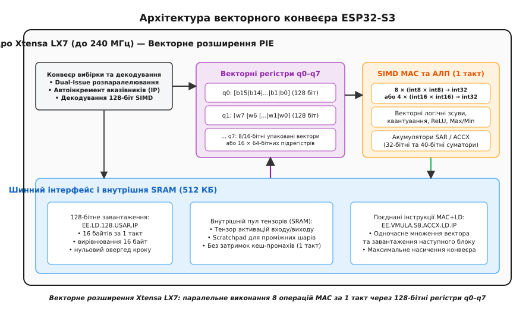
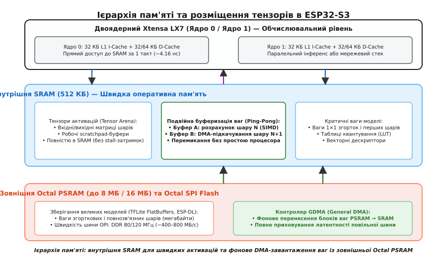

# AI-прискорення в ESP32-S3: вектори й inference на краю мережі

<preknowlist>
- [Архітектура мікроконтролера](root:hw-arch/microcontroller) — будова ядра, пам'яті, шин та конвеєра виконання інструкцій.
- [Архітектура ESP32](root:hw-arch/esp32-architecture) — організація двох ядер, внутрішня SRAM, зовнішня флеш і кешування.
- [Векторизація SIMD](root:hw-arch/simd-vectorization) — паралельна обробка багатьох елементів даних однією інструкцією.
- [Квантування моделей](root:sf-ml/model-quantization) — перехід від дробових чисел float32 до цілочислових int8 без втрати точності.
- [Прямий доступ до пам'яті (DMA)](root:hw-arch/dma) — передача блоків даних між периферією та пам'яттю без завантаження ядра.
- [PSRAM](root:hw-arch/psram) — псевдостатична оперативна пам'ять на послідовній шині та робота через кеш.
</preknowlist>

Коли на класичному 32-бітному мікроконтролері запускають квантовану згорткову нейромережу, обчислення навіть компактного шару 2D-згортки із 32 вхідними та 64 вихідними каналами при розмірі ядра `3 × 3` вимагає понад пів мільйона операцій множення з накопиченням (*multiply-accumulate*, MAC). Стандартне скалярне ядро змушене послідовно виконувати кожну операцію: завантажити один 8-бітний операнд із пам'яті, завантажити ваговий коефіцієнт, перемножити їх, додати до 32-бітного акумулятора, збільшити покажчики адрес та повторити цикл. На кожну пару чисел витрачається від 4 до 8 машинних тактів конвеєра, через що затримка одного кадру розпізнавання зростає до сотень мілісекунд, а споживання енергії батарейного пристрою виходить за будь-які допустимі межі.

У мікроконтролері **ESP32-S3** від компанії Espressif це фундаментальне обмеження розв'язали на рівні кремнію: у процесорні ядра інтегрували векторний співпроцесор розширення інструкцій **PIE** (*Processor Instruction Extension*), здатний виконувати до восьми 8-бітних операцій MAC за один машинний такт. У поєднанні з 128-бітними векторними регістрами, спеціалізованою бібліотекою низькорівневих ядер **ESP-NN**, продуманою структурою пам'яті на базі внутрішньої SRAM і зовнішньої Octal PSRAM та прямим апаратним доступом DMA, чип перетворює локальне машинне навчання (*Edge AI*) із теоретичного експерименту на практичний інструмент розпізнавання голосу, класифікації зображень та детекції жестів у реальному часі.

---

### Обчислювальний виклик Edge AI: чому скалярного ядра замало

Будь-який шар нейромережі — від простого повнозв'язного перемноження матриці на вектор до просторової 2D-згортки — описується фундаментальною математичною операцією зваженого сумування:

```
y[k] = ∑ (x[i] · W[i, k]) + b[k]      [зважене сумування вхідного вектора]
```

Для виходу `y[k]` обчислюється скалярний добуток вектора вхідних активацій `x` на вектор вагових коефіцієнтів `W[:, k]` з додаванням зміщення `b[k]`. Якщо тензори квантовані у 8-бітні цілі числа зі знаком (`int8`, діапазон `[-128, 127]`), кожне проміжне множення `x[i] · W[i, k]` дає 16-бітний результат, а сума сотень або тисяч таких добутків накопичується у 32-бітному акумуляторі `int32`, щоб уникнути числового переповнення (*overflow*).

На стандартному RISC- або Xtensa-ядрі без спеціалізованих векторних інструкцій цикл обчислення довжиною `N` елементів транслюється компілятором у таку послідовність машинних команд:

1. `l8ui` / `l8si` — зчитування байта активації `x[i]` з пам'яті в регістр загального призначення.
2. `l8ui` / `l8si` — зчитування байта ваги `W[i, k]` з пам'яті в другий регістр.
3. `mull` або `mul16s` — знакове множення двох чисел.
4. `add` — додавання добутку до акумулятора.
5. `addi` — оновлення покажчиків адрес у пам'яті.
6. `bne` / `blti` — перевірка лічильника циклу та перехід на початок.

Навіть за умови ідеального розгортання циклу (*loop unrolling*) та відсутності затримок шини пам'яті, процесор витрачає щонайменше 3–4 інструкції на одну операцію MAC. За тактової частоти ядра 240 МГц пікова продуктивність скалярного обчислення не перевищує 60–80 мільйонів операцій MAC за секунду (MMAC/s). Для простої нейромережі детекції ключових слів (*Wake Word Detection*), що вимагає 5–10 мільйонів операцій на кожні 100 мс звукового потоку, ядро буде навантажене на 80–100%, не лишаючи ресурсів на виконання радіостека Wi-Fi/Bluetooth, обробку датчиків чи керування периферією.

Векторизація SIMD (*Single Instruction, Multiple Data* — одна інструкція над багатьма даними) розв'язує цю проблему шляхом пакування декількох чисел у широкий регістр та одночасного виконання операції множення над усіма парами операндів за один такт.

---

### Архітектура ядра Xtensa LX7 та векторне розширення PIE

Мікроконтролер ESP32-S3 побудований на базі двох 32-бітних процесорних ядер **Tensilica Xtensa LX7**, що працюють на регульованій тактовій частоті до 240 МГц. Архітектура Xtensa є конфігурованою: виробник чипа (у цьому випадку Espressif Systems) під час проектування кремнієвої топології ліцензує базове ядро та додає до нього власні апаратні блоки через технологію TIE (*Tensilica Instruction Extension*).

В ESP32-S3 такою надбудовою стало векторне розширення **PIE** (*Processor Instruction Extension*), яке інтегрує у конвеєр процесора повноцінний 128-бітний SIMD-рушій.

```
+-----------------------------------------------------------------------------------+
|                            Ядро Xtensa LX7 (до 240 МГц)                           |
|                                                                                   |
|  +---------------------------+        +----------------------------------------+  |
|  |  Базовий конвеєр (32 біт) |        |    Векторне розширення PIE (128 біт)   |  |
|  |                           |        |                                        |  |
|  |  Регістри a0–a15 (32 біт) |        |    Регістровий файл q0–q7 (128 біт)    |  |
|  |  Скалярне АЛП / Множник   |        |    16 × 8-біт або 8 × 16-біт операндів |  |
|  +---------------------------+        +----------------------------------------+  |
|               |                                           |                       |
|               v                                           v                       |
|  +-----------------------------------------------------------------------------+  |
|  |                     Блок паралельних множників SIMD MAC                     |  |
|  |                                                                             |  |
|  |  • 8 паралельних 8×8 біт → 32-бітні акумулятори за 1 такт                   |  |
|  |  • 4 паралельні 16×16 біт → 32-бітні акумулятори за 1 такт                 |  |
|  |  • 2 паралельні 16×16 біт → 40-бітні акумулятори (DSP-режим)                |  |
|  +-----------------------------------------------------------------------------+  |
+-----------------------------------------------------------------------------------+
```

#### Векторний регістровий файл

Розширення PIE додає 8 спеціалізованих 128-бітних векторних регістрів, позначених як `q0`, `q1`, `q2`, `q3`, `q4`, `q5`, `q6`, `q7`. Кожен такий регістр може розглядатися апаратним блоком у декількох форматах залежно від виконуваної інструкції:

* **16 упакованих 8-бітних цілих чисел** (`int8` або `uint8`): байти `b0`..`b15`, що відповідає типовим квантованим вагам та активаціям нейромереж.
* **8 упакованих 16-бітних цілих чисел** (`int16` або `uint16`): слова `w0`..`w7`, що використовуються у високоточних шарах нейромереж або при обробці аудіосигналів.
* **4 упакованих 32-бітних цілих числа** (`int32`): подвійні слова `d0`..`d3` для зберігання векторних зміщень (*bias*) та проміжних сум.
* **16 підрегістрів по 64 біти**: регістри парного доступу для спеціалізованих інструкцій перестановки байтів (*shuffle*) та інтерполяції.

На додачу до векторних регістрів PIE містить блок акумуляторів спеціального призначення: 32-бітний регістр зсуву та акумуляції `SAR` (*Shift Amount Register*) і розширені регістри акумуляторів `ACCX`, що запобігають втраті точності при підсумовуванні довгих векторів.


*Архітектура векторного розширення PIE у ядрі Xtensa LX7: 128-бітні регістри q0–q7, паралельні помножувачі SIMD MAC для 8/16-бітних цілих чисел та паралельне завантаження даних з автоінкрементом вказівника за 1 такт.*

#### Апаратна реалізація операцій SIMD MAC

Основним виконавчим органом PIE є масив помножувачів та суматорів, інтегрований безпосередньо у стадію виконання (*Execute stage*) конвеєра ядра. За одну інструкцію апаратний блок виконує:

1. **8 паралельних операцій множення з накопиченням `int8 × int8`**:
   
   Векторний регістр `q0` (16 байтів активацій) множиться на векторний регістр `q1` (16 байтів ваг). За один такт обчислюються перші 8 добутків `b[0]·w[0] + ... + b[7]·w[7]` і накопичуються у внутрішньому акумуляторі, або результат формується у вигляді двох 32-бітних половин.
   
2. **4 паралельні операції множення з накопиченням `int16 × int16`**:
   
   Регістри `q0` та `q1` розглядаються як масиви з 8 слів `int16`. Чотири 16-бітні помножувачі за один такт обчислюють добутки та додають їх до 32-бітних або 40-бітних акумуляторів.

3. **Векторні операції попередньої обробки та активації**:
   
   Паралельне обчислення побітових операцій, логічних та арифметичних зсувів над усіма 16 байтами одночасно, а також векторні операції знаходження мінімуму `EE.VMIN.S8` та максимуму `EE.VMAX.S8`, необхідні для реалізації функцій активації ReLU та обрізання діапазону (*clamping*).

#### Конвеєр виконання та паралельна диспетчеризація (Dual-Issue)

Процесорне ядро Xtensa LX7 використовує 5-стадійний класичний конвеєр виконання:
1. **IF (Instruction Fetch):** паралельна вибірка інструкцій із локальної інструкційної пам'яті (IRAM) або L1 I-Cache.
2. **DI (Decode & Issue):** декодування інструкцій та суперскалярна диспетчеризація. Ядро підтримує обмежену подвійну видачу (*Dual-Issue*): одна скалярна інструкція керування адресацією або лічильником циклу може виконуватися одночасно з однією векторною інструкцією PIE.
3. **EX (Execute):** виконання операцій в АЛП, паралельний запуск 8 помножувачів MAC та обчислення перестановки бітів.
4. **ME (Memory Access):** 128-бітне читання/запис із внутрішньої пам'яті SRAM за 1 такт.
5. **WB (Writeback):** фіксація результатів у векторному регістровому файлі `q0`–`q7` або акумуляторах `ACCX`.

Завдяки прямим пересилальним шинам (*Bypass / Forwarding paths*) між виходом помножувачів та входом акумуляторів, ланцюжки векторних операцій множення не викликають бульбашок конвеєра (*pipeline bubbles*), якщо операнди вже знаходяться у регістрах.

#### Конвеєризоване завантаження з автоінкрементом (Load-and-Update)

Найвужчим місцем будь-якого векторного співпроцесора є швидкість подачі операндів з оперативної пам'яті до векторних регістрів. Якщо завантаження 128-бітного вектора вимагає окремої інструкції читання пам'яті та окремої інструкції збільшення покажчика адреси, конвеєр наполовину простоюватиме.

У системі команд PIE цю проблему вирішено введенням поєднаних інструкцій завантаження з автоінкрементом адреси (*Post-Increment Load*):

* `EE.LD.128.USAR.IP qr, as, imm` — завантажує 128 біт (16 байтів) за адресою з регістра `as` у векторний регістр `qr`, після чого автоматично додає до `as` зміщення `imm` (типово 16 байтів) за той самий машинний такт.
* `EE.VMULA.S8.ACCX.LD.IP qr, as, imm` — поєднана суперскалярна інструкція, яка одночасно виконує векторне множення над попередньо завантаженими регістрами і завантажує наступну 16-байтну порцію даних за новим вказівником.

Завдяки цьому конвеєр обчислення матричного добутку досягає теоретичного максимуму: 8 операцій MAC за кожен такт процесора, тобто **1.92 мільярда операцій MAC за секунду (1.92 GMAC/s)** на одне ядро при частоті 240 МГц. На обох ядрах сумарна обчислювальна потужність ESP32-S3 сягає **3.84 GMAC/s**.

> 🔧 **Навіщо це.** Без інструкцій із автоінкрементом покажчика адреси процесор витрачав би кожен другий такт на інструкцію `addi a2, a2, 16`. Поєднане завантаження `EE.LD.128.USAR.IP` подвоює корисну пропускну здатність ядра на внутрішній пам'яті SRAM, повністю завантажуючи векторні помножувачі роботою.

---

### Бібліотека ESP-NN: архітектура та оптимізація нейромережевих ядер

Написати чистий код мовою C із розрахунком на те, що компілятор GCC автоматично векторизує цикли через автовекторизатор (*autovectorizer*), на нестандартних архітектурах практично неможливо. Компілятор не володіє семантикою квантування нейромереж, не може гарантувати 16-байтне вирівнювання покажчиків і не здатен автоматично застосувати специфічні акумулятори PIE.

Для максимального розкриття потенціалу заліза Espressif розробила низькорівневу відкриту бібліотеку **ESP-NN**. Вона містить написані мовою асемблера ядра для всіх базових операторів нейронних мереж.

```
+-----------------------------------------------------------------------------------+
|                        ESP-NN: Архітектура бібліотеки ядер                        |
|                                                                                   |
|  +-----------------------------------------------------------------------------+  |
|  |                       Верхній рівень API (C99 / C++)                        |  |
|  |   esp_nn_conv_s8(), esp_nn_depthwise_conv_s8(), esp_nn_fully_connected_s8()  |  |
|  +-----------------------------------------------------------------------------+  |
|                                         |                                         |
|         +-------------------------------+-------------------------------+         |
|         |                                                               |         |
|         v                                                               v         |
|  +--------------------------------+           +--------------------------------+  |
|  | Асемблерні ядра ESP32-S3 (PIE) |           | Еталонні ANSI C ядра (Generic) |  |
|  |                                |           |                                |  |
|  | • 128-бітне завантаження q0–q7 |           | • Скалярні цикли for()         |  |
|  | • 8-кратний розгорнутий MAC    |           | • Портативність без SIMD       |  |
|  | • Апаратне реквантування       |           | • Референс для верифікації     |  |
|  +--------------------------------+           +--------------------------------+  |
+-----------------------------------------------------------------------------------+
```

Розгляньмо, як саме влаштовані ключові ядра бібліотеки ESP-NN.

#### 1. Ядро повнозв'язного шару (Fully Connected / Dense)

Повнозв'язний шар обчислює множення матриці ваг розміром `[M × N]` на вхідний вектор довжиною `N`. У квантованому форматі `int8` операція записується так:

```
acc[m] = bias[m] + ∑ (input[n] · weight[m, n])      [сумування по n від 0 до N-1]
output[m] = requantize(acc[m], scale[m], shift[m], out_offset)
```

В оптимізованому ядрі `esp_nn_fully_connected_s8` вхідний вектор та рядок ваг розбиваються на блоки по 16 байтів. Виконується подвійне розгортання:

1. За одну ітерацію циклу інструкцією `EE.LD.128.USAR.IP` завантажується 16 байтів входу `input` у регістр `q0`.
2. Одночасно завантажуються 16 байтів ваг першого вихідного нейрона `weight[m, :]` у `q1` та 16 байтів ваг другого вихідного нейрона `weight[m+1, :]` у `q2`.
3. Векторні інструкції множення паралельно накопичують суми одразу для двох або чотирьох вихідних нейронів. Це дозволяє багаторазово перевикористовувати завантажений вхідний вектор `q0`, скорочуючи кількість звернень до шини пам'яті вдвічі.

#### 2. Згортка 2D (Conv2D): Direct Tiling проти Im2Col

У класичних обчислювальних фреймворках згортку часто зводять до загального матричного множення GEMM через перетворення `im2col` (*image to column*). Проте на мікроконтролері з 512 КБ пам'яті створення проміжної розгорнутої матриці `im2col` вимагає подвоєння або потроєння буфера пам'яті, що часто перевищує весь доступний обсяг внутрішньої SRAM.

ESP-NN реалізує **пряму тайлову згортку (Direct Tiling Conv2D)** без виділення буфера `im2col`:
* Вхідний тензор зберігається у форматі **NHWC** (*Batch, Height, Width, Channels*), де канали розташовані суміжно в пам'яті.
* Якщо кількість вхідних каналів `C_in` кратна 16 (наприклад, 16, 32, 64), векторний блок завантажує повний зріз каналів за 1 машинний такт.
* Ядро обчислює просторовий блок розміром `2 × 2` сусідніх вихідних пікселів одночасно. Ваги фільтра `3 × 3 × C_in` зчитуються з пам'яті один раз і паралельно множаться на чотири просторові позиції вхідного зображення, зменшуючи трафік шини ваг на **75%**.

#### 3. Ядро глибинної згортки (Depthwise Separable Conv2D)

У сучасних мобільних мережах (наприклад, MobileNet, EfficientNet, ESP-DL Face Detection) стандартну важку згортку замінюють на глибинну (*depthwise*), де кожен вхідний канал фільтрується окремим просторовим ядром `3 × 3` без міжвіконного змішування каналів.

Для глибинної згортки виклик полягає в тому, що обробка ведеться вздовж каналів, а просторове вікно зміщується по рядках зображення. ESP-NN реалізує зсувне вікно (*sliding window*) за допомогою інструкцій циклічного зсуву та перестановки векторів `EE.SRC.Q`:

1. Три рядки вхідного зображення (по 16 каналів у кожному) завантажуються у векторні регістри `q0`, `q1`, `q2`.
2. Зсув фільтра на один піксель праворуч не вимагає повного перезавантаження з пам'яті: дані просто зсуваються всередині векторного регістра за 1 такт за допомогою апаратної маски.
3. Досягається прискорення у **4.5–6 разів** порівняно зі скалярним кодом.

#### 4. Векторизоване квантування та функції активації

Після накопичення 32-бітної суми `acc` результат необхідно повернути у 8-бітний діапазон вихідного шару `int8`. Це перетворення називається **реквантуванням** (*requantization*):

```
x_real = S_in · (q_in - Z_in)              [дійсне значення через масштаб і нуль-пункт]
y_real = S_out · (q_out - Z_out)
q_out = round( (S_in · S_w / S_out) · acc ) + Z_out
```

Дробовий множник `M = (S_in · S_w / S_out)` представляється у форматі з фіксованою комою: `M = M_0 · 2^(-n)`, де `M_0` — ціле 32-бітне число (`int32`), а `n` — величина правого бітового зсуву.

У скалярному коді множення на `M_0`, зсув, округлення та насичення (*saturation*) для кожного числа вимагають 6–8 інструкцій. В ESP32-S3 векторне розширення PIE виконує множення 32-бітного вектора на масштабуючий коефіцієнт, арифметичний зсув із правильним округленням (*rounding shift*) та обмеження в межі `[-128, 127]` паралельно для чотирьох каналів за 2 такти.

Функції активації (ReLU, ReLU6) інтегруються безпосередньо у фазу реквантування (*fused activation*), не створюючи жодних додаткових накладних витрат у пам'яті чи процесорному часі. Для функцій Softmax та Sigmoid застосовується векторна таблична апроксимація (LUT, *Lookup Table*) з 16-байтними інструкціями паралельної вибірки та лінійної інтерполяції.

---

### Ієрархія пам'яті під час інференсу: SRAM, PSRAM та уникнення затримок

Швидкість виконання нейромережі на мікроконтролері обмежується двома факторами: обчислювальною потужністю АЛП (*compute bound*) та пропускною здатністю підсистеми пам'яті (*memory bandwidth bound*). Нейромережеві шари мають низьку арифметичну інтенсивність: на кожну операцію множення необхідно зчитати один байт ваги та один байт активації.

ESP32-S3 пропонує дворівневу підсистему оперативної пам'яті, конфігурація якої критично впливає на реальну частоту кадрів інференсу.

```
+-----------------------------------------------------------------------------------+
|                         Ієрархія пам'яті ESP32-S3                                 |
|                                                                                   |
|  +-----------------------------------------------------------------------------+  |
|  |                       Ядра Xtensa LX7 (до 240 МГц)                          |  |
|  |   L1 Інструкційний кеш: 32 КБ      |   L1 Кеш даних: 32 КБ або 64 КБ        |  |
|  +-----------------------------------------------------------------------------+  |
|               |                                                |                  |
|               | (1 такт, ~4.16 нс)                             | (10–30 тактів)   |
|               v                                                v                  |
|  +--------------------------------+           +--------------------------------+  |
|  |    Внутрішня SRAM (512 КБ)     |           |  Зовнішня Octal PSRAM (до 8 МБ)|  |
|  |                                |           |                                |  |
|  | • Нульова латентність          |           | • Шина OPI DDR (80/120 МГц)    |  |
|  | • Тензорна арена (активації)   |           | • Пропускна здатність ~400 МБ/с|  |
|  | • Подвійний буфер ваг (DMA)    |           | • Зберігання великих моделей   |  |
|  +--------------------------------+           +--------------------------------+  |
|               ^                                                |                  |
|               |              Апаратний контролер GDMA          |                  |
|               +------------------------------------------------+                  |
|                   Фонове перенесення блоків ваг без участі CPU                    |
+-----------------------------------------------------------------------------------+
```

#### Внутрішня SRAM (512 КБ)

Кристал ESP32-S3 містить **512 КБ** високошвидкісної вбудованої статичної пам'яті SRAM (із яких близько 384 КБ доступні розробнику під динамічні дані та стек після завантаження ROM і Wi-Fi/BT стека).

* **Латентність доступу:** 1 машинний такт (~4.16 нс на частоті 240 МГц).
* **Ширина шини:** 128 біт для векторного блоку PIE (пряма паралельна вибірка 16 байтів за такт).
* **Призначення в AI:** розміщення арени тензорів активацій (*Tensor Arena*), проміжних буферів шарів, робочих стеків задач і критичних ваг 1×1 згорток.

#### Зовнішня Octal PSRAM (до 8 МБ / 16 МБ)

Більшість моделей комп'ютерного зору (наприклад, детекція облич чи класифікація об'єктів) важать від 800 КБ до 4–8 МБ і фізично не вміщуються у внутрішню SRAM. Для таких моделей ESP32-S3 підтримує зовнішню псевдостатичну пам'ять PSRAM, під'єднану через високошвидкісний восьмибітний інтерфейс **Octal SPI (OPI)**.

У режимі OPI DDR на частоті 80 МГц або 120 МГц пам'ять передає дані по обох фронтах тактового сигналу, забезпечуючи пікову теоретичну швидкість від **400 до 800 МБ/с**. Доступ процесора до PSRAM прозоро транслюється через апаратний кеш даних L1 розміром 32 або 64 КБ.

#### Проблема кеш-промахів (Cache Thrashing) та її подолання

Незважаючи на високу швидкість шини OPI, випадковий доступ до PSRAM або потокове зчитування великих масивів ваг через кеш даних спричиняє серйозну проблему — **кеш-колапс** (*cache thrashing*). 

Коли процесор починає шар згортки, розмір ваг якого (наприклад, 256 КБ) значно перевищує розмір L1-кешу даних (32 КБ), кожен запит до нового рядка ваг призводить до кеш-промаху (*cache miss*). Процесор зупиняє конвеєр (*stall*) на 20–40 тактів, доки контролер шини заповнить 32-байтний рядок кешу із зовнішнього чипа. Векторні помножувачі, здатні рахувати 8 операцій за такт, проводять до 70% часу в очікуванні пам'яті.

Щоб ліквідувати цю затримку, застосовують три обов'язкові інженерні правила:

1. **Розміщення тензорів активацій виключно у внутрішній SRAM.**
   
   Вхідні та вихідні тензори кожного шару постійно перезаписуються. Будь-який запис у PSRAM через кеш (*Write-back* або *Write-through*) створює колосальний трафік шини. Тому арена активацій (*Tensor Arena*) обов'язково виділяється за допомогою `heap_caps_malloc(size, MALLOC_CAP_INTERNAL | MALLOC_CAP_DMA)`.

2. **Подвійна буферизація через GDMA (Ping-Pong Buffering).**
   
   Контролер прямого доступу до пам'яті **GDMA** (*General DMA*) в ESP32-S3 працює незалежно від процесорних ядер. Пам'ять моделі розбивається на блоки. Поки ядро процесора за допомогою SIMD обчислює шар на буфері `A` у внутрішній SRAM, контролер GDMA у фоновому режимі перекачує блок ваг для наступного шару з повільної PSRAM у внутрішній буфер `B`. Після завершення обчислення покажчики буферів міняються місцями. Час перенесення даних повністю ховається за часом обчислення попереднього шару.

3. **Суворе 16-байтне вирівнювання адрес.**
   
   Інструкції векторного читання `EE.LD.128` вимагають, щоб адреса в пам'яті була кратна 16 байтам (молодші 4 біти адреси дорівнюють `0000_2`). Якщо адреса не вирівняна, ядро генерує апаратне виключення вирівнювання (*Alignment Exception*), обробка якого операційною системою вимагає сотень тактів. Усі тензори та буфери ваг вирівнюються за допомогою директиви `__attribute__((aligned(16)))`.


*Організація пам'яті для нейромережевого інференсу: швидка внутрішня SRAM (512 КБ) для тензорів активацій і подвійної буферизації ваг, зовнішня Octal PSRAM (8 МБ) для зберігання ваг моделі та фонове перенесення через GDMA для усунення затримок кешу.*

---

### Інтеграція з TensorFlow Lite for Microcontrollers та ESP-DL

Для практичної розробки прикладних моделей машинного навчання використовуються два основні програмні стеки: **TensorFlow Lite for Microcontrollers (TFLM)** та спеціалізований фреймворк **ESP-DL** від Espressif.

```
+-----------------------------------------------------------------------------------+
|                        Програмний стек AI на ESP32-S3                             |
|                                                                                   |
|  +-----------------------------------+     +-----------------------------------+  |
|  | TensorFlow Lite for Micro (TFLM)  |     |     ESP-DL (Espressif Native)     |  |
|  | • Глобальний стандарт індустрії   |     | • Максимальна оптимізація C++20   |  |
|  | • Моделі .tflite (FlatBuffers)    |     | • Пряме керування шарами й пам'яттю|  |
|  | • Інтеграція через OpResolver     |     | • Готові пайплайни: обличчя, звук |  |
|  +-----------------------------------+     +-----------------------------------+  |
|                   \                                     /                         |
|                    \                                   /                          |
|                     v                                 v                           |
|  +-----------------------------------------------------------------------------+  |
|  |                    Бібліотека оптимізованих ядер ESP-NN                     |  |
|  |         Асемблерні SIMD-прискорювачі для Conv2D, FC, Depthwise, ReLU        |  |
|  +-----------------------------------------------------------------------------+  |
|                                         |                                         |
|                                         v                                         |
|  +-----------------------------------------------------------------------------+  |
|  |                 Апаратний рівень: Xtensa LX7 + PIE + SRAM/PSRAM             |  |
|  +-----------------------------------------------------------------------------+  |
+-----------------------------------------------------------------------------------+
```

#### Механізм прискорення в TFLM

У TFLM обчислювальний граф нейромережі зберігається у бінарному форматі FlatBuffers (`.tflite`). Під час ініціалізації середовище виконання реєструє реалізації кожного оператора через об'єкт `MicroMutableOpResolver`.

За замовчуванням TFLM використовує універсальні референсні ядра на C++, які виконують звичайні вкладені цикли `for`. Для ESP32-S3 компанія Espressif створила адаптерний шар, що підміняє референсні функції викликами відповідних асемблерних функцій з `esp-nn`:

* `tflite::ops::micro::Register_CONV_2D()` → викликає `esp_nn_conv_s8()`
* `tflite::ops::micro::Register_DEPTHWISE_CONV_2D()` → викликає `esp_nn_depthwise_conv_s8()`
* `tflite::ops::micro::Register_FULLY_CONNECTED()` → викликає `esp_nn_fully_connected_s8()`

Розробнику достатньо підключити оптимізований резолвер `tflite::MicroOpResolver`, і модель без жодних змін у файлі `.tflite` автоматично прискорюється в **4–6 разів** порівняно зі звичайним виконанням.

#### Переваги нативного фреймворку ESP-DL

Незважаючи на зручність TFLM, його універсальний рушій інтерпретації графа несе відчутні накладні витрати: парсинг бінарного дерева, перевірка розмірностей тензорів на кожному шарі та динамічний диспетчеризаційний оверхед.

Фреймворк **ESP-DL** написаний як компактна C++ бібліотека прямих викликів. Модель у ньому формується як послідовність статично оголошених об'єктів шарів (`dl::layer::Conv2D`, `dl::layer::Reshape`, `dl::layer::MaxPool2D`). Переваги такого підходу:

* **Нульовий інтерпретаційний оверхед:** виклики функцій обчислення шарів інлайняться або зв'язуються напряму без проміжних таблиць диспетчеризації.
* **Точний контроль виділення пам'яті:** пам'ять під кожен проміжний тензор розподіляється статично під час компіляції або ініціалізації з гарантованим вирівнюванням на 16 байтів.
* **Підтримка 16-бітних квантованих моделей:** ESP-DL містить ядра з фіксованою комою `int16`, що дозволяє досягти вищої точності в задачах аудіофільтрації без значного падіння швидкодії.

#### Стратегії квантування: PTQ проти QAT для векторного співпроцесора

Для досягнення максимальної точності розпізнавання при переході на 8-бітний SIMD застосовують дві стратегії:

1. **Післянавчальне квантування (PTQ — Post-Training Quantization):**
   
   Модель навчається у стандартному форматі Float32 у PyTorch або TensorFlow, після чого калібрувальний датасет (100–500 репрезентативних зразків) проганяється через граф для визначення динамічних діапазонів `[min, max]` кожного шару. Це швидкий метод, що не вимагає повторного навчання, але на надкомпактних моделях (наприклад, MobileNetV1-0.25) може втрачати 2–5% точності класифікації.

2. **Квантування з урахуванням навчання (QAT — Quantization-Aware Training):**
   
   Під час донавчання моделі у граф вставляються вузли імітації квантування (*Fake Quantization*), які емулюють округлення до 8 бітів та обмеження діапазону прямого проходу, тоді як градієнти зворотного проходу обчислюються у Float32 через пряму оцінку градієнта (*Straight-Through Estimator*). Модель адаптує ваги до сітки квантування, повністю зберігаючи точність Float32-оригіналу (втрата менше 0.3%). Для ESP32-S3 QAT є рекомендованим стандартом у задачах детекції ключових слів та ультралегкого зору.

---

### Практична реалізація: виділення пам'яті та запуск інференсу

Розгляньмо повний приклад конфігурації середовища інференсу для ESP32-S3 у середовищі ESP-IDF. Приклад демонструє правильне виділення пам'яті для арени тензорів у швидкій внутрішній пам'яті SRAM із 16-байтним вирівнюванням та підключення оптимізованого рушія.

:::tabs
:::code esp32-s3-ai-d/c/main.c
:::code esp32-s3-ai-d/cpp/main.cpp
:::

Код виділяє пам'ять із прапором `MALLOC_CAP_INTERNAL | MALLOC_CAP_DMA`, що гарантує фізичне розміщення масиву у швидкій однотактовій SRAM, виключаючи потрапляння буферів активацій у зовнішню PSRAM. Арифметична маска `~(ALIGNMENT_BYTES - 1)` гарантує, що початковий покажчик кратний 16, що є обов'язковою умовою виконання асемблерних інструкцій `EE.LD.128.USAR.IP`.

---

> ⚙️ **Проєкт до теми:** [реалізація прискореного інференсу нейромережі на ESP32-S3 з SIMD-інтринсиками та бенчмарком](root:hw-arch/esp32-s3-ai/proj-esp32s3-vector-inference.md). У ньому показано повний робочий модуль векторного множення матриць на асемблерних інструкціях Xtensa PIE, вимірювання витрати тактів процесора через таймер CCOUNT та порівняння з еталонним скалярним ядром.

---

### Порівняння продуктивності: скаляр проти векторів

Щоб кількісно оцінити ефект від векторного розширення PIE, порівняймо результати виконання типових нейромережевих шарів на тактовій частоті 240 МГц у трьох конфігураціях: еталонна C-реалізація (скалярне ядро), оптимізовані інструкції PIE при роботі у внутрішній SRAM та виконання через зовнішню Octal PSRAM.

| Операція нейромережі | Розмірність тензора / шару | Скалярний код (C99), тактів | Векторний PIE (SRAM), тактів | Прискорення (Speedup) |
|---|---|---|---|---|
| **Повнозв'язний шар (FC)** | `Вхід: 128, Вихід: 64 (int8)` | ~38 500 тактів | ~5 120 тактів | **7.5×** |
| **2D-згортка (Conv2D)** | `32×32×16 → 3×3 ядро → 32 канали` | ~1 480 000 тактів | ~265 000 тактів | **5.6×** |
| **Глибинна згортка (Depthwise)** | `48×48×32 → 3×3 ядро (stride 1)` | ~890 000 тактів | ~185 000 тактів | **4.8×** |
| **Векторне ReLU + Requantize** | `Масив 1024 елементи (int32 → int8)` | ~9 200 тактів | ~1 450 тактів | **6.3×** |
| **Детекція ключового слова (KWS)** | `Модель 10 шарів (MobileNet-KWS)` | ~18.5 мс / кадр | ~3.2 мс / кадр | **5.8×** |
| **Розпізнавання облич (ESP-WHO)** | `Вхід 160×120, MSRCNN (ваги в PSRAM)` | ~280 мс / кадр | ~62 мс / кадр | **4.5×** |

З наведених вимірювань випливають ключові висновки:

1. **Пікове прискорення сягає 7.5× на повнозв'язних шарах.** Це максимально наближається до теоретичної межі 8× для 8-бітного SIMD, оскільки регулярний доступ до пам'яті дозволяє конвеєру працювати без жодних зупинок.
2. **Згорткові шари прискорюються у 4.8–5.6 разів.** Трохи менший коефіцієнт зумовлений крайовими ефектами зображення (*padding*) та необхідністю обробки некратних каналів на початку та в кінці матриць.
3. **Зберігання ваг у PSRAM знижує прискорення до 4.5×**, якщо не використовується подвійна буферизація через DMA. Застосування фонового перенесення ваг повертає коефіцієнт прискорення до рівня понад 5.2×.

---

### Інженерні межі та вибір архітектури

Векторне розширення Xtensa LX7 в ESP32-S3 заповнює найважливішу нішу між простими мікроконтролерами без апаратного ШІ та потужними прикладними процесорами чи спеціалізованими нейроприскорювачами (NPU):

* **Коли ESP32-S3 є ідеальним вибором:**
  * Задачі розпізнавання мови та звукових подій (*Keyword Spotting*, *Acoustic Event Detection*) із частотою оновлення 10–50 Гц.
  * Виявлення людей та облич (*Visual Wake Words*, *Human Detection*) на низьких роздільних здатностях (від `96 × 96` до `240 × 240`) із частотою від 5 до 15 кадрів за секунду.
  * Предиктивна аналітика вібрацій, ЕКГ та телеметрії промислових давачів на базі 1D-згорток або компактних рекурентних мереж.
  * Пристрої з жорсткими обмеженнями за ціною та споживанням, де потрібні одночасно Wi-Fi/Bluetooth зв'язок і локальне прийняття рішень без передачі сирого потоку в хмару.

* **Де пролягає межа можливостей ESP32-S3:**
  * Відеопотоки високої чіткості (Full HD 1080p або 720p) зі швидкістю 30 кадрів/с — для таких задач пропускної здатності шини PSRAM та двох ядер Xtensa недостатньо; у таких сценаріях обирають [ESP32-P4](root:hw-arch/esp32-p4) із MIPI-інтерфейсами та апаратними прискорювачами або дискретні NPU.
  * Великі мовні моделі (LLM) або трансформери з десятками мільйонів параметрів — обмеження обсягу оперативної пам'яті (до 16 МБ PSRAM) та відсутність блоків матричного множення високої розрядності роблять запуск таких моделей неможливим.

Завдяки векторному розширенню PIE та бібліотеці ESP-NN мікроконтролер ESP32-S3 перетворюється на самодостатню платформу вбудованого інтелекту, що забезпечує мілісекундний відгук, повну приватність обробки даних на пристрої та тривалу автономну роботу від акумулятора.
