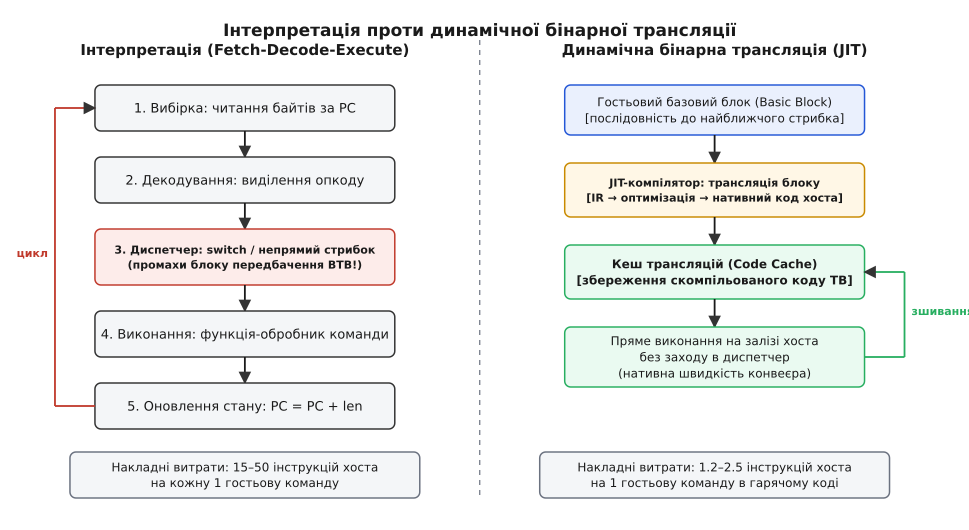
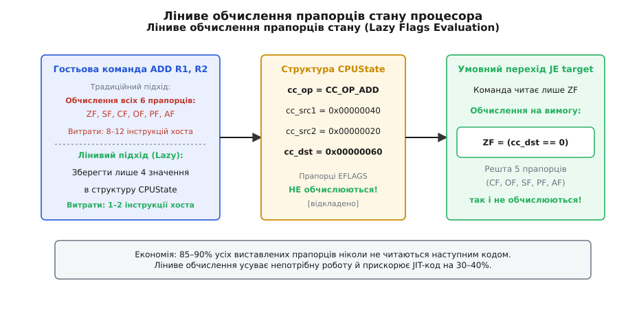
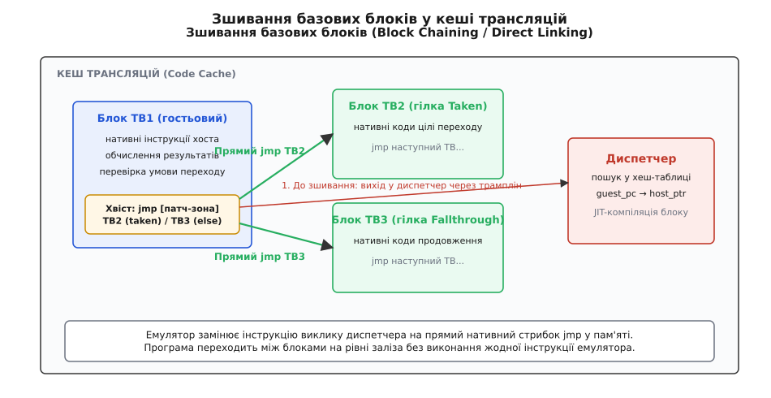
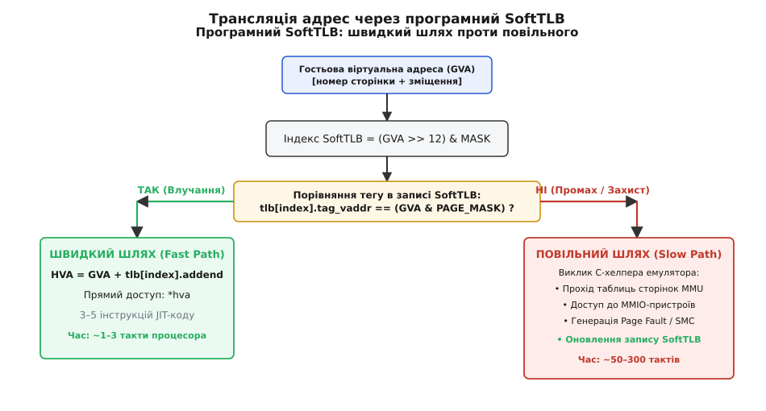

# Емуляція систем команд: інтерпретація та JIT

<preknowlist>
- [Набір інструкцій](root:hw-arch/isa) — класифікація архітектур (CISC, RISC), формати кодування машинних команд, регістровий файл та апаратний лічильник команд.
- [Цикл виконання інструкції](root:hw-arch/instruction-cycle-detail) — стадії вибірки, декодування, виконання та запису результату (Fetch-Decode-Execute).
- [TLB — кеш адресного перекладу](root:hw-arch/tlb) — трансляція віртуальних адрес у фізичні через багаторівневі таблиці сторінок та апаратний буфер трансляції.
- [Бар'єри пам'яті](root:hw-arch/memory-barrier-instructions) — модель строгого порядку записів (TSO) проти систем зі слабким впорядкуванням доступу до пам'яті.
</preknowlist>

Коли операційній системі або розробнику необхідно запустити скомпільовану двійкову програму на процесорі з іншою системою команд — наприклад, 64-розрядну програму архітектури x86 на мікрочипі ARM64 чи гру для гральної консолі з процесором PowerPC на комп'ютері x86-64 — виникає фундаментальна перешкода. Фізичний кремнієвий кристал господаря (Host) не здатний прочитати, декодувати чи виконати байти інструкцій гостьової архітектури (Guest). Його апаратний лічильник команд розрахований на інші формати слів, його апаратно-логічний блок оперує іншим набором регістрів, а таблиці переривань і механізми трансляції адрес підпорядковані зовсім іншій інженерній специфікації.

Єдиним способом подолати цю прірву є **емуляція** (лат. *aemulatio* — намагання зрівнятися, наслідування) — створення програмного або апаратно-програмного прошарку, який повністю відтворює поведінку гостьового процесора, його регістровий контекст, конвеєр виконання, механізми обчислення прапорців стану та віртуальну пам'ять на цільовому залізі.

## Спектр підходів: від покрокової вибірки до генерації нативного коду

Емулятори систем команд еволюціонували від найпростіших покрокових інтерпретаторів до складних систем багаторівневої динамічної бінарної трансляції (Dynamic Binary Translation, DBT) з динамічною компіляцією на льоту (Just-In-Time compilation, JIT).


*Зліва: класичний інтерпретатор покроково розбирає кожну команду в нескінченному циклі із заходами в диспетчер. Справа: JIT-компілятор перетворює цілі базові блоки на нативний машинний код хоста й зберігає їх у кеші трансляцій.*

Вибір архітектурного підходу визначається балансом між складністю розробки емулятора, часом старту програми та підсумковою швидкодією:

1. **Чиста інтерпретація (Interpretation)**: емулятор у нескінченному циклі вичитує байти команди за адресою гостьового лічильника (`Guest PC`), декодує опкод через таблицю або оператор вибору і викликає функцію-обробник, яка модифікує віртуальні регістри. Швидкість виконання складає лише 1–3% від нативної швидкості заліза.
2. **Пряма потокова інтерпретація (Direct-Threaded Code)**: оптимізований варіант інтерпретатора, де замість централізованого диспетчера кінець кожного обробника містить прямий стрибок на адресу наступної гостьової операції через масив покажчиків.
3. **Динамічна бінарна трансляція базових блоків (Basic Block JIT)**: емулятор виділяє послідовність гостьових інструкцій до найближчого розгалуження, компілює її в нативний машинний код процесора хоста, зберігає в буфері пам'яті (Code Cache) і передає керування безпосередньо апаратному процесору.
4. **Трасувальна JIT-компіляція (Trace-based JIT)**: емулятор збирає статистику виконання, виявляє найбільш завантажені цикли (гарячі сліди) і будує оптимізовані суцільні ланцюжки коду, викидаючи невикористовувані перевірки та проводячи агресивний розподіл фізичних регістрів.

Історичний шлях цих підходів — від мікрокодних емуляторів мейнфреймів IBM System/360, транслятора DEC FX!32 та процесорів Transmeta Crusoe до сучасної підсистеми Apple Rosetta 2 — детально висвітлено в нарисі [Від мікрокоду мейнфреймів до Rosetta 2](root:hw-arch/instruction-set-emulation/hist-dbt-evolution.md).

## Архітектурний стан процесора: проєктування структури CPUState

Будь-який емулятор починається з визначення структури даних, що моделює повний фізичний стан цільового кристала. Цю структуру традиційно називають `CPUState` або `CPUArchState`. Вона містить усі програмно доступні регістри, лічильник команд, конфігураційні біти, прапорці стану та службові змінні емулятора.

Приклад моделювання 32-розрядного процесора архітектури RISC/CISC демонструє організацію віртуального контексту:

:::tabs
:::code instruction-set-emulation-d/c/arkhitekturnyi-stan.c
:::code instruction-set-emulation-d/cpp/arkhitekturnyi-stan.cpp
:::

У високопродуктивних емуляторах структура `CPUState` розміщується в пам'яті так, щоб її поля були вирівняні за межами ліній кешу L1 (64 байти). Окрім цілочисельних регістрів, структура містить стан регістрів плаваючої коми та векторних співпроцесорів (наприклад, 128-розрядні регістри NEON/SSE чи 512-розрядні ZMM). Оскільки векторні інструкції хоста вимагають вирівнювання за 16, 32 або 64 байти, масиви векторних даних у `CPUState` завжди вирівнюються директивами компілятора (`alignas(64)` або `__attribute__((aligned(64)))`).

Під час виконання скомпільованого JIT-коду один із фізичних регістрів хоста (наприклад, `r14` на x86-64 або `x28` на ARM64) назавжди закріплюється як постійний базовий покажчик на поточну структуру `CPUState`. Завдяки цьому будь-яке читання чи запис гостьового регістра перетворюється на одну інструкцію зміщення від базового регістра:

```
// Доступ до гостьового регістра R5 у скомпільованому коді ARM64:
LDR W0, [X28, #20]    // Завантажити гостьовий R5 (зміщення 5 * 4 = 20 байтів)
```

## Ліниве обчислення прапорців стану (Lazy Condition Flags)

Найбільш ресурсомісткою частиною емуляції арифметико-логічного пристрою (АЛП) є прапорці стану. В архітектурах на зразок x86, ARM чи m68k майже кожна операція додавання, віднімання або логічного зсуву зобов'язана оновлювати кілька статусних бітів:
- `ZF` (Zero Flag) — ознака нульового результату;
- `SF` (Sign Flag) — копія старшого знакового біта;
- `CF` (Carry Flag) — перенесення або позика для беззнакових чисел;
- `OF` (Overflow Flag) — знакове арифметичне переповнення;
- `PF` (Parity Flag) — парність молодшого байта;
- `AF` (Auxiliary Carry) — перенесення між молодшими 4 бітами (для двійково-десяткової арифметики).

Якщо після кожної операції `ADD` чи `SUB` чесно вираховувати всі шість бітів, інтерпретатор чи JIT-генератор змушений витрачати від 10 до 20 машинних інструкцій хоста на кожен гостьовий арифметичний крок. Водночас аналіз реальних програм показує, що понад 85% обчислених прапорців ніколи не читаються: вони перезаписуються наступними математичними операціями ще до того, як програма дійде до інструкції умовного переходу (`JE`, `JNE`, `JGT`).


*Принцип лінивих прапорців: замість розрахунку всіх бітів після кожної операції зберігаються операнди, а конкретний прапорець (наприклад, ZF) обчислюється за вимогою умовного переходу.*

Емулятори розв'язують цю проблему через **ліниве обчислення** (Lazy Condition Codes Evaluation). Під час виконання арифметичної операції емулятор не вираховує жодного прапорця. Він лише записує в `CPUState` тип операції (`cc_op`), вхідні аргументи (`cc_src1`, `cc_src2`) і результат (`cc_dst`). 

Коли наступний код виконує команду умовного переходу (наприклад, `BEQ` або `JZ`), емулятор звертається до спеціалізованої функції, яка витягує рівно один необхідний прапорець за формулами:

```
ZF: (cc_dst == 0)

SF: (cc_dst >> 31) & 1

CF (для додавання): (cc_dst < cc_src1)
CF (для віднімання): (cc_src1 < cc_src2)
CF (для логічного зсуву вправо SHR): (cc_src1 >> (shift - 1)) & 1

OF (для додавання): ((cc_src1 ^ cc_dst) & (cc_src2 ^ cc_dst)) >> 31
OF (для віднімання): ((cc_src1 ^ cc_src2) & (cc_src1 ^ cc_dst)) >> 31
```

:::tabs
:::code instruction-set-emulation-d/c/linyve-obchyslennia.c
:::code instruction-set-emulation-d/cpp/linyve-obchyslennia.cpp
:::

Якщо між двома умовними переходами виконалося кілька операцій додавання чи віднімання, проміжні прапорці просто затираються новими значеннями без жодного такту процесорного часу на їхній розрахунок. Це заощаджує 30–40% загального часу виконання емулятора.

## Механіка чистої інтерпретації: від декодера до Direct-Threaded Code

Класичний інтерпретатор реалізує канонічний цикл вибірки, декодування та виконання (Fetch-Decode-Execute).

### Складність декодування: CISC проти RISC

Першим бар'єром для інтерпретатора стає сам формат машинних інструкцій.
- В архітектурах **RISC** (ARM, MIPS, RISC-V) усі команди мають фіксовану розрядність (зазвичай суворо 4 байти) і вирівняні в пам'яті. Опкод, номери регістрів (`rd`, `rs1`, `rs2`) та константи завжди знаходяться на фіксованих бітових позиціях. Декодування зводиться до швидкого побітового маскування: `rd = (instr >> 16) & 0x1F`.
- В архітектурах **CISC** (x86, m68k) довжина інструкції є змінною (від 1 до 15 байтів в x86-64). Команда може містити до 4 префіксів зміни розміру операнда або сегмента, байт опкоду (або два-три байти для розширень на зразок SSE/AVX), байт адресації `ModR/M`, байт масштабування індексу `SIB`, а також 1, 2, 4 або 8 байтів безпосереднього зміщення чи константи.

Програмне декодування CISC вимагає побудови багатостадійного автомата станів, де кожен байт вичитується окремо, аналізується через таблиці рішень і змінює покажчик зміщення. Це створює величезну кількість умовних переходів у хостовому коді, що призводить до постійних зупинок апаратного конвеєра.

### Базовий switch-інтерпретатор

Найпростіший спосіб організації диспетчеризації — використання оператора `switch` усередині нескінченного циклу:

:::tabs
:::code instruction-set-emulation-d/c/bazovyi-switch.c
:::code instruction-set-emulation-d/cpp/bazovyi-switch.cpp
:::

### Чому switch-інтерпретатор повільний: ціна непрямих переходів

Скомпільований оператор `switch` перетворюється компілятором у таблицю переходів (Jump Table) з єдиною точкою непрямого стрибка:

```
JMP [table + opcode * 8]
```

Ця єдина інструкція стає катастрофою для конвеєра сучасного суперскалярного процесора. Апаратний буфер передбачення цілей переходів (Branch Target Buffer, BTB) намагається передбачити, куди стрибне процесор на наступній ітерації. Оскільки в реальній програмі після команди `ADD` може йти `MOV`, потім `CMP`, потім `BNE`, адреса переходу в таблиці постійно змінюється. Відсоток промахів BTB досягає 60–80%. Кожен промах скидає процесорний конвеєр глибиною 15–20 стадій, через що хостовий процесор витрачає більшу частину часу не на корисну роботу, а на очищення та перезавантаження своїх конвеєрних регістрів.

### Пряма потокова диспетчеризація (Direct-Threaded Code)

Щоб усунути централізоване вузьке місце, високопродуктивні інтерпретатори використовують розширення GCC/Clang для обчислюваних переходів (Computed Gotos, оператор `&&label`). 

Замість повернення на спільну точку `switch`, кожен обробник завершується власним індивідуальним стрибком на наступну команду:

:::tabs
:::code instruction-set-emulation-d/c/priama-potokova.c
:::code instruction-set-emulation-d/cpp/priama-potokova.cpp
:::

У варіанті з обчислюваними переходами кожен обробник має свою власну фізичну інструкцію непрямого стрибка в кінці тіла. Апаратний предиктор переходів процесора відстежує історію для кожної точки окремо, фіксуючи типові пари інструкцій (наприклад, що після `CMP` майже завжди слідує `BNE`). Завдяки цьому точність передбачення переходів зростає з 25% до 75–85%, а швидкість інтерпретації подвоюється.

Існує також **підпрограмна потокова інтерпретація** (Subroutine-Threaded Code), де послідовність гостьових інструкцій компілюється в пряму послідовність машинних викликів `CALL handler_add`, `CALL handler_sub`. У цьому разі процесор хоста ідеально використовує свій апаратний стек повернень (Return Address Stack, RAS), проте витрати на пролог і епілог кожної функції (збереження регістрів, створення стекового кадру) обмежують граничну продуктивність.

## Динамічна бінарна трансляція та JIT базових блоків

Попри всі оптимізації, інтерпретатор не може подолати фундаментальну межу: на виконання однієї гостьової інструкції він витрачає від 15 до 40 власних інструкцій процесора хоста (вибірка, маскування бітів, читання таблиці, стрибок, виклик).

Єдиним способом наблизитися до швидкості нативного заліза є **динамічна бінарна трансляція** (Dynamic Binary Translation, DBT). Її ключова ідея полягає в перетворенні коду великими неподільними фрагментами — **базовими блоками** (Basic Blocks).

Базовий блок — це послідовність інструкцій, яка:
1. Має рівно одну точку входу (перша інструкція блоку);
2. Не містить усередині жодних розгалужень або стрибків;
3. Завершується рівно однією інструкцією передачі керування (стрибок, умовний перехід, виклик процедури або повернення).

Якщо виконання зайшло на першу інструкцію базового блоку, гарантовано виконаються всі інші інструкції блоку до самого кінця.

### Конвеєр JIT-компілятора базових блоків

Коли емулятор зустрічає адресу `Guest PC`, якої ще немає в кеші скомпільованого коду, запускається процедура трансляції:

```
[Гостьові байти в RAM] 
       │
       ▼
1. Декодер (Frontend): покрокове виділення інструкцій до стрибка
       │
       ▼
2. Генератор проміжного представлення (IR): TCG micro-ops / SSA-граф
       │
       ▼
3. Оптимізатор: згортання констант, ліниві прапорці, розподіл регістрів
       │
       ▼
4. Кодогенератор (Backend): запис машинних кодів x86-64 / ARM64 у буфер
       │
       ▼
[Translation Block у Code Cache] ──► Пряме виконання процесором хоста
```

Згенерований блок нативного коду зберігається у структурі `TranslationBlock` (TB):

:::tabs
```c
typedef struct TranslationBlock {
    uint32_t guest_pc;          // Початкова гостьова адреса блоку
    uint32_t guest_size;        // Розмір блоку в гостьовій пам'яті (байти)
    void    *host_code_ptr;     // Вказівник на скомпільований код у Code Cache
    
    // Поля для зшивання переходів (Block Chaining)
    struct TranslationBlock *jmp_dest[2]; // TB для гілок Taken та Fallthrough
    uint8_t *jmp_patch_addr[2];           // Адреси інструкцій переходу для патчингу
} TranslationBlock;
```
```cpp
struct TranslationBlock {
    uint32_t guest_pc{0};                // Гостьова адреса
    uint32_t guest_size{0};              // Розмір у гостьовій пам'яті
    void*    host_code_ptr{nullptr};     // Вказівник на код у Code Cache
    
    // Зшивання переходів
    std::array<TranslationBlock*, 2> jmp_dest{nullptr, nullptr};
    std::array<uint8_t*, 2>          jmp_patch_addr{nullptr, nullptr};
};
```
:::

### Кеш трансляцій (Translation Block Cache)

Щоб миттєво знаходити готовий нативний код за значенням `Guest PC`, емулятор підтримує швидку хеш-таблицю прямого відображення (Code Cache Index):

:::tabs
:::code instruction-set-emulation-d/c/kesh-transliatsii.c
:::code instruction-set-emulation-d/cpp/kesh-transliatsii.cpp
:::

Коли пошук дає влучання, емулятор не виконує жодного аналізу інструкцій. Він бере покажчик `host_code_ptr` і робить прямий виклик нативної функції: `((void (*)(CPUState *))tb->host_code_ptr)(env)`.

## Зшивання базових блоків (Block Chaining / Direct Linking)

Навіть у разі 100% влучання в кеш трансляцій звичайне виконання базових блоків вимагає повернення в диспетчер після кожного блоку:

```
[Виконання TB1] ──► [Вихід у диспетчер] ──► [Хеш-пошук TB2] ──► [Виконання TB2]
```

Оскільки середня довжина базового блоку в коді x86/ARM становить лише 4–7 інструкцій, на кожні 6 операцій корисного коду процесор витрачає 25–40 тактів на пошук наступного блоку та відновлення регістрового контексту.

Для подолання цих втрат застосовують **пряме зшивання блоків** (Block Chaining).


*Принцип прямого зшивання: після першого виклику диспетчер динамічно переписує машинний код інструкції виходу в хвості TB1 на прямий нативний стрибок jmp на початок TB2.*

Механізм зшивання працює у чотири кроки:
1. Під час первинної трансляції блоку `TB1`, адреси його нащадків `TB2` (гілка `Taken`) та `TB3` (гілка `Fallthrough`) ще можуть бути не скомпільовані. Тому в кінці `TB1` кодогенератор вставляє перехід на спеціальну коротку службову ділянку — **трамплін** (Stub/Trampoline), який завантажує адресу цільового `Guest PC` у службовий регістр і стрибає в диспетчер.
2. Коли під час виконання процесор доходить до кінця `TB1` і стрибає через трамплін у диспетчер, диспетчер знаходить (або компілює) блок `TB2`.
3. Перш ніж запустити `TB2`, диспетчер виконує **динамічний патчинг коду** (Runtime Code Patching): він звертається за адресою `jmp_patch_addr[0]` у хвості `TB1` і перезаписує байти стрибка на трамплін прямою нативною інструкцією стрибка на початок `TB2` (`JMP host_code_ptr_TB2`).
4. Наступного разу, коли процесор виконає `TB1`, він перейде на `TB2` за **рівно один машинний такт** на рівні кремнієвого конвеєра, без виклику диспетчера, без обчислення хешів і без звернення до таблиць!

:::tabs
:::code instruction-set-emulation-d/c/zshyvannia-bazovykh-blokiv.c
:::code instruction-set-emulation-d/cpp/zshyvannia-bazovykh-blokiv.hpp
:::

### Обробка непрямих переходів: кеш IBTC

Пряме зшивання ідеально працює для статичних стрибків (`JMP immediate`, `BNE offset`), де адреса цілі відома заздалегідь. Проте для **непрямих переходів** (`JMP [RAX]`, `CALL [RBX + 8]`, повернень із функцій `RET`) цільовий `Guest PC` змінюється динамічно під час роботи програми і не може бути статично пропатчений у пам'яті.

Щоб не повертатися в повільний C-диспетчер на кожному виклику методу чи поверненні з функції, високопродуктивні JIT застосовують **кеш непрямих переходів** (Indirect Branch Target Cache, IBTC).

Під час компіляції непрямого стрибка JIT генерує швидку перевірку безпосередньо в нативному коді (Inline Fast Path):
1. Значення цільового `Guest PC` хешується прямо в регістрах процесора: `Hash = (Guest_PC ^ (Guest_PC >> 7)) & MASK`.
2. Виконується читання з масиву `ibtc_table[Hash]`.
3. Якщо збережений тег дорівнює поточному `Guest_PC`, процесор виконує прямий стрибок на збережену нативну адресу `Host_PC` (`JMP Host_PC`).
4. Лише у разі промаху кешу керування передається на трамплін виходу в диспетчер.

Точність інлайнового IBTC становить 80–90%, завдяки чому поліморфні виклики функцій C++ та повернення зі стека виконуються майже з нативною швидкістю.

## Емуляція підсистеми пам'яті: програмний SoftTLB

У найпростішому режимі емуляції (User-mode, наприклад `qemu-x86_64`) емулятор транслює лише код простору користувача, а гостьові віртуальні адреси напряму відображаються на віртуальний адресний простір процесу хоста через зміщення (`Host_VA = Guest_VA + Guest_Base`).

Проте під час повної емуляції комп'ютерної системи (System Emulation) гостьова операційна система керує власним віртуальним простором пам'яті: вона створює багаторівневі таблиці сторінок, змінює біти прав доступу (Read/Write/Execute) та налаштовує відображення фізичних сторінок на периферійні пристрої (Memory-Mapped I/O, MMIO).

Кожне гостьове звернення до пам'яті (`MOV EAX, [EBX]`) оперує гостьовою віртуальною адресою (Guest Virtual Address, GVA). Її необхідно транслювати в гостьову фізичну адресу (Guest Physical Address, GPA), а GPA — у віртуальну адресу в пам'яті хоста (Host Virtual Address, HVA). 

Робити чесний прохід таблиць сторінок MMU (Page Table Walk) на кожну операцію читання чи запису неможливо: це вимагало б 4–8 звернень до пам'яті на кожну інструкцію, що сповільнило б систему в 200–500 разів.

Розв'язком є **програмний SoftTLB** (Software Translation Lookaside Buffer).


*Конвеєр трансляції адрес у SoftTLB. За наявності валідного тегу влучання обробляється за 3 такти на швидкому шляху. Промах або доступ до пристрою MMIO перемикається на повільний C-хелпер.*

### Структура запису SoftTLB

SoftTLB являє собою кеш прямого відображення, розміщений у пам'яті емулятора:

:::tabs
:::code instruction-set-emulation-d/c/struktura-zapysu-softtlb.c
:::code instruction-set-emulation-d/cpp/struktura-zapysu-softtlb.cpp
:::

### Швидкий та повільний шляхи (Fast Path vs Slow Path)

Під час трансляції інструкції читання з пам'яті JIT-компілятор генерує короткий блок нативних інструкцій — **швидкий шлях** (Fast Path):

```
1. Index = (GVA >> 12) & (SOFTTLB_SIZE - 1)
2. Tag   = GVA & PAGE_MASK
3. Порівняти Tag з tlb_read[Index].tag_vaddr
4. Якщо співпало (Влучання):
     HVA = GVA + tlb_read[Index].addend
     Read *HVA
5. Якщо НЕ співпало (Промах):
     Стрибок на Slow Path (виклик C-хелпера mmu_read_slow)
```

:::tabs
:::code instruction-set-emulation-d/c/shvydkyi-ta-povilnyi.c
:::code instruction-set-emulation-d/cpp/shvydkyi-ta-povilnyi.cpp
:::

У разі влучання операція читання з пам'яті виконується за 3–5 тактів нативного процесора. Якщо ж гостьова програма звертається до регістра таймера чи мережевої карти, тег у SoftTLB навмисно виставляється як невалідний (`0xFFFFFFFF`), що автоматично перенаправляє операцію на функцію обробки емульованого обладнання.

Окремим випадком є **невирівняний доступ до пам'яті через межу сторінок** (Split Page Access): коли 4-байтне читання починається за адресою `0x1FFF` (останній байт сторінки 1) і закінчується за адресою `0x2002` (перші три байти сторінки 2). Швидкий шлях виявляє таку умову через бітову маску зміщення і передає керування на повільний шлях, який розбиває доступ на два незалежні звернення до двох різних сторінок.

### Техніка Fastmem: апаратний захист пам'яті замість SoftTLB

У 64-розрядних системах емулятори на зразок Dolphin та PCSX2 використовують техніку **Fastmem** (Direct Virtual Memory Mapping). Завдяки колосальному 64-бітному адресному простору емулятор резервує в пам'яті процесу суцільне віртуальне вікно розміром 4 Гігабайти (через `mmap()` з прапорцем `MAP_NORESERVE`). 

Усі гостьові читання перетворюються на прямі нативні інструкції зміщення:
```
MOV EAX, [R15 + RBX]   // R15 — база пам'яті Fastmem, RBX — гостьова адреса
```

Якщо гостьова адреса вказує на неіснуючу сторінку або регістр MMIO, фізичний процесор хоста генерує апаратне виключення (`SIGSEGV`). Обробник сигналу емулятора перехоплює аварію, визначає адресу збою за структурою `siginfo_t`, емулює MMIO-доступ або гостьовий Page Fault і безперешкодно відновлює виконання. Це повністю усуває інструкції перевірки SoftTLB з гарячого шляху виконання, піднімаючи швидкість емуляції пам'яті до 100% від нативної.

## Самозмінний код (Self-Modifying Code) та інвалідація кешу

Критичним викликом для JIT-емулятора є програми, що змінюють власний код у пам'яті під час виконання (Self-Modifying Code, SMC). Це стандартна поведінка для:
- Систем динамічної компіляції (рушій V8 у Chrome/Node.js, JVM);
- Захисних протекторів та пакувальників виконуваних файлів;
- Демосцени та ретро-ігор, де код перезаписувався заради економії кожного байта пам'яті.

Якщо гостьова програма перезаписала байти інструкцій за певною адресою, а в кеші емулятора вже збережено раніше скомпільований блок `TranslationBlock`, виконання старого блоку призведе до фатального порушення логіки програми (Stale Code Execution).

### Відстеження SMC через захист сторінок від запису

Щоб відстежувати зміни коду без ручної перевірки пам'яті на кожній інструкції, емулятори використовують апаратний механізм захисту віртуальної пам'яті операційної системи хоста:

1. Коли з певної сторінки гостьової пам'яті транслюється перший базовий блок, емулятор викликає системний виклик операційної системи (`mprotect()` у POSIX або `VirtualProtect()` у Windows) і знімає право на запис для цієї сторінки пам'яті хоста, залишаючи лише доступ на читання та виконання (`PROT_READ | PROT_EXEC`).
2. Кожен базовий блок реєструється у двозв'язному списку блоків, прив'язаних до цієї сторінки (`PageDesc.first_tb`).
3. Коли гостьова програма намагається записати нові дані у свій код, хостовий процесор генерує апаратне виключення захисту пам'яті (`SIGSEGV` у Linux або `EXCEPTION_ACCESS_VIOLATION` у Windows).
4. Обробник сигналу емулятора перехоплює аварію, визначає адресу сторінки, знаходить усі зареєстровані на ній блоки `TranslationBlock` та виконує їхню **інвалідацію**:
   - Блоки видаляються з кешу трансляцій `tb_cache`;
   - Усі інші блоки, що були зшиті з ними через Block Chaining, розшиваються (Unchaining) — їхні інструкції прямого стрибка повертаються назад у стан переходів на трампліни;
5. Емулятор тимчасово повертає сторінці право на запис, дозволяє виконати зміну пам'яті, після чого знову захищає сторінку або переводить її виконання в режим покрокової інтерпретації.

Завдяки цьому залізо процесора саме виконує безкоштовний моніторинг змін пам'яті на повній швидкості роботи.

## Архітектурний аналіз промислових систем емуляції

Сучасні системи емуляції поєднують розглянуті механізми у високопродуктивні інженерні комплекси:

| Система | Гостьова архітектура | Архітектура господаря | Тип трансляції | Управління пам'яттю | Ключова інженерна особливість |
| :--- | :--- | :--- | :--- | :--- | :--- |
| **QEMU TCG** | x86, ARM, MIPS, RISC-V, PPC, s390 | x86-64, ARM64, RISC-V, PPC | Багаторівневий JIT (IR micro-ops) | SoftMMU / Дворівневий SoftTLB | Універсальність `N × M` через машинно-незалежний генератор TCG Ops |
| **Apple Rosetta 2** | x86-64 | ARM64 (Apple Silicon) | Гібридний: AOT + JIT | Прямий мапінг простору користувача | Апаратна підтримка моделі TSO в кремнії процесорів Apple M-серії |
| **Dolphin** | PowerPC 750CL (Gekko/Broadway) | x86-64, ARM64 | JIT базових блоків та інлайнінг HLE | Fastmem (пряме резервування 4 ГБ) | Емуляція парних 32-бітних векторів FPU (Paired Singles) через SIMD |
| **PCSX2** | MIPS R5900 (Emotion Engine) | x86-64 | Паралельні JIT-рекомпілятори (EE, VU0, VU1) | Сторінковий захист VTLB | Емуляція 128-бітних векторних процесорів Vector Units у реальному часі |

### QEMU TCG (Tiny Code Generator)
QEMU використовує проміжне представлення на базі мікрооперацій TCG. Фронтенд зчитує гостьові інструкції (наприклад, RISC-V) і транслює їх у платформно-незалежні операції (`tcg_gen_add_i32`, `tcg_gen_qemu_ld_i64`). Бекенд генерує нативний код під конкретний хост. Для системної емуляції QEMU містить складний механізм SoftMMU з підтримкою двоступеневої трансляції адрес під час віртуалізації.

### Apple Rosetta 2
Rosetta 2 застосовує гібридну схему: під час інсталяції програми більша частина статичного двійкового коду x86-64 транслюється у нативний двійковий файл ARM64 попередньо (Ahead-Of-Time, AOT). Для динамічно згенерованого коду (JIT браузерів) підключається вбудований runtime-транслятор. Головна перевага Rosetta 2 досягнута на рівні апаратури: інженери Apple вмонтували в ядра Firestorm спеціальний перемикач конфігурації ядра, який вмикає строгу модель узгодженості пам'яті x86 TSO безпосередньо в кремнієвих буферах завантаження/збереження процесора ARM64. Крім того, Rosetta 2 транслює 128-розрядні інструкції SSE та 256-розрядні команди AVX у пари нативних векторних операцій ARM NEON.

### Dolphin Emulator
Емулятор гральних систем Nintendo GameCube та Wii транслює код процесора PowerPC. Окрім класичного JIT, Dolphin використовує високорівневу емуляцію (High-Level Emulation, HLE): замість покрокового моделювання коду системних бібліотек операційної системи (звуковий стек, файлова система, виклики графічного процесора) емулятор перехоплює виклики функцій ОС і виконує їх через високооптимізований нативний C++ код хоста. Унікальною особливістю процесорів Gekko/Broadway є розширення **Paired Singles** — виконання двох 32-бітних операцій з плаваючою комою паралельно всередині одного 64-бітного регістра FPU. Dolphin ефективно транслює ці інструкції в нативні команди SSE/NEON.

### PCSX2
Емулятор гральної консолі PlayStation 2 моделює унікальну багатопроцесорну систему: центральний 128-розрядний процесор Emotion Engine (кастомізоване ядро MIPS R5900) та два спеціалізовані векторні співпроцесори VU0 і VU1. PCSX2 запускає три окремі паралельні JIT-компілятори, які транслюють 128-розрядні інструкції MIPS у нативні векторні команди AVX2 та SSE4.1, синхронізуючи стан заліза через мікросекундні лічильники циклів.

> 🔧 **Навіщо це.** Емуляція систем команд та JIT-трансляція — це не лише інструмент запуску застарілих програм чи відеоігор, а ключова технологія сучасної хмарної інфраструктури, безпечного аналізу шкідливого програмного забезпечення (Dynamic Binary Instrumentation через DynamoRIO/PIN), крос-платформної розробки для вбудованих систем та плавного переходу індустрії на нові енергоефективні процесорні архітектури.

## Принципові обмеження та висновки

Емуляція систем команд завжди залишається мистецтвом пошуку компромісу між точністю відтворення заліза та підсумковою продуктивністю:

1. **Точні виключення (Precise Exceptions)**: у разі виникнення помилки (ділення на нуль, помилка сторінки) стан віртуального процесора має точно відповідати моменту перед аварійною інструкцією. Для цього JIT будує спеціальні таблиці відновлення стану (PC Reconstruction Tables), які відкочують регістри хоста до меж гостьових інструкцій.
2. **Моделі узгодженості пам'яті**: трансляція коду зі строгої моделі (x86 TSO) на слабку архітектуру (ARM/RISC-V) без апаратної підтримки вимагає вставки інструкцій бар'єрів пам'яті (`DMB`), що може забирати до 30–40% загальної швидкодії.
3. **Пряме зшивання блоків і SoftTLB**: саме поєднання швидкого кешу трансляцій, усунення повернень у диспетчер через динамічний патчинг та ефективний швидкий шлях адресного перекладу перетворюють емулятор із повільної навчальної моделі на промислову платформу, здатну виконувати чужий двійковий код майже на повній швидкості фізичного кристала.
