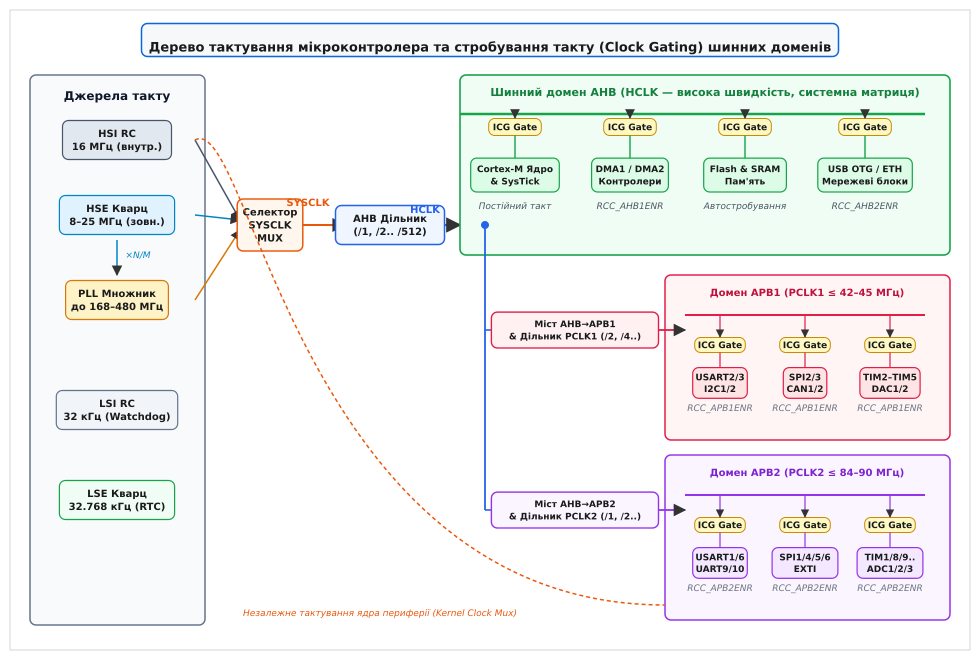
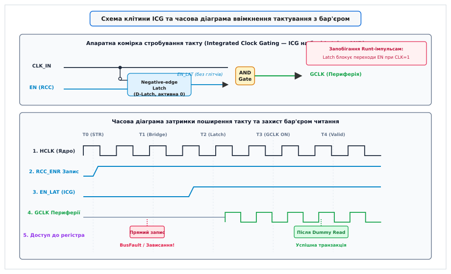

# Тактування периферії: ввімкнення й тактові домени

<preknowlist>
- [Тактування й живлення](root:hw-arch/clock-power) — первинні джерела такту, RC-генератори, кварцові резонатори, помножувачі PLL та структура тактових сигналів.
- [Шини AHB та APB](root:hw-arch/ahb-apb-bus) — магістральні та периферійні шини стандарту AMBA, мости, тактові домени та протокол обміну.
- [Шинна матриця](root:hw-arch/bus-matrix) — комутація багатомайстрових систем, арбітраж транзакцій та паралельний доступ до пам'яті й периферії.
- [Cortex-M](root:hw-arch/cortex-m) — архітектура процесорного ядра, системні шини ICODE/DCODE/SYSTEM, конвеєр виконання та шинні інтерфейси.
- [Обробка винятків процесора](root:hw-arch/cpu-exception-handling) — апаратні переривання, статусний регістр CFSR/BFSR, збої шини та обробник HardFault.
- [Бар'єри пам'яті](root:hw-arch/memory-barrier-instructions) — апаратні інструкції DMB, DSB, ISB для впорядкування доступу до пам'яті та периферійних блоків.
- [Режими сну](root:hw-arch/sleep-modes) — стани зниженого енергоспоживання (Sleep, Stop, Standby), керування живленням та збереження контексту.
</preknowlist>

Коли мікроконтролер виходить зі стану апаратного скидання (англ. *Reset*), процесорне ядро починає вибірку інструкцій із Flash-пам'яті на базовій частоті внутрішнього RC-генератора. Якщо першим же рядком коду прошивка спробує налаштувати послідовний порт і виконає запис у конфігураційний регістр `USART1->CR1 = 0x200C`, обчислювальний конвеєр негайно зупиниться, ядро згенерує апаратний виняток `BusFault` або `HardFault`, а система перейде в нескінченний цикл аварійного скидання. Спроба звернутися до адреси `0x40011000` провалюється не через дефект кремнію чи помилку адресного простору, а тому, що тактовий сигнал на цей модуль апаратно вимкнено в системному контролері тактування. Кінцевий автомат шинного інтерфейсу модуля залишається замороженим у статичному стані, його тригери знеструмлені за тактом, і шинний міст не отримує підтвердження готовності транзакції.

Вимкнення тактування невикористовуваних блоків (англ. *clock gating* — стробування такту) є головним апаратним механізмом збереження енергії в сучасних мікроконтролерах. У кристалах із десятками інтегрованих периферійних модулів (від інтерфейсів I2C, SPI, UART до складних криптографічних прискорювачів, АЦП і контролерів USB/Ethernet) подача тактового сигналу на всю схему одночасно призвела б до споживання десятків або сотень міліамперів струму навіть у стані повного простою прошивки. Тому після скидання апаратура тримає майже всі периферійні вузли знеструмленими за тактом. Програмне забезпечення зобов'язане явно подати тактовий сигнал на потрібний блок перед будь-яким зверненням до його регістрів, врахувати затримку поширення сигналу через шинні мости та коректно вимкнути тактування після завершення роботи.


*Дерево тактування мікроконтролера та стробування такту шинних доменів. Від первинних джерел через матрицю селектора SYSCLK і дільники частота розподіляється по доменах AHB, APB1 та APB2. Кожен периферійний модуль під'єднаний через спеціалізовану комірку стробування такту ICG, керовану відповідними бітами регістрів RCC.*

---

## Фізика енергоспоживання КМОН-структур і необхідність стробування такту

Щоб зрозуміти, чому ненавантажений цифровий блок споживає енергію при подачі тактового сигналу, необхідно звернутися до фізики функціонування комплементарних структур метал-оксид-напівпровідник (КМОН, англ. *CMOS — Complementary Metal-Oxide-Semiconductor*, від лат. *complementum* — доповнення).

Загальна електрична потужність `P_total`, яку розсіює цифровий кремнієвий кристал, складається з двох компонентів: статичної потужності `P_stat` та динамічної потужності `P_dyn`:

```
P_total = P_dyn + P_stat
        = (α · C_L · V_DD² · f) + (I_leak · V_DD)    [загальне рівняння потужності КМОН]
```

Розглянемо фізичну природу кожного параметра у виразі:
1. `V_DD` — напруга живлення цифрового ядра та периферійних доменів (зазвичай 1.2–3.3 В). Оскільки напруга входить у формулу динамічної потужності у квадраті, будь-яке її зниження дає квадратичний виграш у енергоефективності.
2. `I_leak` — сумарний статичний струм витоку (англ. *leakage current*), що виникає через тунельний ефект крізь надтонкий підзатворний діелектрик польових транзисторів та зворотні струми зміщених p-n переходів. Цей струм протікає завжди, коли на транзистор подано напругу, незалежно від наявності тактування.
3. `f` — тактова частота перемикання цифрової схеми в герцах.
4. `C_L` — сумарна навантажувальна та паразитна ємність (англ. *load capacitance*), яка перезаряджається при кожному перемиканні логічного рівня: ємності затворів наступних логічних вентилів, паразитна ємність з'єднувальних металевих провідників на кристалі та ємності p-n переходів стік-витік.
5. `α` — коефіцієнт активності перемикання (англ. *switching activity factor*, від 0.0 до 1.0), що показує, яка середня частка вузлів схеми змінює свій логічний стан (з 0 на 1 або з 1 на 0) за один тактовий період.

У статичному стані, коли логічні рівні у схемі не змінюються, обидва транзистори класичного КМОН-інвертора (верхній p-канальний і нижній n-канальний) одночасно не проводять струм: один із них завжди закритий. Струм від джерела живлення до землі в цей момент визначається лише мікроскопічним струмом витоку `I_leak`.

Проте в момент перемикання логічного рівня відбуваються два фізичні процеси:
- **Перезаряджання ємності `C_L`**: щоб перевести лінію з логічного 0 у логічну 1, конденсатор ємністю `C_L` заряджається від джерела живлення `V_DD` через p-канальний транзистор. При цьому енергія `E_charge = C_L · V_DD²` забирається від джерела, рівно половина її розсіюється у вигляді тепла на активному опорі відкритого каналу транзистора, а друга половина запасається в електричному полі ємності. При подальшому перемиканні з 1 в 0 накопичена енергія скидається на шину землі через n-канальний транзистор і також повністю перетворюється на тепло.
- **Наскрізний струм короткого замикання** (англ. *crowbar / short-circuit current*): протягом короткого проміжку часу (десятки пікосекунд), коли вхідний сигнал перетинає порогову напругу, обидва транзистори інвертора опиняються частково відкритими одночасно, створюючи прямий шлях витоку струму з шини живлення в землю.

```
+V_DD
  │
  ├───┐
  │   │  p-MOS (заряджає C_L при 0 → 1)
 ─┴─  │
 ─┬─ ◄┘  I_charge
  │
  ├─────────────── Out ───┐
  │                       │
 ─┴─ ◄┐  I_discharge      ┴  C_L (паразитна ємність)
 ─┬─  │                   ┬
  │   │  n-MOS (розряджає C_L при 1 → 0)
  ├───┘
  │
 === GND
```

Головний парадокс цифрової схемотехніки полягає в тому, що **тактова мережа (англ. *clock distribution tree*) має максимальний коефіцієнт активності `α = 1.0`**. У той час як тригери конвеєра даних і арифметико-логічні блоки перемикаються лише тоді, коли надходять нові дані (середній `α` для логіки даних становить від 0.05 до 0.15), тактові лінії перемикаються двічі за кожен період такту абсолютно завжди.

Розгалужені тактові буфери, провідники довжиною в міліметри та входи синхронізації тисяч тригерів периферійного модуля утворюють колосальну сумарну ємність `C_clock`. У типовому мікроконтролері або системі на кристалі (SoC) від **30% до 50% всієї динамічної енергії кристала розсіюється виключно на тактовій мережі**.

Якщо мікроконтролер із частотою 168 МГц містить 40 периферійних блоків, і всі вони отримують тактовий сигнал, сумарний струм споживання ядра й периферії може складати 80–120 мА. Якщо ж за допомогою стробування такту подавати сигнал лише на один активний UART і один системний таймер, споживання падає до 8–15 мА. Тобто вимкнення тактування невикористовуваних блоків знижує споживання струму в рази або навіть на порядки, не вимагаючи відключення фізичного живлення з тригерів і повністю зберігаючи вміст конфігураційних регістрів периферії.

---

## Архітектура тактових доменів мікроконтролера

Мікроконтролер не є однорідним обчислювальним полем: він об'єднує швидкісні процесорні ядра, масиви пам'яті, широкосмугові контролери прямого доступу до пам'яті (DMA) та десятки повільних інтерфейсів введення-виведення. Подавати єдиний тактовий сигнал високої частоти на всі ці вузли неможливо через технологічні, енергетичні та фізичні обмеження.

Тому внутрішній простір мікроконтролера розділено на окремі **тактові домени** (англ. *clock domains*), кожен із яких тактується власною похідною частотою від центрального дерева тактування.

```
                           ┌───────────────────────────────┐
                           │   Головне джерело (PLL/HSE)   │
                           └──────────────┬────────────────┘
                                          │ SYSCLK (напр. 168 МГц)
                                          ▼
                           ┌───────────────────────────────┐
                           │      AHB Prescaler (/1)       │
                           └──────────────┬────────────────┘
                                          │ HCLK (168 МГц)
                    ┌─────────────────────┴─────────────────────┐
                    ▼                                           ▼
   ┌─────────────────────────────────┐         ┌─────────────────────────────────┐
   │        Шинний домен AHB         │         │         Міст AHB → APB1         │
   │  Cortex-M, SRAM, Flash, DMA     │         │       (Дільник APB1 /4)         │
   └─────────────────────────────────┘         └────────────────┬────────────────┘
                                                                │ PCLK1 (42 МГц)
                                                                ▼
                                               ┌─────────────────────────────────┐
                                               │        Шинний домен APB1        │
                                               │   USART2, SPI2, I2C1, TIM2..5   │
                                               └─────────────────────────────────┘
```

### Домен системної шини AHB (HCLK)

Шина **AHB** (англ. *Advanced High-performance Bus*) є головною магістраллю кристала. Вона підтримує високу тактову частоту `HCLK` (до сотень мегагерців), конвеєрні пакети транзакцій (англ. *burst transfers*), передачу 32-розрядних, 64-розрядних або ширших слів даних за один такт і роздільні канали адреси та даних.

До тактового домену AHB належать:
- Процесорне ядро (або кілька ядер) та системний таймер `SysTick`;
- Контролери вбудованої Flash-пам'яті та оперативної пам'яті SRAM;
- Шинна матриця (англ. *Bus Matrix* / *Interconnect Crossbar*);
- Контролери прямого доступу до пам'яті (DMA1, DMA2, GDMA);
- Високошвидкісні периферійні контролери, що вимагають прямого доступу до пам'яті: інтерфейси Ethernet MAC, USB OTG High Speed / Full Speed, апаратні криптографічні прискорювачі (AES, SHA, TRNG), контролери дисплеїв (LTDC) та інтерфейси зовнішньої пам'яті (FMC/FSMC).

У сучасних чипах шина AHB часто додатково сегментується на кілька доменів:
- `AHB1` — комутація ядра, внутрішньої пам'яті та базових DMA;
- `AHB2` — цифрова камера (DCMI), генератор випадкових чисел, USB-стек;
- `AHB3` — зовнішня статична та динамічна пам'ять (NOR Flash, PSRAM, SDRAM).

Тактування кожного сегмента AHB керується незалежними регістрами `RCC_AHB1ENR`, `RCC_AHB2ENR` та `RCC_AHB3ENR`.

### Домени периферійних шин APB1 та APB2 (PCLK1 / PCLK2)

Шина **APB** (англ. *Advanced Peripheral Bus*) оптимізована для мінімального енергоспоживання та максимальної простоти кремнієвої реалізації. Інтерфейс APB не має складного конвеєра й арбітражу: кожна транзакція займає щонайменше два такти шини APB (фаза вибірки адреси `SETUP` та фаза передачі даних `ACCESS`).

Через спрощену схемотехніку інтерфейсів більшість периферійних блоків не здатні працювати на максимальній частоті ядра (168–480 МГц). Тому шина APB відокремлюється від AHB спеціальними мостами-дільниками:

1. **Домен APB1 (Low-Speed Domain — `PCLK1`)**: тактується частотою, яка формується за допомогою дільника `HCLK / Prescaler` (дільник 1, 2, 4, 8 або 16). Частота `PCLK1` зазвичай обмежена зверху (наприклад, не більше 42 МГц у STM32F4 або не більше 54 МГц у STM32H7 для деяких шин). До цього домену підключаються повільні комунікаційні інтерфейси: USART2..5, I2C1..3, SPI2..3, CAN-контролери, цифрово-аналогові перетворювачі (DAC) та інтерфейси базових таймерів (TIM2..TIM7).
2. **Домен APB2 (High-Speed Domain — `PCLK2`)**: тактується вищою частотою (часто дорівнює `HCLK` або `HCLK / 2`, наприклад до 84–90 МГц). До APB2 підключаються блоки, чутливі до часової роздільної здатності або пропускної здатності: швидкісні порти USART1/6, SPI1/4/5/6, аналогово-цифрові перетворювачі (ADC1..3), конфігурація системних переривань і ліній GPIO (SYSCFG/AFIO) та розширені таймери керування двигунами (TIM1, TIM8).

Вимкнення та ввімкнення тактування цих модулів зосереджено в регістрах `RCC_APB1ENR` та `RCC_APB2ENR` (або `RCC_APB1ENR1/2`, `RCC_APB2ENR1/2` у новіших сімействах).

### Робота моста AHB-to-APB та автомати протоколу транзакцій

Шинний міст (англ. *AHB-to-APB Bridge*) виконує дві критичні функції: перетворення конвеєрного швидкісного протоколу AHB у простий двотактний протокол APB та узгодження двох різних тактових доменів.

Протокол APB складається з трьох послідовних станів кінцевого автомата:
1. **Стан `IDLE` (Спокій)**: сигнал вибору периферійного модуля `PSELx = 0`, сигнал стробування `PENABLE = 0`. Лінії даних і адреси неактивні.
2. **Стан `SETUP` (Встановлення адреси)**: коли з шини AHB надходить транзакція, міст переходить у стан `SETUP`. Він виставляє адресу `PADDR`, прапорець напрямку передачі `PWRITE` (1 для запису, 0 для читання), дані запису `PWDATA` та піднімає сигнал вибору конкретного раба `PSELx = 1`. Сигнал `PENABLE` у цьому такті залишається рівним 0. Цей стан триває строго один такт шини `PCLK`.
3. **Стан `ACCESS` (Доступ до даних)**: у наступному такті `PCLK` міст піднімає строб `PENABLE = 1`. Периферійний модуль дешифрує команду й фіксує дані або виставляє дані читання на шину `PRDATA`. Якщо модуль готовий завершити транзакцію, він утримує лінію готовності `PREADY = 1`. Якщо периферійному блоку потрібен додатковий час (наприклад, внутрішній АЦП або перетворювач виконує цикл обробки), він скидає `PREADY = 0`, змушуючи міст вставляти додаткові такти очікування (англ. *Wait States*).

```
PCLK      ──┐   ┌───┐   ┌───┐   ┌───┐   ┌───
            └───┘   └───┘   └───┘   └───┘   
Стан APB    ── IDLE ─┼─ SETUP ──┼─ ACCESS ──┼─ IDLE ──
PSELx     ───────────┌──────────────────────┐─────────
PENABLE   ──────────────────────┌───────────┐─────────
PREADY    ──────────────────────┌───────────┐─────────
PR/WDATA  ───────────┼──────────┴───────────┼─────────
```

Якщо частоти шин співвідносяться як `HCLK = 4 · PCLK`, кожна двотактна транзакція на шині APB займає щонайменше 8 тактів процесорного ядра `HCLK`. Шинний міст затримує сигнал підтвердження на шині AHB (`HREADYOUT = 0`), тимчасово призупиняючи конвеєр процесора при спробі синхронного читання периферійного регістра.

### Синхронний та асинхронний поділ доменів (CDC)

Залежно від архітектури чипа зв'язок між AHB та APB реалізується одним із двох способів:
- **Синхронний міст (Synchronous Bridge)**: частота `PCLK` формується простим цілочисельним діленням `HCLK` (наприклад, /1, /2, /4, /8). Усі фронти `PCLK` строго збігаються з відповідними фронтами `HCLK`. У такому мості метастабільність відсутня, а передача сигналів узгоджується за допомогою логічних стробів дозволу такту.
- **Асинхронний міст (Asynchronous CDC Bridge)**: домени AHB та периферії тактуються від принципово різних фізичних джерел (наприклад, ядро від помножувача PLL на 200 МГц, а периферія від кварцу 24 МГц або RC-генератора 16 МГц). У цьому разі міст містить двостадійні тригерні синхронізатори сигналів керування (англ. *2-Flip-Flop Synchronizers*) та асинхронні черги FIFO для даних. Передача сигналів рукостискання `REQ`/`ACK` через межу доменів додає затримку у 2–3 такти приймаючого домену.

### Незалежні тактові домени ядер периферії (Kernel Clocks)

У класичних мікроконтролерах тактовий сигнал інтерфейсу шини (англ. *bus clock*) і тактовий сигнал функціонального ядра периферійного модуля (англ. *functional / kernel clock*) були жорстко об'єднані. Наприклад, швидкість передачі UART (*Baud Rate*) обчислювалася строго від поточної частоти шини `PCLK1`. Це створювало фундаментальну проблему: якщо прошивка для економії енергії знижувала частоту системного ядра й шини `PCLK1` у 4 рази, швидкість роботи всіх послідовних портів зміщувалася в 4 рази, руйнуючи обмін даними. Крім того, мікроконтролер не міг приймати байти по UART у режимах глибокого сну, оскільки шина APB була повністю зупинена.

Для вирішення цієї проблеми в сучасних архітектурах реалізовано **концепцію розділених тактових доменів** (англ. *Dual-Clock Domain / Independent Kernel Clocks*):

```
                       ┌────────────────────────┐
                       │   RCC_APB1ENR (Шина)   │
                       └───────────┬────────────┘
                                   │
              APB1 Bus Clock ─────►├─[ICG Gate]─► [APB Interface Logic]
                                                  (Регістри R/W, шина)
                                                           │
                                                  [Асинхронний FIFO/CDC]
                                                           │
                                                  [Функціональне Ядро]
                                                  (Генератор Baud, RX/TX)
                                                           ▲
                                   │                       │
              HSI16 / LSE ────────►├─[ICG Gate]────────────┘
                                   │
                       ┌───────────┴────────────┐
                       │   RCC_CCIPR (Ядро)     │
                       └────────────────────────┘
```

Периферійний модуль фізично отримує два незалежні тактові сигнали:
- **Шинний такт (Bus Interface Clock)** — синхронізує логіку читання та запису конфігураційних регістрів, підключену до шини APB. Цей сигнал стробується бітом регістра `RCC_APBxENR`.
- **Такт функціонального ядра (Kernel Functional Clock)** — тактує внутрішні лічильники, приймачі, передавачі, зміщувальні регістри та генератори швидкості. Джерело цього сигналу обирається в спеціальних регістрах конфігурації тактування периферії (наприклад, `RCC_CCIPR` або `RCC_D2CCIPR`) з-поміж HSI, HSE, LSE, LSI або спеціалізованих виходів PLL (PLL_P, PLL_Q, PLL_R).

Завдяки цьому модуль LPUART або I2C може безперервно тактуватися від ультранизькоспоживаючого генератора `LSE` (32.768 кГц) або стабільного `HSI` (16 МГц) навіть тоді, коли головні шини AHB та APB зупинені в режимі сну `Stop Mode`. При надходженні старт-біта або збігу адреси на шині I2C функціональне ядро самостійно приймає байт, зберігає його в апаратному FIFO й генерує апаратний сигнал пробудження (англ. *Wakeup Interrupt*), за яким блок RCC запускає головне тактове дерево ядра.

---

## Взаємозв'язок тактування периферії та портів введення-виведення (GPIO)

Типовою архітектурною пасткою для розробників вбудованих систем є ситуація, коли периферійний модуль налаштовано безпомилково, його тактування ввімкнено, конфігураційні регістри приймають значення, але на фізичних ніжках мікросхеми жодних сигналів не з'являється.

Причина полягає в тому, що сучасні мікроконтролери використовують **дворівневу систему тактування каналів введення-виведення**:

```
[Периферійний блок USART1] ─── (Тактується від APB2 via RCC_APB2ENR)
             │
             │ Внутрішня лінія USART1_TX
             ▼
[Мультиплексор GPIO Alternate Function] ─── (Тактується від AHB1 via RCC_AHB1ENR)
             │
             ▼
[Фізичний контакт PA9 на корпусі чипа]
```

1. **Домен периферійного модуля (наприклад, USART1 на шині APB2)**: формує логічні байти, синхронізує бітові інтервали та видає внутрішній сигнал передачі `TX`.
2. **Домен порту вводу-виводу (наприклад, GPIOA на шині AHB1)**: містить регістри конфігурації напрямку `GPIOx_MODER`, вибору альтернативної функції `GPIOx_AFR`, швидкості наростання фронту `GPIOx_OSPEEDR` та підтягуючих резисторів `GPIOx_PUPDR`.

Якщо прошивка ввімкнула тактування `USART1`, але **забула ввімкнути тактування `GPIOA`**:
- Записи в регістри `GPIOA->MODER` та `GPIOA->AFR[1]` будуть тихо проігноровані або викличуть збій шини AHB.
- Мультиплексор альтернативних функцій залишиться у вихідному стані `AF0` (системні входи/скидання).
- Контакт `PA9` залишиться у високоімпедансному стані або в режимі аналогового входу, і сигнал від передавача `USART1` фізично не дійде до вихідного драйвера ніжки.

Якщо ж навпаки ввімкнено тактування `GPIOA`, але **не ввімкнено `USART1`**:
- Контакт `PA9` коректно підключиться до внутрішньої шини `TX` периферійного блока через мультиплексор `AF7`.
- Проте сам передавач `USART1` залишається знеструмленим за тактом, тримаючи вихідну лінію в пасивному високому рівні (стан `IDLE`), і жоден байт не передаватиметься.

Для коректної роботи будь-якого апаратного інтерфейсу прошивка **завжди зобов'язана ввімкнути тактування обох пов'язаних доменів**: як шини периферійного модуля, так і шини відповідного порту GPIO.

---

## Апаратне стробування такту: від транзистора до комірки ICG

На схемотехнічному рівні вимкнення тактування є значно складнішим завданням, ніж проста комутація сигналу. Початківець може уявити схему вимкнення такту як звичайний логічний вентиль `AND` (або `NAND`), на один вхід якого подається тактовий генератор `CLK`, а на інший — сигнал дозволу `EN` від регістра керування:

```
CLK ───────┐
           ├─── AND ────── GCLK (Gated Clock)
EN ────────┘
```

Така наївна схема є **неприпустимою у високошвидкісних цифрових інтегральних схемах** і призводить до фатальних апаратних збоїв.

### Небезпека гонитви сигналів і укорочених імпульсів (Glitches & Runt Pulses)

Сигнал дозволу `EN` формується в результаті запису процесорного ядра в конфігураційний регістр. Момент перемикання сигналу `EN` є повністю асинхронним відносно тактового сигналу `CLK`, який у цей час проходить через вентиль `AND`.

Якщо сигнал `EN` підніметься з 0 в 1 або впаде з 1 в 0 у момент, коли на лінії `CLK` вже присутній високий логічний рівень 1, на виході `GCLK` сформується аномально вузький імпульс — **глітч** (англ. *glitch*) або **укорочений імпульс** (англ. *runt pulse*).

```
CLK      ───┐   ┌───┐   ┌───┐   ┌───┐   ┌───┐
            └───┘   └───┘   └───┘   └───┘   └───

EN       ─────────────┌─────────────────────────  (Перемикання при CLK=1)
                      │
                      ▼
GCLK     ─────────────┌─┐   ┌───┐   ┌───┐   ┌───
 (AND)                └─┘   └───┘   └───┘   └───
                      ▲
                Runt-імпульс! (Порушення t_setup / t_hold → Метастабільність!)
```

Тривалість такого імпульсу може становити сотні або десятки пікосекунд. Коли цей укорочений фронт потрапляє на тактові входи внутрішніх D-тригерів периферійного модуля:
1. Порушуються вимоги до часу встановлення (англ. *setup time*, `t_su`) та часу утримання (англ. *hold time*, `t_h`) внутрішніх сигналів даних.
2. Тригери потрапляють у стан **метастабільності** (англ. *metastability*) — їхній вихід зависає в проміжній аналоговій напрузі між логічним 0 і 1 на непередбачуваний час.
3. Кінцевий автомат периферійного модуля переходить у недопустимий, розсинхронізований стан, що викликає повне зависання апаратури або спотворення конфігураційних бітів.

### Схемотехніка інтегрованої комірки стробування ICG (Integrated Clock Gating Cell)

Щоб повністю виключити появу глітчів, у мікроконтролерах застосовують спеціалізовані стандартні цифрові комірки — **ICG** (англ. *Integrated Clock Gating Cell*).

Класична комірка ICG складається з двох компонентів:
1. Прозорої засувки (англ. *transparent D-latch*), яка активується **низьким рівнем** тактового сигналу (тобто працює по спадному рівню `CLK = 0`).
2. Логічного елемента `AND`.

```
                  ┌──────────────────────┐
                  │    Negative-Edge     │
 EN ─────────────►│ D            Latch Q ├─── EN_LAT ───┐
 (RCC)            │                      │              │
                  │        /CLK          │              ├─── AND ───► GCLK
                  └──────────┬───────────┘              │             (До периферії)
                             │                          │
 CLK ────────────────────────┴──────────────────────────┘
```

Принцип роботи ICG-комірки гарантує абсолютну безпеку перемикань:
1. **Коли `CLK = 1`**: вхід синхронізації засувки неактивний (заблокований інвертором). Засувка тримає на своєму виході `EN_LAT` попередній збережений стан. Будь-які зміни вхідного сигналу `EN` (навіть якщо процесор щойно виконав інструкцію запису в регістр RCC) повністю ігноруються засувкою і не можуть вплинути на лінію `EN_LAT`. Оскільки один із входів вентиля `AND` стабільний, вихід `GCLK` повторює форму вершини імпульсу `CLK` без будь-яких спотворень.
2. **Коли `CLK` падає в 0**: засувка стає прозорою. Новий логічний рівень із входу `EN` передається на вихід `EN_LAT`. Оскільки в цей момент на іншому вході вентиля `AND` присутній стабільний `CLK = 0`, зміна рівня на лінії `EN_LAT` не викликає жодних перепадів на виході `GCLK` (вихід залишається в надійному нулі).
3. **Коли `CLK` знову зростає з 0 в 1**: засувка знову закривається, фіксуючи новий рівень `EN_LAT`. Вентиль `AND` відкривається, і на вихід `GCLK` плавно та синхронно пропускається повний, чистий тактовий імпульс правильної форми.

Завдяки цьому ICG-комірка повністю ізолює периферію від часових флуктуацій шини запису й усуває будь-які паразитичні перепади сигналу.


*Схема клітини ICG та часова діаграма ввімкнення тактування з бар'єром. Засувка Latch затримує перемикання сигналу дозволу EN до моменту, коли CLK переходить у низький стан, унеможливлюючи утворення укорочених runt-імпульсів.*

---

## Часові затримки поширення (Clock Enable Latency) та стан перегонів

Використання безпечних ICG-комірок, багаторівневих прескейлерів та асинхронних шинних мостів породжує фундаментальну апаратну проблему: **ввімкнення тактування периферійного модуля відбувається не миттєво**.

Між моментом, коли процесор виконує асемблерну інструкцію запису в регістр контролера тактування, і моментом, коли перший стабільний тактовий імпульс дійде до регістрового файлу периферійного модуля, минає певна кількість тактів процесорного ядра.

### Ланцюжок поширення сигналу в мікроконтролері

Розглянемо покроковий фізичний маршрут виконання операції ввімкнення тактування:

```
[Ядро Cortex-M] ──(1) STR──► [Шинна матриця AHB] ──(2) Write──► [Блок RCC]
                                                                     │
                                                                 (3) RCC_ENR = 1
                                                                     │
                                                                     ▼
[Периферія APB] ◄──(6) Ready── [Шинний міст APB] ◄──(5) GCLK ON── [ICG Gate] ◄──(4) EN
```

1. **Такт T0**: Процесорне ядро Cortex-M виконує інструкцію збереження `STR R0, [R1]` (де `R1` вказує на регістр `RCC_AHB1ENR` або `RCC_APB1ENR`). Транзакція запису поміщається в буфер запису (англ. *Store / Write Buffer*) ядра.
2. **Такт T1**: Транзакція передається через шинну матрицю AHB до адресного простору блока RCC. Встановлюється відповідний тригер у конфігураційному регістрі.
3. **Такт T2**: Вихідний сигнал від тригера регістра RCC прямує фізичними провідниками на кристалі до входу `EN` комірки ICG потрібного периферійного модуля (наприклад, таймера або UART на шині APB).
4. **Такт T3**: ICG-комірка чекає спадного фронту тактового сигналу відповідної шини (`PCLK`), фіксує сигнал у засувці й відкриває вихідний вентиль `AND`.
5. **Такт T4**: Перший фронт тактового сигналу надходить на внутрішні тригери периферійного модуля. Кінцевий автомат шинного інтерфейсу модуля виходить зі стану скидання й стає готовим приймати транзакції шини APB.

Сумарна затримка становить **від 2 до 4 тактів шини AHB**. Якщо частота шини AHB значно перевищує частоту шини APB (наприклад, `HCLK = 168 МГц`, а `PCLK1 = 42 МГц` — різниця в 4 рази), затримка ввімкнення в перерахунку на такти процесорного ядра може сягати **6–16 процесорних циклів**!

### Стан перегонів при безпосередньому доступі

Розглянемо типовий C-код ініціалізації периферії:

:::tabs
```c
// Небезпечний код із прихованим станом перегонів
RCC->APB1ENR |= RCC_APB1ENR_USART2EN;  // Інструкція 1: Увімкнути тактування USART2
USART2->CR1 = USART_CR1_UE;            // Інструкція 2: Одразу налаштувати регістр USART2
```
```cpp
// Небезпечний код із прихованим станом перегонів
rcc->apb1enr |= rcc_apb1enr_usart2en;
usart2->cr1 = usart_cr1_ue;
```
:::

Компілятор генерує наступну послідовність асемблерних інструкцій:

```asm
LDR  R0, =0x40023840      ; Адреса RCC_APB1ENR
LDR  R1, [R0]             ; Читання поточного значення
ORR  R1, R1, #0x00020000  ; Встановлення біта USART2EN
STR  R1, [R0]             ; Запис нового значення в RCC_APB1ENR
LDR  R2, =0x40004400      ; Адреса USART2_CR1
MOV  R3, #0x2000          ; Значення USART_CR1_UE
STR  R3, [R2]             ; Запис у USART2_CR1 (Небезпечна інструкція!)
```

У мікроконтролерах із глибоким конвеєром (Cortex-M4, Cortex-M7, Cortex-M33) інструкція запису `STR R3, [R2]` потрапляє на конвеєр шини AHB практично в наступному такті після `STR R1, [R0]`. Транзакція запису в `USART2_CR1` миттєво долітає через шинну матрицю до моста `AHB-to-APB1`.

Але в цей самий момент тактовий сигнал `PCLK1` ще не встиг відкритися в комірці ICG модуля `USART2`!

Шинний міст виставляє сигнал вибору `PSEL = 1` і піднімає строб `PENABLE = 1`, проте логіка модуля USART2 знеструмлена за тактом. Лінія готовності `PREADY` залишається підтягнутою до нуля, або міст фіксує таймаут доступу, повертаючи ядру сигнал помилки `HRESP = ERROR`.

### Наслідки стану перегонів: від «фантомних» налаштувань до BusFault

Залежно від апаратної реалізації конкретного мікроконтролера виникає один із двох важких дефектів:

1. **Тихе ігнорування запису (Silent Failure)**: транзакція запису в `USART2->CR1` безслідно зникає, оскільки тригери регістра не тактуються. Прошивка продовжує виконуватися, вважаючи, що порт увімкнено, проте регістр залишається у значенні 0x00000000. Подальші спроби передати дані зависають у вічних циклах очікування прапорів готовності (наприклад, `while (!(USART2->SR & USART_SR_TXE));`).
2. **Апаратний збій шини (Precise / Imprecise Bus Fault)**: міст фіксує звернення до нетактованої периферії й генерує апаратний сигнал помилки шини. Процесор перериває нормальний хід програми й переходить в обробник `BusFault_Handler` або `HardFault_Handler`.

---

## Методи безпечної синхронізації та захист від збоїв шини

Для гарантованого запобігання стану перегонів необхідно змусити процесорне ядро витримати гарантовану затримку між записом у регістр RCC та першим зверненням до регістрів периферійного модуля.

Існує три методи досягнення такої затримки:

### 1. Метод фіктивного читання (Dummy Read / Read-After-Write Back)

Найбільш надійним, апаратно незалежним і стандартизованим методом є виконання **фіктивного читання регістра RCC назад одразу після запису**:

:::tabs
```c
RCC->APB1ENR |= RCC_APB1ENR_USART2EN;  // Запис: ініціювати ввімкнення тактування
(void)RCC->APB1ENR;                     // Фіктивне читання: бар'єр завершення транзакції
USART2->CR1 = USART_CR1_UE;            // Безпечний доступ: тактування гарантовано активне
```
```cpp
rcc->apb1enr |= rcc_apb1enr_usart2en;
[[maybe_unused]] volatile auto dummy = rcc->apb1enr; // Бар'єр завершення транзакції
usart2->cr1 = usart_cr1_ue;
```
:::

Чому це працює на рівні заліза:
1. Інструкція читання `LDR` вимагає від ядра повернути реальні дані з шини AHB.
2. Процесор не може завершити фазу виконання інструкції `LDR`, поки шинний контролер RCC не видасть прочитане значення на шину даних.
3. Це примусово вичерпує (англ. *flush / drain*) буфер запису процесора, змушує шинну матрицю завершити попередню транзакцію запису та гарантує затримку щонайменше в 2–3 такти AHB.
4. До моменту, коли процесор перейде до виконання наступної інструкції `USART2->CR1 = ...`, сигнал `EN` уже надійно закріпиться в ICG-комірці периферії.

У бібліотеках виробників мікроконтролерів (зокрема STM32Cube HAL / LL) цей підхід реалізовано у вигляді макросів:

:::tabs
```c
#define __HAL_RCC_USART2_CLK_ENABLE()   do { \
    __IO uint32_t tmpreg; \
    SET_BIT(RCC->APB1ENR, RCC_APB1ENR_USART2EN); \
    /* Затримка після ввімкнення периферійного тактування */ \
    tmpreg = READ_BIT(RCC->APB1ENR, RCC_APB1ENR_USART2EN); \
    UNUSED(tmpreg); \
} while(0)
```
```cpp
template <typename RccType>
constexpr void enable_usart2_clock(RccType& rcc) noexcept {
    rcc.apb1enr |= (1U << 17);
    [[maybe_unused]] volatile auto barrier = rcc.apb1enr;
}
```
:::

Змінна `tmpreg` оголошена як `__IO` (тобто `volatile`), що запобігає її оптимізації та видаленню компілятором навіть при максимальних рівнях оптимізації `-O2`, `-O3` чи `-Os`.

### 2. Архітектурні бар'єри синхронізації пам'яті (DSB)

У процесорах архітектури ARMv7-M / ARMv8-M (Cortex-M3, M4, M7, M33) апаратний конвеєр може змінювати порядок виконання звернень до пам'яті та периферії або утримувати транзакції запису в буфері відкладеного запису (англ. *Write Buffer*).

Інструкція **`__DSB()`** (англ. *Data Synchronization Barrier* — бар'єр синхронізації даних) гарантує, що жодна наступна інструкція в потоці команд не почне виконуватися, поки всі попередні транзакції доступу до пам'яті та периферійних шин (включно із записами в черзі Store Buffer) не будуть фізично завершені на шині.

:::tabs
```c
RCC->AHB1ENR |= RCC_AHB1ENR_GPIOAEN;
__DSB(); // Очікування завершення запису на шині AHB
GPIOA->MODER |= (1U << (5 * 2));
```
```cpp
rcc->ahb1enr |= rcc_ahb1enr_gpioaen;
asm volatile("dsb" ::: "memory"); // Бар'єр синхронізації пам'яті
gpioa->moder |= (1U << (5 * 2));
```
:::

Проте слід пам'ятати: `__DSB()` гарантує завершення транзакції на шині AHB до блоку RCC, але не додає затримки на час відкриття ICG-засувки на повільній шині APB. Тому для шин APB фіктивне читання `(void)RCC->APB1ENR` є більш надійним засобом, ніж одиночний `__DSB()`.

### 3. Порівняння затримок для різних ядер Cortex-M

| Архітектура ядра | Тип конвеєра | Буфер запису (Store Buffer) | Рекомендований механізм безпеки |
|---|---|---|---|
| **Cortex-M0 / M0+** | 2-стадійний, Von Neumann | Відсутній (або 1 запис) | Достатньо 1–2 тактів NOP або фіктивного читання |
| **Cortex-M3 / M4** | 3-стадійний, Harvard | Присутній буфер запису | Фіктивне читання `(void)RCC->ENR` |
| **Cortex-M7** | 6-стадійний, Dual-Issue, Superscalar | Глибокий FIFO буфер запису, AXI/AHB | Фіктивне читання + `__DSB()` обов'язково |
| **Cortex-M33 / M55** | 3–4 стадії, TrustZone | Буфер запису + перевірка SAU/MPC | Фіктивне читання + `__DSB()` |

На ядрі **Cortex-M7** (наприклад, у мікроконтролерах STM32H7 із тактовою частотою до 480–550 МГц) суперскалярний конвеєр може одночасно видавати дві інструкції за один такт (*Dual-issue*). Без фіктивного читання та `__DSB()` збій при ініціалізації периферії на Cortex-M7 виникає майже у 100% випадків.

---

## Керування апаратним скиданням периферії (Peripheral Reset Control)

Поряд із регістрами ввімкнення тактування `RCC_xxxENR` кожен блок контролера тактування містить парні регістри апаратного скидання периферійних модулів — **`RCC_AHBxRSTR`** та **`RCC_APBxRSTR`** (англ. *Reset Registers*).

```
                      ┌────────────────────────────┐
                      │   RCC_APB1RSTR (Скидання)  │
                      └─────────────┬──────────────┘
                                    │
                                    ▼
       ┌──────────┐          ┌──────────────┐          ┌────────────────┐
       │ Тактування│ ───────► │   Модуль     │ ◄───────┤ Лінія скидання │
       │ активне  │          │   USART2     │          │ nRESET = 0     │
       └──────────┘          └──────────────┘          └────────────────┘
```

### Фізичний механізм скидання та відновлення завислої периферії

Якщо в процесі роботи системи внаслідок електромагнітної завади, просідання живлення або некоректної послідовності передачі даних периферійний модуль зависає (наприклад, апаратний блок I2C переходить у стан блокування `BUSY` через заклинювання веденого пристрою на лінії `SDA`), одного лише вимкнення й повторного ввімкнення тактування **недостатньо**.

Тригери внутрішніх регістрів периферії при вимкненні такту зберігають свій попередній помилковий стан завдяки наявності постійної напруги живлення. Щоб примусово повернути модуль у вихідний стан, визначений документацією (*Reset State*), необхідно виконати процедуру **програмного апаратного скидання**:

1. Встановити відповідний біт у регістрі `RCC_APBxRSTR` у 1 (підняти лінію внутрішнього скидання модуля `nRESET = 0`).
2. Витримати коротку затримку (щонайменше 1–2 такти шини).
3. Скинути біт у регістрі `RCC_APBxRSTR` назад у 0 (зняти скидання `nRESET = 1`).
4. Повторно ініціалізувати конфігураційні регістри модуля.

:::tabs
:::code peripheral-clock-enable-d/c/fizychnyi-mekhanizm.c
:::code peripheral-clock-enable-d/cpp/fizychnyi-mekhanizm.cpp
:::

---

## Діагностика збоїв нетактованої периферії та винятки BusFault

Коли прошивка намагається прочитати або записати регістр периферійного модуля з вимкненим тактуванням, процесор Cortex-M ініціює апаратний виняток. Розуміння механізму діагностики таких помилок дозволяє за лічені хвилини локалізувати збій у складних вбудованих системах.

```
       [Звернення до знеструмленого регістра]
                         │
                         ▼
        [Шинний міст генерує HRESP = ERROR]
                         │
                         ▼
          ┌─────────────────────────────┐
          │   SCB->SHCSR & BUSFAULTENA? │
          └──────────────┬──────────────┘
                         │
            ┌────────────┴────────────┐
         ТАК│                         │НІ
            ▼                         ▼
   [BusFault_Handler]        [HardFault_Handler]
   (BFSR аналіз)             (Ескалація винятку)
```

### Точні та неточні шинні помилки (Precise vs Imprecise Bus Fault)

Системний блок керування ядром (SCB) фіксує причину помилки в регістрі статусу збоїв конфігурації **`SCB->CFSR`** (зокрема в байті `BFSR` — *BusFault Status Register*):

1. **Точна помилка шини (Precise Data Access Violation — `PRECISERR`, біт 1 у BFSR)**:
   - Виникає при операціях **читання** даних (`LDR`) або при операціях **небуферизованого запису**.
   - Процесор точно знає, яка саме інструкція викликала збій.
   - Біт `BFARVALID` (біт 7 у BFSR) встановлюється в 1.
   - Регістр адреси збою шини **`SCB->BFAR`** містить точну фізичну адресу периферійного регістра (наприклад, `0x40004400` для `USART2_CR1`), до якого намагалася звернутися програма!
2. **Неточна помилка шини (Imprecise Data Access Violation — `IMPRECISERR`, біт 2 у BFSR)**:
   - Виникає при **буферизованому записі** (`STR`), коли ядро скинуло дані в буфер запису (Store Buffer) і продовжило виконання наступних інструкцій.
   - Помилка від шинного моста повертається через 2–4 такти, коли ядро вже відійшло від аварійної інструкції на кілька кроків вперед.
   - Процесор не може відновити точну адресу в `BFAR` (`BFARVALID = 0`), а збережений у стеку лічильник інструкцій `PC` вказує на наступні рядки коду, які самі по собі є абсолютно коректними.

### Покрокове налагодження через GDB та OpenOCD

Коли під час розробки або тестування прошивка раптово зупиняється в обробнику `HardFault_Handler`, першим кроком інженера має бути перевірка, чи не викликано збій доступом до знеструмленого модуля:

1. **Зупинити виконання в GDB** та прочитати покажчик стека головного стека `MSP` або поточного стека завдань `PSP`:
   ```gdb
   (gdb) info registers msp psp
   msp            0x2001ff80
   ```
2. **Вивести 8 слів збереженого стекового кадру** (`r0`, `r1`, `r2`, `r3`, `r12`, `lr`, `pc`, `xpsr`):
   ```gdb
   (gdb) x/8xw $msp
   0x2001ff80: 0x00000000 0x40004400 0x00002000 0x08001235
   0x2001ff90: 0x20000100 0x08000547 0x080004e2 0x01000000
   ```
   У наведеному дампі значення на зміщенні +24 байти (`0x080004e2`) — це адреса `PC` інструкції, що викликала збій.
3. **Дизасемблювати код навколо адреси аварії**:
   ```gdb
   (gdb) disassemble /m 0x080004e2-8, 0x080004e2+8
   0x080004dc:  ldr  r1, [pc, #20]  ; r1 = 0x40004400 (USART2_CR1)
   0x080004de:  mov  r2, #0x2000    ; r2 = USART_CR1_UE
   => 0x080004e2:  str  r2, [r1, #0]  ; Запис у знеструмлений регістр!
   ```
4. **Прочитати системні регістри SCB та перевірити біт тактування в RCC**:
   ```gdb
   (gdb) print/x *(uint32_t*)0xE000ED28   ; SCB->CFSR
   $1 = 0x00008200                        ; Встановлено біти BFARVALID (0x80) та PRECISERR (0x02)
   (gdb) print/x *(uint32_t*)0xE000ED38   ; SCB->BFAR
   $2 = 0x40004400                        ; Адреса збою збігається з USART2_CR1!
   (gdb) print/x *(uint32_t*)0x40023840   ; RCC->APB1ENR
   $3 = 0x00000000                        ; Біт 17 (USART2EN) дорівнює 0 — тактування вимкнено!
   ```
Діагноз однозначний: прошивка виконала запис у регістр `USART2_CR1` без попереднього ввімкнення біта `RCC_APB1ENR_USART2EN`.

### Апаратне декодування стану при збої

За замовчуванням після скидання обробник `BusFault` вимкнено в регістрі `SCB->SHCSR`, і будь-яка помилка шини негайно ескалюється в загальний катастрофічний виняток **`HardFault`**.

Щоб отримувати точну діагностику, системний код повинен на етапі старту явно ввімкнути спеціалізовані обробники винятків:

:::tabs
```c
// Увімкнення апаратних обробників BusFault, UsageFault, MemManageFault
SCB->SHCSR |= SCB_SHCSR_BUSFAULTENA_Msk |
              SCB_SHCSR_USGFAULTENA_Msk |
              SCB_SHCSR_MEMFAULTENA_Msk;
```
```cpp
// Увімкнення апаратних обробників винятків Cortex-M
scb->shcsr |= scb_shcsr_busfaultena_msk |
              scb_shcsr_usgfaultena_msk |
              scb_shcsr_memfaultena_msk;
```
:::

Якщо стався збій, обробник перехоплює стек викликів і виводить діагностичну інформацію:

:::tabs
:::code peripheral-clock-enable-d/c/aparatne-dekoduvannia.c
:::code peripheral-clock-enable-d/cpp/aparatne-dekoduvannia.cpp
:::

---

## Порівняння архітектур тактування різних сімейств мікроконтролерів

Хоча фізичні принципи стробування такту універсальні для всієї напівпровідникової індустрії, конкретна регістрова модель та організація дерев тактування мають характерні особливості у різних виробників мікросхем:

### 1. STMicroelectronics (STM32)
- **Модуль**: `RCC` (Reset and Clock Control).
- **Особливості**: Чітка ієрархія шин `AHB1/AHB2/AHB3` та `APB1/APB2` (у серії STM32H7 додано шини `AHB4`, `APB3`, `APB4` для доменів живлення D1/D2/D3).
- **Подвоєння частоти таймерів**: Якщо прескейлер шини APB дорівнює /1, таймери отримують базову частоту `PCLK`. Якщо ж прескейлер APB > 1 (наприклад, /2 або /4), апаратна логіка RCC автоматично подвоює частоту, що подається на таймери (`2 · PCLK`), що дозволяє таймерам працювати на повній швидкості ядра `HCLK`.

### 2. NXP Semiconductors (LPC та i.MX RT)
- **Модуль**: `CCM` (Clock Control Module) у i.MX RT або `SYSCON` у серіях LPC.
- **Особливості**: Розділення на регістри керування живленням аналогових блоків (`PDRUNCFG`) та стробування цифрових шин (`AHBCLKCTRL0/1/2`). У кросовер-процесорах i.MX RT шинна матриця базується на високошвидкісній шині ARM AXI (частота до 600–1000 МГц), а периферія підключається через шину IPG (англ. *Internal Peripheral Gasket*).

### 3. Microchip / Atmel (SAMD / SAME)
- **Модуль**: `MCLK` (Main Clock Controller) та `GCLK` (Generic Clock Controller).
- **Особливості**: Багаторівнева матриця генераторів `GCLK_GEN[0..11]`. Кожен периферійний модуль (наприклад, універсальний послідовний контролер SERCOM) має незалежний мультиплексор вибору каналу `GCLK_PCHCTRL[ID]`, що дозволяє вільно призначати будь-яке джерело тактування будь-якому порту.

### 4. Espressif Systems (ESP32 / ESP32-S3)
- **Модуль**: `DPORT` / `SYSTEM`.
- **Особливості**: Регістри `SYSTEM_PERIP_CLK_EN0_REG` та `SYSTEM_PERIP_RST_EN0_REG`. Тактування комутується між двома обчислювальними ядрами Xtensa / RISC-V, блоками апаратного шифрування та радіочастотними трактами Wi-Fi/Bluetooth.

### 5. Raspberry Pi (RP2040 / RP2350)
- **Модуль**: `CLOCKS` та `RESETS`.
- **Особливості**: Стробування організовано через масив бітових масок `clocks_hw->clk_peri` та апаратні регістри скидання `resets_hw->reset`. Перед початком роботи з UART, SPI або PWM прошивка зобов'язана зняти сигнал скидання у блоці `RESETS` та дочекатися підтвердження готовності в регістрі `resets_hw->reset_done`.

---

## Програмні архітектурні патерни керування тактуванням

У реальних вбудованих проєктах прямий розсип викликів `RCC->APB1ENR |= ...` по всьому коду драйверів є джерелом важковиправних помилок:
1. **Передчасне вимкнення спільної шини**: якщо драйвер датчика температури I2C1 вимикає тактування після завершення читання, він ламає роботу драйвера паралельно підключеної EEPROM-пам'яті на тій самій шині I2C1.
2. **Зайві витрати енергії**: розробники часто вмикають усю периферію один раз на старті функції `main()` і ніколи її не вимикають, що скорочує час автономної роботи батарейного пристрою в 5–10 разів.
3. **Небезпека гонитви**: ручне керування бітами регістрів RCC без атомарності призводить до пошкодження сусідніх бітів при одночасному виклику з різних потоків або переривань.

Для системного вирішення цих проблем застосовують два ключові патерни: **підрахунок посилань (Reference Counting)** та **RAII-захисники (Resource Acquisition Is Initialization)**.

### Патерн 1: Диспетчер тактування з підрахунком посилань (C99)

Суть патерну: кожен периферійний модуль має внутрішній лічильник активних користувачів (`ref_count`).
- Коли перший клієнт викликає `acquire()`, лічильник змінюється з 0 на 1, і модуль фізично вмикає тактування в RCC із фіктивним читанням.
- При повторних викликах `acquire()` від інших підсистем лічильник просто інкрементується.
- Коли клієнт закінчує роботу й викликає `release()`, лічильник декрементується.
- Лише коли лічильник сягає строго нуля, тактування модуля апаратно вимикається в RCC.

```
Клієнт A ──► acquire(I2C1) ──► ref_count: 0 → 1 ──► [RCC: Тактування УВІМКНЕНО]
Клієнт B ──► acquire(I2C1) ──► ref_count: 1 → 2 ──► (Вже працює)
Клієнт A ──► release(I2C1) ──► ref_count: 2 → 1 ──► (Лишається ввімкненим)
Клієнт B ──► release(I2C1) ──► ref_count: 1 → 0 ──► [RCC: Тактування ВИМКНЕНО]
```

### Патерн 2: RAII-обгортки в C++20

У C++20 керування тактуванням зв'язується з часом життя об'єкта в області видимості. Захоплення такту відбувається в конструкторі, а гарантоване вимкнення — у деструкторі, навіть якщо функція завершилася аварійно через вихід за умовою `return` або генерацію винятку.

:::tabs
:::code peripheral-clock-enable-d/c/patern-2-raii-obhortky-v-c.c
:::code peripheral-clock-enable-d/cpp/patern-2-raii-obhortky-v-c.cpp
:::

Повний промисловий приклад диспетчера динамічного тактування з енергетичним моніторингом, захистом від збоїв та засинанням шин розгорнуто в окремій практичній вставці [Диспетчер динамічного тактування периферії з оптимізацією живлення](root:hw-arch/peripheral-clock-enable/proj-rcc-power-optimizer.md).

---

## Стробування такту в режимах низького енергоспоживання (Low-Power Modes)

Керування тактуванням у режимі нормальної роботи (англ. *Run Mode*) — це лише перший рівень оптимізації. Коли мікроконтролер переходить у режими низького енергоспоживання за інструкціями ядра `WFI` (англ. *Wait For Interrupt*) або `WFE` (англ. *Wait For Event*), активуються апаратні автомати стробування такту на рівні шинних доменів.

```
                    ┌───────────────────────────────┐
                    │      Режим роботи ядра        │
                    └──────────────┬────────────────┘
                                   │
              ┌────────────────────┼────────────────────┐
              ▼                    ▼                    ▼
      [Режим RUN]            [Режим SLEEP]         [Режим STOP]
   Ядро працює,           Ядро зупинено (WFI),  Усі PLL/HCLK вимкнено,
   тактування за          тактування за         працюють лише LSE/LSI
   RCC_AHBx/APBxENR       RCC_AHBx/APBxLPENR    та блоки пробудження
```

### Регістри стробування в режимі сну (RCC_xxxLPENR)

У мікроконтролерах Cortex-M поряд із кожним регістром `RCC_APBxENR` присутній парний регістр `RCC_APBxLPENR` (*Low Power Clock Enable Register*).

Ці регістри вирішують важливу задачу: коли процесор засинає в режимі `Sleep Mode`:
- Якщо біт у `RCC_APB1LPENR` встановлено в 1, периферійний модуль продовжує отримувати тактовий сигнал під час сну ядра. Наприклад, модуль UART продовжує приймати байти через DMA в пам'ять SRAM без участі процесора.
- Якщо біт у `RCC_APB1LPENR` скинуто в 0, апаратний блок автоматично вимикає ICG-комірку на весь час сну ядра, додатково заощаджуючи струм. Щойно ядро прокидається від переривання, тактовий сигнал повертається відповідно до бітів основного регістра `RCC_APB1ENR`.

:::tabs
```c
// Налаштування поведінки периферії в режимі сну (Sleep Mode)
RCC->APB1ENR   |= RCC_APB1ENR_USART2EN;   // USART2 активний під час роботи ядра
RCC->APB1LPENR &= ~RCC_APB1LPENR_USART2LPEN; // USART2 автоматично знеструмлюється за тактом під час сну!
```
```cpp
// Налаштування поведінки периферії в режимі сну
rcc->apb1enr |= rcc_apb1enr_usart2en;
rcc->apb1lpenr &= ~rcc_apb1lpenr_usart2lpen;
```
:::

### Розрахунок енергетичного бюджету батарейного пристрою

Розглянемо практичний інженерний розрахунок енергоспоживання автономного бездротового датчика, що живиться від літієвої батарейки типу CR2032 номінальною ємністю `E_bat = 220 мА·год` при напрузі `V_DD = 3.0 В`.

Пристрій виконує наступний робочий цикл тривалістю `T_cycle = 10 с`:
1. **Фаза вимірювання та обробки (`T_active = 5 мс`)**: ядро працює на частоті 64 МГц, активні модуль АЦП, таймер та Flash-пам'ять.
2. **Фаза передачі даних (`T_tx = 15 мс`)**: активний модуль SPI та радіотрансивер.
3. **Фаза сну (`T_sleep = 9.98 с`)**: ядро зупинено в очікуванні наступного таймерного переривання.

Порівняємо два підходи до керування тактуванням периферії:

#### Варіант А: Статичне тактування (усі периферійні модулі ввімкнені постійно)
- Струм споживання в активній фазі: `I_active_A = 24 мА`.
- Струм споживання у фазі сну (тактові дерева 30 периферійних модулів продовжують перемикатися): `I_sleep_A = 1.8 мА`.

Середній струм споживання за цикл:

```
I_avg_A = (I_active_A · (T_active + T_tx) + I_sleep_A · T_sleep) / T_cycle  [визначення середнього струму за цикл]
        = (24 мА · 0.02 с + 1.8 мА · 9.98 с) / 10 с                        [підстановка виміряних параметрів фаз]
        = (0.48 + 17.964) / 10                                              [обчислення спожитого заряду в мА·с]
        = 1.844 мА                                                          [середній постійний струм за 10 с]
```

Час автономної роботи від батареї:

```
Life_A = E_bat / I_avg_A                                                    [закон розряду хімічного джерела]
       = 220 мА·год / 1.844 мА                                              [номінальна ємність батареї CR2032]
       = 119 годин                                                          [приблизно 5 діб безперервної роботи]
```

#### Варіант Б: Динамічне стробування такту (Clock Gating + LPENR)
- Струм споживання в активній фазі (тактуються лише активні АЦП і SPI): `I_active_B = 9 мА`.
- Струм споживання у фазі сну (усі ICG-комірки шинних доменів перекриті): `I_sleep_B = 2.5 мкА` (0.0025 мА).

Середній струм споживання за цикл:

```
I_avg_B = (I_active_B · (T_active + T_tx) + I_sleep_B · T_sleep) / T_cycle  [середній струм зі стробуванням такту]
        = (9 мА · 0.02 с + 0.0025 мА · 9.98 с) / 10 с                      [параметри зі сплячими ICG-комірками]
        = (0.18 + 0.02495) / 10                                             [сумарний заряд активної та пасивної фаз]
        = 0.0205 мА                                                         [еквівалентний струм 20.5 мкА]
```

Час автономної роботи від батареї:

```
Life_B = E_bat / I_avg_B                                                    [розрахунок терміну служби батареї]
       = 220 мА·год / 0.0205 мА                                             [ємність елемента CR2032]
       = 10731 годин                                                        [приблизно 1.22 року автономної роботи]
```

Динамічне стробування тактування продовжує час роботи того самого пристрою від одного елемента живлення **більш ніж у 90 разів**!

### Автономне стробування такту (Autonomous Clock Gating)

У найновіших ультранизькоспоживаючих мікроконтролерах (STM32U5, NXP LPC55, Nordic nRF5340) реалізовано технологію **автономного стробування такту** (англ. *Autonomous Mode / Smart Gating*).

Вузол мікроконтролера містить внутрішній детектор активності:
- Якщо буфер передавача UART порожній і на лінії RX немає активності, ICG-комірка всередині модуля самостійно перекриває тактовий сигнал ядра модуля.
- Щойно на контакт RX надходить перший перепад напруги (спадний фронт старт-біта), внутрішня аналогова схема миттєво відкриває ICG-комірку за лічені наносекунди, забезпечуючи коректний прийом пакета без участі процесора й без програмних накладних витрат.

---

## Підсумок інженерних правил керування тактуванням

| Етап роботи | Правило / Механізм | Апаратна причина |
|---|---|---|
| **Після скидання (Reset)** | Усі периферійні модулі за замовчуванням знеструмлені за тактом | Зниження споживання струму з сотень міліамперів до базових мікроамперів |
| **Перед доступом до регістра** | Запис у `RCC_xxxENR` + фіктивне читання `(void)RCC_xxxENR` | Запобігання стану перегонів через затримку поширення такту в ICG-комірці |
| **При роботі з Cortex-M7/M33** | Додавання інструкції `__DSB()` після фіктивного читання | Очищення буфера запису (Store Buffer) та вирівнювання суперскалярного конвеєра |
| **Спільне використання шини** | Використання диспетчера з підрахунком посилань або RAII | Захист від випадкового вимкнення тактування шини паралельними драйверами |
| **Діагностика збоїв** | Аналіз `SCB->CFSR`, `BFSR` та адреси в `SCB->BFAR` | Локалізація спроб доступу до нетактованих модулів без перетворення на сліпий HardFault |
| **Оптимізація сну** | Налаштування бітів у регістрах `RCC_xxxLPENR` | Автоматичне вимкнення тактування пасивної периферії на час виконання `WFI` |
| **Аварійне відновлення** | Апаратне скидання через `RCC_xxxRSTR` | Примусове перезавантаження логіки завислого модуля без вимикання живлення плати |
| **Конфігурація контактів** | Одночасне ввімкнення тактування GPIO та периферії | Забезпечення живлення мультиплексора AF та периферійного трансивера |
