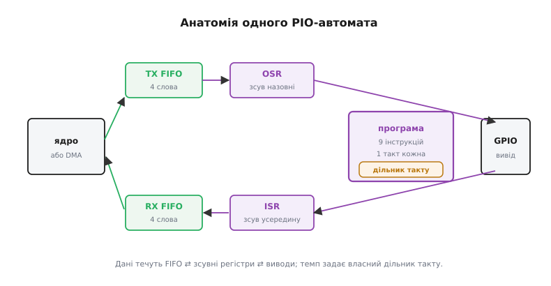
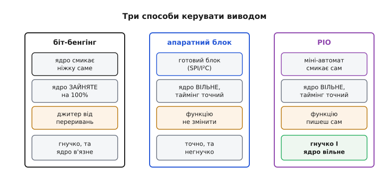

# ⚙️ PIO зсередини: міні-автомати, що самі генерують протоколи

> Алгоритмічна вставка до теми [PIO — периферія, яку програмуєш сам](root:hw-arch/rp2040-pio).
>
> PIO — це апаратна частина мікроконтролера RP2040 (не ESP32). Вставка заглядає всередину механізму й показує, чому це справжній третій шлях поряд із [біт-бенгінгом](root:sf-devices/gpio-registers) та апаратним блоком. На ESP32 найближчий аналог — RMT, яким керуються [адресовані світлодіоди WS2812](root:hw-motion/addressable-leds).

## Задача

Є дві крайнощі. Апаратні блоки (SPI/I²C/UART) швидкі й точні, повністю звільняють ядро — але роблять лише те, під що їх спроєктовано. Нестандартний протокол (WS2812, DShot, крок-крок) — і блок мовчить. [Біт-бенгінг](root:sf-devices/gpio-registers) — будь-який протокол, але ядро зайняте на 100%, і таймінг тремтить від кожного переривання.

Дилема гостра: **гнучкість АБО вільне ядро з точним таймінгом** — досі доводилося вибирати щось одне. Відповідь RP2040: PIO (Programmable I/O) — крихітні програмовані автомати прямо поряд із виводами. Мета вставки — зрозуміти, ЯК це влаштовано, а не просто прийняти «є така функція» на слово.

## Ідея

PIO — це набір незалежних **скінченних автоматів (state machines)**: на RP2040 їх 8 (два блоки по 4). Кожен виконує власну крихітну програму й самостійно керує виводами. Скінченний автомат буває й шаблоном у коді, що крутиться на ядрі (його розгортають усередині [задач](root:sf-os/tasks)); тут FSM вбудовано в залізо й тактується незалежно від ядра.

Один автомат має п'ять складових. **Крихітна програма** — набір команд лише з **9 інструкцій**: кожна виконується за один такт, тому таймінг детермінований. Ключові елементи — `side-set` (змінює стан виводів *паралельно* з будь-якою інструкцією, без додаткового такту) і вбудована затримка `[n]` (0–31 тактів прямо в інструкції). **Два зсувних регістри (shift registers)**: OSR (output shift register) передає біти з TX FIFO до виводів; ISR (input shift register) збирає вхідні біти від виводів до RX FIFO. **Два FIFO (TX/RX)** по 4 слова — міст до ядра або [DMA](root:hw-arch/dma-controller): ядро кладе дані пакетом і йде; з DMA-каналом на FIFO ядро не торкається передачі взагалі. **Дільник такту (clock divider)** з 16.8-бітною точністю — задає темп автомата незалежно від ядра. **Карта виводів** — кожен автомат отримує власну підмножину GPIO.

Ключова теза: **протокол = (мала програма) × (заданий дільником темп) × (потік байтів із FIFO)**. Протокол — це послідовність станів виводів у часі; тут її формує окремий автомат, а не ядро — тому ядро вільне, а таймінг детермінований.

*Анатомія одного PIO-автомата: FIFO ⇄ зсувні регістри OSR/ISR ⇄ виводи, крихітна програма й власний дільник такту.*

> 🔧 **Навіщо це.** Знаючи будову PIO, при [виборі мікроконтролера](root:embedded/mcu-selection) розумієш: нестандартний протокол можна реалізувати без навантаження на ядро і без тремтіння таймінгу — і це не біт-бенгінг (ядро не бере участі), і не апаратний блок (функцію пишеш сам).

## Сама програма: протокол як крихітний автомат

Сам PIO-автомат програмують НЕ на C, а спеціальним міні-асемблером **pioasm** — рідною мовою PIO. C тут — лише драйвер навколо неї. Нижче — реальна pioasm-програма [WS2812](root:hw-motion/addressable-leds) з її жорстким таймінгом (~1.25 мкс/біт, T1H ≈ 0.8 мкс, T0H ≈ 0.4 мкс):

:::tabs
:::code proj-pio/asm/main.s
:::code proj-pio/py/sama-prohrama-protokol-iak.py
:::

Один автомат + ця програма = повноцінний драйвер WS2812, ядро не бере участі.

## Драйвер: код, що заводить автомат

**Приклад (драйвер WS2812 на PIO).**

:::tabs
:::code proj-pio/c/main.c
:::code proj-pio/py/draiver-kod-shcho-zavodyt.py
:::

C лише налаштовує автомат і надсилає байти до FIFO — далі автомат сам формує точні наносекундні фронти. Підключивши DMA на FIFO, ядро не торкається передачі взагалі.

## Третій шлях: між біт-бенгінгом і блоком

*Три способи керувати виводами: біт-бенгінг (гнучко, але ядро зайняте), апаратний блок (ядро вільне, але функцію не змінити), PIO (і гнучко, і ядро вільне).*

PIO займає місце там, де раніше була порожнеча: **гнучкий + ядро вільне + таймінг детермінований**. Про межі — чесно: пам'ять інструкцій мала (32 інструкції на блок), складну логіку й математику автомат не потягне — це генератор і приймач таймінгово-точних протоколів, а не процесор.

Важлива межа: на ESP32 PIO в такому вигляді відсутній. Альтернативи там — **RMT** (саме ним керується WS2812), паралельний I2S/LCD, Dedicated GPIO. Ідея «програмованого I/O» вирішується іншими засобами; PIO — найчистіше її втілення, тому варто знати його при [виборі мікроконтролера](root:embedded/mcu-selection).

## Складність і пастки на МК

- **Інструкцій — лічені одиниці.** 32 інструкції на блок, спільні між автоматами. Складний протокол доводиться розподіляти між автоматами або частину виносити в C/DMA.
- **Таймінг рахується в тактах.** Тривалість біта = (інструкції + `[n]`) × період дільника. Помилишся — протокол «попливе» (WS2812 одразу показує неправильні кольори). Період кожної фази доводиться рахувати вручну.
- **FIFO малий (4 слова).** Без DMA ядро мусить вчасно підживлювати чергу; правильне рішення — DMA на FIFO.
- **Напрям і поріг зсуву.** `autopull` і поріг 24 біти легко переплутати — дані підуть дзеркально або з неправильною шириною. Класична мовчазна помилка.
- **Окрема мова й ланцюжок інструментів.** pioasm — окремий асемблер і окремий крок збірки; PIO-код не відлагодиш звичайним gdb — потрібен логічний аналізатор.
- **Непереносимий код.** Програма під PIO прив'язана до RP2040; на іншому мікроконтролері (ESP32 тощо) її доведеться переписувати під RMT або інший механізм із його [екосистеми](root:sys-bsystem/mcu-ecosystem).

## Підсумок

PIO — жменя крихітних автоматів із власним тактом, що виконують програми з 9 інструкцій і самостійно керують виводами. Він знімає старий компроміс: довільний протокол із детермінованим таймінгом і мінімальним навантаженням на ядро (з DMA — нульовим). Ціна — обмаль інструкцій, окремий асемблер pioasm і прив'язка до RP2040. Головна ідея: I/O-периферію можна не лише *налаштовувати*, а **програмувати** — і саме за це PIO варто знати, обираючи мікроконтролер.
