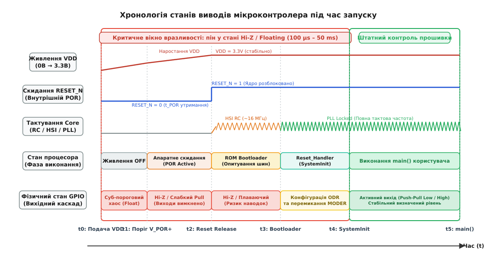
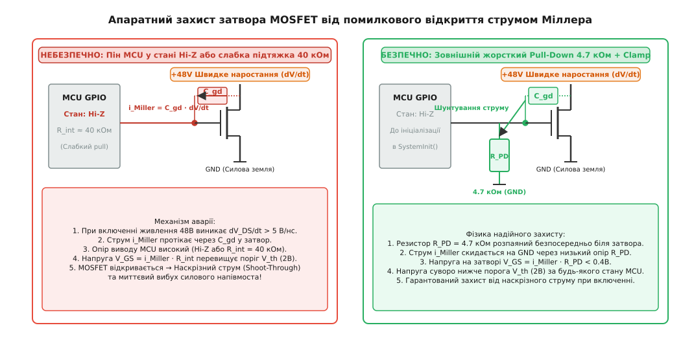

# Стан пінів у першу мить: що робить залізо, доки прошивка мовчить

<preknowlist>
- [Причини reset](root:hw-arch/reset-causes) — як формується сигнал скидання і як працює Power-on Reset.
- [Strapping-піни й режими завантаження](root:hw-arch/strapping-piny-i-rezhymy-zavantazhennia) — фіксація рівнів на виводах у момент відпускання Reset.
- [Тактування й живлення](root:hw-arch/clock-power) — стабілізація напруг VDD та часові інтервали запуску генераторів.
- [Регістри вводу-виводу (MMIO)](root:hw-arch/memory-mapped-io) — апаратні структури керування GPIO та конфігураційні регістри.
- [Мінімальна обв'язка](root:hw-arch/minimalna-obviazka) — базова схемотехніка ліній живлення та виводу скидання NRST.
</preknowlist>

Коли силове реле або польовий транзистор комутує напругу 48 В на силову шину інвертора безколекторного двигуна, напруга на виході вторинного імпульсного стабілізатора 3.3 В починає наростати з крутизною від кількох десятих до десятків вольтів за мікросекунду. У цей момент центральне ядро мікроконтролера ще не отримало стабільної частоти від кварцового резонатора, внутрішній фазовий автопідлаштовувач частоти (PLL) не ввійшов у синхронізм, а лічильник команд не вичитав навіть першої адреси з таблиці векторів переривань. Проте електричний контакт між виводами корпусу мікроконтролера та вхідними каскадами силових драйверів існує безперервно. Якщо лінія керування затвором нижнього або верхнього транзистора силового напівмоста залишається у невизначеному стані, паразитний струм через міжелектродні ємності здатний відкрити обидва ключі одночасно. Струм короткого замикання через напівміст сягає сотень амперів за лічені наносекунди, розриваючи пластикові корпуси транзисторів і випалюючи мідні доріжки плати ще до того, як процесор виконає найпершу інструкцію функції `SystemInit()`.

Ця катастрофічна затримка між появою фізичних напруг у схемі та початком виконання першого рядка коду прошивки є неминучою властивістю напівпровідникової мікроелектроніки. Вона триває від кількох сотень мікросекунд до десятків мілісекунд. Протягом цього часового вікна поведінка кожного цифрового виводу мікроконтролера (GPIO) визначається виключно базовою кремнієвою топологією кристала, станом внутрішніх транзисторних засувок скидання та зовнішніми пасивними колами на друкованій платі. Прошивка в цей час безсила: вона ще не існує як активний процес.

> 🔧 **Навіщо це.** Розуміння фізики поведінки виводів мікроконтролера до старту коду дає змогу усунути найбільш руйнівні апаратні дефекти силової та промислової електроніки: наскрізні струми (*shoot-through*) у півмостах та мостових перетворювачах, короткочасне клацання реле при ввімкненні приладу, неконтрольовану подачу напруги на нагрівачі, електрозапали чи лазери, а також зависання мікроконтролера через паразитне живлення периферійних мікросхем через захисні ESD-діоди плаваючих ліній.

---

### Хронологія запуску кристала: від нуля вольтів до першої інструкції `main()`

Щоб точно розрахувати часове вікно небезпеки, необхідно простежити покрокову послідовність процесів, які розгортаються всередині кремнієвого кристала під час подачі живлення (*Power-On Sequence*). Запуск мікроконтролера — це не миттєвий стрибок, а багатостадійний фізичний перехід через п'ять чітко розмежованих фаз.


*Часова діаграма станів піна та внутрішніх вузлів кристала від моменту подачі живлення VDD до запуску функції main(). Червоним виділено критичне вікно вразливості тривалістю від 100 мікросекунд до десятків мілісекунд, коли вихідний каскад GPIO перебуває у високоімпедансному плаваючому стані Hi-Z або має лише слабку внутрішню підтяжку, а будь-яка зовнішня наводка чи струм зміщення здатні призвести до аварійного спрацьовування силового навантаження.*

#### Фаза 0: Суб-пороговий стан (напруга живлення `0 < VDD < V_POR_OFF`)

У момент подачі первинної енергії напруга на шині `VDD` починає наростати від нуля. Доки `VDD` не досягне мінімального порога спрацьовування внутрішнього компаратора схеми скидання за живленням (*Power-On Reset*, `V_POR_OFF`, зазвичай `0.8–1.2 В`), внутрішні напівпровідникові структури чипа перебувають у неробочому, так званому суб-пороговому режимі (*Sub-threshold region*).

У цьому стані польові транзистори не мають повністю сформованого інверсійного каналу під затвором. Проте вони не є ідеальними ізоляторами: через канал протікає підпороговий струм витоку (*subthreshold leakage current*), величина якого експоненційно залежить від напруги на затворі:

```
I_sub ≈ I_0 · exp((V_GS - V_th) / (n · V_T))
```

де `V_T = k · T / q` — температурний потенціал (близько 26 мВ при кімнатній температурі), `n` — коефіцієнт підпорогової неідеальності (типово 1.2–1.8), а `V_th` — порогова напруга відкриття транзистора.

Диференційні підсилювачі внутрішнього джерела опорної напруги на забороненій зоні кремнію (бандгап, від англ. *bandgap reference*) не мають достатнього струму зміщення для стабілізації напруги. Внутрішні логічні вентилі не можуть сформувати визначені логічні рівні `0` або `1`. Транзистори вихідних каскадів портів вводу-виводу (GPIO) не отримують надійного замикаючого потенціалу на затворах.

У результаті опір між виводом мікроконтролера та внутрішніми шинами живлення і землі має нелінійний випадковий характер і може коливатися від десятків мегомів до одиниць кілоомів. Якщо на зовнішній друкованій лінії присутня паразитна напруга від інших незалежних джерел живлення (наприклад, від силової частини 12 В або сусідньої мікросхеми інтерфейсу), струм починає вільно протікати через кремнієві захисні діоди захисту від електростатичного розряду (*Electrostatic Discharge*, ESD) до внутрішньої шини `VDD`. Це явище називають ефектом паразитного живлення (*phantom powering*). Воно здатне викликати тиристорне замикання кристала (*SCR Latch-Up*), коли чотиришарова структура p-n-p-n на кремнієвій підкладці відкривається й закорочує лінії живлення намертво аж до повного зняття напруги.

#### Фаза 1: Апаратне утримання внутрішнього скидання (`V_POR+ < VDD`, `RESET_N = 0`)

Коли напруга `VDD` перетинає верхній поріг детектора `V_POR+` (наприклад, `1.71–1.92 В` для STM32 або `2.3 В` для ESP32), внутрішня аналогова схема POR прокидається і генерує сигнал системного скидання `RESET_N = 0`. Вбудований цифровий або аналоговий розширювач імпульсу (*pulse stretcher*) примусово утримує цей сигнал активним протягом фіксованого часу `t_POR` (типово від 1 до 10 мс). Це необхідно для гарантії того, що напруга живлення встигне повністю піднятися до номінальних 3.3 В і перехідні процеси у зовнішньому блоці живлення завершаться.

У багатьох сучасних мікроконтролерах паралельно з POR працює детектор просідання живлення (*Brown-Out Reset*, BOR). Якщо напруга живлення під час запуску коливається через заряд великих накопичувальних конденсаторів, схема BOR з гістерезисом `50–100 мВ` миттєво скидає внутрішній таймер у нуль, запобігаючи запуску ядра при нестабільній напрузі.

У фазі активного `RESET_N = 0`:
1. Усі внутрішні тригери та регістри конфігурації периферії апаратно примусово скидаються в початковий стан (*reset state*).
2. Спеціальні затискні транзистори (*reset clamp FETs*) у кожній комірці вводу-виводу притягують затвори вихідних силових P-MOS та N-MOS транзисторів до шин `VDD` та `GND` відповідно.
3. Обидва вихідні транзистори намертво закриваються: вихід переходить у стан високого імпедансу (*High-Z / Floating Input*).
4. Ключі внутрішніх підтягувальних резисторів (Pull-Up та Pull-Down) відключаються або переводяться у стан за замовчуванням відповідно до апаратної маски конкретного піна.

#### Фаза 2: Зовнішнє апаратне скидання (`NRST` активний)

Якщо на платі встановлено кнопку скидання з фільтрувальним конденсатором або спеціалізовану мікросхему супервізора живлення (*Reset Supervisor IC*), вивід `NRST` може утримуватися на рівні землі значно довше за внутрішній таймер `t_POR`. Зовнішній конденсатор ємністю 100 нФ у парі з внутрішнім підтягувальним резистором `R_PU ≈ 40 кОм` формує сталу часу розряду/заряду:

```
τ = R_PU · C_ext
τ = 40 000 Ом · 100 · 10⁻⁹ Ф = 4.0 · 10⁻³ с = 4.0 мс
```

Для надійного скидання виробники регламентують мінімальну тривалість імпульсу низького рівня на вході `NRST` (`t_NRST_MIN`, зазвичай `20–50 мкс`), а також максимальну крутизну спаду напруги.

Протягом усіх цих 4 мілісекунд, а також у разі тривалого натискання кнопки скидання користувачем, цифрове ядро повністю зупинене. Виводи GPIO залишаються у стані високого імпедансу (*Hi-Z*). Будь-яке силове обладнання, підключене до пінів без зовнішніх схемотехнічних захисних ланцюгів, у цей тривалий інтервал перебуває під загрозою неконтрольованого увімкнення від статичних зарядів чи електромагнітних наводок.

#### Фаза 3: Вихід зі скидання, старт внутрішнього генератора та виконання ROM Bootloader

Коли лінія `NRST` відпускається і напруга на ній досягає порога логічної одиниці `V_IH` (близько `0.7 · VDD`), апаратний автомат запуску починає послідовність розгортання:
1. Вмикається внутрішній швидкодіючий RC-генератор (наприклад, HSI на 16 МГц у STM32 або Fast RC на 17.5 МГц у ESP32). Йому потрібно від 1 до 5 мікросекунд на стабілізацію амплітуди коливань.
2. Семплюються рівні на [strapping-пінах](root:hw-arch/strapping-piny-i-rezhymy-zavantazhennia) (таких як `BOOT0`, `GPIO0`, `MTDO`), фіксуючи вибраний апаратний режим завантаження у внутрішніх тригерах-засувках.
3. Процесор починає виконувати вшитий на заводі первинний завантажувач у масковому ПЗП (*System ROM Bootloader*).

Виконання ROM Bootloader може тривати від десятків мікросекунд до сотень мілісекунд. Наприклад, якщо чип сконфігуровано на перевірку інтерфейсів USB DFU, UART чи CAN для оновлення прошивки, завантажувач опитує периферійні шини, чекає стартових пакетів синхронізації або ініціалізує внутрішній контролер Flash-пам'яті. Увесь цей час усі користувацькі виводи GPIO, не задіяні безпосередньо у процесі завантаження, залишаються у вихідному апаратному стані скидання.

#### Фаза 4: Виконання `Reset_Handler` та системної ініціалізації `SystemInit()`

Коли ROM Bootloader передає керування на вектор скидання користувацької Flash-пам'яті, процесор переходить до виконання функції `Reset_Handler`, скомпільованої в користувацькій прошивці:
1. Ініціалізується покажчик вершини стека (`Main Stack Pointer`, MSP).
2. Виконується копіювання початкових значень глобальних змінних із секції `.data` у Flash-пам'яті в оперативну пам'ять SRAM.
3. Обнуляється секція неініціалізованих змінних `.bss`.
4. Викликається функція системного налаштування `SystemInit()`, яка зазвичай перемикає тактування на зовнішній високочастотний кварцовий резонатор (HSE) та очікує стабілізації амплітуди генерації і блокування синтезатора частоти PLL (*PLL Lock Time* триває від 100 мкс до 2 мс).
5. Викликаються конструктори глобальних об'єктів C++ (`__libc_init_array`).
6. Керування нарешті передається у функцію `main()`.

Лише всередині `main()` (або в кінці `SystemInit()`, якщо розробник свідомо виніс туди низькорівневий код) виконується перша команда конфігурації регістрів `GPIOx_MODER`, `GPIOx_ODR` чи `GPIOx_BSRR`.

Сумарна тривалість «сліпого вікна» від моменту появи силової напруги на платі до взяття виводів під контроль програмою складає:

```
t_vulnerable = t_power_ramp + t_POR + t_NRST + t_ROM + t_startup_code
t_vulnerable ≈ 2 мс + 4 мс + 1 мс + 15 мс + 3 мс ≈ 25 мс
```

У силовій електроніці 25 мілісекунд — це вічність. За цей час синусоїда мережевої напруги 50 Гц встигає зробити повний період, а наскрізний струм здатний випарувати кристал транзистора сотні тисяч разів поспіль.

---

### Внутрішня кремнієва архітектура комірки GPIO

Щоб розуміти, чому пін поводиться тим чи іншим чином, необхідно зазирнути під шар оксиду кремнію в топологію типової комірки цифрового порту вводу-виводу (*GPIO Pad*).

Кожен універсальний цифровий вивід сучасного мікроконтролера є складним аналогово-цифровим комутаційним вузлом, що містить шість функціональних блоків:

1. **Вихідний двотактний каскад (*Push-Pull Output Driver*):**
   Складається з потужного P-канального MOSFET у верхньому плечі (підтяжка до `VDD`) та N-канального MOSFET у нижньому плечі (притискання до `GND`). Затвори цих транзисторів керуються окремими логічними сигналами через схему формування мертвого часу, що запобігає їхньому одночасному відкриттю під час перемикання. Коли вивід конфігурується як вхід або перебуває у стані скидання, лінія дозволу виходу `OE_N` (*Output Enable Inverted*) переводиться у стан логічної одиниці, що надійно замикає обидва транзистори.

2. **Внутрішні резистори слабкої підтяжки (*Weak Pull-Up / Pull-Down*):**
   У кремнії підтяжки майже ніколи не виготовляють як суто омічні полікремнієві резистори через дефіцит площі кристала. Замість цього застосовують польові транзистори зі спеціально розрахованим довгим і вузьким каналом (*Long-Channel MOSFETs*). При відкритті такий транзистор працює в лінійній або пологій ділянці вольт-амперної характеристики, еквівалентний опір якої становить `R_int ≈ 30–50 кОм` (а для деяких мікроконтролерів — від 20 до 80 кОм з урахуванням розкиду технологічного процесу, напруги та температури — *PVT variations*).
   Оскільки це напівпровідникові структури, їхній струм є нелінійним: при напругах на виводі, близьких до живильних рейок, ефективний опір значно зростає.

3. **Вхідний буфер з тригером Шмітта (*Schmitt Trigger Input Buffer*):**
   Перетворює аналогову напругу на піні у чіткі логічні рівні `0` та `1` з петлею гістерезису близько `200–400 мВ`. Вхід тригера Шмітта підключений до фізичної площадки постійно, якщо тільки пін не переведено в суто аналоговий режим (*Analog Mode*). Вхідна ємність затворів тригера Шмітта разом із захисними діодами та металізацією площадки утворює власну паразитну ємність виводу `C_pin ≈ 3–7 пФ`.
   Якщо напруга на вході тригера Шмітта повільно дрейфує в зоні перемикання через плаваючий стан піна, обидва внутрішні транзистори вхідного інвертора буфера частково відкриваються одночасно. Виникає так званий наскрізний струм короткого замикання вхідного каскаду (*Crowbar Current*), який може досягати від кількох десятків мікроамперів до кількох міліамперів на кожен пін, істотно розігріваючи мікроконтролер і розряджаючи батарею живлення.

4. **Захисні діоди від електростатичного розряду (*ESD Clamping Diodes*):**
   Верхній діод підключений анодом до піна, а катодом — до внутрішньої шини `VDD`. Нижній діод підключений анодом до шини `GND`, а катодом — до піна. Вони відкриваються і шунтують струм у шини живлення щоразу, коли напруга на виводі виходить за межі `[GND − 0.3 В; VDD + 0.3 В]`.
   На так званих пінах, толерантних до 5 В (*5V-Tolerant Pins*, наприклад, `FT` у STM32), верхній діод замінено на спеціальну каскодну структуру з плаваючим N-карманом (*Floating N-Well*), яка дозволяє подавати на пін напругу 5 В навіть тоді, коли мікроконтролер живиться від 3.3 В. Проте ця толерантність діє **виключно тоді, коли на шину `VDD` подано номінальну напругу живлення**. Якщо мікроконтролер знеструмлений або перебуває у стані скидання при нульовій напрузі `VDD`, плаваючий карман сідає на нуль, і зовнішня напруга 5 В починає живити весь чип через прямий перехід карманного p-n діода, викликаючи деградацію підзатворного діелектрика оксиду кремнію або несанкціоноване споживання струму.

5. **Аналоговий комутатор (*Analog Switch*):**
   Повністю відключає вхідний цифровий тригер Шмітта від площадки при переведенні піна в режим входу АЦП або виходу ЦАП. Це необхідно для того, щоб усунути витік струму крізь тригер Шмітта, коли аналогова напруга тривалий час перебуває в «сірій зоні» між логічним нулем і одиницею.

6. **Апаратна засувка конфігурації (*Configuration Latches*):**
   Керує режимами роботи каскаду. Усі лінії керування засувками під час активного сигналу `RESET_N` примусово скидаються в апаратний дефолт.

#### Апаратні стани за замовчуванням у різних мікроконтролерних архітектурах

Різні родини мікроконтролерів мають суттєво відмінну апаратну поведінку комірок GPIO у момент скидання:

| Родина мікроконтролерів | Стан більшості GPIO під час Reset | Стан спеціальних виводів | Причина такого схемотехнічного вибору виробником |
|:---|:---|:---|:---|
| **STM32F1 / F4** (ARM Cortex-M3/M4) | **Floating Input (Hi-Z)**, підтяжки вимкнені (`MODER = 00b, PUPDR = 00b`). | `PA14` (SWCLK): Pull-Down.<br>`PA13` (SWDIO): Pull-Up.<br>`PB4` (NJTRST): Pull-Up.<br>`PB3` (SWO): Hi-Z. | Забезпечення мінімального впливу на зовнішню схему за замовчуванням та гарантія підключення налагоджувача SWD/JTAG. |
| **STM32L4 / G4 / H7 / U5** | **Analog Mode (Hi-Z)**, тригер Шмітта відключений (`MODER = 11b, PUPDR = 00b`). | Налагоджувальні піни SWD зберігають підтяжки. | Радикальне усунення струмів витоку крізь цифрові вхідні буфери при плаваючих пінах у режимах ультранизького енергоспоживання. |
| **ESP32 / ESP32-S3** (Xtensa / RISC-V) | **Змішаний стан**: частина Hi-Z, частина з апаратними підтяжками. | `GPIO0`, `GPIO2`, `GPIO12`, `GPIO15` мають фіксовані Pull-Up/Pull-Down для зчитування strapping-режимів. | Необхідність вичитування апаратних параметрів завантаження кристала з ліній GPIO під час скидання. |
| **AVR ATmega328P** | **Tri-state (Hi-Z)**, `DDRx = 0, PORTx = 0`. | `RESET` має внутрішній Pull-Up ~50 кОм. | Класична архітектура безструмового входу. |
| **RP2040** (ARM Cortex-M0+) | **Input з увімкненим Pull-Down** (~50–80 кОм). | `QSPI` піни налаштовані під зовнішню Flash. | Захист ліній від плаваючого стану для зниження споживання та стабілізації невикористаних входів. |
| **NXP i.MX RT1060** (Cortex-M7) | **Hi-Z з увімкненим Keeper/Pull** залежно від конфігурації eFuse. | Піни завантаження зчитуються конфігуратором IOMUXC. | Гнучка маршрутизація складних інтерфейсів з можливістю апаратного утримання останнього логічного рівня (*Bus Keeper*). |

---

### Чотири смертельні небезпеки плаваючих пінів

Стан високого імпедансу (*Hi-Z*) означає, що вивід мікроконтролера електрично від'єднаний від внутрішніх джерел струму й шин живлення. З погляду мікроконтролера це найбільш безпечний стан, оскільки кристал не споживає енергії та не може створити короткого замикання за будь-якої полярності зовнішньої напруги. Проте з погляду зовнішньої схеми плаваючий провідник є антеною з нескінченним опором витоку, потенціал якої визначається виключно наведеними зарядами, паразитними ємностями монтажу та струмами витоку напівпровідників.

Розглянемо чотири головні сценарії відмови, з якими стикаються інженери на практиці.

#### 1. Наскрізні струми (Shoot-Through) у силових напівмостах

У будь-якому перетворювачі напруги (імпульсний стабілізатор Buck/Boost, перетворювач частоти для електродвигуна, інвертор сонячних батарей) базовим вузлом є стійка з двох транзисторів: верхнього (*High-Side*) та нижнього (*Low-Side*), підключених послідовно між шиною живлення високої напруги `V_BUS` (наприклад, 400 В) та силовою землею `GND_PWR`.

Керування транзисторами здійснюється через спеціалізовану мікросхему драйвера затворів (наприклад, IR2104, UCC27211, DRV8301, FD6288). Вхідні каскади таких драйверів виготовляються за високошвидкісною CMOS-технологією. Вхідний опір логічного входу драйвера перевищує `10¹² Ом`, а вхідна ємність становить `C_in ≈ 3–10 пФ`.

Якщо мікроконтролер підключений до входів `IN_HIGH` та `IN_LOW` драйвера напряму без зовнішніх підтяжок, під час скидання обидва входи драйвера опиняються у плаваючому стані. Паразитні ємності друкованої плати між лініями керування та сусідніми силовими шинами (де в момент увімкнення відбуваються стрибки напруги з крутизною `dV/dt > 10 В/нс`) інжектують заряд у плаваючі входи драйвера:

```
i_inject = C_pcb · (dV_BUS / dt)
```

При ємності монтажу `C_pcb ≈ 2 пФ` та стрибку напруги `dV/dt = 10 В/нс = 10 · 10⁹ В/с` струм інжекції становить:

```
i_inject = 2 · 10⁻¹² Ф · 10 · 10⁹ В/с = 0.02 А = 20 мА
```

Струм 20 мА миттєво (за частки наносекунди) заряджає вхідну ємність драйвера 5 пФ до напруги логічної одиниці:

```
Δt = (C_in · ΔV) / i_inject
Δt = (5 · 10⁻¹² Ф · 3.3 В) / 0.02 А ≈ 0.825 · 10⁻⁹ с = 0.83 нс
```

Драйвер сприймає це як команду на відкриття обох силових ключів одночасно. Виникає пряме коротке замикання шини `V_BUS` на землю крізь відкриті канали обох MOSFET.

Струм короткого замикання обмежується лише мізерним опором відкритих каналів `R_DS(on)` та еквівалентним послідовним опором електролітичних конденсаторів фільтра `R_ESR`:

```
I_peak = V_BUS / (R_DS(on)_HS + R_DS(on)_LS + R_PCB + R_ESR)
I_peak = 400 В / (0.02 Ом + 0.02 Ом + 0.01 Ом + 0.05 Ом) = 4000 А
```

Пікова потужність, яка виділяється всередині крихітних напівпровідникових кристалів транзисторів розміром 5х5 мм, сягає:

```
P_peak = I_peak² · R_DS(on)_total
P_peak = (4000 А)² · 0.04 Ом = 640 000 Вт = 640 кВт
```

Термічна енергія, накопичена у кремнієвому кристалі за час короткого замикання `Δt = 50 мкс`:

```
E_pulse = P_peak · Δt
E_pulse = 640 000 Вт · 50 · 10⁻⁶ с = 32 Дж
```

Для крихітного кремнієвого кристала масою 50 мг з питомою теплоємністю `c_Si ≈ 700 Дж/(кг · К)` стрибок температури становить:

```
ΔT = E_pulse / (m · c_Si)
ΔT = 32 Дж / (50 · 10⁻⁶ кг · 700 Дж/(кг · К)) = 32 / 0.035 ≈ 914 К
```

За 50 мікросекунд (поки не спрацює захисний плавкий запобіжник або автомат) кремній транзисторів розігрівається вище 1000 °C, плавиться і вибухає з утворенням плазмової дуги.

#### 2. Самовільне відкриття MOSFET через паразитний заряд ємності Міллера

Навіть якщо вхід драйвера підключено до мікроконтролера зі слабкою внутрішньою підтяжкою до землі (*Weak Pull-Down*, `R_int ≈ 40 кОм`), або якщо польовий транзистор керується напряму від піна мікроконтролера через резистор затвора, виникає другий підступний фізичний ефект — індуковане відкриття через динамічну прохідну ємність Міллера `C_gd` (*Gate-Drain Capacitance*).


*Схема впливу прохідної ємності Міллера C_gd та захисту затвора MOSFET від помилкового відкриття. Ліворуч: плаваючий пін або слабка внутрішня підтяжка 40 кОм створюють високий опір витоку; струм зміщення через C_gd при наростанні напруги на стоку підіймає потенціал затвора вище порога відкриття V_th, спричиняючи аварійний наскрізний струм. Праворуч: зовнішній жорсткий резистор 4.7 кОм надійно шунтує струм зміщення на землю, фіксуючи напругу V_GS нижче 0.4 В.*

Між стоком і затвором будь-якого MOSFET існує паразитна бар'єрна ємність зворотного зв'язку `C_gd` (у довідниках вона позначається як `C_rss`). Коли силова напруга живлення на стоці транзистора наростає зі швидкістю `dV_DS / dt`, крізь ємність `C_gd` починає протікати струм зміщення:

```
i_Miller = C_gd · (dV_DS / dt)
```

Цей струм змушений стікати на землю крізь паралельне з'єднання вхідної ємності затвор-витік `C_gs` та еквівалентного опору, підключеного до виводу затвора `R_G_total`.

Розрахуємо напругу, яка наводиться на затворі у двох випадках:

##### Випадок А: Пін мікроконтролера у стані Hi-Z із внутрішнім Pull-Down 40 кОм
Нехай швидкість наростання силової напруги становить помірні `dV_DS / dt = 2 В/нс = 2 · 10⁹ В/с` (типово для сучасних швидких MOSFET та GaN-ключів), а ємність `C_gd = 100 пФ`.

Струм Міллера становить:

```
i_Miller = 100 · 10⁻¹² Ф · 2 · 10⁹ В/с = 0.2 А = 200 мА
```

Якщо до затвора підключено лише внутрішній слабкий pull-down мікроконтролера `R_int = 40 кОм`, теоретична напруга на затворі мала б досягти:

```
V_GS = i_Miller · R_int
V_GS = 0.2 А · 40 000 Ом = 8000 В
```

Звісно, напруга 8000 В не виникне, оскільки на рівні 20 В проб'ється діелектрик підзатворного оксиду MOSFET або спрацюють внутрішні ESD-діоди піна мікроконтролера. Проте напруга на затворі гарантовано перевищить порогову напругу відкриття транзистора `V_GS(th) ≈ 1.5–3.0 В`. Транзистор відкриється в лінійний режим у момент увімкнення живлення, викликавши струмовий удар і вихід з ладу.

##### Випадок Б: До затвора підключено зовнішній жорсткий Pull-Down 4.7 кОм
У цьому випадку струм Міллера стікає на землю крізь низькоомний паралельний шлях:

```
V_GS = i_Miller · R_ext_PD
V_GS = 0.2 А · 4700 Ом = 940 В      [все ще забагато для прямого підключення]
```

Звідси стає очевидним фундаментальне правило силової схемотехніки: **для потужних MOSFET з крутими фронтами напруги прямого резистивного підтягування недостатньо — затвор силового транзистора обов'язково повинен підключатися до виходу низькоомного драйвера затворів, а сам вхід драйвера повинен мати жорстку зовнішню підтяжку.**

Якщо драйвер затвора забезпечує вихідний опір у закритому стані `R_driver_low ≈ 1–2 Ом`, напруга на затворі становить:

```
V_GS = 0.2 А · 2 Ом = 0.4 В
```

Оскільки 0.4 В значно менше за поріг відкриття `V_GS(th) = 2.0 В`, ключ залишається надійно закритим. Але щоб сам драйвер утримував свій вихід притиснутим до землі, його вхід керування під час скидання мікроконтролера повинен бути гарантовано притиснутий до нуля зовнішнім резистором!

#### 3. Хибне спрацьовування виконавчих механізмів: реле, клапани, електрозапали

У системах промислової автоматики та спеціальної техніки виводи мікроконтролера керують виконавчими пристроями постійного струму: обмотками електромагнітних реле, соленоїдними гідроклапанами, контакторами, нагрівальними елементами або піротехнічними електрозапалами (сквабами).

Типова помилка початківця — використання біполярного NPN-транзистора або польового N-MOSFET для керування реле з підключенням бази/затвора безпосередньо до виводу мікроконтролера без зовнішнього резистора розряду бази на землю (*Base-to-Emitter Bleed Resistor*).

Під час запуску мікроконтролера відбуваються такі небезпечні явища:
1. **Тепловий струм витоку колектор-база (*Collector-Base Leakage Current*, `I_CBO`):** У біполярних транзисторах цей струм при підвищеній температурі навколишнього середовища (наприклад, +60 °C під капотом автомобіля або в герметичному промисловому боксі) досягає одиниць мікроамперів. Стікаючи у плаваючу базу, струм посилюється коефіцієнтом передачі струму транзистора `h_FE ≈ 100–300`, створюючи колекторний струм:
   ```
   I_C = h_FE · I_CBO
   I_C = 200 · 10 мкА = 2 мА
   ```
   Для чутливого твердотільного реле, оптичного реле або малопотужного оптрона струму 2 мА достатньо для неконтрольованого спрацьовування!
2. **Ємнісна наводка від сусідніх сигналів:** При щільному трасуванні друкованої плати лінія керування клапаном проходить поруч із високочастотними шинами SPI, тактовими сигналами чи імпульсними лініями живлення. Наведена змінна напруга заряджає затвор польового транзистора. У результаті контактор або реле видає серію коротких механічних клацань під час кожного скидання пристрою, викликаючи підгоряння контактів та подачу помилкових імпульсів на підключені агрегати.
3. **Піропатрони та електрозапали:** Опір ніхромового містка піропатрона становить типово від 1.5 до 3 Ом, а струм гарантованого спрацьовування — від 0.5 до 1.5 А протягом 2–5 мс. Якщо ключ підпалу перебуває у напіввідкритому стані внаслідок плаваючого затвора протягом 20 мс старту мікроконтролера, електрозапал спрацьовує штатно — відбувається несанкціонований відстріл парашута, розкриття піроклапана або підрив ініціатора в момент подачі живлення на систему.

#### 4. Невизначений стан Strapping-пінів та апаратне зависання

Як детально описано у матеріалі про [strapping-піни й режими завантаження](root:hw-arch/strapping-piny-i-rezhymy-zavantazhennia), напруга на певних GPIO зчитується кристалом рівно в мить перетину напругою `NRST` висхідного порога.

Якщо зовнішнє навантаження (наприклад, світлодіод індикації, датчик із відкритою шиною або вхід зовнішньої мікросхеми) під час старту створює додатковий струм витоку на землю або живлення, внутрішній слабкий резистор підтяжки мікроконтролера `R_int ≈ 40 кОм` не здатний забезпечити правильний рівень `V_IH` або `V_IL`.

Розглянемо резистивний дільник, утворений внутрішнім Pull-Up резистором 45 кОм піна `BOOT0` (або `GPIO0` у ESP32) та зовнішнім навантаженням опором 10 кОм на землю:

```
V_pin = VDD · (R_ext / (R_int_PU + R_ext))
V_pin = 3.3 В · (10 000 Ом / (45 000 Ом + 10 000 Ом)) = 3.3 В · (10 / 55) ≈ 0.60 В
```

Напруга 0.60 В потрапляє в зону невизначеності або сприймається як логічний нуль (`V_IL < 0.8 В`). Чип замість виконання прошивки з Flash переходить у режим завантаження через системний UART/USB або зависає в очікуванні команд. Пристрій візуально «вмирає» і не реагує на жодні команди до моменту зняття навантаження.

---

### Апаратні пастки в цифрових та комунікаційних інтерфейсах

Крім силових ключів та виконавчих реле, плаваючий стан виводів мікроконтролера під час скидання створює критичні вразливості у стандартних цифрових шинах та інтерфейсах зв'язку.

#### 1. Синхронні понижувальні перетворювачі (Synchronous Buck Converters)
У сучасних системах з живленням процесорів або FPGA напругою 0.9–1.2 В від вхідної шини 12 В перетворення часто виконується за допомогою ШІМ-таймера мікроконтролера, який безпосередньо керує двоканальним синхронним драйвером.
Якщо верхній ключ перетворювача відкриється через плаваючий пін хоча б на 50 мікросекунд, напруга 12 В безпосередньо потрапить на шину живлення ядра FPGA. Оскільки напруга пробою тонкого підзатворного діелектрика сучасних 7-нм або 16-нм транзисторів становить менше 1.5 В, вся цифрова мікросхема вартістю в сотні доларів миттєво знищується.

#### 2. Інтерфейси пам'яті Quad-SPI / Octo-SPI / FMC
Лінія вибору кристала зовнішньої пам'яті `QSPI_NCS` є активною в низькому рівні (`Active-Low`). Якщо під час подачі живлення на плату вивід `QSPI_NCS` плаває до нуля через паразитну ємність на землю, зовнішня мікросхема Flash-пам'яті вважає, що до неї звертається хост. Вона прокидається з режиму сну і починає керувати лініями даних `IO0..IO3`.
Коли мікроконтролер виходить зі скидання і намагається надіслати команду вичитування ID Flash-пам'яті, на лініях даних виникає апаратний конфлікт драйверів (*Bus Contention*), через який мікроконтролер не може завантажити код з XIP-пам'яті і зависає в аварійному режимі `HardFault`.

#### 3. Промислові трансивери RS-485 та CAN-FD
У трансиверах RS-485 (наприклад, MAX485 або SN65HVD72) лінія дозволу передачі `DE` (*Driver Enable*) активується логічною одиницею. Якщо лінія `DE` мікроконтролера підтягнута слабким внутрішнім резистором або плаває, трансивер може увімкнутися на передачу під час старту пристрою.
Він захоплює спільну диференційну лінію зв'язку `A-B` і блокує передачу даних між усіма іншими вузлами мережі. Один вузол, що перезавантажується, паралізує роботу всієї промислової шини автоматизації підприємства.

Аналогічно, на шині CAN лінія `CAN_TX` у стані спокою повинна утримуватися на рівні логічної одиниці (рецесивний стан). Якщо вивід `CAN_TX` під час скидання сідає на нуль, трансивер CAN починає безперервно транслювати домінантний нуль у виту пару. Контролери CAN на всіх сусідніх приладах фіксують помилку біта (*Bit Error*), збільшують лічильники помилок `TEC` та переходять у стан аварійного відключення від шини (*Bus-Off*).

---

### Аналогові виводи, вбудовані ЦАП та перехідні процеси у вимірювальних трактах

Окрему категорію ризиків становлять аналогові виводи: виходи цифро-аналогових перетворювачів (ЦАП / DAC), виходи інтегрованих операційних підсилювачів (OPAMP) та вхідні лінії аналогово-цифрових перетворювачів (АЦП / ADC).

#### 1. Клацання та стрибки напруги на виходах ЦАП (Audio Click & Pop Glitches)
За замовчуванням під час скидання аналогові блоки ЦАП знеструмлені, а вихідний буфер перебуває у високоімпедансному стані. Проте через баланс струмів витоку захисних діодів та ємнісну наводку від шини `VDD` на вихідному піні формується плаваючий потенціал, близький до `VDD / 2 ≈ 1.65 В`.
Якщо цей вихід безпосередньо з'єднаний із входом підсилювача низької частоти (УНЧ) або драйвера динаміка, у момент подачі живлення відбувається різкий стрибок напруги від 0 до 1.65 В. Розділовий конденсатор тракту заряджається потужним імпульсом струму, генеруючи в динаміках неприємний звуковий удар амплітудою до десятків вальтів, здатний пошкодити чутливу акустику.
Схемотехнічне вирішення: встановлення паралельного аналогового польового ключа (*Mute FET*), який шунтує аудіолінію на землю за допомогою зовнішнього резистора доти, доки прошивка не ініціалізує ЦАП і не встановить стабільний нуль.

#### 2. Вплив плаваючих входів на джерело опорної напруги `VREF+`
Якщо входи АЦП залишаються у стані цифрового плаваючого входу (*Floating Input*), наскрізні струми тригерів Шмітта створюють високочастотний шум на спільній внутрішній кремнієвій шині живлення аналогових блоків `VDDA`. Цей шум прямо модулює джерело опорної напруги `VREF+`, викликаючи спотворення результатів вимірювань і знижуючи ефективну розрядність АЦП (ENOB) з 12 до 8 бітів. Саме тому в сучасних мікроконтролерах родини STM32L4/G4/H7 дефолтним станом пінів після скидання обрано суто аналоговий режим `Analog Mode`, де тригери Шмітта повністю знеструмлені.

---

### Апаратний захист таймерів моторного керування: функція Break (`TIM_BKIN`)

Для захисту силових інверторів під час виникнення критичних апаратних аварій сучасні мікроконтролери містять спеціалізований апаратний вузол блокування таймера ШІМ (*Advanced-Control Timer Break Function*).

У мікроконтролерах STM32 таймери `TIM1` та `TIM8` мають прямий апаратний зв'язок між виводом аварійного входу `BKIN` / `BKIN2` та вихідними каскадами формування комплементарної ШІМ (`CH1/CH1N`, `CH2/CH2N`, `CH3/CH3N`):

1. **Головний біт дозволу виходу `MOE` (*Main Output Enable*):**
   Після скидання мікроконтролера біт `TIMx_BDTR.MOE = 0`. У цьому стані всі виходи таймера апаратно відключені від вихідних пінів. Логічний стан виводів визначається конфігураційними бітами `OSSI` (*Off-State Selection for Idle mode*) та `OISx / OISxN` (*Output Idle State*).

2. **Конфігурація безпечного стану виводів у пасивному режимі (`OISx / OISxN`):**
   Розробник має можливість апаратно зафіксувати, які саме логічні рівні повинні бути виставлені на пінах ШІМ у проміжках, коли таймер зупинено або заблоковано аварією:
   - Якщо драйвер вимагає активних нулів для закриття ключів, встановлюються `OIS1 = 0, OIS1N = 0`.
   - Якщо використовується інверсний оптичний драйвер, встановлюються `OIS1 = 1, OIS1N = 1`.

3. **Миттєве апаратне вимкнення за перепадом на вході `BKIN`:**
   Вхід `BKIN` з'єднується з виходом апаратного компаратора струму або датчика температури силового модуля. При перевищенні струму компаратор генерує перепад, який на рівні кремнієвої логіки таймера за 10–25 наносекунд скидає біт `MOE = 0` і переводить усі шість транзисторів інвертора у безпечний закритий стан без будь-якого втручання процесора, переривань чи коду прошивки.

4. **Апаратний цифровий фільтр перешкод (`BKF`):**
   Вхід `BKIN` оснащено програмованим цифровим фільтром довжиною від 2 до 8 тактів внутрішнього тактування, що виключає хибне спрацьовування захисту від коротких комутаційних викидів струму.

---

### Поведінка виводів у режимах ультранизького енергоспоживання (Low-Power & Deep Sleep)

Проблема плаваючих пінів виникає не лише при первинному ввімкненні приладу, але й під час кожного виходу з режимів глибокого сну (*Deep Sleep*, *Standby*, *Shutdown*).

У сучасних батарейних пристроях мікроконтролер 99% часу проводить у стані глибокого сну зі споживанням менше 1 мкА. Для досягнення такого низького струму внутрішній стабілізатор напруги повністю знеструмлює цифрове ядро та периферійні шини `AHB/APB`. Живлення подається виключно на домен годинника реального часу (`RTC Domain`) та енергонезалежні регістри збереження стану.

У момент знеструмлення основного ядра регістри керування портами `GPIOx_MODER`, `GPIOx_ODR` та `GPIOx_PUPDR` втрачають свій вміст і скидаються в дефолтний стан. Якщо розробник не вжив спеціальних апаратних заходів, усі виводи мікроконтролера миттєво переходять у стан Hi-Z на весь час сну пристрою!

Це призводить до таких наслідків:
1. Силові ключі або зовнішні датчики, які мали залишатися вимкненими, починають хаотично відкриватися через струми витоку.
2. Входи мікроконтролера починають плавати, викликаючи паразитні наскрізні струми крізь тригери Шмітта цифрових буферів, збільшуючи струм споживання пристрою в режимі сну з 1 мкА до 500 мкА і розряджаючи літієву батарею за кілька днів замість розрахованих п'яти років.

#### Апаратні механізми збереження стану (Pin Retention & GPIO Hold)

Для запобігання втраті стану в режимах сну сучасні мікроконтролери мають вбудовані апаратні засувки фіксації:

1. **Сімейство STM32L4 / STM32U5:**
   Містить спеціальні регістри конфігурації підтяжок у режимі Standby: `PWR_PUCRx` (Pull-Up Control Register) та `PWR_PDCRx` (Pull-Down Control Register). Перед входом у режим сну прошивка записує бітові маски необхідних підтяжок у ці регістри. Під час сну аналоговий блок живлення безпосередньо підключає апаратні резистори до пінів в обхід знеструмлених цифрових регістрів `GPIOx`. Після пробудження активується біт ізоляції `PWR_CR2_IOSV`, який утримує налаштування доти, доки прошивка не ініціалізує порти заново.

2. **Сімейство ESP32 / ESP32-S3:**
   Використовує механізм апаратної фіксації виводів `gpio_hold_en()`. Ця команда замикає спеціальну кремнієву засувку всередині I/O комірки. Пін зберігає свій поточний логічний рівень, напрямок і стан підтяжки навіть після повного вимкнення живлення процесорного ядра в режимі `Deep Sleep`. Після пробудження та ініціалізації прошивки викликається `gpio_hold_dis()` для повернення керування стандартному драйверу GPIO.

---

### Вплив швидкості наростання сигналу (Slew Rate / `OSPEEDR`) на старт та ЕМС

При конфігурації виводів у ранньому коді розробники часто автоматично виставляють максимальну швидкість перемикання (*Very High Speed*, `100 МГц`) для всіх виводів без винятку. Це є серйозною схемотехнічною помилкою.

Коли вихідний каскад перемикається з максимальною крутизною, вихідні транзистори P-MOS та N-MOS перезаряджають ємність друкованої лінії та вхідну ємність навантаження `C_load` (зазвичай 20–50 пФ) за лічені наносекунди:

```
i_charge = C_load · (dV / dt)
```

При `C_load = 50 пФ` та перепаді 3.3 В за час `dt = 1.0 нс` комутаційний струм становить:

```
i_charge = 50 · 10⁻¹² Ф · (3.3 В / 1.0 · 10⁻⁹ с) = 0.165 А = 165 мА
```

Якщо під час старту прошивка одночасно перемикає 8 або 16 пінів порту (наприклад, паралельну шину даних або групу сигнальних світлодіодів), сумарний комутаційний струм досягає кількох амперів:

```
I_total = 16 · 165 мА = 2.64 А
```

Цей імпульсний струм протікає крізь мікроскопічні золоті чи алюмінієві розпаювальні дротики всередині корпусу мікроконтролера (*Bond Wires*), які мають паразитну індуктивність `L_bond ≈ 2–5 нГн`.

Падіння напруги на індуктивності розпайки землі та живлення становить:

```
V_bounce = L_bond · (dI_total / dt)
V_bounce = 3 · 10⁻⁹ Гн · (2.64 А / 1.0 · 10⁻⁹ с) = 7.92 В
```

Цей катастрофічний сплеск, відомий як брязкіт землі (*Ground Bounce*) та просідання живлення (*VDD Sag*), призводить до миттєвого збою роботи сусіднього кварцового генератора, спотворення даних у регістрах SRAM або аварійного перезавантаження чипа внутрішньою схемою BOR.

**Інженерне правило налаштування швидкості `OSPEEDR`:**
Для всіх силових сигналів, реле, ліній скидання та звичайних цифрових виходів завжди слід встановлювати **мінімальну швидкість** (`Low Speed`, 2–8 МГц). Максимальну швидкість дозволяється вмикати виключно для високошвидкісних синхронних шин (SPI > 20 МГц, SDIO, QSPI, паралельний інтерфейс дисплея).

---

### Особливості поведінки пінів у складних системах на кристалі (Embedded Linux / SoC)

У системах під керуванням вбудованого Linux на базі багатоядерних процесорів (наприклад, NXP i.MX8, STM32MP1, Allwinner, TI Sitara) тривалість запуску вимірюється не мілісекундами, а секундами:
1. Виконання внутрішнього завантажувача BootROM (0–50 мс).
2. Завантаження та виконання вторинного завантажувача SPL / TF-A (50–300 мс).
3. Завантаження та виконання U-Boot (300–1500 мс).
4. Завантаження ядра Linux та ініціалізація підсистеми драйверів `pinctrl` (1.5–5.0 с).

Увесь цей час (кілька секунд!) піни процесора перебувають у стані за замовчуванням, якщо завантажувач U-Boot або Device Tree не налаштували їх на ранніх стадіях.

#### Конфігурація через Device Tree та підсистему pinctrl
В операційній системі Linux стан пінів описується у дереві пристроїв (*Device Tree*, `.dts` файли) за допомогою стандартних властивостей драйвера `pinctrl`:
- `bias-pull-up` / `bias-pull-down` — увімкнення внутрішніх підтяжок;
- `bias-disable` — переведення у стан Hi-Z;
- `drive-open-drain` / `drive-push-pull` — конфігурація вихідного каскаду;
- `slew-rate = <0>` — обмеження швидкості наростання фронту для покращення ЕМС.

#### Інженерна діагностика стану пінів у Linux
Системний розробник може провести аудит стану фізичних виводів працюючого ядра за допомогою псевдофайлової системи `debugfs`:

```bash
# Перегляд поточної конфігурації всіх виводів контролера pinctrl
cat /sys/kernel/debug/pinctrl/soc:pinctrl/pinmux-pins

# Перевірка напрямку, рівнів та призначення ліній GPIO
cat /sys/kernel/debug/gpio
```

Ці команди дозволяють виявити неініціалізовані або конфліктні виводи безпосередньо в консолі плати без використання зовнішнього логічного аналізатора.

---

### Схемотехнічні шаблони захисту: як проектувати надійне залізо

Повна апаратна безпека системи в першу мить після ввімкнення живлення досягається застосуванням п'яти обов'язкових схемотехнічних шаблонів проектування друкованих плат.

#### Шаблон 1: Розрахунок та встановлення жорстких зовнішніх підтяжок (Hard Pull-Up / Pull-Down)

Внутрішні підтяжки мікроконтролера не можна розглядати як надійні захисні елементи. Вони занадто слабкі (`30–50 кОм`), мають великий технологічний розкид і, найголовніше, **вимкнені під час апаратного скидання**.

Кожна критична лінія керування на платі повинна мати власний фізичний резистор підтяжки, розпаяний безпосередньо біля затвора керованого транзистора або біля входу мікросхеми драйвера.

```
       +3.3V (VDD)
         │
        [ ] R_pullup (4.7k ... 10k)
         │
MCU GPIO ┼───────────────────────────► Вхід захищеного драйвера / каскаду
         │
        [ ] R_pulldown (4.7k ... 10k)
         │
        GND
```

##### Критерії вибору опору резистора підтяжки:

1. **Верхня межа опору (Вимога безпеки та завадостійкості):**
   Резистор повинен бути достатньо низькоомним, щоб струм витоку `I_leak` та струм ємнісної наводки `i_noise` не могли підняти напругу на лінії вище безпечного порога завади `V_noise_margin ≈ 0.3 · VDD`:
   ```
   R_pull ≤ (0.3 · VDD) / (I_leak_max + C_pcb · (dV/dt)_max)
   ```
   Для типових значень (`VDD = 3.3 В`, `I_leak = 10 мкА`, `C_pcb = 5 пФ`, `dV/dt = 1 В/нс = 5 мА`):
   ```
   R_pull ≤ (0.99 В) / (0.00001 А + 0.005 А) ≈ 0.99 В / 0.00501 А ≈ 197 Ом  [для екстремальних наводок]
   ```
   У загальних випадках цифрового керування без екстремальних наводок стандартним компромісним значенням є **4.7 кОм** або **10 кОм**.

2. **Нижня межа опору (Вимога навантажувальної здатності GPIO):**
   Коли мікроконтролер переходить у робочий режим і перемикає пін у протилежний логічний стан, вихідний каскад GPIO змушений безперервно прокачувати струм крізь підтягувальний резистор. Цей струм не повинен перевищувати гранично допустимий струм піна `I_IO_max` (типово 8–20 мА для STM32, 12–40 мА для ESP32/AVR) і не повинен марно розряджати батарею пристрою:
   ```
   R_pull ≥ VDD / I_IO_safe
   R_pull ≥ 3.3 В / 0.002 А = 1650 Ом = 1.65 кОм
   ```

Таким чином, діапазон **4.7 кОм – 10 кОм** є «золотим стандартом» вбудованих систем:
- Струм утримання при `R = 4.7 кОм`: `I = 3.3 В / 4700 Ом = 0.70 мА` (безпечно для будь-якого GPIO).
- Опір 4.7 кОм у 10 разів нижчий за внутрішній pull-down 45 кОм, тому він повністю пригнічує будь-які внутрішні напівпровідникові витоки кристала.

#### Шаблон 2: Вибір активної полярності керування (Fail-Safe Logic Polarity)

При проектуванні схеми керування необхідно обирати таку логічну полярність увімкнення навантаження, яка збігається з природним знеструмленим станом схеми при скиданні.

1. **Правило для N-MOSFET та NPN-ключів (Low-Side Switches):**
   - Навантаження вмикається логічною одиницею (`Active-High`).
   - На затвор встановлюється зовнішній резистор **Pull-Down на GND** (4.7 кОм).
   - Під час скидання, поки пін перебуває у стані Hi-Z, резистор намертво утримує затвор на нулі. Навантаження гарантовано вимкнено.

2. **Правило для P-MOSFET та PNP-ключів (High-Side Switches):**
   - Навантаження вмикається логічним нулем (`Active-Low`).
   - На затвор встановлюється зовнішній резистор **Pull-Up до шини живлення ключа** (наприклад, +12 В або +3.3 В).
   - Під час скидання резистор підтягує затвор до витоку, підтримуючи `V_GS = 0 В`. Ключ гарантовано закритий.

3. **Заборонена конфігурація:**
   Категорично забороняється проектувати силові схеми, в яких активним станом (увімкненням мотора або нагрівача) є стан логічного нуля (`Active-Low`), якщо на лінії відсутній жорсткий зовнішній Pull-Up резистор до `VDD`. Якщо пін мікроконтролера за замовчуванням після скидання має внутрішній Pull-Down або плаває до нуля, прилад самовільно увімкне нагрівач одразу після вставляння вилки в розетку!

#### Шаблон 3: Апаратне блокування живлення драйверів (Power-Good & Reset Interlock)

Найбільш надійним інженерним підходом для високовольтних силових систем є фізичне блокування роботи силових драйверів або зняття живлення з їхньої логічної частини на час, доки мікроконтролер не підтвердить свою повну готовність до роботи.

```
       Сигнал NRST мікроконтролера ────────┐
                                           ▼
       Сигнал MCU_READY (від прошивки) ──►[ & ] Логічний вентиль 2-AND ──► Вхід ENABLE
                                           (74LVC1G08)                     силового драйвера
```

Принципи побудови апаратного блокування:
1. **Використання виводу ENABLE драйвера:** Більшість сучасних мікросхем драйверів (наприклад, DRV8302, TMC2209, L6206) мають спеціальний вхід дозволу роботи `EN` / `ENABLE`. Цей вхід апаратно притягується зовнішнім резистором 4.7 кОм до пасивного неактивного рівня.
2. **Зв'язок із лінією NRST:** Вхід `ENABLE` драйвера з'єднується з лінією системного скидання `NRST` мікроконтролера через буфер або логічний вентиль. Доки мікроконтролер утримується у стані скидання, драйвер апаратно заблокований і його виходи перебувають у стані Hi-Z, унеможливлюючи наскрізні струми незалежно від сигналів на лініях ШІМ.
3. **Двоступенева схема з підтвердженням «Heartbeat»:** У медичних приладах та системах керування польотом вихід `ENABLE` силового каскаду живиться від детектора імпульсів (*Watchdog Charge Pump*). Драйвер розблоковується лише тоді, коли мікроконтролер починає генерувати прямокутний меандр певної частоти (наприклад, 1 кГц). Постійний логічний нуль, постійна одиниця або стан Hi-Z на виводі мікроконтролера миттєво знеструмлюють вихідний каскад драйвера.

#### Шаблон 4: Буферна ізоляція із захистом від зворотного струму (Bus Buffer Isolation)

Коли мікроконтролер взаємодіє з периферійними модулями, які мають власне незалежне живлення (наприклад, плата датчиків із резервним акумулятором або зовнішній трансивер RS-485), плаваючий або вимкнений стан піна може призвести до протікання зворотного струму у знеструмлений мікроконтролер через захисні ESD-діоди.

Для усунення цієї проблеми застосовують спеціалізовані буферні мікросхеми з функцією захисту від вимкненого живлення (*Partial-Power-Down Protection*, позначається як `I_off` у мікросхемах родин 74LVC, 74AUP, наприклад `74LVC1G125`):
- Коли живлення мікроконтролера `VDD = 0 В`, входи та виходи буфера переходять у стан надвисокого імпедансу, виключаючи будь-які витоки струму.
- Вхід стробування буфера `/OE` підключається до лінії живлення мікроконтролера або сигналу скидання через підтягувальний резистор.

#### Шаблон 5: Активний захист від ефекту Міллера (Active Miller Clamp)

Для високошвидкісних силових перетворювачів на GaN, SiC або сучасних надшвидких Superjunction MOSFET традиційного пасивного резистора підтяжки може виявитися недостатньо через паразитну індуктивність доріжок друкованої плати `L_trace` (близько 1–2 нГн на кожен міліметр довжини).

При швидкості спаду напруги `dI/dt = 1000 А/мкс` на індуктивності доріжки довжиною 10 мм (`L = 10 нГн`) виникає падіння напруги:

```
V_L = L_trace · (dI / dt)
V_L = 10 · 10⁻⁹ Гн · 1000 · 10⁶ А/с = 10 В
```

Цей сплеск додається до потенціалу затвора і миттєво відкриває транзистор.

Для боротьби з цим ефектом застосовують спеціалізовані мікросхеми драйверів з функцією активного затискача Міллера (*Active Miller Clamp*, наприклад STGAP2S, Infineon 1EDC20I12AH):
- Драйвер має окремий додатковий вивід `CLAMP`.
- Під час закриття транзистора драйвер спочатку розряджає затвор через штатний резистор вимкнення.
- Коли внутрішній компаратор драйвера фіксує, що напруга на затворі впала нижче безпечного порога `2.0 В`, відкривається внутрішній наднизькоомний транзистор затискача (з опором менше `0.5 Ом`), який напряму закорочує затвор на силову шину витоку `Source / GND`.
- Будь-який струм Міллера, індукований наростанням напруги на сусідньому плечі напівмоста, миттєво стікає через цей низькоомний канал, повністю блокуючи підйом напруги на затворі вище 0.2–0.4 В.

---

### Програмний захист: рання ініціалізація в `SystemInit()`

Хоча схемотехнічні рішення є основою безпеки, прошивка повинна мінімізувати тривалість вразливого часового вікна до абсолютного фізичного мінімуму. Стандартний підхід більшості бібліотек виробників (зокрема STM32Cube HAL чи Arduino Core) є неприпустимо повільним: функція `HAL_Init()` налаштовує системний таймер SysTick, `SystemClock_Config()` очікує стабілізації зовнішнього кварцу та PLL протягом кількох мілісекунд, і лише після цього у функції `MX_GPIO_Init()` викликаються громіздкі функції конфігурації портів.

Правильне інженерне рішення полягає у виконанні **миттєвої атомарної ініціалізації виводів GPIO безпосередньо всередині функції `SystemInit()`** або в найперших інструкціях обробника `Reset_Handler`, задовго до налаштування системного тактування та виклику `main()`.

Повний приклад реалізації високонадійного модуля безпечної конфігурації, верифікації цілісності ліній та апаратного захисту конфігураційних регістрів розгорнуто у вставці [Модуль безпечної ранньої конфігурації пінів та апаратної верифікації GPIO](root:hw-arch/stan-piniv-u-pershu-myt/proj-early-pin-safety-guard.md).

#### Запобігання однотактовому паразитнному імпульсу (Glitch-Free Configuration Pattern)

Класична помилка системного програмування під час налаштування виводу на вихід:

:::tabs
```c
// НЕПРАВИЛЬНО: створює паразитний імпульс логічного нуля на 1 такт!
GPIOA->MODER |= GPIO_MODER_MODER5_0; // Пін став виходом, але ODR за замовчуванням = 0!
GPIOA->ODR   |= GPIO_ODR_ODR_5;      // Пін перемикається в 1 із запізненням на кілька тактів.
```
```cpp
// НЕПРАВИЛЬНО: створює паразитний імпульс логічного нуля на 1 такт!
gpio_port->MODER |= (0b01UL << (5 * 2)); // Пін перемикається у вихід до встановлення рівня
gpio_port->ODR   |= (1UL << 5);          // Запізніле встановлення логічної одиниці
```
:::

Якщо до піна підключено навантаження з активним високим рівнем або зовнішній pull-up до 3.3 В (наприклад, лінія Chip Select шини SPI чи сигнал скидання драйвера), під час виконання першого рядка вивід на короткий проміжок часу (від 1 до кількох тактів процесора) примусово сідає на нуль. Зовнішній пристрій сприймає цей сплеск як помилкову команду вибору чи скидання.

**Залізне правило атомарної безглючної ініціалізації:**
Спочатку у вихідний регістр даних (`ODR`) або регістр побітового встановлення/скидання (`BSRR`) записується бажаний логічний рівень, і **лише другим кроком** пін перемикається в режим виходу в регістрі `MODER`.

#### Апаратне блокування конфігурації портів (`GPIOx_LCKR`)

У критично важливих пристроях (авіоніка, медична техніка, промислові контролери) налаштування пінів після ранньої ініціалізації необхідно захистити від випадкової модифікації. Якщо в програмі виникне помилка з диким вказівником (*wild pointer*), збій стека чи пошкодження пам'яті, сторонній запис у регістри `MODER` чи `AFR` може перетворити вхід аварійної кнопки на вихід або вимкнути ШІМ-захист.

Мікроконтролери STM32 містять спеціальний регістр блокування конфігурації `GPIOx_LCKR`. Запис спеціальної 16-бітної ключової послідовності намертво заморожує конфігурацію відповідних пінів порту (значення `MODER`, `OTYPER`, `OSPEEDR`, `PUPDR`, `AFR`). Після блокування змінити конфігурацію піна неможливо жодним програмним записом — розблокування відбувається виключно через апаратне скидання чипа.

Ключова послідовність запису в `GPIOx_LCKR`:
1. Записати бітову маску пінів + біт `LCKK = 1`.
2. Записати бітову маску пінів + біт `LCKK = 0`.
3. Записати бітову маску пінів + біт `LCKK = 1`.
4. Зчитати регістр `LCKR` (перше читання підтверджує фіксацію).
5. Зчитати регістр `LCKR` (друге читання повертає `LCKK = 1`, що свідчить про успішне блокування).

Нижче наведено професійний код ранньої ініціалізації критичних пінів на мовах C та C++:

:::tabs
:::code stan-piniv-u-pershu-myt-d/c/main.c
:::code stan-piniv-u-pershu-myt-d/cpp/main.cpp
:::

---

### Лабораторні методи верифікації та інженерний чек-лист

Перед запуском силової плати в серійне виробництво проект повинен пройти обов'язкову процедуру лабораторного тестування поведінки сигналів у першу мить.

#### Методика осцилографічного контролю перехідних процесів:
1. **Вибір вимірювальних пробників:** Використання стандартних пасивних щупів з довгим проводом заземлення типу «крокодил» категорично неприпустиме. Довгий провід має власну індуктивність `L ≈ 100–150 нГн`, яка при швидких фронтах `dI/dt` утворює коливальний контур із вхідною ємністю щупа 15 пФ, генеруючи фальшивий дзвін амплітудою до кількох вольтів. Вимірювання слід проводити щупом із короткою коаксіальною заземлювальною пружиною (*Ground Spring*) безпосередньо на контактних площадках компонента.
2. **Багатоканальна синхронізація запуску:**
   - Канал 1: Напруга первинного силового живлення `V_BUS` (48 В).
   - Канал 2: Напруга живлення мікроконтролера `VDD` (3.3 В).
   - Канал 3: Сигнал скидання `NRST`.
   - Канал 4: Напруга на затворі керованого силового транзистора `V_GS`.
   Осцилограф налаштовується на одиночний запуск (*Single Shot*) за фронтом каналу 1 або 2. Розробник верифікує, що протягом усього інтервалу наростання `VDD` та утримання `NRST` напруга на каналі 4 не перевищує **0.3 В**.

#### Чек-лист інженера: 7 правил проектування безпечного старту

1. **Жодного силового затвора без жорсткого зовнішнього резистора:**
   Кожен затвор дискретного польового або біполярного транзистора, підключений до мікроконтролера, повинен мати зовнішній фізичний резистор 4.7 кОм – 10 кОм на землю (для N-MOS/NPN) або на шину живлення (для P-MOS/PNP), розташований у безпосередній близькості до виводів транзистора.

2. **Апаратне блокування драйверів сигналом скидання:**
   Усі мікросхеми драйверів електродвигунів, інверторів та симисторних ключів повинні мати підключення входу `ENABLE` до лінії `NRST` або мати зовнішнє апаратне реле часу (RC-коло / супервізор), яке утримує драйвер вимкненим протягом щонайменше 50 мс після подачі живлення `VDD`.

3. **Розділення живлення логіки та силової частини (Power Sequencing):**
   Силова шина високої напруги (24 В, 48 В, 400 В) повинна подаватися на силові транзистори із затримкою після стабілізації низьковольтної шини 3.3 В мікроконтролера за допомогою схем м'якого пуску (*Soft-Start*) або контакторів під керуванням сигналу `MCU_POWER_GOOD`.

4. **Аудит Strapping-виводів на відсутність конфліктних навантажень:**
   Усі виводи, які беруть участь у виборі режиму завантаження кристала (BOOT0, GPIO0, MTDO), не повинні використовуватися для підключення низькоомних навантажень (світлодіодів на землю, реле, оптронів), здатних змінити логічний рівень у мить зчитування скидання.

5. **Захист від зворотного паразитнного живлення крізь ESD-діоди:**
   Усі зовнішні лінії, на яких може бути присутня напруга при вимкненому мікроконтролері, повинні бути розв'язані за допомогою оптронів, цифрових ізоляторів або буферних мікросхем із функцією `I_off` (часткове вимкнення живлення).

6. **Атомарне встановлення `BSRR/ODR` перед `MODER` у прошивці:**
   У коді ініціалізації забороняється спочатку перемикати пін у режим виходу, а потім записувати вихідний стан. Необхідний рівень повинен бути записаний у регістри вихідних засувок до зміни конфігурації напрямку виводу.

7. **Винесення конфігурації критичних GPIO на початок `SystemInit()`:**
   Ініціалізація виводів керування захисними реле, аварійними гальмами та силовими мостами повинна виконуватися на перших мікросекундах роботи ядра, до запуску повільних алгоритмів налаштування PLL та ініціалізації змінних C/C++.
