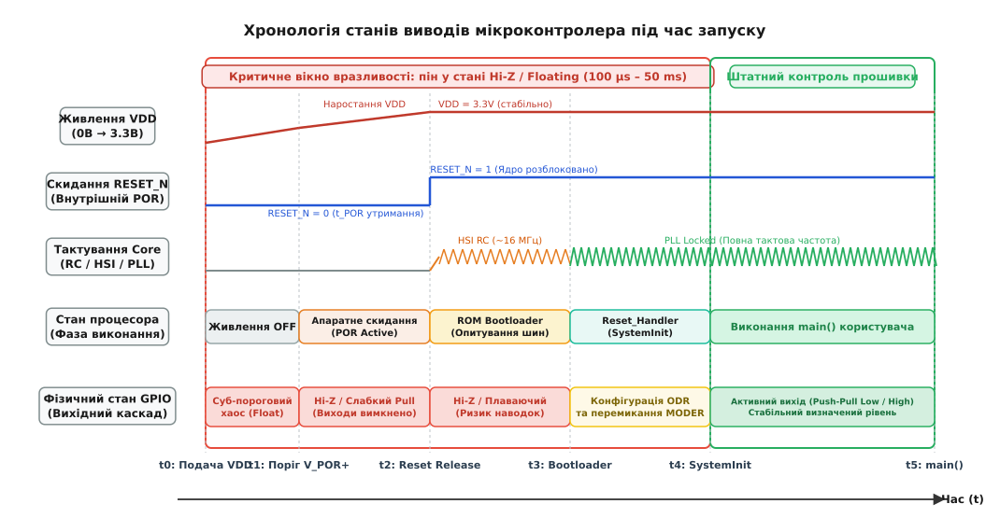

# Стан пінів у першу мить: що робить залізо, доки прошивка мовчить

<preknowlist>
- [Причини reset](root:hw-arch/reset-causes) — як формується сигнал скидання і як працює Power-on Reset.
- [Мінімальна обв'язка](root:hw-arch/minimalna-obviazka) — базова схемотехніка ліній живлення та виводу скидання NRST.
- [Strapping-піни й режими завантаження](root:hw-arch/strapping-piny-i-rezhymy-zavantazhennia) — фіксація рівнів на виводах у момент відпускання Reset.
</preknowlist>

Коли на плату силового перетворювача чи промислового контролера подається живлення, стабілізатор підіймає напругу 3.3 В за лічені мікросекунди. Але доки кварцовий генератор розгойдується, фазовий автопідлаштовувач частоти (PLL) входить у синхронізм, а процесор виконає перший рядок прошивки, минає від кількох мілісекунд до десятків мілісекунд. Протягом усього цього «сліпого вікна» програмний код ще не керує процесором. Проте електричний зв'язок між ніжками чипа та входами силових драйверів або реле замкнений безперервно. Якщо вивід мікроконтролера залишається у невизначеному стані, паразитні наведення та струми зміщення здатні миттєво відкрити силові ключі, спричинивши коротке замикання ще до виклику `main()`.

> 🔧 **Навіщо це.** Розуміння фізики виводів мікроконтролера до старту коду дає змогу усунути руйнівні апаратні аварії: наскрізні струми (*shoot-through*) у напівмостах інверторів, клацання реле при ввімкненні приладу, неконтрольовану подачу напруги на нагрівачі, електрозапали чи лазери, а також зависання мікроконтролера через паразитне живлення периферії через захисні діоди.

---

### Чому виводи кидають у невагомість: стан Hi-Z

Чому розробники кремнієвих кристалів не роблять усі виводи мікроконтролера притягнутими до землі чи до шини живлення за замовчуванням?

Причина в універсальності. Якби мікроконтролер на старті автоматично видавав фіксований логічний рівень, підключення зовнішнього джерела сигналу протилежної полярності створило б пряме коротке замикання між вихідними транзисторами. Кристал миттєво згорів би. Єдиний електрично безпечний стан за будь-якого зовнішнього підключення — це стан високого імпедансу (лат. *impedio* — перешкоджаю), або **Hi-Z** (*High Impedance*, плаваючий стан).


*Часова діаграма станів піна та внутрішніх вузлів кристала від моменту подачі живлення VDD до запуску функції main(). Доки ядро не виконає конфігурацію портів, вивід залишається у вразливому плаваючому стані Hi-Z.*

Під час увімкнення схема скидання за живленням (*Power-On Reset*, POR) або лінія `NRST` утримує ядро у стані скидання. Спеціальні затискні транзистори кожної комірки вводу-виводу притягують затвори верхнього (P-MOS) та нижнього (N-MOS) вихідних транзисторів до шин живлення та землі, надійно замикаючи обидва ключі. Внутрішні резистори підтяжки (Pull-Up / Pull-Down) також вимикаються.

Фізична контактна площадка мікроконтролера виявляється повністю від'єднаною від внутрішніх джерел струму. Вона з'єднана лише з паразитною ємністю площадки (3–7 пФ) та захисними кремнієвими діодами від електростатичного розряду (*ESD*).

---

### Три смертельні небезпеки плаваючих виводів

З погляду мікроконтролера стан Hi-Z є цілком безпечним: струм не тече, кристал не споживає енергії. Проте для зовнішньої силової схеми плаваючий провідник перетворюється на антену, електричний потенціал (лат. *potentia* — сила, можливість) якої визначається випадковими зарядами, електромагнітними наведеннями та ємнісними струмами.

#### 1. Наскрізні струми у силових напівмостах

У перетворювачах напруги чи контролерах електродвигунів силова стійка складається з двох послідовних ключів: верхнього (*High-Side*) та нижнього (*Low-Side*), підключених між високовольтною шиною живлення (48 В або 400 В) та силовою землею. Вони ніколи не повинні відкриватися одночасно.

Якщо входи драйверів підключені до плаваючих пінів мікроконтролера без зовнішньої фіксації, високочастотна завада під час перехідного процесу ввімкнення здатна змістити потенціал обох ліній вище логічного порога. Драйвер відкриває обидва транзистори водночас. Виникає наскрізний струм (*Shoot-Through*): висока напруга замикається на землю з нульовим опором. Струм у сотні амперів за лічені частки мікросекунди розриває корпуси транзисторів і випалює доріжки плати.

#### 2. Самовільне відкриття MOSFET через ємність Міллера

Навіть без зовнішніх наведень силова частина несе внутрішню загрозу. Коли на силову шину подається висока напруга, на стоку закритого нижнього транзистора напруга різко зростає з високою крутизною наростання `dV/dt`.

Цей стрибок напруги викликає струм зміщення через паразитну ємність сток-затвор — ємність Міллера `C_gd`:

```
I_Miller = C_gd · (dV/dt)
```

Цей струм шукає шлях стікання на землю через затворний вузол. Якщо вивід мікроконтролера перебуває у стані Hi-Z, струм Міллера заряджає вхідну ємність затвора. Напруга на ньому перевищує поріг відкриття `V_th` (1.2–2.5 В для транзисторів із логічним рівнем), і ключ самовільно відкривається, спричиняючи коротке замикання.

#### 3. Неконтрольоване спрацьовування виконавчих пристроїв

Входи керування твердотільних реле, оптопар, тиристорів чи електромагнітних клапанів мають високу чутливість. Якщо лінія плаває, мізерний витік струму через ESD-діоди або наведення від сусідніх імпульсних шин викликає короткочасне клацання реле чи хибне спрацьовування клапана в момент подачі живлення.

---

### Апаратні методи захисту: фіксація стану до старту коду

Оскільки процесор у першу мить спить, захист покладається на схемотехніку плати:

1. **Жорсткі зовнішні резистори підтяжки (*Hard Pull-Up / Pull-Down*):**
   Внутрішні резистори мікроконтролера занадто високоомні (30–50 кОм) і на старті вимкнені. Безпосередньо біля входу драйвера встановлюють зовнішній резистор номіналом `1–4.7 кОм`. Він створює низькоомний шлях стікання для струмів Міллера та захищає від наводок.

2. **Безпечна полярність логіки (*Fail-Safe Logic Polarity*):**
   Схему проектують так, щоб пасивний стан виводу (низький рівень або обрив) відповідав вимкненому стану навантаження. Для N-канальних транзисторів застосовують пряме притягання резистором Pull-Down до землі.

3. **Апаратне блокування за сигналом Power-Good або Reset:**
   Силові драйвери забезпечують лінією дозволу роботи (*Enable*), яку апаратно з'єднують із виходом детектора напруги (*Power-Good*) чи колом `NRST`. Доки живлення мікроконтролера не стабілізується й процесор не вийде зі скидання, драйвери апаратно заблоковані й не передають сигнали на затвори.

4. **Активний затискач Міллера (*Active Miller Clamp*):**
   Спеціалізовані драйвери містять внутрішній транзистор, який напряму шунтує затвор силового ключа на землю, щойно напруга на ньому опускається нижче 2 В, унеможливлюючи самовільне відкриття.

---

### Дії прошивки: рання безпечна ініціалізація

Коли ядро мікроконтролера прокидається й починає виконувати код у `Reset_Handler` та `SystemInit()`, першим правилом є уникнення однотактового паразитного імпульсу (*glitch*).

Якщо спочатку налаштувати режим виходу в регістрі напрямку `MODER`, вихідний каскад виставить рівень за замовчуванням із регістра даних `ODR` (після скидання — нуль). Якщо безпечним станом є одиниця, виникне короткочасний спад у нуль.

Тому діє строгий шаблон: **спочатку записують безпечний логічний рівень у вихідний регістр даних або регістр побітового встановлення `BSRR`, і лише потім вмикають режим виходу в `MODER`.**

У критичних системах прошивка додатково перевіряє цілісність кіл: [модуль ранньої безпечної конфігурації пінів та апаратної верифікації GPIO](root:hw-arch/stan-piniv-u-pershu-myt/proj-early-pin-safety-guard.md) виконує активне тестування ліній на перших тактах після скидання та фіксує їхній стан у кремнії через регістр блокування `GPIOx_LCKR`.

Повний аналіз комірки GPIO, точні часові діаграми POR/BOR, розрахунок струмів витоку та захист пінів у режимах сну наведено в [детальній версії статті](root:hw-arch/stan-piniv-u-pershu-myt/detail).
