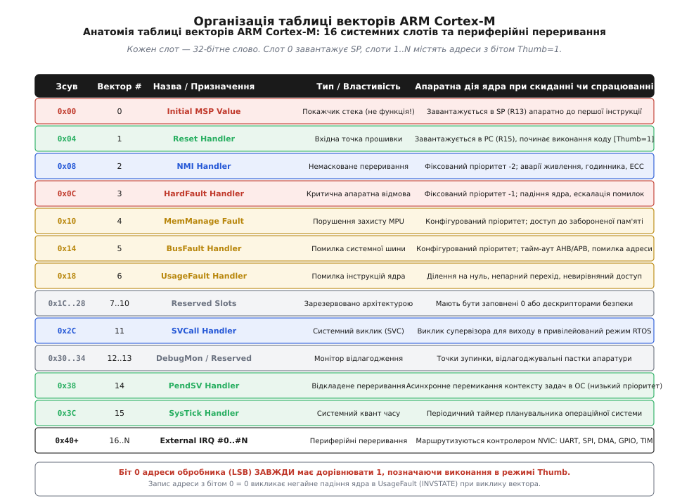
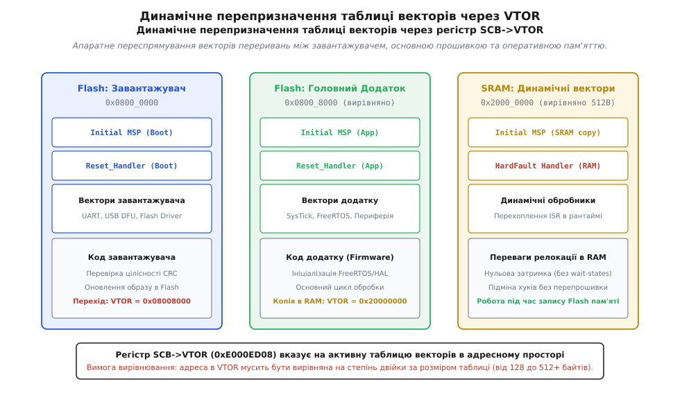

# Таблиця векторів

<preknowlist>
- [Вирівнювання даних: апаратні вимоги](root:hw-arch/alignment-hardware) — чому шина вимагає адрес, кратних степеню двійки, і як це захищає від апаратних збоїв.
- [Переривання: апаратна природа та обробка](root:hw-arch/interrupts) — як контролер фіксує зовнішні сигнали та передає керування обробникам.
- [Пріоритети переривань та вкладеність](root:hw-arch/interrupt-priorities) — як ядро арбітрує одночасні запити та витісняє поточний контекст.
- [Латентність переривань](root:hw-arch/latentnist-pereryvannia) — скільки тактів витрачає конвеєр на збереження регістрів та перехід до ISR.
- [Розділення адресного простору](root:hw-arch/address-space-separation) — як розміщуються Flash, SRAM та регістри периферії на системній шині.
- [Strapping-виводи та режими завантаження](root:hw-arch/strapping-piny-i-rezhymy-zavantazhennia) — як залізо обирає джерело стартового коду в першу мить після скидання.
</preknowlist>

Коли напруга живлення мікроконтролера перетинає поріг скидання і внутрішній генератор стабілізує тактову частоту, ядро ще не виконало жодної інструкції вашої програми. У нього порожній конвеєр, невизначений покажчик стека і заблокований лічильник команд. Процесор не має операційної системи чи завантаженого середовища — він є чистою цифровою машиною, якій потрібна початкова опора в адресному просторі. Перше, що робить кремній на апаратному рівні ще до старту вибірки коду, — це звернення до системної шини за адресою нульового зсуву пам'яті. Звідти ядро за один такт витягує початкове значення покажчика стека, а з наступної сусідньої комірки — адресу першої виконуваної інструкції. Цей впорядкований масив початкових констант і адрес переходів називають таблицею векторів переривань.

Таблиця векторів є головним апаратним шлюзом між цифровими сигналами зовнішнього світу, аварійними подіями обчислювального блоку та кодом прошивки. Вона визначає, куди саме процесор перемкне лічильник команд при натисканні кнопки, завершенні передачі DMA, переповненні таймера або критичній помилці доступу до пам'яті. Помилка у розміщенні цієї таблиці, зсув хоча б на одне слово, порушення вирівнювання або відсутність встановленого службового біта режиму виконання перетворюють старт мікроконтролера на миттєве апаратне падіння ядра.


*Структура перших 16 системних слів та периферійних векторів у пам'яті ARM Cortex-M із нульовим словом Initial MSP.*

### Перший такт живлення: кремнієвий рівень та апаратне захоплення шини

Помилково вважати, що виконання вбудованої програми починається безпосередньо з виклику функції `main()` або навіть із першої інструкції файлу запуску `Reset_Handler`. Перш ніж процесор зможе викликати будь-яку функцію, йому потрібен валідний стек. Без робочого стека неможливо зберегти адресу повернення, розмістити локальні змінні чи підготувати параметри виклику за угодою передачі аргументів [AAPCS](root:sf-lang/abi-calling-convention).

Універсальні комп'ютерні процесори загального призначення часто стартують із фіксованої фізичної адреси скидання (наприклад, `0xFFFFFFF0` в архітектурі x86 або `0x00000000` у класичних ядрах ARM7TDMI), де розташована асемблерна команда далекого безумовного переходу на код ініціалізації. У класичних ядрах ARM7 та ARM9 уся таблиця векторів складалася з виконуваних інструкцій: кожне слово було опкодом команди розгалуження виду `B reset_handler` або `LDR PC, [PC, #offset]`. Це вимагало виконання команд ще до того, як стек був налаштований, і покладало на розробника обов'язок вручну записувати константи в регістри покажчиків стека `SP` для кожного з режимів процесора (User, IRQ, FIQ, SVC, Abort, Undef).

Мікроконтролерні архітектури лінійки ARM Cortex-M повністю змінили цей підхід, реалізувавши апаратне завантаження стартового контексту безпосередньо в кремнії кінцевим автоматом скидання.

Під час подачі напруги живлення внутрішня схема моніторингу напруги (Power-On Reset, POR) та детектор просідання живлення (Brown-Out Reset, BOR) утримують ядро в стані скидання. У цей час стабілізуються внутрішні стабілізатори напруги ядра (LDO / Buck) та запускається базовий внутрішній RC-генератор (HSI). Щойно напруга перетинає безпечний поріг, схема скидання деактивує внутрішній сигнал Reset і запускає кінцевий автомат ініціалізації ядра.

На першому етапі системний контролер зчитує логічні рівні на конфігураційних виводах [strapping-виводах](root:hw-arch/strapping-piny-i-rezhymy-zavantazhennia) (наприклад, виводи `BOOT0` та `BOOT1` у мікроконтролерах STM32). Залежно від комбінації цих рівнів системний мультиплексор шинної матриці AHB-Lite перемикає відображення фізичної пам'яті на логічну адресу `0x00000000`. Логічний нуль може бути фізично зв'язаний із різними фізичними носіями:
- Вбудованою користувацькою Flash-пам'яттю (за замовчуванням, фізична адреса `0x08000000`).
- Системною пам'яттю ROM, де записано заводський DFU-завантажувач виробника (System Memory, наприклад `0x1FFF0000`).
- Вбудованою оперативною пам'яттю SRAM (наприклад, `0x20000000`) для режиму швидкого відлагодження.

Після встановлення маршрутизації шини процесорне ядро Cortex-M генерує два послідовні апаратні цикли читання шиною інструкцій та даних:

```
Хронологія апаратного старту ARM Cortex-M:

Такт 0: Зняття сигналу скидання (Reset deassertion).
Такт 1: Транзакція читання AHB за адресою 0x00000000.
        Шина повертає 32-бітне значення вершини стека (Initial MSP).
        Ядро замикає це значення безпосередньо у внутрішній регістр SP (R13).
Такт 2: Транзакція читання AHB за адресою 0x00000004.
        Шина повертає адресу обробника скидання (Reset_Handler).
        Ядро маскує біт 0, записує очищену адресу в лічильник команд PC (R15),
        а значення біта 0 записує в регістр стану EPSR.T (Thumb-біт).
Такт 3: Початок конвеєрного читання першої інструкції з тіла Reset_Handler.
```

Цей механізм має фундаментальний наслідок: таблиця векторів Cortex-M є **масивом числових констант і покажчиків**, а не масивом виконуваних інструкцій. Перше слово таблиці принципово не є кодом — це числове значення кінцевої адреси пам'яті RAM.

Якщо Flash-пам'ять мікроконтролера є порожньою або стертою, усі комірки пам'яті містять байти `0xFF`. Під час спроби старту ядро вичитує з адреси `0x00000000` значення покажчика стека `0xFFFFFFFF`, а з адреси `0x00000004` — адресу переходу `0xFFFFFFFF`. Спроба завантажити інструкцію з адреси `0xFFFFFFFE` на неіснуючій ділянці пам'яті викликає негайне падіння в апаратну помилку шини `BusFault`. Оскільки таблиця векторів пошкоджена і не містить адреси обробника `HardFault`, процесор фіксує повторну невиправну помилку під час спроби викликати виняток (Double Fault) і переходить у стан мертвого апаратного блокування — **Lockup state**. У цьому стані ядро повністю зупиняє конвеєр, блокує генерацію транзакцій на шині та може бути виведене з нього лише зовнішнім апаратним скиданням або спрацюванням сторожового таймера [Watchdog](root:hw-arch/protection-rings).

### Повна анатомія 16 системних винятків та апаратні регістри контролю

Таблиця векторів в архітектурі ARM Cortex-M стандартизована на рівні специфікації архітектури ARMv7-M, ARMv8-M та бібліотеки CMSIS. Вона починається з 16 фіксованих системних слотів (зсуви `0x00`..`0x3C`), за якими розташовані вектори периферійних переривань конкретного кремнієвого кристала.

```
Повна карта 16 системних векторів архітектури ARM Cortex-M
─────────────────────────────────────────────────────────────────────────────
Зсув     Вектор  Назва винятку       Пріоритет   Призначення та керуючі регістри
─────────────────────────────────────────────────────────────────────────────
0x0000     0     Initial MSP         —           Початкова вершина головного стека
0x0004     1     Reset               -3 (фікс)   Скидання системи, точка старту
0x0008     2     NMI                 -2 (фікс)   Немасковане переривання (CSS, ECC, PVD)
0x000C     3     HardFault           -1 (фікс)   Критична системна відмова ядра
0x0010     4     MemManage Fault     Конфіг.     Порушення захисту пам'яті MPU
0x0014     5     BusFault            Конфіг.     Апаратна помилка транзакції шини AHB/APB
0x0018     6     UsageFault          Конфіг.     Помилка виконання інструкції, стан, поділ на 0
0x001C     7     Reserved            —           Зарезервовано (NXP Checksum / Secure Gateway)
0x0020     8     Reserved            —           Зарезервовано
0x0024     9     Reserved            —           Зарезервовано
0x0028    10     Reserved            —           Зарезервовано
0x002C    11     SVCall              Конфіг.     Системний виклик супервізора (SVC #imm)
0x0030    12     DebugMonitor        Конфіг.     Апаратний монітор відлагодження
0x0034    13     Reserved            —           Зарезервовано
0x0038    14     PendSV              Конфіг.     Відкладене перемикання контексту RTOS
0x003C    15     SysTick             Конфіг.     Періодичний системний таймер ядра
0x0040    16     External IRQ0       Конфіг.     Перше переривання периферії (NVIC)
...      ...     ...                 ...         ...
```

Розглянемо детальний механізм роботи кожного системного слота та його взаємодію з регістрами системного блоку керування (System Control Block, SCB):

#### Слот 0: Initial MSP (Головний покажчик стека)
Слот 0 містить початкове значення покажчика головного стека `MSP`. В архітектурі ARM прийнято модель спадного повного стека (Full Descending Stack): покажчик стека завжди вказує на останнє зайняте 32-бітне слово в пам'яті, а операція запису (push) спочатку зменшує адресу на розмір даних, після чого записує значення.

Тому нульове слово таблиці завжди містить адресу комірки, розташованої безпосередньо за верхньою межею оперативної пам'яті SRAM. Наприклад, якщо пам'ять SRAM розташована за адресою `0x20000000` і має об'єм 128 КБ (`0x00020000`), значення Initial MSP обчислюється як сума початкової адреси та повного об'єму виділеної оперативної пам'яті. У результаті отримуємо адресу `0x20020000`.

Коли перша інструкція збереже 32-бітне слово на стек, воно буде записане за адресою `0x2001FFFC`, тобто точно у верхні 4 байти доступної пам'яті. Стандарт ABI вимагає, щоб початкове значення покажчика стека було строго вирівняне на 8 байтів per [AAPCS](root:sf-lang/abi-calling-convention). Таке вирівнювання гарантує коректність роботи інструкцій подвійного завантаження `LDRD` та збереження `STRD`, які на апаратному рівні шини вимагають 64-бітної кратності адрес для уникнення виникнення додаткових тактів очікування або апаратних винятків невирівняного доступу.

#### Слот 1: Reset Handler
Адреса першої інструкції коду ініціалізації. Сюди передається керування на 3-му такті після скидання. Обробник скидання відповідає за базове розгортання середовища виконання C/C++:
1. Копіювання початкових значень глобальних та статичних змінних із Flash-пам'яті (секція `.rodata` або маркер `_sidata`) в оперативну пам'ять SRAM (секція `.data`, від `_sdata` до `_edata`).
2. Очищення секції неініціалізованих змінних `.bss` (заповнення нулями діапазону від `_sbss` до `_ebss`).
3. Увімкнення блоку обчислень із плаваючою комою FPU (через запис у регістр `SCB->CPACR` для бітів CP10 та CP11), якщо ядро містить апаратний модуль FPU.
4. Виклик функції конфігурації генераторів тактової частоти `SystemInit()`.
5. Виклик статичних конструкторів глобальних C++ об'єктів (`__libc_init_array`).
6. Перехід до головної точки входу програми `main()`.

Коли обробник скидання виконує ці кроки, процесор перебуває у привілейованому режимі нитки (Privileged Thread Mode) та використовує головний покажчик стека `MSP`. Якщо в коді ініціалізації виникає помилка, наприклад спроба запису за неіснуючою адресою, процесор негайно перериває виконання та звертається до наступних слотів таблиці векторів для пошуку відповідного обробника апаратної відмови.

#### Слот 2: NMI (Non-Maskable Interrupt)
Немасковане переривання має найвищий фіксований пріоритет `-2` серед усіх переривань (вищий пріоритет має лише сигнал Reset із рівнем `-3`). NMI неможливо заблокувати встановленням біта `PRIMASK` за допомогою стандартної команди `CPSID i`. Єдиний спосіб призупинити NMI — встановлення регістра `FAULTMASK` (команда `CPSID f`), що дозволено лише в привілейованому режимі ядра для виконання критичних секцій закриття системи.

Головними джерелами NMI є:
- **CSS (Clock Security System)**: Апаратний детектор виходу з ладу зовнішнього кварцового резонатора HSE. Якщо кварц перестає генерувати коливання, система автоматично перемикає тактування ядра на внутрішній RC-генератор HSI та генерує виклик NMI для аварійної зупинки моторів або збереження критичних даних.
- **ECC Multi-bit Error**: Виявлення подвійної помилки в Flash або SRAM із контролем парності та кодами Ріда-Соломона / Хеммінга, що унеможливлює подальше достовірне читання пам'яті.
- **PVD (Programmable Voltage Detector)**: Детектор небезпечного просідання зовнішньої напруги живлення нижче мінімального порогу стабільної роботи Flash-пам'яті.

Оскільки немасковане переривання покликане рятувати систему від фізичної катастрофи, його код повинен бути максимально лаконічним і детермінованим. Обробник NMI не повинен викликати блокуючих функцій, виділяти пам'ять чи очікувати відповідей від повільної зовнішньої периферії через шини I2C або SPI.

#### Слот 3: HardFault
Головний обробник фатальних апаратних відмов із фіксованим пріоритетом `-1`. HardFault спрацьовує у двох випадках:
1. Пряма фатальна помилка: спроба вибірки вектора з некоректної адреси під час обробки іншого винятку, або помилка доступу до пам'яті, коли відповідні спеціалізовані обробники не налаштовані.
2. Ескалація помилок (*Fault Escalation*): якщо в системі відбувається помилка `UsageFault`, `BusFault` або `MemManage`, але відповідний обробник вимкнено в регістрі `SCB->SHCSR` (System Handler Control and State Register), або якщо помилка виникла всередині обробника переривання з рівним чи вищим пріоритетом, ядро автоматично ескалює виняток до рівня `HardFault`.

Діагностика HardFault здійснюється через системні регістри:
- **HFSR (HardFault Status Register)** за адресою `0xE000ED2C`:
  - Біт 30 (`FORCED`): Виняток виник внаслідок ескалації підпорядкованої помилки.
  - Біт 31 (`DEBUGEVT`): Помилка виникла через подію відлагодження (точка зупинки під час заблокованого відлагоджувача).
  - Біт 1 (`VECTTBL`): Помилка шини при читанні самої таблиці векторів під час входу у виняток.

Якщо під час виконання самого обробника `HardFault` виникає ще одна апаратна помилка (наприклад, пошкоджено покажчик стека, що призводить до неможливості збереження контексту), процесор фіксує стан подвійної невиправної помилки (Lockup). У цьому стані ядро повністю зупиняє конвеєр інструкцій, виставляє високий рівень на внутрішньому сигналі `LOCKUP` і блокує будь-яке виконання коду до приходу зовнішнього апаратного імпульсу скидання.

#### Слоти 4..6: Налаштовувані системні відмови
На відміну від HardFault, ці винятки мають налаштовувані програмні пріоритети і за замовчуванням **вимкнені** після скидання мікроконтролера. Якщо їх не увімкнути явно, будь-яка з цих помилок одразу викликає `HardFault`.

Увімкнення здійснюється записом відповідних бітів у регістр `SCB->SHCSR` (`0xE000ED24`):
- `MEMFAULTENA` (біт 16): Дозвіл винятку `MemManage`.
- `BUSFAULTENA` (біт 17): Дозвіл винятку `BusFault`.
- `USGFAULTENA` (біт 18): Дозвіл винятку `UsageFault`.

```
Анатомія конфігурованих регістрів винятків SCB->CFSR (0xE000ED28)
┌─────────────────────────┬─────────────────────────┬─────────────────────────┐
│ UFSR (Біти 31:16)       │ BFSR (Біти 15:8)        │ MMFSR (Біти 7:0)        │
│ UsageFault Status       │ BusFault Status         │ MemManage Status        │
├─────────────────────────┼─────────────────────────┼─────────────────────────┤
│ DIVBYZERO  (біт 25)     │ BFARVALID  (біт 15)     │ MMARVALID  (біт 7)      │
│ UNALIGNED  (біт 24)     │ LSPERR     (біт 13)     │ MLSPERR    (біт 5)      │
│ NOCP       (біт 19)     │ STKERR     (біт 12)     │ MSTKERR    (біт 4)      │
│ INVPC      (біт 18)     │ UNSTKERR   (біт 11)     │ MUNSTKERR  (біт 3)      │
│ INVSTATE   (біт 17)     │ IMPRECISERR(біт 10)     │ DACCVIOL   (біт 1)      │
│ UNDEFINSTR (біт 16)     │ PRECISERR  (біт 9)      │ IACCVIOL   (біт 0)      │
│                         │ IBUSERR    (біт 8)      │                         │
└─────────────────────────┴─────────────────────────┴─────────────────────────┘
```

Детальний аналіз прапорців стану дозволяє локалізувати будь-яку системну помилку:
- **MMFSR (MemManage Fault Status Register)**:
  - `IACCVIOL`: Спроба вибірки інструкції з ділянки пам'яті, позначеної MPU як захищена або XN (eXecute Never).
  - `DACCVIOL`: Спроба читання або запису даних за адресою, забороненою правилами MPU.
  - `MMARVALID`: Вказує, що регістр `SCB->MMFAR` (`0xE000ED34`) містить точну фізичну адресу пам'яті, звернення до якої спричинило порушення.
- **BFSR (BusFault Status Register)**:
  - `IBUSERR`: Помилка шини при попередній вибірці інструкції (конвеєр спробував прочитати код із неіснуючої адреси).
  - `PRECISERR`: Точна помилка доступу до даних. Регістр `SCB->BFAR` (`0xE000ED38`) містить точну адресу пам'яті, що згенерувала помилку шини.
  - `IMPRECISERR`: Неточна помилка шини. Виникає при буферизованому записі даних через шинний міст AHB-to-APB. Оскільки ядро не чекає підтвердження запису і продовжує виконання наступних команд, помилка шини повертається через кілька тактів, коли покажчик `PC` вже пішов далі. У цьому випадку адреса помилки в `BFAR` є недійсною.
  - `STKERR` / `UNSTKERR`: Помилка шини під час апаратного збереження або відновлення стек-фрейму при вході/виході з переривання.
- **UFSR (UsageFault Status Register)**:
  - `UNDEFINSTR`: Спроба декодування невідомої інструкції або інструкції співпроцесора, якщо він вимкнений.
  - `INVSTATE`: Спроба виконання коду з недійсним станом регістра `EPSR` (наприклад, перехід за адресою з бітом `Thumb = 0`).
  - `INVPC`: Некоректне значення `EXC_RETURN` при виході з обробника винятку.
  - `UNALIGNED`: Невирівняне звернення до пам'яті при увімкненому біті `SCB->CCR.UNALIGN_TRP`.
  - `DIVBYZERO`: Ділення цілого числа на нуль при увімкненому біті `SCB->CCR.DIV_0_TRP`.

Роздільне ввімкнення цих трьох обробників є критично важливим для надійності вбудованих систем. Без них будь-яке банальне ділення на нуль або спроба звернення до невирівняного буфера призводить до негайної зупинки всієї системи через виклик загального HardFault. При наявності індивідуальних обробників операційна система може безпечно завершити лише той потік, у якому виникла помилка, і продовжити роботу інших критичних задач.

#### Слот 7: Контрольна сума NXP та TrustZone ARMv8-M
В архітектурі ARMv7-M слоти 7..10 формально зарезервовані. Проте деякі виробники кристалів використовують ці комірки для специфічних апаратних перевірок:
- **Контрольна сума векторів NXP LPC / Kinetis**: Вбудований апаратний завантажувач мікроконтролерів NXP (серії LPC17xx, LPC55xx) під час старту вимагає, щоб арифметична сума перших 8 слів таблиці векторів (слоти від 0 до 7) дорівнювала нулю. Якщо сума не є нульовою, завантажувач вважає прошивку пошкодженою і замість запуску переходить у режим DFU. Компонувальник або спеціальні пост-білд утиліти записують у слот 7 значення доповнення до двох (2's complement) суми перших семи слів.
- **ARMv8-M TrustZone Security Extensions**: В архітектурі ARMv8-M із підтримкою TrustZone (Cortex-M23, Cortex-M33, Cortex-M55, Cortex-M85) мікроконтролер має апаратне розділення на безпечний (Secure) та небезпечний (Non-Secure) домени виконання. У цій системі паралельно функціонують дві повністю незалежні таблиці векторів:
  - `Secure Vector Table` (базова адреса у регістрі `SCB->VTOR_S`).
  - `Non-Secure Vector Table` (базова адреса у регістрі `SCB->VTOR_NS`).

Коли небезпечний код викликає переривання, або коли безпечне переривання витісняє небезпечний потік, апаратний модуль TrustZone автоматично виконує перемикання стеків `MSP_S / PSP_S` на `MSP_NS / PSP_NS` та очищає всі робочі регістри CPU нулями, унеможливлюючи витік криптографічних ключів чи конфіденційних даних через стек-фрейм винятків.

Розподіл периферійних ліній переривань між цими двома світами виконується за допомогою масиву регістрів `NVIC->ITNS[0..N]` (Interrupt Target Non-Secure). Якщо біт у цьому регістрі встановлено в одиницю, відповідне переривання маршрутизується в небезпечну таблицю векторів `VTOR_NS`. Якщо ж біт скинуто в нуль, переривання є безпечним і викликає обробник виключно з безпечної таблиці `VTOR_S`. Це дозволяє надійно ізолювати апаратні криптографічні прискорювачі, генератори випадкових чисел та датчики розкриття корпусу від коду користувацьких додатків або стеків бездротового зв'язку.

#### Слот 11: SVCall (Supervisor Call)
Синхронний системний виклик, що генерується виконанням інструкції `SVC #imm8`. Призначений для реалізації захищеного інтерфейсу системних викликів між непривілейованими задачами користувача та ядром операційної системи.

Коли прикладний код виконує інструкцію `SVC #0x05`, процесор апаратно зберігає стек-фрейм задачі, перемикається в привілейований режим `Handler Mode` і викликає функцію `SVC_Handler`. Всередині обробника C-код зчитує збережене на стеку значення регістра `PC` перерваної задачі, відступає на 2 байти назад і вичитує безпосередній аргумент `#0x05` прямо з коду інструкції у пам'яті Flash.

Цей механізм дозволяє реалізувати класичну модель операційної системи з чітким розділенням привілеїв. Непривілейований код задач не має прямого доступу до керуючих регістрів периферії або таблиць планувальника, а звертається до ядра виключно через стандартизований інтерфейс системних викликів `SVC`.

#### Слот 14: PendSV (Pending Supervisor Call)
Асинхронне системне переривання з налаштовуваним пріоритетом. PendSV є наріжним каменем архітектури контекстного перемикання всіх вбудованих операційних систем реального часу (FreeRTOS, Zephyr, ThreadX, Keil RTX).

Проблема планувальника RTOS полягає в тому, що рішення про необхідність перемикання задачі часто приймається всередині апаратного переривання периферії (наприклад, по приходу байта UART або пакета Ethernet). Якщо почати перемикати покажчики стеків задач безпосередньо всередині обробника переривання UART, ядро зруйнує стек-фрейм вкладених винятків.

Щоб уникнути цієї катастрофи, планувальник RTOS встановлює біт `PENDSVSET` у регістрі керування та стану винятків `SCB->ICSR` (`0xE000ED04`). Пріоритет переривання PendSV у системі завжди конфігурується як **найнижчий можливий** (наприклад, пріоритет `15` або `255`). Ядро ARM Cortex-M фіксує запит, але відкладає його виконання доти, доки всі активні високопріоритетні апаратні обробники периферії (ISR) повністю не завершать свою роботу. Щойно остання лінія IRQ повертає керування, ядро викликає `PendSV_Handler`, який на чистому контексті безпечно змінює стек поточної задачі на стек нової готової до виконання задачі.

#### Слот 15: SysTick
Обробник системного 24-бітного таймера, інтегрованого безпосередньо в кремнієве ядро процесора. На відміну від периферійних таймерів таймер SysTick стандартизований для всіх мікроконтролерів Cortex-M незалежно від виробника чіпа. Він тактується або частотою ядра CPU (FCLK), або поділеною зовнішньою частотою і генерує періодичні виклики для відліку системного часу та квантування процесорного часу між потоками в RTOS.

Таймер SysTick містить чотири базові регістри: керування та статусу `SysTick->CTRL`, значення перезавантаження `SysTick->LOAD`, поточного значення лічильника `SysTick->VAL` та регістр калібрування `SysTick->CALIB`. Коли лічильник досягає нуля, він апаратно встановлює прапорець `COUNTFLAG`, перезавантажує значення з регістра `LOAD` та генерує запит на виклик вектора 15 у таблиці винятків.

### Арбітраж пріоритетів NVIC та групування PRIGROUP

Кожне периферійне переривання, починаючи зі слота 16 (`IRQ0`), маршрутизується через апаратний контролер вкладених векторних переривань — **NVIC** (Nested Vectored Interrupt Controller). NVIC тісно інтегрований у ядро процесора і працює на частоті CPU, що забезпечує мінімальну затримку реакції.

Ключовим механізмом керування витісненням у NVIC є конфігурація бітового поля **PRIGROUP** у регістрі керування перезавантаженням та викликами `SCB->AIRCR` (Application Interrupt and Reset Control Register, адреса `0xE000ED0C`).

В архітектурі ARM Cortex-M пріоритет кожного переривання кодується 8-бітним числом у масиві регістрів `NVIC->IPR[0..N]`. Менше числове значення відповідає вищому пріоритету (рівень `0` — найвищий, рівень `255` — найнижчий). Виробники мікроконтролерів зазвичай реалізують лише старші 3, 4 або 5 бітів із цих 8, а молодші біти залишають зануленими.

Поле `PRIGROUP` визначає двійковий розподіл доступних бітів пріоритету на дві незалежні складові:
1. **Preemption Priority (Пріоритет витіснення)**: Визначає право переривання витіснити (перервати виконання) інший обробник переривання, який уже виконується ядром. Переривання з вищим пріоритетом витіснення формує вкладений виклик.
2. **Subpriority (Підпріоритет)**: Використовується виключно як арбітр одночасності. Якщо одночасно виникають два переривання з однаковим пріоритетом витіснення, ядро спочатку обслуговує те з них, яке має вищий (менший за числом) підпріоритет. Проте переривання з вищим підпріоритетом **не має права витіснити** переривання з тим самим рівнем витіснення, якщо воно вже почало виконуватися.

```
Варіанти розподілу 4-бітного поля пріоритетів (наприклад, STM32) за допомогою PRIGROUP
─────────────────────────────────────────────────────────────────────────────
Значення PRIGROUP    Preemption Bits   Subpriority Bits  Рівнів витіснення  Підпріоритетів
─────────────────────────────────────────────────────────────────────────────
NVIC_PRIORITYGROUP_0      0 бітів           4 біти               1                 16
NVIC_PRIORITYGROUP_1      1 біт             3 біти               2                  8
NVIC_PRIORITYGROUP_2      2 біти            2 біти               4                  4
NVIC_PRIORITYGROUP_3      3 біти            1 біт                8                  2
NVIC_PRIORITYGROUP_4      4 біти            0 бітів             16                  1
─────────────────────────────────────────────────────────────────────────────
```

Для операційних систем реального часу (таких як FreeRTOS) залізне правило вимагає встановлювати `PRIGROUP = NVIC_PRIORITYGROUP_4` (усі доступні біти віддаються під пріоритет витіснення, підпріоритети відсутні). Це необхідно для коректної роботи регістра `BASEPRI`, який маскує переривання нижче певного порогу під час критичних секцій ядра ОС. Якщо в системі залишаться біти підпріоритетів, значення `BASEPRI` може замаскувати лише частину переривань однакового логічного рівня, що призведе до порушення атомарності критичних секцій операційної системи.

### Апаратні пастки MPU під час входу в переривання: помилки стекінгу MSTKERR

Особливий клас важковиправних апаратних відмов виникає під час взаємодії таблиці векторів та блоку захисту пам'яті [MPU](root:hw-arch/protection-rings).

У надійних системах внизу пам'яті стека задачі виділяється захисна сторінка MPU (Guard Page) з атрибутом повної заборони доступу (No Access). Якщо задача переповнює свій стек, будь-яка інструкція запису викличе `MemManage Fault`. Проте що відбувається, якщо стек переповнюється саме в момент виникнення переривання?

Коли виникає сигнал IRQ, процесорне ядро апаратно починає процедуру збереження 8 регістрів (`R0-xPSR`). Якщо покажчик стека `PSP` у цей момент знаходиться біля нижньої межі виділеної області, апаратний блок збереження намагається записати дані безпосередньо в захищену MPU-сторінку.

У цей момент процесор фіксує помилку **`MSTKERR` (MemManage Stacking Error)** у регістрі `SCB->CFSR (MMFSR)`:
1. Апаратний стекінг переривається.
2. Процесор скасовує перехід на периферійний обробник IRQ.
3. Ядро автоматично перемикається на головний стек `MSP` і викликає системний виняток `MemManage_Handler`.
4. Якщо обробник `MemManage` не дозволений у регістрі `SCB->SHCSR`, виняток автоматично ескалюється до `HardFault` зі встановленим прапорцем `FORCED = 1` у регістрі `HFSR` та `MSTKERR = 1` у регістрі `MMFSR`.

Для коректної обробки переповнення стеків у вбудованій системі головний стек переривань `MSP` обов'язково повинен мати окрему власну ділянку пам'яті та ніколи не перетинатися зі стеками прикладних задач `PSP`. При виникненні подібної помилки обробник MemManage має можливість прочитати адресу пошкодженого стека через покажчик `PSP`, ідентифікувати збійний потік, безпечно видалити його зі списку активних задач операційної системи та звільнити виділені ресурси без перезавантаження всього контролера.

### Апаратний механізм Vector Catch у модулі CoreDebug

Під час налагодження мікроконтролера за допомогою апаратного адаптера SWD / JTAG (ST-Link, J-Link, CMSIS-DAP) інженери часто стикаються з ситуацією, коли процесор падає в `HardFault` ще до того, як налагоджувач встигне встановити першу точку зупинки.

Для перехоплення таких ранніх помилок ядро ARM Cortex-M містить блок апаратного перехоплення векторів — **Vector Catch**, який налаштовується через регістр керування монітором відлагодження `CoreDebug->DEMCR` (Debug Exception and Monitor Control Register, адреса `0xE000EDFC`).

```
Керуючі біти перехоплення векторів у регістрі CoreDebug->DEMCR (0xE000EDFC)
┌──────────────────────────────────────────────────────────────────────────┐
│ VC_CORERESET (біт 0)  : Автоматична зупинка ядра на першому такті скидання│
│ VC_MMERR     (біт 4)  : Зупинка при виникненні MemManage Fault           │
│ VC_NOCPERR   (біт 5)  : Зупинка при зверненні до вимкненого FPU співпроц.│
│ VC_CHKERR    (біт 6)  : Зупинка при UsageFault (ділення на 0, вирівнюв.) │
│ VC_STATERR   (біт 7)  : Зупинка при UsageFault (INVSTATE, некоректний LSB)│
│ VC_BUSERR    (біт 8)  : Зупинка при виникненні помилки шини BusFault     │
│ VC_INTERR    (біт 9)  : Зупинка при помилці вибірки вектора з таблиці    │
│ VC_HARDERR   (біт 10) : Зупинка перед входом у HardFault Handler         │
└──────────────────────────────────────────────────────────────────────────┘
```

Якщо налагоджувач встановлює біт `VC_CORERESET = 1`, ядро процесора зупиняється (Halt state) відразу після апаратного зчитування слів `0x00000000` (Initial MSP) та `0x00000004` (Reset Handler) ще до виконання першої інструкції прошивки. Це дозволяє покроково відлагодити процедуру запуску системи. Якщо ж увімкнено біт `VC_INTERR = 1`, а таблиця векторів вказує на пошкоджену або невирівняну адресу пам'яті, процесор миттєво зупиняється на апаратній помилці шини безпосередньо в точці збою, дозволяючи переглянути стан внутрішніх регістрів ядра до того, як стек буде пошкоджено викликом обробника HardFault.

### Порівняльний аналіз: Таблиці векторів у класичних архітектурах

Щоб зрозуміти, чому архітектура ARM Cortex-M обрала саме масив покажчиків даних замість виконуваних інструкцій, корисно порівняти її з іншими популярними архітектурами мікроконтролерів:

```
Порівняння векторних підсистем мікроконтролерних архітектур
─────────────────────────────────────────────────────────────────────────────
Архітектура        Формат елемента таблиці           Релокація векторів
─────────────────────────────────────────────────────────────────────────────
ARM Cortex-M       32-бітний покажчик (дані)        Регістр SCB->VTOR
ARM Cortex-A       32-бітна інструкція переходу (B)  Регістр VBAR
AVR (ATmega)       16/32-бітна інструкція (RJMP/JMP) Біт IVSEL у регістрі MCUCR
PIC32 (MIPS32)     Секція коду з фіксованим кроком   Регістр CP0 EBase
8051               8-байтний слот виконуваного коду  Фіксовано в ROM (без релокації)
RISC-V (Базовий)   Адреса функції або спільний Trap  CSR-регістр mtvec
─────────────────────────────────────────────────────────────────────────────
```

У 8-бітних мікроконтролерах AVR (наприклад, ATmega328P) таблиця векторів розташована на початку пам'яті програм Flash і складається з інструкцій безумовного переходу `RJMP` або `JMP`. Кожен вектор займає 2 або 4 байти виконуваного коду. Якщо обробник переривання є дуже коротким (наприклад, встановлення одного прапорця), його код можна розмістити безпосередньо всередині самої таблиці векторів. Для підтримки завантажувача мікроконтролери AVR містять спеціальний біт `IVSEL` у регістрі `MCUCR`, який апаратно перемикає вектори з адреси `0x0000` на початок секції Bootloader Flash.

На відміну від AVR та Cortex-A, де таблиця складається з інструкцій і вимагає проходження конвеєра декодера команд, рішення Cortex-M з числовими покажчиками дозволяє апаратурі завантажувати адресу переходу безпосередньо в лічильник команд `PC` одночасно з апаратним збереженням регістрів на стек шиною даних. Це забезпечує мінімальну латентність (12 тактів) та найнижче енергоспоживання ядра.

### Кодування адрес, набір команд Thumb-2 та апаратне декодування біта LSB

Найбільше запитань у системних програмістів викликає специфікація молодшого нульового біта адреси у таблиці векторів. Чому функція, розташована в Flash-пам'яті за адресою `0x08000200`, повинна бути записана в таблицю векторів як `0x08000201`?

В архітектурі ARM процесори сімейства Cortex-M підтримують виключно набір команд **Thumb-2**. Це змішана система команд, де базові інструкції мають довжину 16 бітів (2 байти), а розширені інструкції — 32 біти (4 байти). Оскільки кожна інструкція в пам'яті вирівняна щонайменше на межу 2 байтів, фізичні адреси виконуваних інструкцій завжди є **парними числами** (молодший біт фізичної адреси на системній шині завжди дорівнює нулю).

Архітектура ARM використовує нульовий біт адреси переходу (`LSB`, біт 0) не для адресації пам'яті, а як апаратний прапорець архітектурного стану ядра (Instruction Set State):
- `LSB = 0`: режим виконання класичного 32-бітного набору інструкцій ARM (підтримується в Cortex-A / Cortex-R).
- `LSB = 1`: режим виконання набору інструкцій Thumb / Thumb-2 (єдиний підтримуваний режим у Cortex-M).

```
Схема обробки адреси вектора апаратним блоком вибірки Cortex-M:

Значення слова у таблиці векторів:          [ 31 : 1 ] | [ 0 ]
                                                │         │
                                  ┌─────────────┘         └──────────────┐
                                  ▼                                      ▼
                        Фізична адреса для шини                  Прапорець T-bit
                         PC = Address & ~0x1                     EPSR.T = Bit 0
                                  │                                      │
                                  ▼                                      ▼
                       Шинний запит AHB/AXI                 Перевірка валідності стану:
                     Вибірка першої інструкції              Якщо T == 0 -> UsageFault (INVSTATE)
```

Коли контролер винятків зчитує 32-бітне слово з таблиці векторів, воно негайно розпадається на дві частини:
1. Біти `[31:1]` формують фізичну адресу переходу, яка завантажується в лічильник команд: `PC = Vector & 0xFFFFFFFE`.
2. Біт `[0]` безпосередньо завантажується в біт `T` (Thumb state bit) спеціального регістра стану виконання `EPSR` (Execution Program Status Register).

Оскільки ядра Cortex-M апаратно не мають декодера 32-бітних інструкцій ARM, комбінація `EPSR.T = 0` є забороненим апаратним станом. Якщо процесор спробує почати виконання коду за адресою, у якої біт 0 дорівнює `0`, блок вибірки команд на першому ж такті фіксує помилку `INVSTATE` у регістрі `SCB->CFSR (UFSR)` і негайно зупиняє виконання програми викликом `UsageFault` або `HardFault`.

#### Як компілятор та компонувальник вирішують цю проблему
Компілятори GCC та Clang для цільової платформи `arm-none-eabi` автоматично маркують усі функції як Thumb-код. Якщо функція скомпільована з генерацією Thumb-інструкцій і в асемблерному файлі позначена директивою типу `.type Reset_Handler, %function`, компонувальник встановлює молодший біт символу в одиницю у вихідній таблиці символів ELF.

Якщо виконати аналіз скомпільованого ELF-файлу за допомогою утиліти `readelf`:

```bash
arm-none-eabi-readelf -s firmware.elf | grep Reset_Handler
```

Вивід покаже:
```
    45: 080001cd    56 FUNC    GLOBAL DEFAULT    1 Reset_Handler
```

Фізично код функції починається за парною адресою `0x080001CC`, але значення символу в таблиці дорівнює `0x080001CD` (з встановленим бітом `Thumb = 1`). Тому при взятті адреси функції в мові C (`&Reset_Handler`) компілятор автоматично підставляє значення `0x080001CD`.

Пастка виникає тоді, коли розробник формує таблицю векторів вручну через цілочисельні константи або приводить числові адреси до покажчиків:

:::tabs
```c
/* ПОМИЛКА: пряма парна адреса без Thumb-біта викличе HardFault! */
#define MY_HANDLER_ADDR 0x08000200UL
table[16] = (vector_fn)MY_HANDLER_ADDR; /* НЕБЕЗПЕЧНО! INVSTATE! */

/* ПРАВИЛЬНО: явне встановлення LSB для Thumb-режиму */
#define MY_HANDLER_ADDR_SAFE (0x08000200UL | 1UL)
table[16] = (vector_fn)MY_HANDLER_ADDR_SAFE; /* БЕЗПЕЧНО! */
```
```cpp
// ПОМИЛКА: пряма парна адреса без Thumb-біта викличе HardFault!
constexpr uintptr_t raw_handler_addr = 0x08000200;
table[16] = reinterpret_cast<vector_fn>(raw_handler_addr); // НЕБЕЗПЕЧНО! INVSTATE!

// ПРАВИЛЬНО: явне встановлення LSB для Thumb-режиму
constexpr uintptr_t safe_handler_addr = raw_handler_addr | 1UL;
table[16] = reinterpret_cast<vector_fn>(safe_handler_addr); // БЕЗПЕЧНО!
```
:::

### Апаратний конвеєр переривання: Stacking, Unstacking, Tail-Chaining, Late Arrival

Однією з найвизначніших архітектурних переваг ARM Cortex-M є повністю апаратний механізм обробки переривань. На відміну від багатьох інших архітектур, де розробник повинен писати асемблерні збереження регістрів, мікроконтролери Cortex-M реалізують цей протокол на рівні транзисторів ядра.

#### 1. Фаза збереження контексту (Stacking)
Латентність входу в переривання на ядрах Cortex-M3/M4 становить рівно **12 тактів** процесорного ядра (на ядрах Cortex-M7 — 14 тактів через довший конвеєр). Протягом цих тактів ядро виконує такі паралельні операції:

1. **Шинне читання адреси вектора**: Контролер NVIC обчислює зсув переривання, звертається до таблиці векторів за адресою `VTOR + (IRQn + 16) * 4` і завантажує адресу обробника.
2. **Паралельне збереження регістрів шиною даних**: Одночасно з вибіркою вектора шинний контролер ядра виділяє 32 байти (8 слів) на поточному активному стеку (`MSP` або `PSP`) і скидає в пам'ять базовий стек-фрейм:
   - `SP - 32` -> `R0` (Перший аргумент функції C)
   - `SP - 28` -> `R1` (Другий аргумент)
   - `SP - 24` -> `R2` (Третій аргумент)
   - `SP - 20` -> `R3` (Четвертий аргумент)
   - `SP - 16` -> `R12` (Внутрішній регістр виклику)
   - `SP - 12` -> `LR` (Покажчик зв'язку повернення з функції)
   - `SP - 8`  -> `PC` (Адреса наступної інструкції перерваного коду)
   - `SP - 4`  -> `xPSR` (Прапорці процесора: N, Z, C, V та номер активного переривання IPSR)
3. **Запис коду EXC_RETURN у регістр LR**: Регістр зв'язку `LR` (R14) процесора перезаписується службовим 32-бітним кодом `EXC_RETURN`.

```
Декодування бітів коду EXC_RETURN в архітектурі ARM Cortex-M
┌──────────────────────────────────────────────────────────────┐
│ 0xFFFFFF [ Біт 4: FPU_Frame ] [ Біт 3: Mode ] [ Біт 2: Stack]│
└──────────────────────────────────────────────────────────────┘
```

Значення бітів керують відновленням системи при виході з обробника через команду `BX LR`:
- **Біт 4 (`0` — розширений фрейм з FPU, `1` — базовий 8-регістровий фрейм)**: Визначає, чи зберігалися регістри `S0-S15` та `FPSCR`.
- **Біт 3 (`0` — Handler Mode, `1` — Thread Mode)**: Визначає режим процесора після повернення (повернення у вкладене переривання чи у звичайний потік коду).
- **Біт 2 (`0` — Main Stack MSP, `1` — Process Stack PSP)**: Визначає, з якого стека ядро повинно відновити збережені регістри.

#### 2. Ліниве збереження регістрів FPU (Lazy Stacking)
Якщо в системі активний модуль плаваючої коми FPU, збереження 16 додаткових 32-бітних регістрів `S0-S15` та статусного регістра `FPSCR` збільшило б час стекінгу з 12 до 26 тактів.

Щоб зберегти детермінізм латентності в реальному часі, архітектура реалізує механізм **Lazy Stacking** (контролюється регістром `FPCCR.LSPEN = 1`):
1. При вході в переривання ядро модифікує покажчик стека `SP`, резервуючи місце під 26 слів замість 8, але **не здійснює фізичного запису** регістрів FPU шиною пам'яті. У регістрі `FPCCR` встановлюється апаратний прапорець `LSPACT` (Lazy Stacking Active).
2. Якщо код обробника переривання виконує лише цілочисельні операції, переривання завершується без додаткових накладних витрат шини (12 тактів).
3. Якщо всередині ISR процесор зустрічає будь-яку інструкцію FPU (наприклад, `VADD.F32`), конвеєр перериває виконання на 14 тактів, апаратно скидає регістри `S0-S15` у зарезервоване раніше вікно на стеку, скидає прапорець `LSPACT` і продовжує виконання інструкції.

#### 3. Апаратні оптимізації конвеєра: Tail-Chaining та Late Arrival
Для досягнення максимальної швидкодії контролер NVIC використовує два апаратні механізми оптимізації черг:

- **Tail-Chaining (хвостове зв'язування)**: Якщо на момент завершення поточної функції обробника переривання в черзі очікує інше переривання (наприклад, із рівним або нижчим пріоритетом), процесор **не виконує unstacking** (відновлення 8 регістрів зі стека) і наступний **stacking**. Замість марної витрати понад 24 тактів шини ядро залишає поточний стек-фрейм на місці, вичитує адресу нового обробника з таблиці векторів і починає його виконання всього через **6 тактів**.
- **Late Arrival (пізнє прибуття)**: Якщо під час збереження регістрів (фази stacking) для низькопріоритетного переривання виникає вище за пріоритетом переривання, NVIC не скидає поточний цикл. Він завершує збереження регістрів на стек, але в останній момент підміняє вибірку адреси вектора: замість початкового коду ядро вичитує адресу вектора високопріоритетного переривання і обслуговує його негайно. Початкове низькопріоритетне переривання буде оброблене після нього через механізм Tail-Chaining.

### Регістр зсуву таблиці векторів (VTOR) та залізне вирівнювання

Після скидання процесор завжди звертається за фіксованою логічною адресою `0x00000000`. Проте в процесі роботи складної системи (наявність завантажувача, оновлення прошивки по повітрю OTA, використання пам'яті SRAM для прискорення переривань) таблицю векторів необхідно динамічно переміщувати в адресному просторі.

Для цього блок керування системою (System Control Block, SCB) ядра ARM Cortex-M містить регістр **VTOR** (Vector Table Offset Register), розташований за адресою `0xE000ED08`.

```
Структура регістра SCB->VTOR (0xE000ED08)
┌──────────────────────────────────────────────┬───────────────────────────┐
│ Біти [31 : N]                                │ Біти [N-1 : 0]            │
│ TBLOFF (Базова адреса таблиці векторів)      │ Зарезервовано (Завжди 0)  │
└──────────────────────────────────────────────┴───────────────────────────┘
```

#### Математичний закон вирівнювання адреси VTOR
Апаратний блок регістра VTOR має ключову особливість: молодші біти регістра фізично не містять тригерів пам'яті (вони апаратно закорочені на землю). Кількість цих фіксованих нульових бітів залежить від максимальної кількості векторів, яку підтримує конкретне процесорне ядро.

Специфікація архітектури ARM встановлює залізне правило: **базова адреса таблиці векторів у пам'яті зобов'язана бути вирівняна на значення, що дорівнює загальному розміру таблиці векторів, округленому вгору до найближчого степеня двійки**. Мінімальне базове вирівнювання становить **128 байтів** (32 слова).

Формула розрахунку необхідного вирівнювання:

```
Загальна кількість слів = 16 (системні) + N (периферійні лінії IRQ)
Розмір пам'яті в байтах = (16 + N) * 4
Мінімальне вирівнювання = 2 ^ ceil( log2( (16 + N) * 4 ) )
```

Розглянемо практичні приклади для різних сімейств мікроконтролерів:

1. **Мікроконтролер із 16 лініями IRQ**:
   - Всього векторів: 16 + 16 = 32 слова.
   - Розмір пам'яті: 32 · 4 = 128 байтів.
   - Необхідне вирівнювання: **128 байтів** (`0x80`, молодші 7 бітів адреси повинні бути `0`).
2. **Мікроконтролер із 82 лініями IRQ (STM32F407)**:
   - Всього векторів: 16 + 82 = 98 слів.
   - Розмір пам'яті: 98 · 4 = 392 байти.
   - Округлення до степеня двійки: 2⁹ = **512 байтів** (`0x200`, молодші 9 бітів адреси мають бути `0`).
3. **Мікроконтролер із 150 лініями IRQ (STM32H743)**:
   - Всього векторів: 16 + 150 = 166 слів.
   - Розмір пам'яті: 166 · 4 = 664 байти.
   - Округлення до степеня двійки: 2¹⁰ = **1024 байти** (`0x400`, молодші 10 бітів адреси мають бути `0`).

```
Вимоги до вирівнювання VTOR для типових мікроконтролерів
─────────────────────────────────────────────────────────────────────────────
Сімейство чіпів        Кількість IRQ  Розмір таблиці  Вимога вирівнювання VTOR
─────────────────────────────────────────────────────────────────────────────
STM32F103 (Cortex-M3)       60         304 байти       512 байтів  (alignas(512))
STM32F407 (Cortex-M4)       82         392 байти       512 байтів  (alignas(512))
STM32G474 (Cortex-M4)      102         472 байти       512 байтів  (alignas(512))
STM32H743 (Cortex-M7)      150         664 байти       1024 байти  (alignas(1024))
NXP LPC55S69 (Cortex-M33)  128         576 байтів      1024 байти  (alignas(1024))
RP2040 (Cortex-M0+)         26         168 байтів      256 байтів  (alignas(256))
─────────────────────────────────────────────────────────────────────────────
```

Якщо розробник виділить масив під таблицю векторів у пам'яті SRAM за невирівняною адресою (наприклад, `0x20000080` замість `0x20000200` на чіпі, що вимагає вирівнювання 512 байтів), і запише це значення у `SCB->VTOR`, регістр просто відкине молодші біти. При виникненні будь-якого переривання ядро спробує взяти адресу обробника зі зміщеної області пам'яті (де лежать випадкові дані або змінні), що спричинить фатальне падіння в `HardFault`.

### Багатоядерні системи (Dual-Core AMP) та когерентність кеш-пам'яті

У сучасних гетерогенних двоядерних мікроконтролерах (наприклад, STM32H745 / STM32H755 з ядрами Cortex-M7 + Cortex-M4 або LPC55S69 з двома ядрами Cortex-M33) кожне ядро має повністю **незалежний екземпляр регістра VTOR** та власну таблицю векторів переривань.

```
Організація векторів у двоядерному мікроконтролері (STM32H745)
┌──────────────────────────────────────┐  ┌──────────────────────────────────────┐
│ Ядро Cortex-M7 (Master Core)         │  │ Ядро Cortex-M4 (Slave Core)          │
├──────────────────────────────────────┤  ├──────────────────────────────────────┤
│ Регістр: SCB_CM7->VTOR               │  │ Регістр: SCB_CM4->VTOR               │
│ Таблиця Flash: 0x08000000            │  │ Таблиця Flash: 0x08100000            │
│ Таблиця RAM:   0x24000000 (AXI SRAM) │  │ Таблиця RAM:   0x10000000 (SRAM4)    │
│ Локальний стек: DTCM (0x20000000)    │  │ Локальний стек: SRAM1 (0x30000000)   │
└──────────────────────────────────────┘  └──────────────────────────────────────┘
```

Обидва ядра можуть працювати одночасно, виконуючи незалежні задачі. Для між'ядерної взаємодії використовуються апаратні семафори (Hardware Semaphores, HSEM) та лінії міжпроцесорних переривань (Inter-Processor Interrupts), які заводяться на периферійні слоти таблиць векторів кожного з ядер.

#### Пам'ять надшвидкого зв'язку TCM (Tightly Coupled Memory)
У критичних застосунках (керування інверторами електродвигунів, силова електроніка, системи польотного контролю) затримка та джитер обробки переривань мають бути строго нульовими. Для цього ядро Cortex-M7 підключається до спеціальної пам'яті **TCM** (Tightly Coupled Memory) безпосередньо через внутрішні 64-бітні шини процесора в обхід системної матриці AXI:
- **ITCM (Instruction TCM)**: Адресується з `0x00000000`. Пам'ять для коду з абсолютно нульовою затримкою.
- **DTCM (Data TCM)**: Адресується з `0x20000000`. Пам'ять для стеків та критичних змінних.

Розміщення таблиці векторів у пам'яті ITCM (`SCB->VTOR = 0x00000000`) та копіювання коду критичних ISR у пам'ять ITCM забезпечує строго детермінований час реакції на переривання без жодного такту очікування шини чи конфліктів арбітражу з DMA.

#### Проблема когерентності кеш-пам'яті I-Cache / D-Cache на Cortex-M7
На високопродуктивних ядрах із роздільною гарвардською кеш-пам'яттю першого рівня L1 (Instruction Cache та Data Cache, наприклад Cortex-M7 на частоті 480 МГц) динамічна модифікація таблиці векторів у пам'яті SRAM містить підступну апаратну пастку:

1. Коли процесор записує новий покажчик у таблицю векторів у RAM (`sram_vectors[16] = new_isr`), запис проходить через шину даних `D-Code` або шину `AXI` та оновлює **D-Cache** (Data Cache) або залишається в буфері відкладеного запису.
2. Проте, коли виникає апаратне переривання, блок вибірки векторів ядра читає таблицю через шину інструкцій **I-Code** та звертається до **I-Cache** (Instruction Cache).
3. Якщо кеш інструкцій I-Cache містить застарілу копію таблиці векторів, або якщо свіжий запис із D-Cache ще не скинуто у фізичну пам'ять SRAM, процесор виконає стрибок за старим або пошкодженим покажчиком!

Щоб гарантувати абсолютну когерентність при роботі з динамічною таблицею векторів у RAM, необхідно неухильно дотримуватися протоколу очищення та знедійнення кешів:

:::tabs
```c
/* Протокол безпечного оновлення вектора в кешованій пам'яті RAM */
void update_ram_vector_safe(uint32_t irq_num, isr_fn new_handler) {
    /* 1. Запис нової адреси в масив таблиці */
    sram_vector_table[16 + irq_num] = new_handler;

    /* 2. Скидання (Clean) лінії D-Cache у фізичну пам'ять SRAM */
    uint32_t *target_addr = (uint32_t*)&sram_vector_table[16 + irq_num];
    SCB_CleanDCache_by_Addr(target_addr, sizeof(uint32_t));

    /* 3. Знедійнення (Invalidate) кешу інструкцій I-Cache */
    SCB_InvalidateICache();

    /* 4. Бар'єри пам'яті та конвеєра */
    __DSB();
    __ISB();
}
```
```cpp
// Протокол безпечного оновлення вектора в кешованій пам'яті RAM
class cache_coherency_manager {
public:
    static void update_vector(uint32_t irq_num, isr_fn handler) noexcept {
        // 1. Оновлення покажчика в таблиці
        sram_vector_table[16 + irq_num] = handler;

        // 2. Скидання лінії D-Cache
        auto* const addr = reinterpret_cast<uint32_t*>(&sram_vector_table[16 + irq_num]);
        SCB_CleanDCache_by_Addr(addr, sizeof(uint32_t));

        // 3. Знедійнення I-Cache
        SCB_InvalidateICache();

        // 4. Бар'єри пам'яті
        asm volatile ("dsb 0xF\n isb 0xF" : : : "memory");
    }
};
```
:::

### Порівняльний аналіз: Вектори та пастки в архітектурі RISC-V

Архітектура з відкритим набором інструкцій RISC-V принципово відрізняється від ARM Cortex-M у підході до обробки переривань та винятків. Специфікація RISC-V Privilege Architecture розділяє концепцію на рівні привілеїв (M-mode — Machine, S-mode — Supervisor, U-mode — User).

Керування таблицею векторів у машинному режимі (M-mode) здійснюється через системний регістр керування та стану (Control and Status Register, CSR) — **`mtvec`** (`0x305`).

```
Формат системного регістра RISC-V mtvec (Machine Trap-Vector Base)
┌──────────────────────────────────────────────────────────────┬───────────┐
│ BASE [XLEN-1 : 2]                                            │ MODE [1:0]│
└──────────────────────────────────────────────────────────────┴───────────┘
```

Поле **`MODE`** (молодші два біти регістра `mtvec`) визначає режим обробки:
- **`MODE = 0` (Direct Mode, Прямий режим)**:
  Абсолютно всі події — як синхронні винятки (помилки доступу до пам'яті, невідомі інструкції, системний виклик `ecall`), так і асинхронні переривання від таймерів та периферії — передають керування на **одну єдину адресу**, задану полем `BASE` (`PC = BASE`). Центральний обробник зобов'язаний самостійно вичитати значення регістра `mcause`, перевірити старший біт `Interrupt` і за допомогою оператора `switch` або власного коду розгалузити виконання на потрібні підпрограми.
- **`MODE = 1` (Vectored Mode, Векторний режим)**:
  - Усі синхронні винятки (Traps / Faults) переходять на базову адресу `BASE`.
  - Усі асинхронні переривання (Interrupts) апаратно передають керування безпосередньо за адресою, обчисленою як: `PC = BASE + (4 * cause)`. Наприклад, переривання машинного таймера (Machine Timer Interrupt, `cause = 7`) викликає перехід за адресою `BASE + 0x1C`.

```
Порівняльна таблиця векторних підсистем ARM Cortex-M та RISC-V
─────────────────────────────────────────────────────────────────────────────
Властивість            ARM Cortex-M                     RISC-V (M-mode базовий)
─────────────────────────────────────────────────────────────────────────────
Регістр бази векторів  SCB->VTOR (0xE000ED08)           CSR mtvec (0x305)
Початковий стек (SP)   Апаратно завантажується зі слота 0 Програмно налаштовується в ASM
Збереження контексту   Апаратне (8 регістрів + FPU)     Повністю програмне в ISR
Формат слота 0         Адреса вершини стека (Initial MSP) Інструкція або адреса переходу
Кодування адреси       Адреса обробника + біт Thumb=1   Адреса функції (без LSB-бітів)
Контролер переривань   NVIC (вбудований у ядро)         CLINT / PLIC або CLIC
Швидкість реакції      Фіксована апаратна (12 тактів)   Залежить від довжини ASM-прологу
─────────────────────────────────────────────────────────────────────────────
```

Головна відмінність стандартного ядра RISC-V полягає в тому, що **процесор не виконує апаратного збереження регістрів на стек**. При виникненні переривання процесор RISC-V виконує лише мінімальні атомарні дії в кремнії:
1. Зберігає адресу поточної перерваної інструкції в CSR-регістрі `mepc`.
2. Записує причину переривання в CSR-регістр `mcause`.
3. Копіює поточний біт дозволу переривань `mstatus.MIE` у біт `mstatus.MPIE` та очищає `mstatus.MIE` (глобально блокуючи вкладені переривання).
4. Завантажує адресу з `mtvec` у лічильник команд `PC`.

Весь обов'язок зі збереження регістрів загального призначення (`ra`, `t0-t6`, `a0-a7`) лягає на програмний асемблерний пролог обробника. Для повернення з обробника виконується спеціальна інструкція `mret`, яка атомарно відновлює `PC` зі значення `mepc` та повертає стан дозволу переривань із `mstatus.MPIE`.

Керування джерелами переривань здійснюється через пару бітових масок — регістр запитів `mip` (Machine Interrupt Pending) та регістр дозволів `mie` (Machine Interrupt Enable). Стандарт архітектури фіксує три базові класи переривань:
- Програмні міжпроцесорні переривання (Software Interrupts: `MSIP` у машинному режимі, `SSIP` у режимі супервізора).
- Переривання системного таймера ядра (Timer Interrupts: `MTIP` від блоку `mtimecmp` контролера CLINT).
- Зовнішні периферійні переривання від контролера платформи (External Interrupts: `MEIP` від контролера PLIC).

У багаторівневих системах із підтримкою операційних систем класу Linux (наприклад, ядра RV64GC) обробка переривань та винятків розділяється між машинним рівнем (M-mode) та рівнем супервізора (S-mode). Для уникнення накладних витрат на постійне перемикання в машинний монітор ядро RISC-V містить регістри делегування: `medeleg` (Machine Exception Delegation) для синхронних винятків та `mideleg` (Machine Interrupt Delegation) для асинхронних переривань.

Якщо біт у регістрі `mideleg` встановлено в одиницю (наприклад, для таймера супервізора `STIP` або периферії `SEIP`), відповідне переривання оминає машинний режим і викликає апаратне перемикання безпосередньо на адресу з регістра **`stvec`** (Supervisor Trap Vector Base) із збереженням контексту в регістрах `sepc`, `scause` та `sstatus`. Повернення з обробника супервізора виконується інструкцією `sret`. Це формує повністю незалежну дворівневу ієрархію таблиць векторів, де низькорівневий гіпервізор або захищений BIOS (OpenSBI) оперує таблицею `mtvec`, а ядро Linux — власною таблицею `stvec`.

Для подолання обмежень базового контролера переривань консорціум RISC-V розробив стандартизоване розширення **CLIC (Core-Local Interrupt Controller)**, реалізоване в промислових мікроконтролерах реального часу (таких як Nuclei, SiFive E-series та AndesCore). Контролер CLIC докорінно змінює організацію векторної підсистеми RISC-V, наближаючи її за детермінізмом та швидкодією до ARM NVIC:
- **Виділений регістр бази таблиці `mtvt` (Machine Trap Vector Table Base):** замість змішування адрес винятків та переривань у регістрі `mtvec`, CLIC розділяє їх. Синхронні винятки направляються через `mtvec`, а таблиця векторів переривань розміщується за адресою, записаною в `mtvt` (`CSR 0x307`), що вимагає вирівнювання на 64 або 128 байтів.
- **Апаратний вибір адреси та інструкція `mnxti`:** при виникненні периферійного запиту процесор автоматично зчитує 32-бітний або 64-бітний покажчик слота з адреси `mtvt + (irq_id * 4)` без виконання асемблерних інструкцій `j` (стрибка).
- **Підтримка апаратного зчеплення переривань (Hardware Tail-Chaining):** спеціальна інструкція `mnxti` (Machine Next Interrupt) дозволяє обробнику в кінці виконання перевірити наявність наступного переривання з рівним або вищим пріоритетом і негайно перейти до його коду без проміжного відновлення стек-фрейму, скорочуючи латентність перемикання до 4–6 тактів.

Нижче наведено приклад коду керування таблицею векторів RISC-V на C99 та C++20.

:::tabs
```c
#include <stdint.h>

#define RISCV_MTVEC_MODE_DIRECT   0x00UL
#define RISCV_MTVEC_MODE_VECTORED 0x01UL

extern void riscv_trap_entry(void);
extern void __attribute__((aligned(128))) riscv_vector_table(void);

/* Встановлення прямого обробника для всіх подій */
void riscv_init_trap_direct(void) {
    uintptr_t base = (uintptr_t)&riscv_trap_entry;
    uintptr_t val = (base & ~0x3UL) | RISCV_MTVEC_MODE_DIRECT;
    __asm__ volatile ("csrw mtvec, %0" : : "r" (val) : "memory");
}

/* Встановлення векторної таблиці переривань */
void riscv_init_trap_vectored(void) {
    uintptr_t base = (uintptr_t)&riscv_vector_table;
    uintptr_t val = (base & ~0x3UL) | RISCV_MTVEC_MODE_VECTORED;
    __asm__ volatile ("csrw mtvec, %0" : : "r" (val) : "memory");
}
```
```cpp
#include <cstdint>
#include <concepts>

namespace arch::riscv {

enum class mtvec_mode : uintptr_t {
    direct   = 0x00,
    vectored = 0x01
};

extern "C" {
    void riscv_trap_entry();
    alignas(128) void riscv_vector_table();
}

class trap_manager {
public:
    static void set_mode(uintptr_t base_address, mtvec_mode mode) noexcept {
        const uintptr_t reg_val = (base_address & ~static_cast<uintptr_t>(0x03)) |
                                  static_cast<uintptr_t>(mode);
        
        asm volatile ("csrw mtvec, %0" : : "r"(reg_val) : "memory");
    }

    static void enable_direct_mode() noexcept {
        set_mode(reinterpret_cast<uintptr_t>(&riscv_trap_entry), mtvec_mode::direct);
    }

    static void enable_vectored_mode() noexcept {
        set_mode(reinterpret_cast<uintptr_t>(&riscv_vector_table), mtvec_mode::vectored);
    }
};

} // namespace arch::riscv
```
:::

### Розширення RISC-V CLIC (Core-Local Interrupt Controller)

Для подолання розриву в латентності та гнучкості між класичним машинним режимом RISC-V та ARM Cortex-M консорціум RISC-V стандартизував специфікацію **CLIC** (Core-Local Interrupt Controller).

Контролер CLIC повністю модернізує векторну модель RISC-V, наближаючи її до концепції NVIC:
- Замість єдиного спільного регістра `mtvec` вводиться регістр **`mtvt`** (Machine Trap Vector Table Base Address), який містить базову адресу масиву покажчиків переривань.
- Кожне переривання отримує індивідуальні регістри керування `clicintie[i]`, `clicintip[i]`, `clicintattr[i]` та `clicintctl[i]`.
- Регістр атрибутів `clicintattr[i]` дозволяє динамічно налаштовувати режим для кожного вектора окремо:
  - `shv = 0` (Non-Vectored): виклик через загальний обробник `mtvec`.
  - `shv = 1` (Hardware Vectored): апаратне читання покажчика прямо з масиву `mtvt`.
  - `mode`: прив'язка переривання до потрібного рівня привілеїв (M-mode або U-mode).

```
Апаратний цикл виклику вектора у системі RISC-V CLIC:

1. Сигнал переривання id арбітрується блоком пріоритетів CLIC.
2. Ядро формує адресу вибірки вектора: Address = mtvt + (id * 4).
3. Шинний контролер вичитує 32-бітний покажчик обробника.
4. Процесор завантажує адресу в PC і починає виконання ISR.
```

Надзвичайно потужною функцією CLIC є апаратне зчеплення обробників переривань через системний CSR-регістр **`mnxti`** (Machine Next Interrupt):
Коли обробник переривання завершує своє тіло, він виконує читання CSR `mnxti`. Якщо в системі є інше очікуюче переривання, читання цього регістра повертає адресу нового обробника та атомарно підтверджує переривання. Програма виконує непрямий перехід `jalr` на нову функцію **без жодного відновлення та повторного збереження регістрів стека**! Це забезпечує еквівалент апаратного Tail-Chaining з нульовими витратами пам'яті.

### Архітектура завантажувача (Bootloader), подвійне оновлення прошивки та релокація VTOR

У практичній розробці комерційних пристроїв таблиця векторів відіграє ключову роль у реалізації безпечного оновлення прошивки (In-Application Programming, IAP) та систем подвійного завантаження (A/B Dual-Bank Bootloader).


*Схема релокації VTOR із секції завантажувача до образу додатку у Flash та оперативної пам'яті SRAM.*

Типова карта пам'яті мікроконтролера з підтримкою завантажувача:
- `0x08000000 .. 0x08007FFF` (32 КБ): Секція завантажувача (Bootloader). Містить власну початкову таблицю векторів за адресою `0x08000000`.
- `0x08008000 .. 0x0807FFFF` (480 КБ): Секція основного додатку (Main Application Firmware). Містить повноцінну таблицю векторів додатку за адресою `0x08008000`.

#### Протокол коректної передачі керування від Bootloader до Application
Простий перехід за адресою `((void(*)(void))0x08008004)()` є критичною помилкою. Якщо викликати додаток без деініціалізації ядра, виникнуть такі проблеми:
1. Регістр `VTOR` залишиться спрямованим на `0x08000000`. Будь-яке переривання додатку викличе обробник зі старого коду завантажувача, що призведе до краху системи.
2. Головний покажчик стека `MSP` залишиться налаштованим на стек завантажувача, що може спричинити переповнення або конфлікт пам'яті.
3. Активні периферійні переривання, увімкнені завантажувачем (UART, USB, таймери), почнуть генерувати сигнали в NVIC під час ініціалізації додатку.

Коректна послідовність передачі керування зобов'язана виконувати такі кроки:

1. **Глобальне маскування переривань**: Виконати команду `__disable_irq()` (інструкція `CPSID i`).
2. **Зупинка та скидання системного таймера SysTick**: Очистити регістри `SysTick->CTRL = 0`, `SysTick->LOAD = 0`, `SysTick->VAL = 0`.
3. **Очищення та скидання контролера NVIC**:
   Вимкнути всі дозволені переривання через запис `0xFFFFFFFF` у всі регістри `NVIC->ICER[0..7]` та скинути всі активні прапорці очікування через запис у `NVIC->ICPR[0..7]`.
4. **Встановлення нового значення VTOR**: Записати базову адресу таблиці векторів додатку в регістр `SCB->VTOR = 0x08008000`.
5. **Бар'єри пам'яті**:
   - `__DSB()` (Data Synchronization Barrier): змушує шину дочекатися фізичного завершення запису у `SCB->VTOR`.
   - `__ISB()` (Instruction Synchronization Barrier): повністю очищає та скидає конвеєр вибірки інструкцій CPU, гарантуючи, що наступні команди вибиратимуться з нового контексту.
6. **Встановлення головного покажчика стека додатку**:
   Зчитати значення з нульового слова пам'яті додатку `*(volatile uint32_t*)0x08008000` і записати його в регістр `MSP` за допомогою інструкції `MSR MSP, r0`.
7. **Перехід у Reset_Handler додатку**:
   Зчитати адресу з другого слова `*(volatile uint32_t*)0x08008004`, привести її до типу покажчика на функцію та виконати виклик.

Нижче наведено повну еталонну реалізацію безпечного переходу мовами C99 та C++20.

:::tabs
```c
#include <stdint.h>
#include <stdbool.h>

#define APP_START_ADDRESS 0x08008000UL

static inline void cpu_disable_irq(void)  { __asm__ volatile ("cpsid i" : : : "memory"); }
static inline void cpu_set_msp(uint32_t val) { __asm__ volatile ("msr msp, %0" : : "r" (val) : "memory"); }
static inline void cpu_dsb(void)          { __asm__ volatile ("dsb 0xF" : : : "memory"); }
static inline void cpu_isb(void)          { __asm__ volatile ("isb 0xF" : : : "memory"); }

typedef void (*app_entry_fn)(void);

bool bootloader_verify_and_jump(uint32_t app_addr) {
    uint32_t app_stack = *(volatile uint32_t*)app_addr;
    uint32_t app_reset = *(volatile uint32_t*)(app_addr + 4);

    /* 1. Базова перевірка валідності стека (чи потрапляє в SRAM 0x20000000..0x20040000) */
    if ((app_stack < 0x20000000UL) || (app_stack > 0x20040000UL)) {
        return false;
    }

    /* 2. Перевірка валідності адреси точки входу (повинна бути у Flash та мати біт Thumb=1) */
    if ((app_reset < app_addr) || (app_reset > 0x08080000UL) || ((app_reset & 1UL) == 0)) {
        return false;
    }

    /* 3. Глобальне блокування переривань */
    cpu_disable_irq();

    /* 4. Зупинка системного таймера SysTick */
    volatile uint32_t *systick_ctrl = (volatile uint32_t*)0xE000E010;
    volatile uint32_t *systick_load = (volatile uint32_t*)0xE000E014;
    volatile uint32_t *systick_val  = (volatile uint32_t*)0xE000E018;
    *systick_ctrl = 0;
    *systick_load = 0;
    *systick_val  = 0;

    /* 5. Очищення та вимкнення всіх ліній NVIC */
    volatile uint32_t *nvic_icer = (volatile uint32_t*)0xE000E180;
    volatile uint32_t *nvic_icpr = (volatile uint32_t*)0xE000E280;
    for (int i = 0; i < 8; ++i) {
        nvic_icer[i] = 0xFFFFFFFFUL;
        nvic_icpr[i] = 0xFFFFFFFFUL;
    }

    /* 6. Релокація VTOR */
    volatile uint32_t *scb_vtor = (volatile uint32_t*)0xE000ED08;
    *scb_vtor = app_addr;

    /* 7. Бар'єри конвеєра */
    cpu_dsb();
    cpu_isb();

    /* 8. Ініціалізація MSP додатку */
    cpu_set_msp(app_stack);

    /* 9. Перехід у Reset_Handler */
    app_entry_fn jump_to_app = (app_entry_fn)app_reset;
    jump_to_app();

    return true; /* Недосяжний код */
}
```
```cpp
#include <cstdint>
#include <concepts>
#include <span>

namespace bootloader {

inline void disable_interrupts() noexcept {
    asm volatile ("cpsid i" : : : "memory");
}

inline void set_msp(uint32_t stack_top) noexcept {
    asm volatile ("msr msp, %0" : : "r"(stack_top) : "memory");
}

inline void dsb() noexcept { asm volatile ("dsb 0xF" : : : "memory"); }
inline void isb() noexcept { asm volatile ("isb 0xF" : : : "memory"); }

class firmware_launcher {
public:
    explicit constexpr firmware_launcher(uintptr_t base_address) noexcept
        : app_base_(base_address) {}

    [[nodiscard]] bool is_valid() const noexcept {
        const auto stack_top = *reinterpret_cast<const uint32_t*>(app_base_);
        const auto entry_addr = *reinterpret_cast<const uint32_t*>(app_base_ + sizeof(uint32_t));

        const bool valid_stack = (stack_top >= 0x20000000UL) && (stack_top <= 0x20040000UL);
        const bool valid_entry = (entry_addr >= app_base_) && (entry_addr < 0x08080000UL) && ((entry_addr & 1UL) != 0);

        return valid_stack && valid_entry;
    }

    [[noreturn]] void launch() const noexcept {
        const auto stack_top = *reinterpret_cast<const uint32_t*>(app_base_);
        const auto entry_addr = *reinterpret_cast<const uint32_t*>(app_base_ + sizeof(uint32_t));

        disable_interrupts();

        // Зупинка SysTick
        auto* const systick_ctrl = reinterpret_cast<uint32_t*>(0xE000E010);
        auto* const systick_load = reinterpret_cast<uint32_t*>(0xE000E014);
        auto* const systick_val  = reinterpret_cast<uint32_t*>(0xE000E018);
        *systick_ctrl = 0;
        *systick_load = 0;
        *systick_val  = 0;

        // Скидання NVIC
        auto* const nvic_icer = reinterpret_cast<uint32_t*>(0xE000E180);
        auto* const nvic_icpr = reinterpret_cast<uint32_t*>(0xE000E280);
        for (std::size_t i = 0; i < 8; ++i) {
            nvic_icer[i] = 0xFFFFFFFFUL;
            nvic_icpr[i] = 0xFFFFFFFFUL;
        }

        // Встановлення VTOR
        auto* const scb_vtor = reinterpret_cast<uint32_t*>(0xE000ED08);
        *scb_vtor = static_cast<uint32_t>(app_base_);

        dsb();
        isb();

        set_msp(stack_top);

        using reset_fn = void (*)() noexcept;
        auto entry_point = reinterpret_cast<reset_fn>(entry_addr);
        entry_point();

        while (true) {
            // Запобіжник у разі збою
        }
    }

private:
    uintptr_t app_base_;
};

} // namespace bootloader
```
:::

#### Перенесення таблиці векторів в оперативну пам'ять SRAM
Другим найважливішим застосуванням релокації VTOR є розміщення копії таблиці векторів безпосередньо в оперативній пам'яті SRAM:

1. **Усунення затримок читання Flash (Zero-Wait-State ISR)**:
   При високих тактових частотах (наприклад, 168 МГц у STM32F4 або 480 МГц у STM32H7) фізична Flash-пам'ять вимагає встановлення від 3 до 7 циклів очікування шини (Flash Latency Wait-States). Щоразу, коли ядро обслуговує переривання, воно витрачає ці такти на вибірку адреси з Flash. Пам'ять SRAM працює на повній частоті шини з нульовою затримкою (0 wait-states), тому вибірка вектора з RAM відбувається миттєво.
2. **Безперебійна робота під час стирання Flash (IAP Execution)**:
   Коли мікроконтролер виконує стирання сторінки або запис у Flash, контролер вбудованої енергонезалежної пам'яті повністю блокує шину Flash на десятки або сотні мілісекунд. Якщо в цей момент станеться переривання, а таблиця векторів залишиться у Flash, ядро заблокується на шинній транзакції AHB, що викличе збій зв'язку або аварію керованого приводу. Перенесення таблиці векторів та функцій обробників в SRAM усуває цю залежність.

Практичний приклад проектування закінченого C/C++ драйвера для динамічного керування таблицею векторів у SRAM із захистом та перехопленням апаратних відмов представлено у вставці [Менеджер динамічної таблиці векторів](root:hw-arch/vector-table/proj-vector-table-manager.md).

### Сценарії компонування для різних тулчейнів: GNU ld, ARM Clang та IAR

Розглянемо практичні відмінності в оголошенні та прив'язці таблиці векторів у трьох головних промислових інструментах розробки:

```
Синтаксис розміщення таблиці векторів у тулчейнах
─────────────────────────────────────────────────────────────────────────────
Тулчейн        Файл конфігурації   Ключові директиви та секції
─────────────────────────────────────────────────────────────────────────────
GNU GCC        Linker Script (.ld) KEEP(*(.isr_vector)) > FLASH
ARM Clang /    Scatter File (.sct) *(+RESET, +First)
Keil MDK
IAR EWARM      ICF File (.icf)     place at address mem:0x08000000 { readonly section .intvec };
─────────────────────────────────────────────────────────────────────────────
```

Нижче наведено порівняння конфігурацій лінкерів:

:::tabs
```ld
/* 1. GNU Linker Script (gcc.ld) */
MEMORY
{
    FLASH (rx)  : ORIGIN = 0x08000000, LENGTH = 512K
    RAM   (rwx) : ORIGIN = 0x20000000, LENGTH = 128K
}

SECTIONS
{
    .isr_vector :
    {
        . = ALIGN(4);
        KEEP(*(.isr_vector))
        . = ALIGN(4);
    } > FLASH
}
```
```sct
/* 2. ARM Clang / Keil Scatter File (scatter.sct) */
LR_IROM1 0x08000000 0x00080000 {
    ER_IROM1 0x08000000 0x00080000 {
        *.o (RESET, +First)
        *(InRoot$$Sections)
        .ANY (+RO)
        .ANY (+XO)
    }
    RW_IRAM1 0x20000000 0x00020000 {
        .ANY (+RW +ZI)
    }
}
```
:::

### Діагностика апаратних відмов: Написання HardFault-обробника

Коли в системі виникає аварійна ситуація, керування передається на обробник `HardFault_Handler`. За замовчуванням стандартний обробник містить порожній нескінченний цикл `while(1)`, що унеможливлює діагностику причини падіння без підключеного апаратного відлагоджувача JTAG/SWD.

Професійна системна прошивка повинна містити діагностичний обробник HardFault, який автоматично витягує збережені регістри зі стека та розбирає статусні регістри ядра.

```
Схема визначення активного стека при виникненні HardFault:

                 ┌─────────────────────────────┐
                 │    Вхід у HardFault_Handler │
                 └──────────────┬──────────────┘
                                │
                  Перевірка біта 2 регістра LR
                 (TST LR, #4 в асемблері ядра)
                                │
                ┌───────────────┴───────────────┐
         Біт 2 == 0                      Біт 2 == 1
                │                               │
                ▼                               ▼
    Використовувався стек MSP       Використовувався стек PSP
    (Переривання або потік ОС)      (Задача RTOS користувача)
```

Нижче наведено повну реалізацію діагностичного трампліна та розбору відмови на мовах C99 та C++20.

:::tabs
```c
#include <stdint.h>

/* Структура збереженого апаратурою стек-фрейму */
typedef struct {
    uint32_t r0;
    uint32_t r1;
    uint32_t r2;
    uint32_t r3;
    uint32_t r12;
    uint32_t lr;
    uint32_t pc;
    uint32_t psr;
} hw_stack_frame_t;

/* C-функція аналізу стану ядра */
void hard_fault_handler_c(hw_stack_frame_t *frame, uint32_t lr_value) {
    volatile uint32_t hfsr = *(volatile uint32_t*)0xE000ED2C;
    volatile uint32_t cfsr = *(volatile uint32_t*)0xE000ED28;
    volatile uint32_t bfar = *(volatile uint32_t*)0xE000ED38;
    volatile uint32_t mmar = *(volatile uint32_t*)0xE000ED34;

    /* Регістри аварійного стану доступні для аналізу або збереження в EEPROM / RTC RAM */
    (void)frame;
    (void)lr_value;
    (void)hfsr;
    (void)cfsr;
    (void)bfar;
    (void)mmar;

    while (1) {
        __asm__ volatile ("bkpt #0"); /* Зупинка відлагоджувача */
    }
}

/* Асемблерний трамплін для вибору активного покажчика стека */
__attribute__((naked)) void HardFault_Handler(void) {
    __asm__ volatile (
        "tst lr, #4\n"
        "ite eq\n"
        "mrseq r0, msp\n"
        "mrsne r0, psp\n"
        "mov r1, lr\n"
        "b hard_fault_handler_c\n"
    );
}
```
```cpp
#include <cstdint>
#include <span>

namespace diagnostics {

struct alignas(4) stack_frame {
    uint32_t r0;
    uint32_t r1;
    uint32_t r2;
    uint32_t r3;
    uint32_t r12;
    uint32_t lr;
    uint32_t pc;
    uint32_t psr;
};

struct fault_registers {
    uint32_t hfsr;
    uint32_t cfsr;
    uint32_t bfar;
    uint32_t mmar;
};

extern "C" void hard_fault_decoder(const stack_frame* frame, uintptr_t exc_return) noexcept {
    const fault_registers regs{
        .hfsr = *reinterpret_cast<const volatile uint32_t*>(0xE000ED2C),
        .cfsr = *reinterpret_cast<const volatile uint32_t*>(0xE000ED28),
        .bfar = *reinterpret_cast<const volatile uint32_t*>(0xE000ED38),
        .mmar = *reinterpret_cast<const volatile uint32_t*>(0xE000ED34)
    };

    // Запобігання видаленню компілятором при оптимізації
    asm volatile ("" : : "r"(frame), "r"(&regs), "r"(exc_return) : "memory");

    while (true) {
        asm volatile ("bkpt #0");
    }
}

extern "C" [[gnu::naked]] void HardFault_Handler() noexcept {
    asm volatile (
        "tst lr, #4\n"
        "ite eq\n"
        "mrseq r0, msp\n"
        "mrsne r0, psp\n"
        "mov r1, lr\n"
        "b hard_fault_decoder\n"
    );
}

} // namespace diagnostics
```
:::

### Підсумковий інженерний синтез та рекомендації з проектування

Таблиця векторів є базовим фундаментом архітектури мікроконтролера. Її правильна організація гарантує надійний старт системи, швидку та передбачувану обробку подій у реальному часі та безпечну передачу керування між завантажувачем і прикладними модулями.

Головні правила, яких слід неухильно дотримуватися при роботі з таблицею векторів:
1. **Завжди перевіряйте вирівнювання VTOR**: адреса таблиці в пам'яті Flash або RAM повинна бути кратною повному розміру таблиці, округленому вгору до найближчого степеня двійки (від 128 до 1024 байтів).
2. **Обов'язково контролюйте біт Thumb (LSB = 1)**: будь-яка адреса виконуваного коду в таблиці векторів повинна містити одиницю в нульовому біті, інакше перший же виклик переривання призведе до аварійного завершення `UsageFault (INVSTATE)`.
3. **Використовуйте бар'єри пам'яті DSB та ISB**: при будь-якій зміні регістра `SCB->VTOR` обов'язково виконуйте бар'єри синхронізації пам'яті та скидання конвеєра до ввімкнення переривань.
4. **Захищайте початковий стек**: нульове слово таблиці векторів має строго вказувати на вершину валідного діапазону оперативної пам'яті SRAM і бути вирівняним на 8 байтів.

Дотримання цих апаратних контрактів перетворює низькорівневу підсистему обробки подій на надійний і детермінований цифровий механізм, здатний стабільно функціонувати в найжорсткіших умовах промислової експлуатації.
