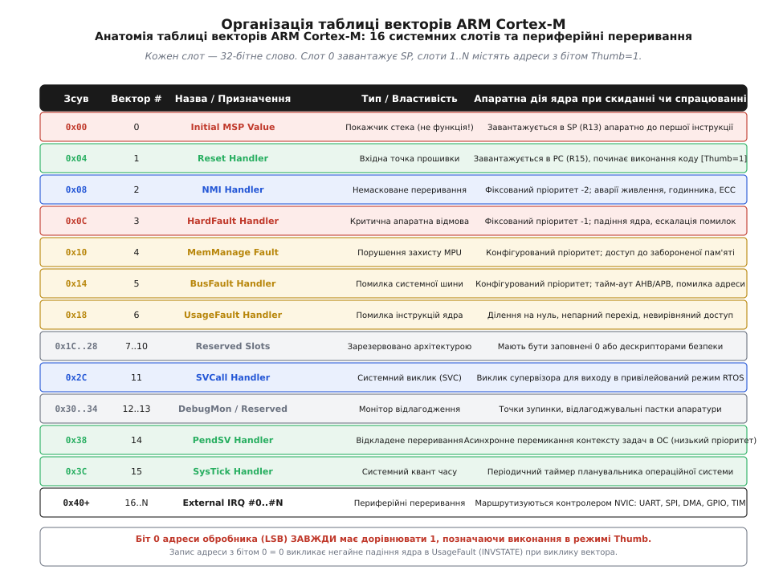

# Таблиця векторів

<preknowlist>
- [Вирівнювання даних: апаратні вимоги](root:hw-arch/alignment-hardware) — чому шина вимагає адрес, кратних степеню двійки.
- [Переривання: апаратна природа та обробка](root:hw-arch/interrupts) — як контролер фіксує зовнішні сигнали та передає керування обробникам.
- [Пріоритети переривань та вкладеність](root:hw-arch/interrupt-priorities) — як ядро арбітрує одночасні запити та витісняє поточний контекст.
- [Латентність переривань](root:hw-arch/latentnist-pereryvannia) — скільки тактів витрачає конвеєр на збереження регістрів та перехід до ISR.
- [Розділення адресного простору](root:hw-arch/address-space-separation) — як розміщуються Flash, SRAM та регістри периферії на системній шині.
- [Strapping-виводи та режими завантаження](root:hw-arch/strapping-piny-i-rezhymy-zavantazhennia) — як залізо обирає джерело стартового коду в першу мить після скидання.
</preknowlist>

Коли напруга живлення мікроконтролера стабілізується і схема скидання знімає апаратне блокування, процесорне ядро ще не має завантаженого коду програми чи налаштованого середовища. У нього порожні регістри загального призначення, невизначений покажчик стека і заблокований лічильник команд. Щоб розпочати роботу, кремнієвий автомат ядра на першому такті звертається до системної шини за адресою нульового зсуву пам'яті. Звідти процесор вичитує початкове значення покажчика стека, а з наступної комірки — адресу першої інструкції програми. Цей впорядкований масив початкових констант і числових адрес переходу називають таблицею векторів переривань.

Таблиця векторів є базовим контрактом між апаратурою кристала та кодом прошивки. Вона визначає, куди саме передається керування при виникненні апаратних подій від таймерів, портів введення-виведення, інтерфейсів передачі даних або критичних системних помилок обчислювального блоку.


*Структура перших 16 системних слів та периферійних векторів у пам'яті ARM Cortex-M із нульовим словом Initial MSP.*

### Апаратний старт ядра та структура системних винятків

В архітектурі ARM Cortex-M таблиця векторів принципово відрізняється від традиційних процесорів загального призначення. Вона містить не виконувані асемблерні інструкції розгалуження, а **числові 32-бітні значення покажчиків**.

Перші 16 слів таблиці (зсуви `0x00`..`0x3C`) зарезервовані під системні винятки процесорного ядра:
- **Слот 0 (`0x0000`) — Initial MSP**: Початкова вершина головного покажчика стека. Оскільки архітектура використовує спадний стек, це значення зазвичай вказує на кінцеву адресу доступної оперативної пам'яті SRAM (наприклад, `0x20020000`).
- **Слот 1 (`0x0004`) — Reset Handler**: Адреса точки входу функції ініціалізації середовища, яка копіює змінні з Flash у RAM, очищає секцію `.bss` та викликає `main()`.
- **Слот 2 (`0x0008`) — NMI**: Немасковане переривання з найвищим фіксованим пріоритетом для обробки критичних апаратних аварій (збій кварцового резонатора, помилки пам'яті з корекцією ECC).
- **Слот 3 (`0x000C`) — HardFault**: Головний обробник фатальних відмов ядра при спробах недійсного доступу до пам'яті або виконанні заборонених операцій.
- **Слоти 4..6 — MemManage, BusFault, UsageFault**: Налаштовувані винятки для захисту пам'яті MPU, помилок системної шини та виконання некоректних інструкцій.
- **Слот 11 — SVCall**: Синхронний системний виклик для взаємодії непривілейованих задач користувача з ядром операційної системи.
- **Слот 14 — PendSV**: Відкладене низькопріоритетне переривання для безпечного перемикання контексту задач в RTOS.
- **Слот 15 — SysTick**: Обробник періодичного системного таймера ядра.

Починаючи зі слота 16 (`0x0040`), розташовані вектори переривань периферійних блоків конкретного мікроконтролера (таймери, UART, SPI, DMA, АЦП), які керуються контролером переривань NVIC.

### Апаратне правило молодшого біта Thumb (LSB)

Усі процесори лінійки ARM Cortex-M виконують виключно інструкції набору команд Thumb-2. Оскільки кожна інструкція в пам'яті має довжину 2 або 4 байти і розміщується за парною адресою, нульовий біт адреси переходу використовується як апаратний прапорець архітектурного стану ядра (Thumb State Bit).

Коли ядро вичитує адресу вектора з таблиці:
1. Старші біти `[31:1]` завантажуються в лічильник команд `PC`.
2. Молодший біт `[0]` завантажується в біт `T` регістра стану виконання `EPSR`.

Якщо адреса в таблиці векторів є парною (`LSB = 0`), процесор фіксує заборонений стан ядра (`EPSR.T = 0`) і на першому ж такті вибірки інструкції падає в апаратну помилку `UsageFault (INVSTATE)` або `HardFault`. Компілятори GCC та Clang автоматично встановлюють цей біт для всіх функцій, проте при ручному формуванні таблиці векторів у коді розробник зобов'язаний додавати одиницю до кожної адреси: `(uint32_t)Handler | 1UL`.

### Регістр зсуву VTOR та вирівнювання за степенем двійки

За замовчуванням після скидання ядро вибирає таблицю векторів з адреси `0x00000000`. Для підтримки завантажувачів (Bootloader), оновлення прошивки по повітрю або прискорення обробки переривань через оперативну пам'ять адреса таблиці може бути змінена записом у регістр **`SCB->VTOR`** (Vector Table Offset Register, адреса `0xE000ED08`).

Базова адреса таблиці векторів підпорядковується строгому правилу: **вона зобов'язана бути вирівняна в пам'яті на число байтів, рівне повному розміру таблиці, округленому вгору до найближчого степеня двійки**. Мінімальне апаратне вирівнювання становить 128 байтів (32 слова).

Наприклад, для мікроконтролера з 82 лініями периферійних переривань повний розмір таблиці становить (16 + 82) · 4 = 392 байти. Найближчим степенем двійки є 2⁹ = 512 байтів. Спроба встановити невирівняну адресу призведе до апаратного відкидання молодших бітів регістром VTOR та неминучого краху системи.

### Передача керування від Bootloader до Application

При побудові системи з завантажувачем передача керування основній прошивці вимагає коректної послідовності скидання контексту:
1. Глобальне блокування переривань (`__disable_irq()`).
2. Зупинка системного таймера SysTick та скидання всіх активних ліній NVIC.
3. Встановлення нового значення регістра `SCB->VTOR` на базову адресу таблиці векторів додатку.
4. Виконання бар'єрів пам'яті `__DSB()` та синхронізації конвеєра `__ISB()`.
5. Завантаження покажчика стека `MSP` зі слота 0 пам'яті додатку.
6. Перехід на функцію обробника скидання `Reset_Handler` зі слота 1.

Нижче наведено базовий приклад переходу на C99 та C++20.

:::tabs
```c
#include <stdint.h>

typedef void (*entry_fn)(void);

void boot_jump_to_app(uint32_t app_base) {
    __asm__ volatile ("cpsid i" : : : "memory");

    /* Зупинка SysTick */
    *(volatile uint32_t*)0xE000E010 = 0;

    /* Встановлення VTOR */
    *(volatile uint32_t*)0xE000ED08 = app_base;

    __asm__ volatile ("dsb 0xF" : : : "memory");
    __asm__ volatile ("isb 0xF" : : : "memory");

    /* Завантаження стека та перехід */
    uint32_t msp_val = *(volatile uint32_t*)app_base;
    uint32_t reset_val = *(volatile uint32_t*)(app_base + 4);

    __asm__ volatile ("msr msp, %0" : : "r" (msp_val) : "memory");
    ((entry_fn)reset_val)();
}
```
```cpp
#include <cstdint>

namespace boot {

using entry_point_t = void (*)() noexcept;

inline void jump_to_application(uintptr_t app_base) noexcept {
    asm volatile ("cpsid i" : : : "memory");

    // Зупинка SysTick
    *reinterpret_cast<volatile uint32_t*>(0xE000E010) = 0;

    // Релокація VTOR
    *reinterpret_cast<volatile uint32_t*>(0xE000ED08) = static_cast<uint32_t>(app_base);

    asm volatile ("dsb 0xF\n isb 0xF" : : : "memory");

    const auto stack_top = *reinterpret_cast<const uint32_t*>(app_base);
    const auto entry_addr = *reinterpret_cast<const uint32_t*>(app_base + sizeof(uint32_t));

    asm volatile ("msr msp, %0" : : "r"(stack_top) : "memory");

    auto entry_point = reinterpret_cast<entry_point_t>(entry_addr);
    entry_point();
}

} // namespace boot
```
:::

Таблиця векторів забезпечує детермінований і надійний старт мікроконтролера та слугує апаратним шлюзом між цифровими сигналами зовнішнього світу та кодом системної прошивки.
