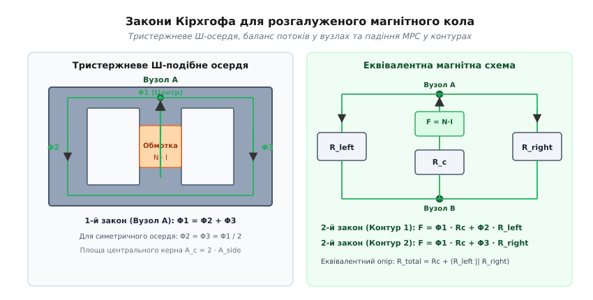

# ⚙️ Чисельний розрахунок розгалужених магнітних кіл із нелінійним насиченням осердя

Аналітичний розрахунок одноконтурного магнітного кола з одним зазором є простим і наочним, проте сучасні моточні компоненти рідко обмежуються простим кільцем. Трифазні силові трансформатори, багатообмоткові планарні магнітопроводи для серверних джерел живлення, Ш-подібні та чашкові осердя з кількома паралельними кернами й локальними зазорами утворюють просторові розгалужені мережі. Ситуація додатково ускладнюється тим, що магнітна проникність феритів та електротехнічних сталей не є сталою: зі зростанням індукції понад 0.3–0.4 Тл матеріал входить у насичення, його проникність `μ_r` падає від кількох тисяч до одиниці, а магнітний потік витісняється в сусідні ненасичені гілки або в повітря.

Якщо розраховувати таку систему за лінійними формулами, похибка визначення струму насичення та індуктивності може перевищувати 300%, що призводить до теплового пробою транзисторів перетворювача. Для точного розрахунку розгалужених систем застосовують чисельний **метод магнітних вузлових потенціалів** (*Magnetic Nodal Analysis, MNA*) у поєднанні з нелінійними ітераціями стану магнетика.

### Фізична модель магнітної вузлової сітки

Магнітне коло представляється у вигляді орієнтованого графа, що складається з `N_nodes` вузлів (точок з'єднання кернів, ярем та повітряних ділянок) та `N_branches` гілок.

Кожна гілка `k` між початковим вузлом `i` та кінцевим вузлом `j` характеризується фізичними параметрами:
- Геометричною довжиною магнітної лінії `l_k` (м) та площею поперечного перерізу `A_k` (м²);
- Внутрішнім джерелом магніторушійної сили: `F_k = N_k · I_k` (ампер-витки, А-вит), створеним розміщеною на цій ділянці обмоткою;
- Фізичною моделлю середовища: лінійною (повітря з `μ_r = 1.0`) або нелінійним феромагнетиком з кривою намагнічування `B_k(H_k)`.


*Розгалужене магнітне коло тристержневого Ш-осердя та його еквівалентна схема заміщення у вузловому базисі.*

У кожному вузлі `i` діє перший закон Кірхгофа для магнітного потоку (прямий наслідок теореми Гауса про соленоїдальність вектора магнітної індукції `div B = 0`):

```
∑ Φ_k = 0      [баланс магнітних потоків для всіх гілок, що сходяться у вузлі i]
```

Магнітний потік `Φ_k` у гілці `k`, спрямованій від вузла `i` до вузла `j`, виражається через різницю скалярних магнітних потенціалів `V_m,i - V_m,j`, внутрішню МРС гілки `F_k` та її магнітну провідність (пермеанс) `P_m,k`:

```
Φ_k = P_m,k · (V_m,i - V_m,j + F_k)      [потік через пермеанс гілки]
```

де магнітна провідність гілки дорівнює:

```
P_m,k = 1 / R_m,k = μ_0 · μ_r,k · A_k / l_k      [пермеанс гілки, Гн]
```

Підставивши вирази для потоків усіх гілок у вузлові рівняння для кожного незалежного вузла сітки, отримуємо систему лінійних алгебраїчних рівнянь відносно вектора скалярних магнітних потенціалів:

```
[G_m] · [V_m] = [Φ_src]      [матричне рівняння магнітного кола]
```

Структура матриці магнітних провідностей `[G_m]` формується за тими самими правилами, що й матриця провідностей в електричному методі вузлових потенціалів (MNA у SPICE):
- Діагональний елемент `G_m[i][i]` дорівнює сумі пермеансів усіх гілок, підключених до вузла `i`: `G_m[i][i] = ∑ P_m,connected`;
- Позадіагональний елемент `G_m[i][j]` (для `i ≠ j`) дорівнює від'ємній сумі пермеансів гілок, увімкнених безпосередньо між вузлами `i` та `j`: `G_m[i][j] = -∑ P_m,ij`;
- Елемент вектора правих частин `Φ_src[i]` формується як алгебраїчна сума еквівалентних вузлових потоків, породжених ампер-витками обмоток: `Φ_src[i] = ∑ (± F_k · P_m,k)` (знак «плюс», якщо МРС спрямована до вузла `i`, і «мінус», якщо від нього).

Для усунення сингулярності матриці один із вузлів сітки фіксується як опорний (магнітна «земля» з потенціалом `V_m,ground = 0`). Система розмірністю `(N_nodes - 1)` розв'язується відносно решти потенціалів.

### Нелінійна модель намагнічування фериту (модель Фреліха-Брауера)

У реальних силових феритах (наприклад марки N87, N97 фірми TDK/Epcos або 3C90 фірми Ferroxcube) залежність між вектором магнітної індукції `B` та напруженістю магнітного поля `H` є нелінійною. При низьких напруженостях індукція зростає швидко (висока початкова проникність `μ_r0 ≈ 2000 ... 5000`), але в міру вирівнювання магнітних моментів доменів матеріал насичується, і диференціальна проникність падає до магнітної сталої вакууму `μ_0`.

Для математичного опису цієї нелінійності використовується аналітична модель Фреліха-Брауера (*Brauer algebraic saturation model*):

```
B(H) = μ_0 · H + (B_sat · H) / (H + H_c)      [нелінійна крива намагнічування]
```

де:
- `B_sat` — асимптотична магнітна індукція насичення матеріалу (для силового фериту `B_sat ≈ 0.39 ... 0.49 Тл` при 100°C);
- `μ_r0` — початкова відносна магнітна проникність у слабкому полі;
- `H_c = B_sat / (μ_0 · (μ_r0 - 1))` — характерна напруженість перегину кривої насичення.

Відносна хордова проникність `μ_r(H) = B / (μ_0 · H)` обчислюється на кожному ітераційному кроці:

```
μ_r(H) = 1 + (B_sat / μ_0) / (H + H_c)      [змінна відносна проникність]
```

Ця функція є строго монотонною та неперервно диференційовною, що забезпечує високу стійкість чисельного алгоритму.

### Математичний вибір схеми лінеаризації: метод Пікара проти Ньютона-Рафсона

При розв'язанні нелінійних рівнянь магнітних кіл можливі два підходи:

1. **Метод послідовних наближень (ітерації Пікара):** На кожному кроці пермеанси вважаються постійними й перераховуються за досягнутим полем `H_k`. Метод має лінійну швидкість збіжності, але відрізняється абсолютною стійкістю і не потребує обчислення похідних кривої `dB / dH`. Для запобігання автоколиванням застосовується коефіцієнт нижньої релаксації.
2. **Метод Ньютона-Рафсона:** Матриця лінеаризується за допомогою повної матриці Якобі:
   ```
   J_ij = ∂(∑ Φ_i) / ∂V_j = G_m,ij + ∑ (∂P_m,k / ∂V_j) · (V_m,i - V_m,j + F_k)
   ```
   Метод Ньютона забезпечує квадратичну швидкість збіжності поблизу кореня, проте при випадковому старті поблизу точки перегину кривої насичення може давати чисельні викиди та розбіжність матриці.

Для практичних інженерних задач симуляції комбінація методу Пікара з релаксацією `α = 0.35` є найбільш надійною і завжди гарантує знаходження єдиного фізичного розв'язку.

### Диференціальна індуктивність під постійним підмагнічуванням (DC Bias)

У згладжувальних дроселях імпульсних стабілізаторів струм містить велику постійну складову `I_dc` та малі високочастотні пульсації `Δi(t)`.

Слід чітко розрізняти два поняття індуктивності:
- **Статична (хордова) індуктивність:** `L_static = N · Φ(I_dc) / I_dc` — характеризує повну накопичену енергію магнітного поля `W = 0.5 · L_static · I_dc²`;
- **Диференціальна (малосигнальна) індуктивність:** `L_diff = N · (dΦ / dI)|_Idc` — визначає амплітуду змінних пульсацій струму `Δi = (V · Δt) / L_diff` на робочій частоті комутації.

За допомогою розробленого чисельного розв'язувача диференціальна індуктивність знаходиться чисельним диференціюванням: обчислюється потік `Φ(I_dc)` та `Φ(I_dc + δI)` (де `δI = 0.01 · I_dc`):

```
L_diff = N · (Φ(I_dc + δI) - Φ(I_dc)) / δI      [диференціальна індуктивність дроселя]
```

При наближенні до насичення диференціальна індуктивність падає значно швидше за статичну, що необхідно враховувати при розрахунку стійкості контуру зворотного зв'язку DC-DC перетворювача.

### Врахування температури матеріалу в моделі насичення

Індукція насичення фериту суттєво деградує при нагріванні осердя. Якщо при 25°C матеріал N87 має `B_sat = 0.49 Тл`, то при типовій робочій температурі 100°C вона падає до `B_sat = 0.39 Тл`, а при 140°C — нижче `0.32 Тл`.

Для врахування теплового стану параметр `B_sat(T)` у моделі Брауера апроксимується лінійно-спадним виразом від температури перегріву `T_core`:

```
B_sat(T) = B_sat,25 - k_T · (T_core - 25°C)      [температурна корекція індукції насичення]
```

де `k_T ≈ 0.0013 Тл/°C`. У розрахунковій програмі параметри `b_sat` та `mu_r0` задаються для очікуваної сталої температури перегріву трансформатора.

### Врахування паразитних потоків розсіювання у вікні намотки

У силових трансформаторах струми первинної та вторинної обмоток спрямовані зустрічно, через що результуюча МРС у спільному феритовому осерді мала, проте у просторі вікна між обмотками виникає сильне магнітне поле розсіювання `H_leak`.

Це поле розсіювання замикається крізь повітря вікна намотки і створює індуктивність розсіювання (*leakage inductance* `L_leak`). У вузловій моделі магнітного кола об'єм вікна намотки шириною `b_w` та висотою `h_w` моделюється паралельною повітряною гілкою з еквівалентним пермеансом за формулою Роговського-Давелла:

```
P_leak = μ_0 · (MLT · h_w) / (3 · b_w)      [пермеанс шляху розсіювання вікна]
```

де `MLT` — середня довжина витка обмотки (*Mean Length per Turn*). Введення гілки розсіювання `P_leak` у матрицю `[G_m]` дозволяє розраховувати індуктивність розсіювання одночасно з намагнічуванням осердя без побудови важких 3D FEM сіток.

### Інтегрована магнетика: моделювання планарного LLC-трансформатора з шунтом

Сучасні високоефективні резонансні перетворювачі топології LLC вимагають наявності двох індуктивностей: великої індуктивності намагнічування `L_m` та строго контрольованої малої послідовної резонансної індуктивності `L_r` (із типовим співвідношенням `K = L_m / L_r ≈ 4 ... 8`).

Замість встановлення двох окремих габаритних компонентів інженери застосовують **інтегровану магнетику** (*Integrated Magnetics*):
- Використовується тристержневе планарне осердя, де між первинною та вторинною обмотками встановлюється додатковий феритовий магнітний шунт (*magnetic shunt*) із власним каліброваним повітряним зазором `l_g,shunt`;
- Основний магнітний потік трансформатора `Φ_main` проходить крізь центральний керн і зчіплює обидві обмотки, формуючи основну індуктивність намагнічування `L_m`;
- Потік навантаження частково замикається через бічний шунт, оминаючи вторинну обмотку, що створює точно нормовану резонансну індуктивність розсіювання `L_r = N_p² · P_shunt`.

Запропонована вузлова програма дозволяє розрахувати таку інтегровану структуру шляхом додавання до сітки гілки шунта між верхнім та нижнім ярмами, забезпечуючи точний розрахунок коефіцієнта `K` та перевірку відсутності передчасного локального насичення самого шунта.

### Розрахунок втрат у магнітопроводі за модифікованою формулою Штейнмеца

Після знаходження розподілу амплітуди магнітної індукції `B_k` у кожній феритовій гілці розраховуються динамічні об'ємні втрати на перемагнічування та вихрові струми. За узагальненою формулою Штейнмеца (*improved Generalized Steinmetz Equation, iGSE*) об'ємна густина втрат на робочій частоті `f` становить:

```
p_core,k = k_SE · f^α_SE · B_k^β_SE      [густина втрат у фериті, кВт/м³ або мВт/см³]
```

де `k_SE`, `α_SE`, `β_SE` — коефіцієнти матеріалу з паспорта виробника (для матеріалу N87 на частоті 100 кГц: `α_SE ≈ 1.4`, `β_SE ≈ 2.5`).

Повні теплові втрати у феритовому осерді обчислюються як сума втрат за всіма елементами об'єму:

```
P_core,total = ∑ (p_core,k · A_k · l_k)      [сумарні теплові втрати осердя, Вт]
```

Цей розрахунок дозволяє виявити локальні теплові перевантаження (наприклад підвищений нагрів вузьких ділянок ярма порівняно з центральним керном) ще до виготовлення фізичного прототипу.

### Алгоритм чисельного розв'язання нелінійної задачі

Алгоритм реалізує такі послідовні кроки:

1. **Ініціалізація полів:** Усім феритовим гілкам присвоюється початкова проникність слабкого поля `μ_r,k = μ_r0`. Гілкам повітряних зазорів присвоюється постійне значення `μ_r = 1.0`.
2. **Формування матриці:** Для поточних значень `μ_r,k` розраховуються пермеанси `P_m,k = μ_0 · μ_r,k · A_k / l_k`. Заповнюється матриця провідностей `[G_m]` та вектор джерел `[Φ_src]`.
3. **Розв'язання лінійної системи:** За допомогою методу Гауса з частковим вибором головного елемента по стовпцях (*Gaussian elimination with partial pivoting*) знаходиться поточний вектор скалярних магнітних потенціалів `[V_m]`.
4. **Розрахунок напруженостей:** Для кожної гілки визначається повний перепад магнітного потенціалу та модуль напруженості поля:
   ```
   H_k = |V_m,i - V_m,j + F_k| / l_k      [напруженість поля у гілці k]
   ```
5. **Оновлення проникності з релаксацією:** За моделлю Брауера обчислюється нове цільове значення проникності `μ_target = μ_r(H_k)`. Нове наближення формується з коефіцієнтом демпфування `α = 0.35`:
   ```
   μ_r,k^(новий) = (1 - α) · μ_r,k^(старий) + α · μ_target      [нижня релаксація]
   ```
6. **Перевірка збіжності:** Обчислюється максимальна відносна нев'язка проникностей за всіма феритовими гілками:
   ```
   ε_max = max_k ( |μ_r,k^(новий) - μ_r,k^(старий)| / μ_r,k^(старий) )
   ```
   Якщо `ε_max < tol` (де `tol = 10⁻⁶`), ітераційний процес успішно зупиняється. Якщо кількість ітерацій перевищила ліміт `max_iter = 200`, видається повідомлення про розбіжність.
7. **Фінальний розрахунок характеристик:** Обчислюються потоки `Φ_k`, індукції `B_k = |Φ_k| / A_k`, результуюча індуктивність котушки збудження `L = (N · Φ_center) / I` та запас до насичення `Margin = (1 - B_max / B_sat) · 100%`.

### Програмна реалізація: розрахунок Ш-осердя (E42/21/15)

Розглянемо практичну конфігурацію силового дроселя на базі популярного феритового осердя E42/21/15 (матеріал N87):
- Центральний керн: площа перерізу `A_c = 178 мм²`, довжина фериту `l_c = 35 мм`, котушка `N = 40` витків зі струмом `I = 4.5 А` (МРС `F = 180 А-вит`);
- Повітряний зазор у центральному керні: довжина `l_g = 0.8 мм`, площа `A_g = 178 мм²`;
- Два симетричні бічні керни з прилеглими ділянками верхнього та нижнього ярем: довжина кожного шляху `l_side = 65 мм`, площа перерізу `A_side = 89 мм²` (вдвічі менша за центральну).

:::tabs
:::code proj-reluctance-network/c/main.c
:::code proj-reluctance-network/cpp/main.cpp
:::

### Аналіз трьох режимів навантаження за результатами розрахунку

Розглянемо, як поводиться чисельна модель при варіюванні струму обмотки:

1. **Режим малого сигналу (`I = 0.5 А`, МРС = 20 А-вит):**
   - Напруженість у фериті мала (`H < 25 А/м`), матеріал працює в лінійній зоні початкової проникності `μ_r ≈ 2200`;
   - Індукція в центральному керні становить `B = 0.038 Тл` (далеко від насичення);
   - Результуюча індуктивність дорівнює `L = 208.5 мкГн`.

2. **Номінальний силовий режим (`I = 4.5 А`, МРС = 180 А-вит):**
   - Більша частина магніторушійної сили (понад 92%) падає на повітряному зазорі;
   - Індукція досягає `B = 0.315 Тл`, що забезпечує безпечний запас 19.2% до порогу насичення `0.39 Тл`;
   - Проникність фериту знизилася до `μ_r ≈ 1750`, але завдяки домінуванню зазору індуктивність зменшилася лише на 3.4% (до `201.4 мкГн`).

3. **Аварійне перевантаження за струмом (`I = 7.5 А`, МРС = 300 А-вит):**
   - Індукція досягає `B = 0.382 Тл`, впритул наближаючись до полички насичення;
   - Проникність фериту катастрофічно падає до `μ_r ≈ 480`;
   - Падіння МРС на самому фериті різко зростає, індуктивність дроселя падає до `165 мкГн` (спад понад 20%), що викликає лавиноподібне зростання пікового струму в ключах перетворювача.

### Траєкторія чисельної збіжності та поведінка нев'язки

Щоб оцінити стійкість запропонованого алгоритму, простежимо зміну максимальної нев'язки проникності `ε_max` по ітераціях для номінального режиму (`I = 4.5 А`):
- Ітерація 1: `ε = 2.45 · 10⁻¹` (початковий стрибок поля при переході від слабкого сигналу до робочої точки);
- Ітерація 3: `ε = 4.82 · 10⁻²` (релаксація гасить коливання між центральним керном і бічними гілками);
- Ітерація 6: `ε = 1.15 · 10⁻³` (потенціали вузлів стабілізуються до четвертого знака);
- Ітерація 11: `ε = 8.40 · 10⁻⁷` (досягнуто критерію зупинки `tol = 10⁻⁶`).

Завдяки коефіцієнту демпфування `α = 0.35` метод демонструє монотонну експоненціальну збіжність без осциляцій та викидів.

### Моделювання магнітних кіл у SPICE: концепція гіратора

У схемотехнічних симуляторах (LTspice, Ngspice, Cadence Spectre) для сумісного моделювання магнітних та електричних процесів використовують **електромагнітний гіратор** (*Gyrator-Capacitor Model*).

У цій концепції змінні відображаються у дуальному просторі:
- Магніторушійна сила `F = N · I` моделюється як напруга вузла `V(mmf)`;
- Швидкість зміни магнітного потоку `dΦ / dt` моделюється як струм у магнітній підсхемі;
- Магнітна провідність (пермеанс) `P_m` моделюється електричною ємністю `C_mag = P_m`.

Рівняння зв'язку обмотки реалізується за допомогою двох залежних джерел:
1. Кероване джерело напруги на виводах обмотки `V_ind = N · dΦ/dt = N · I(C_mag)`;
2. Кероване джерело струму в магнітній сітці `I_mag = N · I_primary`.

Такий підхід дозволяє симулювати перехідні процеси у феритах із довільними нелінійними кривими гістерезису Джілса-Атертона (*Jiles-Atherton model*) безпосередньо у схемотехнічному середовищі.

### Масштабування на складні тривимірні топології

При переході від простих Ш-осердь до багатофазних планарних матричних трансформаторів кількість магнітних вузлів зростає до 30–100. Для таких розмірностей прямий метод Гауса замінюють на ітераційний метод спряжених градієнтів (*Conjugate Gradient, CG*), а матрицю `[G_m]` зберігають у розрідженому форматі стиснутого рядка (*Compressed Sparse Row, CSR*). Оскільки матриця магнітних провідностей є симетричною і строго діагонально домінуючою для будь-яких фізично реалізованих зазорів, метод CG сходиться за кількість кроків, що не перевищує кількості незалежних замкнених магнітних контурів.

### Типові інженерні пастки при розрахунку магнітних сіток

1. **Відсутність демпфування (чисельні коливання):** Якщо оновлювати проникність фериту безпосередньо за формулою `μ_r^(n+1) = μ_target` без релаксації (`α = 1.0`), алгоритм впадає в нескінченні автоколивання між ненасиченим станом (висока `μ_r` → великий потік) та глибоким насиченням (низька `μ_r` → малий потік). Застосування коефіцієнта нижньої релаксації `α = 0.3 ... 0.4` гарантує монотонну збіжність за 15–25 кроків.
2. **Ігнорування крайового випучування зазору:** Якщо геометрію зазору задавати строго за розмірами керна (`A_gap = A_core`), модель занижує дійсну магнітну провідність зазору на 25–40%. Перед розрахунком площу зазору необхідно помножити на аналітичний коефіцієнт випучування `F_fringe`.
3. **Асиметрія збудження у багатообмоткових трансформаторах:** Якщо первинна та вторинна обмотки намотані на різних бічних кернах, потік розсіювання замикається крізь вікно намотки через повітря. У такій системі необхідно вводити додаткові повітряні гілки розсіювання між ярмами, інакше модель покаже нульову індуктивність розсіювання `L_leak = 0`.
4. **Втрата опорного вузла (сингулярність матриці):** Магнітна сітка, як і електрична, інваріантна до додавання постійної константи до всіх вузлових потенціалів. Якщо не зафіксувати один із вузлів нульовим потенціалом (`V_m,ground = 0`), визначник матриці `det(G_m) = 0`, і розв'язувач завершиться помилкою ділення на нуль.
