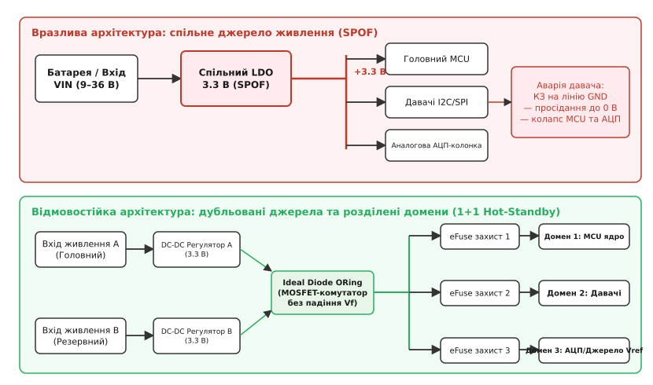
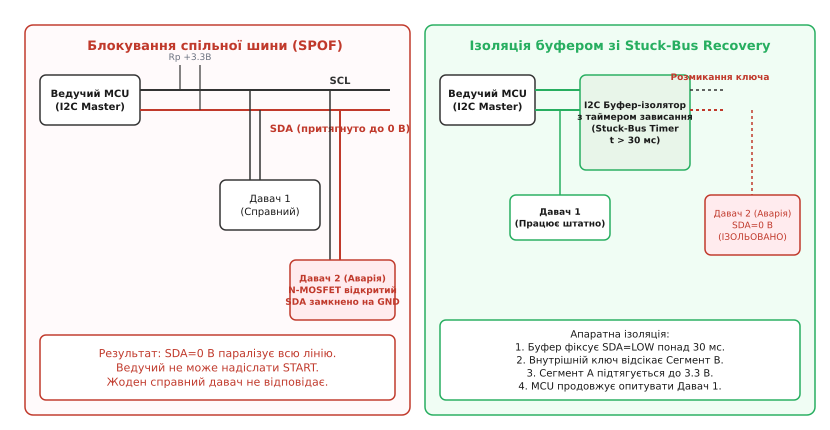
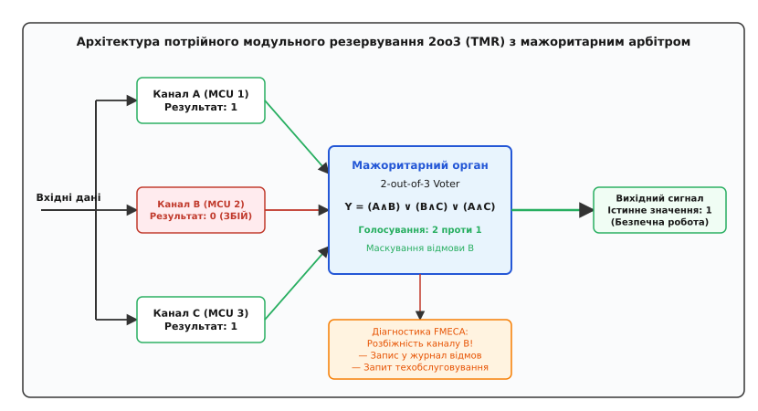
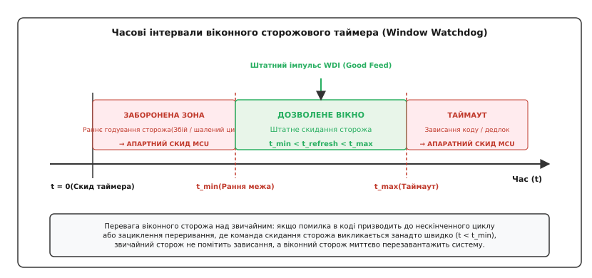

# Одинична точка відмови

<preknowlist>
- [Аналіз надійності та запасів](root:hw-components/worst-case-analysis) — розрахунок найгірших умов, чутливість до відхилень параметрів.
- [Гальванічна ізоляція](root:hw-components/galvanic-isolation) — бар'єри напруги, ємнісна та магнітна розв'язка сигнальних кіл.
- [Відновлення шини I2C](root:com-devices/i2c-bus-recovery) — скидання завислої лінії SDA тактуванням 9 імпульсів.
- [Домен резервного живлення (VBAT)](root:hw-components/backup-power-domain) — відокремлені острови живлення та захист від перетікання струмів.
- [Детектування просідання напруги](root:hw-arch/brownout) — поведінка мікроконтролера та пороги скидання при аварії живлення.
</preknowlist>

Коли на друкованій платі багатоканального промислового контролера з десятками датчиків, двома процесорними ядрами та резервованими лініями зв'язку пробивається один керамічний блокувальний конденсатор вартістю кілька центів на виході спільного стабілізатора 3.3 В, шина живлення замикається на землю. Обидва обчислювальні ядра миттєво знеструмлюються, інтерфейсні трансивери гаснуть, а виконавча система перетворюється на мертвий шматок текстоліту. Попри наявність програмного резервування та дублювання алгоритмів, система повністю втрачає життєздатність через одну схемотехнічну вразливість — одиничну точку відмови.

Одинична точка відмови (англ. *Single Point of Failure*, SPOF) — це фізичний, електричний або логічний елемент системи, дефект або деградація якого унеможливлює виконання приладом його цільової функції без можливості автоматичної компенсації чи збереження критичного стану. На відміну від випадкових збоїв окремих функціональних блоків, відмова в точці SPOF запускає незворотну ланцюгову реакцію або паралізує спільну інфраструктуру пристрою.

### Системний аналіз надійності: методики FMEA та FMECA

Для виявлення та усунення таких вразливостей на етапі проектування схемотехніки застосовують системний інженерний аналіз видів і наслідків відмов — FMEA (англ. *Failure Mode and Effects Analysis*). Цей метод передбачає послідовну декомпозицію системи на окремі вузли та аналіз кожного можливого фізичного дефекту за трьома основними критеріями, які оцінюються за шкалою від 1 до 10:

1. **Тяжкість наслідків (лат. *gravis* / англ. *Severity*, `S`):** оцінює вплив відмови на безпеку людей, збереження обладнання та виконання місії. Значення `S = 1` відповідає непомітному відхиленню без втрати функцій, `S = 5..6` — деградації вторинних функцій зі збереженням керованості, а `S = 9..10` вказує на катастрофічну відмову з загрозою життю людей або повною втратою приладу без попередження.
2. **Ймовірність виникнення (англ. *Occurrence*, `O`):** визначається статистичною інтенсивністю відмов компонента `λ` (кількість відмов на мільйон годин або FIT, де `1 FIT = 10⁻⁹ відмов/год`). Значення `O = 1` відповідає надійності космічного класу (ймовірність відмови менше `10⁻⁶` за час експлуатації), а `O = 10` — регулярним відмовам елементів низької якості або роботі в екстремальних температурних режимах із перевищенням допустимих запасів.
3. **Ймовірність виявлення (англ. *Detection*, `D`):** оцінює здатність вбудованої діагностики (апаратних компараторів, сторожових таймерів, алгоритмів контролю цілісності пам'яті) зафіксувати дефект до настання важких наслідків. Значення `D = 1` означає гарантоване миттєве детектування апаратурою з безпечною реакцією, тоді як `D = 10` означає приховану (латентну) відмову, яку неможливо виявити під час роботи.

Добуток цих трьох параметрів утворює пріоритетне число ризику (англ. *Risk Priority Number*, RPN):

```
RPN = S · O · D
```

Значення RPN може змінюватися в діапазоні від 1 до 1000. Вузли з `RPN > 100` або будь-які елементи з показником тяжкості `S ≥ 9` (незалежно від загального RPN) автоматично класифікуються як критичні одиничні точки відмови і вимагають обов'язкової схемотехнічної модифікації.

Розширений аналіз FMECA (англ. *Failure Mode, Effects, and Criticality Analysis*) доповнює якісну оцінку FMEA точним кількісним розрахунком критичності `C_m` для кожної модальності відмови компонента:

```
C_m = α · β · λ · t
```

де `α` — частка конкретного виду відмови серед усіх відмов компонента (коефіцієнт модальності, наприклад, для керамічного конденсатора частка короткого замикання становить `α ≈ 0.7`, а обриву `α ≈ 0.3`), `β` — умовна ймовірність того, що цей дефект призведе до повної відмови системи, `λ` — загальна інтенсивність відмов деталі, а `t` — тривалість місії.

Нижче наведено фрагмент інженерної таблиці FMECA для типового вузла мікроконтролерного приладу:

| Вузол / Елемент | Вид відмови (Failure Mode) | Фізична причина | Наслідок для системи | S | O | D | RPN | Заходи усунення SPOF |
|---|---|---|---|---|---|---|---|---|
| Вхідний LDO 3.3 В | Пробій регулюючого MOSFET (Drain-Source Short) | Теплове перевантаження, сплеск перенапруги | Подача 12 В на шину 3.3 В; вигорання всіх IC | 10 | 3 | 4 | 120 | Захисний стабілітрон Crowbar / OVP eFuse |
| Кераміка MLCC 10 мкФ | Коротке замикання (Dielectric Breakdown) | Механічна тріщина від вигину плати | Повне занулення шини живлення; зупинка MCU | 9 | 4 | 2 | 72 | Послідовне з'єднання (Soft Termination / 2-in-Series) |
| Шина I2C (Давач тиску) | Залипання лінії SDA в 0 В (Stuck-Low) | Зависання цифрового автомата під час читання | Блокування всієї шини; відмова інших датчиків | 8 | 5 | 3 | 120 | I2C-буфер з авто-розмиканням (Stuck-Bus Timer) |
| Кварцовий резонатор 16 МГц | Зупинка генерації (Loss of Oscillation) | Механічний удар, розтріскування кварцу | Зупинка тактування ядра; зависання системи | 9 | 2 | 2 | 36 | Активація Clock Security System (CSS) у MCU |
| Лінія /RESET | Замикання на землю через витік конденсатора | Деградація діелектрика ємності затримки | Нескінченний апаратний ресет процесора | 9 | 2 | 3 | 54 | Використання активного супервізора з відкритим стоком |

#### Класифікація відмов за фізичною природою та часовим профілем

У напівпровідниковій та дискретній електроніці відмови класифікують за трьома часовими категоріями:

- **Постійні відмови (англ. *Hard / Permanent Failures*):** незворотні фізичні руйнування кристала або пасивних компонентів. До них належать пробій тонкого підзатворного оксиду (Time-Dependent Dielectric Breakdown, TDDB), електроміграція металізації при високих густинах струму, вигорання золотих чи алюмінієвих зв'язувальних провідників (Bond Wires), утворення ниткоподібних кристалів олова (Tin Whiskers) між виводами або скол кристала при термоциклуванні.
- **Перемежовані відмови (англ. *Intermittent Failures*):** періодична втрата електричного контакту або локальне порушення параметрів через теплове розширення матеріалів. Типовий приклад — мікротріщини в BGA-пайці під процесором, деградація перехідних отворів (Vias) у багатошарових платах або зміна опору контакту роз'ємів під впливом вібрації.
- **Перехідні збої (англ. *Transient / Soft Errors*):** поодинокі збої бітів (англ. *Single Event Upset*, SEU) під дією альфа-частинок від радіоактивного розпаду мікродомішок у пластмасових корпусах або нейтронів космічного випромінювання. Вони інвертують стан тригерів пам'яті SRAM або регістрів процесора без фізичного пошкодження кремнієвої решітки.

> 🔧 **Навіщо це.** Аналіз FMEA на ранньому етапі розведення друкованої плати рятує від необхідності повної переробки виробу після польових випробувань. Якщо аналіз виявляє, що пробій одного давача струму випалює спільну шину SPI і паралізує блок керування двигуном, схемотехнік зобов'язаний ввести ізолюючі буфери або розділити шини до передачі плати у виробництво.

---

### Типові апаратні SPOF у вбудованих системах

Помилки схемотехнічного проектування зазвичай концентруються у трьох базових підсистемах: системі вторинного електроживлення, спільних цифрових шинах зв'язку та колах синхронізації й системного скидання.

#### 1. Спільні джерела живлення та опорної напруги (LDO, DC-DC, VREF)

Найпоширеніша помилка розробника — живлення цифрового ядра мікроконтролера, чутливої аналогової частини, потужних польових трансиверів та роз'ємів зовнішніх датчиків від одного лінійного LDO або імпульсного DC-DC перетворювача.


*Порівняння одноточкової системи вторинного живлення зі спільним LDO (SPOF) та відмовостійкої архітектури з розділеними доменами, захистом eFuse та активним змішуванням Ideal Diode ORing.*

Розглянемо фізику процесів при дефектах у такій схемі:

1. **Коротке замикання у зовнішньому колі:** Довгий кабель зовнішнього датчика піддається перетиранню або потраплянню вологи. Опір лінії падає до нуля. Лінійний або імпульсний стабілізатор переходить у режим обмеження струму (Current Limit) або спрацьовує його внутрішній тепловий захист (Thermal Shutdown). Напруга на шині 3.3 В падає нижче 2.0 В. Процесор фіксує аварію живлення через блок Brown-Out Reset (BOR) і вимикається, зупиняючи всі технологічні процеси.
2. **Пробій силового ключа регулятора:** У разі перенапруги на вході стабілізатора силовий P-MOSFET або BJT-транзистор зазнає лавинного пробою сток-витік. Якщо стабілізатор перетворював вхідні 24 В у вихідні 3.3 В, напруга 24 В безпосередньо надходить на шину живлення мікроконтролера та датчиків. За кілька мікросекунд пробиваються всі тонкі підзатворні діелектрики мікросхем, перетворюючи всю плату на непридатний для відновлення брак.
3. **Деградація джерела опорної напруги `V_REF`:** У схемах, де прецизійна мікросхема `V_REF` живить відразу три незалежні мікроконтролери та два зовнішні АЦП, будь-який температурний витік, дефект пайки або шумові завади в колі опорної напруги однаково спотворюють оцифровані значення на всіх каналах. Програмні алгоритми порівняння каналів між собою не зможуть зафіксувати відмову, оскільки всі обчислювачі отримають однаково зміщені дані (англ. *Common Cause Failure*).

#### 2. Спільна цифрова шина (I2C, SPI) без захисту від блокування

Шина I2C використовує двопровідну топологію відкритого колектора/стоку (англ. *Open-Drain*) з пасивними резисторами підтяжки `R_p` до шини живлення. Стан високого логічного рівня забезпечується резисторами, а низький рівень формується активним відкриттям N-канального польового транзистора будь-якого підключеного вузла.


*Механізм блокування лінії SDA дефектним веденим пристроєм (Stuck-Bus) та його ізоляція шинним буфером з автоматичним апаратним розмиканням ключа за таймаутом.*

Фізика блокування шини розвивається за двома основними сценаріями:

- **Зависання кінцевого автомата веденого чіпа (Stuck-Bus):** Якщо мікроконтролер читав дані з датчика і в момент передачі біта `0` (коли ведений утримував лінію SDA на рівні 0 В) зазнав раптового перезавантаження (через Watchdog, Brown-Out або програмне скидання), тактування SCL переривається. Ведений пристрій не знає про рестарт ведучого: його апаратний автомат продовжує терпляче очікувати наступного тактового імпульсу SCL, утримуючи відкритим свій вихідний N-MOSFET. Після рестарту мікроконтролер бачить, що на лінії SDA присутній потенціал 0 В. За стандартом I2C провідний контролер не має права генерувати стан START, доки лінія SDA не підніметься до 3.3 В. Шина блокується назавжди.
- **Паразитне живлення через ESD-діоди знеструмленого датчика:** Якщо один із датчиків втрачає живлення `VDD` через локальний обрив або вимикання домену, його внутрішні захисні ESD-діоди між виводами SDA/SCL та внутрішньою шиною `VDD` зміщуються у прямому напрямку. Струм від підтягувальних резисторів через відкритий захисний діод починає затікати у знеструмлену шину датчика, намагаючись паразитно заживити його кристалічні вузли. Напруга на лініях зв'язку просідає до рівня прямого падіння на діоді (`0.6..0.7 В`), що потрапляє в зону забороненого логічного стану і блокує роботу всіх інших трансиверів.

У шині SPI критична вразливість полягає в лінії MISO. Усі ведені мікросхеми підключені до спільної лінії даних паралельно. Коли сигнал вибору кристала `/CS` неактивний (високий рівень), вихідний буфер мікросхеми зобов'язаний переходити у високоімпедансний стан (High-Z). Якщо через внутрішній дефект чіпа або замикання лінії `/CS` на землю вихід MISO залишається в активному стані (push-pull), він створює пряме коротке замикання з виходом будь-якого іншого датчика, який намагається передати свої дані.

#### 3. Спільні тактові резонатори та кола скидання (/RESET)

Використання одного тактового генератора чи резонатора для синхронізації кількох мікросхем або спільної лінії скидання створює критичні точки відмови:

- **Механічне руйнування резонатора:** Кварцовий резонатор є електромеханічною системою. Під дією ударних навантажень або тривалої вібрації тонкі кварцові консолі тріскаються. Попадання вологи через мікротріщини герметика корпусу збільшує демпфування коливань, через що динамічний опір кварцу `R_m` зростає вище компенсуючої здатності інвертора П'єрса. Генерація зривається. Якщо мікроконтролер не обладнаний апаратною системою контролю тактування (Clock Security System, CSS), процесорне ядро зависає миттєво.
- **Ємнісний витік лінії скидання:** Класична RC-ланцюг затримки скидання (`10 кОм + 100 нФ`) на вході `/RESET` мікроконтролера вразлива до забруднення плати залишками флюсу або деградації конденсатора. Витік струму створює резистивний дільник, знижуючи напругу на піні `/RESET` нижче порогу спрацьовування тригера Шмітта, переводячи процесор у стан перманентного перезавантаження.

---

### Методи схемотехнічного усунення SPOF

Усунення одиничних точок відмови вимагає поєднання топологічного дублювання, бар'єрної ізоляції та незалежних механізмів арбітражу.

#### 1. Апаратне дублювання (1+1 Standby та 2oo3 TMR)

Існують дві класичні архітектури апаратного резервування:

- **Дублювання 1+1 (Active/Standby):** Основний вузол виконує завдання, а резервний перебуває в гарячому (Hot Standby — постійно отримує вхідні потоки даних, але його виходи заблоковані ключами) або холодному (Cold Standby — повністю знеструмлений для економії ресурсу) стані. Перемикання на резерв здійснюється зовнішнім арбітром при втраті контрольних імпульсів (Heartbeat) від основного модуля.
- **Потрійне модульне резервування 2oo3 (англ. *Triple Modular Redundancy*, TMR):** Три незалежні ідентичні модулі виконують однакові обчислення паралельно. Їхні виходи подаються на мажоритарний орган (англ. *Majority Voter*), який формує результуючий вихід за правилом більшості (2 з 3).


*Архітектура потрійного модульного резервування 2oo3 з логічним мажоритарним органом та блоком діагностики невідповідності каналів.*

Логічна функція двійкового мажоритарного органу для трьох каналів `A`, `B` та `C` описується булевим рівнянням:

```
Y = (A ∧ B) ∨ (B ∧ C) ∨ (A ∧ C)
```

Якщо один із трьох каналів видає хибний рівень через апаратний збій, мажоритарний орган миттєво маскує помилку без жодної затримки на програмне перемикання. Докладно математичні моделі надійності TMR, розрахунок MTTF та аналіз впливу спільних причин відмов наведені у вставці [Математика резервування: розрахунок надійності TMR та дубльованих систем](root:hw-components/odynychna-tochka-vidmovy/math-redundancy-reliability.md).

#### 2. Розділені домени живлення та комутатори Ideal Diode

Щоб відмова вторинного джерела не вимикала всю систему, плату розбивають на ізольовані домени живлення з незалежними регуляторами. Для об'єднання двох джерел постійного струму (наприклад, основного блока живлення та резервної батареї) замість діодів Шотткі застосовують контролери ідеальних діодів (англ. *Ideal Diode ORing Controllers*) на базі силових MOSFET.

Пасивний діод Шотткі має пряме падіння напруги `V_f = 0.3..0.5 В`. При струмі навантаження 5 А на діоді розсіюється потужність `P = 5 А · 0.4 В = 2.0 Вт`, що вимагає масивного тепловідводу і загрожує тепловим пробоєм. N-MOSFET під керуванням контролера ідеального діода має опір відкритого каналу `R_DS(on) = 2..4 мОм`, знижуючи падіння напруги до:

```
V_drop = I_load · R_DS(on)
= 5 А · 0.003 Ом
= 0.015 В = 15 мВ                    [падіння напруги на відкритому N-MOSFET]

P_loss = I_load² · R_DS(on)
= (5 А)² · 0.003 Ом
= 25 · 0.003 = 0.075 Вт = 75 мВт    [теплові втрати зменшилися у 27 разів!]
```

Для захисту індивідуальних доменів від короткого замикання встановлюють інтелектуальні електронні запобіжники (eFuse) або контролери гарячої заміни (Hot-Swap). Завдяки інтегрованому вимірювальному шунту та надшвидкому компаратору вони відсікають пошкоджену гілку навантаження за час `t_trip < 1..2 мкс`, не дозволяючи напрузі на головній шині просісти нижче допустимого порогу.

#### 3. Шинна ізоляція та буфери з авто-відключенням завислих ліній

Для запобігання блокуванню спільних інтерфейсів застосовують спеціалізовані мікросхеми-буфери:

- **I2C Bus Buffers із функцією Stuck-Bus Recovery:** Спеціалізований буфер (наприклад, класу PCA9511/LTC4300) безперервно відстежує рівень на лініях SDA та SCL. Якщо лінія утримується в нулі довше ніж 30 мс (таймаут зависання), внутрішній аналоговий компаратор розмикає транзитні двонаправлені ключі, ізолюючи аварійний сегмент плати. Основна шина з боку мікроконтролера негайно підтягується резисторами до 3.3 В, дозволяючи процесору продовжити опитування інших справних пристроїв.
- **Гальванічні та цифрові ізолятори:** Застосування ємнісних або магнітних цифрових ізоляторів сигнальних ліній захищає процесорні порти від високовольтних викидів на довгих лініях польових давачів та унеможливлює передачу короткого замикання між платами при стійкості до синфазних завад (Common-Mode Transient Immunity, CMTI) понад 100 кВ/мкс.

#### 4. Віконні сторожові таймери (Window Watchdog)

Звичайний сторожовий таймер (WDT) перезавантажує мікроконтролер, якщо програма не надсилає команду підтвердження (англ. *Feed / Refresh*) протягом заданого періоду `t_max`. Проте при певному типі програмних збоїв (наприклад, зациклення переривання або розкручування помилкового безкінечного циклу) функція скидання WDT може викликатися занадто часто — кожні кілька мікросекунд замість штатних 50 мс. Звичайний сторож вважатиме систему повністю здоровою.


*Часова діаграма роботи віконного сторожа (Window Watchdog): визначення забороненої зони занадто раннього скидання, дозволеного вікна та аварійного таймауту.*

Віконний сторожовий таймер (англ. *Window Watchdog*) усуває цю вразливість: він вимагає, щоб сигнал скидання приходив строго всередині дозволеного часового вікна `t_min < t_refresh < t_max`. Якщо мікроконтролер подає імпульс занадто рано (`t < t_min`) або занадто пізно (`t > t_max`), сторожовий чіп негайно ініціює апаратний сигнал скидання системи `/RESET`.

---

### Програмні стратегії обробки відмов: Fail-Safe проти Fail-Operational

Апаратна відмовостійкість безпосередньо взаємодіє з системною парадигмою обробки аварій:

- **Безпечна відмова (англ. *Fail-Safe*):** Якщо підсистема виявляє непереборне спотворення даних або втрату одного з каналів керування, пристрій примусово переходить у заздалегідь визначений пасивний безпечний стан (англ. *Safe State*). Приклади: знеструмлення котушок електромагнітних клапанів на газовій магістралі, замикання пружинних механічних гальм приводу ліфта, вимикання силових мостів драйвера двигуна.
- **Працездатність при відмові (англ. *Fail-Operational / Graceful Degradation*):** Система зобов'язана продовжувати виконання своєї критичної функції навіть після повної відмови одного з обчислювальних або датчикових каналів. Приклади: електродистанційна система керування літаком (Fly-by-Wire) або автономне кермування автомобіля, де раптовий перехід у пасивний стан призведе до аварії. У цьому разі система плавно знижує функціональні можливості (наприклад, обмежує максимальну швидкість руху), сигналізуючи про необхідність технічного обслуговування.

Для реалізації обох підходів прошивка використовує багаторівневий моніторинг: перевірку достовірності діапазонів (Plausibility Checks), контроль швидкості наростання сигналу (Rate of Change Limit), контроль цілісності структур даних за допомогою CRC32/ECC та перехресний обмін контрольними повідомленнями між процесорними вузлами (Cross-Heartbeat).

---

### Модуль арбітражу надійності та відновлення шини на C та C++

Нижче наведено повний виробничий модуль, який поєднує:
1. Автоматичний апаратний алгоритм відновлення завислої шини I2C шляхом ручного тактування лінії SCL (9 імпульсів із формуванням STOP-умови).
2. Мажоритарний арбітр 2oo3 (TMR Voter) для обробки вимірювальних каналів із контролем допустимого розходження, лічильником деградації каналів та генерацією діагностичних подій FMECA.

:::tabs
:::code odynychna-tochka-vidmovy-d/c/reliability_arbiter.h
:::code odynychna-tochka-vidmovy-d/cpp/reliability_arbiter.hpp
:::

---

### Практичний чекліст проектування відмовостійкої апаратури

Перед передачею електричної принципової схеми у трасування друкованої плати інженер-схемотехнік зобов'язаний верифікувати проект за наступним списком перевірки:

1. **Вторинне живлення:** Кожен зовнішній кабельний роз'єм захищений самовідновлюваним запобіжником PTC або контролером eFuse. КЗ у кабелі зовнішнього датчика не призводить до падіння напруги на процесорному ядрі.
2. **Аналогові кола:** Джерело опорної напруги `V_REF` не використовується як силове джерело живлення датчиків. Для кожного прецизійного АЦП встановлено незалежне джерело `V_REF` або передбачено програмне калібрування за внутрішнім стабільним опорником мікроконтролера.
3. **Шина I2C:** Усі сегменти плати з датчиками підключені через розв'язувальні буфери з апаратним виявленням зависання (Stuck-Bus Disconnect), або прошивка містить процедуру Bit-Bang скидання шини перед ініціалізацією периферійних драйверів.
4. **Тактування:** У мікроконтролері активовано модуль Clock Security System (CSS), що забезпечує автоматичне перемикання на внутрішній RC-генератор при зриві коливань зовнішнього кварцу.
5. **Сторожовий контроль:** У системі застосовано незалежний сторожовий таймер (IWDG) з власним генератором або зовнішній віконний супервізор. Обслуговування сторожа прив'язане до виконання повного циклу завдань RTOS, а не до ізольованого таймерного переривання.
