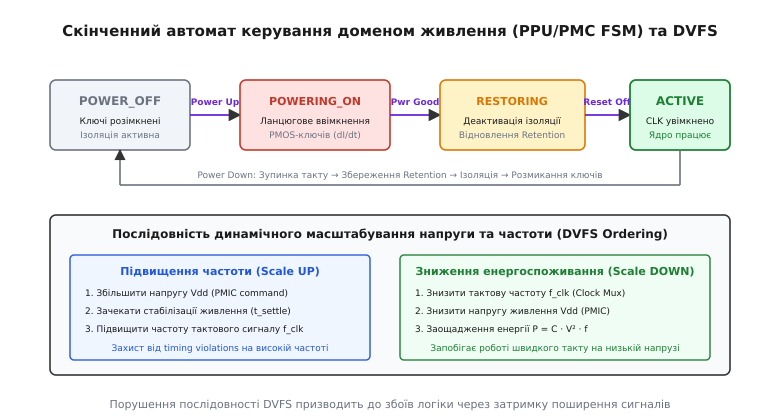

# ⚙️ Керування доменами живлення та контролер DVFS на системі-на-кристалі

У сучасних системах-на-кристалі, виготовлених за технологічними нормами менше 7 нанометрів, одночасна робота всіх наявних блоків (восьми процесорних ядер, масивного графічного прискорювача, тензорного нейропроцесора, модему зв'язку та контролерів пам'яті) на максимальній тактовій частоті призвела б до перевищення теплового ліміту кристала у 4–6 разів. Виділення тепла понад 30–50 Вт на крихітній площі 100 мм² спричиняє миттєвий перегрів і тепловий пробій напівпровідникової структури. Щоб кристал залишався у безпечних температурних межах мобільного чи вбудованого пристрою, апаратно-програмний комплекс керування живленням повинен динамічно знеструмлювати незадіяні функціональні домени та плавно підлаштовувати напругу й частоту активних ядер під поточне обчислювальне навантаження.

Нижче наведено практичну реалізацію низькорівневого драйвера та скінченного автомата (FSM) для контролера керування живленням (Power Management Controller, PMC / PPU) та підсистеми динамічного масштабування напруги й частоти (DVFS, англ. *Dynamic Voltage and Frequency Scaling*). Модуль реалізує точну фізичну послідовність увімкнення та вимкнення комутованого домену живлення з урахуванням ланцюжкового вмикання ключів для обмеження пускового струму, керування ретеншн-тригерами, активації ізоляційних комірок та безпечної зміни точок продуктивності (OPP).

*Стани скінченного автомата керування доменом живлення та строгий порядок перемикання напруги й частоти DVFS.*

---

## 1. Фізична структура комутованого домену та граничні елементи

Розбиття монолітного кристала на окремі ізольовані острівці напруги (Voltage Islands) та домени живлення (Power Domains) вимагає спеціальних схемотехнічних елементів, інтегрованих у бібліотеку стандартних комірок.

### Силові ключі живлення (Power Switches)
Знеструмлення функціонального блоку здійснюється за допомогою масиву паралельних польових транзисторів, які від'єднують блок від загальної мережі живлення. Залежно від полярності розрізняють два підходи:
1. **Header-ключі на PMOS-транзисторах:** Вмикаються між реальною шиною живлення `Vdd` та віртуальною шиною живлення домену `Vdd_virtual`. Це найпоширеніша схема в цифрових SoC, оскільки вона зберігає спільну надійну підкладкову землю `Vss` (GND) незмінною по всьому кристалу.
2. **Footer-ключі на NMOS-транзисторах:** Вмикаються між віртуальною землею `Vss_virtual` та реальною землею `Vss`. NMOS-транзистори мають удвічі вищу рухливість носіїв заряду (електронів) і менший опір відкритого каналу `R_DS(on)` на одиницю площі, проте плаваючий потенціал підкладки NMOS створює паразитні зміщення порогів через ефект підкладки (Body Effect).

Силові ключі інтегрують безпосередньо в ряди стандартних комірок у вигляді регулярної сітки. Для запобігання надмірному падінню напруги (IR-Drop) сумарний опір усіх відкритих ключів домену проектують так, щоб падіння напруги не перевищувало 1–2% від `Vdd` при піковому струмі споживання.

### Комірки ізоляції (Isolation Cells)
Коли домен знеструмлюється, напруга на його віртуальній шині `Vdd_virtual` спадає до нуля через струми витоку. Вихідні сигнали такого домену переходять у плаваючий високоімпедансний стан із проміжними напругами (наприклад, 0.3–0.4 В). Якщо такий невизначений сигнал потрапить на вхід активного CMOS-вентиля у сусідньому ввімкненому домені, він одночасно відкриє і верхній PMOS, і нижній NMOS транзистори вхідного інвертора. Це спричиняє виникнення колосального наскрізного струму короткого замикання (Shoot-Through Current) між `Vdd` та `Vss`, що призводить до локального перегріву, просідання напруги та виходу мікросхеми з ладу.

Для запобігання цій аварії на всіх вихідних лініях комутованого домену встановлюють комірки ізоляції (Isolation Cells). Це логічні вентилі (AND або OR), які живляться від постійно активної шини сусіднього домену. За сигналом `ISO_EN = 1` комірка примусово фіксує вихідний сигнал у безпечному стані логічного нуля або логічної одиниці, повністю відсікаючи плаваючий вхід.

### Перетворювачі рівнів напруг (Level Shifters)
Різні домени SoC часто працюють при різних напругах: наприклад, високопродуктивне процесорне ядро працює при напрузі 0.75 В, а підсистема введення-виведення — при 1.8 В. Логічна одиниця з амплітудою 0.75 В не здатна надійно закрити PMOS-транзистор у домені 1.8 В (бо напруга затвор-витік `V_gs = 0.75 − 1.8 = −1.05 В` значно перевищує порогову напругу відкриття).

Перетворювачі рівнів (Level Shifters) містять перехресно увімкнені тригерні структури, які транслюють логічні рівні між доменами з різними напругами без виникнення витоків і з мінімальною затримкою поширення сигналу (типово 50–150 пікосекунд).

### Тригери збереження стану (Retention Flip-Flops)
Звичайний тригер втрачає свій стан у момент вимкнення живлення, що вимагало б повного холодного перезавантаження процесора (тривалістю від кількох мілісекунд до сотень мілісекунд).

Retention-тригери містять додаткову енергонезалежну «тіньову» засувку (Balloon Latch), підключену до окремої слабкострумової шини живлення `Vdd_ret` (Always-On). Перед вимкненням живлення контролер подає імпульс `SAVE`, копіюючи стан головного тригера в тіньову засувку. При пробудженні після відновлення напруги подається імпульс `RESTORE`, і процесор миттєво продовжує виконання коду з тієї самої інструкції, на якій зупинився.

---

## 2. Безглітчове перемикання тактових частот (Glitch-Free Clock Multiplexing)

Під час виконання процедури DVFS або переходу між генератором PLL та резервним низькочастотним генератором неприпустимо перемикати тактові сигнали за допомогою звичайного комбінаторного мультиплексора. Якщо сигнал керування селектором зміниться у момент, коли один тактовий сигнал перебуває у стані логічної одиниці, а інший — у стані нуля, на виході виникне короткий паразитний імпульс (глітч, тривалістю у частки наносекунди). Такий імпульс не здатний коректно перемкнути тригери конвеєра процесора, що призводить до руйнування даних і зависання системи.

Для безпечного перемикання застосовують спеціальну схему безглітчового мультиплексора (Glitch-Free MUX), побудовану на двох D-тригерах, що тактуються спадними фронтами відповідних годинникових сигналів `CLK0` та `CLK1`. Логіка схеми блокує вмикання нового тактового сигналу доти, доки поточний активний сигнал не перейде у стабільний стан логічного нуля. Це гарантує, що результуючий вихідний сигнал завжди зберігає правильні інтервали між фронтами.

---

## 3. Протоколи взаємодії з мікросхемою живлення (PMIC)

Керування напругами на рівні кристала координується із зовнішньою або вбудованою інтегральною схемою керування живленням (PMIC, англ. *Power Management IC*).

Для передавання команд зміни напруги в сучасних мобільних та серверах застосовують такі інтерфейси:
1. **MIPI SPMI (System Power Management Interface):** Спеціалізована двопровідна шина (SDATA та SCLK) із підтримкою тактових частот до 26 МГц, пріоритетного арбітражу між кількома майстрами та широкомовних команд. SPMI дозволяє змінити напругу живлення ядра за час менше 1–2 мікросекунд.
2. **I2C / PMBus:** Стандартна послідовна шина, що використовується в менш критичних за швидкістю вбудованих пристроях. Латентність передавання пакета становить 20–50 мікросекунд.
3. **Паралельні лінії VID (Voltage Identification):** Прямі цифрові лінії від SoC до фаз імпульсних стабілізаторів VRM, що забезпечують нульову протокольну затримку передавання коду напруги.

---

## 4. Ієрархія станів енергозбереження: від WFI до глибокого сну

Сучасні системи-на-кристалі не обмежуються бінарним вибором «увімкнено чи вимкнено». Замість цього PMC підтримує цілу ієрархію режимів низького споживання:
- **Рівень C0 (Active):** Усі домени увімкнені, тактування активне, ядра виконують інструкції на робочій частоті DVFS.
- **Рівень C1 (Clock Gated / WFI):** Процесор виконав інструкцію `WFI` (Wait For Interrupt). Живлення ядра залишається повним, але комірка ICG зупиняє подавання тактового сигналу на конвеєр. Економія: 30–50% енергії, вихід зі стану займає менше 1–2 тактів годинника.
- **Рівень C2 (Retention Sleep):** Тактування вимкнено, стан регістрів скопійовано у тіньові засувки, напруга живлення логіки знижується до мінімального порогу утримання (Retention Voltage `V_ret ≈ 0.5 В`). Витоки падають у 3–4 рази, вихід займає 5–10 мікросекунд.
- **Рівень C3 (Power Gated Core):** Силові ключі повністю розмикають лінію `Vdd_virtual` для окремого ядра. Стан збережено в L2-кеші або Retention-тригерах. Витоки ядра падають до нуля, час пробудження — 20–50 мікросекунд.
- **Рівень C4 (Cluster / System Deep Sleep):** Знеструмлюється весь кластер ядер разом із спільним L3-кешем та більшістю контролерів інтерконекту. Активним залишається лише домен AON із годинником реального часу RTC та лініями пробудження. Час повернення до роботи — 1–5 мілісекунд.

---

## 5. Регістрова карта контролера керування живленням (PMC)

Контролер живлення розташовується в постійно увімкненому домені (Always-On Domain, AON) і керує силовими ключами, комірками ізоляції, тактовими мультиплексорами та шиною зв'язку з PMIC.

Базова карта регістрів для кожного комутованого домену:
- `PWR_GATE_CTRL (0x00)`: Керування силовими ключами Header PMOS. Біт `0` — увімкнення першого ступеня (слабкі ключі зі збільшеним опором каналу), біт `1` — увімкнення другого ступеня (основні силові ключі з мінімальним `R_DS(on)`).
- `PWR_GATE_STATUS (0x04)`: Статус живлення. Біт `0` — апаратний сигнал `Power Good` від внутрішнього компаратора напруги домену, біт `1` — готовність каналу зв'язку з PMIC.
- `ISO_CTRL (0x08)`: Керування ізоляційними комірками. Біт `0` — сигнал `ISO_EN` (1 — виходи заблоковано в безпечному логічному рівні «0» або «1», 0 — ізоляцію знято).
- `RET_CTRL (0x0C)`: Керування збереженням/відновленням стану тригерів Retention. Біт `0` — `SAVE`, біт `1` — `RESTORE`.
- `CLK_GATE_CTRL (0x10)`: Керування тактуванням. Біт `0` — `CLK_EN` (подавання такту через комірку ICG), біти `16..31` — дільник тактової частоти.
- `RESET_CTRL (0x14)`: Скидання логіки домену. Біт `0` — `RESET_N` (активний низький рівень).
- `PMIC_VOLT_CMD (0x18)`: Регістр запису цільової напруги у мікровольтах для відправлення по шині SPMI/I2C.

---

## 6. Таблиця робочих точок продуктивності (OPP Table)

Фізична затримка поширення сигналу крізь логічні вентилі залежить від напруги живлення: вища напруга створює вищий струм заряду ємностей затворів, дозволяючи вентилям перемикатися швидше. Кожній частоті відповідає мінімально допустима напруга живлення, за якої задовольняються часові обмеження (Setup Time Constraints).

Таблиця робочих точок (Operating Performance Points, OPP):

| Рівень (OPP) | Частота `f_clk` | Напруга `V_dd` | Час стабілізації напруги `t_settle` |
| :--- | :--- | :--- | :--- |
| **OPP_LOW** | 400 МГц | 650 мВ (0.65 В) | 20 мкс |
| **OPP_NOM** | 1200 МГц | 750 мВ (0.75 В) | 25 мкс |
| **OPP_HIGH** | 2000 МГц | 900 мВ (0.90 В) | 35 мкс |
| **OPP_TURBO**| 2800 МГц | 1050 мВ (1.05 В) | 50 мкс |

---

## 7. Алгоритми та часові інваріанти

Під час перемикання станів живлення критично дотримуватися суворих часових інваріантів:

### Послідовність увімкнення домену (Power Up Sequence)
1. **Увімкнення ізоляції (`ISO_EN = 1`):** Запобігає потраплянню невизначених рівнів напруги (X-state) до зовнішніх доменів під час перехідних процесів.
2. **Ступінь 1 силових ключів (`STAGE1 = 1`):** Повільне заряджання внутрішньої паразитної ємності домену струмом, обмеженим опором перших ключів. Запобігає просіданню загальної шини живлення (Voltage Sag).
3. **Очікування сигналу `Power Good`:** Перевірка, що напруга всередині домену досягла 95% від номіналу.
4. **Ступінь 2 силових ключів (`STAGE2 = 1`):** Вмикання повної паралелі PMOS-транзисторів для мінімізації робочого падіння напруги.
5. **Відновлення стану (`RESTORE = 1`):** Копіювання збережених даних із резервних комірок у тригери процесора.
6. **Деактивація ізоляції (`ISO_EN = 0`):** Дозвіл вихідним сигналам домену надходити до інтерконекту.
7. **Увімкнення тактування (`CLK_EN = 1`):** Подавання тактового сигналу через ICG.
8. **Зняття сигналу скидання (`RESET_N = 1`):** Старт виконання інструкцій.

### Послідовність зміни режиму DVFS
- **Підвищення продуктивності (Scale UP):** Спочатку підвищуємо напругу `V_dd` через PMIC → чекаємо стабілізації `t_settle` → лише після цього підвищуємо тактову частоту `f_clk`. Якщо підвищити частоту раніше, логічні вентилі не встигнуть перемкнутися за скорочений період такту, що спричинить порушення часу встановлення (Setup Time Violation).
- **Зниження продуктивності (Scale DOWN):** Спочатку знижуємо тактову частоту `f_clk` → лише після цього надсилаємо команду на зниження напруги `V_dd`. Це запобігає роботі ядра на високій частоті при недостатньому рівні живлення.

---

## 8. Програмна реалізація мовами C та C++

У наведеному коді реалізовано повний набір функцій керування станами комутованого домену живлення та безпечного перемикання робочих точок DVFS.

У версії на C застосовано прямий доступ до відображених у пам'ять регістрів через макроси та покажчики типу `volatile uint32_t *`, що гарантує відсутність небажаної оптимізації компілятором порядку запису в апаратні регістри.

У версії на C++20 реалізація оформлена у вигляді суворо типізованого класу `PowerDomainController`, де зміщення регістрів та бітові маски інкапсульовано в типізовані переліки `enum class`, обробка помилок побудована на базі сучасного мовного засобу `std::expected` замість магічних числових кодів повернення, а для автоматичного контролю життєвого циклу активного стану домену створено обгортку `PowerDomainGuard`, яка реалізує ідіому RAII (Resource Acquisition Is Initialization).

:::tabs
:::code proj-soc-power-dvfs/c/main.c
:::code proj-soc-power-dvfs/cpp/PowerDomainController.hpp
:::

---

## 9. Взаємодія з планувальником операційної системи (EAS та CPUFreq)

У сучасних мобільних операційних системах (наприклад, у ядрі Linux для Android) вибір поточної робочої точки OPP здійснюється підсистемою енергоефективного планування (Energy-Aware Scheduling, EAS) через регулятор частоти `schedutil`.

Планувальник постійно аналізує завантаженість черг запуску завдань (Pelth Metric) та температуру від вбудованих на кристал аналогових термодіодів. Якщо інтенсивність обчислень зростає або черга переповнюється, планувальник надсилає запит на підвищення OPP драйверу ядра, який виконує описану вище апаратну послідовність перемикання. При досягненні критичної температури (Thermal Throttle Threshold, зазвичай 85–95 °C) апаратний контролер безпеки примусово обмежує верхню межу OPP незалежно від запитів операційної системи, рятуючи чіп від перегріву.

---

## 10. Типові апаратні пастки та крайові випадки

1. **Стрибок пускового струму і просідання напруги живлення:**
   Одночасне замикання всіх паралельних PMOS-ключів домену миттєво відкриває шлях струму на заряджання десятків нанофарад внутрішньої розподіленої ємності. За формулою індуктивного викиду `V_drop = L_pkg · (dI/dt)` паразитні індуктивності BGA-кульок корпусу та металевих шин живлення спричиняють різке падіння напруги на сусідніх активних CPU-доменах, викликаючи їхнє аварійне перезавантаження або помилки в обчисленнях (Brownout). Лікування: суворе дво- або триступеневе послідовне вмикання ключів (Daisy-Chain Turn-on).

2. **Передчасне зняття ізоляції (`ISO_EN = 0`):**
   Якщо вимкнути ізоляційні комірки до того, як напруга всередині домену стабілізується на рівні `Power Good`, проміжні невизначені рівні напруг на входах CMOS-вентилів сусіднього активного домену призведуть до одночасного відкриття верхнього PMOS і нижнього NMOS транзисторів. Виникає колосальний струм наскрізного замикання (Shoot-Through Current), що може фізично пропалити металізацію кристала.

3. **Порушення послідовності DVFS при масштабуванні вгору:**
   Якщо підвищити частоту `f_clk` до того, як PMIC завершить регулювання напруги й заряд конденсаторів фільтрації, логічні вентилі на зниженій напрузі не встигнуть перемкнутися за скорочений період такту. Це призводить до порушення часу встановлення (Setup Time Violation) і зависання процесора.

4. **Зниження напруги до зменшення тактової частоти:**
   Зниження напруги живлення при збереженні високої тактової частоти миттєво уповільнює час проходження критичних шляхів комбінаторної логіки. Тригери фіксують старий стан до приходу нових даних, що призводить до непоправного спотворення регістрових значень операційної системи.
