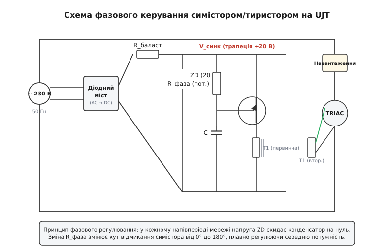

# ⚙️ Фазоімпульсне керування тиристором і симістором на базі UJT

Керування середньою потужністю в колах змінного струму 230 В / 50 Гц (плавне регулювання яскравості ламп розжарювання, потужності нагрівальних елементів та частоти обертання колекторних електродвигунів) традиційно вимагає точного фазового зсуву моменту відмикання силового тиристора або симістора відносно моменту переходу мережевої напруги через нуль.

Класичним аналоговим стандартом для цієї задачі є схема на базі одноперехідного транзистора (UJT 2N2646), яка поєднує в собі релаксаційний таймер затримки, вузол синхронізації з нулем мережі та потужний формувач коротких пускових імпульсів для керувального електрода симістора.

### 1. Архітектура та фізичний принцип синхронізації

Фазове регулювання потужності полягає в тому, що навантаження підключається до мережі не на весь напівперіод синусоїди, а лише на його частину — від моменту відмикання симістора під фазовим кутом `α` (де `0° ≤ α ≤ 180°`) до моменту природного згасання струму в кінці напівперіоду.


*Принципова електрична схема фазоімпульсного регулятора: діодний міст і стабілітрон формують трапецієподібну напругу синхронізації, UJT відраховує кут затримки, а трансформатор T1 відмикає симістор у силовому колі навантаження.*

Схема містить чотири функціональні вузли:

1. **Дводіодний або мостовий випрямляч:** випрямляє синусоїдальну напругу мережі 230 В / 50 Гц у пульсуючу однополярну напругу з подвоєною частотою 100 Гц (тривалість кожного напівперіоду `T_half = 10.0 мс`).
2. **Параметричний стабілізатор-обмежувач:** баластний резистор `R_drop` та стабілітрон (Zener diode `V_Z ≈ 18...24 В`) зрізають верхівки випрямлених півхвиль, формуючи синхронізовану з мережею трапецієподібну напругу живлення. У моменти переходу мережі через нуль напруга на стабілітроні спадає до нуля.
3. **UJT релаксатор:** у кожному напівперіоді конденсатор `C` заряджається через змінний резистор `R_pot` від напруги стабілітрона `V_Z`. Коли напруга на конденсаторі досягає порогу `V_P = η·V_Z + V_D`, транзистор лавиноподібно відкривається і розряджає конденсатор у первинну обмотку імпульсного трансформатора.
4. **Імпульсний трансформатор розв'язки T1:** передає короткий потужний імпульс струму у коло керувального електрода (*Gate*) симістора, забезпечуючи повну гальванічну ізоляцію низьковольтної частини керування від силового кола.

Коли напруга мережі наприкінці напівперіоду наближається до нуля, напруга на стабілітроні падає нижче залишкової напруги западини `V_V`. Конденсатор повністю розряджається до 0 В, завдяки чому в новому напівперіоді заряд починається з фіксованого нульового стану, незалежно від попередньої передісторії.

### 2. Квадранти симістора та полярність імпульсу збудження

Симістор (*TRIAC*) є симетричним п'ятишаровим приладом, здатним проводити струм в обох напрямках між основними силовими виводами MT1 (умовний катод) та MT2 (умовний анод). Відмикання симістора залежить від комбінації полярностей напруги між MT2–MT1 та керувальним електродом Gate–MT1, які утворюють чотири робочі квадранти:

1. **Квадрант I (MT2+, Gate+):** позитивна напруга на аноді MT2 та позитивний струм у затвор. Найбільш чутливий режим з мінімальним струмом відмикання `I_GT ≈ 10...25 мА`.
2. **Квадрант II (MT2+, Gate−):** позитивна напруга на MT2, негативний струм затвора. Потребує вищого пускового струму `I_GT ≈ 20...50 мА`.
3. **Квадрант III (MT2−, Gate−):** негативна напруга на MT2 та негативний струм затвора. Високочутливий симетричний режим `I_GT ≈ 10...25 мА`.
4. **Квадрант IV (MT2−, Gate+):** негативна напруга на MT2, позитивний струм затвора. Найменш чутливий режим з низькою стійкістю за швидкістю наростання струму `dI/dt`; у промисловій практиці його уникають.

Використання імпульсного трансформатора `T1` дозволяє подавати на затвор симістора імпульси будь-якої бажаної полярності. Підключаючи вторинну обмотку так, щоб струм затвора був спрямований узгоджено з полярністю силового напівперіоду (режим I/III), досягають мінімального споживання енергії від генератора та максимальної стійкості до перешкод.

### 3. Послідовне простеження сигналів у контрольних точках

Розгляньмо динаміку напруг у схемі протягом одного повного мережевого періоду тривалістю 20 мс:

1. **Точка TP1 (Випрямлена шина після моста):** пульсуюча однополярна напруга амплітудою `V_peak = 230 · √2 ≈ 325 В`. Двічі за період (через кожні 10 мс) напруга строго падає до 0 В.
2. **Точка TP2 (Шина синхронізації після стабілітрона):** напруга швидко наростає від 0 В до рівня стабілізації `V_Z = 20 В` приблизно за 0.2 мс (кут `3.5°`), залишається строго постійною протягом більшої частини напівперіоду, а за 0.2 мс до кінця напівперіоду спадає назад до 0 В.
3. **Точка TP3 (Емітер UJT / Конденсатор C):** напруга наростає за експонентою від 0 В до порогу `V_P = 13.65 В`. Що більший встановлений опір потенціометра `R_pot`, то похиліша експонента, і то пізніше настає момент пробою.
4. **Точка TP4 (База B1 / Первинна обмотка T1):** у мить досягнення порогу `V_P` формується гострий імпульс розряду амплітудою близько 10 В з крутим фронтом наростання менше 100 нс та повною тривалістю близько 2 мкс.
5. **Точка TP5 (Силове навантаження):** до моменту імпульсу симістор закритий, напруга на навантаженні дорівнює нулю. Після приходу імпульсу симістор миттєво відкривається (падіння на ньому падає до 1.5 В), і до навантаження прикладається залишок поточної синусоїди мережі.

### 4. Розрахунок імпульсного трансформатора розв'язки T1

Імпульсний трансформатор є критичним елементом схеми. Він має передати пусковий імпульс без спотворення фронту та не увійти в магнітне насичення під дією струму розряду.

Параметри осердя розраховуються за формулою закону електромагнітної індукції Фарадея:

```
U_imp · t_imp = N1 · S_core · ΔB    [закон Фарадея для імпульсного осердя]
```

де:
- `U_imp ≈ 12 В` — амплітуда імпульсу на первинній обмотці,
- `t_imp ≈ 3 мкс` — тривалість імпульсу розряду конденсатора,
- `S_core` — площа поперечного перерізу феритового кільця (для кільця К10×6×4 мм `S_core = (10 − 6)/2 · 4 = 8 мм² = 8·10⁻⁶ м²`),
- `ΔB ≈ 0.25 Тл` — допустимий розмах магнітної індукції фериту без насичення.

Розрахуємо мінімальну кількість витків первинної обмотки `N1`:

```
N1 ≥ (U_imp · t_imp) / (S_core · ΔB) = (12 · 3·10⁻⁶) / (8·10⁻⁶ · 0.25) = 36·10⁻⁶ / 2·10⁻⁶ = 18 витків
```

Обираємо `N1 = N2 = 25...30 витків` мідного емальованого проводу діаметром 0.25...0.31 мм (ПЕВ-2), намотаних біфілярно (двома проводами одночасно) на феритовому кільці з проникністю `μ_r = 2000...3000`.

Біфілярне намотування мінімізує паразитну індуктивність розсіювання, забезпечуючи швидкість наростання струму вторинної обмотки `dI_G / dt > 2 А/мкс`, що запобігає локальному тепловому руйнуванню кристала симістора біля керувального електрода.

### 5. Плавний пуск (Soft-Start) та захист від пускових надструмів

Особливою небезпекою для симісторів є комутація холодних ламп розжарювання або потужних нагрівачів. Вольфрамова нитка розжарення в холодному стані має питомий опір у 10–15 разів нижчий, ніж у розжареному (`R_cold ≈ 0.07...0.10 · R_hot`). При миттєвому вмиканні на повному куті провідності пусковий струм для лампи 100 Вт може досягати 30–40 А, що перевищує граничний ударний струм `I_TSM` компактних симісторів (наприклад, BT136) і викликає перегорання нитки розжарення або вихід ключа з ладу.

Для усунення цієї проблеми в схему інтегрують вузол **плавного пуску** (*Soft-Start*):
- Паралельно часозадавальному конденсатору `C` підключають біполярний транзистор скиду з RC-ланцюгом затримки на базі (`R_ss = 100 кОм`, `C_ss = 10...47 мкФ`).
- У момент подачі живлення конденсатор `C_ss` розряджений, транзистор частково відбирає струм заряду від `C`, штучно затягуючи час заряду до максимального кута `α ≈ 170°` (мінімальна потужність).
- У міру заряду `C_ss` транзистор плавно закривається протягом 1–2 секунд, і кут відмикання плавно зміщується до значення, встановленого основним потенціометром `R_pot`.

Це повністю усуває пускові стрибки струму та збільшує ресурс ламп у 3–5 разів.

### 6. Замкнений контур регулювання: стабілізація обертів двигуна та температури

У промислових установках ручне регулювання потенціометром часто доповнюють або замінюють автоматичним зворотним зв'язком. Схема на UJT ідеально адаптується для роботи в замкненому контурі:

1. **Стабілізатор обертів колекторного двигуна з тахогенератором:** паралельно зарядному резистору `R_pot` або замість нього встановлюють транзисторний генератор струму на базі біполярного PNP-транзистора. Напруга від тахогенератора на валу двигуна після випрямлення та згладжування подається на базу PNP-транзистора. Якщо навантаження на валу зростає і оберти падають, напруга тахогенератора зменшується, PNP-транзистор відкривається сильніше, струм заряду конденсатора зростає, кут затримки `α` зменшується, і симістор подає на двигун більшу потужність, автоматично відновлюючи задану частоту обертання.
2. **Прецизійний терморегулятор:** у часозадавальне коло замість фіксованого резистора встановлюють терморезистор з негативним температурним коефіцієнтом (NTC-термістор). При охолодженні нагрівальної камери опір термістора зростає, що в класичному включенні збільшувало б затримку. Проте, якщо увімкнути термістор у нижнє плече мостової схеми порівняння, сигнал розбалансу керує додатковим ключем, забезпечуючи пропорційне збільшення кута провідності симістора при зниженні температури нижче уставки.

### 7. Оптоізольоване сполучення з цифровими мікроконтролерами

Для інтеграції аналогового UJT-регулятора в сучасні мікроконтролерні системи автоматизації (на базі STM32, ESP32 або AVR) застосовують оптопари з аналоговою або дискретною модуляцією:

1. **Аналогова оптопара з фоторезистором або лінійним фототранзистором (наприклад, VTL5C або IL300):** світлодіод оптопари живиться вихідним ШІМ-сигналом з мікроконтролера через згладжувальний RC-фільтр, змінюючи опір фотоприймача у часозадавальному колі UJT. Це забезпечує повну гальванічну ізоляцію низьковольтної логіки 3.3 В / 5 В від високовольтної шини 230 В.
2. **Оптотранзистор скиду (PC817 / 4N35):** мікроконтролер відстежує перехід напруги мережі через нуль за допомогою окремого оптодетектора нуля (*Zero-Cross Detector*), відраховує програмний таймер із роздільною здатністю в мікросекунди і подає короткий імпульс на оптопару, що примусово ініціює пробій UJT або замикає емітер на землю.

Така гібридна топологія об'єднує гнучкість цифрового алгоритмічного керування з надійністю та простотою формування потужного симісторного імпульсу напівпровідниковим UJT-каскадом.

### 8. Тепловий розрахунок радіатора симістора

Під час протікання змінного струму через відкритий симістор на його кристалі виділяється потужність через пряме падіння напруги `V_T ≈ 1.2...1.5 В` та динамічний опір `r_T ≈ 0.05...0.1 Ом`:

```
P_loss = V_T0 · I_load(avg) + r_T · I_load(rms)²    [потужність втрат на симісторі]
```

Для активного навантаження потужністю 1 кВт при 230 В діючий струм становить `I_load(rms) ≈ 4.35 А`, середній випрямлений струм `I_load(avg) ≈ 3.91 А`.
- `P_loss ≈ 1.1 · 3.91 + 0.08 · (4.35)² ≈ 4.30 + 1.51 ≈ 5.81 Вт`.

Розрахуємо необхідний тепловий опір радіатора `R_th(h-a)` для утримання температури кристала `T_j ≤ 110 °C` при максимальній температурі навколишнього повітря `T_a = 40 °C`:

```
R_th(total) = (T_j(max) − T_a) / P_loss = (110 − 40) / 5.81 ≈ 12.0 °C/Вт
R_th(total) = R_th(j-c) + R_th(c-h) + R_th(h-a)
```

Для корпусу TO-220 тепловий опір «перехід–корпус» `R_th(j-c) ≈ 2.5 °C/Вт`, опір термопасти «корпус–радіатор» `R_th(c-h) ≈ 0.5 °C/Вт`.

Звідси допустимий тепловий опір охолоджувального радіатора:

```
R_th(h-a) ≤ R_th(total) − R_th(j-c) − R_th(c-h) = 12.0 − 2.5 − 0.5 = 9.0 °C/Вт
```
Обираємо алюмінієвий ребристий радіатор із площею поверхні не менше `50...70 см²`.

### 9. Програмне моделювання та розрахунок фазового регулятора

Для точного інженерного проєктування регулятора, розрахунку гармонійного складу напруги на навантаженні та калібрування шкали змінного резистора наведено симулятор мовами C та C++.

:::tabs
:::code proj-scr-phase-control/c/phase_control_sim.c
:::code proj-scr-phase-control/cpp/phase_control_sim.cpp
:::

### 10. Електромагнітна сумісність (EMI) та трасування друкованої плати

Фазове регулювання супроводжується миттєвим замиканням синусоїди під напругою до 325 В, що породжує потужні високочастотні завади в живильну мережу в діапазоні від 150 кГц до 30 МГц. Для забезпечення електромагнітної сумісності (стандарт EN 55014) на вході регулятора встановлюють фільтри:

1. **Вхідний мережевий дросель L_filter:** дросель на замкненому феритовому або розпиленому залізному осерді з індуктивністю `L = 100...500 мкГн`, розрахований на повний струм навантаження.
2. **Конденсатор фільтра X2:** плівковий конденсатор ємністю `0.1...0.22 мкФ` (класу безпеки X2 на напругу 275 В AC), що шунтує мережеві дроти до регулятора.
3. **Демпферний ланцюг (снаббер) симістора:** послідовно з'єднані резистор `R_snub = 47...100 Ом` та конденсатор `C_snub = 47...100 нФ` (класу Y2/X2 на 630 В DC). Потужність, що розсіюється на резисторі снаббера за рахунок перезаряду ємності у кожному напівперіоді, розраховується як `P_snub = 2 · C_snub · V_peak² · f_grid = 2 · (47·10⁻⁹) · (325)² · 50 ≈ 0.50 Вт`. Для забезпечення надійної тривалої експлуатації без перегріву використовують резистор номінальною потужністю не менше 2 Вт (металооксидний або цементний).

Снаббер обмежує швидкість наростання напруги на закритому симісторі на рівні `(dV/dt)_off < 10 В/мкс`, що унеможливлює самочинне аварійне відмикання приладу під час комутації індуктивного струму двигуна.

Правила трасування друкованої плати (PCB Layout):
- **Ізоляційні проміжки (Creepage & Clearance):** між високовольтними доріжками мережі 230 В та низьковольтним контуром UJT витримують відстань не менше 6.3 мм (згідно з IEC 60950 / IEC 62368).
- **Зіркоподібне заземлення:** силовий контур струму навантаження та слабкострумовий контур заряду конденсатора підключаються до мінусової шини моста в одній спільній точці, щоб уникнути паразитного наведення імпульсів на емітер UJT.
- **Мінімізація площі контуру затвора:** провідники від вторинної обмотки трансформатора `T1` до виводів Gate та MT1 симістора скручують у виту пару довжиною не більше 5–10 см.

### 11. Покрокова діагностика та типові помилки налагодження

При запуску та перевірці фазоімпульсного регулятора рекомендується дотримуватися такої послідовності діагностики:

1. **Перевірка трапеції синхронізації:** осцилографом із гальванічно розв'язаним щупом виміряти напругу на стабілітроні (між катодом ZD та загальним мінусом моста). На екрані має спостерігатися чиста трапеція амплітудою 20 В без высокочастотного дзвону. Якщо напруга є постійною без спадів до нуля — пробитий один із діодів випрямного моста.
2. **Перевірка пилки на емітері:** сигнал на конденсаторі `C` має являти собою плавні періодичні пилкоподібні наростання від 0 В до 13.6 В з наступним миттєвим вертикальним спадом. Якщо напруга плавно піднімається до 20 В і зависає — UJT несправний або обірвано його вивід B1.
3. **Перевірка амплітуди пускового імпульсу на затворі:** на вторинній обмотці трансформатора `T1` має бути присутній гострий імпульс напруги амплітудою не менше 3...5 В і струмом не менше 50 мА. Якщо імпульс занадто слабкий — збільшити ємність конденсатора `C` або зменшити кількість витків вторинної обмотки для узгодження імпедансу.
4. **Усунення нестабільності на мінімальній яскравості (Flicker Effect):** якщо лампа мерехтить при великих кутах затримки (`α > 150°`), це свідчить про те, що конденсатор не встигає скинутися до нуля перед початком наступного напівперіоду. Необхідно зменшити напругу стабілітрона (наприклад, до 15 В) або підключити паралельно конденсатору розрядний діодний ключ на малопотужному транзисторі, керований нулем мережі.
5. **Захист від індуктивного самоіндукційного викиду:** для захисту симістора від перенапруг при раптовому вимкненні високоіндуктивного двигуна паралельно силовим клемам корисно встановити варистор на робочу напругу 275 В AC (наприклад, металооксидний варистор MOV 14D431K з енергопоглинанням до 70 Дж).
