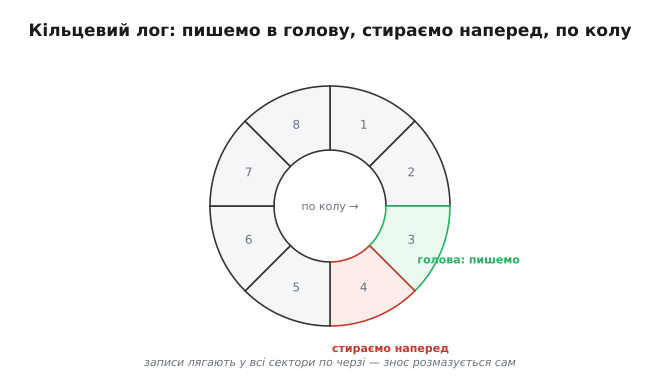
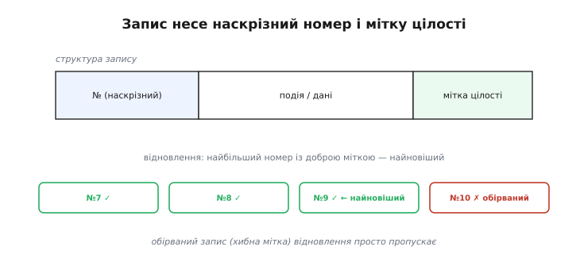

# ⚙️ Кільцевий лог у Flash: писати журнал, не вбиваючи сектори

> Алгоритмічна вставка про те, як вести [журнал на Flash](root:hw-components/why-persist), що росте й дописується, — не зносячи окремі сектори скінченної памʼяті.

## Задача

Журнал хоче двох несумісних, на перший погляд, речей. Він **росте безкінечно** — подія за подією, можливо, роками. А Flash, по-перше, **скінченний** (місця обмаль), по-друге, **зношується** від частих записів в одне місце (звідси й потреба [вирівнювати знос](root:sf-data/wear-leveling)). Якби ми просто дописували лог в один сектор, ми б і місце скоро вичерпали, і той сектор стерли б на смерть. Потрібен спосіб вести **нескінченний** журнал у **скінченному** Flash, рівномірно розмазуючи знос.

## Ідея

Відповідь елегантна — **кільце**. Виділимо під лог кілька секторів і думаймо про них не як про рядок із початком і кінцем, а як про **коло**. Нові записи дописуємо в «голову», посуваючи її вперед сектором за сектором. Дійшла голова до останнього сектора — **вертається на перший**, по колу. А щоб звільнити місце під нове, сектор **попереду** голови **стираємо наперед** — і цим затираємо **найдавніші** записи. Так журнал завжди тримає останні події, а старі тихо випадають.


*Сектори логу — це коло. Пишемо в голову; сектор попереду стираємо наперед, затираючи найдавніше; дійшли до краю — вертаємось на початок. Записи лягають у всі сектори по черзі, тож знос розмазується сам.*

Дві приємні речі стаються самі собою. По-перше, **місце обмежене**: лог ніколи не переповнить Flash, бо крутиться в межах виділеного кільця. По-друге — і це краса прийому — записи лягають **по черзі в усі сектори**, тож знос **розмазується сам**, без окремих зусиль: те саме [вирівнювання зносу](root:sf-data/wear-leveling), але вбудоване в саму будову логу.

Лишається питання: як при старті зрозуміти, де голова й у якому порядку йшли записи? Для цього кожному запису дають **наскрізний номер** (sequence number), що лише росте. Тоді найновіший запис — той, у кого **номер найбільший**, а порядок відновлюється за номером.


*Кожен запис несе наскрізний номер і мітку цілості. При старті відновлення знаходить найбільший номер із доброю міткою — це найновіший запис, — а обірвані (хибна мітка) пропускає. Мітка — той самий прийом, що й [перевірка цілості запису](root:sf-data/write-integrity).*

## Псевдокод

```
append(подія):
    якщо голова дійшла до межі сектора:
        стерти наступний сектор (звільнити найдавніше)
    записати { №=++лічильник, подія, мітка_цілості } у голову
    посунути голову вперед (з кінця — на початок: по колу)

при старті (відновлення):
    пробігти всі записи кільця
    відкинути обірвані (мітка цілості не сходиться)
    голова = одразу за записом із найбільшим №
    лічильник = найбільший №
```

Мітку цілості тут беремо з [прийому перевірки запису](root:sf-data/write-integrity): коротка позначка «запис завершено», щоб відсіяти той, що його обірвав збій живлення на півдорозі.

## Робочий код

Псевдокод приховує дві суттєві для Flash деталі, з якими доводиться рахуватися в реальній прошивці. Перша: у Flash **не можна перезаписати** байт довільно — клітинку спершу **стирають** (усі біти стають одиницями), і лише тоді в неї пишуть нулі. Тому стерта комірка — це всі `0xFF`, і саме за цим маркером ми впізнаємо **вільне** місце. Друга: писати треба **вирівняними** порціями. Найпростіший варіант, що знімає обидва клопоти, — один запис на цілий сектор фіксованого розміру; тоді «посунути голову» означає просто перейти до наступного сектора.

Кожен запис починає **наскрізний номер** `seq` (що лише росте), а завершує `crc` — мітка цілості над тілом. Вільний сектор виказує себе тим, що його `seq` дорівнює `0xFFFFFFFF` (стерте слово). Найновіший запис — той, у кого `seq` найбільший і `crc` сходиться.

:::tabs
:::code proj-flash-ring-log/c/main.c
:::code proj-flash-ring-log/py/main.py
:::code proj-flash-ring-log/go/main.go
:::

Порядок дій у `log_append` не випадковий, а **захищає від збою живлення**. Тіло пишуть, а `crc` лягає **в межах того самого запису сектора** — отже, якщо живлення зникло посеред `flash_write`, сектор лишиться без коректної мітки, і відновлення його просто **відкине**. Стирання ж робимо **наперед** (`ahead`), затираючи найдавніше; обірветься воно — пропаде лише старий, уже непотрібний запис, а свіжі вціліють.

**Умова.** Сектор Flash — 4 КБ, під лог віддано 16 секторів, кожен запис займає сектор. Скільки подій тримає кільце і коли кожен сектор стирається?

```
ємність кільця = N_SECTORS − 1 = 15 записів
  (один сектор завжди стертий «наперед», тож під дані — 15)
розмір payload  = 4096 − 8 = 4088 байт на подію
повний оберт    = кожні 15 дописувань голова повертається на старт
знос            = після 15 записів КОЖЕН сектор стирався рівно 1 раз
```

Висновок: знос розподіляється **порівну** — за 15 дописувань кожен із 16 секторів стирається один раз, тож жоден не зношується швидше за сусідів. Якщо ресурс сектора ~100 000 стирань, а пристрій пише подію раз на хвилину, кільце з 16 секторів проживе мільйони хвилин — роки безперервної роботи.

## Складність і пастки на МК

- **Швидкість.** Дописати — O(1): майже завжди це лише запис у голову. Дорога операція — **стирання сектора** — трапляється раз на цілий сектор записів, тож «розмазується» в часі, але дає періодичні **сплески затримки**. Якщо лог пишуть у чутливому до часу циклі, стирання наступного сектора варто робити **наперед**, у спокійну мить, а не тоді, коли він раптом знадобився.
- **Відновлення.** Простий спосіб знайти голову — **прочитати все** кільце при старті: O(n) за розміром логу. Для дрібного логу це дешево; для великого можна тримати окрему позначку голови.
- **Обірваний запис.** Збій під час дописування лишає останній запис недописаним — рятує мітка цілості: відновлення його просто пропускає. А оскільки стирали ми **найдавніше** (попереду голови), збій під час стирання губить лише старі, уже непотрібні дані.
- **Переповнення лічильника.** Номер росте вічно — беріть його **достатньо широким** (скажімо, 32 чи 64 біти), щоб за весь вік пристрою він не «обернувся» через нуль і не сплутав порядку. На 32 бітах при записі раз на секунду до обертання — понад сто років; на практиці цього досить, але якщо подій багато, 64 біти знімають питання геть.

## Коли запис дрібніший за сектор

Один запис на цілий сектор — найпростіше, та коли подія важить десяток байтів, а сектор — 4 КБ, це марнотратно: 4 КБ Flash під одне число. Тоді записи **пакують** у сектор щільно, один за одним, аж поки сектор не заповниться, і лише тоді переходять до наступного. Голова тепер — це **пара**: номер сектора плюс зсув у ньому. Платою стає трохи складніше відновлення (треба знайти не лише сектор-голову, а й перший вільний байт у ньому — за маркером `0xFF`), зате Flash витрачається ощадливо.

Цей варіант повертає нас до різниці двох форм даних. Якщо події **рідкісні й важливі** (збій, перезавантаження) — сектор на запис цілком виправданий: їх мало, місця вдосталь, зате код простий і надійний. А якщо лог **частий і дрібний** (телеметрія щосекунди) — пакування в сектор стає необхідним, інакше Flash скінчиться за дні. Форма й частота даних, як і всюди зі сховищем, диктують, наскільки хитромудрим має бути механізм.

> 🔧 **Навіщо це.** Кільцевий лог — це те, що відрізняє пристрій, який після збою в полі **мовчить**, від пристрою, який **розповідає**, що з ним сталося. Без нього кожне «воно якось перезавантажилося» — глуха загадка; з ним — рядок журналу з номером, часом і причиною. І все це — ціною кількох секторів Flash, які цей самий прийом береже від передчасного зносу.

Підсумок: кільцевий лог — це той випадок, коли одна проста ідея (писати по колу) одразу вирішує **три** проблеми — обмежує місце, розмазує знос і дає лад записам, — і саме тому він класичний для журналів на Flash.
