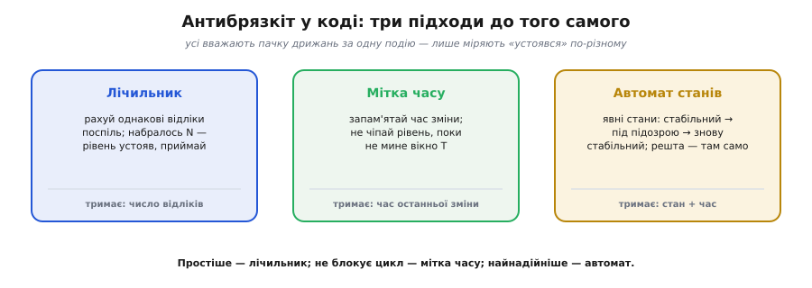
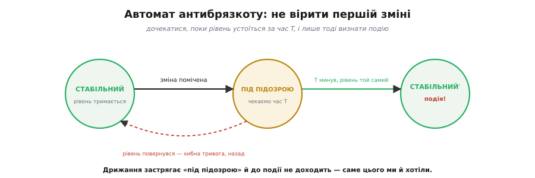

# ⚙️ Антибрязкіт у коді: лічильник, мітка часу, автомат станів

Механічний контакт при перемиканні [дзвенить](root:hw-digital/contact-debounce): один натиск дає не чистий перепад, а пачку швидких 0-1-0-1 на якихось одиниці–десятки мілісекунд. Мікроконтролер надто швидкий, щоб це пробачити: за ту мілісекунду він устигає сотні тисяч інструкцій, тож кожен відскік бачить як окрему чесну подію й рахує один натиск за п'ять. Прибрати дрижання можна залізом, але часто це роблять **у коді** — нічого не додаючи на плату. Тут зібрано три ідіоматичні способи це зробити, від найпростішого до найнадійнішого, і реальний код, що приймає кнопку начисто.

## Задача

Маємо ніжку, до якої під'єднана кнопка з підтяжкою: спокій — стабільний HIGH, натиск — LOW (зі звичайним `INPUT_PULLUP` кнопка тягне лінію до землі). Сире читання `digitalRead(pin)` під час натиску повертає пачку перемикань. Треба, **не чіпаючи заліза**, звести цю пачку до однієї події «кнопку натиснуто» — і бажано так, щоб не **блокувати** решту програми на час очікування, бо на мікроконтролері паралельно крутяться мигання, опитування давачів, мережа.

Одразу зафіксуймо різницю, яку легко проґавити. Нас майже завжди цікавить не сам **рівень** на ніжці («кнопка зараз притиснута»), а **момент переходу** «відпущено → натиснуто». Тому фільтр антибрязкоту складається з двох частин: спершу очистити рівень від дрижання, а тоді відстежити, що очищений рівень **змінився** проти попереднього стабільного. Пропустити другу частину — і «натиск» спрацьовуватиме весь час, поки кнопку тримають.

## Ідея

Усі три способи ловлять одну думку — «**не вір миттєвому рівню, дочекайся, поки він устоїться**», — але міряють «устоявся» по-різному: один **рахує** однакові відліки поспіль, другий **дивиться на годинник** і витримує вікно T, третій веде **явний автомат станів**.

*Три ідіоми антибрязкоту поряд. Лічильник тримає число однакових відліків; мітка часу — час останньої зміни (і не блокує цикл); автомат — явний стан плюс час. Простіше — лічильник; чуйніше (без блокування) — мітка часу; найнадійніше й найрозширюваніше — автомат.*

Спільне в них і те, **чого вони не роблять**: жоден не «вгадує» брязкіт за формою сигналу. Усі троє просто чекають тиші — рівня, що не міняється протягом вибраного вікна, — і лише сталий рівень пропускають далі. Тому той самий код заразом гасить і одиничні електричні наводки: випадковий вкрап теж не протримається вікно й буде відкинутий.

## Спосіб 1: лічильник однакових відліків

Найпростіший. Раз у раз з рівним кроком (скажімо, кожну 1 мс) читаємо ніжку. Рівень той самий, що минулого разу, — **збільшуємо лічильник**; змінився — **скидаємо в нуль**. Коли лічильник набрав поріг N (напр. 5), вважаємо рівень стабільним і, якщо він відрізняється від уже прийнятого, приймаємо нову подію. Один-два випадкові відскоки серед відліків щоразу скидають лічильник, тож пробитися крізь фільтр може лише рівень, що справді встояв N кроків поспіль.

:::tabs
:::code proj-debounce/cpp/sposib-1-lichylnyk.cpp
:::code proj-debounce/py/micropython/sposib-1-lichylnyk.py
:::code proj-debounce/py/sposib-1-lichylnyk.py
:::

Сильний бік — простота й те, що шум гаситься «безкоштовно». Слабкий — час підтвердження прив'язаний до **темпу опитування**: ті самі N = 5 за кроку 1 мс дають 5 мс затримки, а за кроку 4 мс — уже 20 мс. Міняючи частоту тіку, доводиться перебирати й N.

## Спосіб 2: мітка часу (не блокуючи цикл)

Кращий для чуйних програм. Замість блокуючого «зачекати 20 мс» (`delay(20)` заморозив би весь мікроконтролер) ми **запам'ятовуємо час** останньої зміни сирого рівня й **ігноруємо** нові зміни, поки не мине вікно T. Цикл не стоїть ані такту — лише поглядає на годинник [неблокуючим часом](root:sf-devices/nonblocking-time): кожен прохід читає `millis()` і порівнює.

:::tabs
:::code proj-debounce/cpp/sposib-2-mitka-chasu-ne.cpp
:::code proj-debounce/py/micropython/sposib-2-mitka-chasu-ne.py
:::code proj-debounce/py/sposib-2-mitka-chasu-ne.py
:::

Це класичний **неблокуючий** debounce: програма крутиться далі й паралельно стежить за кнопкою. Зверніть увагу на віднімання `millis() - t_change`: воно коректне навіть тоді, коли лічильник `millis()` через ~49 діб переповнюється, бо різниця беззнакових чисел «перекручується» правильно — саме тому `t_change` беззнаковий і ми **віднімаємо**, а не порівнюємо `millis() >= t_change + T`.

## Спосіб 3: автомат станів

Найнадійніший і найясніший для складних випадків. Кнопка живе в явних станах: **СТАБІЛЬНИЙ → ПІД ПІДОЗРОЮ → СТАБІЛЬНИЙ′**. Помітивши зміну, переходимо в «під підозрою» й засікаємо час; якщо рівень **устояв** до кінця вікна T — визнаємо подію й вертаємось у стабільний; якщо рівень **повернувся** раніше — то була хибна тривога, тихо відкочуємось назад, події немає.

*Автомат не вірить першій зміні: помітивши її, переходить у «під підозрою» й чекає T. Устояв рівень — визнає подію; повернувся — хибна тривога, назад. Дрижання щоразу скидає очікування й застрягає «під підозрою», так і не дійшовши до події.*

:::tabs
:::code proj-debounce/cpp/sposib-3-avtomat-staniv.cpp
:::code proj-debounce/py/micropython/sposib-3-avtomat-staniv.py
:::code proj-debounce/py/sposib-3-avtomat-staniv.py
:::

Дрижання просто застрягає у стані «під підозрою»: кожен новий відскік або повертає рівень (хибна тривога, відкат), або не дає вікну T домірятися, — і до події воно так і не доходить. Це рівно те, чого ми хотіли. Бонус — автомат **легко розширити**: довге натискання, подвійний клац, автоповтор — це просто нові стани й переходи, каркас уже є. По суті кожна кнопка стає крихітним [скінченним автоматом](root:hw-digital/finite-state-machines), і антибрязкіт — його найпростіший випадок.

## Worked-приклад: підбір вікна під реальну кнопку

**Умова.** Кнопка брязкоче до ~10 мс (типово для тактової). Тік таймера — 1 мс. Підберімо N для лічильника й вікно T для двох інших способів так, щоб брязкіт точно гасився, а людина затримки не відчула.

:::code proj-debounce/c/main.c

**Висновок.** Вікно фільтра має бути **досить довгим**, щоб перекрити найдовший брязкіт кнопки (тут — більшим за 10 мс), і **досить коротким**, щоб людина не відчула затримки (менше ~50 мс). Між цими межами лежить зручний коридор ~10–20 мс, у який майже завжди легко влучити; конкретне число варто **виміряти або взяти із запасом**, бо дешеві кнопки з часом брязкочуть дедалі гірше.

> 🔧 **Навіщо це.** Це той код, що відрізняє меню, яке слухняно йде по одному пункту, від меню, яке «перестрибує». Лічильник беріть для найпростішого скетчу; мітку часу — щойно в циклі є ще щось, що не можна морозити `delay`; автомат — коли кнопка має ще й довге натискання чи подвійний клац. У відповідальному пристрої кладіть автомат одразу: дописати стан дешевше, ніж переписувати фільтр.

## Складність і пастки на МК

- **Виявляйте фронт, не рівень.** Подію приймайте лише коли новий стабільний рівень **відрізняється** від попереднього (`s != stable` у всіх трьох прикладах) — інакше «натиск» спрацьовуватиме безперервно, поки кнопку тримають.
- **Кожну кнопку — окремо.** Свій лічильник / мітка / стан на **кожну** кнопку; спільні змінні плутають сусідів. На масив кнопок виносьте стан у масив структур і ганяйте той самий код у циклі по індексу.
- **Не блокуйте.** `delay(20)` на кнопці заморожує все інше — мигання, опитування, мережу. Способи 2 і 3 цього уникають; блокуючий «зачекати й перечитати» прийнятний хіба в найпростішому однозадачному коді.
- **Вікно T — компроміс.** Замале — пропустиш не всі дрижання; завелике — кнопка «тупить». ~10–20 мс зазвичай у самий раз; як [оцінити вікно під конкретну кнопку](root:hw-digital/contact-debounce) — у worked-прикладі вище.
- **Лічильник прив'язаний до темпу опитування.** N відліків означає різний час за різної частоти тіку; міняючи період опитування, перебирайте й N.
- **Брязкіт є й при відпусканні.** Розмикання дзвенить так само, як замикання, тож фільтр має чистити **обидва** фронти — усі три приклади це й роблять, бо стежать за рівнем загалом, а не лише за натиском.

## Підсумок

Лічильник — для найпростішого; мітка часу — коли не можна блокувати; автомат — коли треба надійність і простір для розвитку. Усі троє роблять одне: **перетворюють пачку дрижань на одну чесну подію** — чекають, поки рівень устоїться вибране вікно, і лише сталий, до того ж **новий** рівень пропускають далі.
