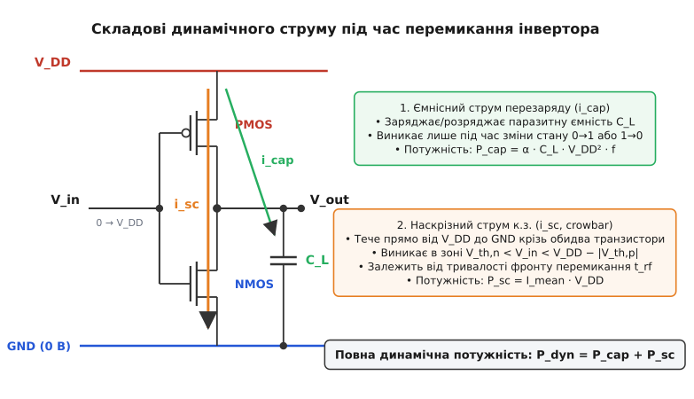
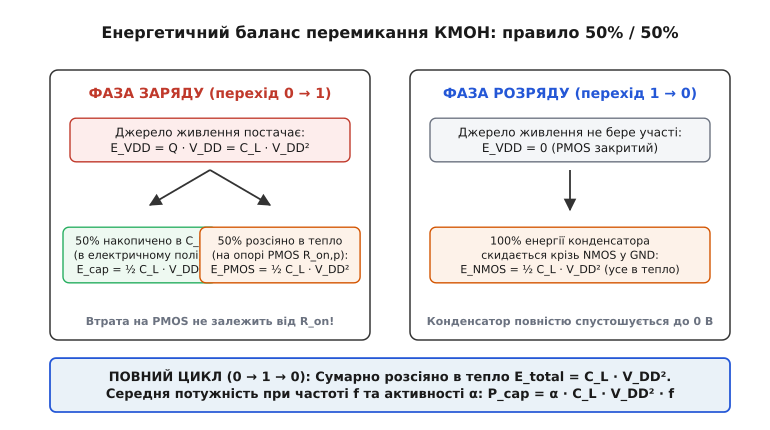
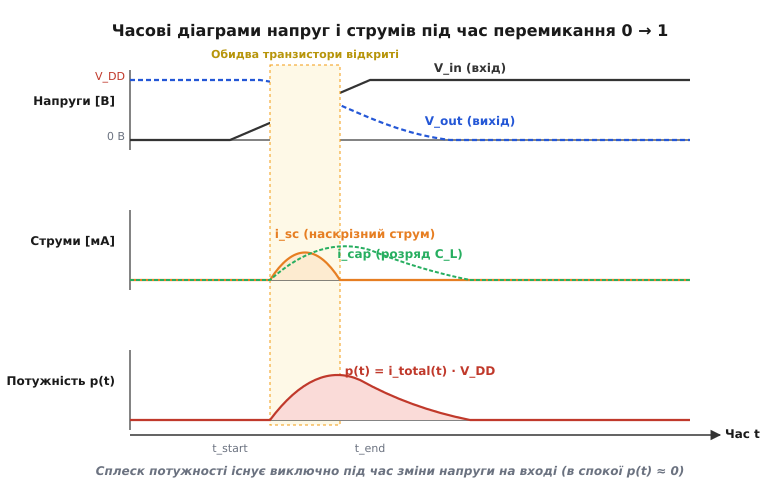
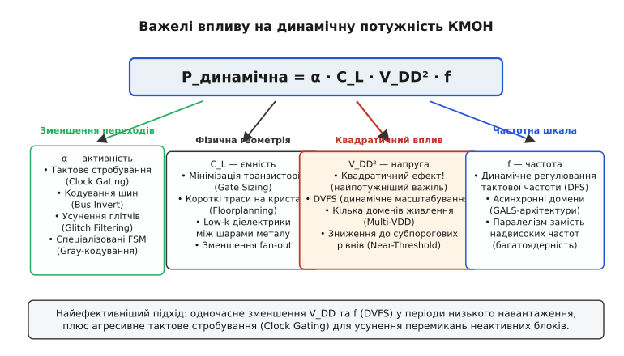

# Динамічна потужність КМОН: перезаряд ємностей і наскрізні струми

<preknowlist>
- [CMOS](root:hw-digital/cmos) — комплементарна пара NMOS та PMOS, базовий інвертор без статичного споживання.
- [Логічні рівні як діапазони](root:hw-digital/logic-levels-as-ranges) — порогові напруги та перехідна характеристика КМОН-вентиля.
- [Тривалість фронтів сигналу](root:hw-digital/edges-rise-time) — час наростання й спаду, вплив швидкості перемикання на наскрізні струми.
- [Тактове стробування](root:hw-digital/clock-gating) — вимикання тактування для зниження коефіцієнта активності.
</preknowlist>

Коли логічний вентиль КМОН перебуває в усталеному стані — на вході утримується незмінний рівень логічного нуля чи одиниці, — постійний струм від джерела живлення практично не тече: один із пари комплементарних польових транзисторів (NMOS або PMOS) надійно запертий, його опір каналу перевищує гігаоми, а провідний шлях між шиною живлення `V_DD` і землею розірваний. Але щойно цифровий сигнал починає змінювати свій рівень, схема миттєво перетворюється на споживача електричної енергії. Ця втрата енергії має динамічну природу й складається з двох фундаментальних фізичних процесів: необхідності перезаряджати паразитні ємності вузлів і з'єднувальних ліній через скінченний опір відкритих каналів, що створює ємнісну потужність `P_cap = α · C_L · V_DD² · f`, та виникнення прямого наскрізного струму короткого замикання між шиною живлення й землею в той короткий проміжок часу, коли вхідна напруга перетинає середину перехідної зони й обидва транзистори одночасно опиняються у відкритому стані.

### Анатомія споживання: чому статичний спокій змінюється сплеском струму

Щоб зрозуміти, звідки береться тепло у процесорі, який містить мільярди транзисторів, простежмо поведінку базової одиниці цифрової мікроелектроніки — інвертора (від лат. *invertere* — перевертати, обертати навспак). У статичному стані, коли на затворах присутній потенціал землі `0 В`, канал нижнього NMOS перекритий, а верхній PMOS відкритий і підтягує вихідний вузол до шини `V_DD`. Вихід має потенціал `V_DD`, струм через закритий NMOS обмежується мізерним струмом підпорогового витоку (на рівні пікоамперів). Коли на вхід подається `V_DD`, верхній PMOS замикається, а нижній NMOS відмикається, з'єднуючи вихід із землею. Струм знову прямує до нуля.

Проте цифрова схема існує заради передачі та обробки інформації, тобто постійної зміни логічних станів. Процес переходу між «0» та «1» зветься динамічним (від грец. *dynamis* — сила, рух, міць): це режим роботи схеми, за якого напруги й струми у вузлах є функціями часу, а накопичені заряди в паразитарних реактивних елементах перерозподіляються між шинами живлення, землею та ємностями навантаження.


*Складові динамічного струму. При перемиканні струм джерела V_DD ділиться на заряд паразитної ємності C_L через PMOS та короткочасний наскрізний струм i_sc через обидва відкриті транзистори на землю.*

У момент перемикання струм, що відбирається від джерела живлення `V_DD`, розгалужується на дві компоненти:
1. **Ємнісний струм `i_cap(t)`:** струм, необхідний для зміни заряду на зосередженій та розподіленій ємності вихідного вузла `C_L`. При переході `0 → 1` цей струм витікає з шини живлення крізь PMOS і заряджає ємність до напруги `V_DD`. При переході `1 → 0` заряд із ємності стікає крізь NMOS у шину землі `GND`.
2. **Наскрізний струм `i_sc(t)` (short-circuit або crowbar current):** струм, який тече безпосередньо від шини живлення `V_DD` крізь послідовно з'єднані канали PMOS та NMOS у землю, оминаючи ємність навантаження. Цей струм виникає виключно тому, що фронт вхідного сигналу не є математично миттєвим: поки напруга на вході зростає від порогової напруги відкривання NMOS `V_th,n` до напруги замикання PMOS `V_DD - |V_th,p|`, обидва транзистори прочинені одночасно.

Повна миттєва потужність, споживана вентилем від шини живлення, записується як добуток напруги на сумарний струм: `p(t) = V_DD · (i_cap(t) + i_sc(t))`. Усереднення цієї величини за велику кількість тактів визначає динамічну потужність мікросхеми.

---

### Фізична природа паразитної ємності вузла

Кожен провідник, затвор і напівпровідниковий перехід усередині інтегральної мікросхеми володіє здатністю накопичувати електричний заряд під дією прикладеної напруги. Ця властивість зветься ємністю (від лат. *capacitas* — місткість, здатність уміщати; у фізиці — відношення накопиченого заряду до різниці потенціалів `C = Q / V`).

Узагальнена паразитна ємність вихідного вузла `C_L` (Load Capacitance) не є окремим дискретним конденсатором, а формується сумою кількох незалежних фізичних компонентів на кристалі:

```
C_L = C_gate + C_diff + C_wire + C_miller
```

1. **Ємність затворів навантаження (`C_gate`):** сумарна ємність підзатворного діелектрика польових транзисторів наступних каскадів, під'єднаних до виходу даного вентиля (коефіцієнт розгалуження, *fan-out*). Для кожного приймального транзистора ця ємність визначається площею каналу та товщиною оксиду: `C_gate = C_ox · W · L`, де `C_ox = ε_ox / t_ox` — питома ємність діелектрика. У типових сучасних техпроцесах затворна ємність становить від 0.5 до 2 фФ на мікрометр ширини каналу.
2. **Дифузійна ємність стокових областей (`C_diff`):** бар'єрна та дифузійна ємність зворотно зміщених p-n переходів між легованими областями стоків транзисторів самого інвертора та напівпровідниковою підкладкою (або ізолюючою кишенею n-well). Вона складається з донної ємності площі стоку та ємності бічних стінок (периметра). Дифузійна ємність є нелінійною функцією напруги: при збільшенні зворотної напруги ширина збідненої зони зростає, а ємність дещо зменшується за законом `C_j(V_R) = C_j0 / (1 + V_R / φ_0)^m`.
3. **Ємність міжз'єднань і металізації (`C_wire`):** паразитна ємність металевих доріжок зв'язку відносно підкладки та сусідніх паралельних ліній. У глибоких субмікронних нормах (нижче 65 нм) через малу відстань між сусідніми провідниками мікросхеми міжелектродна ємність сусідніх ліній (*cross-coupling capacitance*) починає домінувати над ємністю на підкладку, досягаючи 50–70% від загального значення `C_wire`.
4. **Ємність Міллера (`C_miller`):** ємність перекриття затворів і стоків `C_gd` транзисторів інвертора. Оскільки під час перемикання напруги на затворі й стоку змінюються в протилежних напрямках, динамічний перезаряд цієї ємності подвоюється за рахунок ефекту Міллера: `ΔV_Cgd = 2 · V_DD`.

---

### Ємнісний перезаряд навантаження: закон 50% / 50%

#### Фаза заряду: перехід 0 → 1

Припустимо, що вихідний вузол мав потенціал `0 В`, тобто ємність `C_L` була повністю розряджена (`Q = 0`). На вхід інвертора приходить логічний нуль: нижній NMOS замикається, верхній PMOS відмикається, маючи опір відкритого каналу `R_on,p`.

Через канал PMOS починає протікати струм заряду `i(t) = C_L · (dv_C / dt)`. Джерело живлення з постійною напругою `V_DD` переносить на обкладки конденсатора повний електричний заряд `Q = C_L · V_DD`.

Повна енергія `E_VDD`, яку джерело живлення віддає у схему протягом часу заряду, обчислюється через інтеграл миттєвої потужності:

```
E_VDD
= ∫₀^∞ (V_DD · i(t)) dt              [миттєва потужність джерела живлення]
= V_DD · ∫₀^∞ i(t) dt               [напруга V_DD є постійною величиною]
= V_DD · Q                          [інтеграл струму є повним перенесеним зарядом]
= V_DD · (C_L · V_DD)               [підстановка виразу для заряду ємності]
= C_L · V_DD²                       [повна енергія, видана джерелом]
```

Водночас енергія `E_cap`, накопичена в електростатичному полі конденсатора при досягненні напруги `V_DD`, дорівнює:

```
E_cap
= ∫₀^∞ (v_C(t) · i(t)) dt           [інтеграл потужності на обкладках ємності]
= ∫₀^V_DD (v_C · C_L) dv_C          [заміна змінної інтегрування: i(t) dt = C_L dv_C]
= C_L · ∫₀^V_DD v_C dv_C            [винесення ємності за знак інтеграла]
= C_L · [½ · v_C²]₀^V_DD            [інтегрування степеневої функції]
= ½ · C_L · V_DD²                   [енергія електричного поля конденсатора]
```

Виникає фундаментальний енергетичний факт: джерело віддало енергію `C_L · V_DD²`, але в конденсаторі збереглася лише половина цієї величини — `½ · C_L · V_DD²`. Куди зникла друга половина?

Згідно з законом збереження енергії, різниця між відданою енергією та накопиченою виділилася у вигляді тепла на активному опорі відкритого каналу PMOS-транзистора:

```
E_PMOS
= E_VDD - E_cap                     [баланс енергії за законом збереження]
= C_L · V_DD² - ½ · C_L · V_DD²    [віднімання значень енергії]
= ½ · C_L · V_DD²                   [теплові втрати на транзисторі PMOS]
```

Найважливіший фізичний висновок полягає в тому, що **кількість тепла `½ · C_L · V_DD²`, виділена на PMOS під час заряду, абсолютно не залежить від величини опору `R_on,p`**. Якщо опір транзистора зробити дуже малим, струм зросте, а час заряду `τ = R_on · C_L` зменшиться; якщо опір зробити великим, струм буде малим, але час розтягнеться. Інтеграл `∫ i²(t) · R_on dt` в обох випадках дасть строго однакове число: `½ · C_L · V_DD²`.


*Правило 50% / 50%. При заряджанні ємності половина енергії джерела перетворюється на тепло в каналі PMOS, а друга половина накопичується в конденсаторі. Під час розряду накопичена енергія розсіюється в каналі NMOS.*

#### Фаза розряду: перехід 1 → 0

При зворотному перемиканні входу в одиницю PMOS закривається й ізолює схему від шини `V_DD`, а NMOS відкривається з опором каналу `R_on,n`. Джерело живлення не бере участі в процесі (`E_VDD = 0`).

Енергія `½ · C_L · V_DD²`, накопичена в електричному полі конденсатора під час попередньої фази, тепер повністю розряджається через канал NMOS на землю й безповоротно розсіюється у кремнії у вигляді теплових коливань кристалічної ґратки:

```
E_NMOS = ½ · C_L · V_DD²
```

Детальне математичне виведення цих інтегралів зі строгими замінами змінних та аналізом неповного розмаху напруг наведено в окремому документі:
> 🧮 **Математика:** [Виведення енергетичного балансу перезаряду КМОН та інтегралу наскрізного струму](root:hw-digital/dynamichna-potuzhnist-kmon/math-energy-derivation.md)

#### Підсумок повного циклу

За один повний цикл перемикання `0 → 1 → 0` від шини живлення відбирається енергія `C_L · V_DD²`, і рівно стільки ж енергії розсіюється у вигляді тепла (половина на PMOS, половина на NMOS):

```
E_cycle = E_PMOS + E_NMOS = C_L · V_DD²
```

---

### Формула ємнісної потужності та коефіцієнт активності

Якщо цифровий вузол працює на тактовій частоті `f` (де період дорівнює `T = 1 / f`), але змінює свій стан не на кожному такті, середня динамічна ємнісна потужність залежить від інтенсивності перемикань.

Частку тактів, у яких вузол здійснює активний перехід `0 → 1` (тобто акт споживання енергії від шини живлення), називають коефіцієнтом активності (від лат. *activitas* від *agere* — діяти, рухати; позначається символом `α`).

Формула середньої ємнісної динамічної потужності набуває вигляду:

```
P_cap = α · C_L · V_DD² · f
```

де:
- `P_cap` — середня розсіювана ємнісна потужність [Вт];
- `α` — коефіцієнт активності (безрозмірна величина від 0 до 1);
- `C_L` — сумарна паразитна ємність вузла [Ф];
- `V_DD` — напруга живлення [В];
- `f` — тактова частота схеми [Гц].

```
Параметри для розрахунку:
C_L = 100 фФ (10⁻¹³ Ф) — типова ємність навантаженого логічного вузла з розгалуженням (fan-out = 4)
V_DD = 1.0 В — напруга живлення логічного ядра
f = 2.0 ГГц (2·10⁹ Гц) — робоча тактова частота
α = 0.1 — середній коефіцієнт активності для комбінаційної логіки

Обчислення потужності одного вентиля:
P_cap = α · C_L · V_DD² · f
      = 0.1 · (100 · 10⁻¹⁵ Ф) · (1.0 В)² · (2.0 · 10⁹ с⁻¹)
      = 0.1 · 10⁻¹³ · 1.0 · 2 · 10⁹
      = 2.0 · 10⁻⁵ Вт = 20 мкВт

Для блоку з 10 мільйонів активних вентилів:
P_total = 10⁷ · 20 мкВт = 200 Вт
```

Цей числовий розрахунок наочно показує масштаб проблеми: мізерні 20 мікроватів на один вентиль за рахунок високої густини пакування перетворюються на 200 ватів тепла, які необхідно відвести з площі кристала розміром менше нігтя.

#### Розподіл коефіцієнта активності `α` за типами вузлів

У реальних синхронних цифрових системах різні функціональні блоки мають кардинально різний коефіцієнт активності:
- **Тактове дерево (Clock Network):** тактовий сигнал змінює стан щотакту (перехід `0 → 1` і `1 → 0` у кожному періоді). Для ліній тактового сигналу `α = 1.0`. Через це тактова мережа (буфери розводки такту, входи тактування тригерів) споживає від 35% до 50% усієї динамічної енергії сучасного процесора!
- **Шини випадкових даних (Data Buses):** якщо біти в послідовних тактах є незалежними та рівноймовірними (`P(0) = P(1) = 0.5`), ймовірність виникнення переходу `0 → 1` дорівнює добутку ймовірностей `P(0) · P(1) = 0.5 · 0.5 = 0.25`. Тобто для некорельованого потоку даних `α = 0.25`.
- **Керуючі лінії та адреси (Control & Address lines):** сигнали дозволу запису, вибору кристала чи старші біти адресних ліній перемикаються значно рідше — типово `α = 0.01 ... 0.05`.

#### Паразитна активність: глітчі в комбінаційній логіці

У комбінаційних схемах реальний коефіцієнт активності часто виявляється значно вищим за теоретичний через явище динамічних перегонів сигналів (hazard / glitch).

Глітч (від нім. *glitschen* / їдиш *glitsh* — ковзати, зсуватися) — це короткочасний паразитичний імпульс на виході логічного вентиля, спричинений різницею в затримках поширення сигналів різними шляхами комбінаційної схеми до його входів.

Наприклад, якщо на входи двовходового вентиля «Виключне АБО» (XOR) надходять два сигнали, які теоретично змінюються одночасно з 0 на 1, але один сигнал затримується на 100 пікосекунд через довший провідник, вентиль встигне на ці 100 пс виставити на виході хибну одиницю, зарядити ємність `C_L`, а потім знову розрядити її в нуль. Результат обчислення в тригері не зміниться, але енергія `C_L · V_DD²` буде безповоротно витрачена на нагрівання кристала.

У глибоких комбінаційних блоках (наприклад, каскадних помножувачах чи хвильових суматорах) на один корисний перехід може припадати від 3 до 7 паразитичних перемикань. Глітчі здатні створювати від 20% до 40% надлишкової динамічної потужності всього комбінаційного тракту.

---

### Наскрізні струми короткого замикання (Crowbar / Short-Circuit Power)

Другою компонентою динамічного споживання є наскрізний струм короткого замикання, який в англомовній інженерній традиції образно називають *crowbar current* (від англ. *crowbar* — лом, монтування; назва походить від захисних схем аварійного закорочення живлення, які діють подібно до важкого залізного лома, кинутого на оголені шини живлення).

В ідеальному цифровому світі вхідний фронт вважається нескінченно крутим: напруга миттєво стрибає між `0` та `V_DD`, тому один транзистор закривається в ту саму мить, коли відкривається інший.

У фізичній реальності напруга на вході вентиля наростає за скінченний час `t_r` (rise time) і спадає за час `t_f` (fall time).


*Часові діаграми перехідного процесу. Наскрізний струм i_sc формує куполоподібний сплеск у проміжній зоні напруг, а миттєва потужність p(t) досягає піка в момент найвищої провідності обох транзисторів.*

Розгляньмо, що відбувається під час плавного зростання вхідної напруги `V_in` від `0 В` до `V_DD`:
1. **Поки `V_in < V_th,n`:** нижній NMOS надійно закритий. Наскрізного шляху немає (`i_sc = 0`).
2. **Коли `V_th,n < V_in < V_DD - |V_th,p|`:** нижній NMOS уже відкрився, але верхній PMOS ще не закрився! Обидва транзистори одночасно перебувають у провідному стані. Утворюється прямий низькоомний канал від шини `V_DD` через PMOS і NMOS до землі `GND`. Струм `i_sc(t)` досягає максимуму біля точки логічного порога `V_in ≈ V_DD / 2`, де провідність обох каналів є найвищою.
3. **Коли `V_in > V_DD - |V_th,p|`:** напруга затвор-витік PMOS `|V_gs,p| = V_DD - V_in` стає меншою за порогову напругу `|V_th,p|`, верхній транзистор повністю замикається, і наскрізний струм обривається.

#### Формула Веєстакера та співвідношення фронтів

За класичною аналітичною моделлю Г. Веєстакера (H. J. M. Veendrick), наскрізна динамічна потужність інвертора описується рівнянням:

```
P_sc = (1 / 12) · β · (V_DD - 2·V_th)³ · t_rf · f
```

де `β = μ · C_ox · (W / L)` — параметр крутизни транзистора, `t_rf` — середня тривалість фронтів сигналу, `V_th` — порогова напруга.

Ця залежність демонструє важливі інженерні закономірності:
1. **Кубічна чутливість до напруги живлення:** множник `(V_DD - 2·V_th)³` показує, що при наближенні напруги живлення до подвійної порогової напруги (`V_DD ≤ 2·V_th`) наскрізний струм зникає майже повністю, оскільки діапазон одночасної провідності звужується до нуля.
2. **Лінійна залежність від крутизни вхідного фронту `t_rf`:** що повільніше наростає напруга на вході вентиля, то довше транзистори перебувають у відкритому стані, і то більше заряду марно витікає в землю.

#### Вплив співвідношення вхідної та вихідної крутизни (`t_in` проти `t_out`)

Частка наскрізної потужності в загальному балансі критично залежить від співвідношення між тривалістю вхідного фронту `t_in` та швидкістю перезаряджання вихідної ємності `t_out ≈ R_on · C_L`:
- **Повільний вхід, легкий вихід (`t_in >> t_out`):** вхідний сигнал змінюється повільно, тоді як вихідна напруга встигає швидко впасти до нуля. При цьому напруга стік-витік PMOS `V_ds,p = V_DD - V_out` швидко досягає майже повного значення `V_DD`, створюючи максимальний струм через відкриті транзистори. За таких умов наскрізне споживання `P_sc` може сягати **20–30% і більше** від загальної динамічної потужності!
- **Швидкий вхід, важкий вихід (`t_in ≤ t_out`):** крутий вхідний фронт швидко проскакує небезпечну зону `ΔV_th`. Велика вихідна ємність `C_L` утримує напругу `V_out` високою протягом усього часу зміни входу. Через це напруга `V_ds,n` на нижньому транзисторі залишається малою, обмежуючи струм насичення. У правильно спроєктованих цифрових бібліотеках (де вихідні ємності узгоджені з драйверами) частка `P_sc` становить **менше 5–10%** від `P_cap`.

---

### Інженерні стратегії боротьби з динамічною потужністю

Повна динамічна потужність схеми є сумою ємнісних та наскрізних втрат: `P_dyn = P_cap + P_sc`. Оскільки ємнісна компонента домінує, оптимізація спрямована на чотири множники головної формули: `P_cap = α · C_L · V_DD² · f`.


*Чотири важелі формули P_dyn = α · C_L · V_DD² · f. Оптимізація кожного множника формує комплексну багаторівневу стратегію енергоефективності сучасної цифрової системи.*

> 🔧 **Навіщо це.** Домінування квадрата напруги `V_DD²` десятиліттями визначало еволюцію напівпровідникової індустрії. Перехід від стандарту живлення 5.0 В (серія 74HC) до 3.3 В (LVCMOS) скоротив споживання на `1 - (3.3 / 5.0)² = 56%`. Перехід від 3.3 В до 1.8 В дав ще `70%` економії, а сучасні ядра процесорів на напрузі 0.75 В споживають на одне перемикання у `(5.0 / 0.75)² ≈ 44 рази` менше енергії, ніж їхні класичні попередники за тієї самої ємності вузлів.

#### 1. Динамічне масштабування напруги та частоти (DVFS — Dynamic Voltage and Frequency Scaling)
Оскільки час затримки поширення сигналу в КМОН-вентилі обернено пропорційний напрузі живлення (`t_pd ∝ V_DD / (V_DD - V_th)^α`), зниження напруги живлення зменшує максимальну робочу частоту `f_max`. Коли обчислювальне навантаження на систему знижується (наприклад, користувач читає текст або чекає вводу), контролер живлення одночасно знижує і тактову частоту `f`, і напругу `V_DD`. Зниження напруги вдвічі разом із двократним зниженням частоти зменшує динамічне споживання у **вісім разів** (`P ∝ (0.5·V)² · (0.5·f) = 0.125`).

#### 2. Тактове стробування (Clock Gating)
Оскільки тактове дерево володіє `α = 1.0` і споживає до половини енергії чипа, відсікання тактового сигналу від неактивних модулів є найефективнішим архітектурним прийомом. Спеціальні комірки інтегрованого стробування такту (ICG — Integrated Clock Gating Cell) на базі засувки та вентиля «І» зупиняють подачу тактових імпульсів на тригери, якщо блок у даному такті не виконує корисних обчислень, зводячи локальний коефіцієнт `α` до нуля.

#### 3. Мінімізація паразитних ємностей (Gate Sizing & Layout Optimization)
На етапі синтезу топології САПР аналізує критичні за затримкою шляхи (timing-critical paths). Для вентилів, які мають запас за часом (позитивний *slack*), розміри каналів `W` штучно зменшуються (downsizing). Це трохи збільшує опір `R_on`, але пропорційно зменшує власну вхідну ємність затвора `C_gate` для попереднього каскаду, розвантажуючи попередні вентилі. Також застосовують діелектрики з низькою проникністю (Low-k dielectric, `ε_r < 3.0`) між шарами металізації для зниження `C_wire`.

#### 4. Кодування шин для мінімізації переходів (Bus Invert Coding)
На широких паралельних шинах (пам'ять, міжчипові інтерфейси), де ємність ліній сягає десятків пікофарад, застосовують алгоритми кодування, які зменшують середню кількість перемикань.
> ⚙️ **Проєкт:** [Алгоритм Bus Invert: зменшення перемикань шини даних](root:hw-digital/dynamichna-potuzhnist-kmon/proj-bus-invert.md)

---

### Практичне моделювання та розрахунок бюджету

Щоб глибше зрозуміти взаємодію фізичних параметрів інвертора, розгляньмо два програмні приклади: чисельну симуляцію перехідного процесу перемикання з розрахунком наскрізного та ємнісного струмів, а також модуль оцінки динамічного енергетичного бюджету багаторозрядної шини даних.

#### Приклад 1. Чисельна симуляція динамічного перемикання КМОН-інвертора

Ця програма розраховує перехідний процес інвертора на інтервалі часу з дискретним кроком `dt`. На кожному кроці розраховується вхідна напруга `V_in(t)`, струми насичення та лінійного режиму транзисторів за моделлю Шихмана-Ходжеса, наскрізний струм `i_sc(t)`, струм заряду вихідної ємності `i_cap(t)` та інтегрується повна розсіяна енергія.

:::tabs
:::code dynamichna-potuzhnist-kmon-d/c/pryklad-1-chyselna.c
:::code dynamichna-potuzhnist-kmon-d/cpp/pryklad-1-chyselna.cpp
:::

#### Приклад 2. Розрахунок енергетичного бюджету паралельної шини даних

Цей приклад моделює динамічну потужність 32-бітної паралельної шини на друкованій платі (розподілена ємність 8 пФ на лінію, частота передачі 400 МГц, напруга 1.2 В). Програма порівнює споживання стандартного некодованого потоку з оптимізованим алгоритмом Bus Invert.

:::tabs
:::code dynamichna-potuzhnist-kmon-d/c/pryklad-2-rozrakhunok.c
:::code dynamichna-potuzhnist-kmon-d/cpp/pryklad-2-rozrakhunok.cpp
:::

---

### Підсумок: повний енергетичний баланс КМОН

Повний баланс споживання потужності сучасного цифрового КМОН-пристрою об'єднує всі вивчені складові:

```
P_total
= P_динамічна + P_статична                 [сума динамічних і статичних втрат]
= (P_cap + P_sc) + P_leak                  [розбиття динаміки на ємнісну та наскрізну складові]
= (α · C_L · V_DD² · f + I_mean_sc · V_DD) + I_leak · V_DD [підстановка компонентних фізичних формул]
```

У мікросхемах із нормами від 180 нм до 65 нм динамічна ємнісна складова `P_cap` становила понад 85–90% усього енергетичного бюджету. У глибоких нанометрових вузлах (менше 7 нм) статичні струми витоку `I_leak` (підпороговий витік, тунелювання крізь тонкий діелектрик затвора) стрімко зросли, змусивши інженерів застосовувати нові структури польових транзисторів — FinFET та GAAFET (Gate-All-Around / нанострічки). Проте на рівні функціонування логічних схем динамічне перезаряджання ємностей залишається незмінним фізичним фундаментом: кожен біт інформації, кожна логічна операція вимагають транспортування заряду `Q = C · V`, половина енергії якого неминуче перетворюється на тепло.
