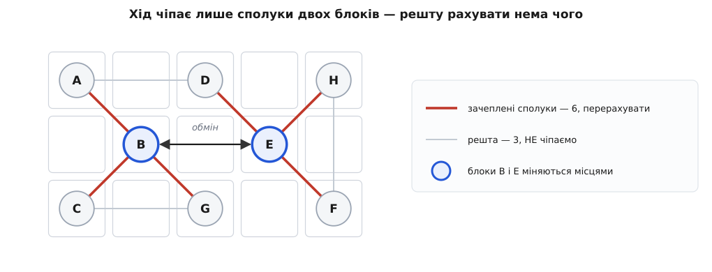
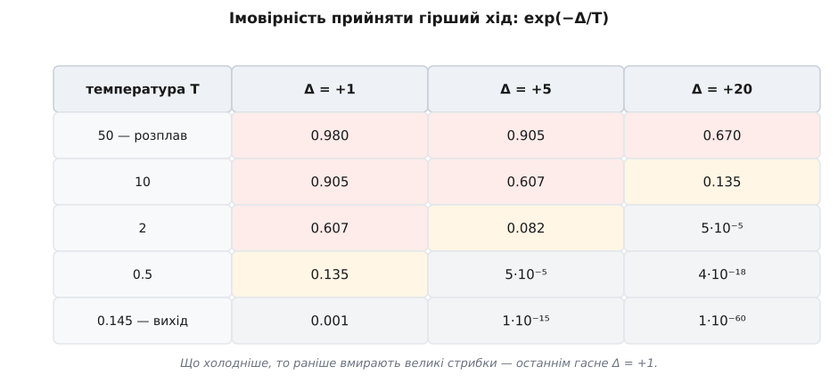
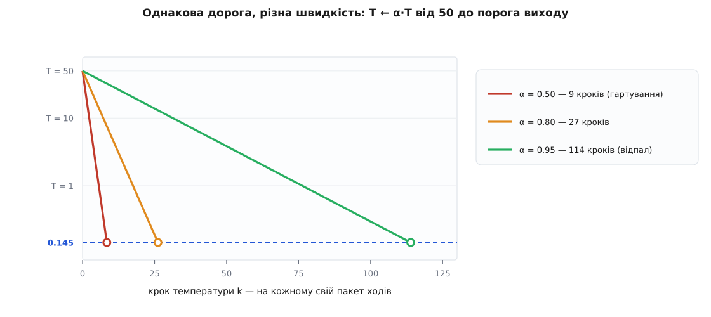

# ⚙️ Розміщувач на імітації відпалу: код, у якому все вирішує дельта

<preknowlist>
- [Імітація відпалу](root:sf-algorithms/simulated-annealing) — робити випадкові зміни, кращі приймати завжди, гірші — з імовірністю exp(−Δ/T), і поволі знижувати T; звідки взялася аналогія з остиганням металу.
- [Логічний синтез](root:hw-digital/lut-mapping) — звідки береться список з'єднань: блоки й сполуки між ними.
- [Усередині FPGA](root:hw-digital/inside-fpga) — тканина з однакових логічних блоків і слотів із фіксованими координатами.
</preknowlist>

**Задача.** Дано список з'єднань — блоки й сполуки між ними — і сітку вільних слотів. Треба посадити кожен блок у слот так, щоб сумарний HPWL вийшов якомога менший. Гарантованого оптимуму не буде й бути не може; буде програма на C, яку можна прочитати цілком за один захід і яка за секунди спускається з випадкової розкладки майже до найкращої.

**Ідея.** Уся програма — це один цикл, і в ньому чотири рядки суті: вибери два слоти навмання, поміняй їхній уміст, подивись, як змінилася ціна, і вирішуй — лишити чи відкотити. Кращий хід лишаємо завжди. Гірший — теж лишаємо, але з імовірністю exp(−Δ/T), і що нижча температура T, то рідше. Спершу T велика й розкладка вільно блукає; далі T падає, блукання стискається до сповзання вниз, і врешті система застигає.

Написати цей цикл — година. Але між «написав» і «працює на справжній схемі» лежить одна деталь, без якої все марно: **скільки коштує дізнатися Δ**. Наївно — перерахувати ціну всієї розкладки: два рядки, очевидно правильно. І саме тут гине більшість саморобних розміщувачів. Бо ходів треба зробити сотні мільйонів, і якщо кожен коштує повного обходу схеми, відпал перетворюється на процедуру завдовжки в добу. Уся стаття, по суті, крутиться навколо того, як зробити хід **дешевим** — і чому це не мікрооптимізація, а різниця між робочим інструментом і красивою іграшкою.

Мова тут — C, і не з ностальгії: цикл гарячий, ходів мільйони, дані — плоскі масиви цілих, і кожну зайву непряму адресацію видно на секундомірі. Це саме той випадок, де ручне поводження з пам'яттю окупається.

## Що тримати в пам'яті

Структури даних тут не оформлення, а половина алгоритму: від того, що ми можемо спитати за O(1), залежить ціна ходу. Тож розберімо, що саме треба питати.

Щоб порахувати HPWL сполуки, треба знати координати всіх її блоків — отже, потрібен напрямок **сполука → її виводи** й **блок → його слот**. Щоб зробити хід, треба знати, хто сидить у вибраному слоті, — отже, ще й **слот → блок**. А щоб дізнатися, які сполуки взагалі зачепить ворушіння блока, потрібен напрямок **блок → його сполуки**. Чотири запитання — чотири таблиці, і кожна відповідає за O(1) або за час, пропорційний відповіді.

Обидва списки — у форматі, який у роботі з розрідженими даними називають CSR: одна суцільна стрічка значень плюс масив зміщень, де починається кожен рядок. Ніяких вказівників на купу, ніяких окремих списків на кожен вузол — два масиви, які лежать у пам'яті поспіль і читаються послідовно.

:::code proj-annealing-placer/c/shcho-trymaty-v-pamiati.c

Два поля `Placement` описують одну й ту саму річ із різних боків, і тримати їх узгодженими — обов'язок коду. Спокуса викинути одне з них велика, але марна: без `slot_of` доведеться шукати блок по всій сітці, без `blk_at` — не дізнатися, кого ми зачепили, вибравши слот. Пам'яті це коштує копійки, а кожен хід рятує від лінійного пошуку.

## Ціна: HPWL

HPWL сполуки — півпериметр найменшої рамки, що охоплює всі її виводи. Один прохід по виводах, чотири порівняння на вивід.

:::code proj-annealing-placer/c/tsina-hpwl.c

Зверніть увагу на коментар до `total_hpwl`: **двічі за весь прогін**. Ця функція — не робоча конячка, а міряльний прилад: один раз узяти початкову ціну, один раз наприкінці перевірити себе. Щойно вона з'явиться всередині циклу ходів — програма перетворюється на ту саму іграшку.

## Хід: обміняти два слоти

Хід вибирає **два слоти**, а не два блоки. Різниця не косметична: слотів зазвичай більше, ніж блоків, і вибір по слотах природно дозволяє переселити блок у **порожнє** місце — а такий хід часто найкорисніший. Вибір по блоках цю можливість просто не має як висловити.

Обмін умісту двох слотів має приємну властивість: він сам собі зворотний. Ніякого журналу скасувань, ніякої копії стану — щоб відкотити хід, викликаємо ту саму функцію ще раз.

```c
/* Обмін умісту двох слотів. Сам собі зворотний: викликати вдруге — відкотити. */
static void apply_swap(Placement *pl, int s1, int s2)
{
    int b1 = pl->blk_at[s1], b2 = pl->blk_at[s2];
    pl->blk_at[s1] = b2;
    pl->blk_at[s2] = b1;
    if (b1 >= 0) pl->slot_of[b1] = s2;
    if (b2 >= 0) pl->slot_of[b2] = s1;
}
```

І ще одна властивість, за яку варто зачепитися: розкладка **завжди лишається законною**. Обмін зберігає взаємну однозначність — кожен блок в одному слоті, у кожному слоті не більш ніж один блок. Хоч мільярд ходів зроби, порушити правило нічим. Це не дрібниця: цілий клас розміщувачів мусить наприкінці окремо **легалізувати** свій результат, бо в процесі блоки в них налазять один на одного. Відпал на сітці слотів цю проблему просто не має.

Тепер нам потрібне джерело випадковості — і тут теж не все одно, яке.

:::code proj-annealing-placer/c/khid-obminiaty-dva-sloty.c

## Серце: дельта замість повного перерахунку

Ось те місце, заради якого все й писалося.

Поміняли місцями блоки B і E. Що змінилося в ціні? Координати змінилися **лише у двох блоків**. Сполука, до якої не належить ні B, ні E, бачить рівно ту саму картину, що й хвилину тому: усі її виводи там, де були. Її HPWL змінитися **не міг**. Отже, перераховувати треба тільки сполуки, які чіпають B або E, — а це жменька.


*Хід чіпає лише сполуки двох блоків. B і E міняються місцями; змінити довжину можуть тільки шість сполук, що до них під'єднані (виділені). Три сполуки збоку — A–D, C–G, F–H — не мають до B і E жодного стосунку, і їхні виводи навіть не ворухнулися: рахувати їх заново означає щоразу отримувати те саме число. На схемі з мільйона сполук таких «тих самих» буде 999 990 з мільйона.*

Тонкість, на якій легко впасти: сполуку, що чіпає **обидва** блоки одразу, зібрати можна двічі — і тоді її внесок подвоїться, а дельта вийде брехливою. Найприкріше, що це саме ті сполуки, які між B і E й напнуті, тобто найважливіші. Тому список зачеплених треба збирати **без повторів**.

Дешевий спосіб — мітка з номером ходу. Замість чистити масив після кожного ходу (це знову лінійний прохід, тобто знову те, від чого тікаємо) ми просто збільшуємо лічильник: якщо в комірці стоїть номер поточного ходу, сполуку вже брали.

:::code proj-annealing-placer/c/sertse-delta-zamist.c

Останній коментар — не дрібниця, а те, чому фокус узагалі можливий. Хід переставляє блоки в **просторі**, але не чіпає **структуру** зв'язків: хто до якої сполуки належить, лишається як було. Тож список зачеплених, зібраний до обміну, чинний і після — і його не треба збирати вдруге.

> 🔧 **Навіщо це.** Дельта — не оптимізація «додамо потім, якщо гальмуватиме», а те, що взагалі робить відпал придатним для розміщення. Ціна повного перерахунку росте разом зі схемою; ціна дельти залежить лише від того, до **скількох сполук під'єднаний один блок**, — а це три-чотири й на схемі з тисячі блоків, і на схемі з мільйона. Тобто хід коштує **однаково** незалежно від розміру проєкту. Саме ця незалежність і переводить відпал із «цікаво на іграшках» у «працює на справжніх кристалах»: більшає схема — більшає потрібна кількість ходів, але не ціна кожного.

## Правило Метрополіса

Дельта є — лишилося вирішити її долю. Кращий хід (Δ ≤ 0) беремо не думаючи. Гірший беремо з імовірністю exp(−Δ/T). Формула не з повітря: вона прийшла з обчислювальної фізики, де тим самим виразом рахували поведінку речовини за скінченної температури (*J. Chem. Phys.* 21(6):1087–1092, 1953). У нашому циклі вона робить рівно те саме, тільки роль енергії грає довжина дроту.

Придивімося, що ця формула робить. Точні числа рахуються на пальцях — жодного запуску не треба.


*Точна арифметика правила прийняття. На T = 50 проходить майже все, навіть стрибок на +20 — розкладка вільно блукає й забуває, звідки почала. На T = 2 великі стрибки вже практично померли (5·10⁻⁵), а дрібні ще живі. На T = 0.145 навіть найменший можливий погіршувальний хід Δ = +1 проходить раз на тисячу — відпал виродився в звичайне сповзання вниз.*

У таблиці видно головне, чого не побачити у формулі: **великі стрибки вмирають першими, дрібні — останніми**. Гарячий відпал грубо перетасовує схему, теплий поправляє на кілька клітин, холодний вилизує на одну. Один вираз exp(−Δ/T) сам, без жодного окремого коду, розводить пошук на етапи — від крупного до дрібного.

## Розклад: звідки й доки холонути

Три числа треба звідкись узяти: початкову T, множник охолодження й поріг зупинки. Два з них можна не вгадувати, а вивести.

**Початкова температура.** Її сенс — «на старті приймається майже все». Але «майже все» залежить від того, які там взагалі бувають Δ, а це властивість конкретної схеми, а не константа. Тож не вгадуймо — **поміряймо**: поблукаємо навмання, приймаючи геть усе, подивимося на розкид дельт і візьмемо T₀ = 20·σ. Чому саме 20? Бо тоді типовий погіршувальний хід (Δ ≈ σ) проходить з імовірністю exp(−σ/20σ) = exp(−0.05) ≈ 0.95 — власне те, що й називається розплавом. Це не єдино правильний множник, а ручка; але сама ідея брати T₀ **з виміряного розкиду ціни** — стандарт: у VTR, відкритому пакеті розміщення й трасування, автоматичний розклад має оцінювач початкової температури, який так і зветься — `cost_variance`.

**Поріг зупинки.** Тут узагалі можна нічого не вгадувати. HPWL — ціле число, тож найменший можливий погіршувальний хід — це Δ = +1; меншого не буває. Коли навіть він перестає проходити, гірші ходи не приймаються **ніякі**, і відпал уже не відпал, а жадібне сповзання: далі холонути безглуздо. Візьмімо за «перестав проходити» імовірність 0.001:

```
exp(−1/T) = 0.001
    −1/T  = ln(0.001) = −6.9078
       T  = 1 / 6.9078 ≈ 0.1448
```

Ось і поріг: **T_EXIT ≈ 0.145**, і він не залежить від розміру схеми — бо не залежить від масштабу ціни, а лише від того, що ціна ціла. (Для порівняння: у ручному розкладі VTR типовий `--exit_t` — 0.01, тобто трохи холодніше.)

**Множник охолодження.** А от його вивести не вийде — це і є головна ручка, і головна пастка. Про неї — нижче.

:::code proj-annealing-placer/c/rozklad-zvidky-i-doky.c

Показник 4/3 у кількості ходів на температуру — не мій винахід: рівно так масштабує зусилля VTR (ручка `--inner_num`, типове значення там 0.5 — я беру щедрі 10, бо схема в демо крихітна й хочеться дотиснути до відомого оптимуму). Сенс: більша схема потребує не пропорційно, а помітно більше ходів на кожній температурі, щоб устигнути прийти до рівноваги.

## Демо-схема, у якої відомий оптимум

Перевіряти розміщувач на схемі, для якої ніхто не знає найкращої відповіді, — марна справа: побачиш число й не знатимеш, добре це чи погано. Тож збудуймо схему, де оптимум **відомий наперед і доведений**.

Візьмімо блоки, з'єднані в сітку 16×16: кожен зі своїм сусідом праворуч і сусідом знизу. Слотів рівно стільки ж. Тоді розкладка «блок i у слот i» дає кожній сполуці довжину 1. Краще неможливо: у кожної сполуки два **різні** блоки в **різних** слотах, тож її HPWL не менший за 1, а отже сума не менша за кількість сполук. Оптимум доведено — і він дорівнює 480.

:::code proj-annealing-placer/c/demo-skhema-u-iakoi.c

Збирається як `cc -O2 -o placer placer.c -lm`; шматки коду вище йдуть у файл згори вниз у порядку появи.

Останні два рядки `main` — найважливіші в усій програмі, хоч і не роблять нічого корисного. Ціну ми весь прогін вели **інкрементно**, додаючи дельти; наприкінці рахуємо її **чесно, з нуля** й порівнюємо. Якщо числа розійшлися — дельта бреше, і всі красиві відсотки прийняття нічого не варті. Це найдешевша страховка від найпідступнішого класу помилок, які тільки бувають в інкрементному коді.

А скільки має вийти на старті — теж видно без запуску:

**Приклад: чого чекати від випадкової розкладки.**

```
Для двох незалежних рівномірних координат на 0..15:
    E|x₁ − x₂| = (W² − 1)/(3W) = (256 − 1)/48 = 5.3125
Слоти мусять бути різні; випадок s₁ = s₂ дав би нуль і його викинуто,
тож середнє трохи росте:
    5.3125 · 256/255 = 5.3333
По двох осях:      E[HPWL сполуки] = 2 · 5.3333 = 10.667
На 480 сполук:     480 · 10.667 ≈ 5120

Відомий оптимум:   480
Розрив, який має закрити відпал: ≈ 10.7 раза
```

## Скільки коштує хід

Тепер порахуймо те, з чого починали.

**Приклад: дельта проти повного перерахунку.**

```
Сітка 16×16: 256 блоків, 480 сполук, 960 виводів.

Хід через дельту:
    сполук на блок      ≤ 4      (сусіди в сітці)
    зачеплено за хід    ≤ 4 + 4 = 8
    виводів на сполуку  2
    міряємо до і після  ×2
    разом ≈ 8 · 2 · 2 = 32 відвідини виводу

Хід через повний перерахунок:
    960 виводів (усі 480 сполук по 2)
    разом ≈ 960 відвідин виводу              → у 30 разів дорожче

Уже на іграшці — тридцятикратна різниця. Але суть не в «30»:
дельта не залежить від розміру схеми, а перерахунок — залежить.
```

Ось де ця різниця показує зуби. Візьмімо справжній масштаб — 100 000 блоків, стільки ж приблизно сполук, десь 300 000 виводів:

```
Ціна одного ходу — рахуємо так само, як на іграшці:
    сполук на блок      ≈ 5
    зачеплено за хід    ≈ 5 + 5 = 10
    виводів на сполуку  ≈ 3
    міряємо до і після  ×2
    дельтою:            ≈ 10 · 3 · 2 = 60 відвідин виводу
    перерахунком:       ≈ 3·10⁵ відвідин          → у 5000 разів більше

Ходів за розкладом (INNER_NUM = 0.5, як у VTR):
    на температуру:  0.5 · 100000^(4/3) ≈ 2.3·10⁶
    температур:      ≈ 120
    разом:           ≈ 2.8·10⁸ ходів

Дельтою:             2.8·10⁸ · 60      ≈ 1.7·10¹⁰ відвідин  → секунди
Повним перерахунком: 2.8·10⁸ · 3·10⁵   ≈ 8.4·10¹³ відвідин  → доба

(за оптимістичних 10⁹ відвідин на секунду)
```

Секунди проти доби — і це та сама програма, у якій відрізняється **одна функція**. Зверніть увагу, що саме зробило розрив: ціна ходу дельтою вийшла 60 замість 32 — тобто майже не змінилася, хоч схема більша в чотириста разів. А ціна перерахунку зросла з 960 до 300 000 — пропорційно схемі. Дельта не залежить від розміру проєкту, бо блок як мав чотири-п'ять сполук, так і має; перерахунок залежить, бо щоразу обходить усе. Тому й розрив не сталий: на іграшці він тридцятикратний, на справжньому проєкті — п'ятитисячний, і далі росте.

## Пастки

**Занадто швидке охолодження.** Найпоширеніша й найпідступніша — бо програма не ламається, а просто тихо видає гірший результат. Порахуймо, скільки температурних кроків минає від T₀ = 50 до порога 0.145:


*Однакова дорога, різна швидкість. Той самий старт і той самий поріг виходу — але α вирішує, скільки пакетів ходів устигне зробити система. При α = 0.5 усе закінчується за дев'ять кроків: розкладка не встигає прийти до рівноваги на жодній температурі й застигає в тому безладі, у якому її застав холод. При α = 0.95 кроків 114 — у понад дванадцять разів більше нагод переставити те, що переставляється тільки на теплому.*

Важить не загальна кількість ходів, а **скільки часу система провела на температурах, де ще щось вирішується**. Є вузька смуга, у якій частка прийнятих ходів сповзає з майже одиниці до майже нуля, — саме там визначається крупна будова розкладки: які блоки опиняться в якому кутку. Проскочив цю смугу — будова застигла навмання, і скільки потім не вилизуй на холоді дрібниці, крупну помилку вже не виправити: щоб її виправити, потрібні великі стрибки, а їх на холоді не приймають (див. таблицю вище).

Аналогія з металом тут працює буквально й до самого дна — це та сама фізика, з якої й позичено метод. Швидко остудити метал — **гартування**: твердо, крихко, з напруженнями всередині. Повільно — **відпал**: атоми встигають знайти свої місця, ґратка виходить упорядкована. Різниця між двома словами — це один множник α.

**Повний перерахунок замість дельти.** Пастка тим і зваблива, що правильний варіант виглядає гірше: `cost = total_hpwl(...)` після кожного ходу — два рядки, які неможливо написати з помилкою. Дельта — тридцять рядків, у яких помилитися легко. Спокуса зробити «спершу просто, потім оптимізуємо» тут особливо сильна — і особливо шкідлива, бо на маленькій схемі, де ви налагоджуєте, різниця буде тридцятикратна й непомітна, а вилізе вона аж на справжньому проєкті, коли переписувати вже нікому.

**Дельта, що розійшлася з правдою.** Класична біда всього інкрементного: ціна, яку ми ведемо, поволі відповзає від справжньої. Джерел три. Перше — забути про повтори, і тоді сполука між двома обмінюваними блоками врахується двічі. Друге — забути відкотити відхилений хід. Третє, найпідступніше: `stamp` — це `int`, і після приблизно 2·10⁹ ходів він переповниться; мітки почнуть збігатися випадково, і сполуки мовчки випадатимуть зі списку зачеплених. На довгих прогонах це реально: беріть ширший лічильник або перечищайте мітки при обгортанні. Ліки від усіх трьох — та сама перевірка з `main`, і під час налагодження її варто робити не в кінці, а на кожній температурі.

**Слоти не однакові.** Наша тканина однорідна, тож обмін завжди законний. Справжня — ні: там колонки пам'яті, помножувачі, блоки вводу-виводу, і блок пам'яті в слот для таблиці істинності не сяде. Найпростіші ліки — вибирати другий слот лише серед **сумісних** із першим блоком (тримати окремий список слотів на кожен тип), і тоді законність знову зберігається сама. Інакше доведеться легалізувати результат окремим проходом — а легалізація вміє з'їсти чималу частку тієї якості, за яку ви щойно платили мільйонами ходів.

**Ходи навмання через увесь кристал.** На холоді обмін двох блоків із протилежних кутів дає величезне Δ й відхиляється практично завжди. Тобто наприкінці прогону майже всі ходи — марна робота. Ліки: обмежувати радіус ходу вікном навколо першого слота й стискати вікно разом із температурою. Механізм цілком реальний — у VTR він зветься межею області, і в нього є навіть ручка `--place_rlim_escape` — «частка ходів, яким дозволено її знехтувати». Без цього вікна остання, найдовша частина прогону витрачається на відхилення.

---

Отже: розміщувач на відпалі — це три сотні рядків, і майже всі вони обслуговують один-єдиний рядок сенсу — `if (delta <= 0 || rnd_unit() < exp(-delta / T))`. Дві таблиці CSR існують тільки для того, щоб за O(1) відповісти «які сполуки чіпає цей блок». Мітка-номер-ходу — щоб не чистити масив. Обмін слотів, а не блоків, — щоб уміти селити в порожнє. Обмін, зворотний сам собі, — щоб відкат був безкоштовний. Кожна з цих дрібниць існує з однієї причини: **зробити хід дешевим**, бо ходів буде сотні мільйонів.

І в цьому, мабуть, головний урок, ширший за розміщення. Коли алгоритм робить мільйони однакових крихітних кроків, його швидкодія живе не в алгоритмі, а в **ціні одного кроку** — а ціна кроку живе в структурах даних. Наївний і швидкий розміщувачі відрізняються не ідеєю (ідея та сама, і вона в одному рядку) і не мовою, а тим, що один щоразу перепитує всю схему, а другий пам'ятає, кого саме він потурбував.
