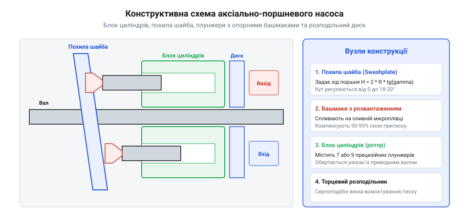
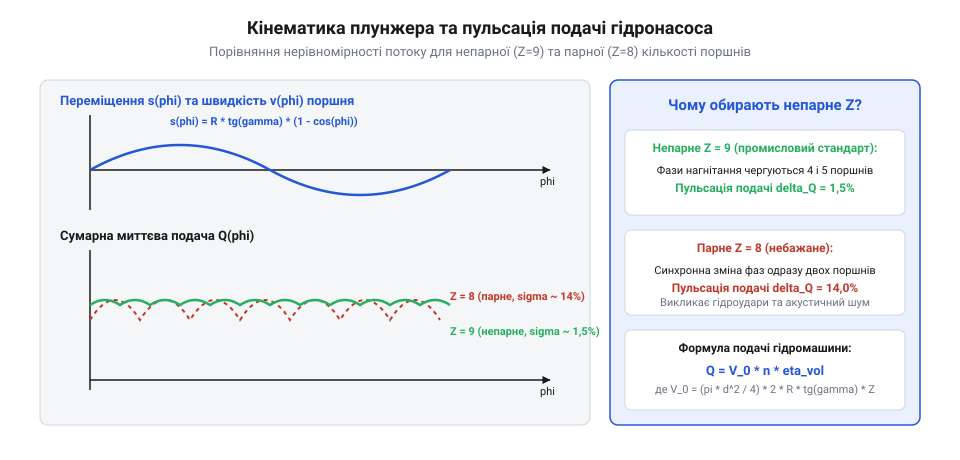
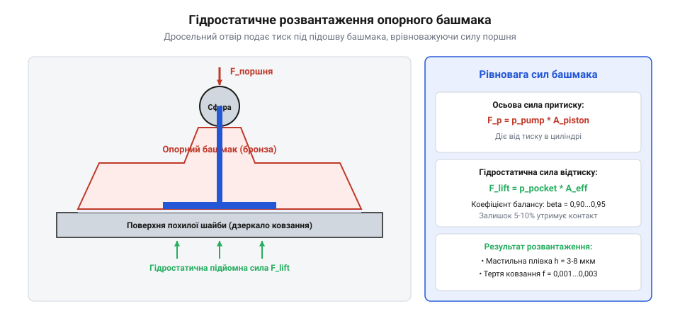

# Аксіально-поршневий гідронасос із похилою шайбою

## Принцип об'ємного гідропривода високого тиску

Гідравлічні приводи важкої мобільної робототехніки, крокуючих людиноподібних машин (як-от Boston Dynamics Atlas перших поколінь) та маніпуляторів високої потужності вимагають екстремальної питомої сили (до 30–50 кВт/кг на вихідному штоку). Основою таких гідросистем є об'ємні насоси високого тиску. Традиційні шестеренні (зовнішнього та внутрішнього зачеплення) та пластинчасті насоси через свої геометричні та механічні особливості не здатні забезпечити тривалий робочий тиск понад 20–25 МПа:



1. **Радіальне гідростатичне навантаження вала**. У шестеренному насосі зона високого вихідного тиску діє на бічну поверхню шестерень, викликаючи величезні незбалансовані радіальні сили на опорні підшипники кочення чи ковзання, що обмежує їхній ресурс.
2. **Витікання через торцеві та радіальні зазори**. Зі зростанням тиску пружна деформація корпусу призводить до розкриття щілин між торцями зубів і плаваючими компенсаційними втулками. При тисках вище 25 МПа об'ємний ККД шестеренного насоса стрімко падає (`η_vol < 70%`) через лавиноподібне зворотне перетікання нагрітого мастила.
3. **Пластинчасті обмеження**. Лопатки (пластини) зазнають вигину при виході з пазів ротора під дією перепаду тиску, а контактні напруження між кромкою пластини та поверхнею статора викликають задири.

Аксіально-поршневі насоси з похилою шайбою (@@en|axial piston swashplate pump@@) долають ці бар'єри завдяки циліндричному плунжерному ущільненню. Поршень і гільза блоку циліндрів утворюють прецизійну пару ковзання з мікроскопічним діаметральним зазором (3–8 мкм). Довга лінія рідинного лабіринту в циліндрі витримує тиск 35–45 МПа (і до 50 МПа в короткочасних піках) при об'ємному ККД `η_vol ≥ 95–98%`, а симетричне розташування плунжерів навколо осі обертання взаємно компенсує радіальні зусилля на валу.

Найнебезпечнішим патологічним явищем у роботі аксіально-поршневих гідронасосів є кавітаційний знос і газовиділення в лінії всмоктування. Коли плунжер висувається з циліндра, об'єм підпоршневої камери стрімко зростає, створюючи розрідження для всмоктування масла через вікно розподільного диска. Якщо гідравлічний опір всмоктувальної магістралі занадто великий (холодне густе масло, засмічений фільтр або завузький трубопровід), тиск падає нижче тиску насичених парів розчиненого газу:

```
P_suction < P_cavitation ≈ 0.02...0.08 МПа (абс.)
```

У маслі виникають мікроскопічні газові каверни (бульбашки). Коли плунжер проходить верхню мертву точку і потрапляє у зону високого нагнітання (35–45 МПа), бульбашки вибухоподібно захлопуються за лічені мікросекунди. Створювані кумулятивні мікрострумені рідини зі швидкістю понад 1000 м/с і локальним тиском до 10 000 МПа вибивають шматочки металу з бронзового розподільника та сталевих гільз, перетворюючи прецизійну гідромашину на джерело абразивної стружки.

Стабільність гідростатичної подушки опорного башмака плунжера визначається геометрією вбудованого дросельного мікроканалу. Якщо масло надходило б у кишеню без дроселювання, при випадковому мікроперекосі башмака розкриття зазору призвело б до падіння тиску в усій системі. Дросель створює гідравлічний опір `R_orifice`:

```
Q_pocket = μ_d · A_orifice · sqrt( 2 · [P_cylinder - P_pocket] / ρ_oil )
```

Цей дросель утворює від'ємний гідромеханічний зворотний зв'язок: якщо зазор під башмаком раптово зростає (збільшення витоків), витрата через дросель збільшується, викликаючи падіння тиску `P_pocket`, що дозволяє силі поршня знову притиснути башмак, відновлюючи оптимальний стабільний зазор `h = 8...12 мкм`.

### Термодинаміка рідини високого тиску та ефективний модуль об'ємної пружності

Робота аксіально-плунжерних гідромашин у діапазоні тисків 28–42 МПа (280–420 бар) принципово залежить від термодинамічної стисливості робочої рідини. Хоча в загальній гідравліці мінеральні оливи вважаються нестисливими, при екстремальних тисках стисливість викликає значні втрати об'ємного ККД та динамічні коливання.

Стисливість рідини характеризується модулем об'ємної пружності (Bulk Modulus) `β_oil`:

```
β_oil = - V_0 · ( dP / dV )   [Па]
```

Для чистої гідравлічної оливи на мінеральній основі (ISO VG 46) за нормальної температури `β_oil ≈ 1400...1800 МПа`. Проте в реальних гідросистемах в оливі завжди присутнє нерозчинене повітря у вигляді мікробульбашок (об'ємна частка вільного повітря `α_air = 0.5...2.0%`).

Ефективний модуль пружності газорідинної суміші описується рівнянням Бленда (Bland):

```
                       1
β_eff = ------------------------------------------------
         ( 1 - α_air ) / β_oil + α_air · ( P_0 / P² )
```

При низькому тиску всмоктування (`P = 0.1...0.3 МПа`) модуль пружності суміші падає до `β_eff = 200...400 МПа` — олива стає «м'якою», як гума. Під час переходу плунжера з зони всмоктування у зону високого тиску об'єм рідини в робочій камері циліндра миттєво стискається на величину:

```
ΔV_comp = V_cylinder · ( P_discharge - P_suction ) / β_eff
```

Для насоса з робочим об'ємом 100 см³ на тиску 35 МПа пружна деформація рідини забирає до 2.5–3.5% повної подачі, генеруючи потужний хвильовий гідравлічний удар при відкритті нагнітального вікна.

### Відкритий та закритий контури циркуляції

За гідравлічною схемою застосовують дві топології циркуляції:
1. **Відкритий контур (Open Circuit)**. Насос засмоктує оливу з безнапірного бака через фільтр і подає її в напірну магістраль до розподільників. Злив від споживачів повертається назад у бак. Вимагає великого об'єму бака (у 2–3 рази більше хвилинної подачі насоса) для деаерації та охолодження рідини;
2. **Закритий контур (Closed Loop Circuit)**. Зливна гідролінія від гідромотора безпосередньо з'єднується зі всмоктувальним портом насоса. Потік циркулює по замкненому колу без контакту з атмосферою. Зміна напрямку обертання мотора здійснюється плавним перекиданням похилої шайби через нульове положення без використання громіздких гідророзподільників. Для компенсації внутрішніх витоків та охолодження в систему вбудовують допоміжний шестеренчастий насос підживлення (Charge Pump), який подає свіжу профільтровану оливу в лінію низького тиску під стабільним тиском 1.8–2.5 МПа.

### Кавітаційні межі та закон Пуазейля у всмоктувальній лінії

Надійна бескавітаційна робота насоса при високих частотах обертання обмежується умовами гідродинаміки у всмоктувальному тракті. Рух рідини через всмоктувальний трубопровід та вікна розподільника супроводжується гідравлічними втратами тиску за законом Дарсі–Вейсбаха та рівнянням Пуазейля для ламінарного потоку:

```
ΔP_suction = λ_pipe · ( L_pipe / d_pipe ) · ( ρ_oil · v_oil² / 2 ) + ∑ ζ_local · ( ρ_oil · v_oil² / 2 )
```

де `λ_pipe` — коефіцієнт гідравлічного тертя, а `ζ_local` — коефіцієнти місцевих опорів поворотів і колін.

Якщо абсолютний тиск оливи на вході в циліндр опускається нижче тиску насиченої пари розчинених газів `P_sat` (для мінеральних олив за робочої температури 60 °C `P_sat ≈ 5...15 кПа` абсолютного тиску), виникає розрив суцільності рідини — парогазова кавітація (Gaseous & Vapor Cavitation). Утворюються мільйони мікроскопічних кавітаційних бульбашок, які заповнюють порожнину циліндра.

При вході в зону високого нагнітального тиску бульбашки миттєво схлопуються (колапсують) за час у кілька наносекунд. Кумулятивні мікрострумені рідини зі швидкістю понад 1000 м/с б'ють по поверхні бронзової втулки циліндра та сталевого днища поршня, створюючи локальні мікротиски до 1500–2000 МПа. Метал зазнає кавітаційного втомного виколювання (ерозії), що за лічені десятки мотогодин виводить дорогий насос із ладу. Для запобігання кавітації швидкість потоку у всмоктувальній магістралі обмежують значенням `v_suction <= 1.2...1.5 м/с`, а переріз вхідного патрубка розширюють.

## Кінематика переміщення плунжера у циліндровому блоці

Кінематична схема насоса базується на обертанні циліндрового блока навколо поздовжньої осі приводу. Всередині блока рівномірно по колу радіуса `R_pitch` розміщено непарну кількість циліндрів (зазвичай `Z = 7` або `9`). Сферичні головки плунжерів спираються на плоску поверхню похилої шайби через гідростатично розвантажені опорні черевики (підп'ятники), які утримуються притискною пластиною.



Кут нахилу шайби відносно нормалі до осі обертання позначимо як `γ`. При обертанні блоку циліндрів із постійною кутовою швидкістю `ω` кутове положення кожного поршня визначається кутом `φ = ω · t`.

```
Похила шайба (кут γ)
   \   <- башмаки поршнів
    \  [Плунжер 1] ===> [ Блок ] === Всмоктування
     \ [Плунжер 2] ===> [циліндрів] === Нагнітання (P = 35..45 МПа)
      \                  (вал, ω)
```

Поздовжнє осьове переміщення плунжера `s(φ)` від крайньої мертвої точки виражається строгою кінематичною залежністю:

```
s(φ) = R_pitch · tan(γ) · (1 - cos(φ))

де:
  s(φ)    = миттєве осьове зміщення плунжера [м]
  R_pitch = радіус кола розташування осей циліндрів [м]
  γ       = кут нахилу похилої шайби [рад]
  φ       = кут повороту вала блоку циліндрів [рад]
```

Повний робочий хід поршня між нижньою і верхньою мертвими точками дорівнює `h_stroke = 2 · R_pitch · tan(γ)`. Миттєва швидкість плунжера відносно гільзи знаходиться диференціюванням за часом:

```
v_p(φ) = d s(φ) / dt = R_pitch · ω · tan(γ) · sin(φ)
```

Завдяки синусоїдальному закону швидкості об'ємна подача рідини одним поршнем змінюється плавно. Непарне число плунжерів (`Z = 9`) мінімізує пульсацію вихідної витрати гідросистеми: коли один плунжер проходить точку перегину розподільчого диска, інші компенсують витрату, знижуючи високочастотні пульсації тиску до часток відсотка.

### Інерційні сили плунжера та бічне перекошування у гільзі

Кінематика плунжера породжує значні знакозмінні інерційні сили, які діють на шарнір башмака та стінки циліндра. Диференціюючи переміщення плунжера `s(φ)` за часом, отримуємо швидкість `v_p(φ)` та лінійне прискорення `a_p(φ)`:

```
v_p(φ) = ω_shaft · R_pitch · tan(γ_swash) · sin(φ)

a_p(φ) = ω_shaft² · R_pitch · tan(γ_swash) · cos(φ)
```

де `R_pitch` — радіус розташування осей циліндрів [м], `γ_swash` — кут нахилу шайби [рад], а `ω_shaft` — кутова швидкість обертання вала [рад/с].

Осьова сила інерції плунжера масою `m_p` досягає максимуму в мертвих точках (`φ = 0°` та `φ = 180°`):

```
F_inert_max = m_p · ω_shaft² · R_pitch · tan(γ_swash)
```

При швидкості обертання вала 3000–4000 об/хв для важкого плунжера масою 120 г сила інерції перевищує 800–1200 Н. На фазі всмоктування ця сила намагається відірвати башмак від поверхні похилої шайби, що вимагає встановлення потужної притискної опорної пластини з центральною пружиною.

Одночасно нахил похилої шайби створює поперечну складову гідравлічної сили — бічне зусилля (Side Thrust):

```
F_side(φ) = P_cyl(φ) · A_piston · tan(γ_swash)
```

При куті шайби `γ_swash = 18°` бічне зусилля становить майже 32% від повного осьового гідравлічного тиску. Ця сила притискає плунжер до стінки бронзової гільзи циліндра, створюючи перекошувальний момент. Для запобігання заїданню та схоплюванню зазор між плунжером і гільзою витримують у прецизійному діапазоні `h_gap = 8...15 мкм`, а зовнішню поверхню сталевих плунжерів покривають надтвердим алмазоподібним вуглецевим покриттям (DLC — Diamond-Like Carbon) або піддають глибокому азотуванню.

### Спектральний аналіз Фур'є пульсацій витрати для непарного та парного числа циліндрів

Математичне обґрунтування вибору непарної кількості поршнів (`Z = 7, 9, 11`) базується на гармонічному розкладі сумарної миттєвої подачі циліндрового блока в ряд Фур'є.

Якщо позначити кут повороту ротора `φ`, миттєва подача окремого плунжера у фазі нагнітання описується синусоїдою:

```
q_i(φ) = A_piston · R_pitch · ω_shaft · tan(γ_swash) · sin(φ_i)   для 0 <= φ_i <= π
```

Сумарна миттєва витрата насоса `Q_sum(φ)` дорівнює сумі подач усіх поршнів, що одночасно перебувають у зоні серпоподібного вікна нагнітання.

1. **Для парної кількості циліндрів (`Z = 2k`, наприклад `Z = 8`)**:
   У зоні нагнітання завжди знаходиться рівно `Z / 2 = 4` поршні. Період коливань подачі становить `T_ripple = 2π / Z`. Відносна амплітуда пульсації витрати:
   ```
   δ_Q_even = ( Q_max - Q_min ) / Q_avg = (π / Z) · tan( π / (2 · Z) )
   ```
   Для `Z = 8` відносна пульсація подачі становить `δ_Q ≈ 4.9%`, а домінуюча гармоніка пульсацій дорівнює зубцевій частоті поршнів `f_ripple = 8 · f_rot`.
2. **Для непарної кількості циліндрів (`Z = 2k + 1`, наприклад `Z = 9`)**:
   Кількість поршнів, що подають оливу у вікно нагнітання, не є сталою: вона періодично чергується між `k` та `k + 1` (для 9 циліндрів — між 4 та 5 поршнями). Внаслідок цього фази синусоїд накладаються зі зсувом, викликаючи взаємну компенсацію піків та провалів:
   ```
   δ_Q_odd = ( Q_max - Q_min ) / Q_avg = (π / (2 · Z)) · tan( π / (4 · Z) )
   ```
   Для `Z = 9` відносна пульсація витрати падає до рекордних `δ_Q ≈ 1.6%` (утричі менше, ніж для 8 циліндрів!). Крім того, частота пульсацій подвоюється:
   ```
   f_ripple_odd = 2 · Z · f_rot = 18 · f_rot
   ```
   Високочастотні пульсації тиску подвоєної частоти набагато легше згладжуються власною пружністю гідроліній та малогабаритними мембранними гідроакумуляторами.

## Пульсації миттєвої подачі та тиску

Оскільки рух кожного окремого плунжера в блоці циліндрів підпорядковується синусоїдальному закону швидкості `v_p(φ) = R_pitch · ω · tan(γ) · sin(φ)`, миттєва об'ємна подача рідини, що нагнітається одним плунжером у вихідну гідролінію, постійно змінюється від нуля до максимуму. Результуюча вихідна витрата насоса `Q(φ)` дорівнює сумі витрат усіх плунжерів, які в даний момент перебувають у зоні нагнітання (рухаються від нижньої мертвої точки до верхньої):

```
Q(φ) = A_piston · R_pitch · ω · tan(γ) · ∑ sin(φ_i)
                                         i∈Нагнітання
```

Кількість поршнів, що одночасно витісняють рідину, змінюється під час обертання блоку циліндрів. Тут виникає фундаментальна відмінність між парною та непарною кількістю циліндрів:

1. **Парна кількість плунжерів (наприклад, Z = 8)**. У зоні нагнітання завжди перебуває рівно половина поршнів (`Z / 2 = 4`). Коли один поршень закінчує хід і виходить із вікна нагнітання, рівно в цю ж мить діаметрально протилежний поршень входить у зону нагнітання. Амплітуда відносних пульсацій витрати становить:
   ```
   δ_Q_even = [Q_max - Q_min] / Q_avg ≈ 14.0% (для Z = 8)
   ```
2. **Непарна кількість плунжерів (наприклад, Z = 7 або 9)**. Під час обертання блоку циліндрів кількість поршнів у зоні нагнітання чергується: то `(Z - 1) / 2`, то `(Z + 1) / 2`. Завдяки перекриттю фаз синусоїд піки подачі одного поршня накладаються на спади інших, створюючи інтерференційне згладжування. Амплітуда пульсацій подачі падає в рази:
   ```
   δ_Q_odd ≈ π² / (8 · Z²) ≈ 1.5% (для Z = 9)
   ```

```
Пульсації подачі:
Парне Z=8:   /\__/\__/\__/\__/\  (глибокі провали витрати, δ_Q ≈ 14%)
Непарне Z=9: ~~~~~~~~~~~~~~~~~~  (квазіпостійний потік, δ_Q ≈ 1.5%)
```

Зменшення пульсації витрати до 1–1.5% має вирішальне значення для гідроприводів роботів: високочастотні пульсації тиску `ΔP = ΔQ · Z_hydraulic` викликають паразитну вібрацію гідроциліндрів, акустичний свист і втомне руйнування армованих рукавів високого тиску.

Аналітичне розкладання миттєвої подачі аксіально-поршневого насоса у тригонометричний ряд Фур'є розкриває спектральну природу пульсацій витрати рідини. Для насоса з непарною кількістю плунжерів `Z` та кутовою швидкістю вала `ω` функція вихідного потоку `Q(t)` містить постійну середню складову `Q_avg` та високочастотні гармоніки:

```
Q(t) = Q_avg · [ 1 - ∑ A_2k · cos(2 · k · Z · ω · t) ]
                     k=1

де амплітуда основної гармоніки пульсацій витрати дорівнює:
  A_2 = 1 / [ (2 · Z)² - 1 ]
```

Для непарного числа `Z = 9` частота основної пульсації становить `2 · Z · f_rot = 18 · f_rot`. Амплітуда першої гармоніки дорівнює лише `1 / (18² - 1) = 1 / 323 ≈ 0.31%`. Висока частота та мізерна амплітуда пульсацій легко демпфуються природною піддатливістю гідравлічних рукавів і компактними мембранними гідроакумуляторами об'ємом менше 0.1 літра.

Вплив робочої температури масла на товщину масляного клину гідростатичних опор `h_film` підпорядковується експоненційному закону зміни динамічної в'язкості рідини Рейнольдса:

```
η_oil(T) = η_0 · exp( - β_temp · [T - T_0] )
```

При нагріванні гідросистеми від 20 °C до 80 °C в'язкість мінерального гідравлічного масла ISO VG 46 падає в 7–10 разів (з 46 сСт до 5–7 сСт). Зі зниженням в'язкості витоки через зазор башмака зростають, викликаючи просідання масляної плівки з `h = 12 мкм` до небезпечних `h = 3...4 мкм`. Якщо поверхнева шорсткість деталей перевищує `Ra = 0.4 мкм`, виникає локальний контакт нерівностей (сухе тертя), що веде до зносу. Тому в сучасних насосах застосовують гідростатичні підп'ятники з температурно-компенсованими мікроклапанами з біметалевими дроселями.

### Аналітичний розрахунок дросельних канавок розподільного диска

Головним джерелом шуму та кавітаційної ерозії в аксіально-поршневих насосах є різкий стрибок тиску під час переходу робочої камери через нижню та верхню мертві точки (НМТ і ВМТ).

Коли циліндр закінчує фазу всмоктування при тиску 0.2 МПа і набігає на серпоподібне вікно нагнітання з тиском 35 МПа, миттєве сполучення порожнин породжує потужну зворотну гідродинамічну хвилю: стиснута нагнітальна олива вривається в камеру циліндра зі надзвуковою швидкістю, викликаючи різкий акустичний удар (постріл тиску) амплітудою до 50 МПа.

Для плавного зняття градієнта тиску на кромках розподільного диска виконують V-подібні компенсаційні декомпресійні канавки (Silencing Grooves / Relief Notches). Профіль канавки розраховують із диференціального рівняння витрати дроселювання:

```
dP_cyl / dt = ( β_eff / V_cyl(t) ) · [ - A_piston · v_p(t) + Q_notch(t) ]

Q_notch(t) = μ_discharge · A_notch(φ) · sqrt( (2 / ρ_oil) · | P_discharge - P_cyl(t) | )
```

Кут розкриття та глибину канавки оптимізують за допомогою гідродинамічного моделювання (CFD) таким чином, щоб тиск усередині камери циліндра за рахунок руху самого поршня та дросельного підживлення зрівнявся з тиском нагнітання `P_discharge` точно в момент повного відкриття основного серпоподібного вікна. Грамотна геометрія розвантажувальних канавок знижує загальний акустичний рівень шуму насоса на 8–12 дБА і повністю ліквідує кавітаційне вибивання бронзи на торці розподільника.

### Стійкість та відрив блока циліндрів від розподільного диска

Найвідповідальнішим фрикційним вузлом насоса є торцеве сполучення обертового блока циліндрів із нерухомим плоским чи сферичним розподільним диском (Valve Plate).

Між полірованими торцями блока та диска діють дві протилежні сили:
1. **Притискна гідравлічна сила `F_clamp_block`**. Тиск усередині робочих камер циліндрів, що нагнітають оливу, штовхає дно блока циліндрів у напрямку розподільника:
   ```
   F_clamp_block = ∑ P_cyl_i · A_bore
   ```
2. **Відтискна сила гідростатичної плівки `F_sep_block`**. Олива, що затікає в мікрозазор між торцями (`h_gap = 3...8 мкм`), формує епюру гідростатичного тиску навколо серпоподібних вікон, намагаючись відірвати блок від диска.

Коефіцієнт гідростатичного розвантаження блока циліндрів витримують у межах:

```
K_unload = F_sep_block / F_clamp_block ≈ 0.88...0.94
```

Залишок сили `(1 - K_unload) · F_clamp` (6–12%) забезпечує надійне механічне притискання поверхонь через тонку масляну плівку, запобігаючи внутрішньому перетіканню рідини з напірної порожнини у всмоктувальну. Для збереження контакту під час запуску та при нульовому тиску в системі всередині центрального отвору вала встановлюють пакет потужних тарілчастих або витих пружин початкового притиску із зусиллям `F_spring_init = 250...500 Н`.

## Гідростатичне розвантаження башмаків і торцевого розподільника

При робочому тиску гідросистеми `P = 35...45 МПа` на торець кожного плунжера діаметром 15–25 мм діє гігантська осьова сила стиску:

```
F_axial = P · A_piston = P · (π · d_piston² / 4) ≈ 15 000...25 000 Н (1.5–2.5 тонни!)
```

Якби опорний башмак поршня просто притискався до похилої шайби із сухою або граничною плівкою мастила, при ковзанні зі швидкістю 10–20 м/с пара тертя розплавилася б і зварилася за частки секунди. Щоб уникнути цього, в аксіально-поршневих насосах застосовують технологію повного гідростатичного розвантаження (@@en|hydrostatic balance@@).

Всередині поршня просвердлено наскрізний осьовий мікроканал, через який робоче масло під тиском `P` надходить безпосередньо у внутрішню розвантажувальну кишеню опорного черевика. На підошві башмака формується контрольована гідростатична подушка.

```
       [Плунжер] ---> осьовий канал подачі тиску P
           |
       (Сферичний шарнір)
           |
       [Башмак] === [Гідростатична кишеня P_pocket] ===
       ================================================ [Похила шайба]
                   ^--- масляна плівка h = 5..15 мкм
```

Розрахунок площі розвантажувальної кишені башмака `A_pocket` виконується так, щоб гідростатична підйомна сила врівноважувала від 92% до 96% притискної сили поршня:

```
F_lift = P · A_pocket_eff = (0.92...0.96) · F_axial
```

Залишковий нескомпенсований притиск у 4–8% надійно утримує башмак на поверхні шайби, запобігаючи витокам, тоді як фактичне тертя відбувається по гідродинамічній масляній плівці завтовшки 5–15 мкм із мікроскопічним коефіцієнтом тертя `μ ≈ 0.001...0.003`.

Аналогічний принцип гідростатичного розвантаження реалізовано на стику обертового блоку циліндрів і нерухомого торцевого розподільного диска (valve plate). Спеціальні дугоподібні розвантажувальні канавки з дроселюючими канавками тонкого регулювання вирівнюють перекидаючий момент від тиску, усуваючи металевий контакт деталей при збереженні високої герметичності.



### Гідродинамічна стійкість та кутове перекидання башмака

Гідростатичний башмак плунжера повинен не лише утримувати товщину масляної плівки `h_gap = 5...12 мкм`, але й володіти високою кутовою стійкістю проти перекидання (Tilt Stability).

Під час ковзання башмака по похилій шайбі на нього діє момент тертя в сферичному шарнірі плунжера `M_friction_ball` та гідродинамічний момент від перекосу зазору:

```
M_ball = μ_ball · F_clamping · R_sphere
```

Якщо зазор під башмаком стає клиноподібним (`h_1 < h_2`), поле тиску зміщується. Відновлювальний момент гідродинамічного клина описується інтегралом зазору за рівнянням Рейнольдса для двовимірного в'язкого потоку:

```
∂/∂r [ r · h³ · ∂p/∂r ] + (1 / r) · ∂/∂θ [ h³ · ∂p/∂θ ] = 6 · η_oil · v_sliding · r · ∂h/∂x
```

Для запобігання торканню металу об метал і зрізанню кромки башмака конструкція повинна мати позитивну кутову жорсткість: при нахилі башмака тиск на звуженій стороні повинен різко зростати, відштовхуючи кромку від поверхні шайби. Цього досягають оптимізацією відношення діаметра центральної кишені до зовнішнього діаметра опорного пояска (`d_pocket / d_outer = 0.55...0.65`).

## Конструкція регульованих насосів

Головною перевагою аксіально-поршневих насосів із похилою шайбою над іншими типами гідромашин є простота регулювання робочого об'єму (подачі) безпосередньо в процесі роботи. Оскільки робочий хід поршнів прямо пропорційний куту нахилу шайби `h_stroke = 2 · R_pitch · tan(γ)`, зміна положення шайби від `γ = 0` до `γ_max = 18...22°` плавно модулює вихідну подачу від нуля до максимального значення `Q_max`.

Конструктивно регулювання реалізується за допомогою внутрішнього або зовнішнього сервокерування:

1. **Поворотна люлька шайби на цапфах**. Похила шайба монтується на прецизійних радіальних підшипниках кочення чи гідростатичних напрямних цапфах у корпусі насоса.
2. **Диференційний сервопоршень керування**. З боків люльки встановлені один або два гідравлічні керуючі плунжери різного діаметра. Плунжер меншого діаметра постійно перебуває під системним тиском нагнітання, намагаючись повернути шайбу в бік максимальної подачі. Керуючий плунжер більшого діаметра підключається до виходу електрогідравлічного пропорційного сервоклапана або гідродинамічного регулятора.
3. **Компенсатори тиску та витрати (системи Load Sensing, LS)**. Для досягнення максимальної енергоефективності в робототехніці застосовують системи чутливості до навантаження (Load Sensing):
   - Регулятор вимірює перепад тиску `ΔP_ls = P_pump - P_load` на робочому пропорційному розподільнику виконавчого гідромотора чи циліндра за допомогою тонкої сигнальної гідролінії зворотного зв'язку.
   - Механічний пружинний золотник підтримує цей перепад строго постійним (зазвичай `ΔP_ls = 1.5...2.5 МПа`), незалежно від того, яке зусилля розвиває робочий орган.
   - Насос подає в гідросистему рівно стільки літрів масла за хвилину, скільки в даний момент вимагає рух шарнірів робота, і рівно під тим тиском, який потрібен для подолання навантаження, зводячи дросельні втрати енергії та нагрівання бака до мінімуму.

```
Схема регулятора Load Sensing (LS):
 [Насос γ] === (Вихід P_pump) ---> [Пропорційний золотник] ---> [Гідроциліндр P_load]
    ▲                                    | (сигнальна лінія LS)
    |                                    ▼
 [Сервопоршень] <--- (Золотник LS: тримає ΔP = P_pump - P_load = const)
```

При досягненні граничного тиску налаштування (захист від перевантаження) вмикається вбудований компенсатор відсічки тиску (Pressure Cut-off), який миттєво переводить похилу шайбу на нульовий кут нахилу (`γ → 0`), утримуючи максимальний тиск у системі без скидання масла через запобіжний клапан.

Динаміка кутового переміщення похилої шайби (люльки) під дією сервопоршнів описується диференціальним рівнянням другого порядку з нелінійними гідродинамічними моментами зворотного зв'язку:

```
J_swash · d²γ/dt² + B_swash · dγ/dt + K_spring · γ = A_servo1 · P_servo1 · L_servo1 - A_servo2 · P_servo2 · L_servo2 + M_fluid(γ, P)

де:
  J_swash  = момент інерції поворотної люльки разом із башмаками [кг·м²]
  B_swash  = коефіцієнт демпфування в опорних цапфах [Н·м·с/рад]
  A_servo  = робочі площі керуючих поршнів сервоприводу [м²]
  M_fluid  = сумарний гідродинамічний момент від реакцій усіх робочих плунжерів [Н·м]
```

Особливістю моменту `M_fluid` є його знакозмінний пульсуючий характер: оскільки лінія тиску нагнітання розташована з одного боку від осі повороту люльки, плунжери високого тиску намагаються самовільно повернути шайбу в положення нульового нахилу (`γ → 0`), діючи як природний гідравлічний демпфер безпеки.

Для високодинамічного керування гідроприводом крокуючих машин смуга пропускання контуру нахилу шайби повинна становити не менше 30–50 Гц. Це досягається встановленням швидкодіючих двокаскадних електрогідравлічних сервоклапанів (Servovalve) із соленоїдами прямої дії та зворотним зв'язком за кутом нахилу шайби через високоточний датчик LVDT.

### Регулятори потужності, тиску та системи Load-Sensing (LS)

У сучасних мехатронних та робототехнічних гідроприводах регульований насос працює не як джерело постійного тиску, а як інтелектуальний регулятор потоку потужності. Застосовують три класи гідравлічних та електропропорційних серворегуляторів:

1. **Регулятор тиску (Pressure Limiter / Cut-off)**. Забезпечує роботу насоса за максимальною подачею до моменту досягнення заданого порогу тиску `P_max`. При досягненні `P_max` плунжер керування долає пружину і висуває похилу шайбу в положення мінімального кута (`γ_swash -> 0°`), утримуючи максимальний тиск із нульовою корисною подачею (режим очікування / Standby), споживаючи лише 1–2 кВт потужності на компенсацію витоків;
2. **Система чутливості до навантаження (Load-Sensing — LS)**. Насос відстежує реальний опір навантаження гідроциліндрів або моторів через спеціальну тонку сигнальну лінію LS. Диференціальний клапан підтримує постійний перепад тиску на відкритому вікні пропорційного розподільника:
   ```
   ΔP_ls = P_pump - P_load_max = const ≈ 1.5...2.5 МПа
   ```
   Незалежно від швидкості обертання вала насоса чи навантаження на виконавчому органі, подача насоса строго відповідає вимогам споживача. Це виключає дроселювання надлишкового потоку через переливний клапан у бак, підвищуючи загальний ККД системи з 30–40% до 75–85%;
3. **Електропропорційне керування похилою шайбою (Direct Drive Swashplate Control)**. Застосовується в електрогідростатичних сервоприводах авіації та робототехніки (EHA / Electro-Hydrostatic Actuators). Нахил шайби змінюється швидкодіючим двокаскадним сервоклапаном із датчиком лінійного положення LVDT (Linear Variable Differential Transformer). Смуга пропускання контуру кута шайби досягає 40–60 Гц, забезпечуючи перехід з нульової подачі на 100% максимальної реверсивної витрати за 25–40 мс.

### Практичний інженерний розрахунок насоса EHA для шарніра важкого маніпулятора

Розглянемо числовий приклад розрахунку робочих параметрів насоса для автономного електрогідростатичного привода шарніра важкого підйомного маніпулятора:
- Максимальний робочий тиск у напірній порожнині: `P_nom = 32 МПа` (320 бар);
- Необхідна максимальна вихідна подача: `Q_max = 60 л/хв` (`10^(-3) м³/с`);
- Швидкість обертання приводного вентильного електромотора: `n_pump = 3600 об/хв` (`ω = 377 рад/с`);
- Кількість циліндрів: `Z_cyl = 9` (непарне число для мінімізації пульсацій);
- Кут нахилу шайби: `γ_swash = 16°` (`tan(16°) ≈ 0.2867`).

**Крок 1: Розрахунок теоретичного робочого об'єму насоса**:
З урахуванням об'ємного ККД насоса `η_vol = 0.94`:
```
V_disp = Q_max / ( n_pump · η_vol ) = 0.001 / ( (3600 / 60) · 0.94 ) = 0.001 / 56.4 ≈ 1.773 · 10^(-5) м³/об = 17.73 см³/об
```

**Крок 2: Геометричний підбір діаметра плунжера та діаметра блока**:
Робочий об'єм насоса описується формулою:
```
V_disp = Z_cyl · ( (π · d_piston²) / 4 ) · ( 2 · R_pitch · tan(γ_swash) )
```
Приймаємо радіус ділильного кола осей циліндрів `R_pitch = 22 мм` (0.022 м).
Повний робочий хід поршня становить:
```
h_stroke = 2 · R_pitch · tan(γ_swash) = 2 · 0.022 · 0.2867 ≈ 0.0126 м = 12.6 мм
```
Необхідна площа плунжера:
```
A_piston = V_disp / ( Z_cyl · h_stroke ) = 1.773 · 10^(-5) / ( 9 · 0.0126 ) ≈ 1.564 · 10^(-4) м²
```
Звідси діаметр плунжера:
```
d_piston = sqrt( (4 · A_piston) / π ) = sqrt( (4 · 1.564 · 10^(-4)) / 3.1416 ) ≈ 0.0141 м = 14.1 мм
```
Приймаємо найближчий стандартний розмір плунжера `d_piston = 14.0 мм`.

**Крок 3: Розрахунок гідравлічної та приводної потужності**:
Корисна гідравлічна потужність струменя оливи:
```
P_hyd = P_nom · Q_max = 32 · 10^6 · 10^(-3) = 32 кВт
```
При загальному ККД насоса `η_total = η_vol · η_mech = 0.94 · 0.92 ≈ 0.865` необхідна механічна потужність на валу електромотора становить:
```
P_mech = P_hyd / η_total = 32 / 0.865 ≈ 37.0 кВт
```
Крутний момент на валу електромотора:
```
T_shaft = P_mech / ω = 37000 / 377 ≈ 98.1 Н·м
```
При масі такого насосного блока всього 5.8 кг питома масова потужність становить `32 / 5.8 ≈ 5.5 кВт/кг`, що втричі перевищує найкращі електромеханічні редукторні приводи та дозволяє встановити насосний вузол безпосередньо всередину поворотного коліна стріли робота.

### Цифрові гідравлічні насоси з індивідуальними електроклапанами (Digital Displacement)

Революційним напрямком розвитку гідростатичних приводів останнього покоління стала технологія цифрового витіснення (Digital Displacement Pumps — DDP, розроблена в Единбурзькому університеті та компаніями Artemis Intelligent Power / Danfoss).

Замість механічної зміни кута похилої шайби кожен окремий циліндр насоса оснащується парою високошвидкісних електромагнітних тарілчастих клапанів низького та високого тиску з мікросекундним часом спрацьовування (`t_switch <= 2...4 мс`).

Бортовий цифровий процесор керує кожним циліндром індивідуально на кожному оберті вала за одним із трьох режимів:
- **Повний робочий хід (Pumping Cycle)**: всмоктувальний клапан закривається на початку ходу вперед, вся олива витісняється в напірну лінію;
- **Холостий хід (Idling Cycle)**: всмоктувальний клапан примусово утримується відкритим, олива вільно перетікає назад у бак без стиску і без втрат енергії;
- **Моторний режим (Motoring Cycle)**: циліндр працює як гідромотор, рекуперуючи механічну енергію з лінії високого тиску на вал.

Регулювання вихідної подачі від 0 до 100% здійснюється дискретною широтно-імпульсною селекцією робочих циклів поршнів (Digital Pulse Flow Allocation). Це усуває паразитне дроселювання, знижує втрати холостого ходу на 80–90% та піднімає ККД привода в режимах часткового навантаження до безпрецедентних 92–95%.
