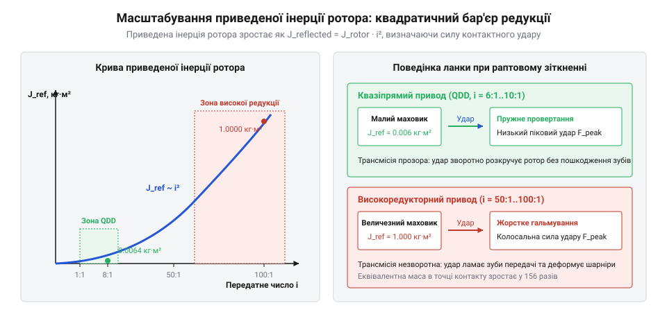
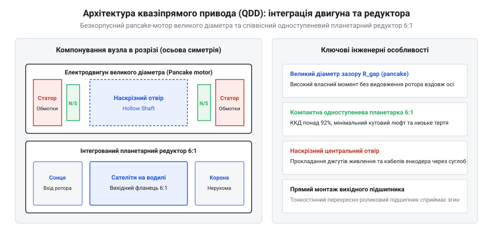
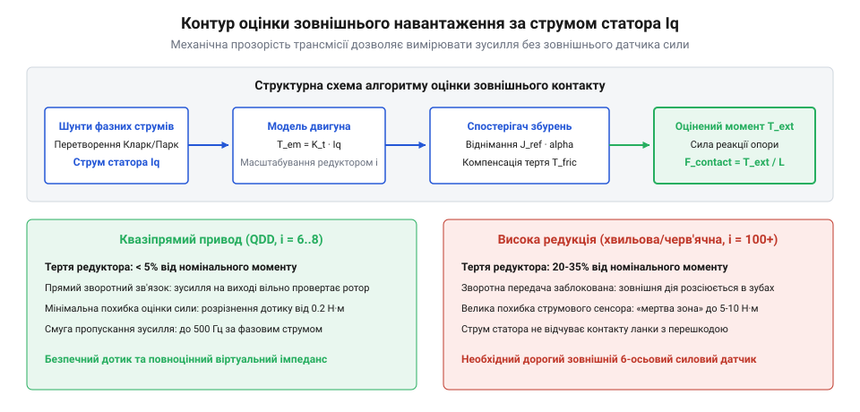
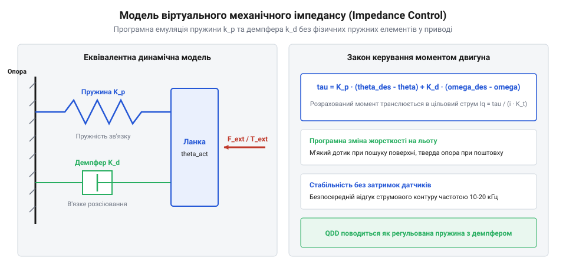

# Зворотна рушійність і квазіпрямий привід (QDD): прозорість трансмісії та відчуття навантаження

<preknowlist>
- [Планетарний редуктор](root:hw-motion/planetary-gearbox) — будова сонячної шестерні, сателітів і коронної шестерні
- [Мотор-редуктор](root:hw-motion/gearmotor) — базові зв'язки швидкості, моменту та передавального відношення
</preknowlist>

## Проблема високої редукції в динамічній робототехніці: чому робот ламає шестерні при ударі

Традиційна робототехніка десятиліттями розвивалася шляхом максимізації передавального числа редукторів. Невеликі високообертові електродвигуни поєднували з редукторами 100:1 або 200:1 на базі хвильових чи багатоступеневих планетарних передач. Для статичного позиціонування маніпуляторів це давало чудовий виграш у моменті за мінімальної маси мотора.

Однак коли робот починає бігати, стрибати або взаємодіяти з людьми, висока редукція перетворюється на руйнівний недолік. Головна фізична причина криється в явищі приведеного моменту інерції ротора двигуна (@@en|reflected inertia@@). Момент інерції обертового ротора J_rotor трансформується на вихідний вал редуктора пропорційно квадрату передавального числа i:

```
J_reflected = J_rotor · i²
```

Якщо передавальне число редуктора дорівнює 100:1, то квадрат i становить 10 000. Це означає, що крихітна інерція ротора вагою у двісті грамів відчувається з боку вихідного вала як обертання багатотонного маховика.


*Квадратична залежність приведеного моменту інерції ротора від передавального числа: при високих передавальних числах привід втрачає піддатливість і поводиться як твердий масивний молот.*

Ударна взаємодія кінцівки робота з твердою поверхнею триває лічені мілісекунди (дельта_t ≈ 1–5 мс). Швидкість поширення хвилі механічної деформації у сталі становить близько 5000 м/с. Механічний удар досягає зубів редуктора за кілька мікросекунд — задовго до того, як цифровий контролер зафіксує сигнал від енкодера, обробить алгоритм FOC і змінить напругу на обмотках інвертора.

Величезна приведена інерція ротора діє як монолітна нерухома стіна. Кінетична енергія удару не може провернути ротор у зворотному напрямку через інерційний опір та тертя зачеплення. Увесь імпульс концентрується на контактних поверхнях зубів передачі, викликаючи миттєві напруження, що перевищують межу текучості металу. Зуби шестерень викришуються або зазнають крихкого відламування.

> 🔧 **Навіщо це.**
> Для безпечної роботи роботів поруч із людиною та швидкісної локомоції по пересіченій місцевості привід повинен мати низьку власну інерцію, щоб при випадковому зіткненні миттєво провертатися назад під дією зовнішнього зусилля без руйнування механіки.

Розуміння цієї фундаментальної проблеми спонукало дослідників до перегляду парадигми приводів, про що розповідає [історію створення приводу MIT Cheetah](root:hw-motion/backdrivability-and-quasi-direct-drive/hist-qdd-mit-cheetah.md).

## Фізика оборотної рушійності (Backdrivability): передача крутного моменту від вихідного вала до ротора

Оборотна рушійність (@@en|backdrivability@@) — це здатність механічної трансмісії легко й безперешкодно передавати крутний момент у зворотному напрямку: від вихідної ланки назад до вала електродвигуна. Привід із високою оборотною рушійністю називають механічно прозорим.

Механічна прозорість означає, що будь-яка зовнішня сила, прикладена до кінцівки робота, без втрат транслюється на ротор двигуна. На заваді цій прозорості стоять два фактори:
1. Тертя зачеплення та ущільнень у редукторі.
2. Приведена інерція обертових деталей.

Крутний момент зворотного зрушення (@@en|backdrive torque@@) визначає мінімальне зусилля на вихідному валу, необхідне для подолання сил тертя спокою трансмісії:

```
T_backdrive = T_friction / (eta_reverse · i)
```

де eta_reverse — коефіцієнт корисної дії передачі при зворотному ході. У редукторах QDD зі співвідношенням i = 6..8 та прямозубими сателітами eta_reverse сягає 90–94%, завдяки чому зворотний момент рушання становить мізерні 0.1–0.3 Н·м. Людина може повертати лапу робота легким дотиком одного пальця.

Якщо прямий ККД редуктора низький або передача наближається до самогальмування (як-от багатозахідні черв'яки чи високоредукторні ступені), привід стає повністю необоротним: зовнішня сила не обертає ротор, а ламає зуби.

> 🔧 **Навіщо це.**
> Механічно прозорий привід дозволяє реалізувати функцію тактильного відчуття навантаження: електроніка оцінює прикладену до вала зовнішню силу за величиною струму в обмотках без використання дорогих і крихких зовнішніх датчиків сили.

Детальний математичний апарат розрахунку контактної жорсткості та смуги пропускання наведено у матеріалі [математична модель приведеної інерції](root:hw-motion/backdrivability-and-quasi-direct-drive/math-reflected-inertia-and-transparency.md). Звичайний [мотор-редуктор](root:hw-motion/gearmotor) із високим передавальним числом не має зворотної рушійності, тоді як спеціалізований [планетарний редуктор](root:hw-motion/planetary-gearbox) малого ступеня відкриває шлях до побудови квазіпрямого приводу.

## Концепція квазіпрямого приводу (QDD): баланс швидкості, моменту та низької інерції

Щоб обійти парадокс приведеної інерції, інженери створили концепцію квазіпрямого приводу (@@en|Quasi-Direct Drive, QDD@@). Це архітектура, яка поєднує безредукторний прямий привід (@@en|Direct Drive@@) та класичний високоредукторний мотор-редуктор, беручи найкраще від обох підходів.

У прямому приводі двигун кріпиться безпосередньо до шарніра без жодних шестерень (i = 1). Це забезпечує ідеальну механічну прозорість, але двигун виходить надто масивним і важким, оскільки електромотор повинен видавати колосальний крутний момент самостійно.

У приводі QDD використовують одноступеневий [планетарний редуктор](root:hw-motion/planetary-gearbox) із дуже малим передавальним числом: зазвичай від 5:1 до 10:1 (найчастіше 6:1 або 8:1). Завдяки малому i приведений момент інерції roтора зростає лише у 25-64 рази, а не в 10 000 разів:

```
J_reflected = J_rotor · 6² = 36 · J_rotor
```

Така низька величина дозволяє шарніру миттєво піддаватися зовнішньому удару без руйнування шестерень.


*Компоновка QDD-приводу: широкий плаский безколекторний двигун (pancake motor) великого діаметра з концентрованою обмоткою та інтегрований одноступеневий планетарний редуктор.*

Щоб компенсувати невисоке передавальне число і забезпечити робочий момент у 20-50 Н·м, необхідний для стрибків робота, звичайний двигун замінюють на безкорпусний багатополюсний безколекторний мотор типу «млинець» (@@en|pancake motor@@). Конструктивні особливості та магнітні системи таких моторів описані в статті [безкорпусні високомоментні двигуни](root:hw-motion/backdrivability-and-quasi-direct-drive/comp-frameless-torque-motor.md). Великий діаметр повітряного зазору r_gap створює значне плече для електромагнітної сили Лоренца, дозволяючи отримати високий питомий крутний момент навіть на низьких обертах.

> 🔧 **Навіщо це.**
> Привід QDD оптимізовано під високочастотну роботу в режимі частих змін напрямку руху, де прискорення кінцівки обмежене не напругою живлення, а здатністю мотора швидко розганяти власну інерцію.

Як спроєктувати такий привід для реального шарніра робота, демонструє [практична розробка модуля QDD](root:hw-motion/backdrivability-and-quasi-direct-drive/proj-qdd-actuator-module.md).

## Прозорість трансмісії як безконтактний датчик сили

Завдяки наднизькому тертю кочення та відсутності самогальмування редуктор QDD стає практично прозорим акустичним і механічним каналом зв'язку між ротором і зовнішнім світом.

У традиційній трансмісії зусилля на виході вимірюють за допомогою тензометричних силомоментних датчиків, встановлених на фланці. Проте тензодатчики крихкі, дорогі та додають масу на рухомий кінець маніпулятора. У системі QDD датчиком сили стає сам безколекторний електродвигун.

Векторне керування двигуном (FOC) контролює квадратурну складову струму статора I_q, яка строго пропорційна електромагнітному моменту ротора через константу моменту k_t:

```
tau_motor = k_t · I_q
```

Оскільки передавальне число i відоме, а втрати на тертя у якісній прямозубій планетарній передачі становлять менше 5-8%, діючий навантажувальний крутний момент на вихідному валу обчислюється аналітично:

```
tau_load ≈ i · k_t · I_q
```


*Контур вимірювання зусиль за фазовим струмом: висока механічна прозорість трансмісії транслює зовнішній крутний момент прямо на ротор, дозволяючи оцінювати сили без тензодавачів.*

Для забезпечення високої точності вимірювання крутного моменту в діапазоні температур від -20 до +80 °C контролер враховує температурний коефіцієнт залишкової індукції неодимових магнітів NdFeB (константа k_t падає приблизно на 0.11% на кожні 1 °C нагріву ротора):

```
k_t(T) = k_t_nominal · (1 - 0.0011 · (T_rotor - 25))
```

Також алгоритм виконує автокалібрування нульового зміщення струмових підсилювачів шунтів при кожному старті та компенсацію моменту магнітного залипання (@@en|cogging torque ripple@@) за попередньо складеною гармонійною картою кута ротора.

> 🔧 **Навіщо це.**
> Оцінка сили за струмом фаз працює з високою смугою частот (до кількох кілогерців), дозволяючи роботу відчувати дотик до землі, розрізняти м'який килим і твердий лід або безпечно зупинятися при контакті з тілом людини.

У високоредукторному приводі (i = 100) тертя зачеплення «маскує» зовнішній момент: потрібно прикласти силу в десятки ньютонів, перш ніж мотор взагалі відчує зміну навантаження. У QDD поріг чутливості становить частки ньютон-метра, що створює фундамент для тактильної взаємодії.

## Алгоритми взаємодії: імпедансне керування, віртуальна жорсткість і демпфування

Завдяки високій механічній прозорості та прямому вимірюванню крутного моменту через фазовий струм, квазіпрямий привід дозволяє реалізувати імпедансне керування (@@en|Impedance Control@@). Це метод, за якого привід регулює не положення саме по собі, а динамічний зв'язок між відхиленням координати та контактною силою взаємодії.

Замість жорсткого утримання траєкторії контролер емулює поведінку віртуальної механічної пружини жорсткістю k_virt та віртуального демпфера з коефіцієнтом b_virt:

```
tau_cmd = k_virt · (theta_target - theta_actual) + b_virt · (omega_target - omega_actual)
```


*Модель віртуального механічного імпедансу: віртуальна пружина k та демпфер b, сформовані програмним регулятором у взаємодії із зовнішньою силою.*

Якщо оператор штовхає ланку робота, вона піддається зусиллю й плавно зміщується на величину, пропорційну прикладеній силі. Як тільки зовнішнє зусилля зникає, віртуальна пружина плавно повертає важіль у вихідне положення без перерегулювання.

Змінюючи коефіцієнти програмно в режимі реального часу (із частотою 1 кГц), робот може миттєво змінювати свій стан:
- Під час польоту ноги в повітрі: k_virt висока, забезпечуючи точне позиціонування стопи.
- За 5 мілісекунд до торкання землі: k_virt різко знижують, перетворюючи ногу на м'який амортизатор, що запобігає відскоку від поверхні.

> 🔧 **Навіщо це.**
> Імпедансне керування дозволяє крокуючому роботу стабільно пересуватися по нерівному камінню чи сходах без використання дальномірів: нерівності ґрунту пасивно компенсуються регульованою віртуальною пружністю кожного суглоба.

Глибші теоретичні аспекти реалізації зворотного зв'язку за зусиллям викладено у статті [імпедансне та адмітансне керування приводами](root:hw-motion/impedance-and-admittance-control).

## Межі та компроміси QDD: теплове перевантаження та утримання статичного моменту

Попри визначні переваги у динаміці та піддатливості, архітектура QDD має суворе фізичне обмеження — теплове перевантаження від джоулевих втрат в обмотках (@@en|Joule heating@@).

У класичному високоредукторному сервоприводі (i = 100) мотор працює на великих обертах і видає мізерний крутний момент:

```
tau_motor = tau_load / (100 · eta)
```

Струм статора залишається малим, тому втрати на нагрів P_heat = 3/2 · R_phase · I² є мінімальними. Редуктор бере все зусилля на себе завдяки механічному плечу шестерень.

У приводі QDD (i = 6) двигун змушений видавати у 15-20 разів більший електромагнітний момент самостійно. Оскільки крутний момент пропорційний струму I, а потужність теплових втрат пропорційна квадрату струму I²:

```
P_heat ∝ tau_motor² ∝ (tau_load / i)²
```

Зменшення передавального числа редуктора в 10 разів призводить до зростання тепловиділення в мідних обмотках мотора у 100 разів для утримання однакового навантажувального моменту на вихідному валу.

> 🔧 **Навіщо це.**
> QDD є ідеальним для високодинамічних ударних рухів (біг, стрибки, маніпуляції легкими предметами), проте він енергетично неефективний для тривалого статичного утримання важких вантажів або тривалого стояння на місці під вагою корпусу.

Якщо чотириногий робот просто нерухомо стоїть, мотори QDD продовжують споживати високий струм і швидко нагріваються до критичних 90–120 °C. Це вимагає застосування алюмінієвих корпусів із розвиненим ребристим радіатором, примусового обдуву кулерами або зниження номінального навантаження (@@en|derating@@).

## Інженерний вибір та порівняльне зіставлення приводних архітектур

Вибір концепції приводу для сучасного робототехнічного комплексу вимагає ретельного зважування компромісів між масою, піковою силою, механічною прозорістю та енергоефективністю.

### Зіставлення чотирьох парадигм приводу

1. **Прямий привід (Direct Drive):**
   - Передавальне число: i = 1.
   - Переваги: нульовий люфт, ідеальна зворотна рушійність, максимальна смуга частот.
   - Обмеження: низька питома густина крутного моменту; двигуни занадто важкі для багатоланкових маніпуляторів.
   - Сфера: швидкісні SCARA-роботи для мікроелектроніки, поворотні дзеркала лідарів.

2. **Квазіпрямий привід (QDD):**
   - Передавальне число: i від 5:1 до 10:1.
   - Переваги: висока оборотна рушійність, чудове відчуття зовнішньої сили за фазовим струмом, надзвичайна стійкість до ударів об ґрунт.
   - Обмеження: високе теплове виділення при утриманні статичних навантажень.
   - Сфера: динамічні чотириногі роботи-собаки, біпедальні платформи, активні екзоскелети, тактильні інтерфейси.

3. **Високоредукторні приводи (хвильові та циклоїдні):**
   - Передавальне число: i від 50:1 до 160:1.
   - Переваги: величезний статичний крутний момент за мінімальних габаритів, нульовий люфт, низьке енергоспоживання при утриманні позиції.
   - Обмеження: повна відсутність зворотної рушійності, крихкість при ударах.
   - Сфера: промислові зварювальні роботи, медичні хірургічні маніпулятори, де потрібна жорстка кінематична фіксація. Як альтернативу для важких позиціонерів застосовують [циклоїдний редуктор](root:hw-motion/cycloidal-drive), а для компактних суглобів — [хвильова передача](root:hw-motion/harmonic-drive).

4. **Серійні пружні актуатори (SEA):**
   - Передавальне число: довільне (зазвичай високе) + фізична пружина на виході.
   - Переваги: фізичне накопичення кінетичної енергії, механічний захист редуктора від перевантажень, безпека людини.
   - Обмеження: обмежена смуга пропускання контуру сили, схильність до резонансних коливань.
   - Сфера: важкі крокуючі людиноподібні роботи та реабілітаційні апарати.

```
Параметр            | Direct Drive | QDD        | Harmonic/Cyclo | SEA
--------------------+--------------+------------+----------------+------------
Редукція i          | 1:1          | 5:1..10:1  | 50:1..160:1    | 50:1 + пружина
Зворотна рушійність | Ідеальна     | Відмінна   | Відсутня       | Опосередкована
Ударна стійкість    | Абсолютна    | Висока     | Низька         | Максимальна
Смуга зусилля       | > 100 Гц     | 40..80 Гц  | < 5 Гц         | 10..25 Гц
Статичний нагрів    | Катастрофіч. | Високий    | Мінімальний    | Мінімальний
```

> 🔧 **Навіщо це.**
> Матриця характеристик дозволяє інженеру обрати оптимальну архітектуру на етапі ескізного проєктування, уникнувши типової помилки встановлення жорсткого хвильового редуктора на стрибаючі ноги робота.
