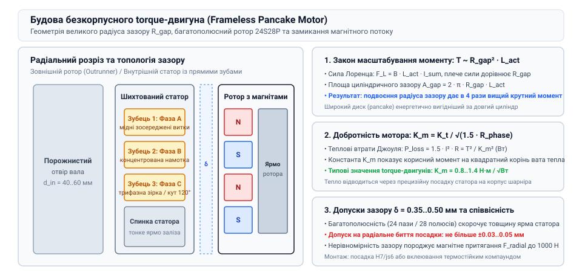
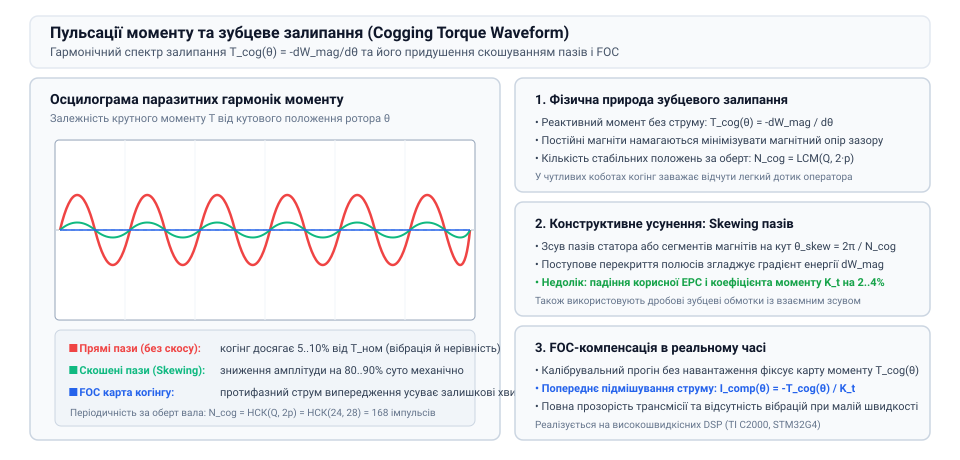

# Зворотна рушійність і квазіпрямий привід (QDD): прозорість трансмісії та відчуття навантаження

## Електромагнітна архітектура безкорпусних torque-моторів: великий діаметр ротора, вузький повітряний зазор та багатополюсність

Для квазіпрямого привода (QDD) ключовою вимогою є генерація максимального обертального моменту безпосередньо ротором електродвигуна, оскільки коефіцієнт редукції передачі штучно обмежується малими значеннями (i = 6:1..9:1). Звичайні циліндричні промислові серводвигуни мають видовжений ротор малого діаметра, розрахований на високі швидкості (3000–6000 об/хв), але створюють незначний власний момент (0.2–0.5 Н·м). На противагу їм безкорпусні двигуни (@@en|frameless torque motors@@, або pancake motors) оптимізовані за геометрією виключно для силового кручення.

Крутний момент T безколекторного двигуна з постійними магнітами прямо пропорційний радіусу повітряного зазору R_gap та силі Лоренца F_L:

T = F_L · R_gap = (B · L_act · I) · R_gap

де B — середня магнітна індукція в зазорі (типово 0.8–1.1 Тл для магнітів NdFeB марки N42–N52), L_act — активна осьова довжина пакета заліза статора, I — сумарний фазовий струм. Оскільки площа циліндричного зазору становить 2 · pi · R_gap · L_act, магнітна сила F_L пропорційна R_gap при незмінній густині струму. Отже, вихідний момент масштабується пропорційно квадрату радіуса повітряного зазору:

T ~ R_gap² · L_act

Збільшуючи діаметр статора з 40 мм до 90–110 мм при короткій осьовій довжині (15–25 мм), інженер одержує 5–8-кратне зростання пікового крутного моменту без збільшення загальної маси двигуна.

Для забезпечення високої частоти комутації та рівномірного магнітного зчеплення кількість пар полюсів p у torque-двигунах доводять до 14, 21 або навіть 28 (конфігурації 24S28P або 36S42P). Багатополюсна структура дозволяє суттєво скоротити товщину спинки статора (ярма), зменшуючи паразитна вагу металу. Повітряний зазор між магнітами ротора та зубами статора підтримується на мінімально технологічному рівні — від 0.3 до 0.6 мм, що мінімізує магнітний опір та підвищує енергетичний ККД.

*Конструктивна будова безкорпусного torque-двигуна: зовнішній ротор на неодимових магнітах, зубцевий статор та тонкий повітряний зазор.*

> 🔧 **Навіщо це.**
> Розуміння геометрії T ~ R_gap² дозволяє підібрати плоский pancake-двигун замість довгого витягнутого циліндра, що критично для вбудовування в тонкі ноги чотириногих крокуючих роботів.

## Питомий момент і теплові обмеження: константа двигуна Km, активний опір та тепловідведення в шарнірі

Головним фундаментальним обмеженням крутного моменту будь-якого електродвигуна є тепловиділення за законом Джоуля-Ленца в мідних обмотках статора. Теплові втрати P_loss (Вт) визначаються діючим значенням струму та мікроопором фаз R_phase:

P_loss = 1.5 · I_rms² · R_phase

Оскільки крутний момент пов'язаний зі струмом через коефіцієнт моменту K_t (Н·м / А) як T = K_t · I_rms, теплове розсіювання можна виразити безпосередньо через крутний момент:

P_loss = 1.5 · (T / K_t)² · R_phase = T² / K_m²

де K_m — фундаментальна константа двигуна (@@en|motor size constant@@, вимірюється в Н·м / sqrt(Вт)):

K_m = K_t / sqrt(1.5 · R_phase)

Константа K_m є об'єктивним мірилом якості електромагнітної конструкції, оскільки вона не залежить від схеми намотування (кількості витків і товщини дроту). Чим вища константа K_m, тим менше ват тепла виділяє двигун на один ньютон-метр корисного моменту. У найкращих сучасних безкорпусних двигунах (наприклад, T-Motor U8, TBM-76) значення K_m сягає 0.8–1.4 Н·м / sqrt(Вт).

При тривалій роботі тепло мусить відводитися від статора до навколишнього середовища. Оскільки безкорпусний двигун постачається без власного радіатора та вентилятора, роль охолоджувача повністю бере на себе алюмінієвий або магнієвий корпус робототехнічного суглоба:

T_winding - T_ambient = P_loss · (R_th,ws + R_th,sh + R_th,ha)

де R_th,ws — тепловий опір між обмоткою і залізом статора (0.5–1.2 °C/Вт), R_th,sh — тепловий опір контакту «статор-корпус» (вимагає прецизійної посадки з теплопровідною пастою), R_th,ha — опір корпусу до повітря. Перевищення граничної температури ізоляції класу H (180 °C) призводить до міжвиткового короткого замикання та незворотного розмагнічування неодимових магнітів.

> 🔧 **Навіщо це.**
> Порівняння двигунів за константою K_m рятує розробника від маркетингових пасток: двигун із високим K_t може мати величезний опір R_phase і перегріватися за лічені секунди.

## Паразитні моменти та якість руху: природа зубцевого залипання (cogging torque), пульсації моменту та методи їхньої компенсації

Незважаючи на високу питому силу, безкорпусні torque-мотори мають вроджену фізичну ваду, безпосередньо спричинену їхньою багатополюсною відкритою геометрією — паразитний момент зубцевого залипання (@@en|cogging torque@@). Когінг виникає через періодичну зміну магнітної провідності зазору під час проходження постійних магнітів ротора повз сталеві зубці статора за повної відсутності струму в обмотках.

Магнітне поле ротора завжди намагається мінімізувати повну потенційну енергію системи W_mag, притягуючи крайки магнітів до найближчих сталевих зубів статора. Кутовий градієнт цієї магнітної енергії створює паразитний реактивний момент:

T_cog(theta) = -dW_mag / dtheta = sum_{n=1}^{infinity} T_n · sin(n · N_cog · theta)

де N_cog — кількість стабільних положень рівноваги на один повний оберт вала, яка дорівнює найменшому спільному кратному (НСК) кількості пазів статора Q та кількості магнітних полюсів 2·p:

N_cog = LCM(Q, 2 · p)

Для двигуна з Q = 24 пазами та 2·p = 28 полюсами період когінгу повторюється LCM(24, 28) = 168 разів за оберт. Амплітуда когінг-моменту T_cog може досягати 5–10% від номінального моменту двигуна, створюючи виражену тактильну «хвилястість» і вібрації на низьких швидкостях обертання.

Для усунення когінгу в прецизійних сервоприводах застосовують три основні конструктивні та алгоритмічні заходи:
1. **Скошування пазів статора або магнітів ротора (skewing):** зсув пазів на кут одного зубцевого кроку theta_skew = 2 · pi / N_cog згладжує фронт перекриття магнітного потоку, знижуючи когінг на 80–90%;
2. **Дробові обмотки із зосередженими котушками:** вибір комбінацій Q та p із високим значенням LCM(Q, 2·p) розмиває енергетичні бар'єри на сотні мікроімпульсів мізерної амплітуди;
3. **Алгоритмічна компенсація за картою когінгу:** контролер FOC запам'ятовує гармоніки моменту за показами високоточного енкодера та додає в струм статора Iq протифазну гармоніку випередження I_comp(theta) = -T_cog(theta) / K_t.

*Графік паразитних пульсацій крутного моменту: гармоніки когінгу залежно від положення ротора та зниження амплітуди скосом пазів.*

> 🔧 **Навіщо це.**
> Зниження когінг-моменту є обов'язковою умовою для коботів: якщо когінг перевищує поріг чутливості, робот не здатний відчути делікатний дотик руки оператора.

## Механічна інтеграція та прецизійний монтаж: радіальні посадки, вимоги до співвісності, теплові розширення та монтаж ротора на порожнистий вал

Безкорпусний двигун постачається заводом-виробником у вигляді двох окремих кілець: ротора з вклеєними магнітами та шихтованого статора з котушками. На відміну від готового мотор-редуктора, безкорпусний двигун не має власних підшипників, вихідного вала чи корпусу. Усі функції підтримки радіального зазору та сприйняття механічних навантажень перекладаються на конструкцію шарніра замовника.

Для забезпечення паспортних характеристик інженер мусить витримати жорсткі геометричні допуски під час конструювання посадкових поверхонь:
- **Радіальне биття та концентричність:** оскільки повітряний зазор між ротором і статором становить лише delta_gap = 0.35..0.5 мм, сумарне радіальне биття посадкових поверхонь статора й ротора не повинно перевищувати ±0.03..0.05 мм (не більше 10% від товщини зазору). Будь-який перекіс спричиняє колосальну несиметричну силу магнітного притягання F_mag, radial, яка може досягати 500–1500 Н і перевантажувати підшипники шарніра.
- **Посадки та кріплення:** пакет статора зазвичай монтують у розточку алюмінієвого корпусу за перехідною посадкою H7/js6 або за допомогою теплового пресування (нагрів корпусу до 80–100 °C) із фіксацією анаеробним термостійким клеєм Loctite 648. Ротор встановлюють на тонкостінний порожнистий сталевий або титановий вал за посадкою h6/H7 з осьовою фіксацією затискною гайкою або прецизійними торцевими гвинтами.
- **Компенсація різниці коефіцієнтів теплового розширення (КТР):** корпус робота зазвичай виготовляють із легкого алюмінієвого сплаву (КТР alpha_Al ≈ 23 · 10⁻⁶ 1/°C), тоді як шихтований статор виготовлено з електротехнічної кремнієвої сталі (КТР alpha_steel ≈ 11 · 10⁻⁶ 1/°C). При нагріванні шарніра до робочих 90 °C алюмінієвий отвір розширюється швидше за статор, що може призвести до ослаблення натягу посадки та провертання статора в корпусі, якщо не передбачено шпонкових пазів або радіальних штифтів.

> 🔧 **Навіщо це.**
> Помилка в посадці статора на 0.05 мм зміщує зазор, викликаючи одностороннє магнітне притягання, яке вигинає тонкий вал і призводить до заклинювання ротора об зубці статора під час пікового навантаження.

## Порівняльний аналіз провідних серій безкорпусних двигунів: Kollmorgen TBM, T-Motor, Maxon EC-frameless та критерії підбору для роботів

Сучасний ринок безкорпусних двигунів пропонує інженеру кілька сформованих технологічних лінійок, оптимізованих під різні баланси між піковою питомою силою, надійністю та вартістю. При виборі двигуна для шарніра робота ключовими параметрами порівняння є: зовнішній діаметр D_outer, діаметр внутрішнього порожнистого отвору d_inner, піковий крутний момент T_peak, константа двигуна K_m та тепловий опір R_th.

Нижче наведено зіставлення типових промислових представників безкорпусних torque-двигунів калібру 70–90 мм:

| Серія / Модель | Конфігурація статора/ротора | Габарити (D_out × L_ax), мм | Внутрішній отвір d_in, мм | Маса, кг | Піковий момент T_peak, Н·м | Константа K_m, Н·м / sqrt(Вт) |
|---|---|---|---|---|---|---|
| Kollmorgen TBM2G-076 | 24S28P (внутрішній ротор) | 76.2 × 26.0 | 25.4 | 0.44 | 6.80 | 0.82 |
| T-Motor AK80-9 (RI80) | 24S28P (зовнішній ротор, аутранер) | 95.0 × 24.5 | 32.0 | 0.48 | 9.50 | 0.94 |
| Maxon EC frameless DT50 | 12S14P (внутрішній ротор) | 50.0 × 22.0 | 14.0 | 0.21 | 2.10 | 0.42 |
| Applimotion ULT-85 | 36S42P (паперово-тонкий статор) | 85.0 × 18.0 | 48.0 | 0.38 | 7.20 | 0.88 |

Аналіз конструктивних рішень демонструє чітку інженерну дихотомію:
1. **Зовнішній ротор (Outrunner, як у T-Motor):** за рахунок розміщення магнітів на максимальному радіусі забезпечує найвищий піковий момент на одиницю маси (понад 18–20 Н·м/кг). Проте статор розташований всередині, що ускладнює відведення тепла крізь зовнішні стінки корпусу робота.
2. **Внутрішній ротор (Inrunner, як у Kollmorgen TBM):** котушки статора безпосередньо прилягають до зовнішнього алюмінієвого корпусу шарніра, що забезпечує мінімальний тепловий опір (до 0.35 °C/Вт) та вдвічі вищий тривалий номінальний момент в умовах закритого корпусу без вентиляції.

Для мобільних чотириногих роботів та екзоскелетів переважають аутранери завдяки неперевершеній піковій динаміці під час стрибків. Для промислових коботів та хірургічних маніпуляторів стандартом є інранери Kollmorgen завдяки великому наскрізному отвору для кабелів і неперевершеному тривалому тепловідведенню.

> 🔧 **Навіщо це.**
> Правильний підбір між інранером і аутранером рятує проєкт від провалу: аутранер перегріється на конвеєрі під постійним навантаженням, а важкий інранер не дозволить роботу-псу виконати сальто.
