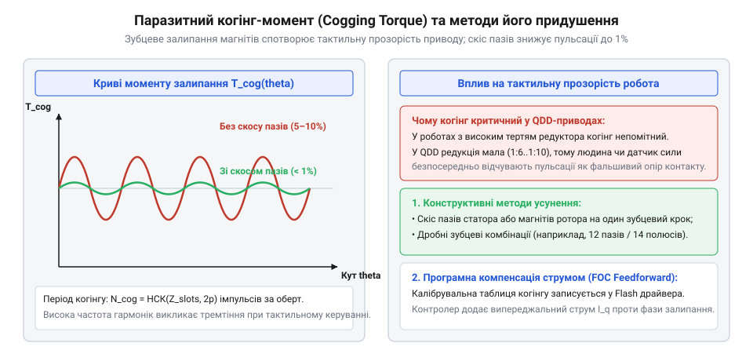
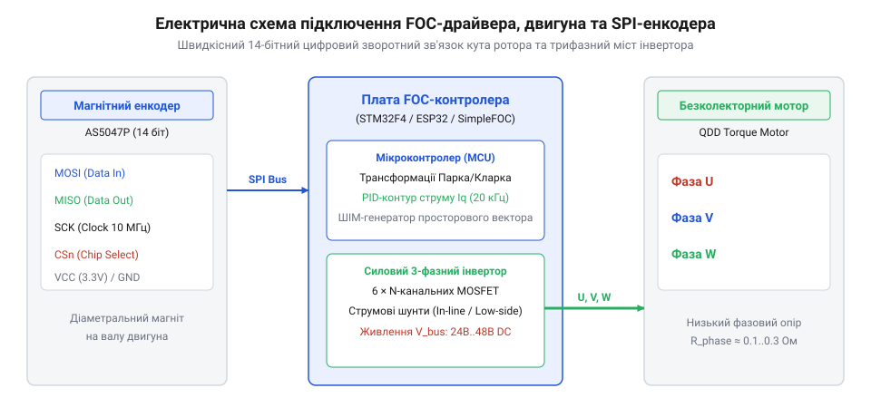

# Зворотна рушійність і квазіпрямий привід (QDD): прозорість трансмісії та відчуття навантаження

## Криза традиційної робототехніки початку 2010-х: зрізання зубів редукторів та інерційний бар'єр передач із великим передавальним числом

Класична парадигма електромеханічних приводів у робототехніці спиралася на високошвидкісні безколекторні двигуни малого діаметра, агреговані з редукторами великого передавального числа `N > 50` або навіть `N = 100..200`. Таке інженерне рішення видавалося безальтернативним: щоб розвинути крутний момент, достатній для втримання кінцівки чи підйому ланки робота, компактний високообертовий ротор потребував значної механічної редукції. Найпоширенішим вибором у конструкціях гуманоїдів та маніпуляторів стали прецизійна [хвильова передача](root:hw-motion/harmonic-drive) та багатоступеневий [планетарний редуктор](root:hw-motion/planetary-gearbox). Проте спроби вивести таких роботів за межі повільної квазістатичної ходьби у простір динамічного бігу та стрибків призвели до фундаментальної системної кризи.

Головною непереборною перешкодою став закон приведення моменту інерції до вихідного вала трансмісії. Відбита інерція ротора (@@en|reflected inertia@@, лат. *inertia* — бездіяльність) зростає непропорційно швидко — пропорційно квадрату передавального числа редуктора:

```
J_ref
= J_rotor · N²           [закон приведення моменту інерції до вихідного вала]
= J_rotor · 100²         [для передавального числа трансмісії N = 100]
= 10000 · J_rotor        [квадратичний бар'єр приведення моменту інерції]
```


*Зростання передавального числа пропорційно збільшує вихідний крутний момент, але квадратично нарощує відбиту інерцію ротора, багаторазово підсилюючи руйнівні ударні навантаження на зубці під час контакту з ґрунтом.*

Коли лапа робота торкається поверхні під час швидкого бігу, тривалість ударного контакту становить усього 5–15 мілісекунд. За такий мізерний проміжок часу високошвидкісний ротор двигуна фізично не встигає загальмувати чи розкрутитися у зворотному напрямку через інерційний бар'єр `10000 · J_rotor`. Трансмісія поводиться не як пружний передавач, а як абсолютно жорстка кам'яна стіна. Оскільки передача втрачає механічну прозорість і не здатна провернутися назад під дією зовнішнього зусилля (явище нульової зворотної рушійності, @@en|non-backdrivability@@), уся кінетична енергія зіткнення розсіюється безпосередньо в точках зачеплення зубчастих коліс або гнучкого вінця хвильової передачі. Зубці просто зрізало згинальним напруженням під час перших же високошвидкісних стрибків.

Спроби захистити редуктори шляхом встановлення пружних торсіонів у послідовних пружних приводах (SEA) або монтажу зовнішніх багатоосьових тензодатчиків сили на стопах не розв'язали проблеми динаміки. Пружні елементи неминуче знижували смугу пропускання контуру за моментом до 10–20 Гц, роблячи реакцію кінцівки «млявою» і нездатною миттєво відпрацьовувати мікронерівності ґрунту. Робототехніка вперлася в глухий кут: висока редукція давала високу питому силу за нерухомого утримання, але цілковито знищувала ударну стійкість та динамічну піддатливість.

> 🔧 **Навіщо це.** Розуміння квадратичного впливу передавального числа на відбиту інерцію захищає інженера від фатальної помилки: намагаючись отримати максимальний момент через глибоку редукцію в динамічному шарнірі, розробник гарантовано руйнує зубчасті передачі під час першого ж непередбачуваного удару об перешкоду.

## Лабораторія біоміметичної робототехніки MIT: Санбе Кім, концепція динамічного бігу та розробка MIT Cheetah 1 і 2

Вихід із технологічного глухого кута на початку 2010-х років запропонувала Лабораторія біоміметичної робототехніки Массачусетського технологічного інституту (MIT Biomimetic Robotics Lab) під керівництвом професора Санбе Кіма (@@en|Sangbae Kim@@). Аналізуючи біомеханіку найшвидших наземних ссавців — гепардів та гірських козлів, дослідники усвідомили, що живі кінцівки працюють за принципом надзвичайної механічної прозорості: м'язи не мають редукторів із високим передавальним числом і самі слугують одночасно і джерелом сили, і демпфером, і датчиком взаємодії через пропріорецепцію.

Команда MIT розробила нову парадигму квазіпрямого привода (@@en|Quasi-Direct Drive@@, QDD). Замість традиційного малопотужного мотора з крихким багатоступеневим редуктором було запропоновано поєднати спеціалізований безколекторний двигун зовнішнього обертання (аутраннер) великого діаметра з ультранизькою редукцією `N = 6:1` на базі одноступеневої [планетарної передачі](root:hw-motion/planetary-gearbox).


*Конструктивний розріз привода MIT Cheetah: коаксіальна інтеграція тонкостінного статора великого діаметра з одноступеневим планетарним редуктором 6:1 мінімізує інерцію та забезпечує абсолютну зворотну рушійність.*

У приводі роботів MIT Cheetah 1 і MIT Cheetah 2 відбита інерція ротора становила лише:

```
J_ref_qdd
= J_rotor · 6²           [закон приведення інерції для одноступеневого редуктора 6:1]
= 36 · J_rotor           [зниження відбитої інерції майже на три порядки порівняно з N=100]
```

Зниження відбитої інерції з `10000` до `36` одиниць докорінно змінило фізику взаємодії з поверхнею. Під час удару лапи об тверду перешкоду вихідний вал вільно провертався, передаючи зусилля на ротор двигуна без критичного перевантаження зубців шестерень. Електродвигун починав діяти як регульований електромагнітний демпфер: кінетична енергія удару перетворювалася на електричний струм і гасилася силою Лоренца або поверталася в акумуляторну батарею через рекуперацію.

Робот MIT Cheetah 1 продемонстрував стійкий біг на біговій доріжці зі швидкістю понад 22 км/год, а MIT Cheetah 2 у 2014 році здійснив перший у світі повністю автономний стрибок чотириногого робота через бар'єри заввишки до 40 см на повному галопі без жодного троса чи зовнішнього страхування. Усі ударні навантаження сприймалися виключно квазіпрямими приводами шарнірів, довівши повну надійність шестерень із прямим контактом без застосування ненадійних датчиків сили.

## Народження парадигми QDD: аутраннери великого діаметра, низькоредукторна планетарна передача та прозорість за зворотним зв'язком

Успіх експериментів з MIT Cheetah остаточно закріпив термін «квазіпрямий привід» (@@en|Quasi-Direct Drive@@, QDD, лат. *quasi* — майже) в академічній та промисловій робототехніці. Фундаментальна суть концепції полягає у зміні пріоритетів проектування силового ланцюга: замість компенсації слабкого мотора глибокою механічною редукцією інженери максимізують питомий електромагнітний крутний момент самого двигуна, залишаючи редуктору лише роль компактного силового помножувача з мінімальним передавальним числом (`N = 6:1..9:1`).

Фізичним підґрунтям такого підходу є геометрія безколекторного двигуна з зовнішнім ротором (аутраннера). Електромагнітний момент машини пропорційний площі зазору статора та радіусу прикладання магнітної сили Лоренца у квадраті: `T ∝ r² · L`, де `r` — радіус повітряного проміжку між зубами статора та постійними магнітами ротора, а `L` — осьова довжина пакета заліза. Сплюснуті двигуни у формі диска («млинця», @@en|pancake motor@@) забезпечують удесятеро вищий власний момент на одиницю маси, ніж довгі циліндричні мотори класичних промислових роботів:

```
T_qdd
= T_motor · N            [вихідний момент квазіпрямого привода]
= (K_t · I_q) · 6        [для одноступеневого планетарного редуктора з коефіцієнтом редукції 6:1]
```

Оскільки одноступеневий [планетарний редуктор](root:hw-motion/planetary-gearbox) має надзвичайно високий прямий і зворотний коефіцієнт корисної дії (`η ≈ 0.90..0.95`), опір зворотному провертанню (@@en|backdrive torque@@) залишається мізерним. Чутливість вихідного вала до зовнішніх дотиків виражається через баланс сил:

```
T_backdrive
= (T_friction + J_rotor · α) / η      [момент, необхідний для зворотного провертання трансмісії]
= (0.2 + J_rotor · 6 · α) / 0.92      [типові значення для прецизійного шарнірного модуля QDD]
```

Такий привід стає механічно прозорим: будь-яке зовнішнє зусилля миттєво доходить до ротора без заклинювання, перетворюючи механічну систему на ідеальний пружний демпфер.

> 🔧 **Навіщо це.** Механічна прозорість трансмісії QDD гарантує, що при падінні чи зіткненні робота з твердою перешкодою редуктор не заклинить, а двигун миттєво провернеться, поглинаючи енергію удару в обмотках без механічних руйнувань зубців.

## Відмова від апаратних датчиків сили: оцінка зовнішніх взаємодій за фазовим струмом двигуна та алгоритми керування імпедансом

Найважливішим наслідком високої механічної прозорості QDD стала повна відмова від коштовних, важких і крихких зовнішніх датчиків сили й крутного моменту (тензометричних балок і шестиосьових динамометрів). У класичних приводах із редукцією `N > 100` високе внутрішнє тертя шестерень створювало зону мертвого ходу й гістерезису, через що за струмом двигуна було неможливо визначити, чи тисне робот на стіну, чи просто долає власне заклинювання. На противагу цьому, у приводі QDD тертя настільки мале, що квадратурний струм статора `I_q` лінійно й однозначно відповідає фактичному моменту на вихідному валу шарніра:

```
T_out
= K_t · I_q · N          [безсенсорна оцінка вихідного моменту за струмом статора]
= 0.08 · I_q · 6.0       [для двигуна з K_t = 0.08 Н·м/А та планетарного ступеня 6:1]
= 0.48 · I_q             [прямий лінійний зв'язок струму з вихідним моментом у Н·м]
```

Це відкрило шлях до [пропріоцептивного привода](root:hw-motion/proprioceptive-actuation) (@@en|proprioceptive actuation@@, лат. *proprius* — власний + *capere* — сприймати) та відчуття навантаження. Робот відчуває дотик ґрунту або удар перешкоди безпосередньо через стрибок фазного струму за мікросекунди.

На цій основі базується віртуальне [керування імпедансом](root:hw-motion/impedance-control-robotics) (@@en|impedance control@@, лат. *impedire* — перешкоджати): замість жорсткого відпрацювання позиції мікроконтролер програмно моделює поведінку шарніра як віртуальної механічної пружини та демпфера з налаштовуваною жорсткістю `K_p` і демпфуванням `K_d`:

```
T_cmd
= K_p · (θ_target - θ_actual) - K_d · ω_actual    [закон віртуального механічного імпедансу]
```

Змінюючи коефіцієнти в коді на льоту, один і той самий привід може бути абсолютно м'яким і піддатливим під час дотику людини або перетворюватися на надтверду пружину під час відштовхування від поверхні. Ця архітектурна революція MIT Cheetah у подальшому лягла в основу створення відкритих проєктів MIT Mini Cheetah, комерційних роботів Boston Dynamics Spot, а також масових чотириногих серій Unitree Robotics.

## Тріумф відкритої архітектури MIT Cheetah 3 та Mini Cheetah: перехід від лабораторних експериментів до світового промислового стандарту квадропедів

Еволюція концепції квазіпрямого привода сягнула апогею у 2017–2019 роках із появою роботів MIT Cheetah 3 та MIT Mini Cheetah під керівництвом Санбе Кіма та провідного розробника мехатроніки Бенджаміна Каца (@@en|Benjamin Katz@@). Якщо Cheetah 3 важив 40 кг і продемонстрував феноменальну здатність підніматися захаращеними сходами наосліп («сліпа локомоція», @@en|blind locomotion@@) виключно завдяки пропріоцептивному тактильному відгуку приводів, то створений у 2018 році компактний Mini Cheetah став поворотною точкою в усій світовій індустрії крокуючих машин.

Mini Cheetah масою всього 9 кг було побудовано на базі 12 абсолютно однакових, взаємозамінних модульних приводів QDD. Кожен привід інтегрував безколекторний аутраннер із кастомним одноступеневим [планетарним редуктором](root:hw-motion/planetary-gearbox) 6:1, силовим драйвером та оптичним енкодером у єдиний легкознімний блок:

```
m_actuator
= m_motor + m_gearbox + m_controller    [масовий баланс інтегрованого шарніра Mini Cheetah]
= 420 + 210 + 60                        [маса статора з ротором, планетарного редуктора та плати FOC, г]
= 690                                   [загальна маса модульного привода QDD у грамах]
```

Робот продемонстрував неперевершену динамічну стійкість: Mini Cheetah став першим у світі чотириногим роботом, здатним стабільно виконувати сальто назад на 360 градусів з приземленням на чотири лапи, розганятися до 8.8 км/год та витримувати прямі удари ногою під час бігу без поломки механіки.

Вирішальним стратегічним кроком лабораторії MIT стало рішення повністю відкрити архітектуру Mini Cheetah для світової наукової спільноти. Дослідники виклали у відкритий доступ повні креслення CAD, схемотехніку плат керування, параметри обмоток двигунів та [алгоритми конвексного керування з прогнозуванням моделі](root:hw-motion/convex-mpc-locomotion) (convex MPC). Це спричинило вибуховий ефект: замість багатомільйонних бюджетів лабораторії отримали готовий рецепт побудови наддинамічного робота за кілька тисяч доларів.

Відкритий стандарт MIT визначив сучасний вигляд комерційних чотириногих та двоногих платформ. Компанія Boston Dynamics перевела шарніри електричного Spot на принципи зворотно рушійних приводів із низькою редукцією. Заснована Сінсіном Ваном компанія Unitree Robotics запустила промислове серійне виробництво шарнірних модулів QDD, випустивши масові платформи A1, Go1, Go2 та гуманоїдів H1 і G1. Те, що починалося як сміливий академічний експеримент із подолання ламкості редукторів, стало універсальним світовим стандартом силового привода сучасної наземної робототехніки.

> 🔧 **Навіщо це.** Модульна архітектура привода QDD дозволяє скласти цілого 12-ступеневого крокуючого робота з однакових шарнірів, радикально скорочуючи витрати на проєктування, виробництво деталей та сервісну заміну пошкоджених вузлів.
