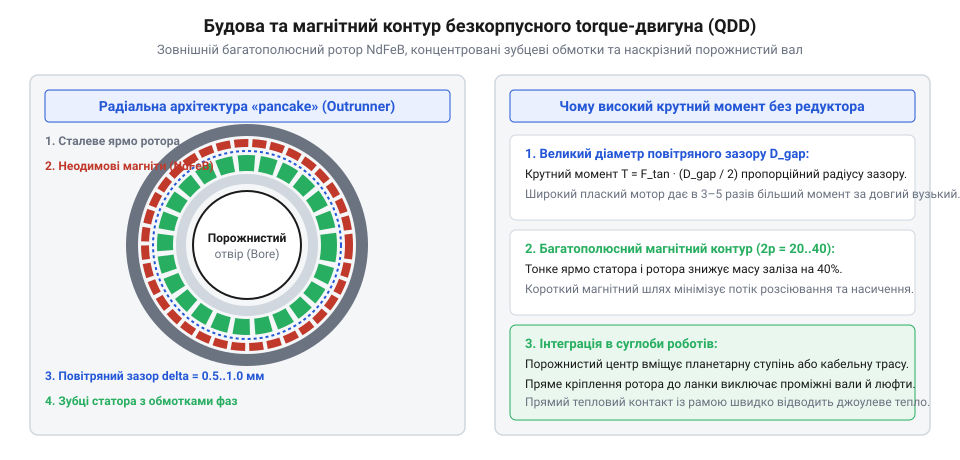
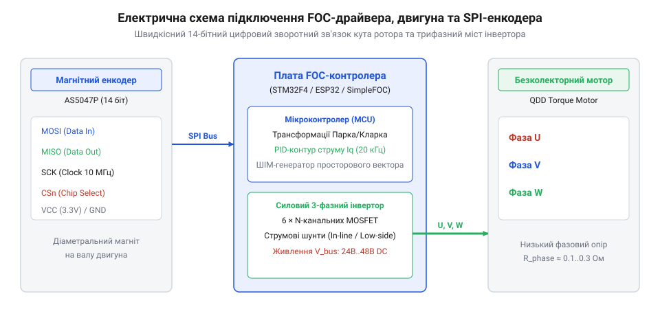
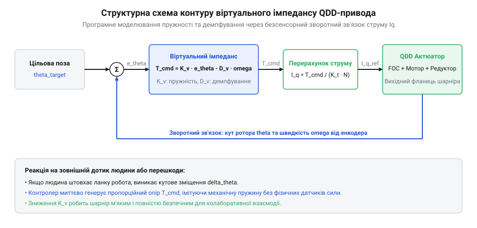

# Зворотна рушійність і квазіпрямий привід (QDD): прозорість трансмісії та відчуття навантаження

## Механічна компоновка та силова передача модуля QDD: вибір безколекторного мотора, сонячної шестерні та вихідного сателітного водила 6:1

Побудова компактного квазіпрямого привода (QDD) починається з узгодження електромагнітної геометрії безколекторного електродвигуна з кінематичною схемою одноступеневого планетарного редуктора. На відміну від стандартних мотор-редукторів загального призначення, серцем QDD-модуля є низькопрофільний безколекторний двигун типу аутраннер (@@en|outrunner@@ — мотор із зовнішнім ротором) з широким діаметром статора (наприклад, типорозмірів 8108 або 6010). Великий радіус повітряного проміжку забезпечує високий електромагнітний важіль, що дає змогу отримати значний базовий крутний момент за низької швидкості обертання та відносно малого значення коефіцієнта швидкості `K_v ≈ 90..120` об/хв/В.

Для збереження високої зворотної рушійності та мінімізації механічного тертя редуктор QDD виконується одноступеневим за схемою [планетарного редуктора](root:hw-motion/planetary-gearbox) з нерухомим зубчастим вінцем (епіциклом):

```
N
= 1 + (Z_ring / Z_sun)     [передавальне число планетарної передачі з нерухомим епіциклом]
= 1 + (60 / 12)            [для сонячної шестерні Z_sun = 12 та вінця Z_ring = 60]
= 6.0                      [коефіцієнт редукції сателітного водила]
```


*Вибух-схема вузлів модуля QDD ілюструє співвісну інтеграцію ротора електродвигуна, сонячної шестерні, блока трьох сателітів на вихідному водилі та магнітного датчика положення.*

Сонячна шестерня монтується безпосередньо на внутрішню маточину чаші ротора за допомогою пресової посадки зі шліцами або фіксувальних штифтів, що усуває потребу в проміжних еластичних муфтах. Три сателіти встановлюються на голчастих підшипниках або прецизійних кулькових вальцях сателітного водила, яке безпосередньо утворює вихідний обертовий фланець шарніра. Сам фланець спирається на пару тонкостінних радіально-упорних підшипників, які беруть на себе всі зовнішні радіальні, осьові та перекидні моменти кінцівки робота, розвантажуючи тонкі зубчасті зачеплення редуктора.

Розрахунок міцності зубчастих коліс планетарної передачі модуля QDD підпорядкований суворим обмеженням динамічних ударних перевантажень при приземленні робота. Оскільки сонячна шестерня має найменшу кількість зубів (типово `Z_sun = 12..14` при нормальному модулі `m = 0.5..0.8` мм), вона є найбільш критичним вузлом за контактною витривалістю поверхонь зубів та згинальною міцністю ніжки зуба. Перевірка контактних напружень виконується згідно з міжнародним стандартом ISO 6336-2 на основі розрахунку напружень Герца в полюсі зачеплення між сонячним колесом і кожним із трьох сателітів:

```
F_t
= (2.0 · T_max) / (d_1 · K_gamma)   [окружна сила на ділильному колі сонячної шестерні]
= (2.0 · 3.5) / (0.0072 · 3)        [для пікового моменту 3.5 Н·м, d_1 = 7.2 мм та трьох сателітів]
= 324.1 Н                           [номінальне зусилля на один контактний зуб]
```

де `T_max` — піковий крутний момент ротора електродвигуна, `d_1 = m · Z_sun` — ділильний діаметр сонячної шестерні, а `K_gamma ≈ 2.7..3.0` — коефіцієнт нерівномірності розподілу навантаження між сателітами, який залежить від точності кутового розташування осей на водилі (за 6-м класом точності ISO 1328 досягається `K_gamma ≈ 2.85`). Контактні напруження `sigma_H` визначаються через коефіцієнти форми `Z_H`, матеріалу `Z_E` та коефіцієнти динамічності:

```
sigma_H
= Z_H · Z_E · Z_eps · sqrt((F_t / (b · d_1)) · ((u + 1) / u) · K_A · K_V · K_Hbeta)   [контактне напруження за ISO 6336]
<= sigma_HP                                                                           [гранично допустиме напруження матеріалу]
```

Для сталевої пари (20MnCr5 або 12ХН3А з поверхневою цементацією на глибину 0.3–0.5 мм і твердістю 58–62 HRC) коефіцієнт пружності становить `Z_E = 189.8` МПа^(1/2), коефіцієнт форми зуба при куті зачеплення alpha = 20° дорівнює `Z_H ≈ 2.495`, а коефіцієнт торцевого перекриття `Z_eps ≈ 0.85`. За ширини вінця `b = 8` мм та передавального відношення пари сонце-сателіт `u = Z_planet / Z_sun = 24 / 12 = 2.0` розрахункове пікове напруження сягає `sigma_H ≈ 1280` МПа, що вкладається в межу контактної витривалості високоякісної легованої цементованої сталі (`sigma_HP = 1450..1600` МПа) із коефіцієнтом запасу `S_H = 1.25`.

Другим критичним фактором безвідмовної роботи інтегрованого модуля є узгодження теплових зазорів у системі «статор — ротор — тонкостінні підшипники». Під час активного маневрування та стрибків струм у мідних фазних обмотках статора спричиняє джоулеві втрати потужністю до 150–250 Вт, нагріваючи внутрішнє осердя статора до температури 95–115 °C. Водночас зовнішній зубчастий вінець редуктора та алюмінієвий тримач сателітів охолоджуються зовнішнім повітрям і мають температуру близько 40–50 °C. Різниця температур `Delta T = 60` °C викликає термічне розширення магнітопроводу ротора й алюмінієвої чаші:

```
Delta D_rotor
= alpha_Al · D_rotor · Delta T    [радіальне розширення алюмінієвої чаші ротора]
= 23e-6 · 85.0 · 60.0             [для коефіцієнта alpha = 23·10^-6 1/K та діаметра 85 мм]
= 0.117 мм                        [збільшення посадкового діаметра обойми підшипника]
```

Якщо підшипники встановлені з нульовим початковим радіальним зазором, теплове розширення неминуче призведе до надмірного затискання кульок, вичавлювання мастила, різкого стрибка моменту тертя `T_friction` і передчасного пітингу доріжок кочення. Тому головний опорний тонкостінний підшипник ротора вибирають зі спеціальним радіальним зазором класу C3 (зазор 18–30 мкм) або монтують із застосуванням тарілчастої пружини сталої сили (хвильової шайби) у плаваючій опорі, що забезпечує стабільний попередній натяг `F_preload ≈ 80..120` Н незалежно від робочої температури корпусу.

Крім того, для запобігання термічному заклинюванню зубчастих зачеплень при нагріванні обов'язково забезпечується гарантований боковий зазор (бічний люфт зубів) за рахунок зменшення товщини зубів сонячної шестерні та сателітів:

```
j_t_min
= 2 · Delta a_w · sin(alpha)     [мінімальний гарантований боковий зазор зачеплення]
= 2 · 0.025 · sin(20°)            [для зміщення міжосьової відстані Delta a_w = 25 мкм]
= 0.017 мм                       [нижня межа зазору для усунення сухого контакту граней]
```

На практиці призначають технологічний боковий зазор у діапазоні `j_t = 0.035..0.055` мм. Такий мікрозазор зберігає масляну гідродинамічну плівку синтетичного поліальфаолефінового мастила (PAO) в'язкістю ISO VG 32 з протизадирними присадками EP, повністю виключаючи схоплювання зубів при екстремальних термомеханічних навантаженнях.

> 🔧 **Навіщо це.** Співвісна інтеграція сонячної шестерні в ротор двигуна та використання водила сателітів як силового опорного фланця ліквідує люфти проміжних з'єднань, у рази підвищує крутильну жорсткість шарніра та зменшує осьову довжину привода до 40–50 мм.

## Електронна архітектура та датчики: розміщення магнітного енкодера AS5047P, узгодження осі ротора та плата FOC-драйвера

Керування квазіпрямим приводом спирається на безперервне польоорієнтоване керування (@@en|Field Oriented Control@@, FOC, лат. *vector* — носій), яке вимагає миттєвого й високоточного знання електричного кута повороту ротора. Для вимірювання положення застосовується 14-бітний магнітний енкодер AS5047P із динамічною компенсацією кутової похибки (DAEC, @@en|Dynamic Angle Error Compensation@@), здатний забезпечити роздільну здатність 16384 відліків на повний оберт.

Сенсор монтується на друкованій платі безпосередньо над центром обертання вала, на торці якого запресовано діаметрально намагнічений циліндричний неодимовий магніт:


*Схема електричних з'єднань мікроконтролера керування, силового трифазного інвертора, шунтових підсилювачів струму та цифрового інтерфейсу SPI магнітного енкодера.*

Для коректної роботи алгоритму FOC електричний кут статора повинен бути ідеально синхронізований із положенням магнітних полюсів ротора. Електричний кут `θ_elec` обчислюється через механічний кут ротора `θ_mech` та кількість пар полюсів `p`:

```
θ_elec
= (θ_mech · p) mod 2π    [перерахунок механічного кута в електричний кут ротора]
= (θ_mech · 14) mod 2π   [для статора конфігурації 24N28P з 14 парами магнітних полюсів]
```

Плата керування FOC містить 32-бітний мікроконтролер із блоком апаратних обчислень із рухомою комою (FPU), силові півмостові ключі на польових транзисторах (MOSFET) з ультранизьким опором каналу `R_ds(on) < 2` мОм та швидкодіючі підсилювачі фазних струмів. Опитування енкодера здійснюється через високошвидкісну шину SPI на частоті 10 МГц на кожному такті контуру керування (частота переривання 20–40 кГц). Точна інформація про струми фаз дозволяє системі не тільки формувати поле статора, ортогональне до поля ротора, але й миттєво обчислювати фактичний крутний момент взаємодії за виміряним квадратурним струмом `I_q`.

## Калібрування та ідентифікація моделі тертя: експериментальне визначення сухого й в'язкого тертя редуктора для компенсації за струмом

Незважаючи на високу механічну прозорість низькоредукторної передачі, реальний планетарний ступінь володіє внутрішнім опором тертя. Щоб безсенсорне визначення крутного моменту за фазовим струмом було метрологічно точним, необхідно провести експериментальну ідентифікацію характеристик тертя редуктора та підшипникових вузлів.

Класична модель тертя в трансмісії описується сумою сухого Кулонового тертя (@@en|Coulomb friction@@) та лінійного гідродинамічного або в'язкого тертя мастила (@@en|viscous friction@@):

```
T_friction(ω)
= T_c · sign(ω) + b · ω     [модель сухого Кулонового та в'язкого тертя редуктора]
= 0.15 · sign(ω) + 0.02 · ω [експериментально виміряні коефіцієнти для модуля QDD 6:1]
```

Для визначення коефіцієнтів `T_c` та `b` модуль запускають у режимі стабілізації швидкості без навантаження на вихідному фланці. Ротор обертають у діапазоні швидкостей від `-ω_max` до `+ω_max` із постійним кроком (наприклад, від -30 до +30 рад/с), записуючи значення квадратурного струму `I_q`. Значення струму перераховують у крутний момент двигуна. Точка перетину графіка з віссю ординат за нульової швидкості дає поріг сухого тертя рушання `T_c`, а тангенс кута нахилу лінії апроксимації відповідає коефіцієнту в'язкого опору `b`.

Отримані значення записують у незалежну пам'ять мікроконтролера. Під час роботи алгоритм компенсації додає розрахований момент тертя до цільового значення струму керування:

```
I_q_comp
= I_q_target + (T_friction(ω) / (K_t · N))    [струмова компенсація внутрішнього тертя редуктора]
```

Це нівелює відчуття опору шестерень, роблячи рух вихідного фланця абсолютно гладким та невагомим.

Окрім глобального тертя, у приводах QDD суттєвий вплив на прозорість має коггінг-момент (зубчасте залипання ротора через взаємодію постійних магнітів із пазами статора) та просторова нерівномірність зачеплення шестерень редуктора. Для їх усунення застосовують скрипт автоматичної побудови калібрувальної таблиці компенсації (@@en|lookup table@@, LUT) за кутом повороту. Привод перемикають у контур повільного квазістатичного позиціювання, обертаючи ротор із постійною швидкістю 1–2 об/хв на повні 360° спочатку вперед, а потім назад. Контролер фіксує масив значень квадратурного струму `I_q(theta_m)` для 4096 дискретних точок кута механічного положення ротора.

Оскільки дисипативне тертя змінює знак залежно від напрямку обертання, а консервативний коггінг-момент залежить виключно від геометрії магнітного поля в пазах, симетричне усереднення прямого та зворотного проходів дозволяє виділити чистий профіль залипання:

```
T_cog(theta)
= (K_t · (I_q_fwd(theta) + I_q_rev(theta))) / 2.0    [відокремлення потенціального коггінгу від сил тертя]
```

Отриманий профіль згладжується низькочастотною фільтрацією для видалення випадкових вимірювальних шумів струмових шунтів і прошивається в енергонезалежну пам'ять Flash-драйвера. Під час стандартного циклу керування алгоритм FOC зчитує поточний кут енкодера AS5047P і додає випереджальне компенсуюче значення струму `I_q_cog = -T_cog(theta) / K_t` безпосередньо у вузол регулятора струму, усуваючи паразитні пульсації моменту нижче порогу 0.01 Н·м. Це повністю виключає відчуття магнітної ребристості при ручному прокручуванні та гарантує метрологічну лінійність сили у контурах віртуального імпедансу при взаємодії робота з навколишнім середовищем.

> 🔧 **Навіщо це.** Компенсація сухого й в'язкого тертя редуктора розширює поріг чутливості безсенсорного датчика: шарнір починає детектувати навіть найлегші дотики людини зусиллям усього 0.05–0.1 Н·м.

## Програмна реалізація FOC та безсенсорного спостерігача моменту: розрахунок крутного моменту за квадратурним струмом Iq

Програмний контур привода об'єднує [векторне польоорієнтоване керування](root:hw-motion/foc-control) (FOC), спостерігач моменту за фазовим струмом та регулятор віртуального механічного імпедансу:


*Структурна схема алгоритму: перетворення Кларка й Парка виділяють струм моменту Iq, який узгоджується з законом віртуальної пружини-демпфера для генерації керуючих напруг інвертора.*

Ключова архітектурна логіка контролера зосереджена в класі `FOCQDDController`:

:::code proj-qdd-actuator-module/py/foc_qdd_controller.py 43-181

У кожному такті контуру керування (частота 1 кГц) виконуються сім послідовних операцій:

1. **Електричний кут**: метод `mechanical_to_electrical_angle` масштабує механічне положення з енкодера на кількість пар полюсів ротора `p = 14`.
2. **Перетворення струмів**: методи `clarke_transform` та `park_transform` переводять двофазні виміри струмів інвертора `i_a`, `i_b` спочатку в нерухому систему `i_alpha, i_beta`, а потім в обертову систему ротора `i_d, i_q`.
3. **Безсенсорний спостерігач**: метод `estimate_torque` обчислює поточний зовнішній крутний момент навантаження:
```
T_est
= K_t · I_q · N          [формула безсенсорної оцінки вихідного моменту]
= 0.08 · I_q · 6.0       [визначення крутного моменту за квадратурним струмом]
```
4. **Контур імпедансу**: метод `compute_virtual_impedance` розраховує бажаний відновлювальний момент віртуальної пружини та демпфера:
```
T_cmd
= K_spring · (θ_target - θ_actual) - D_damping · ω_actual   [віртуальний механічний імпеданс]
```
5. **Завдання струму**: бажаний момент перераховується у цільовий струм `i_q_target`, тоді як струм польового ослаблення `i_d_target` утримується рівним нулю.
6. **PID-регулювання струму**: пропорційно-інтегральні регулятори `pid_id` та `pid_iq` формують коригувальні напруги `v_d_cmd` та `v_q_cmd`.
7. **Зворотний Парк**: метод `inverse_park_transform` перетворює напруги обертової системи в координати нерухомого статора `v_alpha, v_beta`, які передаються на генератор [просторово-векторної широтно-імпульсної модуляції](root:hw-motion/svpwm) (SVPWM).

## Налаштування алгоритму віртуального імпедансу: регулювання віртуальної жорсткості K_p, демпфування K_d та тест на безпечний контакт

Завершальним етапом створення модуля QDD є налаштування параметрів контуру механічного імпедансу — віртуальної пружини `K_spring` (або `K_p`, Н·м/рад) та віртуального демпфера `D_damping` (або `K_d`, Н·м·с/рад). Цей контур формує цільовий момент взаємодії у виклику методу `step`:

:::code proj-qdd-actuator-module/py/foc_qdd_controller.py 116-181

Налаштування починають із вибору коефіцієнта затухання коливань. Для перешкоджання резонансним автоколиванням віртуальної маси ротора відношення демпфування повинно відповідати критичному:

```
D_damping
= 2 · √(K_spring · J_total)   [умова критичного затухання віртуальної механічної системи]
= 2 · √(12.0 · 0.005)         [для віртуальної жорсткості 12 Н·м/рад та інерції ланки 0.005 кг·м²]
= 0.49                        [рекомендований коефіцієнт демпфування у Н·м·с/рад]
```

Особливу увагу звертають на дискретність контуру керування. Оскільки обчислення виконуються з фіксованим кроком у часі `dt = 0.001` с (частота 1 кГц), затримка фази може призвести до порушення принципів [пасивного керування](root:hw-motion/passivity-based-control) та межі пасивності цифрового регулятора (@@en|passivity limit@@). Гранична віртуальна жорсткість, за якої система зберігає стійкість і не генерує нефізичну енергію під час пружного удару, обмежена величиною демпфування:

```
K_max
≤ 2 · D_damping / dt       [умова пасивності цифрового контуру імпедансу для запобігання автоколиванням]
= 2 · 0.5 / 0.001          [для демпфування D = 0.5 Н·м·с/рад та періоду дискретизації dt = 1 мс]
= 1000                     [теоретична гранична межа віртуальної жорсткості в Н·м/рад]
```

На практиці робочий діапазон жорсткості вибирають у межах `K_spring = 5..30` Н·м/рад, що забезпечує м'який і безпечний фізичний контакт.

Динаміку повернення ротора оцінюють за безрозмірним коефіцієнтом відносного демпфування `zeta = D / (2 · sqrt(K · J))`. На практиці розрізняють три характерні режими поведінки привода:
- Підкритичне демпфування (`zeta < 1.0`, наприклад `D = 0.15` Н·м·с/рад, `zeta ≈ 0.3`): ланка шарніра миттєво зривається в бік нульового положення, однак проскакує його з перерегулюванням до 35–45% і робить 3–4 затухаючі коливання. При взаємодії з людиною такий режим сприймається як коливальна «дзвінка» пружина, що може спричинити втрату стійкості при контакті з твердими стінками.
- Критичне демпфування (`zeta = 1.0`, `D = 0.49` Н·м·с/рад): перехідний процес відбувається максимально швидко за мінімальний час встановлення без жодного викиду за цільову точку. Це еталонний режим для бігу чотириногого робота, оскільки кінцівка після відриву від ґрунту миттєво займає очікувану фазу наступного кроку.
- Надкритичне демпфування (`zeta > 1.0`, наприклад `D = 1.1` Н·м·с/рад, `zeta ≈ 2.2`): реакція набуває аперіодичного затяжного характеру, наче важіль переміщується у в'язкому середовищі. Таке налаштування використовують у фазах повільного точного позиціонування або в колаборативних маніпуляторах під час навчання за показом (@@en|lead-through programming@@), де надважливо повністю придушити будь-які вібраційні коливання руки оператора.

Експериментальний інженерний стрес-тест на піддатливість полягає у раптовому зіткненні вихідної ланки, що рухається зі швидкістю 10–15 рад/с, із масивною металевою перепоною: завдяки низькій відбитій інерції ротора та миттєвому обмеженню квадратурного струму драйвером FOC ударний сплеск сили не перевищує 15–20% від номінального, що повністю виключає сколювання зубів або пошкодження підшипників.

Верифікація безпеки контакту виконується експериментально:
1. Задають цільове положення `θ_target = 0` та базові параметри `K_spring = 10.0` Н·м/рад, `D_damping = 0.4` Н·м·с/рад.
2. Інженер рукою відхиляє вихідний важіль шарніра на кут 45° (близько 0.8 рад). При цьому опір відчувається як плавна механічна пружина без жодного люфту чи стукоту зубців.
3. Важіль відпускають: ротор повертається в нульове положення без перерегулювання та автоколивань.
4. До фланця прикладають зовнішню перешкоду на траєкторії руху: замість аварійного вимкнення за струмом привід м'яко впирається в перешкоду, обмежуючи зусилля тиску на безпечному для людини рівні.

> 🔧 **Навіщо це.** Правильно підібране співвідношення K_p та K_d перетворює твердий залізний редукторний механізм на адаптивний колаборативний шарнір, повністю безпечний для прямої взаємодії з людиною та здатний демпфувати ударні посадки робота.
