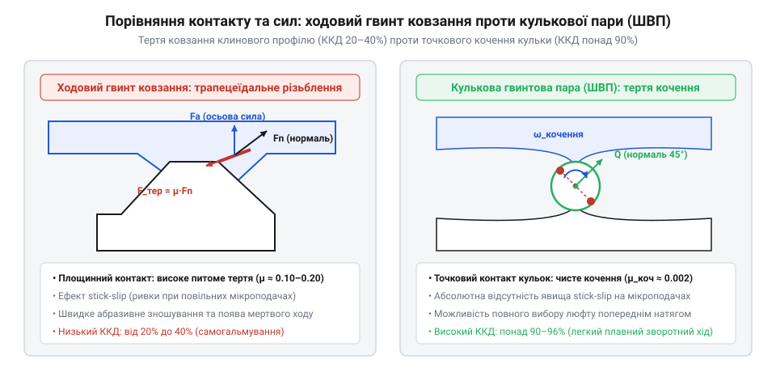
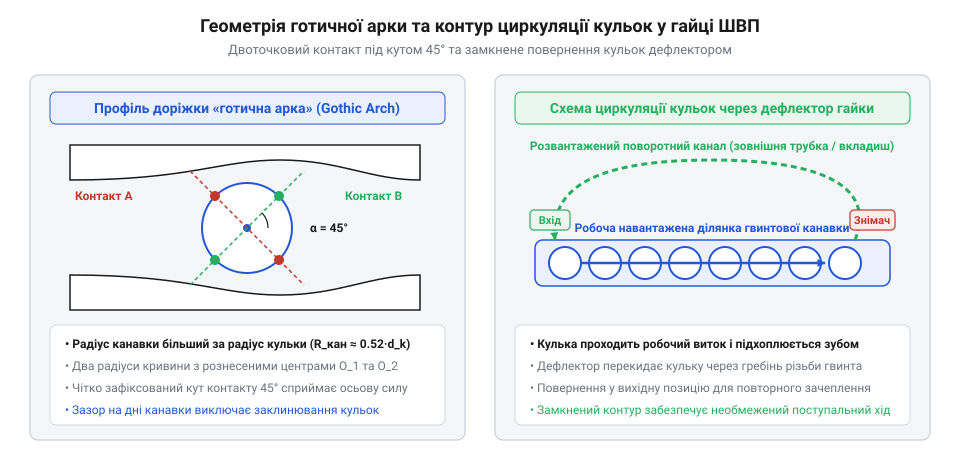
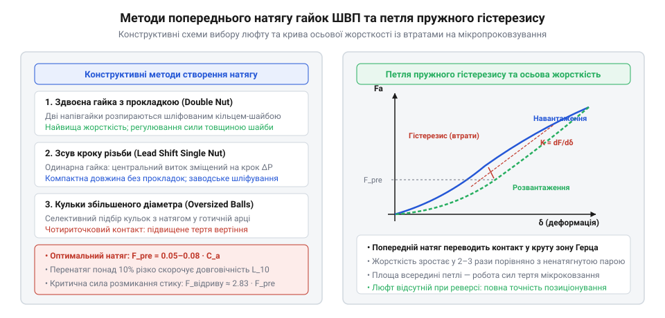
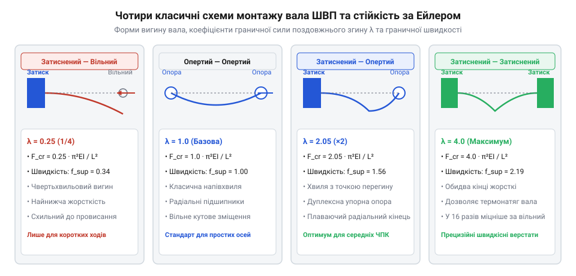

# Кулькова гвинтова пара (ШВП) та ходовий гвинт: класи точності, попередній натяг і кінематика люфту

<preknowlist>
- [Редуктори](root:hw-motion/gears-transmission) — базові поняття передатного відношення, механічної потужності та крутного моменту.
</preknowlist>

## Чому трапецеїдальний гвинт ковзання обмежує швидкість та точність: тертя, знос і явище stick-slip

Перетворення обертового руху двигуна на лінійне переміщення робочого органа є фундаментальним завданням мехатроніки: від подачі супорта токарного верстата до висування штока лінійного актуатора в авіації. Історично найпростішим і найдоступнішим розв'язком цього завдання є звичайна гвинтова пара ковзання — ходовий гвинт із трапецеїдальною різьбою (@@en|trapezoidal lead screw@@) або прямокутною різьбою Acme, де сталевий нарізний стрижень безпосередньо контактує з внутрішньою нарізкою бронзової чи полімерної гайки. Попри конструктивну простоту та дешевизну, гвинт ковзання має вроджені фізичні вади, які перетворюють його на непереборну перешкоду для швидкісних і високоточних приводів.

Головна проблема полягає в трибологічній природі контакту: під час обертання витки гвинта буквально труться об витки гайки, спираючись на тонку мастильну плівку або сухий поверхневий контакт. Коефіцієнт тертя ковзання сталі по бронзі за наявності мастила становить mu ≈ 0.10..0.15, а в режимі граничного тертя сягає 0.20 і більше. Через малий кут підйому різьби psi (зазвичай від 2° до 5°) більша частина вхідної механічної потужності витрачається не на корисне штовхання навантаження, а на подолання опору тертя. Коефіцієнт корисної дії такої пари описується класичним рівнянням механіки:

eta = tg(psi) / tg(psi + rho)

де rho = arctg(mu / cos(alpha_thread)) — зведений кут тертя, а alpha_thread — половина профільного кута різьби (15° для трапецеїдальної різьби ISO). Оскільки кут тертя rho (6°..12°) часто перевищує кут підйому різьби psi, реальний ККД передачі становить жалюгідні 20–40%. Понад 60–80% енергії приводу безповоротно розсіюється у вигляді тепла прямо в зоні різьби. При спробі підвищити лінійну швидкість штока масивний нагрів викликає локальне теплове розширення гвинта, деградацію мастила, прискорений абразивний знос і заклинювання гайки.

У таблиці нижче зіставлено трибологічні характеристики ходових гвинтів ковзання з різними матеріалами гайок проти прецизійної кулькової пари:

| Матеріал пари (гвинт / гайка) | Коефіцієнт тертя mu | Типовий ККД eta | Питоме теплове розсіювання | Гранична лінійна швидкість |
|---|---|---|---|---|
| Сталь 40Х / Бронза БрОЦС 5-5-5 | 0.10..0.14 | 30–42% | Високе (до 65% вхідної потужності) | До 0.05..0.10 м/с |
| Сталь 40Х / Поліамід (Капролон) | 0.15..0.22 | 22–32% | Критичне (ризик теплового пливу) | До 0.02..0.05 м/с |
| Загартована сталь / Чавун СЧ20 | 0.12..0.16 | 28–38% | Високе | До 0.04..0.08 м/с |
| ШВП (Сталь ШХ15 / кульки ШХ15) | 0.003..0.005 | 92–96% | Мізерне (< 5–8% потужності) | До 0.5..1.5 м/с |

*Порівняння трибологічного контакту гвинта ковзання та кульки в ШВП: суцільне тертя ковзання з високими втратами проти точкового кочення кульок у канавці з кутом контакту 45°.*

Друга катастрофічна вада гвинта ковзання — явище переривчастого руху, або фрикційні автоколивання (@@en|stick-slip phenomenon@@). Статичний коефіцієнт тертя спокою mu_static завжди помітно вищий за коефіцієнт динамічного тертя руху mu_dynamic. Коли сервопривід намагається виконати мікропереміщення на кілька мікронів, пружність гвинта й трансмісії спочатку накопичує напруження, доки крутний момент не подолає високий бар'єр тертя спокою. У момент зриву коефіцієнт тертя миттєво падає до динамічного значення, і каретка різко «стрибає» вперед, перелітаючи цільову координату. Контур керування фіксує перерегулювання і намагається повернути вісь назад, де ситуація повторюється. Виникає незгасаюча низькочастотна вібрація, яка унеможливлює плавне позиціювання на малих швидкостях.

Крім того, для вільного ковзання різьба мусить мати конструктивний тепловий зазор між витками, який у міру експлуатації неминуче зростає через зношування. Цей бічний зазор перетворюється на осьовий мертвий хід (backlash) амплітудою 0.1–0.5 мм, що робить неможливим високоточну обробку реверсивних траєкторій на верстатах із ЧПК.

> 🔧 **Навіщо це.**
> Розуміння фізичних меж ходового гвинта ковзання дозволяє інженеру не витрачати ресурси на безнадійні спроби стабілізувати ПІД-регулятор позиціювання при наявності вираженого stick-slip, а своєчасно замінити вузол на передачу з коченням.

## Будова та кінематика кулькової гвинтової пари: профіль «готична арка» та циркуляція кульок

Революційним розв'язанням кризи тертя стала кулькова гвинтова передача (ШВП, @@en|ball screw@@), у якій масивне тертя ковзання замінено на прецизійне кочення загартованих сталевих кульок між спіральними доріжками гвинта та гайки. Завдяки заміні тертя ковзання на кочення коефіцієнт опору падає на два порядки — до mu_roll ≈ 0.003..0.005, а механічний ККД піднімається вище 90–95%. Передача стає повністю оборотною (backdrivable): лінійне осьове зусилля на гайці здатне легко розкручувати гвинт у зворотному напрямку.

Головним елементом геометрії ШВП є профіль спіральної канавки. Простий напівкруглий профіль радіуса R_groove, що трохи перевищує радіус кульки r_ball, не забезпечує стабільного положення точки контакту під дією знакозмінного осьового навантаження. Тому в прецизійних ШВП застосовують профіль «готична арка» (@@en|gothic arch profile@@). Доріжка кочення утворюється двома зміщеними дугами кола з різними радіальними центрами, завдяки чому поперечний переріз канавки нагадує стрілчасту готичну арку.

*Геометрія профілю готичної арки з кутом контакту кульки 45 градусів та схема циркуляції кульок через зворотний канал гайки.*

У такому профілі кулька контактує з поверхнею металу не в донній точці, а в двох симетричних бічних зонах під номінальним контактним кутом beta ≈ 45°. При прикладанні осьової сили F_axial контактна нормальна сила F_normal розкладається під кутом 45°, що забезпечує високу осьову жорсткість за мінімального поперечного зміщення. Співвідношення радіуса жолоба до діаметра кульки (коефіцієнт конформності f = R_groove / d_ball) обирають у межах 0.52..0.54: це гарантує оптимальний компроміс між величиною контактних пружних напружень Герца та паразитним диференціальним ковзанням у контактній плямі (спінінгом кульки).

Кінематичний зв'язок між кутом повороту гвинта theta (у радіанах) і лінійним зміщенням гайки x описується ходом різьби P_h (@@en|lead@@):

x = (theta / (2 · pi)) · P_h

Лінійна швидкість v_lin при кутовій швидкості обертання omega становить:

v_lin = (omega · P_h) / (2 · pi) = n · P_h

де n — частота обертання у витках за секунду. За один повний оберт гвинта кульки здійснюють планетарний рух уздовж гвинтової канавки, котячись із середньою швидкістю центрів v_ball ≈ 0.5 · v_rel. Дійшовши до кінця робочої зони нарізки гайки, кульки не повинні випадати: вони потрапляють у спеціальний зворотний канал рециркуляції.

За типом повернення кульок гайки ШВП поділяють на дві основні конструктивні родини:
1. **Зовнішня рециркуляція (трубчаста схема):** кульки знімаються з витка кінцевим язичком спеціальної вигнутої сталевої трубки, піднімаються над гребенем різьби гвинта і спрямовуються по зовнішньому жолобу на протилежний бік робочої ділянки гайки (один контур повернення охоплює від 1.5 до 3.5 робочих витків).
2. **Внутрішня рециркуляція (дефлекторна схема):** компактний металевий вкладиш-дефлектор вмонтовано безпосередньо в тіло гайки між суміжними витками. Дефлектор перехоплює кульку на виході з витка, піднімає її над зовнішнім діаметром гвинта й перекидає в сусідній виток на 360° назад. Така конструкція суттєво зменшує зовнішній діаметр корпусу гайки, усуває виступаючі деталі й краще витримує високі частоти обертання без вібрацій зворотного тракту.

> 🔧 **Навіщо це.**
> Вибір між внутрішньою та зовнішньою циркуляцією визначає зовнішній габарит каретки та граничну швидкість d_m · n: внутрішні вкладиші-дефлектори дозволяють проектувати надкомпактні маніпулятори з плавним ходом без виступаючих трубок, схильних до пошкодження стружкою.

## Люфт та механізми попереднього натягу: подвійні гайки, зміщення кроку та селективні кульки

У базовій одногайковій ШВП без спеціальних конструктивних заходів завжди присутній мінімальний технологічний зазор (0.01–0.05 мм) між кульками та доріжками кочення. Цей зазор необхідний для вільного кочення без ризику заклинювання від випадкових мікронерівностей чи температурного розширення. Проте під час реверсу напрямку руху приводу цей вільний простір перетворюється на осьовий люфт (осьовий мертвий хід, @@en|axial backlash@@): мотор робить поворот на невеликий кут delta_theta, доки кульки не перейдуть від контакту з передньою стінкою витка канавки до контакту із задньою. У прецизійних верстатах із ЧПК та координатно-вимірювальних машинах такий мертвий хід призводить до спотворення контуру фрезерування (ефект сходинки або овальності при обробці кіл) та втрати стійкості контуру сервокерування.

Для ліквідації мертвого ходу та радикального підвищення контактної жорсткості застосовують технологію попереднього натягу (@@en|preload@@). Фізична сутність попереднього натягу полягає у створенні штучної внутрішньої пружної сили стискання кульок між гвинтом і гайкою за відсутності зовнішнього корисного навантаження. Завдяки пружній деформації в зонах контакту Герца всі мікрозазори вибираються, і система демонструє майже лінійну характеристику жорсткості від самого початку руху.

*Методи створення попереднього натягу та криві осьової деформації: усунення мертвого ходу та підвищення контактної жорсткості за рахунок вибору зазорів.*

В інженерній практиці використовують три головні методи створення попереднього натягу:
1. **Подвійна гайка з дистанційною прокладкою (Double Nut with Spacer):** дві окремі гайки змонтовано на одному гвинті в єдиному корпусі. Між їхніми фланцями встановлюють прецизійно прошліфовану регулювальну шайбу товщиною d_spacer. При затягуванні стяжних болтів перша гайка зміщується вперед, притискаючи кульки до передніх скосів канавок гвинта, а друга гайка зміщується назад, притискаючи кульки до задніх скосів. Цей метод забезпечує найвищу жорсткість та стабільність натягу, а також дозволяє точно регулювати зусилля натягу під час заводського збирання, але подвоює довжину гайкового вузла.
2. **Одинарна гайка зі зміщенням кроку різьби (Lead Shift Preload):** у процесі внутрішнього шліфування різьби суцільної одинарної гайки в її середній частині роблять навмисний мікрозсув кроку delta_P (зазвичай на 10–30 мкм). Половина витків гайки контактує з гвинтом в один бік, а друга половина — у протилежний. Така конструкція компактна, легка і не має рухомих з'єднань, проте вимагає надвисокої точності шліфування й не підлягає регулюванню.
3. **Чотириточковий натяг за рахунок селективних кульок (Oversized Balls Preload):** у канавку «готична арка» одинарної гайки засипають кульки, діаметр яких на кілька мікронів перевищує номінальний зазор. Кулька затискається одночасно в чотирьох точках контакту. Метод дешевий і компактний, але кульки зазнають значного диференціального проковзування, що обмежує його застосування малими навантаженнями та низькими швидкостями.

Величина сили попереднього натягу F_pr обирається за стандартом ISO 3408 як фіксована частка від еквівалентного динамічного навантаження C_am:
- Легкий натяг: F_pr ≈ 0.02..0.05 · C_am (усунення люфту, плавний хід, мінімальне тертя);
- Середній натяг: F_pr ≈ 0.05..0.08 · C_am (стандарт для більшості верстатів ЧПК);
- Важкий натяг: F_pr ≈ 0.10..0.12 · C_am (екстремальна жорсткість для важкої чорнової обробки).

Розглянемо числовий приклад розрахунку для типового верстатного гвинта діаметром d_nom = 32 мм, ходом різьби P_h = 10 мм та динамічною вантажопідйомністю C_am = 28 кН (28000 Н):
- Приймаємо середній клас попереднього натягу 7% від C_am:
  F_pr = 0.07 · 28000 Н = 1960 Н;
- Крутний момент холостого ходу (момент опору натягу) T_pre при прямому ККД eta = 0.92 становить:
  T_pre = (F_pr · P_h) / (2 · pi · eta) = (1960 Н · 0.010 м) / (2 · pi · 0.92) = 19.6 / 5.78 ≈ 3.39 Н·м;
- Розвантажувальне осьове навантаження, при якому протилежний контур кульок втрачає стиск:
  F_lift = 2.83 · F_pr = 2.83 · 1960 Н ≈ 5547 Н.

Створення натягу має свою ціну: зростає момент холостого ходу T_pre, підвищується робоча температура вузла й знижується втомний ресурс підшипникової доріжки. Якщо зовнішнє осьове навантаження F_ext перевищує величину розвантажувальної сили F_lift, одна з груп кульок повністю розвантажується, і жорсткість вузла різко падає до жорсткості одинарної гайки.

> 🔧 **Навіщо це.**
> Правильний вибір класу попереднього натягу запобігає перегріву: надмірний натяг у швидкісній осі 3D-принтера або робота викликає прискорений знос і тепловий клин, тоді як недостатній натяг у фрезерному верстаті руйнує чистоту обробленої поверхні через мікролюфти.

## Класи точності ШВП, накопичена похибка кроку та теплова деформація вала

Точність позиціювання ШВП визначається геометричною точністю виготовлення гвинтової канавки та стабільністю довжини вала під впливом температурних змін. Міжнародний стандарт ISO 3408-3 та японський JIS B 1192 класифікують гвинти ШВП за класами точності, що позначаються літерою C з числовим індексом: від ультрапрецизійного C0 до транспортного C10.

Ключовим критерієм класу є допустиме відхилення ходу різьби e_p (@@en|lead error@@) — різниця між фактичним лінійним переміщенням гайки та теоретичним розрахунковим значенням на контрольному відрізку довжини 300 мм:
- **Прецизійні шліфовані ШВП (Ground screws):**
  - Клас C0: e_300 ≤ ±3.5 мкм (оптичні верстати, інтерферометри, напівпровідникова літографія);
  - Клас C1: e_300 ≤ ±5 мкм (надпрецизійні шліфувальні верстати);
  - Клас C3: e_300 ≤ ±8 мкм (високоточні обробні центри ЧПК);
  - Клас C5: e_300 ≤ ±18 мкм (стандартні промислові фрезерні та токарні верстати).
- **Транспортні катані ШВП (Rolled screws):**
  - Клас C7: e_300 ≤ ±50 мкм (автоматизація, пакувальні машини, координатні столи початкового рівня);
  - Клас C10: e_300 ≤ ±210 мкм (вантажопідйомні пристрої, допоміжне регулювання).

Технологія виготовлення катаних гвинтів базується на холодній пластичній деформації: пруток прокатується між профільованими роликами. Це забезпечує високу швидкість і низьку собівартість, проте залишкові внутрішні напруження та нерівномірність пластичної течії металу не дозволяють отримати клас вище C7. Натомість прецизійні гвинти класів C0–C5 проходять термообробку (загартування струмами високої частоти з глибиною шару до 2–3 мм), відпуск для зняття напружень та чистове багатопрохідне шліфування різьби абразивними кругами в кліматичних камерах із постійною температурою 20 °C.

Навіть найточніший гвинт класу C0 не гарантує точності, якщо не враховувати теплове розширення (@@en|thermal expansion@@). У процесі тривалої роботи за рахунок втрат на тертя у витках гайки та підшипникових опорах вал нагрівається на delta_T = 5..15 °C відносно станини верстата. Лінійне подовження сталевого вала робочої довжини L розраховується за формулою:

delta_L_th = alpha_steel · L · delta_T

де alpha_steel ≈ 11.7 · 10⁻⁶ 1/°C — коефіцієнт лінійного теплового розширення інструментальної сталі. Для гвинта довжиною L = 1000 мм при нагріванні лише на 10 °C теплове подовження становить delta_L_th = 11.7 · 10⁻⁶ · 1000 · 10 = 0.117 мм (117 мкм). Ця величина на порядок перевищує весь допуск класу C3 (18 мкм) і повністю спотворює координату робочого органа.

Для боротьби з тепловим дрейфом у прецизійному верстатобудуванні застосовують три інженерні рішення:
1. **Попереднє механічне розтягування вала (Pre-tensioning):** гвинт закріплюють у двох жорстких радіально-упорних опорах (схема затиснений-затиснений) і при збиранні примусово розтягують гідравлічним натягувачем на величину delta_L_pretension, яка точно дорівнює розрахунковому тепловому подовженню при робочій температурі. У міру нагрівання гвинт не видовжується, а лише знижує внутрішнє механічне напруження розтягу.
2. **Внутрішнє охолодження порожнистого вала (Hollow shaft cooling):** через центральний осьовий свердлений отвір вала прокачують охолоджену оливу з термостата, підтримуючи температуру серцевини гвинта на рівні 20.0 ± 0.2 °C.
3. **Прямий оптичний лінійний зворотний зв'язок (Linear Glass Scales):** енкодер встановлюють не на вал мотора, а на саму каретку супорта. Контролер ЧПК отримує абсолютну фізичну координату каретки й автоматично компенсує тепловий дрейф гвинта в реальному часі.

> 🔧 **Навіщо це.**
> Без урахування теплового розширення дорогий гвинт класу C3 через пів години інтенсивного фрезерування працюватиме за точністю як катаний C7. Попередній натяг вала за схемою «затиснений-затиснений» повертає паспортну точність без дорогих систем масляного охолодження.

## Динамічні обмеження: критична швидкість обертання та явище биття гвинта

Зі зростанням довжини робочого ходу та швидкості переміщення каретки у верстатах із ЧПК і швидкісних портальних роботах кулькова гвинтова пара впирається в жорстке динамічне обмеження — явище згинального резонансу вала, відоме як биття або явище «хлиста» (@@en|screw whipping@@).

Гвинт ШВП являє собою довгий гнучкий сталевий стрижень, який під дією власної сили тяжіння має певний початковий прогин. Крім того, навіть найточніший шліфований вал має залишковий ексцентриситет маси e_mass відносно геометричної осі обертання. Коли вал починає обертатися з високою кутовою швидкістю omega, на кожну одиницю його довжини починає діяти відцентрова сила:

F_centrifugal = m_lin · (w_def + e_mass) · omega²

де m_lin — погонна маса вала (кг/м), а w_def — динамічний прогин осі.

При наближенні частоти обертання до першої власної частоти згинальних коливань стрижня за моделлю Ейлера-Бернуллі відцентрова сила вступає в резонанс із власною пружністю матеріалу. Прогин вала катастрофічно зростає, він починає обертатися у формі вигнутої дуги («хлиста»), викликаючи дикі вібрації, руйнування ущільнень гайки, викришування кульок і незворотний пластичний вигин вала.

Критична частота обертання n_crit (об/хв) розраховується за класичним рівнянням:

n_crit = f_support · (d_root / L²) · 10⁷

де:
- d_root — внутрішній діаметр гвинта по дну канавки (мм);
- L — вільна довжина вала між підшипниковими опорами (мм);
- f_support — коефіцієнт схеми підшипникового закріплення кінців вала:
  - Вільний — затиснений (Fixed-Free): f_support ≈ 0.34;
  - Опертий — опертий (Supported-Supported): f_support ≈ 0.97;
  - Затиснений — опертий (Fixed-Supported): f_support ≈ 1.51;
  - Затиснений — затиснений (Fixed-Fixed): f_support ≈ 2.19.

Розглянемо числовий приклад розрахунку для типового шліфованого гвинта номінальним діаметром 32 мм (діаметр по дну різьби d_root = 26 мм) за довжини між опорами L = 1500 мм:
- Геометричний дільник становить: d_root / L² = 26 / (1500)² = 26 / 2 250 000 ≈ 1.1556 · 10⁻⁵ мм⁻¹;
- Схема «затиснений-вільний» (Fixed-Free): n_crit = 0.34 · 1.1556 · 10⁻⁵ · 10⁷ = 393 об/хв (гранична робоча швидкість 0.8 · n_crit = 314 об/хв);
- Схема «опертий-опертий» (Supported-Supported): n_crit = 0.97 · 1.1556 · 10⁻⁵ · 10⁷ = 1121 об/хв (робоча швидкість до 897 об/хв);
- Схема «затиснений-опертий» (Fixed-Supported): n_crit = 1.51 · 1.1556 · 10⁻⁵ · 10⁷ = 1745 об/хв (робоча швидкість до 1396 об/хв);
- Схема «затиснений-затиснений» (Fixed-Fixed): n_crit = 2.19 · 1.1556 · 10⁻⁵ · 10⁷ = 2531 об/хв (робоча швидкість до 2024 об/хв).

При кроці різьби P_h = 10 мм максимальна швидкість лінійної подачі порталу зростає від 3.14 м/хв (для схеми Fixed-Free) до понад 20.2 м/хв (для схеми Fixed-Fixed) — різниця у швидкодії становить 6.4 раза при збереженні того самого діаметра гвинта!

З цієї формули видно, що критична швидкість пропорційна діаметру d_root і обернено пропорційна квадрату довжини L². Подвоєння робочого ходу верстата (L × 2) зменшує допустиму швидкість обертання у 4 рази! За правилами безпеки максимальна робоча швидкість ШВП n_max не повинна перевищувати 80% від критичної: n_max ≤ 0.8 · n_crit.

Додатковим обмеженням швидкості є характеристика d_m · n (добуток діаметра центрів кульок на частоту обертання). Для стандартних гайок із зовнішньою циркуляцією границя становить d_m · n ≤ 70000..100000 мм·об/хв, а для високошвидкісних гайок із внутрішніми тангенціальними дефлекторами — до 150000..220000 мм·об/хв. Перевищення цього ліміту призводить до зіткнення кульок на вході в поворотний канал та руйнування пластикових напрямних.

> 🔧 **Навіщо це.**
> Якщо інженер не перевірить гвинт за формулою n_crit, портал фрезера довжиною 2 метри при спробі прискореного переміщення 30 м/хв увійде в резонанс, і гвинт розтрощить підшипникові опори за кілька секунд.

## Стійкість проти поздовжнього вигину за Ейлером та схеми закріплення опор

Окрім динамічного биття при обертанні, довгий вал ШВП піддається потужним осьовим стискальним навантаженням під час прискорення масивного порталу або силового врізання фрези в метал. Якщо прикладена осьова сила стиску F_axial перевищить границю пружної стійкості тонкого стрижня, відбудеться раптова втрата стійкості — поздовжній вигин за Ейлером (@@en|Euler buckling@@).

Критична сила поздовжнього вигину F_buckle (Н) визначається формулою Леонарда Ейлера для пружного поздовжнього згину:

F_buckle = m_support · (pi² · E · I_axial) / L²

де:
- E ≈ 2.06 · 10⁵ МПа — модуль пружності (Юнга) загартованої сталі;
- I_axial = (pi · d_root⁴) / 64 — осьовий момент інерції круглого перерізу вала по дну різьби (мм⁴);
- L — максимальна відстань між затиснутою опорою та гайкою у крайньому робочому положенні (мм);
- m_support — коефіцієнт схеми закріплення кінців вала:
  - Затиснений — вільний кінець (Fixed-Free): m_support = 0.25;
  - Опертий — опертий (Supported-Supported): m_support = 1.0;
  - Затиснений — опертий (Fixed-Supported): m_support = 2.0;
  - Затиснений — затиснений (Fixed-Fixed): m_support = 4.0.

*Схеми закріплення кінців вала ШВП та критичні форми втрати стійкості: порівняння коефіцієнта довжини та критичного навантаження для різних типів опор.*

Допустиме осьове стискальне зусилля обирають із запасом надійності не менше S_b ≥ 2.5..3.0: F_axial,max ≤ F_buckle / S_b.

Порівняння чотирьох типових монтажних схем підшипникових опор (стандартизовані блоки типу FK/BK для фіксованої опори та FF/BF для плаваючої) наочно демонструє еволюцію інженерних рішень:
1. **Затиснений — вільний (Fixed-Free):** один кінець вала жорстко затиснутий парою дуплексних радіально-упорних підшипників, другий висить у повітрі. Найгірша схема: гранично низька критична швидкість (f=0.34) та мінімальна стійкість до стиску (m=0.25). Застосовується лише для коротких ходів (L < 400 мм) при повільних вертикальних переміщеннях.
2. **Затиснений — опертий (Fixed-Supported):** фіксована опора тримає осьові й радіальні сили, а плаваюча опора з одним радіальним кулькопідшипником дозволяє валу вільно видовжуватися при нагріванні. Стійкість до вигину зростає у 8 разів порівняно з вільною схемою (m=2.0).
3. **Затиснений — затиснений (Fixed-Fixed):** обидва кінці вала жорстко зафіксовані попередньо натягнутими дуплексними радіально-упорними блоками. Стійкість проти поздовжнього вигину досягає максимуму (m=4.0), критична швидкість зростає у 6.4 раза порівняно з вільною схемою. Ця схема дозволяє попередньо розтягувати вал для повної компенсації теплового подовження, що є стандартом для швидкісних верстатів ЧПК.

> 🔧 **Навіщо це.**
> Перехід зі схеми «затиснений-опертий» на схему «затиснений-затиснений» подвоює допустиме тягове зусилля подачі без збільшення діаметра гвинта, заощаджуючи масу та знижуючи інерцію приводу.

## Інженерний розрахунок, вибір типорозміру, ККД та мащення ШВП

Підбір кулькової гвинтової передачі для верстата, маніпулятора або лінійного актуатора виконується за стандартизованою інженерною методикою ISO 3408 на основі спектра навантажень, частот обертання та цільового ресурсу в мотогодинах.

Першим кроком визначають розрахункове еквівалентно-динамічне осьове навантаження P_m (Н) для змінного робочого циклу, що складається з i-х фаз (прискорення, сталий рух із силами різання, гальмування, холостий хід):

P_m = ( (sum(F_i³ · n_i · q_i)) / (sum(n_i · q_i)) )^(1/3)

де F_i — діюча осьова сила на i-му етапі (Н), n_i — частота обертання вала (об/хв), а q_i — частка часу етапу у відсотках від тривалості повного циклу.

За заданим цільовим ресурсом L_h (наприклад, 20000 годин безперервної роботи) та середньою частотою обертання n_m розраховують мінімально необхідну динамічну вантажопідйомність C_a,req:

L_10 = 60 · n_m · L_h · 10⁻⁶

C_a,req = P_m · (L_10)^(1/3) · f_w

де f_w — коефіцієнт умов навантаження (1.0..1.2 для спокійного руху без ударів, 1.5..2.0 за наявності сильних вібрацій чи ударних навантажень від фрезерування).

З каталогу виробника обирають типорозмір ШВП, у якого паспортне динамічне навантаження C_a перевищує розрахункове C_a,req, після чого проводять обов'язкову перевірку на статичну вантажопідйомність C_0a:

S_0 = C_0a / F_axial,max ≥ 2.0..3.0

Це гарантує, що при раптовому аварійному зіткненні чи екстремальному гальмуванні контактні напруження Герца в доріжках кочення не перевищать межу пластичної деформації металу (допустима залишкова вм'ятина не більше 0.0001 діаметра кульки d_ball).

Крутний момент T_drive (Н·м), необхідний для переміщення осьового навантаження F_axial при прямому приводі (обертання гвинта -> рух гайки), визначається кінематикою кроку різьби та коефіцієнтом корисної дії:

T_drive = (F_axial · P_h) / (2 · pi · eta_direct) + T_pre

де P_h — хід різьби (м), eta_direct ≈ 0.90..0.95 — прямий ККД кулькової передачі, а T_pre — момент опору від попереднього натягу гайки.

Оскільки ШВП має мінімальне тертя кочення, вона оборотна: при прикладанні зовнішньої сили F_ext до гайки на гвинті виникає розкручувальний реактивний крутний момент:

T_backdrive = (F_ext · P_h · eta_reverse) / (2 · pi)

де eta_reverse ≈ 0.85..0.90 — зворотний ККД. Це критично для вертикальних осей: при вимкненні електроживлення шпиндельна балка під власною вагою миттєво впаде на робочий стіл, розкручуючи мотор. Тому всі вертикальні приводи на базі ШВП обов'язково оснащують електромеханічним пружинним гальмом на валу серводвигуна.

Тривалість служби ШВП напряму залежить від правильного вибору мастила під швидкісний фактор d_m · n (добуток діаметра центрів кульок у мм на частоту обертання в об/хв). У таблиці нижче систематизовано стандартні інженерні рекомендації:

| Швидкісний фактор d_m · n, мм·об/хв | Тип змащування | Рекомендовані марки мастил | В'язкість базової оливи | Інтервал обслуговування |
|---|---|---|---|---|
| До 50 000 (низькошвидкісний) | Пластичне мастило (NLGI 2) | Shell Gadus S2 V220, Mobilux EP 2 | 220 сСт при 40 °C | 500–1000 годин |
| 50 000 .. 100 000 (середній) | Пластичне мастило (NLGI 1–2) | Kluber Isoflex NBU 15, Mobil SHC Polyrex 005 | 100..150 сСт при 40 °C | 300–500 годин |
| 100 000 .. 150 000 (швидкісний) | Рідка синтетична олива | Mobil DTE 25, Shell Morlina S2 BL 10 | ISO VG 46..68 | Неперервно (крапельно / імпульсно) |
| Понад 150 000 (екстремальний) | Масляний туман / упорскування | Kluber Isoflex PDP 38, Mobil Velocite No. 6 | ISO VG 10..22 | Примусова циркуляція з охолодженням |

Для запобігання потраплянню абразивного пилу, металевої стружки та охолоджувальної рідини СОЖ торці гайки оснащують двокромочними еластомерними манжетами з фторкаучуку або лабіринтними ущільненнями, а відкриту частину вала захищають гофрованими сильфонними кожухами чи телескопічними сталевими щитками.

У випадках, коли розрахункове еквівалентне осьове навантаження перевищує контактну міцність кулькових доріжок або актуатор працює в умовах екстремальних ударів (наприклад, у важких пресах чи електромеханічних приводах шасі), альтернативою є [роликогвинтова передача (ШРВП)](root:hw-motion/roller-screw) із лінійним контактом планетарних різьбових роликів.

> 🔧 **Навіщо це.**
> Розрахунок моменту T_backdrive рятує вертикальні верстати від аварійних катастроф: сервопривід без утримувального гальма при аварійному знеструмленні скине важку фрезерну головку прямо в затиснуту деталь.
