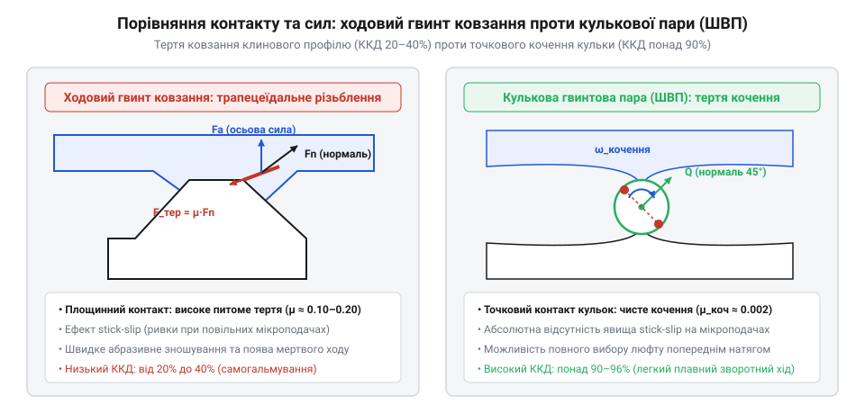
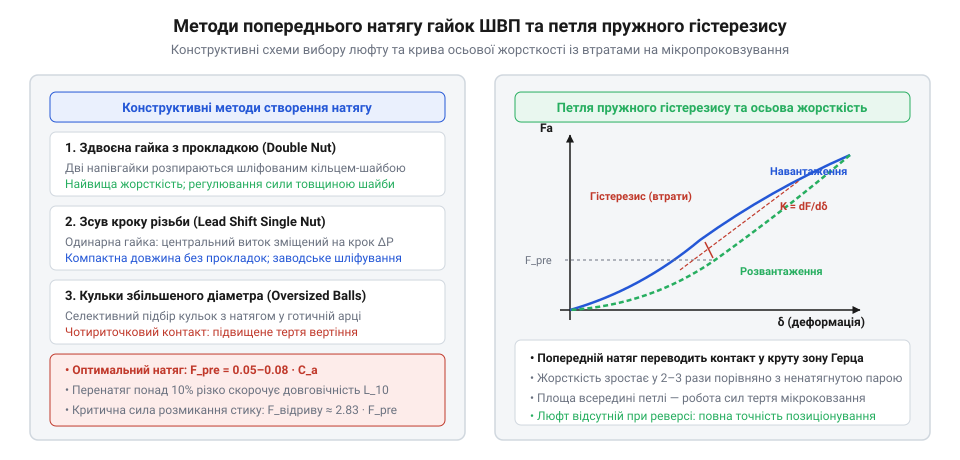
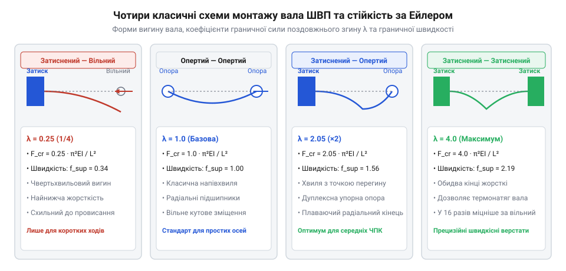

# Кулькова гвинтова пара (ШВП) та ходовий гвинт: класи точності, попередній натяг і кінематика люфту

## Фізика переходу від тертя ковзання до кочення кульок: як заміна ковзної бронзової пари на контакт сталевих кульок у радіусних канавках підвищує ККД з 30–50% до 90–95%, усуває ефект stick-slip та мінімізує теплове розширення приводу

У класичних верстатах і простих підйомних механізмах лінійне переміщення столу або робочого органа традиційно реалізували за допомогою передачі гвинт-гайка ковзання — ходового гвинта (@@en|lead screw@@). У такій передачі сталевий гвинт із трапецеїдальною або прямокутною різьбою безпосередньо контактує з внутрішньою різьбою масивної бронзової або чавунної гайки. Передача обертального руху в лінійний відбувається виключно через безперервне тертя ковзання по всій площі стичних витків.

Ковзання металу по металу навіть за умов рясного рідкого мащення супроводжується значним коефіцієнтом тертя `f = 0.10..0.15`. Зведений кут тертя `rho = arctg(f)` досягає `6°..9°`. При типових кутах підйому різьби `gamma = 3°..5°` більша частина механічної енергії приводного двигуна не здійснює корисного поступального переміщення, а перетворюється на тепло:

```
eta
= tg(gamma) / tg(gamma + rho)             [визначення ККД гвинтової пари через кут підйому різьби та кут тертя]
= tg(4°) / tg(4° + 7°)                    [підстановка параметрів ходового гвинта ковзання: gamma = 4°, rho = 7°]
= 0.0699 / 0.1944                         [обчислення тригонометричних функцій кутів]
≈ 0.36 (36%)                              [результуючий ККД пари ковзання]
```

Низький коефіцієнт корисної дії (30–50%) — лише частина проблеми. Головною вадою ходового гвинта у прецизійних приводах є ефект переривчастого ковзання — @@en|stick-slip@@. Статичний коефіцієнт тертя спокою `f_s` завжди помітно вищий за кінематичний коефіцієнт тертя руху `f_d` (`f_s / f_d ≈ 1.3..1.6`). Коли привод намагається виконати мікропереміщення на кілька мікрометрів, гайка спочатку застряє на місці («stick»), накопичуючи пружну деформацію скручування гвинта. Коли зростаючий крутний момент нарешті долає силу тертя спокою, опір різко падає до динамічного рівня, і гайка неконтрольовано зривається вперед («slip»), перелітаючи цільову координату.


*Порівняння геометрії контакту та балансу сил: площинне ковзання бронзової гайки по сталі з низьким ККД та явищем stick-slip проти локального пружного кочення сталевих кульок у кулькогвинтовій передачі з ККД понад 90%.*

Кардинальним інженерним вирішенням цієї фізичної межі став перехід від тертя ковзання до тертя кочення. У кулькових гвинтових передачах (ШВП, @@en|ball screw@@) між різьбою гвинта та гайки введено замкнений масив прецизійних загартованих сталевих кульок.

Заміна механічного контакту змінює фізичну картину руху:
1. **Точковий або еліптичний контакт герцівського пружного стиску:** кульки котяться у прецизійних напівкруглих або готичних канавках гвинта й гайки, замінюючи площинне пластично-в'язке стирання поверхонь на мікродеформацію кочення кулі по сталі;
2. **Падіння тертя на два порядки:** зведений коефіцієнт тертя кочення становить лише `f_roll = 0.003..0.005`, а зведений кут тертя не перевищує `rho_roll ≈ 0.2°`;
3. **Зростання ККД до 90–95%:** передача транслює майже всю потужність двигуна в осьове зусилля:

```
eta_ball
= tg(gamma) / tg(gamma + rho_roll)        [визначення ККД кулькової передачі через зведений кут тертя кочення]
= tg(4°) / tg(4° + 0.2°)                  [підстановка характеристик ШВП: кут тертя кочення rho_roll ≈ 0.2°]
= 0.0699 / 0.0734                         [обчислення тригонометричних співвідношень]
≈ 0.95 (95%)                              [результуючий ККД кулькової передачі]
```

4. **Повна ліквідація явища stick-slip:** оскільки статичний опір початку кочення кульки практично не відрізняється від динамічного опору усталеного кочення, зникає поріг зриву. Привод набуває здатності плавно й неперервно позиціонувати робочий орган із кроком у частки мікрометра без застрягань;
5. **Мінімізація теплового розширення:** у звичайному ходовому гвинті втрачені 50–70% потужності нагрівають сталевий стрижень на 20–40 °C. За довжини вала `L = 1000 мм` термічне видовження `delta_L = alpha_t · L · delta_T` (де `alpha_t ≈ 12 · 10⁻⁶ 1/°C`) призводить до набігаючої похибки позиціонування `delta_L = 12 · 10⁻⁶ · 1000 · 30 ≈ 0.36 мм` (360 мкм), що абсолютно неприпустимо для верстатів із ЧПК. У ШВП теплове виділення мізерне, завдяки чому геометрія валопроводу залишається термостабільною.

> 🔧 **Навіщо це.**
> Заміна тертя ковзання на кочення дозволяє використовувати втричі менш потужні серводвигуни для досягнення однакового тягового зусилля на каретці, позбавляє систему від ривків на повзучих швидкостях та зберігає мікронну точність верстата незалежно від тривалості його безперервної роботи.

## Кінематика замкненої рециркуляції кульок та механізм вибору осьового люфту: контури повернення кульок у гайці, профіль готичної арки та попередній натяг для мікронної точності позиціонування

Уведення сталевих кульок у простір між гвинтом і гайкою створює фундаментальну топологічну проблему: під час обертання гвинта кульки безперервно котяться спіральною канавкою в осьовому напрямку. Досягнувши краю гайки, вони неминуче випали б назовні, якби конструкція не містила спеціального зворотного тракту.

Для неперервної роботи кулькової гвинтової передачі кульки замикають у нескінченний циркуляційний контур. У сучасному машинобудуванні застосовують два головні типи систем рециркуляції:
1. **Зовнішня рециркуляція (трубчасті канали):** вигнута сталева трубка встановлюється ззовні корпусу гайки, з'єднуючи перший і останній робочі витки. На кінцях трубки розташовано дефлектори, які знімають кульку з гвинтової канавки, направляють її крізь трубку поверх витків гвинта й повертають на протилежний бік робочого ланцюга.
2. **Внутрішня рециркуляція (компактні дефлекторні вкладиші):** у стінку гайки впресовано невеликі металеві або керамічні дефлектори. Кожен дефлектор підхоплює кульку наприкінці одного витка, підіймає її над гребенем різьби вала і перекидає в сусідню канавку того самого контуру. Гайка з внутрішньою рециркуляцією має мінімальний зовнішній діаметр і гладкий циліндричний корпус, що спрощує монтаж у вузьких порожнинах робототехнічних суглобів.

Другим критичним завданням є досягнення нульового осьового люфту (@@en|backlash@@). Якщо профіль доріжки кочення виконано за простою напівкруглою дугою з технологічним зазором, зміна напрямку руху стола верстата супроводжується зоною нечутливості в 20–50 мкм, поки кульки не перекладуться з одного робочого схилу різьби на інший.


*Методи створення попереднього натягу в ШВП: регулювальне розпірне кільце між здвоєними гайками та калібровані кульки з чотириточковим контактом у готичній арці для повної ліквідації зони нечутливості.*

Для забезпечення мікронної точності позиціонування застосовують спеціальний профіль різьби — готичну арку (@@en|gothic arch@@). Її форму утворено двома перетинними дугами кіл, радіуси яких трохи більші за радіус кульки (`r_groove ≈ 1.05..1.10 · r_ball`). Завдяки цьому кулька контактує з поверхнею не в одній точці на дні канавки, а у двох симетричних точках на бокових схилах під контактним кутом `alpha_c ≈ 40°..45°`.

Ліквідацію осьового люфту та багаторазове збільшення контактної жорсткості забезпечує створення попереднього натягу (@@en|preload@@) одним із двох класичних методів:
- **Попередній натяг перерозмірними кульками (Single nut with oversized balls):** у гайку з профілем готичної арки закладають кульки каліброваного діаметра, що на 5–15 мкм перевищує номінальний зазор між гвинтом і гайкою. Кулька зазнає пружного чотириточкового стиску (дві точки на валу і дві на гайці), повністю обираючи зазор без ускладнення конструкції гайки;
- **Здвоєна гайка з розпірним кільцем (Double nut preload):** дві окремі гайки змонтовано на одному валу й розперто прецизійно шліфованою проміжною шайбою певної товщини (або стиснуто зовнішніми стяжними шпильками). Перша гайка сприймає осьове навантаження одного напрямку, а друга — протилежного, створюючи внутрішнє пружне зусилля натягу:

```
F_pr
= (0.05..0.10) · C_dyn                    [вибір сили попереднього натягу через динамічну вантажопідйомність ШВП]
```

Осьове навантаження на приводі діє на попередньо затиснений стик. За законом пружного контакту Герца осьове зміщення `delta_ax` пропорційне зусиллю у степені 2/3: `delta_ax = (F_ax / K_ax)^(2/3)`. Поки зовнішня сила різання чи розгону `F_ext` не перевищує критичного порогу розмикання `F_ext ≤ 2.83 · F_pr`, жоден контур кульок не втрачає пружного стиску. Передача не має мертвого ходу при реверсі, а її динамічна осьова жорсткість подвоюється.

> 🔧 **Навіщо це.**
> Попередній натяг перетворює гвинтовий механізм із дискретної «брязкальця» з люфтом у монолітну пружну пружину з нанометровою роздільною здатністю, що є обов'язковою умовою високошвидкісного фрезерування гартованих пресформ.

## Зворотна рушійність (backdrivability) та динамічні межі: ризик самовільного скочування вертикальних осей під вагою вантажу через високий ККД, критична швидкість обертання довгого гвинта для уникнення биття та обмеження на поздовжній вигин (колона Ейлера)

Високий коефіцієнт корисної дії (понад 90%) та низький опір тертя кочення надають кульковій гвинтовій передачі унікальну властивість — повну зворотну рушійність (@@en|backdrivability@@). Якщо звичайний трапецеїдальний ходовий гвинт із кутом тертя ковзання `rho = 7°` при куті підйому `gamma = 4°` є самогальмівним (`gamma < rho`) і надійно утримує вантаж без подачі живлення, то в ШВП через зведений кут тертя `rho_roll ≈ 0.2°` завжди діє сувора нерівність:

```
gamma
> rho_roll                                [умова оборотності механічної передачі: кут підйому різьби перевищує кут тертя]
```

Це означає, що прикладання поздовжнього осьового зусилля до гайки легко обертає гвинт. У вертикальних осях фрезерних верстатів із ЧПК, роботів-маніпуляторів чи медичних столів це створює критичну аварійну небезпеку: у разі раптового знеструмлення сервопривода шпиндель або важка каретка під дією власної ваги миттєво зривається вниз, розкручуючи приводний вал і розбиваючи деталь чи інструмент. Тому вертикальні ШВП в обов'язковому порядку оснащують пружинними електромеханічними гальмами нормального закриття (fail-safe brakes) або пневматичними розвантажувальними циліндрами.

Окрім вимог до утримання вантажу, проектування швидкісних приводів накладає два жорсткі фізичні обмеження на геометрію та швидкість обертання гвинта — резонансне згинальне биття та втрату поздовжньої стійкості при стиску.


*Граничні режими навантаження ШВП: втрата поздовжньої стійкості тонкого гвинта за Ейлером при стиску та перша резонансна форма згинальних коливань вала при обертанні.*

Першим швидкісним бар'єром є критична швидкість обертання вала (@@en|critical speed@@). Обертовий сталевий вал довжиною `L` через залишковий мікродисбаланс та дію сили тяжіння зазнає поперечних згинальних коливань. При збігу частоти обертання з першою власною частотою згину настає хвильовий резонанс (whirling) — вал різко прогинається, виникає руйнівне вібраційне биття з амплітудою в кілька міліметрів, яке за секунди розбиває опорні підшипники та шайби гайки:

```
n_crit
= f_mount · (d_core / L²) · 10⁷           [критична швидкість обертання вала, об/хв]
```

де `d_core` — внутрішній діаметр різьби вала (мм), `L` — відстань між опорними підшипниками (мм), а `f_mount` — кінематичний коефіцієнт опор (0.97 для консольного вала, 1.51 для вільно опертих кінців Simple-Simple, 2.19 для комбінації Fixed-Simple та 3.40 для жорстко затиснених дуплексних опор Fixed-Fixed). Допустима робоча швидкість ніколи не повинна перевищувати 80% від `n_crit`.

Другим бар'єром є максимальне осьове навантаження на поздовжній вигин за законом Ейлера (@@en|Euler column buckling@@). Коли привід штовхає важкий супорт у бік заготовки, вал працює на осьовий стиск як тонка пружна колона:

```
F_buckling
= m_mount · (pi² · E · I / L²)            [критична сила втрати стійкості за Ейлером]
```

де `E = 2.06 · 10⁵ МПа` — модуль пружності сталі, `I = pi · d_core⁴ / 64` — осьовий момент інерції перерізу вала, а `m_mount` — коефіцієнт закріплення (від 0.25 для вільної консолі до 4.0 для жорсткого затиснення обох кінців Fixed-Fixed). Якщо зусилля різання перевищить розрахункове значення `F_buckling`, довгий гвинт миттєво втрачає стійкість, необоротно вигинаючись дугою з пластичною деформацією сталі.

> 🔧 **Навіщо це.**
> Розрахунок граничних величин `n_crit` та `F_buckling` визначає максимальну швидкість подачі та довжину верстата: нехтування цими бар'єрами призводить або до руйнування каретки від резонансної вібрації, або до викривлення дорогого гвинта при першому ж форсованому врізанні фрези.
