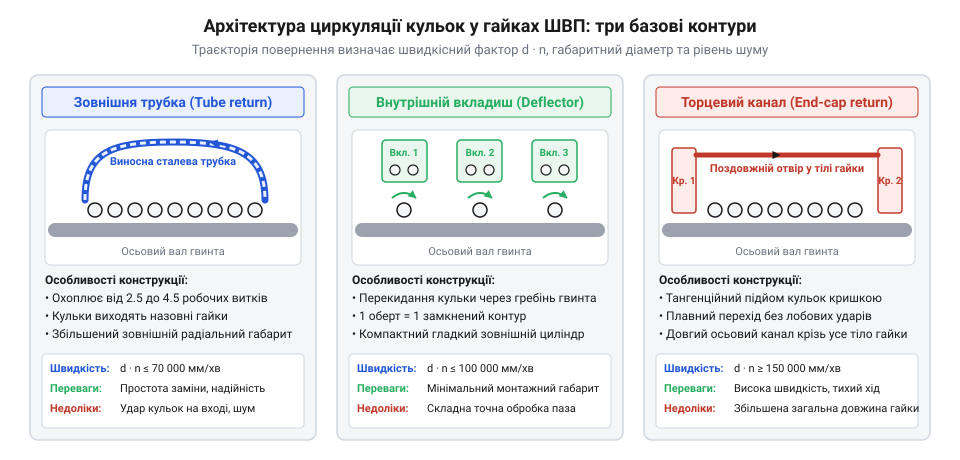
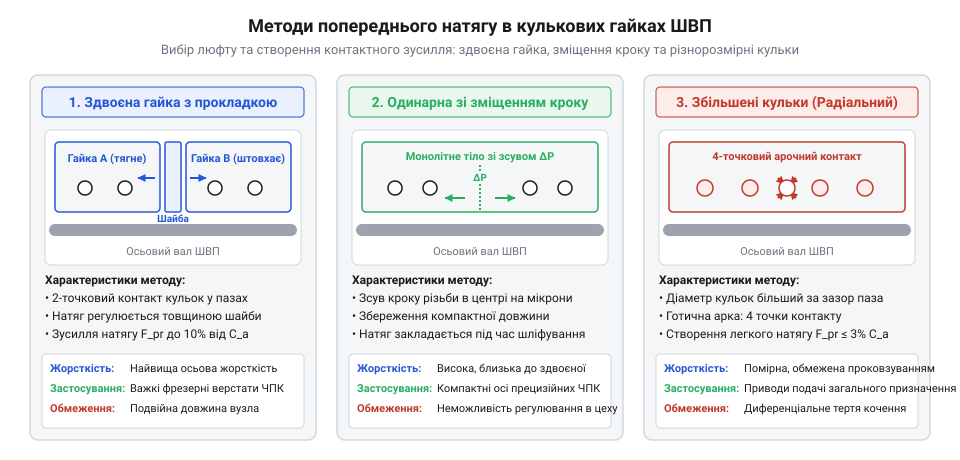

# Кулькова гвинтова пара (ШВП) та ходовий гвинт: класи точності, попередній натяг і кінематика люфту

## Архітектура контурів повернення кульок: зовнішні перепускні трубки, внутрішні вкладиші-дефлектори та торцеві кришки з осьовими каналами

У кульковій гайці кожна сталева кулька, прокочуючись по спіральних бігових доріжках під дією відносного обертання вала, переміщується вздовж осі. Для забезпечення безперервної роботи передачі кульки після проходження робочої зони повинні повертатися у вихідну точку контуру. Конструкція контуру рециркуляції визначає граничну швидкість обертання, рівень акустичного шуму, габаритний діаметр та динамічну вантажопідйомність гайки.

У сучасному машинобудуванні застосовують три базові топології циркуляції:

1. **Зовнішні перепускні трубки (External return tubes):**
Кульки проходять від 1.5 до 3.5 повних робочих витків різьби. На торцях контуру встановлені зігнуті сталеві трубки, зафіксовані на зовнішній поверхні корпусу гайки притискними планками. Кулька перехоплюється з канавки гвинта, підіймається над його зовнішнім діаметром і по зовнішній трубці спрямовується назад на початок того ж контуру.
- *Переваги:* простота виготовлення, висока надійність у важких верстатах і пресах, можливість роботи з великими кульками високої вантажопідйомності.
- *Обмеження:* збільшений зовнішній діаметр вузла, вразливість виступаючих трубок до механічних пошкоджень, підвищений шум через удари кульок на вході в трубку при швидкостях понад 2–3 м/с.

2. **Внутрішні вкладиші-дефлектори (Internal deflector buttons / Bridge return):**
Циркуляція здійснюється локально в межах одного витка різьби (одновитковий контур). У тіло гайки радіально запресовується або фіксується гвинтом прецизійний суцільний вкладиш із твердого сплаву або загартованої сталі. Дефлектор перекидає кульку через зовнішній гребінь різьби вала безпосередньо у сусідню канавку того ж витка.
- *Переваги:* ідеально гладкий циліндричний зовнішній габарит гайки без будь-яких виступів, можливість рівномірного розподілу навантаження по багатьох незалежних одновиткових контурах (зазвичай від 3 до 6 вкладишів на гайку).
- *Обмеження:* складність високошвидкісного різання точних гнізд під вкладиші, обмеження максимального діаметра кульок.

3. **Торцеві кришки з осьовими наскрізними свердліннями (End-cap return):**
Застосовується у високих кроках різьби (великий кут підйому спіралі, багатозахідні ШВП для високошвидкісних осей подачі). Кульки проходять усю робочу довжину гайки, після чого плавно знімаються тривимірним торцевим напрямним козирком у пластиковій або металевій кришці та повертаються назад через гладкий наскрізний поздовжній отвір, просвердлений усередині стінки корпусу гайки.
- *Переваги:* найвища швидкість циркуляції (параметр швидкохідності `d_n > 150 000`), плавна безперервна траєкторія руху без різких кутових зламів, низький рівень шуму.
- *Обмеження:* довгий замкнений ланцюг кульок, чутливий до перекосів при згині довгого вала.


*Порівняння трьох типів повернення кульок: зовнішня трубка, внутрішній вкладиш і торцевий канал.*

Критичним фактором при проектуванні багатовиткової гайки є вкрай нерівномірний розподіл осьового зусилля між робочими витками. Через пружне стиснення гвинта та розтяг корпусу гайки різні витки деформуються неоднаково. Перший виток, розташований найближче до опорного фланця гайки, сприймає від 35% до 45% сумарного осьового навантаження передачі. Другий виток навантажується на 20–25%, третій — приблизно на 15%, тоді як четвертий та п'ятий витки передають менше 5–10% сили.

Математично частка навантаження `k`-го витка описується спадною гіперболічною кривою:
```
q_k = Q_total · ( sinh(γ · (N_turns - k + 0.5)) / sinh(γ · N_turns) )
```
де `γ = √( (K_ball / K_body) )` — безрозмірний параметр співвідношення контактної жорсткості кульок до осьової жорсткості тіла гвинта й гайки.

Через це виготовлення гайок із кількістю витків понад 4–5 є недоцільним: додаткові хвостові витки практично не збільшують реальну несучу здатність вузла, а лише додають паразитний опір тертя. Щоб підвищити динамічну вантажопідйомність без перевантаження першого витка, застосовують багатозахідні різьби (2 або 4 паралельні заходи) або використовують модифікований змінний крок канавки гайки, який штучно вирівнює контактні зусилля по довжині.

> 🔧 **Навіщо це.** Для компактних приводів роботів та лінійних актуаторів обирають гайки з внутрішніми дефлекторами, тоді як для високошвидкісних фрезерних центрів (швидкість переміщення понад 60 м/хв) безальтернативним стандартом є торцеве повернення через поздовжні канали.

## Методи створення попереднього натягу: здвоєні гайки з регулювальною шайбою, одинарні гайки зі зміщенням кроку різьби (lead shift) та негабаритні кульки

У прецизійних верстатах навіть мікроскопічний осьовий зазор (люфт) у 5–10 мкм призводить до браку обробки деталей, фазового відставання сервоконтуру та вібрацій. Для повної ліквідації люфту та багаторазового підвищення контактної жорсткості застосовують методи попереднього натягу (preload).


*Методи створення попереднього натягу в гайках ШВП: здвоєна гайка, зміщення кроку та різнорозмірні кульки.*

Конструктивно попередній натяг реалізують трьома основними підходами:

1. **Здвоєна гайка з прецизійною регулювальною прокладкою (Double nut with spacer):**
Вузол складається з двох окремих фланцевих або циліндричних напівгайок, встановлених на одному гвинті. Між їхніми торцями встановлюють шліфоване кільце-прокладку завтовшки `t_shim`.
- При зменшенні товщини прокладки напівгайки стягуються одна до одної шпильками, створюючи натяг на розтяг («тягнучий натяг»);
- При збільшенні товщини прокладки напівгайки розпираються, створюючи натяг на стиск («розпірний натяг»).
У результаті кульки першої напівгайки притискаються до правого схилу канавки гвинта, а другої — до лівого. Це класична двоточкова схема контакту.
*Переваги:* найвища точність регулювання величини натягу в процесі збирання, максимальна осьова жорсткість серед усіх типів гайок.
*Недоліки:* подвоєна довжина вузла та більша маса.

2. **Одинарна гайка зі зміщенням кроку різьби (Lead-shift single nut):**
Гайка виконується суцільною, монолітною. На етапі шліфування внутрішньої різьби посередині довжини гайки на спеціальному крокомірному верстаті виконують стрибок кроку на величину зміщення `ΔP ≈ 10–30 мкм`.
Кульки лівої половини гайки вступають у контакт із лівими робочими гранями витків вала, а кульки правої половини — з правими.
*Переваги:* компактні габарити одинарної гайки за збереження двоточкового контакту та високої жорсткості здвоєної схеми.
*Недоліки:* величина натягу закладається на заводі раз і назавжди під час шліфування і не підлягає експлуатаційному регулюванню.

3. **Радіальний натяг збільшеними кульками (Oversized balls / 4-point contact):**
В одинарній гайці з профілем бігової доріжки «готична арка» (Gothic arch) встановлюють кульки, калібрований діаметр яких `d_ball` на кілька мікронів перевищує номінальний зазор між канавками гвинта й гайки.
Кулька стискається між чотирма точками контакту (дві точки на валу і дві на гайці).
*Переваги:* гранично коротка й дешева конструкція гайки.
*Недоліки:* через різницю лінійних швидкостей у точках контакту виникає мікропроковзування (spin-to-roll ratio), що призводить до підвищеного моменту тертя, інтенсивного нагрівання та прискореного зношування при високих швидкостях. Застосовується переважно для середніх класів натягу (`F_pre ≤ 0.05 · C_a`).

Трибологічна фізика чотириточкового контакту обумовлює колосальне розсіювання тепла. Кожна кулька одночасно взаємодіє з чотирма контактними еліпсами Герца. Внаслідок протилежно направлених векторів колових швидкостей на протилежних схилах готичної арки чисте кочення без ковзання можливе лише вздовж двох вузьких ліній нульової швидкості, тоді як по всій решті площі еліпсів виникає диференціальне ковзання зсуву (Heathcote & spin slip).

Потужність тепловиділення від тертя в одинарній гайці з чотириточковим натягом описується інтегральним виразом:
```
P_fric_4pt = Z_balls · ∑_{i=1}^4 ( ∫∫_{A_i} τ_fric(x,y) · v_slip(x,y) dx dy )
```
де `Z_balls` — загальна кількість навантажених кульок у гайці, `A_i` — площа `i`-го контактного еліпса Герца, а `v_slip` — локальна швидкість відносного проковзування металу кульки по жолобу.

В інженерних розрахунках потужність тертя чотириточкового контакту оцінюють за узагальненою формулою моменту вертіння (spin moment):
```
P_fric_4pt = 4 · Z_balls · μ_spin · Q_contact · ω_ball · r_contact · sin(α)
```
де:
- `Q_contact = F_pre / (Z_balls · sin(α))` — нормальне зусилля на одній кульці від натягу;
- `ω_ball = (2 · π · n_screw / 60) · (d_nom / (2 · d_ball))` — кутова швидкість власного обертання кульки;
- `μ_spin ≈ 0.03–0.06` — ефективний коефіцієнт тертя вертіння;
- `α ≈ 45°` — кут контакту готичної арки.

Підстановка реальних верстатних параметрів показує, що тепловиділення в однаковій гайці з чотириточковим контактом у 2.5–3.2 рази перевищує втрати двоточкової спареної гайки за однакового осьового натягу `F_pre`. При швидкостях обертання понад `n = 1500` об/хв локальний тепловий потік сягає 150–250 Вт, що призводить до нагрівання гайки на 35–50 °C вище станини, викликаючи теплове заклинювання кульок та прискорене руйнування бігових доріжок.

## Механічна жорсткість та кінематичні втрати: вплив натягу на момент холостого ходу T_preload, нагрівання й зниження втомного ресурсу L_10

Попередній натяг кулькової гайки є головним інструментом підвищення осьової жорсткості вузла, проте за нього доводиться платити додатковими втратами потужності та підвищенням робочої температури.

Сумарна осьова жорсткість кулькової пари `K_ax` складається з пружної деформації контакту кульок із канавками гвинта й гайки (`K_contact`), жорсткості тіла гайки (`K_nut`) та жорсткості самого різьбового вала (`K_screw`):
```
1 / K_total = 1 / K_contact + 1 / K_nut + 1 / K_screw
```
Оскільки контактна жорсткість підпорядковується закону Герца (`K_contact ~ F_pre^(1/3)`), збільшення натягу з `0.02 · C_a` до `0.08 · C_a` підвищує контактну жорсткість майже на 60%.

Нерівномірність навантаження кульок по витках безпосередньо керує механізмом втомного руйнування гайки. За стандартом ISO 3408 та теорією Лундберга-Пальмгрена довговічність окремої бігової доріжки обернено пропорційна кубу еквівалентного навантаження:
```
L_10_turn ~ (1 / Q_turn)³
```
Якщо в 5-витковій гайці перший виток сприймає `Q_1 ≈ 0.40 · F_total`, а п'ятий виток — лише `Q_5 ≈ 0.05 · F_total`, то відносне співвідношення їхнього втомного ресурсу складає:
```
L_10_turn5 / L_10_turn1 = (Q_1 / Q_5)³ = (0.40 / 0.05)³ = 8³ = 512
```
Це означає, що перший виток вичерпує свій запас довговічності у 500 разів швидше за останній. Втомне викришування металу (subsurface fatigue pitting) завжди локалізується виключно на перших двох робочих витках гайки біля фланця.

Щоб запобігти передчасному руйнуванню, у прецизійних верстатних парах застосовують два конструктивні прийоми:
1. **Здвоєні гайки з різноспрямованим натягом:** робоче навантаження прямого та зворотного ходу сприймається різними напівгайками, що вирівнює середній цикл напружень;
2. **Прогресивне шліфування кроку канавки (pitch compensation):** крок різьби гайки роблять на кілька мікронів меншим або більшим за крок вала. Під робочим навантаженням пружна деформація корпусу компенсує цю різницю, вирівнюючи навантаження між усіма витками та потроюючи фактичний ресурс вузла.

Проте з появою попереднього натягу виникає постійний гальмівний момент опору обертанню — момент холостого ходу:
```
T_preload = (F_pre · P_lead) / (2 · π) · (1 - η_reverse)
```
де `P_lead` — крок різьби, а `η_reverse ≈ 0.88–0.92` — зворотний механічний ККД пари. При високій частоті обертання `n` потужність тертя в гайці перетворюється на тепловий потік:
```
P_heat = T_preload · ω = T_preload · (2 · π · n / 60)
```
Для швидкісної осі з кроком 10 мм і натягом `F_pre = 2500` Н при частоті обертання `n = 3000` об/хв тепловиділення в гайці сягає:
```
P_heat ≈ 0.40 Н·м · 314 рад/с ≈ 125 Вт
```
Якщо не передбачено примусового охолодження, температура гайки зростає на 20–30 °C відносно кінців вала, викликаючи термічний клин та прискорену деградацію мастила.

Крім того, навантаження від натягу враховується при розрахунку номінальної довговічності за стандартом ISO 3408. Еквівалентне динамічне навантаження розраховується як:
```
F_equiv = ( (F_pre + 0.65 · F_ext)³ · q_1 + ... )^(1/3)
```
Оскільки довговічність `L_10` обернено пропорційна кубу навантаження (`L_10 ~ (C_a / F_equiv)³`), надмірний натяг у `0.12 · C_a` скорочує ресурс підшипника в 2–3 рази порівняно з помірним натягом `0.05 · C_a`.

## Інженерні критерії підбору та межі швидкості: фактори d_n і DN, ущільнення гайки, мащення та правила монтажу на верстатну вісь

При проектуванні вузла ШВП критичним обмеженням є гранична лінійна швидкість руху кульок усередині гайки. Її оцінюють двома нормативними критеріями:
1. **Фактор швидкохідності `d_n`:** добуток номінального діаметра вала `d_nom` (в мм) на частоту обертання `n` (в об/хв):
```
d_n = d_nom · n
```
Для гайок із зовнішніми перепускними трубками допустима межа становить `d_n ≤ 70 000`. Для гайок із внутрішніми дефлекторами — `d_n ≤ 100 000`. Для високошвидкісних гайок із торцевими кришками та плавними каналами повернення — `d_n ≤ 160 000–220 000`.
2. **Параметр лінійної швидкості центрів кульок (DN):** лінійна швидкість кочення кульок не повинна перевищувати `v_ball ≤ 5–7 м/с`.

Для захисту бігових доріжок від абразивного металевого пилу та охолоджувальної рідини (МОР) на торцях гайки обов'язково встановлюють багатопелюсткові безконтактні лабіринтні або еластомірні контактні ущільнення (wiper seals). Зношене або відсутнє ущільнення призводить до потрапляння стружки в канавку, де вона розчавлюється кульками з руйнуванням цементованого шару за кілька годин роботи.

Режим змащення обирають залежно від швидкісного параметра:
- При `d_n < 50 000` застосовують пластичні літієві або полісечовинні мастила в'язкості NLGI 2;
- При `d_n > 50 000` обов'язковим є автоматичне централізоване імпульсне змащування мінеральними оливами з кінематичною в'язкістю ISO VG 32–68, які одночасно виносять тепло з корпусу гайки.

### Розрахунок тепловиділення та нагрівання гайки від моменту холостого ходу

Створення попереднього натягу неминуче супроводжується внутрішнім тертям кочення та ковзання кульок, що породжує момент опору холостого ходу (drag torque) `T_preload`. За відсутності зовнішнього корисного навантаження вся механічна потужність, що витрачається на подолання цього моменту під час швидкісних переміщень робочого органа верстата, повністю перетворюється на теплову енергію безпосередньо в зоні контакту кульок із біговими доріжками.

Розглянемо практичний інженерний приклад розрахунку теплового балансу гайки прецизійної верстатної осі зі здвоєною гайкою та такими параметрами:
- Номінальний діаметр гвинта: `d_nom = 32 мм`;
- Крок різьби: `P_lead = 10 мм = 0.010 м`;
- Базова динамічна вантажопідйомність гайки: `C_a = 25 000 Н`;
- Сила попереднього натягу: `F_pre = 0.08 · C_a = 2000 Н` (стандартні 8% для високоточних верстатів);
- Прямий ККД кулькової пари: `η_forward = 0.95`;
- Зворотний ККД: `η_reverse = 0.90`;
- Частота обертання при швидкісному позиціонуванні (`G00`): `n = 2400 об/хв` (швидкість подачі столу `v_feed = n · P_lead = 24 м/хв`, фактор `d_n = 32 · 2400 = 76 800`).

Момент опору від попереднього натягу розраховують за аналітичною формулою:
```
T_pre = (F_pre · P_lead) / (2 · π) · (1 - η_reverse)
T_pre = (2000 · 0.010) / (2 · 3.14159) · (1 - 0.90) = 3.183 · 0.10 ≈ 0.318 Н·м
```
Додатково слід врахувати момент тертя контактних торцевих ущільнень (манжет), який для вала діаметром 32 мм становить близько `T_seal ≈ 0.16 Н·м`. Повний момент опору холостого ходу натягнутої гайки дорівнює:
```
T_drag = T_pre + T_seal = 0.318 + 0.160 = 0.478 Н·м
```

Обчислимо кутову швидкість обертання вала:
```
ω = (2 · π · n) / 60 = (2 · 3.14159 · 2400) / 60 ≈ 251.3 рад/с
```

Теплова потужність, яка виділяється всередині гайки:
```
P_heat = T_drag · ω = 0.478 Н·м · 251.3 рад/с ≈ 120.1 Вт
```

У стаціонарному тепловому режимі вся теплова потужність розсіюється у навколишнє середовище через зовнішню поверхню корпусу гайки конвекцією та випромінюванням. Нехай площа ефективного охолодження сталевого фланцевого корпусу гайки становить `A_nut ≈ 0.045 м²`, а коефіцієнт природної конвекції та тепловіддачі в закритій порожнині верстатного супорта дорівнює `h_conv ≈ 18 Вт/(м²·°C)`.

Рівноважний перегрів корпусу гайки відносно температури навколишнього повітря у захисному кожусі верстата (`ΔT_steady`):
```
ΔT_steady = P_heat / (h_conv · A_nut) = 120.1 / (18 · 0.045) = 120.1 / 0.81 ≈ 148.3 °C
```

Якщо гайка не має активного тепловідведення, її температура може зрости на десятки градусів навіть за переривчастого робочого циклу (з коефіцієнтом тривалості вмикання `DC = 0.30` середній перегрів сягає `ΔT ≈ 45 °C`).

Тепловий потік із гайки розігріває прилеглі ділянки гвинтового вала. Темп температурного видовження сталевого гвинта становить `ΔL = α_L · L · ΔT`, де для вуглецевої та підшипникової сталей `α_L = 1.17 · 10⁻⁵ 1/°C`. На робочій довжині гвинта `L = 1000 мм` нагрівання вала лише на `ΔT = 15 °C` призводить до температурного видовження:
```
ΔL = 1.17 · 10⁻⁵ · 1000 · 15 ≈ 0.176 мм = 176 мкм
```
Таке видовження у 15–20 разів перевищує допустиму похибку прецизійного верстата класу точності `ISO C3` (допуск накопиченої похибки кроку на 1000 мм становить лише 12 мкм), повністю знищуючи точність обробки деталей.

Саме тому у високошвидкісних обробних центрах реалізують три інженерні заходи:
1. **Примусове циркуляційне охолодження:** через спеціальні радіальні канавки у фланці гайки або через порожнистий центральний канал гвинтового вала прокачують термостатовану оливу з холодильного агрегата, яка стабілізує перегрів у межах `ΔT ≤ 2–3 °C`;
2. **Попередній температурний натяг вала (Pre-stretching):** гвинт під час монтажу між жорсткими дуплексними радіально-упорними опорами попередньо механічно розтягують гідравлічним натягувачем на розрахункову величину теплового подовження `ΔL_stretch`, завдяки чому при робочому нагріванні розтягувальне напруження у валі зменшується, але його геометрична довжина між опорами залишається абсолютно незмінною;
3. **Оптимізація попереднього натягу:** вибір мінімально необхідного зусилля натягу (перехід від 8–10% `C_a` до 4–5% `C_a` за умови збереження динамічної жорсткості відрізання або фрезерування).

> 🔧 **Навіщо це.** Помилка монтажу — кутовий перекіс осі гайки відносно напрямних станини понад 1:2000 (0.05 мм на 100 мм ходу) — концентрує все осьове навантаження лише на крайньому першому витку кульок, що спричиняє втомне викришування металу і скорочує ресурс передачі на 90%.
