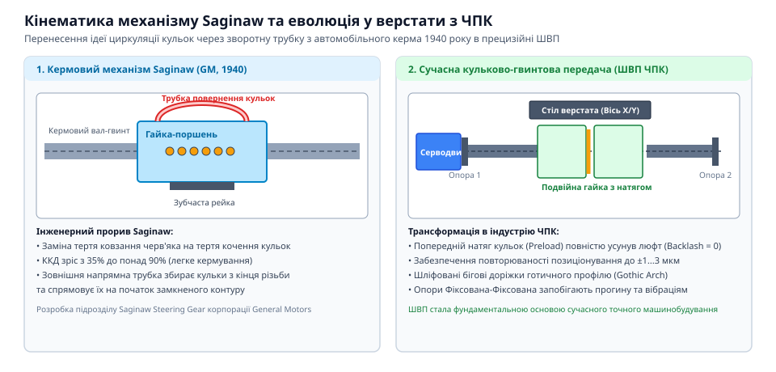

# Кулькова гвинтова пара (ШВП) та ходовий гвинт: класи точності, попередній натяг і кінематика люфту

## Криза механіки ковзання у ходових гвинтах: енергетичні втрати, зношування трапецеїдальних різьб і важке кермо автотранспорту 1930-х років

До середини XX століття єдиним способом перетворення обертового руху на лінійне переміщення у верстатах і машинах залишалися передачі з ковзанням — ходові гвинти з метричною або трапецеїдальною різьбою (Acme). Контакт між сталевим гвинтом та бронзовою або чавунною гайкою здійснювався безпосередньо по бічних поверхнях витків. Такий контакт супроводжувався сухим або граничним тертям ковзання з високим коефіцієнтом тертя `μ ≈ 0.10–0.20`.

Низький механічний коефіцієнт корисної дії передачі ковзання описується класичним рівнянням:
```
η = tan(λ) / tan(λ + ρ)
```
де `λ` — кут підйому різьби (типово 2–5°), а `ρ = arctan(μ / cos(α/2))` — приведений кут тертя для профілю з кутом при вершині `α = 29°` або `30°`. Для більшості ходових гвинтів кут тертя значно перевищував кут підйому різьби (`ρ > λ`), через що механічний ККД передачі коливався в межах `η ≈ 20–40%`. Понад 60–80% введеної механічної потужності безповоротно розсіювалося в зоні контакту витків у формі теплового потоку `Q_heat = (1 - η) · P_in`.

Цей тепловий потік спричиняв значне теплове розширення ходового гвинта:
```
ΔL = α_th · L · ΔT
```
де `α_th ≈ 11.7 · 10⁻⁶ 1/°C` для конструкційної сталі. При нагріванні довгого верстатного гвинта довжиною `L = 1.5` м лише на 15 °C лінійне видовження сягало:
```
ΔL = 11.7 · 10⁻⁶ · 1500 · 15 ≈ 0.263 мм
```
Помилка позиціонування у чверть міліметра робила прецизійну контурну обробку неможливою без регулярного ручного калібрування.

Фізика теплового балансу ходового гвинта ковзання визначається співвідношенням між генерацією тепла тертям та конвективним тепловідводом у навколишнє середовище й масивну станину:
```
m_screw · c_steel · (dT / dt) = μ · F_ax · v_rel - h_conv · A_surf · (T - T_amb)
```
де:
- `F_ax` — осьова сила різання або притискання гайки;
- `v_rel = (π · d_nom · n_rot) / (60 · cos(λ))` — лінійна швидкість відносного ковзання витків;
- `h_conv ≈ 15–25 Вт/(м²·К)` — коефіцієнт природної конвекції повітря;
- `A_surf` — ефективна площа охолодження гвинта.

Через низьку тепловіддачу сталевого вала та локальний характер тертя в рухомій гайці температура в зоні зачеплення швидко підіймалася на 30–50 °C вище температури навколишнього середовища. Оскільки гайка переміщується вздовж станини нерівномірно, нагрівання гвинта мало виражений градієнтний просторовий профіль: ділянки частого реверсу розігрівалися значно сильніше за кінці вала. Це спричиняло нелінійний дрейф кроку різьби по довжині, який неможливо було скомпенсувати навіть простим пропорційним масштабуванням шкали верстата.

Паралельно поставала критична проблема автомобільної промисловості 1930-х років. З появою важких тривісних комерційних вантажівок, автобусів і військової бронетехніки масою понад 5–10 тонн зусилля на кермовому колесі для повороту коліс стало перевищувати фізичні можливості водія. Гідравлічні підсилювачі керма тоді перебували в зародковому експериментальному стані та вирізнялися високою аварійністю й громіздкістю. Кермові редуктори типу «черв'як–сектор» або звичайний «гвинт–гайка» мали настільки високе внутрішнє тертя, що маневрування на низьких швидкостях вимагало прикладання моменту понад 80–100 Н·м на кермі діаметром пів метра.

Крім низького ККД, звичайні ходові гвинти страждали від неминучого зношування. Щоб пара не клинилася від теплового розширення, конструктори змушені були закладати початковий бічний зазор у 0.05–0.15 мм. У процесі тертя бронзові витки гайки стиралися, і зазор швидко збільшувався до 0.3–0.8 мм. Це створювало величезний мертвий хід (backlash): при реверсі напрямку обертання вал робив помітний холостий оберт до того, як гайка торкалася протилежного схилу різьби.

> 🔧 **Навіщо це.** Якщо в ручному токарному верстаті досвідчений токар міг компенсувати мертвий хід гвинта подачі, підводячи різець завжди з одного боку, то автоматичний контур позиціонування з люфтом втрачає стійкість: реверс викликає затримку переміщення та розгойдування сервоприводу.

## Патенти підрозділу Saginaw (Рудольф Бем) та перехід до тертя кочення: стрибок ККД з 30% до 90% для військових вантажівок і приводів літаків B-29

Проривне інженерне рішення розробила команда підрозділу Saginaw Steering Gear корпорації General Motors під керівництвом провідного інженера Рудольфа Бема (Rudolph G. Boehm). Замість прямого тертя твердих поверхонь гвинта й гайки було запропоновано розмістити у спіральній канавці прецизійні гартовані сталеві кульки, перетворивши пару ковзання на підшипник кочення нескінченного ходу.

Головною кінематичною перешкодою для практичної реалізації кулькового гвинта була потреба в безперервному поверненні кульок. Кулька, рухаючись по спіралі разом із відносним переміщенням гвинта й гайки, за кілька обертів доходила до кінця різьбової втулки. Бем запропонував революційну конструкцію зовнішньої поворотної трубки (recirculating ball tube). Спеціальний дефлектор на краю гайки перехоплював кульку з нарізної канавки, підіймав її над вершиною різьби гвинта і направляв через зовнішню перепускну трубку назад на протилежний бік контуру, замикаючи замкнений нескінченний контур циркуляції.

Геометрія поворотної трубки Saginaw вимагала виняткової точності розрахунку. Щоб запобігти заклинюванню та динамічним ударам кульок на високих обертах, внутрішній діаметр трубки виконували з прецизійним зазором `d_tube = d_ball + (0.10–0.15 мм)`. Радіус плавного згину трубки обирався з умови безударного входу кульок:
```
R_bend ≥ 2.5 · d_ball
```
Дефлекторні носики трубки проєктувалися за тангенціальною траєкторією під кутом зйому `β_def ≈ 15–20°` до лінії гвинтового підйому різьби. Це дозволяло плавно підхоплювати кульку з силової канавки без виникнення гальмівного моменту. Самі перепускні трубки виготовлялися штампуванням із легованої листової сталі завтовшки 1.0–1.2 мм у вигляді двох симетричних поздовжніх половинок, які після ретельного полірування внутрішніх поверхонь з'єднувалися високотемпературною пайкою твердим срібним припоєм і гартувалися до твердості 58–60 HRC.

Для безперешкодної циркуляції використовувалися прецизійні кульки з хромистої сталі 52100 (класу точності Grade 10 за стандартом ABMA), різнорозмірність яких у межах одного комплекту не перевищувала 1.0–1.5 мкм. Якщо діаметр хоча б однієї кульки відхилявся на 3–5 мкм у більший бік, вона сприймала на себе все осьове навантаження витка, що викликало миттєве локальне викришування металу бігової доріжки.


*Кінематична схема Saginaw з поверненням кульок через зовнішню трубку та її перенесення у верстат із ЧПК.*

У серії патентів кінця 1930-х — початку 1940-х років (зокрема US Patent 2,298,011) було зафіксовано базову архітектуру передачі. Результат був приголомшливим:
1. **Зниження тертя:** коефіцієнт тертя кочення сталевих кульок по гартованій сталі складав `μ_roll ≈ 0.003–0.005`, що було у 30–50 разів менше за тертя ковзання.
2. **Стрибок ККД:** механічний ККД піднявся з 25–35% до понад `η ≈ 90–95%`.
3. **Оборотність руху:** передача стала повністю оборотною (backdrivable) — осьове зусилля на гайці могло легко обертати гвинт із мінімальним опором.

Впровадження кулькової пари Saginaw в автомобілі General Motors (починаючи з моделей Cadillac і важких вантажівок GMC) кардинально полегшило керування: водій міг вільно обертати кермо багатотонної машини без гідропідсилювача.

Зі вступом США у Другу світову війну розробка Saginaw набула стратегічного значення. Військова авіація потребувала потужних і водночас компактних лінійних приводів для керування стулками бомболюків, закрилками та шасі важких бомбардувальників Boeing B-29 Superfortress. Електромотори того часу мали обмежену потужність; високий ККД кулькових гвинтів дозволив замінити важкі гідравлічні магістралі легкими електромеханічними актуаторами, стійкими до морозів стратосфери (до -50 °C), де гідравлічні рідини густішали та відмовляли.

Саме військовий досвід B-29 показав колосальну зносостійкість кулькових передач: загартовані до твердості 60–62 HRC бігові доріжки працювали сотні годин без виникнення люфту. Проте до початку 1950-х років ШВП залишалася виключно транспортним та авіаційним силовим вузлом, де певний зазор між кульками та канавкою (0.02–0.05 мм) був обов'язковим для вільного кочення без заклинювання.

## Революція ЧПК: експеримент Джона Парсонса та MIT (1952), де ШВП ліквідувала нелінійний мертвий хід і зробила можливим стійкий сервоконтур

Справжній цивілізаційний прорив у застосуванні кулькових гвинтових передач стався на початку 1950-х років завдяки піонеру числового керування Джону Парсонсу (John T. Parsons) та дослідникам Лабораторії сервомеханізмів Массачусетського технологічного інституту (MIT Servomechanisms Laboratory) під керівництвом Вільяма Піза (William Pease) та Джеймса Макдоноу (James O. McDonough).

Парсонс, власник компанії Parsons Corporation у штаті Мічиган, виготовляв лопаті несучих гвинтів вертольотів Sikorsky. Складний просторовий аеродинамічний профіль лопатей вимагав фрезерування важких шаблонів із тисячами координатних точок. Парсонс запропонував обчислювати траєкторію на перфокартах IBM і автоматично позиціонувати робочі осі верстата за допомогою сервоприводів.

У 1949–1952 роках ВПС США (US Air Force) профінансували створення першого повноцінного верстата з числовим програмним керуванням на базі трикоординатного гідрокопіювального фрезерного верстата Cincinnati Hydro-Tel.

Коли команда MIT підключила гідромотори та електронні контури зворотного зв'язку до штатних ходових гвинтів верстата, сервосистема зазнала катастрофічного фіаско:
1. **Люфт і фазове відставання:** через наявність мертвого ходу (backlash) у 0.15 мм при кожній зміні знака помилки позиціонування датчик фіксував обертання двигуна, але стіл стояв на місці. Контур зворотного зв'язку сприймав це як нескінченний статичний опір і накопичував інтегральну помилку.
2. **Автоколивання і розхитування:** щойно зазор вибирався, стіл різко зривався вперед, виникав переліт цільової позиції, і сервопривод реверсував. Верстат впадав у безперервні автоколивання на резонансній частоті, що ламало різальний інструмент.
3. **Зрив контуру (stick-slip):** різниця між статичним і динамічним коефіцієнтами тертя ковзання в різьбі Acme викликала дискретний ривковий рух замість плавного контурного фрезерування.

Вирішальним порятунком проєкту стала ідея замінити звичайні трапецеїдальні гвинти на автомобільні кулькові гвинтові пари Saginaw. Кулькові пари практично не мали різниці між тертям спокою та тертям руху (`μ_stat ≈ μ_dyn ≈ 0.004`), усунувши ефект stick-slip. Більше того, створивши попереднє стискання кульок між витками, інженери вперше досягли нульового мертвого ходу.

У 1952 році перший фрезерний верстат із ЧПК у лабораторії MIT успішно вирізав просторову деталь авіаційного крила. ШВП миттєво перетворилася з вузькоспеціалізованого компонента важкого транспорту на технологічний серцевинний елемент світового верстатобудування.

## Еволюція прецизійності: розвінчання міфу про первинність космосу, поява готичної арки та спарених гайок для попереднього натягу

У популярній літературі нерідко зустрічається твердження, ніби прецизійні кулькові гвинти були винайдені в межах космічної програми NASA або спеціально для міжконтинентальних балістичних ракет. Це історичний міф: ШВП з'явилися як відповідь на суто земні потреби важких вантажівок Saginaw/General Motors, а їх точність виросла завдяки верстатам MIT. Космічна та ракетна техніка 1960-х лише запозичила вже зрілу верстатну технологію для приводів відхилення векторів тяги ракетних сопел Saturn V.

Проте перетворення транспортної кулькової пари на прецизійний верстатний інструмент вимагало розв'язання фундаментальної проблеми пружного натягу. Ранні гайки Saginaw мали круговий радіусний профіль доріжки (circular arc), у якому кулька контактувала з металом у двох протилежних точках. У такій геометрії неможливо було повністю усунути осьовий зазор без різкого заклинювання кульок при найменшій температурній зміні розмірів.

У 1960-х роках провідні верстатобудівні школи розробили дві взаємодоповнюючі інновації:
1. **Профіль бігової доріжки «готична арка» (Gothic arch):** радіус канавки формується двома зміщеними центрами кривизни. Завдяки цьому кулька контактує з поверхнею не по дну западини, а під кутом контакту `α ≈ 40–45°`. Це дало змогу створювати чотириточковий контакт і обирати мікролюфти радіальним добором каліброваних кульок із натягом.
2. **Спарені гайки з регулювальною прокладкою (Double nut preload):** між двома прецизійно шліфованими гайками встановлюють шліфовану шайбу-прокладку завтовшки `t_shim`. Взаємне осьове розпирання або стягування двох гайок генерує внутрішнє зусилля натягу `F_pre`, яке повністю обирає зазор у всьому діапазоні робочих навантажень:
```
F_pre ≈ F_max / 2.83
```

> 🔧 **Навіщо це.** Попередній натяг спареними гайками не просто усуває мертвий хід: він переводить контакт у нелінійну пружну зону Герца, де контактна жорсткість зростає пропорційно `F^(1/3)`, запобігаючи відгинанню різального інструменту під дією сили різання.

Завдяки переходу від точіння до глибинного оптичного шліфування загартованих гвинтів та лазерної інтерферометрії похибку кроку було зменшено з 50 мкм/м до часток мікрона (сучасні класи C0 і C1), завершивши еволюцію ШВП як основи сучасної мехатроніки.
