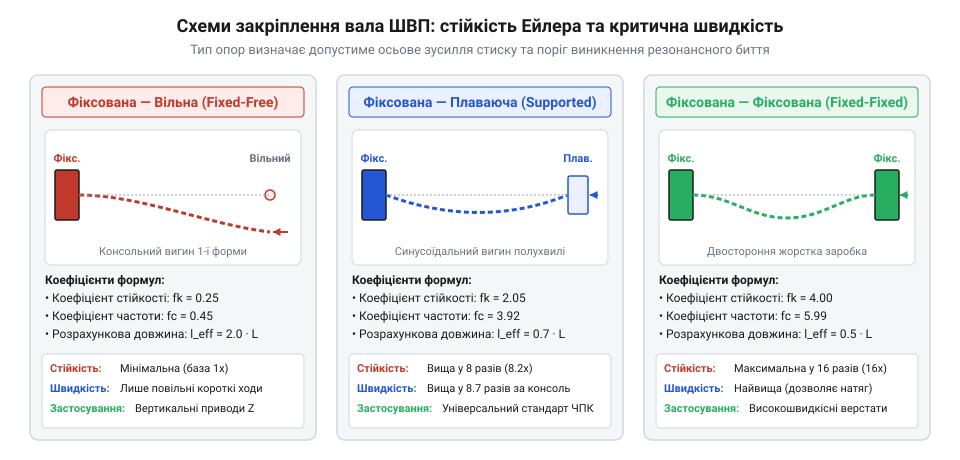
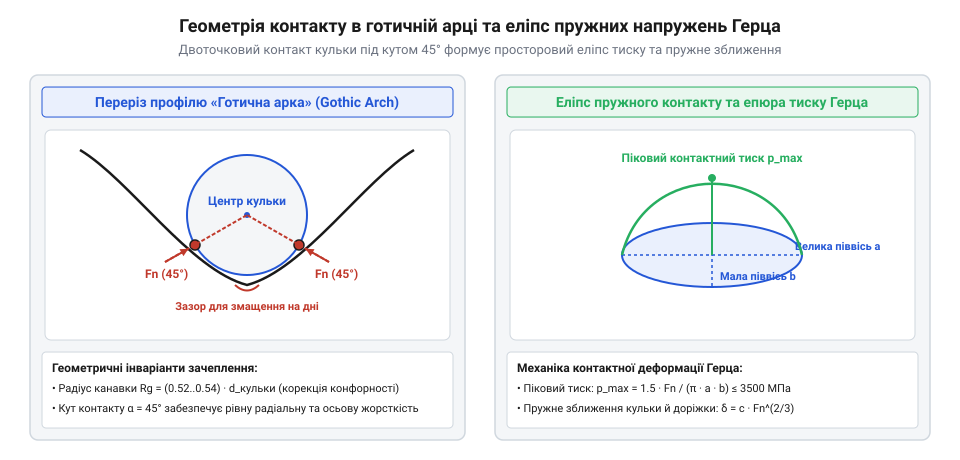

# Кулькова гвинтова пара (ШВП) та ходовий гвинт: класи точності, попередній натяг і кінематика люфту

## Поздовжній вигин гвинта за Ейлером: диференціальне рівняння пружної лінії, граничне стискальне навантаження F_cr та коефіцієнти крайових умов закріплення опор

При роботі кулькової гвинтової передачі вал зазнає комбінованого навантаження: крутного моменту обертання та осьової сили реакції від переміщення каретки. У режимі реверсу або штовхання важкої маси вал працює на осьовий стиск. Оскільки довжина ходового гвинта `L` зазвичай у десятки разів перевищує його внутрішній діаметр впадин різьби `d_r` (гнучкість стрижня `λ_flex = L / i >> 100`), основним критерієм механічної міцності стає стійкість проти поздовжнього згину за Ейлером.

Рівновага пружної лінії вигнутого стрижня описується лінійним диференціальним рівнянням четвертого порядку:
```
E · I · (d⁴w / dx⁴) + F · (d²w / dx²) = 0
```
де:
- `E` — модуль пружності матеріалу вала (для загартованої конструкційної сталі `E ≈ 2.06 · 10⁵` МПа);
- `I` — осьовий момент інерції поперечного перерізу тіла гвинта за внутрішнім діаметром впадин різьби:
```
I = (π · d_r⁴) / 64
```
- `F` — прикладена осьова стискальна сила;
- `w(x)` — функція прогину осі гвинта.

Граничне критичне навантаження втрати стійкості (випинання) ідеально прямого стрижня `F_cr` знаходиться інтегруванням крайової задачі для відповідних умов спирання кінців гвинта:
```
F_cr = λ_b · (π² · E · I) / L²
```
де `λ_b` — безрозмірний коефіцієнт закріплення опор:
1. **Нерухомо – Вільно (Fixed – Free):** консольне кріплення вала на одному кінці, другий кінець вільний: `λ_b = 0.25`;
2. **Оперто – Оперто (Supported – Supported / Simple – Simple):** обидва кінці утримуються радіальними плаваючими підшипниками: `λ_b = 1.00`;
3. **Нерухомо – Оперто (Fixed – Supported):** один кінець затиснутий радіально-упорним дуплексом підшипників, протилежний — плаваючим радіальним: `λ_b = 2.05`;
4. **Нерухомо – Нерухомо (Fixed – Fixed):** обидва кінці вала жорстко затиснуті дуплексними радіально-упорними підшипниковими опорами: `λ_b = 4.00`.

Проте в реальних верстатах ідеально прямих валів не існує: через термообробку та залишкові напруження після шліфування довгий гвинт завжди має початкову стрілу прогину (непрямолінійність) `e_0 = w_0(x)`. При прикладанні осьового стиску `F` реальний прогин починає наростати за нелінійним законом задовго до досягнення ейлерової критичної сили:
```
w_total(x) = e_0 · sin(π · x / L) / (1 - F / F_cr)
```
Якщо відношення навантаження до критичної сили сягає `F / F_cr = 0.75`, початкова кривина ампліфікується у 4 рази. Додатковий згинальний момент `M_bend = F · w_total` різко збільшує напруження в крайніх волокнах вала:
```
σ_max = F / A_core + (F · w_total · (d_r / 2)) / I
```
де `A_core = π · d_r² / 4`.

Коли сумарні напруження `σ_max` досягають межі текучості сталі `σ_y ≈ 900–1100 МПа`, у металі виникають незворотні пластичні деформації, і гвинт втрачає прямолінійність назавжди.

Для врахування реальної кривизни вала в інженерній практиці застосовують модифікований коефіцієнт зниження несучої здатності за формулою Ренкіна-Гордона або коефіцієнт початкового ексцентриситету Ейлера-Ясинського:
```
F_cr_real = F_cr / ( 1 + (e_0 · d_r / (2 · i²)) · (1 / cos( (π / 2) · √(F / F_cr) )) )
```
де `i = √(I / A_core) = d_r / 4` — радіус інерції перерізу вала. Якщо для прецизійного вала класу точності C3 початкове биття на довжині 1 м складає `e_0 = 0.03` мм, зниження критичної сили становить лише 3–5%. Але для прокатної транспортної ШВП класу C7 із початковим прогином `e_0 = 0.20` мм критичне навантаження падає на 25–35%.


*Схеми закріплення вала ШВП та їх вплив на критичну силу вигину й резонансну швидкість.*

> 🔧 **Навіщо це.** Жорстке фіксування обох кінців вала (`Fixed – Fixed`, `λ_b = 4.00`) не лише збільшує граничну стійкість на стиск у 16 разів порівняно з консольною схемою, але й створює зустрічний згинальний момент на опорах, що зменшує прогин від початкової кривизни більш ніж утричі.

Для гарантування безпечної експлуатації максимальне осьове навантаження `F_max` повинно відповідати умові запасу стійкості:
```
F_allow = F_cr / n_safety
```
де нормативний коефіцієнт запасу за стандартом ISO 3408 обирається в діапазоні `n_safety = 2.5–3.5` залежно від динамічності навантаження.

## Згинальний резонанс та критична частота обертання: динамічна модель обертового вала, явище згинального биття (хлиста) та коефіцієнти запасу

Обертання довгого гнучкого вала неминуче супроводжується динамічними явищами. Навіть найточніше шліфований вал має залишковий мікроексцентриситет маси `e_m` відносно геометричної осі обертання та статичний прогин від власної ваги `δ_grav = (5 · m_line · g · L⁴) / (384 · E · I)`.

Під час обертання відцентрова сила інерції намагається вигнути вал у радіальному напрямку, чому протидіє пружна сила вигину. Якщо кутова швидкість обертання `ω` наближається до власної частоти поперечних згинальних коливань вала `ω_n`, виникає явище резонансного згинального биття — так званий ефект «хлиста» (whipping). Амплітуда биття гвинта різко зростає, спричиняючи руйнування бігових доріжок гайки, викришування кульок і катастрофічну відмову підшипникових вузлів.

Динаміка поперечних коливань описується рівнянням вільного вигину балки з погонною масою `m_line = ρ_steel · (π · d_r² / 4)`:
```
E · I · (∂⁴w / ∂x⁴) + m_line · (∂²w / ∂t²) = 0
```

Перша критична швидкість обертання гвинта `n_cr` (в обертах за хвилину, об/хв) визначається аналітичним виразом:
```
n_cr = (60 · λ_w² / (2 · π · L²)) · √( (E · I) / m_line )
```
де `λ_w` — фундаментальний хвильовий коефіцієнт форми власних коливань для різних схем закріплення:
1. **Нерухомо – Вільно:** `λ_w = 1.875`;
2. **Оперто – Оперто:** `λ_w = π ≈ 3.142`;
3. **Нерухомо – Оперто:** `λ_w = 3.927`;
4. **Нерухомо – Нерухомо:** `λ_w = 4.730`.

Підставивши константи конструкційної сталі (`E = 2.06 · 10¹¹` Па, `ρ_steel = 7850` кг/м³), отримуємо зручну інженерну формулу розрахунку критичної швидкості:
```
n_cr = f_support · (d_r / L²) · 10⁷   [об/хв]
```
де `d_r` та `L` виражені в міліметрах, а коефіцієнт типу опор `f_support` дорівнює:
- `f_support = 0.43` для схеми Нерухомо – Вільно;
- `f_support = 1.21` для схеми Оперто – Оперто;
- `f_support = 1.88` для схеми Нерухомо – Оперто;
- `f_support = 2.74` для схеми Нерухомо – Нерухомо.

Розглянемо числовий приклад розрахунку для типового верстатного гвинта номінальним розміром 25×5 мм (зовнішній діаметр `d_nom = 25` мм, крок `P = 5` мм, діаметр тіла за впадинами різьби `d_r = 21.4` мм) з робочою довжиною між опорами `L = 1000` мм.

Розрахуємо першу критичну швидкість обертання `n_cr` та граничну допустиму швидкість `n_max = 0.80 · n_cr` для всіх чотирьох схем закріплення опор:

1. **Схема Нерухомо – Вільно (Fixed – Free):**
```
n_cr = 0.43 · (21.4 / 1000²) · 10⁷ ≈ 920 об/хв
n_max = 0.80 · 920 ≈ 736 об/хв
```
Максимальна швидкість лінійної подачі становить лише `v_max = (736 · 5) / 1000 ≈ 3.68` м/хв. На такій консольній схемі верстат приречений на низьку продуктивність.

2. **Схема Оперто – Оперто (Supported – Supported):**
```
n_cr = 1.21 · (21.4 / 1000²) · 10⁷ ≈ 2589 об/хв
n_max = 0.80 · 2589 ≈ 2071 об/хв
```
Максимальна швидкість подачі зростає до `v_max = (2071 · 5) / 1000 ≈ 10.35` м/хв.

3. **Схема Нерухомо – Оперто (Fixed – Supported):**
```
n_cr = 1.88 · (21.4 / 1000²) · 10⁷ ≈ 4023 об/хв
n_max = 0.80 · 4023 ≈ 3218 об/хв
```
Максимальна швидкість лінійної подачі досягає `v_max ≈ 16.09` м/хв.

4. **Схема Нерухомо – Нерухомо (Fixed – Fixed):**
```
n_cr = 2.74 · (21.4 / 1000²) · 10⁷ ≈ 5864 об/хв
n_max = 0.80 · 5864 ≈ 4691 об/хв
```
Швидкість подачі сягає `v_max = (4691 · 5) / 1000 ≈ 23.45` м/хв — це більш ніж у 6 разів вище, ніж при консольному закріпленні вала.

Цей числовий розрахунок наочно демонструє, чому високошвидкісні обробні центри завжди використовують жорстке двостороннє закріплення вала дуплексними радіально-упорними підшипниками або переходять на схему з нерухомим гвинтом і обертовою гайкою, де вал не обертається взагалі, а явище згинального резонансу усувається в зародку.

Максимальна допустима робоча частота обертання `n_max` повинна становити не більше 80% від першої резонансної частоти:
```
n_max ≤ 0.80 · n_cr
```
Це створює 20-відсотковий частотний коридор безпеки, що гарантує відсутність самозбудження паразитних згинальних коливань вала у всьому діапазоні робочих швидкостей верстата.

## Контактна механіка Герца для кулькових пар: геометрія профілю готичної арки, еліпс деформації контакту кульки з біговою доріжкою та піковий тиск p_max

У кульковій гвинтовій передачі взаємодія сталевих кульок із біговими доріжками гвинта й гайки являє собою пружний точковий контакт опуклих тіл складної просторової геометрії. Класичний радіусний профіль канавки спричиняє двоточковий контакт по дну впадини, що унеможливлює вибір люфту без заклинювання. Тому в прецизійному верстатобудуванні застосовують профіль «готична арка» (Gothic arch), утворений поєднанням двох кругових дуг однакового радіуса `r_groove > r_ball`, центри яких рознесені на величину зміщення `Δx_center`.

Завдяки такій формі канавки кулька стикається з кожною біговою доріжкою не по центру, а під фіксованим кутом контакту `α` (типово `α = 45°`).


*Геометрія контакту кульки в профілі готичної арки та еліпс пружних напружень Герца.*

Під дією нормальної контактної сили `Q_contact` сфера кульки та жолоб деформуються за класичною теорією Генріха Герца. Початковий точковий контакт розширюється у контактний еліпс із півосями `a` (велика піввісь вздовж витка канавки) та `b` (мала піввісь упоперек канавки):
```
a = μ_H · ∛( (3 · Q_contact · Σρ_inv) / (2 · E_star) )
b = ν_H · ∛( (3 · Q_contact · Σρ_inv) / (2 · E_star) )
```
де:
- `E_star` — приведений модуль пружності контактуючих тіл:
```
1 / E_star = (1 - ν_1²) / E_1 + (1 - ν_2²) / E_2
```
Для однакової загартованої хромистої підшипникової сталі 100Cr6 (ШХ15) з `E = 2.06 · 10⁵` МПа і `ν = 0.3` маємо `E_star ≈ 1.13 · 10⁵` МПа;
- `Σρ_inv` — сума головних кривин поверхонь у точці контакту;
- `μ_H`, `ν_H` — табличні трансцендентні коефіцієнти Герца, які визначаються кутом кривини `cos(θ_H)`.

Ключовим параметром геометрії доріжки є коефіцієнт конформності (osculation factor) `f_conf`:
```
f_conf = r_groove / (2 · r_ball) = r_groove / d_ball
```
Значення `f_conf` визначає ступінь кривизни жолоба відносно сфери кульки і лежить у діапазоні `0.515 ≤ f_conf ≤ 0.560`.

Вплив конформності на механіку контакту має виражений компромісний характер:
1. **Щільна конформність (`f_conf → 0.515–0.520`):** радіус канавки майже дорівнює радіусу кульки. Сума головних кривин `Σρ_inv` різко спадає, завдяки чому площа еліпса контакту `A_ellipse = π · a · b` збільшується на 40–60%. У результаті максимальний контактний тиск Герца `p_max` суттєво падає:
```
p_max = (3 · Q_contact) / (2 · π · a · b)
```
Це збільшує статичну вантажопідйомність `C_0` та втомну довговічність за формулою Лундберга-Пальмгрена (`L_10 ~ p_max⁻⁹`). Проте через різницю відстаней від осі обертання кульки до різних точок широкого еліпса виникає значне диференціальне проковзування (Heathcote slip). Коефіцієнт тертя зростає у 2–3 рази, спричиняючи інтенсивне нагрівання передачі.
2. **Вільна конформність (`f_conf → 0.550–0.560`):** контактний еліпс звужується, проковзування Хіткота зникає, пара вирізняється високим ККД (`η > 95%`) і легким ходом. Проте піковий тиск `p_max` під навантаженням різко зростає, перевищуючи критичний поріг 3200–3500 МПа, що створює ризик пластичного пом'яття (brinelling) та поверхневого викришування.

У сучасному верстатобудуванні канонічним стандартом для прецизійних ШВП є вибір конформності `f_conf = 0.525–0.535`, що забезпечує запас за контактними напруженнями `p_max ≤ 2800 МПа` при помірному тепловиділенні.

Пружне зближення центрів кульки та канавки `δ_H` пов'язане з нормальною силою нелінійним законом:
```
δ_H = c_Hertz · Q_contact^(2/3)
```
де коефіцієнт контактної податливості `c_Hertz` безпосередньо обчислюється через параметри еліпса Герца та коефіцієнт конформності `f_conf`.

## Попередній натяг і баланс пружного зближення: двоточковий та чотириточковий контакт, вибір величини попереднього натягу F_pre та мінімізація втрат довговічності

Нелінійна залежність пружного зближення Герца від сили (`δ ~ Q^(2/3)`) лежить в основі феноменального зростання жорсткості ШВП при створенні попереднього натягу (preload).

Диференціальна контактна жорсткість одиничного контакту дорівнює похідній сили за деформацією:
```
K_contact = dQ / dδ = (3 / (2 · c_Hertz^(3/2))) · √δ = const · Q^(1/3)
```
З формули видно: чим більше попереднє навантаження `Q_pre`, тим крутішою стає характеристика жорсткості вузла.

> 🔧 **Навіщо це.** Завдяки попередньому натягу кулькова пара працює на крутій ділянці пружної кривої Герца: додаткова зовнішня сила різання викликає в рази меншу пружну деформацію, ніж у системі без натягу.

Розглянемо кінематичний баланс спареної гайки із зусиллям попереднього натягу `F_pre`. При додатку зовнішньої осьової робочої сили `F_ext`:
- Навантаження на робочу півгайку зростає: `F_1 = F_pre + ΔF_1`;
- Навантаження на допоміжну півгайку розвантажується: `F_2 = F_pre - ΔF_2`.

Оскільки деформація обох півгайок є спільною (`δ_total = δ_1 + δ_2`), точка повного розвантаження допоміжної гайки (`F_2 = 0`, тобто початок втрати попереднього натягу) наступає за умови:
```
F_ext_lift = 2.83 · F_pre
```
Звідси випливає фундаментальне інженерне правило вибору попереднього натягу:
```
F_pre = F_ext_max / 2.83 ≈ 0.35 · F_ext_max
```
Зазвичай виробники обмежують натяг значенням `F_pre = (0.05–0.10) · C_a`, де `C_a` — базова динамічна вантажопідйомність ШВП.

Надмірний попередній натяг небезпечний: він створює постійне додаткове навантаження на кульки навіть за відсутності корисного руху. Момент опору холостого ходу від попереднього натягу дорівнює:
```
T_preload = (F_pre · P_lead) / (2 · π) · (1 - η_reverse)
```
де `P_lead` — крок різьби, а `η_reverse ≈ 0.90` — ККД у зворотному напрямку. Цей момент повністю перетворюється на тепло всередині гайки.

Розглянемо практичний інженерний приклад розрахунку нагрівання гайки ШВП типорозміру 32×10 мм (діаметр `d_nom = 32` мм, крок `P_lead = 10` мм) із попереднім натягом спареними гайками `F_pre = 3000` Н під час швидкісного холостого переміщення каретки на частоті обертання `n = 2400` об/хв (`ω = 251.3` рад/с, лінійна швидкість подачі `v = 24` м/хв).

1. Момент опору холостого ходу від попереднього натягу:
```
T_preload = (3000 · 0.010) / (2 · π) · (1 - 0.90) ≈ 0.477 Н·м
```
2. Потужність тепловиділення в зачепленні гайки:
```
P_heat = T_preload · ω = 0.477 · 251.3 ≈ 120.0 Вт
```
3. Оцінимо стаціонарне нагрівання корпусу гайки без активного охолодження. Площа зовнішньої тепловіддачі гайки становить приблизно `A_nut ≈ 0.045 м²`, а коефіцієнт конвективної тепловіддачі до повітря `h_conv ≈ 20 Вт/(м²·К)`.
Температурний перегрів відкритої гайки склав би:
```
ΔT_steady = P_heat / (h_conv · A_nut) = 120 / (20 · 0.045) ≈ 133.3 °C
```
Таке катастрофічне перегрівання призвело б до коксування мастила, теплового розширення гайки та заклинювання кульок.

Саме тому в реальних верстатах з ЧПК застосовують два обов'язкових заходи:
- Тепловідвід у масивний сталевий корпус каретки верстата через шліфований фланець (тепловий опір контакту `R_th_contact ≈ 0.08 К/Вт`), що знижує перегрів до `ΔT ≈ 15–20 °C`;
- Централізовану циркуляцію термостабілізованої мастильної оливи з витратою `Q_oil = 1.2` л/хв, яка виносить до 80% теплоти тертя безпосередньо з зони контакту кульок, обмежуючи перегрів вузла безпечною величиною `ΔT ≤ 3–5 °C`.

Крім того, ресурс ШВП падає пропорційно кубу еквівалентного навантаження за формулою номінальної довговічності ISO 3408:
```
L_10 = (C_a / F_equiv)³ · 10⁶   [обертів]
```
Тому проектування попереднього натягу завжди є компромісом між вимогою нульового люфту й високої осьової жорсткості з одного боку та допустимим тепловиділенням і строком служби підшипника з іншого.
