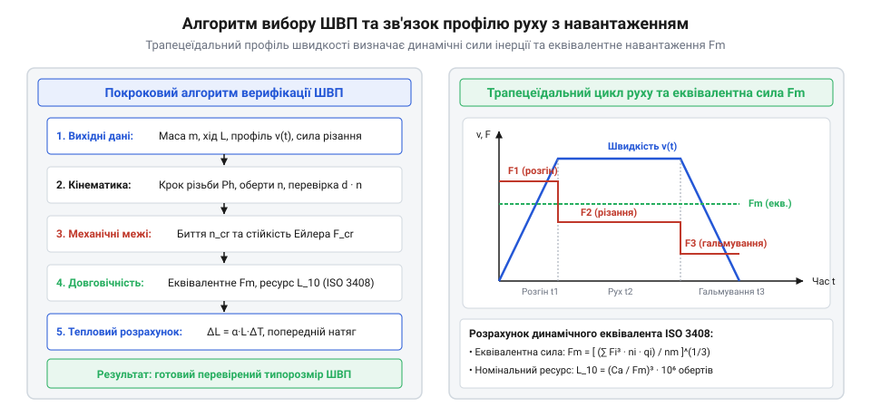
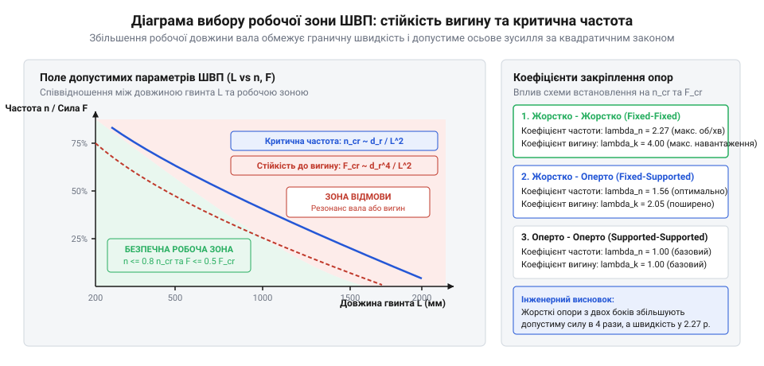

# Кулькова гвинтова пара (ШВП) та ходовий гвинт: класи точності, попередній натяг і кінематика люфту

## Вхідні кінематичні вимоги та навантажувальний цикл: розрахунок еквівалентної сили F_m і частоти обертання n_m за трапецеїдальним профілем руху

Проєктування кульково-гвинтової передачі (@@en|ball screw@@) для прецизійної лінійної осі верстата з ЧПК або промислового робота починається з аналізу кінематичного циклу переміщення робочого органу. На відміну від статичних механізмів, де розрахунок ведеться за піковим навантаженням, довговічність підшипників кочення підпорядковується законам втомного руйнування металу при контактних напруженнях Герца. Оскільки лінійна каретка в процесі обробки змінює режими — від швидкого холостого ходу до повільного силового фрезерування чи точіння, гвинт зазнає змінного в часі осьового навантаження F_i та обертається з різною частотою n_i.


*Структурна схема інженерного підбору ШВП: дискретизація трапецеїдального графіка швидкості та розрахунок еквівалентних динамічних параметрів за ISO 3408.*

Трапецеїдальний профіль руху поділяють на характерні фази: прискорення маси вузла, сталий рух із робочою швидкістю різання, сповільнення каретки та холосте повернення. Для кожної i-ї фази тривалістю t_i (або з часткою часу q_i = t_i / t_total) визначають кутову швидкість обертання гвинта:

```
n_i
= (v_linear_i · 60) / P_lead                                    [частота обертання вала ШВП за лінійною швидкістю каретки, об/хв]
```

Осьова сила F_i на кожному кроці складається з корисної сили різання F_cut, сили опору тертя в лінійних напрямних F_friction = mu · (m_table + m_workpiece) · g та динамічної інерційної сили розгону чи гальмування F_dyn = (m_table + m_workpiece) · a_linear:

```
F_i
= F_cut_i + mu · m_total · g + m_total · a_i                    [сумарне осьове навантаження на кульковий гвинт на i-му інтервалі]
```

На додаток до сил опору напрямних значний внесок у сумарний баланс навантаження робить тертя всередині самої кулькової гайки. Прецизійні торцеві контактні очисники (@@en|wiper seals@@), які захищають доріжки кочення від проникнення абразивної металевої стружки та пилу охолоджувальної емульсії, щільно охоплюють гвинтовий профіль вала, створюючи неперервний опір обертанню. Разом із внутрішнім тертям кочення та ковзання кульок, гідродинамічним зсувом шару пластичного мастила або оливи вони формують динамічний момент холостого ходу (@@en|drag torque@@) T_idle:

```
T_idle
= T_seal + T_preload + T_visc                                   [момент холостого опору обертанню ненавантаженої кулькової гайки, Н·м]
```

де момент тертя ущільнень T_seal становить 0.1–0.4 Н·м залежно від матеріалу кромок (нітрильний каучук NBR, флуороеластомер FKM або пресований повсть) та якості шліфування різьби; T_preload — внутрішній момент пружного контакту попередньо натягнутих кульок, а T_visc — швидкісна складова гідродинамічного перемішування мастила, що нелінійно зростає з підвищенням частоти n_i. Цей сумарний момент опору створює постійне додаткове еквівалентне осьове навантаження на гвинт:

```
F_drag
= (2 · pi · T_idle · eta_p) / P_lead                            [еквівалентна осьова сила опору від тертя ущільнень і мастила, Н]
```

де eta_p — прямий механічний ККД передачі (типово 0.90–0.95). Сила F_drag спрямована завжди проти напрямку відносного переміщення каретки: під час прямого робочого ходу вона віднімається від корисної тяги привода, а при швидкому холостому реверсі істотно навантажує двигун та підшипники опор.

За стандартом ISO 3408 змінний навантажувальний спектр приводять до єдиного сталого еквівалентного режиму — середньої частоти обертання n_m та кубічного середньозваженого навантаження F_m:

```
n_m
= sum(n_i · q_i)                                                [еквівалентна середня частота обертання за повний цикл роботи]
```

```
F_m
= (sum(F_i³ · n_i · q_i) / n_m)^(1/3)                           [еквівалентна динамічна осьова сила за критерієм кубічної втоми Герца]
```

Кубічна степінь у формулі еквівалентної сили відображає степеневу залежність контактної втоми точкового контакту загартованих сталевих кульок із гвинтовими доріжками кочення. Навіть короткочасні сплески зусилля під час розгону роблять визначальний внесок у знос робочих поверхонь канавок різьби.

Під час повного розрахунку навантажувального циклу підшипникових вузлів верстата інженер повинен обов'язково враховувати внутрішні термічні зусилля, що виникають при розігріві гвинта. Якщо передача встановлена за кінематичною схемою з двосторонньою жорсткою фіксацією («Fixed-Fixed»), вільне температурне подовження сталевого стрижня стримується нерухомими корпусними опорами станини, породжуючи потужне внутрішнє зусилля температурного розпирання F_thermal:

```
F_thermal
= E_steel · A_core · alpha_steel · delta_T                      [осьова реакція температурного розпирання на підшипникові опори, Н]
```

де `A_core = pi · d_r² / 4` — площа суцільного поперечного перерізу сердечника вала. Для стандартного гвинта номінальним діаметром 25 мм із внутрішнім діаметром d_r = 21.4 мм робочий нагрів усього на 10 °C генерує додаткову осьову силу реакції понад 8.7 кН. Це зусилля безпосередньо передається на радіально-упорні прецизійні дуплексні підшипники опор (серії 72xx або 70xx), різко підвищуючи їхній внутрішній контактний тиск, провокуючи лавиноподібне саморозігрівання мастила та багаторазово скорочуючи розрахунковий ресурс підшипникового вузла.

> 🔧 **Навіщо це.** Заміна змінного навантаження еквівалентною парою (F_m, n_m) дозволяє інженеру розраховувати довговічність складної траєкторії обробки як один стаціонарний режим за базовою формулою каталожної вантажопідйомності ISO 3408.

## Верифікація за динамічною вантажопідйомністю C_a та номінальною довговічністю L_10: вибір попереднього натягу спарених гайок

Отримавши значення еквівалентної динамічної сили F_m та частоти n_m, інженер виконує перевірку розрахункового ресурсу кулькової гайки. За каталогами виробників (HIWIN, THK, NSK) для вибраного діаметра гвинта d_nom і кроку різьби P_lead вибирають базову динамічну вантажопідйомність C_a. Номінальна втомна довговічність L_10 (ресурс, якого досягають щонайменше 90% партії ідентичних передач без ознак лущення металу) обчислюється в мільйонах обертів:

```
L_10
= (C_a / (f_w · F_m))³                                          [номінальний ресурс у мільйонах обертів (одиниці 10⁶)]
```

де f_w — коефіцієнт умов експлуатації (від 1.0 для спокійного плавного руху до 1.5–2.0 за наявності ударних навантажень і вібрацій). Для переведення ресурсу в години безперервної експлуатації L_10h використовують співвідношення:

```
L_10h
= (L_10 · 10⁶) / (60 · n_m)                                     [розрахункова довговічність ШВП у годинах роботи]
```

:::code proj-ball-screw-selection-calculator/py/ball_screw_calculator.py 76-99

У прецизійних приводах наявності чистої довговічності L_10 недостатньо: механічний люфт між кульками й канавками унеможливлює точне позиціонування каретки при реверсі напрямку руху. Для ліквідації мертвого ходу та багаторазового підвищення осьової контактної жорсткості застосовують попередній натяг (@@en|preload@@) гайки. Найвищу стабільність забезпечує подвійна гайка зі шліфованою дистанційною шайбою між корпусами (@@en|double nut preload@@), яка розпирає або стискає два ряди кульок із заданою силою F_pr:

```
F_pr
= 0.05 · C_a .. 0.10 · C_a                                      [рекомендований діапазон попереднього натягу подвійної гайки]
```

Попередній натяг створює постійний початковий пружний натяг у зонах контакту, завдяки чому при виникненні зовнішньої осьової сили деформація спареного вузла зростає за нелінійною кривою Герца значно повільніше, усуваючи кутовий і осьовий гістерезис. Проте надмірний натяг (понад 10–12% від C_a) веде до лавиноподібного саморозігріву та скорочення терміну служби передачі.

Важливим інженерним компромісом при проектуванні прецизійного привода є неминуче зниження механічного ККД при підвищенні сили попереднього натягу. У вільній гайці без натягу кульки котяться по канавках із двоточковим контактом за мінімального тертя, а прямий коефіцієнт корисної дії сягає eta_0 = 0.95–0.98. Проте коли спарені гайки розпираються зусиллям F_pr, у готичному профілі різьби виникає чотириточковий стиск, і в зоні пружного еліпса контакту Герца з'являється явище диференційного проковзування Хіткота (@@en|Heathcote slip@@) через різницю лінійних швидкостей на різних радіусах кульки.

Оскільки кут контакту кульок із канавкою становить 40°–45°, краї пружної площадки контакту рухаються з різною коловою швидкістю, викликаючи мікроковзання металу по металу навіть під час ідеального кочення. Це мікроковзання породжує внутрішній момент опору тертя холостого ходу T_pr, що діє постійно:

```
T_pr
= (F_pr · P_lead · (1 - eta_0²)) / (2 · pi · eta_0)             [момент опору обертанню від внутрішнього попереднього натягу гайки, Н·м]
```

При прикладанні зовнішньої осьової сили F_ext сумарний крутний момент на валу двигуна складається з корисного моменту підйому навантаження та постійного внутрішнього гальмівного моменту натягу. Внаслідок цього ефективний робочий ККД передачі eta_eff істотно знижується:

```
eta_eff
= eta_0 · (F_ext / (F_ext + 2.8 · F_pr · (1 - eta_0)))          [ефективний ККД ШВП з урахуванням втрат на внутрішній попередній натяг]
```

На фазах легкого чистового різання або швидких холостих переміщень, коли корисне осьове зусилля значно менше за внутрішній натяг (F_ext < F_pr), ефективний ККД може падати нижче 60–65%. Уся втрачена потужність перетворюється на тепло безпосередньо всередині гайки. Оскільки осьова контактна жорсткість зростає пропорційно лише кубічному кореню з натягу `K_ax ~ F_pr^(1/3)`, а момент тертя і тепловиділення зростають лінійно, підвищення натягу понад 8–10% від C_a дає мізерний приріст жорсткості ціною катастрофічного падіння енергоефективності.

З цієї причини виробники стандартизують класи попереднього натягу: легкий натяг Z0 (до 1–2% C_a) для високошвидкісних легких маніпуляторів з максимальним ККД; середній натяг ZA (близько 5% C_a) для стандартних металорізальних верстатів; важкий натяг ZB (8–10% C_a) для важких портальних верстатів, де жорсткість переважає над енерговитратами. У важких режимах ZB обов'язково впроваджують циркуляційне масляне охолодження або охолодження через порожнистий вал гвинта, інакше розігрів гайки викличе її теплове заклинювання та втомне викришування канавок.

> 🔧 **Навіщо це.** Правильно підібраний попередній натяг усуває мікролюфти лінійної осі без надмірного тепловиділення, гарантуючи верстату повторюваність позиціонування в межах кількох мікрометрів протягом усього розрахункового ресурсу L_10h.

## Перевірка геометричних обмежень вала: стійкість проти поздовжнього вигину за Ейлером та критична швидкість згинального резонансу (whipping)

При збільшенні робочого ходу лінійної осі та швидкості переміщення каретки вирішальними факторами стають геометричні обмеження довгого тонкого вала. Першим критичним бар'єром є стійкість проти поздовжнього вигину (@@en|Euler buckling@@) під дією максимальної осьової сили стиску F_axial. За стандартом ISO 3408 критична сила Ейлера обчислюється через діаметр западин різьби d_r та безопорну довжину L:

```
P_k
= f_k · (d_r⁴ / L²) · 10⁴                                        [критичне осьове зусилля поздовжньої втрати стійкості, Н]
```

де f_k — коефіцієнт схеми закріплення кінців вала: від 0.25 для консольної схеми «Fixed-Free» до 2.05 для типової верстатної схеми «Fixed-Supported» та 4.00 для жорстко затисненої пари «Fixed-Fixed». Допустиме робоче стискальне навантаження призначають із коефіцієнтом запасу стійкості S_k = 2.5:

```
P_perm
= P_k / S_k                                                     [допустиме осьове зусилля стиску кулькового гвинта]
```


*Діаграма вибору робочої зони ШВП: перетин кривих критичної сили Ейлера та швидкості биття визначає допустиму довжину вала.*

Другим небезпечним явищем є згинальний резонанс вала (@@en|screw whipping@@). При досягненні критичної частоти обертання n_cr відцентрові сили власного дисбалансу гвинта збігаються з першою власною частотою поперечних коливань балки, викликаючи різке зростання амплітуди биття та руйнування гайки:

```
n_cr
= f_c · (d_r / L²) · 10⁷                                        [критична частота обертання першої згинальної моди, об/хв]
```

Максимальна робоча швидкість обертання не повинна перевищувати 80% від критичної: `n_perm = 0.8 · n_cr`. Додатково перевіряють швидкісний фактор контакту кульок `d_nom · n <= 70000 .. 100000`, що лімітується відцентровими силами кульок у поворотному каналі вкладиша.

:::code proj-ball-screw-selection-calculator/py/ball_screw_calculator.py 100-140

Критичним фактором, що істотно знижує фактичну межу згинального резонансу в реальному верстаті порівняно з ідеальними аналітичними формулами, є наявність радіальних зазорів та контактної піддатливості в підшипниках кінцевих опор. Класична формула частоти биття виведена в припущенні абсолютно жорстких опорних вузлів («Fixed» як нерухоме защемлення без кутового повороту, або «Supported» як шарнір із нульовим радіальним люфтом). Проте стандартні радіальні кулькові підшипники або зношені вузли мають внутрішній початковий радіальний люфт delta_rad порядку 10–30 мкм, а корпусні обойми під дією сил різання зазнають пружної податливості.

Радіальний зазор послаблює граничні умови закріплення балки: номінальне затиснення «Fixed» перетворюється на частково податливе шарнірне спирання, а опертий кінець «Supported» деградує в напрямку вільного консольного кінця «Free». Внаслідок цього коефіцієнт схеми закріплення f_c різко падає. Наприклад, для популярної схеми «Fixed-Supported» каталожний коефіцієнт f_c = 3.92 через наявність зазорів зменшується до ефективного значення 2.4–2.8. Відповідно, фактична резонансна частота n_cr падає на 20–35% нижче розрахункової.

Динамічну взаємодію гвинта та опор описують моделлю послідовно з'єднаних пружностей. Сумарна податливість коливальної системи є сумою згинальної податливості сталевого вала та радіальної податливості підшипникових опор:

```
1 / (omega_eff²)
= 1 / (omega_beam²) + 1 / (omega_bearing²)                      [ефективна кругова резонансна частота згинальних коливань з урахуванням жорсткості опор]
```

де `omega_bearing = sqrt(2 · K_rad_brg / m_screw)` — парціальна власна частота коливань вала на пружних опорах із радіальною жорсткістю K_rad_brg, а m_screw — розподілена маса вала.

Коли частота обертання наближається до зниженої резонансної межі, радіальний зазор підшипника перестає бути пасивною величиною і перетворюється на траєкторію ударної прецесії вала. Замість гладкого обертання шийка гвинта починає обкочуватися по доріжках підшипника з мікроударами, викликаючи бринелювання (@@en|brinelling@@) доріжок кочення, розбивання посадкових отворів у корпусі та катастрофічну вібрацію.

Тому в прецизійних верстатах з ЧПК для фіксованих опор застосовують виключно спеціальні спарені радіально-упорні кулькові підшипники з кутом контакту 60° (наприклад, серій NSK TAC або SKF BSA) із заводським негативним внутрішнім зазором (жорстким попереднім натягом), які гарантують радіальну жорсткість вузла понад 1000–1500 Н/мкм та зберігають розрахункову швидкість биття.

> 🔧 **Навіщо це.** Одночасна перевірка стійкості та биття рятує від поширеної помилки, коли за номінальним зусиллям вибирають занадто тонкий гвинт, який на великому вильоті починає вібрувати й деформуватися вже на половині номінальних обертів.

## Тепловий розрахунок видовження гвинта ΔL та термосиметричне попереднє розтягування вала: повний консольний сценарій розрахунку

Під час високоінтенсивної роботи з частими реверсами тертя кочення кульок у натягнутій гайці та тепловиділення в опорних підшипниках нагрівають сталевий вал на delta_T = 5–15 °C відносно масивної станини. Вільне теплове лінійне подовження гвинта становить:

```
delta_L
= alpha_steel · L · delta_T                                     [абсолютне теплове видовження вала ШВП, мм]
```

При довжині гвинта L = 1000 мм та локальному нагріві delta_T = 10 °C подовження досягає 117 мкм, що вдесятеро перевищує допуск позиціонування прецизійних класів C3 та C5.

Для компенсації температурного дрейфу застосовують технологію механічного попереднього розтягування вала (@@en|thermal pre-stretch@@). Гвинт встановлюють за схемою «Fixed-Fixed» і під час монтажу видовжують за допомогою спеціальних гайок натягу з розрахунковим зусиллям F_prestretch:

```
F_prestretch
= alpha_steel · delta_T · E_steel · A_core                      [осьове зусилля попереднього натягу вала на холодну, Н]
```

де `A_core = pi · d_r² / 4` — площа суцільного перерізу сердечника. У міру розігріву гвинта в роботі теплове розширення не подовжує вал і не вигинає його, а лише компенсує початковий пружний натяг, зберігаючи абсолютну стабільність кроку різьби в межах мікрона.

:::code proj-ball-screw-selection-calculator/cpp/main.cpp 15-40

> 🔧 **Навіщо це.** Попереднє розтягування вала в схемі Fixed-Fixed перетворює тепловий нагрів з джерела незворотного викривлення деталі на контрольоване розвантаження натягу, підтримуючи точність верстата протягом усієї багатозмінної експлуатації.
