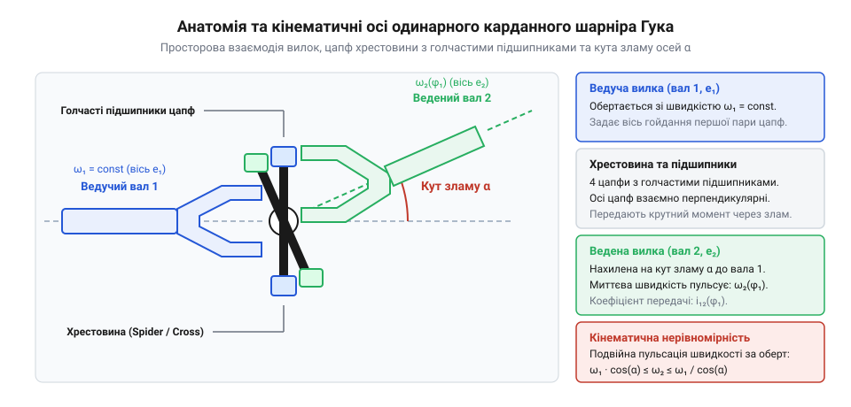
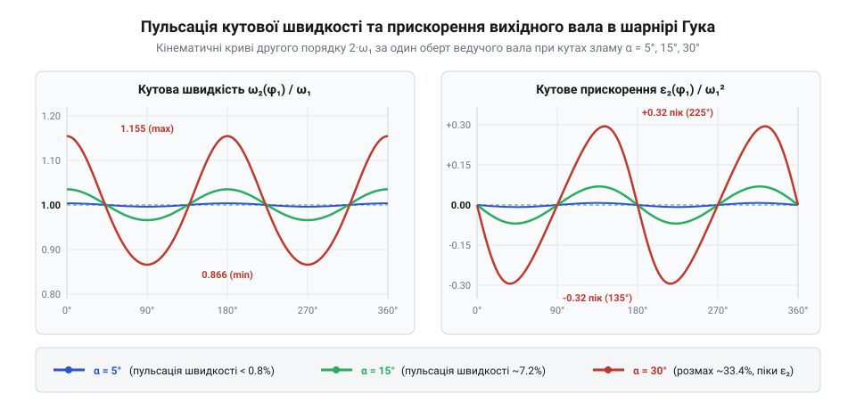
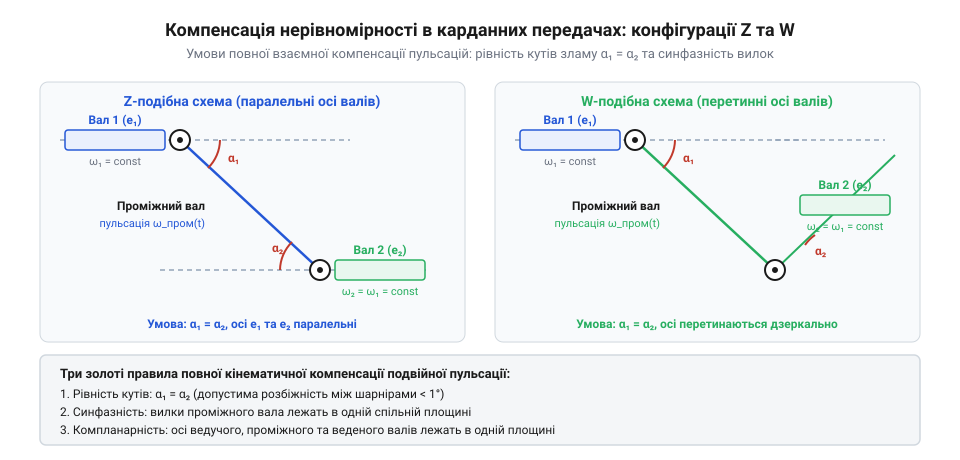
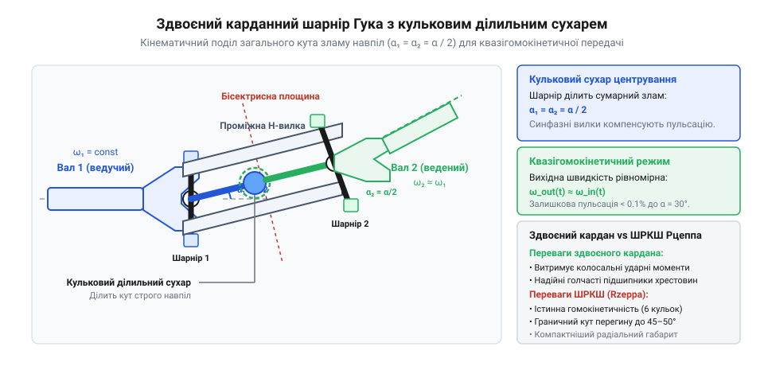

# Карданний шарнір Гука: нерівномірність передачі, пульсація швидкості та здвоєні схеми

<preknowlist>
- [Редуктори](root:hw-motion/gears-transmission) — базові поняття передачі обертового моменту, кутової швидкості та механічних втрат.
</preknowlist>

## Чому жорсткий вал не здатен передавати обертання між несоосними агрегатами: кінематичні конфлікти підвіски та просторові зміщення

У механічних приводах машинобудування передача крутного моменту від джерела обертання (електродвигуна, ДВЗ чи редуктора) до кінцевого виконавчого органа рідко відбувається вздовж однієї ідеально прямої лінії. Просторове розташування агрегатів диктується вимогами компонування, а в мобільних роботах і транспортних засобах — динамічною роботою підвіски коліс або гусениць. Коли ведучий міст автомобіля долає нерівності дороги, він безперервно переміщується вгору-вниз відносно кузова на 100–300 мм, через що кут між вихідним валом коробки передач і вхідним валом редуктора головної передачі постійно коливається в межах від кількох градусів до 15–20°.

Спроба з'єднати такі агрегати суцільним жорстким валом веде до миттєвої механічної катастрофи:
- Жорсткий сталевий стрижень під дією кутового перекосу зазнає величезних знакозмінних згинальних напружень sigma_bend;
- За один повний оберт вала кожне його зовнішнє волокно зазнає повного циклу розтягу та стиску, що за лічені секунди призводить до втомного руйнування металу;
- На опорні підшипники вихідного та вхідного вузлів починають діяти колосальні радіальні реакції консольного вигину, які виламують посадкові гнізда корпусів і руйнують обойми підшипників.

Пружні гумометалеві муфти (наприклад, муфти Джубо або дискові пружні елементи) частково вирішують проблему вібрацій, але здатні компенсувати лише мізерні кутові перекоси — зазвичай не більше 1.5°..3°. При кутах понад 5° циклічні деформації еластомеру викликають інтенсивне внутрішнє гістерезисне тепловиділення, температура гуми перевищує 100 °C, і муфта буквально розплавляється або розривається від втомних тріщин.

Таким чином, виникає безкомпромісна інженерна потреба в кінематичному зчленуванні, яке дозволяє валам перетинатися під суттєвими й постійно змінними просторовими кутами, зберігаючи безперервну передачу великого крутного моменту без виникнення паразитних згинальних сил на корпуси підшипників.

> 🔧 **Навіщо це.**
> Чітке розуміння природи кутового перекосу захищає розробника шасі від фатальної помилки: жорстке або напівпружне з'єднання підвішеного редуктора з кузовом неминуче призведе до зрізання вихідного вала мотора при першому ж стрибку машини на вибоїні.

## Будова та просторова кінематика одинарного шарніра Гука: хрестовина та вилки

Класичним інженерним розв'язком задачі передачі моменту між валами, що перетинаються під кутом alpha, став універсальний шарнір, названий на честь англійського природодослідника Роберта Гука (@@en|Hooke's joint@@, або шарнір Кардано). Механізм шарніра вирізняється надзвичайною простотою та компактністю: він складається лише з трьох основних рухомих компонентів — ведучої вилки, веденої вилки та просторового хрестоподібного елемента (хрестовини).

*Просторова схема будови одинарного шарніра Гука: ведуча та ведена вилки, хрестовина, цапфи з голчастими підшипниками та кут зламу осей alpha.*

Обидва вали закінчуються U-подібними вилками (yokes). Кінці вилок мають циліндричні отвори, в яких за допомогою голчастих підшипників або підшипників ковзання встановлюються чотири прецизійні цапфи (шипи) хрестовини. Осі двох пар шипів хрестовини лежать в одній площині, є строго перпендикулярними одна до одної і перетинаються в одній центральній точці — центрі шарніра.

Коли ведучий вал обертається, площина вилки 1 завжди залишається перпендикулярною до осі ведучого вала. Відповідно, цапфи хрестовини, з'єднані з вилкою 1, описують коло в площині, нормальній до вхідного вала. Проте вилка веденого вала 2 нахилена на робочий кут зламу alpha. Друга пара цапф хрестовини змушена рухатися по колу в площині, строго перпендикулярній до осі вихідного вала.

Оскільки всі чотири шипи жорстко сполучені в єдиній хрестовині під кутом 90°, площина хрестовини при кожному оберті здійснює складне просторове хитавильне коливання. Взаємний зв'язок між миттєвим кутом повороту ведучого вала phi_1 та кутом повороту веденого вала phi_2 виводиться зі сферичної тригонометрії:

tg(phi_2) = tg(phi_1) · cos(alpha)

де кути phi_1 та phi_2 відлічуються від положення, коли вісь цапфи ведучої вилки лежить у спільній площині зламу осей валів.

З цього базового рівняння випливає фундаментальна закономірність: якщо кут зламу alpha = 0 (вали співвісні), cos(alpha) = 1, звідки tg(phi_2) = tg(phi_1) і phi_2 = phi_1: вали обертаються синхронно. Проте якщо кути осей перетинаються під ненульовим кутом alpha > 0, cos(alpha) < 1. Тільки у чотирьох точках за один повний оберт (при phi_1 = 0°, 90°, 180°, 270°) кути збігаються (phi_2 = phi_1). У проміжних положеннях вихідний вал то відстає від вхідного, то випереджає його.

У таблиці нижче наведено максимальне кутове відхилення (відставання або випередження) delta_phi_max = |phi_2 - phi_1|_max та відносну амплітуду пульсацій швидкості для типових кутів перегину валопроводу:

| Кут зламу осей alpha | cos(alpha) | Максимальне кутове відставання delta_phi_max | Відносна пульсація швидкості delta_omega | Інженерна придатність одинарного шарніра |
|---|---|---|---|---|
| 2° | 0.9994 | ±0.017° (1 мінута) | 0.12% | Ідеально для довгих валів |
| 5° | 0.9962 | ±0.11° (6.6 мінут) | 0.76% | Допустимо для карданних валів авто |
| 10° | 0.9848 | ±0.44° (26 мінут) | 3.09% | Підвищена вібрація, лише короткочасно |
| 15° | 0.9659 | ±1.00° (60 мінут) | 7.05% | Критичні знакозмінні динамічні навантаження |
| 20° | 0.9397 | ±1.80° (108 мінут) | 12.8% | Руйнівний рівень вібрацій для одинарного кардана |

Одинарний шарнір Гука є кінематично нерівномірною передачею: стале обертання ведучого вала неминуче породжує циклічно пульсуюче обертання вихідного вала.

> 🔧 **Навіщо це.**
> Будова хрестовини на голчастих підшипниках забезпечує колосальну навантажувальну здатність за мінімальної маси, але просторове хитання хрестовини породжує кінематичну нерівномірність, з якою інженер мусить навчитися боротися.

## Кінематична нерівномірність: подвійна пульсація швидкості та динамічний крутний момент

Кінематична нерівномірність одинарного шарніра Гука не є другорядною похибкою виготовлення — це фундаментальна математична властивість просторового перетворення руху. Продиференціювавши базове тригонометричне рівняння tg(phi_2) = tg(phi_1) · cos(alpha) за часом, одержуємо аналітичну формулу для миттєвої кутової швидкості вихідного вала omega_2:

omega_2 = omega_1 · (cos(alpha) / (1 - sin²(alpha) · cos²(phi_1)))

де omega_1 = d(phi_1) / dt — кутова швидкість ведучого вала, яку ми вважаємо строго постійною.

*Криві нерівномірності кутової швидкості та кутового прискорення веденого вала за один оберт ведучого вала при різних кутах зламу осей alpha.*

Аналіз цієї функції виявляє кілька критичних інженерних закономірностей:
1. **Екстремуми швидкості:** вихідна кутова швидкість omega_2 коливається між мінімальним та максимальним значеннями:
   - omega_2,min = omega_1 · cos(alpha) — досягається при phi_1 = 0° та 180°;
   - omega_2,max = omega_1 / cos(alpha) — досягається при phi_1 = 90° та 270°.
2. **Подвоєна частота (2 · omega):** за один повний оберт ведучого вала (360°) вихідна швидкість двічі досягає максимуму і двічі падає до мінімуму. Тобто частота кінематичних коливань рівно вдвічі перевищує частоту обертання вала: f_pulsation = 2 · f_rot.
3. **Коефіцієнт нерівномірності обертання:** відносна амплітуда пульсації швидкості описується коефіцієнтом:
   delta_omega = (omega_2,max - omega_2,min) / omega_1 = (1 / cos(alpha)) - cos(alpha) = sin²(alpha) / cos(alpha) ≈ tg(alpha) · sin(alpha)
   При куті alpha = 5° нерівномірність становить непомітні 0.8%. Проте при куті alpha = 15° нерівномірність досягає 7%, а при alpha = 30° — катастрофічних 29%!

Оскільки вихідний вал неперервно прискорюється й сповільнюється, виникає кутове прискорення epsilon_2 = d(omega_2) / dt. Продиференціювавши вираз швидкості, отримуємо точну аналітичну залежність:

epsilon_2 = -omega_1² · ( (cos(alpha) · sin²(alpha) · sin(2 · phi_1)) / (1 - sin²(alpha) · cos²(phi_1))² )

За наявності масивного маховика чи великого моменту інерції навантаження J_load на вихідному валу це кутове прискорення генерує циклічний знакозмінний динамічний момент:

M_dyn(phi_1) = J_load · epsilon_2(phi_1)

Якщо навантаження має полярний момент інерції J_load = 0.5 кг·м², а вал обертається на n = 1500 об/хв (omega_1 ≈ 157 рад/с) під кутом перегину alpha = 15°, максимальне прискорення сягає epsilon_2,max ≈ 1720 рад/с². Знакозмінний динамічний крутний момент досягає пікового розмаху M_dyn,peak = 0.5 · 1720 ≈ 860 Н·м! Цей величезний знакозмінний момент чотири рази за оберт розтягує та стискає шліци вала з подвоєною частотою 50 Гц, викликаючи катастрофічний крутильний резонанс валопроводу та втомне руйнування вилок.

> 🔧 **Навіщо це.**
> Розрахунок знакозмінного моменту M_dyn є обов'язковим при проектуванні карданних приводів важких роботів і верстатів: якщо власна крутильна частота валопроводу збіжиться з частотою 2·omega, настане резонансний обрив хрестовини або зрізання шпонкових з'єднань.

## Компенсація пульсацій у просторових трансмісіях: Z-подібна та W-подібна схеми валопроводу

Оскільки одинарний карданний шарнір не є гомокінетичним, передавати обертання між несоосними вузлами одним шарніром на високих швидкостях неприпустимо. Класичним розв'язком є застосування двошарнірної карданної передачі, що складається з ведучого вала, проміжного карданного вала з двома шарнірами на кінцях та вихідного веденого вала.

Ідея полягає у взаємній анігіляції пульсацій: якщо другий шарнір створює точно таку ж нерівномірність швидкості, але в протифазі до першого шарніра, кутові коливання проміжного вала повністю взаємно скорочуються, і кінцевий вихідний вал 3 обертається абсолютно синхронно з ведучим валом 1: omega_3(t) = omega_1(t).

*Умови взаємної компенсації пульсацій кутової швидкості в двошарнірних передачах: рівність кутів зламу та розташування вилок проміжного вала в одній площині.*

Для досягнення строгої гомокінетичності двошарнірного валопроводу мають одночасно виконуватися три фундаментальні геометричні правила:
1. **Рівність робочих кутів перегину:** кут перегину першого шарніра alpha_1 мусить бути строго рівним куту перегину другого шарніра alpha_2 (alpha_1 = alpha_2).
2. **Копланарність осей:** осі ведучого, проміжного та веденого валів повинні лежати в одній спільній площині. Це реалізується в двох класичних компонуваннях:
   - **Z-подібна схема:** осі ведучого та веденого валів паралельні між собою, а проміжний вал розташований під кутом до них (типова схема задньопривідного автомобіля з підвішеним редуктором);
   - **W-подібна схема:** осі ведучого та веденого валів перетинаються, утворюючи симетричну трапецію.
3. **Фазове узгодження вилок проміжного вала:** обидві вилки, приварені до кінців проміжного вала, мусять лежати в одній строго спільній площині (фазовий зсув gamma = 0°). Якщо при збиранні шліцьового з'єднання повернути вилку хоча б на один зуб шліца (наприклад, на 15°–30°), пульсації не скомпенсуються, а навпаки — накладуться одна на одну, подвоївши амплітуду вібрацій і руйнуючи підвіску.

Слід пам'ятати: навіть за ідеальної компенсації на вихідному валу сам проміжний вал продовжує обертатися з подвійною пульсацією швидкості 2·omega. Тому його масу та полярний момент інерції прагнуть робити мінімальними, виготовляючи з тонкостінних безшовних труб високої жорсткості.

> 🔧 **Навіщо це.**
> Помилка при складанні шліцьового з'єднання карданного вала (порушення копланарності вилок) — найпоширеніша причина виникнення нестерпної вібрації на швидкості понад 60 км/год після ремонту трансмісії.

## Здвоєний карданний шарнір із центрувальним механізмом як компактний квазі-ШРКШ

Хоча класична двошарнірна карданна передача надійно компенсує пульсації швидкості в Z- та W-подібних конфігураціях, вона вимагає значного просторового рознесення: між двома шарнірами має бути присутній проміжний вал певної фізичної довжини L_inter. Проте в багатьох сучасних конструкціях — наприклад, у приводних маточинах поворотних мостів повнопривідних тракторів, важких будівельних навантажувачів та компактних шарнірах промислових роботів-маніпуляторів — місця для довгого проміжного вала просто немає. Вал повинен зламуватися на кут до 30°–40° у вузлі довжиною всього 150–200 мм.

Розв'язанням цієї інженерної дилеми став здвоєний карданний шарнір Гука (@@en|Double Cardan joint@@). У цьому механізмі два одинарні шарніри Гука об'єднані в єдиний монолітний блок через проміжну сполучну муфту мінімально можливої довжини.

*Будова здвоєного карданного шарніра із кульковим центрувальним механізмом: примусовий поділ кута зламу навпіл та кінематичне порівняння з кульковим ШРКШ.*

Проте самого лише механічного зближення шарнірів недостатньо: щоб система працювала гомокінетично, сумарний кут зламу осей alpha_total мусить у будь-який момент часу ділитися між двома шарнірами строго навпіл:

alpha_1 = alpha_2 = alpha_total / 2

Якщо шарнір залишити без внутрішнього зв'язку, під дією нерівномірного тертя та інерції один шарнір зігнеться на 30°, а другий залишиться прямим (0°). Умова рівності кутів буде порушена, і агрегат почне шалено вібрувати.

Для примусового збереження симетрії всередину здвоєного кардана інтегрують спеціальний центрувальний механізм (@@en|centering ball mechanism@@). Він складається з прецизійної сталевої кулі, закріпленої на кінці ведучого вала, та циліндричного або сферичного гнізда (сухаря), розміщеного на веденому валу. Центр цієї кулі розташований точно на перетині осей цапф проміжного корпусу.

Цей кульковий механізм працює як жорсткий кінематичний ділильний циркуль: він примусово утримує проміжний корпус у бісекторній площині — площині, що ділить кут між вхідним і вихідним валами строго навпіл. Завдяки цьому кути зламу першого й другого шарнірів залишаються строго однаковими за будь-якого маневру, і нерівномірність швидкості повністю самознищується всередині вузла.

Контактні напруження в кульковому сухарі центрувального механізму визначаються реактивним моментом пари сил, що прагне вивести проміжне кільце з бісекторної площини під дією передаваного моменту T_drive:
- Згинальний момент на центрувальний елемент: M_bend = T_drive · tg(alpha_total / 2);
- Радіальна сила реакції в кульковому сухарі при відстані від центру хрестовини L_cross: F_ball = M_bend / L_cross;
- Контактний тиск у сферичному гнізді площею A_proj = pi · d_ball² / 4 обмежують допустимим значенням p_cont = F_ball / A_proj ≤ 60..80 МПа, застосовуючи бронзові або загартовані сталеві втулки з безперервним змащуванням.

Здвоєний кардан працює як компактний квазігомокінетичний шарнір, забезпечуючи плавну передачу обертання на робочих кутах до 35°–42°.

> 🔧 **Навіщо це.**
> Здвоєний кардан — ідеальний вибір для мобільної спецтехніки: він значно міцніший і витриваліший до ударних брудових навантажень, ніж кулькові ШРКШ, і не вимагає герметичних гумових чохлів у важких умовах кар'єру.

## Порівняння з істинними шарнірами рівних кутових швидкостей (Рцеппа, трипоїд)

Незважаючи на успіх здвоєного кардана, для масових передньопривідних легкових автомобілів та високоточних роботів знадобилися шарніри, які є істинно гомокінетичними на рівні самого принципу взаємодії деталей — [шарніри рівних кутових швидкостей (ШРКШ: Рцеппа, трипоїд)](root:hw-motion/cardan-hooke-joint/comp-universal-joint-and-cv-joint-types.md) (@@en|Constant Velocity Joints, CVJ@@).

Фундаментальне геометричне правило гомокінетичності будь-якого просторового зчленування говорить: *передача обертання між двома валами під кутом alpha є строго рівномірною тоді й тільки тоді, коли точки силового контакту ведучої та веденої ланок розташовані в бісекторній площині — площині, яка перпендикулярна до площини перегину осей і ділить кут перегину навпіл.*

Порівняння основних типів сучасних шарнірів виявляє їхні чіткі інженерні ніші:
1. **Шестикульковий шарнір Рцеппа (Rzeppa CVJ):** внутрішня зірочка на валу має шість радіальних канавок, зовнішня обойма — шість відповідних внутрішніх канавок, а між ними розміщено шість прецизійних загартованих кульок, зафіксованих сферичним сепаратором. Профіль канавок виконано за спеціальною меридіональною геометрією: при нахилі валів центри канавок зміщуються, змушуючи сепаратор разом із кульками самовстановлюватися строго в бісекторну площину при будь-якому куті повороту. Шарнір Рцеппа забезпечує бездоганну синхронність обертання на кутах до 45°–48°, що зробило його незамінним на зовнішніх (колісних) кінцях привідних півосей.
2. **Шарнір трипоїдного типу (Tripod CVJ):** складається з трипроменевої зірочки (трипоїда), на шипах якої встановлено сферичні ролики на голчастих підшипниках. Ролики ковзають у трьох поздовжніх пазах зовнішнього тюльпаноподібного корпусу. Трипоїдний шарнір не лише передає обертання з кутом до 25°, але й забезпечує вільне осьове переміщення вала (ход до ±35..50 мм) із надзвичайно низьким опором кочення. Його встановлюють на внутрішньому боці півосі біля коробки передач для компенсації ходу важелів підвіски.

Зіставлення з класичним карданним шарніром Гука підсумовує інженерні компроміси:
- **Кут перегину:** одинарний кардан Гука обмежений тривалим кутом 5°–8° (короткочасно до 15°–20°), тоді як ШРКШ Рцеппа спокійно витримує тривалі кути до 45°;
- **Втрати та нагрів:** на кутах понад 20° у кулькових ШРКШ зростає диференціальне проковзування кульок у канавках, що викликає помітний нагрів вузла; кардан на голчастих підшипниках має менші внутрішні втрати на тертя;
- **Чутливість до забруднення:** хрестовина кардана захищена компактними гумовими сальниками на кожній цапфі й здатна працювати у відкритому середовищі за умови регулярного шприцювання. ШРКШ Рцеппа має великий внутрішній об'єм і потребує обов'язкового еластичного гумового або термопластового пильовика (boot). Якщо пильовик порветься, пил і волога за 200–500 км пробігу перетворюють внутрішнє молібденове мастило на абразивну пасту, що викликає миттєве заклинювання кульок і руйнування обойми.

> 🔧 **Навіщо це.**
> Чітке розуміння спеціалізації шарнірів визначає вибір вузла: кардан незамінний для потужних поздовжніх валів вантажівок і тракторів завдяки колосальній витривалості, тоді як ШРКШ Рцеппа і трипоїд безальтернативні для керованих коліс із великими кутами вивороту.

## Інженерний розрахунок, голчасті підшипники, кути перегину, дисбаланс та мащення

Розрахунок і проектування карданного валопроводу спираються на розрахунок довговічності голчастих підшипників хрестовини, обмеження кутів перегину для уникнення локального втомного зносу та забезпечення динамічного балансування на високих частотах обертання.

Головним навантаженим елементом карданного шарніра є голчасті підшипники (@@en|needle bearings@@), що встановлюються в чашках на чотирьох цапфах хрестовини. Під час обертання вала під кутом alpha шипи хрестовини не здійснюють повного колового обертання в підшипнику: вони здійснюють зворотно-поворотний коливальний рух на кут хитання theta_osc ≈ ±alpha з частотою обертання вала.

Це породжує небезпечне специфічне явище зношування — хибне бринелювання (@@en|false brinelling@@, або фретинг-корозію):
- Якщо робочий кут зламу надто малий (alpha < 1°), голки практично не перекочуються, а лише вібрують на одних і тих самих мікроплямах контакту. Тонка мастильна плівка витискається, виникає локальне мікрозварювання металу, і на цапфах утворюються глибокі поздовжні канавки, що руйнують підшипник.
- Тому мінімальний інженерний кут перегину карданного шарніра завжди обирають не менше alpha_min ≥ 1.5°..2.0°.
- Водночас максимальний тривалий робочий кут для одинарного промислового кардана обмежують alpha_max ≤ 5°..8°. Робота під кутами понад 12° допускається лише короткочасно (при повільному маневруванні техніки), інакше ресурс підшипників падає пропорційно кубу кута перегину.

Розрахунок довговічності голчастих підшипників хрестовини L_10h (у годинах роботи) виконують за адаптованою емпіричною формулою ISO з урахуванням кутового фактора хитання f_alpha:

L_10h = (10⁶ / (60 · n)) · (C_dyn / P_rad)^(10/3) · f_alpha

де:
- C_dyn — динамічна вантажопідйомність підшипника чашки (Н);
- P_rad = M_torque / (2 · R_cross) — радіальна сила на шип хрестовини від передаваного моменту M_torque за радіуса плеча шипів R_cross;
- n — частота обертання вала (об/хв);
- f_alpha = (3° / alpha)^(1/3) — кутовий коефіцієнт довговічності для робочого кута зламу alpha (прийнято f_alpha = 1.0 для базового кута 3°).
Для шарніра з C_dyn = 18 кН при передачі моменту 400 Н·м (P_rad ≈ 5700 Н на плечі R_cross = 35 мм) на частоті n = 1500 об/хв при робочому куті alpha = 4° кутовий коефіцієнт становить f_alpha = (3/4)^(1/3) ≈ 0.91, а розрахунковий ресурс сягає понад 4500 годин безперервної роботи.

Динамічний розрахунок карданного вала на високих частотах обертання вимагає обов'язкової перевірки на критичну швидкість обертання за Ейлером-Бернуллі проти виникнення резонансного згинального прогину довгої труби:

n_crit = (1.2 · 10⁸ / L_tube²) · √(D_outer² + d_inner²)

де L_tube — довжина труби вала між шарнірами (мм), D_outer та d_inner — зовнішній і внутрішній діаметри сталевої труби (мм). Робоча швидкість автомобільного кардана не повинна перевищувати 75–80% від n_crit.

Крім того, виготовлений карданний вал обов'язково проходить динамічне балансування на прецизійному балансувальному верстаті у двох площинах корекції. Залишковий дисбаланс компенсують точковим приварюванням сталевих балансувальних пластин на кінцях труби біля вилок.

Надійність шарніра визначається правильним вибором мастила:
- У чашки голчастих підшипників закладають водостійкі літієві або комплексні кальцієві пластичні мастила консистенції NLGI 1 чи NLGI 2 з протизадирними присадками (дисульфід молібдену MoS_2 або EP-комплекс);
- Кожна чашка герметизується радіальною армованою гумовою манжетою, здатною витримувати тиск свіжого мастила при плановому періодичному шприцюванні через центральну прес-маслянку хрестовини (тавотницю);
- Внутрішні канали хрестовини містять клапан скидання надлишкового тиску, що запобігає видавлюванню сальників під час шприцювання плунжерним шприцом.

> 🔧 **Навіщо це.**
> Правило alpha ≥ 1.5° захищає кардан від самознищення: ідеально прямий карданний вал виходить з ладу втричі швидше за вал із невеликим навмисним зламом осі через фретинг-викришування нерухомих голок підшипника.
