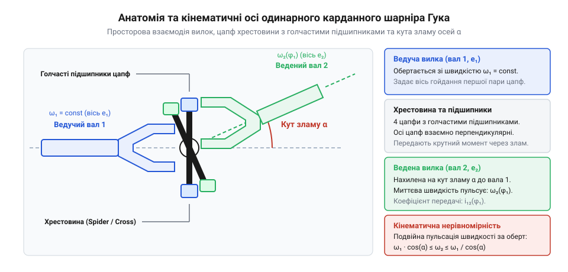
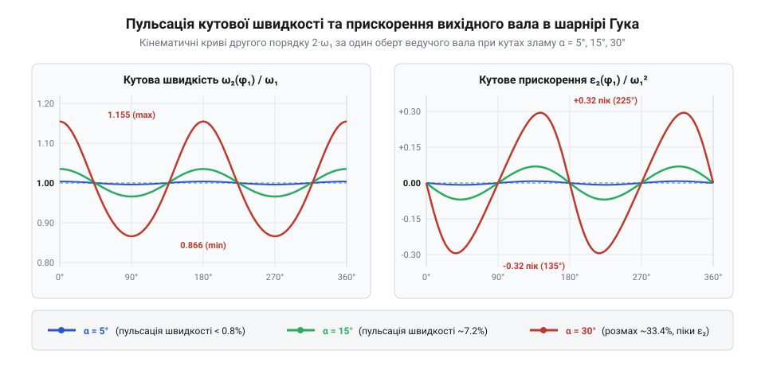
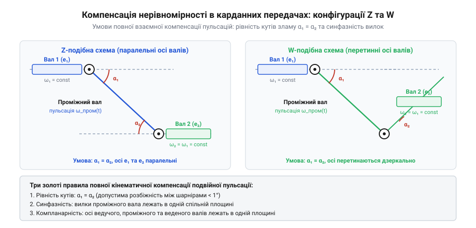

# Карданний шарнір Гука: нерівномірність передачі, пульсація швидкості та здвоєні схеми

## Геометрія хрестовини та кінематична нерівномірність одинарного кардана: чому передача обертання під просторовим кутом викликає нерівномірність кутового положення та циклічне відставання і випередження веденого вала

Карданний шарнір Гука (універсальний шарнір) передає крутний момент між двома валами, поздовжні осі яких перетинаються під просторовим кутом перекосу `beta`. Механічна конструкція шарніра складається з двох вилок — ведучої та веденої, взаємно перпендикулярні шипи яких шарнірно посаджені на загальну просторову хрестовину через чотири радіальні голчасті підшипники.


*Будова одинарного карданного шарніра Гука: взаємно перпендикулярні шипи хрестовини з'єднують ведучу й ведену вилки, передаючи обертання між валами під кутом перекосу beta.*

Головна фізична суперечність одинарного кардана полягає в тому, що під час обертання шипи хрестовини ведучого вала описують коло в площині, перпендикулярній до його осі, тоді як пара шипів веденого вала змушена рухатися у власній похилій площині. Проєкція ідеальної колової траєкторії одного вала на похилу площину спряженого утворює еліпс. Через цю геометричну асиметрію між кутом повороту ведучого вала `phi_1` та кутом веденого вала `phi_2` виникає нелінійний кінематичний зв'язок:

```
tan(phi_2)
= tan(phi_1) · cos(beta)    [кінематичний зв'язок кутів повороту валів одинарного кардана]
```

Диференціювання цього співвідношення за часом показує, що навіть за умови абсолютно рівномірного обертання вхідного вала зі сталою кутовою швидкістю `omega_1 = const`, миттєва швидкість вихідного вала `omega_2` безперервно коливається:

```
omega_2 / omega_1
= cos(beta) / (1 - sin^2(beta) · sin^2(phi_1))    [миттєве передавальне відношення одинарного кардана]
```

За кожен повний оберт вала (360°) ведений вал двічі випереджає ведучий і двічі відстає від нього, утворюючи гармонічну пульсацію з подвоєною частотою (2/rev). Мінімальна швидкість `omega_2_min = omega_1 · cos(beta)` припадає на положення `phi_1 = 0` та `pi`, а максимальна `omega_2_max = omega_1 / cos(beta)` — на положення `pi/2` та `3*pi/2`.

Швидка циклічна зміна кутової швидкості спричиняє потужні знакозмінні кутові прискорення `epsilon_2 ~ omega_1^2 · sin^2(beta)`. Вони створюють циклічні динамічні крутильні моменти, які передаються на всю трансмісію машини, викликаючи гул, руйнівні вібрації та прискорене втомне зношування голчастих підшипників хрестовини. Тому на відміну від прямолінійних гвинтових приводів на зразок [ШВП](root:hw-motion/ball-screw), одинарний кардан ніколи не забезпечує синхронної передачі кутової швидкості при наявності кута перекосу.

> 🔧 **Навіщо це.** Знання природи пульсації 2/rev пояснює, чому одинарний шарнір Гука принципово не є шарніром рівних кутових швидкостей і чому для безвібраційної передачі обертання обов'язково потрібні спарені компенсуючі конфігурації валів.

## Подвоєна пульсація кутової швидкості та динамічні моменти: коливання вихідної швидкості та прискорення з частотою 2/rev, виникнення знакозмінних навантажень та небезпека резонансу

Нерівномірність миттєвого передавального відношення одинарного шарніра Гука неминуче перетворює кінематичну асиметрію на потужні динамічні коливання. Оскільки ведений вал двічі за один оберт прискорюється і двічі сповільнюється, закон зміни його кутової швидкості має гармонічний характер із подвоєною частотою обертання вала (2/rev).


*Пульсація кінематичних параметрів веденого вала за один повний оберт (360°): циклічне коливання швидкості omega_2 та квадратичне наростання кутового прискорення epsilon_2 від кута перекосу beta.*

Диференціювання функції кутової швидкості `omega_2(phi_1)` за часом визначає миттєве кутове прискорення веденого вала:

```
epsilon_2(phi_1)
= -omega_1^2 · (cos(beta) · sin^2(beta) · sin(2·phi_1)) / (1 - sin^2(beta) · sin^2(phi_1))^2   [кутове прискорення веденого вала]
```

Амплітуда пікового кутового прискорення `epsilon_2_max` зростає пропорційно квадрату кутової швидкості обертання `omega_1^2` та квадрату синуса кута перекосу `sin^2(beta)`. За наявності інерційної маси на веденому валу (наприклад, коліс автомобіля, маховика або робочого органа верстата з моментом інерції `J_load`) це прискорення генерує циклічний динамічний інерційний момент:

```
T_dyn
= J_load · epsilon_2_max    [знакозмінний динамічний крутний момент від нерівномірності кардана]
```

Цей пульсуючий момент збуджує вимушені крутильні коливання в усьому валопроводі. Якщо частота пульсації `f_pulse = 2 · (n / 60)` Гц збігається з власною частотою крутильних коливань вала, виникає небезпечний резонанс, здатний спричинити передчасну втому металу, розкришування голчастих підшипників хрестовини або зрізання з'єднувальних шліців.

> 🔧 **Навіщо це.** Квадратична залежність динамічного моменту від частоти обертання та кута зламу пояснює, чому карданні передачі високих обертів вимагають жорсткого обмеження робочих кутів перекосу до 3–5° або застосування спарених схем повної взаємної компенсації.

## Схеми взаємної компенсації та межі кардана: правила рівності кутів і копланарності у Z- та W-валопроводах, центрувальний здвоєний кардан та перехід до ШРКШ при великих кутах зламу

Щоб усунути шкідливу пульсацію кутової швидкості на вихідному валу, у машинобудуванні застосовують двозв'язні карданні передачі, що складаються з двох однакових шарнірів Гука, з'єднаних проміжним валом. Ідея полягає в тому, щоб циклічне випередження, створене першим шарніром, дзеркально компенсувалося аналогічним відставанням у другому шарнірі.


*Конфігурації компенсації пульсацій у двозв'язних карданних валах: Z-подібна та W-подібна схеми з рівними робочими кутами beta_1 = beta_2 та копланарними внутрішніми вилками забезпечують синхронне обертання вихідного вала.*

Повна взаємна компенсація нерівномірності досягається лише за одночасного виконання двох обов'язкових геометричних умов:
1. **Копланарність вилок проміжного вала:** обидві вилки, закріплені на проміжному валу, мають лежати суворо в одній площині (фазовий зсув 0°). Будь-який кутовий перекіс вилок при складанні по шліцах веде не до гасіння, а до подвоєння амплітуди вібрацій.
2. **Рівність робочих кутів:** робочий кут зламу першого шарніра повинен точно дорівнювати куту другого (`beta_1 = beta_2`).

За взаємним просторовим розташуванням валів розрізняють дві класичні схеми:
- **Z-подібна схема (паралельні вали):** вхідний і вихідний вали розташовані паралельно, а проміжний вал нахилений між ними. Кути перекосу рівні (`beta_1 = beta_2`), але спрямовані в протилежні боки. Це стандартна схема для карданних передач задньопривідних автомобілів між коробкою передач і головною передачею ведучого моста.
- **W-подібна схема (перетинні вали):** осі ведучого й веденого валів перетинаються в одній точці, утворюючи симетричну трапецію або рівнобедрений трикутник з рівними внутрішніми кутами перекосу.

Хоча вихідний вал двозв'язної передачі обертається абсолютно рівномірно (`omega_3 = omega_1 = const`), сам проміжний вал продовжує пульсувати зі швидкістю `omega_2`. За великих кутів перекосу (`beta > 15..20°`) або в умовах, коли вали мають незалежні просторові зміщення (наприклад, у керованих колесах переднього моста автомобіля), забезпечити сталість кутів `beta_1 = beta_2` неможливо.

У таких випадках застосовують компактний спарений здвоєний карданний шарнір із центральним кульковим або сферичним напрямним сухарем, що примусово ділить сумарний кут зламу порівну між двома хрестовинами. Для ще більших кутів перегину (до 45–50°) у шарнірах підвіски та рульового приводу переходять до кулькових або триподних шарнірів рівних кутових швидкостей (ШРКШ), де бісекторне ділення кута здійснюється безпосередньо контактом кульок або сферичних роликів у профільованих канавках.

> 🔧 **Навіщо це.** Двозв'язна Z- чи W-подібна схема ліквідує пульсацію на виході валопроводу, але вимагає прецизійного фазування шліців проміжного вала, тоді як ШРКШ забезпечує повну синхронність обертання в єдиному компактному вузлі.
