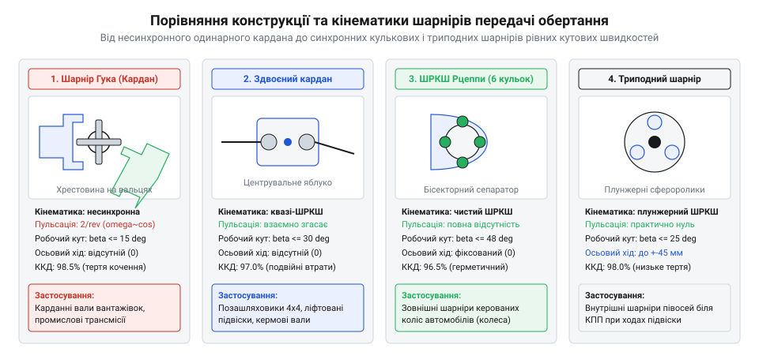
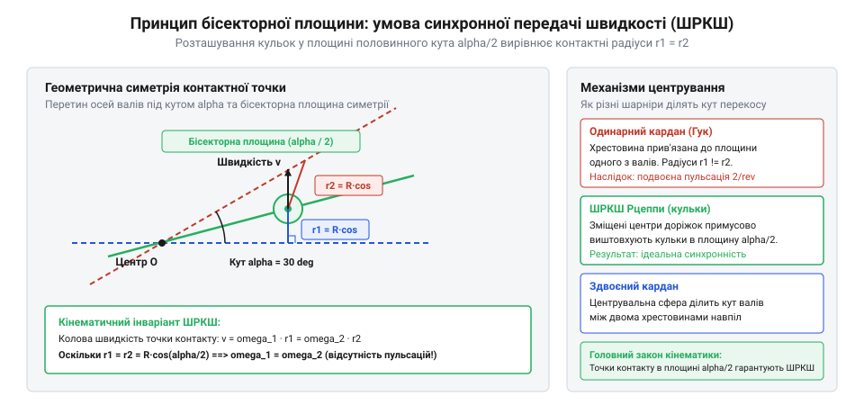

# Карданний шарнір Гука: нерівномірність передачі, пульсація швидкості та здвоєні схеми

<preknowlist>
- [Карданний шарнір Гука: нерівномірність передачі, пульсація швидкості та здвоєні схеми](root:hw-motion/cardan-hooke-joint) — розуміння нерівномірності передачі швидкості одинарним шарніром Гука та умови компенсації у здвоєному кардані.
</preknowlist>

## Класифікація шарнірів кутової передачі: кінематичний поділ на асинхронні шарніри нерівних швидкостей та синхронні шарніри рівних швидкостей (ШРКШ)

В інженерній кінематиці передача обертового руху між двома валами, геометричні осі яких перетинаються під змінним або фіксованим кутом `α`, поділяється на два фундаментальні класи механізмів:
1. **Асинхронні шарніри нерівних кутових швидкостей (Variable Velocity Joints):** класичний карданний шарнір Гука (хрестовина з двома вилками). За постійної кутової швидкості ведучого вала `ω_1 = const` ведений вал обертається з неперервною циклічною пульсацією `ω_2(φ_1)`, двічі за оберт прискорюючись до `ω_1 / cos(α)` і двічі сповільнюючись до `ω_1 · cos(α)`. Ця нерівномірність генерує знакозмінні інерційні моменти другого порядку на подвійній частоті `2 · ω_1`.
2. **Синхронні шарніри рівних кутових швидкостей (ШРКШ, Constant Velocity Joints):** передачі, в яких миттєве передавальне відношення швидкостей у кожен момент часу тотожно дорівнює одиниці (`ω_out(t) = ω_in(t)`) за будь-якого кута перегину валів у межах робочого діапазону.


*Порівняльні схеми перерізів та кінематичних пар: шарнір Гука, кульковий ШРКШ Рцеппи, трипод та подвійний кардан.*

Фундаментальною кінематичною передумовою для забезпечення повної гомокінетичності (рівності кутових швидкостей) є так звана **теорема бісекторної площини симетрії**:
> Точки силового контакту ведучого та веденого ланок, що передають крутний момент, повинні безперервно знаходитися строго у бісекторній площині, яка ділить кут зламу між валами навпіл (`α / 2`) і перпендикулярна до площини перегину осей.

Якщо симетрія бісекторної площини витримується, лінійні швидкості контактних точок на обох піввісях абсолютно рівні на рівних плечах від осей обертання:
```
v_contact = ω_1 · R_contact = ω_2 · R_contact  =>  ω_2 = ω_1
```

### Векторне кінематичне доведення теореми бісекторної площини

Розглянемо аналітичне доведення теореми на основі векторної кінематики просторових шарнірних механізмів. Нехай геометричні осі ведучого вала 1 та веденого вала 2 задаються одиничними направляючими векторами `e_1` та `e_2`, які перетинаються у спільному центрі шарніра `O` під просторовим кутом зламу `α`:
```
e_1 · e_2 = cos(α)
```
Кутові швидкості валів спрямовані вздовж відповідних осей обертання:
```
ω_1 = ω_1 · e_1,   ω_2 = ω_2 · e_2
```

Нехай передача крутного моменту здійснюється через силове контактне тіло (сталеву кульку, ролик або сухар), центр якого розташований у точці `P` із радіус-вектором `r = OP`. Якщо точка `P` є точкою безперервного силового контакту між ведучою та веденою ланками без розриву кінематичного зв'язку, її миттєва лінійна швидкість як точки, що належить першому валу, визначається векторним добутком:
```
v_P1 = ω_1 × r = (ω_1 · e_1) × r
```
Аналогічно, як точка, що належить веденому валу 2:
```
v_P2 = ω_2 × r + v_rel = (ω_2 · e_2) × r + v_rel
```
де `v_rel` — вектор швидкості відносного ковзання або кочення контактного тіла вздовж напрямних канавок.

Для забезпечення жорсткої геометричної передачі руху без деформації та взаємного проникнення матеріалів проекції лінійних швидкостей на спільну контактну нормаль `n` повинні строго збігатися:
```
v_P1 · n = v_P2 · n
```
Оскільки контактні поверхні симетричні відносно площини передачі моменту, нормаль `n` є ортогональною до вектора відносного ковзання (`n · v_rel = 0`). Отже:
```
((ω_1 · e_1) × r) · n = ((ω_2 · e_2) × r) · n
```

Використовуючи циклічну перестановку у мішаному векторному добутку `(a × b) · c = (b × c) · a`:
```
(r × n) · (ω_1 · e_1) = (r × n) · (ω_2 · e_2)
ω_1 · (e_1 · (r × n)) = ω_2 · (e_2 · (r × n))
```
Звідси передавальне відношення миттєвих кутових швидкостей виражається строго через геометричні проекції:
```
i_12 = ω_2 / ω_1 = (e_1 · (r × n)) / (e_2 · (r × n))
```

Щоб передавальне відношення було строго синхронним (`i_12 ≡ 1`) для довільного кута повороту валів, скалярні добутки в чисельнику та знаменнику повинні бути тотожно рівними:
```
e_1 · (r × n) = e_2 · (r × n)  =>  (e_1 - e_2) · (r × n) = 0
```
Вектор різниці одиничних направляючих осей `(e_1 - e_2)` спрямований строго вздовж нормалі до площини, яка ділить кут між валами навпіл. Справді, знайдемо скалярний добуток вектора `(e_1 - e_2)` з вектором бісектриси кута зламу `e_b = (e_1 + e_2) / (2 · cos(α / 2))`:
```
(e_1 - e_2) · (e_1 + e_2) = |e_1|² - |e_2|² = 1 - 1 = 0
```
Це означає, що вектор `n_bisect = e_1 - e_2` є вектором геометричної нормалі до площини симетрії (бісекторної площини `Π_bisect`), що лежить під кутом `α / 2` до кожного з валів.

Рівність `n_bisect · (r × n) = 0` означає, що векторний добуток `(r × n)` лежить у бісекторній площині `Π_bisect`. Звідси випливає фундаментальна геометрична вимога: сам радіус-вектор точки контакту `r` мусить неперервно належати бісекторній площині (`P ∈ Π_bisect`).

Коли точка контакту `P` лежить у бісекторній площині, трикутник, утворений осями валів та вектором `r`, є рівнобедреним за побудовою. Відстані від точки силового контакту до осі ведучого вала `R_1` та до осі веденого вала `R_2` тотожно рівні між собою:
```
R_1 = |r × e_1| = |r| · sin(∠(r, e_1))
R_2 = |r × e_2| = |r| · sin(∠(r, e_2))
∠(r, e_1) = ∠(r, e_2) = θ_contact  =>  R_1 = R_2 = R_contact
```
Оскільки тангенціальні лінійні швидкості в точці контакту не можуть мати розриву в напрямку обертання:
```
v_t = ω_1 · R_1 = ω_2 · R_2  =>  ω_1 · R_contact = ω_2 · R_contact  =>  ω_2 = ω_1
```

Якщо ж точка передачі моменту виходить із бісекторної площини (як це відбувається у просторовому хрестовинному шарнірі Гука, де цапфи вилок жорстко зафіксовані під кутом 90° до своєї осі), плечі `R_1(φ)` та `R_2(φ)` починають гармонічно пульсувати під час обертання, породжуючи знайому нерівномірність передачі швидкості `i_12(φ) = cos(α) / (1 - sin²(α) · cos²(φ))`.

> 🔧 **Навіщо це.** Без бісекторної симетрії створення переднього приводу в автомобілях було б неможливим: виворіт керованих коліс на кути 35–45° з одинарними шарнірами Гука викликає пульсації швидкості понад 50%, що вибиває кермо з рук водія та зриває протектор коліс в юз.

## Конструктивні типи ШРКШ: кульковий шарнір Рцеппи, триподний шарнір (Tripod), спарений кардан та кулачково-сухариковий вузол Тракта/Вейса

Для утримання робочих тіл кочення або ковзання у бісекторній площині розроблено кілька принципово різних механічних конфігурацій:

### 1. Шестикульковий шарнір Рцеппи (Rzeppa Joint)

Винайдений інженером Альфредом Рцеппою (патент 1928–1935 рр.), цей тип є золотим стандартом зовнішніх шарнірів приводних валів коліс:
- **Конструкція:** сферична внутрішня обойма (зірочка) на шліцах вала, масивна зовнішня обойма (кулак) у формі чаші, тороїдальний штампований сепаратор (cage) та 6 прецизійних гартованих сталевих кульок.
- **Механізм бісекторного позиціонування:** центри кривини поздовжніх канавок на внутрішній та зовнішній обоймах зміщені від геометричного центра шарніра в протилежні боки вздовж осі на однакову відстань ексцентриситету `±e`. Коли вал нахиляється на кут `α`, утворені канавками клини автоматично зміщують сепаратор із кульками рівно на половину кута:
```
φ_cage = α / 2
```
- **Характеристики:** граничний кут перегину досягає `α_max = 45–50°`; жорстко зафіксований в осьовому напрямку (не допускає осьового плунжерного переміщення).

### 2. Триподний шарнір (Tripod / Tripode Joint)

Використовується переважно як внутрішній шарнір приводу передніх коліс біля диференціала коробки передач:
- **Конструкція:** трипроменева маточина (павук), закріплена на шліцах вала, три сферичні ролики на голчастих підшипниках та корпус-тюльпан із трьома поздовжніми циліндричними пазами.
- **Осьова компенсація (плунжерність):** ролики вільно перекочуються вздовж канавок корпусу на довжину до `ΔL = ±25–45 мм`, повністю компенсуючи коливання відстані між маточиною колеса та картером коробки передач під час роботи підвіски.
- **Характеристики:** кут зламу обмежений `α ≤ 25–26°`; забезпечує рекордно низький коефіцієнт опору осьовому переміщенню, усуваючи вібраційні поштовхи на кузов при прискоренні.

### 3. Спарений здвоєний кардан (Double Cardan Joint)

Являє собою два зближені шарніри Гука, з'єднані через спільне проміжне кільце (H-подібну вилку):
- **Принцип:** внутрішній сферичний центруючий палець (centering ball stud) примусово утримує проміжне кільце у площині половинного кута `α / 2`.
- **Застосування:** карданні вали важких позашляховиків, роздавальні коробки повнопривідних вантажівок та шарніри рульових редукторів. Передає колосальний крутний момент за кутів до `30–35°`.

### 4. Кулачково-сухариковий шарнір Тракта (Tracta Joint) та кульковий Вейса

- **Особливість:** замість точкового контакту кульок крутний момент передається через широкі циліндричні сегменти (сухарі), що ковзають у вилчастих пазах.
- **Переваги та недоліки:** надзвичайно висока стійкість до ударних навантажень та бруду (застосовувався на передніх мостах бронетранспортерів і вантажівок КрАЗ, ЗІЛ-131), проте має низький ККД через тертя ковзання та схильний до сильного розігріву на швидкостях понад 1000 об/хв.

## Порівняльний аналіз експлуатаційних параметрів: граничні кути зламу, крутний момент, осьова рухливість (плунжерні шарніри), ККД та тепловиділення

Вибір конструктивного типу шарніра визначається компромісом між п'ятьма фундаментальними експлуатаційними факторами: допустимим робочим кутом перекосу осей, передаваною потужністю, здатністю до осьової компенсації довжини, механічними втратами (ККД) та тепловідведенням.


*Геометричний принцип бісекторної площини: центрування кульок у площині половинного кута alpha/2 для синхронної передачі швидкості.*

### 1. Граничні кути зламу осей

Діапазон допустимих кутів перегину валів диктується фізичним обмеженням контакту робочих тіл та геометричною інтерференцією вилок або сепаратора:
- **Класичний карданний шарнір Гука:** тривалий робочий кут обмежений `α ≤ 5–8°` через зростання циклічних пульсацій швидкості та вібрацій. Короткочасний кут (наприклад, у кермових валах або підвісці вантажівок) може сягати `15–20°`, після чого настає геометричне заклинювання вилок на хрестовині.
- **Спарений здвоєний кардан (Double Cardan):** завдяки поділу кута навпіл між двома хрестовинами забезпечує кути до `α ≤ 30–35°`.
- **Триподний шарнір (Tripod):** сферичні ролики перекочуються у поздовжніх пазах корпусу під кутами до `α ≤ 25–26°`. При спробі збільшити кут понад 26° сферичні ролики виходять за межі паралельних доріжок корпусу-тюльпана.
- **Шестикульковий шарнір Рцеппи (Rzeppa):** забезпечує найбільший кут серед серійних трансмісійних вузлів — до `α = 45–50°` (а в спеціальних версіях для керованих мостів позашляховиків — до `52°`). Кут лімітується виходом кульок із сепаратора та різким зменшенням робочої контактної площі еліпса Герца на краю канавки.
- **Кулачковий шарнір Тракта:** допускає кути до `α ≈ 40–45°`, проте зі зростанням кута різко зростає питомий тиск на плоских контактах сухарів.

### 2. Крутний момент і навантажувальна здатність

Навантажувальна здатність шарнірів залежить від площі контакту силових елементів:
- Шарнір Гука передає зусилля через чотири цапфи хрестовини, що спираються на голчасті підшипники з високою лінійною контактною жорсткістю. Це забезпечує максимальну питому крутну здатність за мінімального зовнішнього діаметра вузла.
- У кулькових ШРКШ Рцеппи передача моменту здійснюється через точковий контакт сталевих кульок у радіусних канавках. Розрахунок контактних напруг за Герцом показує, що піковий контактний тиск може перевищувати `σ_Hertz ≥ 2500–3200 МПа`. Оскільки крутний момент розподіляється між 3–6 кульками, для передачі великого моменту доводиться суттєво збільшувати зовнішній діаметр обойми.
- Кулачкові шарніри Тракта мають найбільшу площу циліндричного контакту, що надає їм колосальної стійкості до ударних навантажень під час руху по важкому бездоріжжю, хоча й за рахунок значно більшого тертя ковзання.

### Деталізований розрахунок граничного контактного тиску Герца у кулькових канавках

На відміну від карданної хрестовини з циліндричними голчастими роликами, контакт сталевої кульки з радіусною доріжкою обойми у ШРКШ Рцеппи або кулькових шарнірах типу VL є точковим. Розрахунок граничної контактної міцності базується на класичній теорії пружного контакту Герца для криволінійних тіл.

Геометрична конформність (ступінь охоплення кульки доріжкою) визначається відношенням радіуса жолоба доріжки `R_groove` до діаметра кульки `d_ball = 2 · r`:
```
f_osculation = R_groove / (2 · r)
```
У високонавантажених автомобільних шарнірах коефіцієнт конформності проектують у діапазоні `f_osculation = 1.02...1.06` (типово `f = 1.03`, тобто радіус канавки лише на 3% перевищує радіус кульки). Чим ближчий радіус канавки до радіуса кульки, тим ширшою стає контактна площадка під навантаженням і тим нижчим є піковий контактний тиск, проте занадто мала різниця радіусів (`f < 1.015`) викликає різке зростання диференціального тертя ковзання кульки по краях канавки та катастрофічний розігрів вузла. Подібні закономірності конформності готичної арки є визначальними також у споріднених механізмах кочення, таких як [Кулькова гвинтова пара (ШВП) та ходовий гвинт: класи точності, попередній натяг і кінематика люфту](root:hw-motion/ball-screw).

Визначимо головні кривини контактуючих тіл у точці торкання:
1. Для сталевої кульки радіуса `r` кривини в усіх площинах однакові:
```
k_11 = 1 / r,   k_12 = 1 / r
```
2. Для канавки обойми, що має радіус жолоба `R_groove` та радіус колової траєкторії центру кульок `R_track`:
   - У поперечному перерізі (увігнута поверхня канавки): `k_21 = -1 / R_groove`;
   - У поздовжньому перерізі вздовж доріжки: `k_22 = 1 / R_track` (для внутрішньої обойми-зірочки) або `k_22 = -1 / R_track` (для зовнішньої чаші шарніра).

Сума кривин поверхонь у контактній зоні становить:
```
Σk = k_11 + k_12 + k_21 + k_22 = (2 / r) - (1 / R_groove) + (1 / R_track)
```

Приведений модуль пружності контактної пари із підшипникової сталі ШХ15 (модуль Юнга `E = 2.1 · 10⁵ МПа`, коефіцієнт Пуассона `ν = 0.3`):
```
E* = E / (2 · (1 - ν²)) = 2.1 · 10⁵ / (2 · (1 - 0.09)) = 210 000 / 1.82 ≈ 115 385 МПа
```

Під дією нормального зусилля `F_ball` контактна площадка деформується в еліпс із півосями `a` (спрямована вздовж доріжки) та `b` (поперек канавки):
```
a = μ_Hertz · ∛( (3 · F_ball) / (2 · Σk · E*) )
b = ν_Hertz · ∛( (3 · F_ball) / (2 · Σk · E*) )
```
де `μ_Hertz` та `ν_Hertz` — трансцендентні коефіцієнти форми контактного еліпса Герца, які визначаються через повні еліптичні інтеграли за аргументом кута кривини `cos(θ_k) = |(k_11 - k_12) + (k_21 - k_22)| / Σk`.

Піковий контактний тиск `p_0` виникає строго у геометричному центрі еліпса і розраховується за формулою:
```
p_0 = (3 · F_ball) / (2 · π · a · b)
```

#### Числовий розрахунок напруг для шарніра легкового автомобіля

Розглянемо типовий зовнішній ШРКШ легкового автомобіля C/D-класу при передачі максимального пікового моменту першої передачі:
- Розрахунковий крутний момент на півосі: `M_axle = 2400 Н·м`;
- Радіус розташування центрів кульок: `R_pitch = 42 мм = 0.042 м`;
- Кількість кульок у шарнірі: `Z = 6`;
- При передачі крутного моменту зусилля сприймають одночасно половина кульок (`Z_active = 3`), що знаходяться на навантаженій стороні сепаратора;
- Тангенціальне колове зусилля на одну активну кульку:
```
F_tangent = M_axle / (Z_active · R_pitch) = 2400 / (3 · 0.042) ≈ 19 048 Н
```
- Профіль канавок виконаний у формі еліптичної або готичної арки з номінальним кутом контакту `β_contact = 45°`. Нормальна контактна сила, що розклинює кульку між стінками канавки:
```
F_ball = F_tangent / cos(45°) = 19 048 / 0.7071 ≈ 26 938 Н
```

Для кульки радіуса `r = 9.525 мм` (діаметр 3/4 дюйма) та канавки з конформністю `f = 1.035` (`R_groove = 9.858 мм`) обчислення півосей еліпса дає:
```
a ≈ 5.42 мм,   b ≈ 0.88 мм
```
Обчислимо піковий контактний тиск Герца:
```
p_0 = (3 · 26 938) / (2 · π · 5.42 · 0.88) = 80 814 / 29.97 ≈ 2696 МПа
```

Отримане значення контактного тиску `p_0 ≈ 2.7 ГПа` у півтора раза перевищує границю текучості нормалізованої конструкційної сталі. Щоб витримувати такі напруги без залишкової пластичної деформації та утворення лунок (бринелювання), деталі ШРКШ піддають обов'язковій хіміко-термічній обробці: глибокій цементації з гартуванням або поверхневому загартуванню ТВЧ на глибину `1.8–2.5 мм` до твердості `60–64 HRC`.

При роботі під максимальними кутами зламу `α = 45°` виникає небезпечне крайове навантаження (@@en|edge loading@@): контактний еліпс виходить на край канавки, площа контакту різко падає вдвічі, а локальний піковий тиск стрибає до `3500–3800 МПа`, викликаючи прогресуюче втомне викришування металу.

### 3. Осьова рухливість (плунжерна здатність)

Під час руху автомобіля хід підвіски призводить до неперервної зміни відстані між картером головної передачі та маточиною колеса (розмах коливань сягає `ΔL = ±20–45 мм`). Шарнірні передачі розв'язують цю задачу двома шляхами:
1. **Фіксовані шарніри (Fixed Joints — Rzeppa RF, шарніри Гука):** не мають внутрішньої осьової рухливості. Для компенсації зміни довжини вал мусить містити зовнішнє телескопічне шліцьове з'єднання. Під дією високого крутного моменту тертя у шліцах блокує осьове ковзання (ефект защемлення або @@en|spline lock@@), викликаючи жорсткі осьові удари на опори підшипників.
2. **Плунжерні шарніри (Plunging Joints — Tripod, плунжерний кульковий шарнір VL):** допускають безперешкодне поздовжнє переміщення всередині самого корпусу. У триподі ролики вільно котяться вздовж канавок корпусу з мінімальним коефіцієнтом опору коченню (`μ_roll ≈ 0.005–0.015`). Сила осьового опору трипода під навантаженням у 10–20 разів нижча, ніж у телескопічних шліців, що повністю ізолює кузов від вібраційних поштовхів трансмісії.

### 4. Механічний ККД та тепловиділення

Механічний коефіцієнт корисної дії шарнірів прямо корелює з типом трибологічного контакту:
- **Шарнір Гука:** чисте кочення голчастих роликів забезпечує `η = 98.5–99.5%` за кутів перегину до 5°. Тепловиділення мінімальне, шарнір охолоджується набігаючим потоком повітря.
- **ШРКШ Рцеппи:** при прямолінійному русі (`α = 0°`) кульки працюють у чистому коченні (`η ≈ 98–99%`). Проте при повороті на кути `α > 25°` у точках контакту кульки з канавкою виникає мікропроковзування (диференціальне ковзання Герца) та тертя торців сепаратора об сферичні обойми. За максимальних кутів `α ≈ 45°` ККД падає до `94–96%`, а потужність тертя перетворюється на тепло:
```
P_heat = M_torque · ω · (1 - η)
```
Якщо шарнір тривалий час працює під великим кутом на високій швидкості (наприклад, на повнопривідному транспорті на серпантині), внутрішня температура мастила може перевищити `120–140 °C`, що вимагає застосування термостійких мастил.
- **Триподний шарнір:** завдяки голчастим підшипникам усередині сферичних роликів підтримує стабільно високий ККД `η ≈ 98–99%` у всьому діапазоні кутів.
- **Кулачковий шарнір Тракта:** постійне тертя ковзання плоских сухарів знижує ККД до `η = 90–95%`, що призводить до інтенсивного нагріву на швидкостях понад 1000 об/хв.

| Тип шарніра | Граничний кут `α_max` | Осьова плунжерність `ΔL` | Механічний ККД `η` | Контакт силових тіл | Провідне застосування |
|:---|:---:|:---:|:---:|:---:|:---|
| **Карданний шарнір Гука** | 8° (тривалий), 18° (пік) | 0 мм (потрібні шліци) | 98.5–99.5 % | Голчасті підшипники (кочення) | Карданні вали задніх мостів, спецтехніка |
| **Спарений здвоєний кардан** | 30–35° | 0 мм (потрібні шліци) | 97.0–98.5 % | Дві хрестовини + центруюча сфера | Вали позашляховиків, шарнірні рами |
| **Кульковий ШРКШ Рцеппи** | 45–50° | 0 мм (фіксований) | 95.0–99.0 % | 6 кульок у канавках (кочення + мікрозсув) | Зовнішні шарніри керованих коліс легковиків |
| **Триподний плунжерний** | 25–26° | ±25–45 мм (вільне кочення) | 98.0–99.0 % | 3 сферичні ролики на голках | Внутрішні шарніри передніх приводів |
| **Кулачковий Тракта** | 40–45° | 0 мм (жорсткий) | 90.0–95.0 % | Циліндричні сухарі (тертя ковзання) | Важкі військові бронетранспортери та вантажівки |

> 🔧 **Навіщо це.** Комбінація «зовнішній фіксований кульковий ШРКШ Рцеппи (великий кут повороту коліс) + внутрішній триподний шарнір (вільне осьове плавання)» є канонічною схемою приводу сучасних передньопривідних автомобілів, що забезпечує одночасно маневреність і віброізоляцію кузова.

## Трибологія, змащення та надійність: захисні гофровані чохли (пильовики), спеціальні дисульфід-молібденові мастила та діагностика втомного зносу

Надійність та ресурс шарнірних з'єднань трансмісії критично залежать від герметичності захисних оболонок і хімічного складу пластичного мастила в зоні високих контактних напруг.

### 1. Захисні герметичні чохли (пильовики, @@en|CV boot@@)

Внутрішні деталі кулькових та триподних ШРКШ працюють у режимі змішаного або граничного тертя за пікових контактних тисків до 3 ГПа. Потрапляння навіть кількох міліграмів дорожнього бруду чи кварцового піску (твердість кварцу `SiO_2` за Моосом становить 7, що вище за твердість загартованої кулькопідшипникової сталі ШХ15 / 100Cr6 твердістю 60–64 HRC) викликає миттєвий абразивний знос:
- **Конструкція пильовика:** гофрована гумова або полімерна манжета, яка герметично фіксується нержавіючими безвушковими хомутами на корпусі шарніра та приводному валу. Гофри розраховані на багатомільйонні цикли згинання під кутом до 50° та розтягування/стискання при ходах підвіски.
- **Матеріали:**
  - *Неопрен / хлоропреновий каучук (CR):* традиційний еластичний матеріал, проте чутливий до дії озону, дорожніх хімічних реагентів та старіє при температурах понад 100 °C;
  - *Термопластичний поліефірний еластомер (TPE / Hytrel):* сучасний конструкційний полімер, що має у 3–5 разів вищу міцність на розрив, стійкість до ударів каміння та температурну стійкість від -40 °C до +130 °C.
- **Механіка руйнування:** пошкодження пильовика камінням або стирання через контакт з елементами підвіски призводить до викидання мастила відцентровою силою на швидкостях обертання 1000–2500 об/хв. Без захисту шарнір виходить із ладу через абразивне руйнування бігових доріжок уже через 150–500 км пробігу.

### 2. Спеціалізовані мастильні матеріали та трибохімія

Мащення ШРКШ вимагає суворого розділення за типом внутрішньої кінематики:
- **Мастила для кулькових шарнірів Рцеппи (високий тиск, мікроковзання):** застосовують літієві або полісечовинні пластичні мастила консистенції NLGI 1–2 із протизадирними присадками (EP — @@en|Extreme Pressure@@) та 3–5% тонкодисперсного твердого антифрикційного наповнювача — дисульфіду молібдену `MoS_2` (або суміші з колоїдним графітом). Кристалічна ґратка `MoS_2` має шарувату гексагональну структуру: сильні ковалентні зв'язки всередині шару атомів сірки та молібдену і надзвичайно слабкі ван-дер-ваальсові зв'язки між шарами. При пікових герцівських тисках мастильна гідродинамічна плівка продавлюється, проте пластинки `MoS_2` легко ковзають одна по одній, запобігаючи схоплюванню, задиранню та мікрозварюванню сталевих кульок із канавками.
- **Мастила для триподних шарнірів (голчасті ролики):** категорично заборонено використовувати мастила з вмістом дисульфіду молібдену `MoS_2`! Дрібні тверді частинки `MoS_2` потрапляють між тонкими голчастими роликами підшипників трипода, спричиняючи їхнє блокування, ковзання юзом замість кочення та утворення фальшивого бринелювання (вм'ятин). Для триподів використовують виключно беззольні полісечовинні мастила без твердих часток із протизносними присадками на основі дитіофосфатів цинку (ZDDP).

### 3. Діагностика втомного зносу та дефекти шарнірів

Протягом експлуатації шарніри зазнають циклічного контактного втомного навантаження (механізм втомного викришування або @@en|spalling@@):
1. **Знос зовнішнього кулькового ШРКШ Рцеппи:**
   - *Механізм:* вибивання втомних мікровибоїн у зонах максимального контакту кульок з канавками (зазвичай у зоні, що відповідає кутам повороту керма при виїзді з парковки під тягою).
   - *Симптоми:* характерний циклічний стукіт або клацання («хрускіт») високої частоти, що виникає виключно під час руху автомобіля в повороті з натиснутою педаллю газу.
2. **Знос внутрішнього триподного шарніра:**
   - *Механізм:* накочування локальних ямок (бринелювання) на робочих поверхнях циліндричних пазів корпуса-тюльпана в положенні, що відповідає прямолінійному руху.
   - *Симптоми:* низькочастотна поперечна вібрація всього кузова («тремтіння переду») при інтенсивному розгоні на швидкостях 70–100 км/год, яка повністю зникає при відпусканні педалі газу або русі накатом.
3. **Знос карданного шарніра Гука:**
   - *Механізм:* виникнення поздовжніх канавок на цапфах хрестовини під голчастими роликами через вібраційне бринелювання та висихання сальникових ущільнень.
   - *Симптоми:* поява металевого дзвінкого удару («клацання») під час рушання з місця та різкої зміни напрямку передачі моменту (перемикання передач), а також високочастотний монотонний гул на швидкості понад 80 км/год.

> 🔧 **Навіщо це.** Своєчасна діагностика за акустичними та вібраційними паттернами дозволяє локалізувати дефектний вузол без розбирання трансмісії: хрускіт у повороті вказує на зовнішній кульковий шарнір, тремтіння кузова при розгоні — на внутрішній трипод, а дзвінкий удар під час рушання — на люфт хрестовини кардана.
