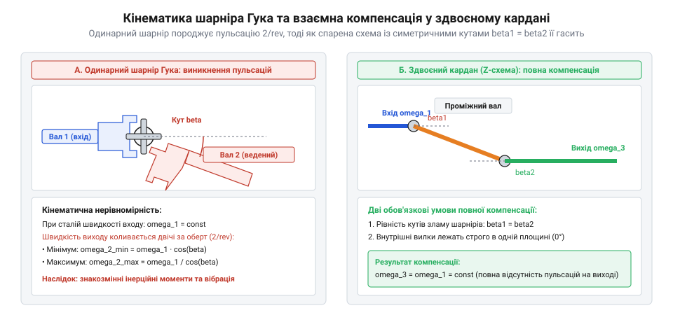
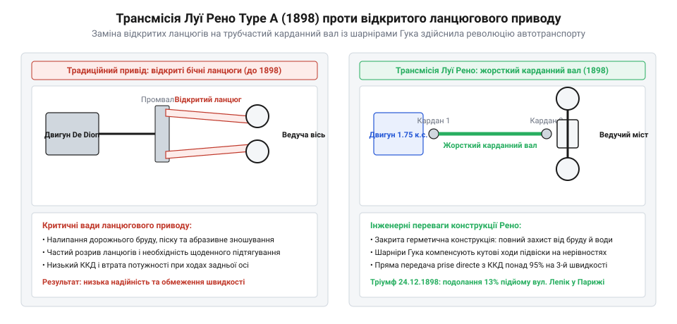

# Карданний шарнір Гука: нерівномірність передачі, пульсація швидкості та здвоєні схеми

## Від підвісу Кардано до морських компасів: міф про «винахід кардана» Джероламо Кардано та збереження горизонталі мореплавцями XVI століття

В інженерній та побутовій мові будь-яке шарнірне зчленування двох валів, що обертаються під кутом, зазвичай називають «карданним валом» або просто «карданом». Проте з погляду історії техніки закріплення імені італійського математика, філософа та лікаря XVI століття Джероламо Кардано (Gerolamo Cardano) за шарнірною передачею обертання є класичною історичною метонімією.

Кардано не винайшов механізму для передачі крутного моменту між не співвісними валами. У своєму енциклопедичному трактаті *De subtilitate rerum* (1550) він описав і популяризував конструкцію концентричного трикільцевого шарнірного підвісу (gimbal suspension). Мета такого підвісу була суто орієнтаційною, а не кінематичною: зберегти вертикальне положення важкого тіла незалежно від просторових кутових коливань зовнішньої опорної платформи.

Такий підвіс був життєво необхідний мореплавцям епохи Великих географічних відкриттів:
1. Магнітні морські компаси вимагали ідеальної горизонтальності чутливої котушки зі стрілкою під час бортової та кільової хитавиці корабля на океанських хвилях;
2. Суднові олійні лампи та жаровні не повинні були перекидатися і спричиняти пожежу на дерев'яному судні під час шторму.

Фізичний принцип підвісу Кардано ґрунтується на маятниковій гравітаційній стабілізації. Тіло, що стабілізується (латунний казанок компаса масою `m`), підвішується на концентричних кільцях так, щоб його центр мас `G` був зміщений строго вниз від геометричного центру перетину осей підвісу `O` на плече ексцентриситету `h_cm`. При відхиленні судна на кут крену або диференту `θ` сила тяжіння створює відновлювальний гравітаційний момент:
```
M_grav = m · g · h_cm · sin(θ)
```
Динаміка кутових коливань казанка в підвісі описується рівнянням фізичного маятника:
```
J_pivot · (d²θ / dt²) + b_visc · (dθ / dt) + m · g · h_cm · sin(θ) = 0
```
де `J_pivot` — момент інерції казанка відносно осі підвісу, а `b_visc` — коефіцієнт в'язкого тертя в цапфах.

Щоб запобігти небезпечному резонансному розгойдуванню стрілки компаса під дією періодичної хвильової хитавиці корабля, казанок заповнювали сумішшю спирту та дистильованої води, яка забезпечувала ефективне гідродинамічне демпфування. Три вкладені концентричні кільця взаємно перпендикулярних осей повністю розв'язували кути Ейлера (крен, тангаж і рискання), залишаючи чутливий елемент нерухомим відносно локального гравітаційного горизонту Землі.

Сам принцип вкладених кілець був відомий ще античним авторам (зокрема Філону Візантійському у III столітті до н. е. для підвісу кадильниць). Заслуга Кардано полягала у вичерпному геометричному аналізі ступенів вільності системи. Проте жодне з кілець у підвісі Кардано не оберталося для передачі механічної потужності. Перехід від пасивного гравітаційного стабілізатора до силового кутового приводу вимагав зовсім іншої інженерної ідеї — створення шарнірної хрестовини.

> 🔧 **Навіщо це.** Карданний підвіс забезпечує тілу кутову ізоляцію за трьома ступенями вільності, тоді як карданний шарнір призначений для протилежної задачі: передачі обертання навколо осі з мінімальними втратами при фіксованому або змінному зламі траєкторії валів.

## Універсальне зчленування Роберта Гука (1676): хрестовина для геліостата, відкриття пульсації кутової швидкості та перша симетрична здвоєна схема

Справжнім творцем силового універсального шарніра є видатний англійський полімат, куратор експериментів Лондонського королівського товариства Роберт Гук (Robert Hooke).

У 1670-х роках Гук працював над астрономічним приладом — геліостатом, дзеркало якого повинно було безперервно стежити за сонцем на небосхилі та спрямовувати сонячний промінь у нерухомий горизонтальний тубус телескопа. Для приводу дзеркала від маятникового годинникового механізму вимагалося передавати повільне безперервне обертання вала під кутом, що змінювався протягом світлового дня.

У 1676 році Гук опублікував працю *A Description of Helioscopes, and Some Other Instruments*, де представив конструкцію універсального шарніра (Hooke's joint). Вузол складався з двох U-подібних вилок (yokes), шарнірно з'єднаних між собою центральною просторовою хрестовиною (cross spider) із чотирма взаємно перпендикулярними шипами.


*Кінематична схема шарніра Гука з хрестовиною та принцип компенсації пульсацій у здвоєному кардані.*

Геометричне доведення нерівномірності обертання шарніра ґрунтується на аналізі просторового руху осей шипів хрестовини. Розглянемо два одиничні вектори `e_1` та `e_2`, направлені вздовж цапф хрестовини:
- Шип вхідної вилки обертається у площині, перпендикулярній осі ведучого вала (площина `XY`), тому його координати описуються кутом повороту `φ_1`:
```
e_1 = (-sin(φ_1), cos(φ_1), 0)
```
- Шип вихідної вилки обертається у похилій площині, нахиленій відносно осі `X` на кут зламу шарніра `α`:
```
e_2 = (-cos(φ_2), -sin(φ_2) · cos(α), sin(φ_2) · sin(α))
```

Оскільки хрестовина є абсолютно жорстким металевим хрестом, кут між її суміжними шипами завжди дорівнює строго 90°. Скалярний добуток ортогональних векторів тотожно дорівнює нулю:
```
e_1 · e_2 = 0
```
Розкриємо скалярний добуток за компонентами:
```
(-sin(φ_1)) · (-cos(φ_2)) + cos(φ_1) · (-sin(φ_2) · cos(α)) + 0 = 0
sin(φ_1) · cos(φ_2) - cos(φ_1) · sin(φ_2) · cos(α) = 0
```
Поділимо обидві частини рівності на добуток `cos(φ_1) · cos(φ_2)` (при кутах, де косинуси не дорівнюють нулю):
```
tan(φ_1) - tan(φ_2) · cos(α) = 0
```
Звідси отримуємо елегантне фундаментальне рівняння зв'язку кутів повороту валів:
```
tan(φ_2) = tan(φ_1) / cos(α)
```
Якщо прийняти початковий відлік так, щоб при `φ_1 = 0` шип лежав у площині зламу, рівняння записується у канонічній формі:
```
tan(φ_2) = tan(φ_1) · cos(α)
```

Диференціюючи це рівняння за часом `t`, Гук отримав миттєве передавальне відношення швидкостей:
```
i_12(φ_1) = ω_2 / ω_1 = cos(α) / (1 - sin²(α) · cos²(φ_1))
```
За один повний оберт вала вихідна швидкість двічі досягає максимуму `ω_max = ω_1 / cos(α)` і двічі падає до мінімуму `ω_min = ω_1 · cos(α)`.

Для високоточного годинникового приводу така циклічна нерівномірність була неприпустимою. Гук блискуче вирішив проблему, винайшовши **здвоєний універсальний шарнір (Double Cardan joint)**: проміжний вал встановлюється між двома однаковими шарнірами. Якщо вхідний і вихідний кути зламу однакові (`α_1 = α_2`), а вилки проміжного вала лежать в одній площині, пульсації першого шарніра дзеркально компенсуються другим шарніром. В результаті кінцевий вал обертається абсолютно рівномірно (`ω_out = ω_in`).

## Автомобільний переворот Луї Рено 1898 року: заміна ненадійних ланцюгових передач жорстким карданним валом у voiturette Type A

Наприкінці XIX століття перші самохідні екіпажі (автомобілі Карла Бенца, Готтліба Даймлера та братів Панар) використовували для приводу задніх ведучих коліс відкриті ланцюгові передачі з натяжними зірочками.

Ланцюговий привод мав катастрофічні експлуатаційні вади:
1. **Зношування від абразиву:** відкриті роликові ланцюги не мали захисних кожухів і швидко забивалися дорожнім піском, пилом та брудом, стираючись за кількасот кілометрів пробігу;
2. **Низький ККД і шум:** ланцюги розтягувалися, провисали, створювали сильний металевий брязкіт і часто злітали із зірочок на вибоїнах;
3. **Обмеження підвіски:** натяг ланцюга жорстко обмежував хід заднього моста на ресорах, роблячи рух надзвичайно жорстким.

У грудні 1898 року 21-річний французький ентузіаст Луї Рено (Louis Renault) у маленькій майстерні в саду своїх батьків у передмісті Парижа Булонь-Біянкур зібрав свій перший експериментальний автомобіль — легку чотириколісну «вуатюретку» (voiturette), що згодом отримала позначення Renault Type A.


*Компонувальна схема першої карданної трансмісії Луї Рено (1898) проти відкритого ланцюгового приводу.*

Рено зробив революційний винахід (патент від 1899 року), повністю відмовившись від ланцюгів:
- Від трьохшвидкісної коробки передач крутний момент передавався на суцільний сталевий трубчастий карданний вал (driveshaft);
- На кінцях вала стояли шарніри Гука, що компенсували взаємне кутове зміщення коробки передач на рамі та заднього моста;
- На задній осі вал обертав конічну головну передачу з диференціалом, розташованим у герметичному картері з масляною ванною.

На Святвечір 1898 року Луї Рено виграв парі, заїхавши на своєму Type A по крутому підйому вулиці Лепік на пагорб Монмартр у Парижі (кут нахилу 13°). Публіка була вражена плавністю та безшумністю ходу машини. Того ж вечора Рено отримав перші 12 замовлень із передоплатою, що поклало початок автоконцерну Renault. Конструкція жорсткого карданного вала з шарнірами Гука миттєво стала світовим стандартом автомобілебудування на все наступне століття.

## Кінематичний глухий кут керованого моста: чому одинарний шарнір Гука руйнував передні приводи і шлях до ШРКШ Рцеппи та Вейса

Попри тріумф у задньопривідних трансмісіях, спроби використати шарнір Гука для приводу передніх керованих коліс зайшли в глухий кут на початку 1920-х років.

Якщо в карданному валі заднього моста кут зламу зазвичай не перевищує `α ≈ 3–6°`, то поворот переднього колеса легкового автомобіля вимагає кута відхилення `α ≈ 35–45°`.

Підставимо кут `α = 40°` у формулу пульсацій шарніра Гука:
```
i_min = cos(40°) ≈ 0.766
i_max = 1 / cos(40°) ≈ 1.305
```
Нерівномірність обертання колеса складає:
```
δ_omega = (i_max - i_min) / i_nom = (1.305 - 0.766) / 1.0 ≈ 53.9%
```
Це означало, що при кожному вивороті керма кероване колесо двічі за один оберт то забігало вперед на 30%, то гальмувало на 23%.

Наслідки були катастрофічними:
1. **Зрив керованості та биття на кермі:** пульсація кутової швидкості важкого колеса генерувала колосальні знакозмінні інерційні моменти `M_dyn = J_wheel · (dω / dt)`, які вибивали кермо з рук водія;
2. **Прослизання протектора:** нерівномірне кочення колеса призводило до миттєвого зриву шини в ковзання на сухому асфальті;
3. **Руйнування трансмісії:** циклічні знакозмінні навантаження зрізали шпиці та ламали хрестовини за лічені години їзди.

> 🔧 **Навіщо це.** Шарнір Гука категорично не підходить для приводів із великими кутами зламу (понад 10–12°): нерівномірність передачі обертання зростає пропорційно `1 - cos(α)`, перетворюючи трансмісію на генератор руйнівних вібрацій.

Цей кінематичний бар'єр стимулював винахід принципово нового класу шарнірів — шарнірів рівних кутових швидкостей (ШРКШ, Constant Velocity Joints). У 1920–1930-х роках Карл Вейс (Carl Weiss) запатентував кульковий шарнір із пересічними канавками, а інженер Альфред Рцеппа (Alfred H. Rzeppa) створив легендарний 6-кульковий ШРКШ із сепаратором. У ШРКШ площина передачі крутного моменту кульками завжди ділить кут зламу навпіл (`α / 2`), що забезпечує ідеально синхронне обертання вихідного вала при кутах до 45–50° і відкрило шлях масовим передньопривідним автомобілям.
