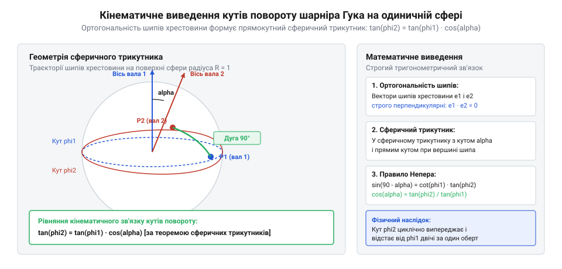
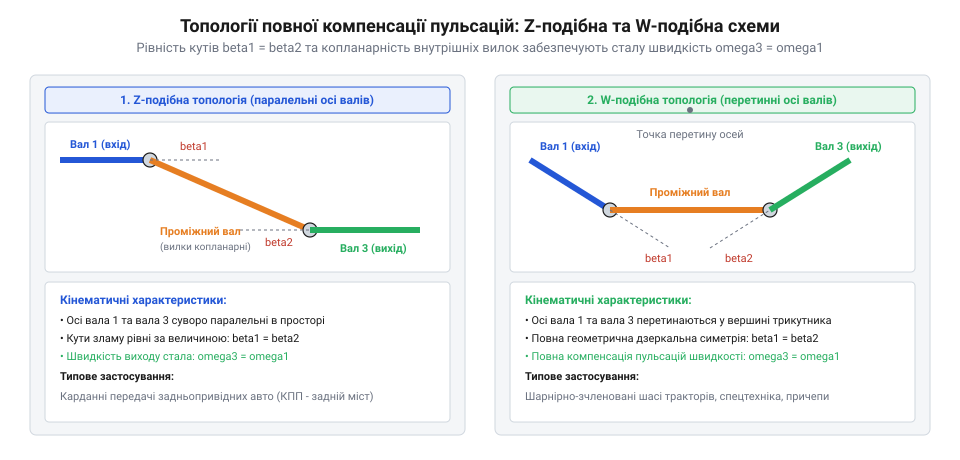

# Карданний шарнір Гука: нерівномірність передачі, пульсація швидкості та здвоєні схеми

## Сферично-тригонометричний вивід нерівномірності передачі: просторова ортогональність хрестовини, співвідношення тангенсів та миттєве передавальне відношення i_12

Одинарний карданний шарнір Гука призначений для передачі крутного моменту між двома валами, геометричні осі яких перетинаються під кутом зламу `α`. Центральним елементом шарніра є хрестовина (spider), чотири цапфи якої жорстко ортогональні між собою у просторі.

Розглянемо кінематику шарніра на одиничній сфері з центром у точці перетину осей валів. Нехай вісь ведучого вала спрямована вздовж осі `Z_1`, а вісь веденого вала — вздовж осі `Z_2`, відхиленої на кут `α` у площині `YZ`.


*Геометричний вивід співвідношення кутів повороту шарніра Гука на одиничній сфері.*

Цапфи вхідної вилки описують коло у площині, перпендикулярній осі `Z_1`. Їхнє кутове положення задається кутом повороту `φ_1`. Цапфи вихідної вилки обертаються у площині, перпендикулярній осі `Z_2`, а їхнє положення задається кутом `φ_2`.

### Деталізований геометричний вивід за правилом Непера для прямокутного сферичного трикутника

Побудуємо на одиничній сфері сферичний трикутник, вершинами якого є точки перетину характерних осей механізму з поверхнею сфери:
1. Вершина `P_1` — точка виходу осі ведучого вала `Z_1`;
2. Вершина `A` — кінець шипа ведучої вилки, що обертається у площині, перпендикулярній до `Z_1`; дуга великого кола `P_1 A` строго дорівнює 90° за означенням вилки;
3. Вершина `B` — кінець шипа веденої вилки, що обертається у площині, перпендикулярній до `Z_2`; дуга великого кола `P_2 B` також дорівнює 90°;
4. Оскільки цапфи хрестовини абсолютно жорсткі та взаємно перпендикулярні, дуга великого кола між точками `A` та `B` строго дорівнює прямому куту: `arc(AB) = 90°`.

Проектуючи положення цапф на сферичні координати, розглянемо прямокутний сферичний трикутник `Δ ABC`, вершина `C` якого утворена перетином меридіанних кіл осей валів під прямим кутом `∠C = 90°`. У цьому сферичному трикутнику:
- Катет `b = arc(AC)` відповідає поточному куту повороту ведучого вала відносно площини зламу: `b = φ_1`;
- Катет `a = arc(BC)` пов'язаний із кутом повороту веденого вала: `a = 90° - φ_2`;
- Сферичний двогранний кут при вершині `A` між площиною обертання вхідної вилки та площиною зламу дорівнює куту зламу валів `α`: `∠A = α`.

Для довільного прямокутного сферичного трикутника (із прямим кутом `C = 90°`) застосуємо класичне правило колових частин Джона Непера (Napier's rules of circular parts). Розташуємо п'ять елементів трикутника по колу Непера у порядку їх слідування:
```
катет b,  катет a,  доповнення кута (90° - B),  доповнення гіпотенузи (90° - c),  доповнення кута (90° - A)
```

Згідно з другим правилом Непера: косинус будь-якої середньої частини дорівнює добутку котангенсів двох прилеглих до неї частин:
```
cos(середня частина) = cot(прилегла 1) · cot(прилегла 2)
```

Оберемо елемент `(90° - A)` як середню частину. Його прилеглими сусідами на колі Непера є катет `b` та доповнення гіпотенузи `(90° - c)`:
```
cos(90° - A) = cot(b) · cot(90° - c)
```
Але в нашому трикутнику гіпотенуза `c` утворена прямокутною парою шипів, тому зручніше застосувати перше правило Непера: косинус кута дорівнює відношенню тангенса прилеглого катета до тангенса протилеглого катета (або через котангенси):
```
cos(A) = tan(b) · cot(a)
```
Підставимо значення наших геометричних кутів у цю тотожність:
- `A = α` (кут зламу валів);
- `b = φ_1` (кут повороту ведучого вала);
- `a = 90° - φ_2` (кутове положення шипа веденого вала).

Отримуємо:
```
cos(α) = tan(φ_1) · cot(90° - φ_2)
```
Оскільки за тригонометричною формулою зведення `cot(90° - φ_2) = tan(φ_2)` (або `1 / tan(90° - φ_2) = 1 / cot(φ_2) = tan(φ_2)`), рівність набуває вигляду:
```
cos(α) = tan(φ_1) / tan(φ_2)
```
Помноживши обидві частини на `tan(φ_2)` та розділивши на `cos(α)`, приходимо до фундаментального закону зв'язку кутів шарніра Гука:
```
tan(φ_2) = tan(φ_1) · cos(α)
```
Якщо виразити кут повороту веденого вала явно:
```
φ_2(φ_1) = arctan( tan(φ_1) · cos(α) )
```

Знайдемо миттєве передавальне відношення кутових швидкостей `i_12(φ_1) = ω_2 / ω_1`. Диференціюємо ліву та праву частини рівняння тангенсів за часом `t`:
```
(d / dt)(tan(φ_2)) = (d / dt)(tan(φ_1) · cos(α))
(1 / cos²(φ_2)) · (dφ_2 / dt) = (cos(α) / cos²(φ_1)) · (dφ_1 / dt)
```
Звідси відношення кутових швидкостей дорівнює:
```
i_12(φ_1) = ω_2 / ω_1 = (cos(α) · cos²(φ_2)) / cos²(φ_1)
```
Використовуючи тригонометричну тотожність `1 / cos²(φ_2) = 1 + tan²(φ_2) = 1 + tan²(φ_1) · cos²(α)` та підставляючи `tan(φ_1) = sin(φ_1) / cos(φ_1)`, після спрощення отримуємо канонічну формулу миттєвої передавальної функції шарніра Гука:
```
i_12(φ_1) = ω_2 / ω_1 = cos(α) / ( 1 - sin²(α) · cos²(φ_1) )
```
Або у термінах подвійного кута `2 · φ_1`:
```
i_12(φ_1) = (2 · cos(α)) / ( (1 + cos²(α)) - sin²(α) · cos(2 · φ_1) )
```

З аналізу функції видно:
- При `φ_1 = 0` та `φ_1 = π` передавальне відношення мінімальне:
```
i_min = cos(α)
```
- При `φ_1 = π/2` та `φ_1 = 3π/2` передавальне відношення максимальне:
```
i_max = 1 / cos(α)
```

> 🔧 **Навіщо це.** Навіть за абсолютно рівномірного обертання двигуна `ω_1 = const` вихідний вал одинарного шарніра двічі за один оберт прискорюється до `ω_1 / cos(α)` і двічі сповільнюється до `ω_1 · cos(α)`.

## Пульсації швидкості та знакозмінне кутове прискорення: гармонічний аналіз ряду Фур'є, подвійна частота 2·omega та генерація динамічних моментів

Наявність нерівномірності кутової швидкості означає, що будь-яка маса, приєднана до вихідного вала, зазнає безперервного кутового прискорення.

Знайдемо миттєве кутове прискорення веденого вала `ε_2 = dω_2 / dt`, продиференціювавши вираз кутової швидкості:
```
ε_2(φ_1) = (dω_2 / dφ_1) · (dφ_1 / dt) = ω_1² · ( (d / dφ_1) [ cos(α) / (1 - sin²(α) · cos²(φ_1)) ] )
```
Обчислюючи похідну, маємо:
```
ε_2(φ_1) = -ω_1² · ( (cos(α) · sin²(α) · sin(2 · φ_1)) / (1 - sin²(α) · cos²(φ_1))² )
```

Максимальне кутове прискорення досягається поблизу кутів `φ_1 ≈ 45°, 135°, 225°, 315°` і для помірних кутів зламу `α` (де `sin(α) ≈ α`) наближено оцінюється формулою:
```
ε_2_max ≈ ω_1² · sin²(α) ≈ ω_1² · α²
```

Для аналізу вібрацій розкладемо передавальне відношення `i_12(φ_1)` у тригонометричний ряд Фур'є за парними гармоніками кута повороту:
```
i_12(φ_1) = 1 + 2 · ∑_{k=1}^∞ (-1)^k · m^k · cos(2 · k · φ_1)
```
де параметр форми `m` дорівнює:
```
m = (1 - cos(α)) / (1 + cos(α)) = tan²(α / 2)
```
Для кутів `α ≤ 15°` параметр `m` є малою величиною (`m ≈ α² / 4`), тому вищими гармоніками (`4 · φ_1`, `6 · φ_1`) можна знехтувати. Головною рушійною силою вібрацій стає перша парна гармоніка подвійної частоти `2 · ω_1`:
```
ω_2(t) ≈ ω_1 · ( 1 - 2 · tan²(α / 2) · cos(2 · ω_1 · t) )
```

Подвійна частота пульсацій є фундаментальною властивістю шарніра Гука: за один повний оберт вхідного вала вихідний вал здійснює рівно два повні цикли розгону та гальмування.

Якщо вихідний вал з'єднаний з інерційним навантаженням (колесо автомобіля, ротор вентилятора або шпиндель верстата) з моментом інерції `J_load`, знайозмінне прискорення генерує динамічний інерційний момент:
```
M_dyn(t) = J_load · ε_2(t) ≈ J_load · ω_1² · sin²(α) · sin(2 · ω_1 · t)
```

### Практичний розрахунок динамічного навантаження трансмісії автомобіля

Розглянемо чисельний приклад розрахунку динамічного крутного моменту для вала трансмісії задньопривідного легкового автомобіля або комерційного фургона:
- Робоча частота обертання карданного вала на трасі (пряма передача, 100 км/год): `n_1 = 3000 об/хв`;
- Кутова швидкість ведучого вала: `ω_1 = (2 · π · 3000) / 60 ≈ 314.16 рад/с`;
- Робочий кут перегину заднього карданного шарніра через динамічний хід ресорної підвіски: `α = 6° = 0.1047 рад`;
- Зведений момент інерції рухомих мас, жорстко зв'язаних із веденим фланцем редуктора моста (провідна конічна шестерня головної передачі, вінець диференціала, півосі, гальмівні диски та колеса, приведені до осі карданного вала з урахуванням головного передавального числа `i_main = 3.5`): `J_pinion ≈ 0.08 кг·м²`.

Обчислимо амплітуду кутового прискорення веденого вала шарніра:
```
sin(6°) ≈ 0.10453,   sin²(6°) ≈ 0.010926
ε_2_max ≈ ω_1² · sin²(α) = (314.16)² · 0.010926 ≈ 98 696 · 0.010926 ≈ 1078.4 рад/с²
```

Знайдемо пікову амплітуду знакозмінного інерційного моменту, який діє на шипи хрестовини та шліци вала:
```
M_dyn_max = J_pinion · ε_2_max = 0.08 кг·м² · 1078.4 рад/с² ≈ 86.3 Н·м
```

Частота вимушених крутильних коливань на подвійній частоті обертання дорівнює:
```
f_vib = 2 · (n_1 / 60) = 2 · (3000 / 60) = 100 Гц
```

Це означає, що хрестовина карданного шарніра та шліцьове з'єднання зазнають знакозмінного знакоперемінного скручування з розмахом `±86.3 Н·м` із частотою 100 разів на секунду (6000 циклів навантаження за хвилину). Якщо номінальний корисний крутний момент двигуна в цьому режимі становить близько `M_engine ≈ 200 Н·м`, то динамічна пульсація досягає понад 43% від номінального навантаження.

Такі циклічні вібрації мають дві вкрай небезпечні інженерні загрози:
1. **Втомне пошкодження підшипників хрестовини (False Brinelling):** мікровибоїни та викришування цементованого шару під голчастими роликами виникають уже через десятки годин експлуатації через безперервні високочастотні мікроудари;
2. **Крутильний резонанс:** якщо власна частота крутильних коливань валопроводу `f_0 = (1 / 2π) · √(C_torsion / J_equiv)` виявиться близькою до 100 Гц, настає катастрофічний резонанс із коефіцієнтом динамічного підсилення `Q ≈ 5–10`, що збільшує знакозмінний момент до 500–800 Н·м та призводить до миттєвого руйнування шліцьової муфти або скручування тонкостінної труби вала.

> 🔧 **Навіщо це.** Без суворої геометричної компенсації пульсацій за допомогою другого шарніра Гука карданний вал автомобіля працював би як високочастотний вібромолот, руйнуючи трансмісію за кілька тисяч кілометрів пробігу.

## Двозвенний валопровід: геометричні умови повної компенсації нерівномірності для Z-подібної та W-подібної схем

Одинарний шарнір Гука є принципово асинхронною передачею: нерівномірність кутової швидкості веденого вала є неминучим наслідком геометрії просторової хрестовини. Проте у валопроводах з двома послідовно встановленими шарнірами кінематичну нерівномірність першого шарніра можна повністю скомпенсувати за допомогою другого шарніра.

Розглянемо триланковий валопровід, що складається з ведучого вала 1, проміжного карданного вала 2 та веденого вала 3. Перший шарнір Гука з'єднує вали 1 і 2 під кутом зламу `α_1`. Другий шарнір Гука з'єднує вали 2 і 3 під кутом зламу `α_2`.


*Кінематичні схеми повної взаємної компенсації пульсацій швидкості: Z-подібна та W-подібна топології.*

Для першого шарніра зв'язок між кутом повороту вхідного вала `φ_1` та кутом повороту проміжного вала `φ_2` описується базовим рівнянням:
```
tan(φ_2) = tan(φ_1) · cos(α_1)
```
Звідси кут вхідного вала через кут проміжного вала:
```
tan(φ_1) = tan(φ_2) / cos(α_1)
```

Для другого шарніра проміжний вал 2 виступає ведучим ланкою, а вихідний вал 3 — веденою. Якщо вилка другого шарніра на проміжному валі повернута відносно вилки першого шарніра на фазовий кут `γ = 0` (тобто обидві вилки проміжного вала лежать строго в одній площині), то кутовий зв'язок між валами 2 і 3 має вигляд:
```
tan(φ_3) = tan(φ_2) / cos(α_2)
```

Підставимо вираз для `tan(φ_2) = tan(φ_1) · cos(α_1)` у рівняння другого шарніра:
```
tan(φ_3) = (tan(φ_1) · cos(α_1)) / cos(α_2) = tan(φ_1) · (cos(α_1) / cos(α_2))
```

Щоб кут повороту веденого вала в кожен момент часу строго дорівнював куту повороту ведучого вала (`φ_3(t) = φ_1(t)`), коефіцієнт при `tan(φ_1)` повинен тотожно дорівнювати одиниці:
```
cos(α_1) / cos(α_2) = 1  =>  cos(α_1) = cos(α_2)  =>  α_1 = α_2
```

При рівності кутів зламу `α_1 = α_2 = α` отримуємо:
```
tan(φ_3) = tan(φ_1)  =>  φ_3(t) = φ_1(t)
```
Диференціюючи цю тотожність за часом, маємо повну синхронність обертання:
```
ω_3(t) = ω_1(t) = const,   ε_3(t) = 0
```

Для реалізації цієї умови на практиці застосовують дві класичні просторові топології:
1. **Z-подібна схема (паралельне розташування валів):** осі ведучого вала 1 та веденого вала 3 строго паралельні між собою (`осі 1 || 3`), але зміщені у просторі на величину міжосьової відстані (ексцентриситет). Проміжний вал 2 з'єднує їх під однаковими протилежно спрямованими кутами зламу `α_1 = α_2`. Усі три осі валів лежать в одній загальній площині зламу. Ця схема є стандартом для приводу заднього ведучого моста легкових і вантажних автомобілів із класичним компонуванням, де вихідний вал коробки передач паралельний осі провідної шестерні головної передачі моста.
2. **W-подібна схема (симетричне перетинання осей):** осі вхідного 1 та вихідного 3 валів лежать в одній площині та перетинаються під деяким кутом, а проміжний вал розташований симетрично відносно бісектриси цього кута. Кути зламу на обох шарнірах спрямовані в один бік і рівні між собою: `α_1 = α_2`. Така топологія використовується у важких шарнірних зчленуваннях тракторів із ламаною рамою (наприклад, шарнір повороту піврам) та у спарених карданних шарнірах (Double Cardan joint / Constant Velocity yoke).

### Числовий розрахунок залишкових пульсацій при порушенні фазування вилок

Якщо під час складання або обслуговування карданного вала порушено копланарність вилок проміжного вала (фазовий кут розведення `γ ≠ 0`), повного взаємного гасіння не відбувається. Залишкова пульсація кутової швидкості вихідного вала на подвійній частоті `2 · ω_1` має амплітуду:
```
δ_omega_residual = 4 · tan²(α / 2) · |sin(γ)|
```
Амплітуда залишкового динамічного прискорення та крутного моменту при зведеному моменті інерції ведених мас `J_load`:
```
ε_3_max ≈ ω_1² · sin²(α) · |sin(γ)|
M_dyn_residual = J_load · ε_3_max
```

Проаналізуємо вплив кута десинхронізації вилок `γ` для типового автомобільного режиму: робоча швидкість `n_1 = 3000 об/хв` (`ω_1 = 314.16 рад/с`), кут зламу шарнірів `α = 6°` (`sin(6°) ≈ 0.10453`), момент інерції навантаження `J_load = 0.08 кг·м²`.

| Кут фазування `γ` | `|sin(γ)|` | Залишкова пульсація `δ_omega` | Кутове прискорення `ε_3_max` | Динамічний момент `M_dyn` | Рівень вібрацій / Наслідки |
|:---:|:---:|:---:|:---:|:---:|:---|
| **0°** (Ідеал) | 0.000 | **0.00 %** | 0 рад/с² | **0.0 Н·м** | Повна компенсація; ідеально плавне обертання |
| **15°** (Помилка на 1–2 шліци) | 0.259 | **0.28 %** | 279 рад/с² | **22.3 Н·м** | Помітний низькочастотний гул на кузові при розгоні |
| **45°** (Груба помилка збірки) | 0.707 | **0.77 %** | 762 рад/с² | **61.0 Н·м** | Сильна тряска, прискорене втомне руйнування шліців |
| **90°** (Антифаза, катастрофа) | 1.000 | **1.09 %** | 1078 рад/с² | **86.3 Н·м** | Подвоєння пульсацій; резонансне зрізання хрестовин |

З аналізу таблиці видно: помилка взаємного розвороту вилок усього на `15°` (що відповідає зміщенню шліцьової втулки лише на один-два шліци при ремонті) генерує знакозмінний пульсуючий момент величиною `±22.3 Н·м` на частоті 100 Гц. При розвороті на `90°` нерівномірність подвоюється порівняно з одинарним шарніром, викликаючи майже 90 Н·м динамічних ударів, що призводить до обриву опор коробки передач за перші сотні кілометрів пробігу.

> 🔧 **Навіщо це.** Хоча ведений вал 3 обертається ідеально рівномірно (`ω_3 = const`), проміжний вал 2 продовжує зазнавати неперервних пульсацій швидкості `ω_2(t)` та кутових прискорень `ε_2(t)` на подвійній частоті `2 · ω_1`. Тому для зменшення динамічних навантажень на опори проміжний карданний вал обов'язково проектують максимально полегшеним — у вигляді тонкостінної труби з високою крутильною жорсткістю та мінімальним власним моментом інерції.

## Фазове розведення вилок і просторовий злам: розрахунок залишкової нерівномірності при порушенні копланарності осей

Повна взаємна компенсація пульсацій у двозвенному карданному валопроводі можлива лише за суворого дотримання двох геометричних умов:
1. Рівність кутів зламу: `α_1 = α_2`;
2. Копланарність вилок проміжного вала: внутрішні вилки обох шарнірів повинні лежати в одній спільній площині (`γ = 0`).

Якщо карданний вал має телескопічне шліцьове з'єднання для компенсації зміни відстані під час ходу підвіски, помилка складання вала «на один шліц» призводить до кутового взаємного закручування вилок на фазовий кут помилки `γ ≠ 0`.

Розглянемо передачу руху за наявності фазового зсуву `γ` між площинами вилок проміжного вала:
```
tan(φ_2) = tan(φ_1) · cos(α_1)
```
Кут входу у другий шарнір зміщений на фазовий кут: `φ_2' = φ_2 + γ`. Відповідно, кінематичне рівняння другого шарніра набуває вигляду:
```
tan(φ_3) = tan(φ_2 + γ) / cos(α_2)
```

Розкладемо передавальне відношення швидкостей для всього валопроводу `i_13(φ_1) = ω_3 / ω_1` в гармонічний ряд при малій величині кутів зламу `α_1 ≈ α_2 = α`.

Амплітуда першої гармоніки пульсації кутової швидкості веденого вала на подвійній частоті `2 · ω_1` описується векторною різницею пульсацій двох шарнірів:
```
δ_omega_residual = 2 · tan²(α / 2) · √((1 - cos(2 · γ))² + sin²(2 · γ)) = 4 · tan²(α / 2) · |sin(γ)|
```
Для малих кутів зламу `tan(α / 2) ≈ α / 2`, що дає зручну інженерну оцінку залишкової пульсації:
```
δ_omega_residual ≈ α² · |sin(γ)|
```

Проаналізуємо граничні випадки:
- **Ідеальне фазування (`γ = 0°`):** `sin(0) = 0`, залишкова пульсація `δ_omega_residual = 0`. Нерівномірність повністю ліквідована.
- **Найгірша помилка складання — розведення на 90° (`γ = 90°`):** `sin(90°) = 1`. Залишкова нерівномірність подвоюється:
```
δ_omega_residual = 4 · tan²(α / 2) ≈ α²
```
У цьому випадку пульсації обох шарнірів не віднімаються, а складаються синфазно. Рівень динамічних вібрацій на підшипниках та хрестовинах подвоюється порівняно навіть з одинарним шарніром. На швидкостях понад 2000 об/хв це викликає миттєвий резонансний гул, руйнування голчастих підшипників хрестовини та зрізання болтів фланця.

### Просторовий 3D-злам осей (складний кут)

В реальних машинах осі агрегатів рідко лежать в одній геометричній площині. Зазвичай присутній як вертикальний кут перекосу `α_v` (через різницю висот коробки передач і редуктора моста), так і горизонтальний кут `α_h` (через зміщення редуктора вбік від поздовжньої осі рами).

Результуючий просторовий кут зламу кожного шарніра визначається за формулою сферичної геометрії:
```
cos(α_space) = cos(α_v) · cos(α_h)
```
Якщо площина зламу першого шарніра повернута відносно площини зламу другого шарніра на просторовий кут `β_plane`, виникає такий самий ефект, як і при фазовому розведенні вилок.

Щоб повністю скомпенсувати пульсації у просторово-зігнутому валопроводі:
1. Просторовий кут першого шарніра повинен строго дорівнювати просторовому куту другого шарніра: `α_space_1 = α_space_2`;
2. Вилки проміжного вала повинні бути виготовлені або зібрані не паралельно, а розгорнуті на кут `γ = β_plane`. Тільки тоді площини симетрії вилок співпадуть із відповідними площинами просторового зламу осей, забезпечуючи ідеальне взаємне гасіння коливань кутової швидкості.
