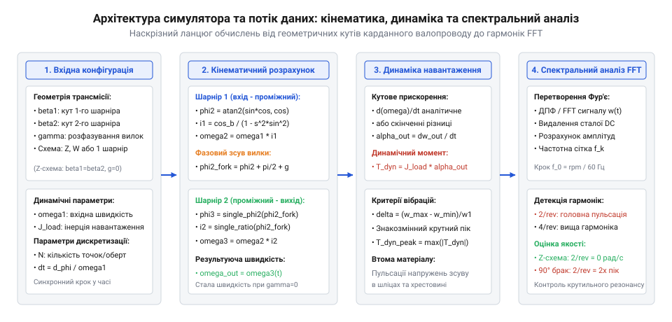
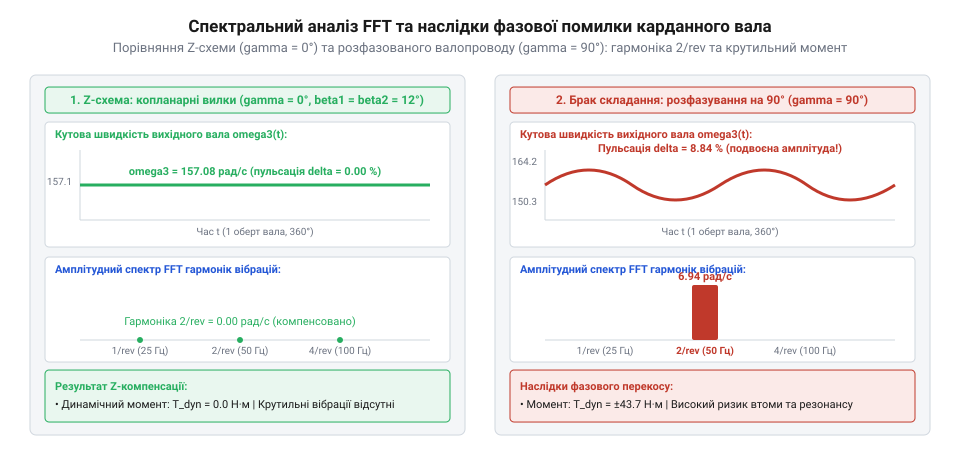

# Карданний шарнір Гука: нерівномірність передачі, пульсація швидкості та здвоєні схеми

<preknowlist>
- [Карданний шарнір Гука: нерівномірність передачі, пульсація швидкості та здвоєні схеми](root:hw-motion/cardan-hooke-joint) — розуміння геометрії хрестовини, формули передавального відношення швидкості та умов компенсації у Z-подібній конфігурації.
</preknowlist>

## Архітектура та математична модель симулятора: опис просторової кінематики валопроводу, формулювання розрахункових рівнянь для кутових швидкостей, прискорень та динамічних моментів навантаження

У карданних передачах із шарнірами Гука (@@en|Cardan / Hooke joints@@) зміна кутової орієнтації між валами неминуче породжує кінематичну нерівномірність обертання. Оскільки площина хрестовини під час обертання здійснює просторове коливання відносно осі веденого вала на кут зламу beta, кутові координати вхідної вилки phi_1 та вихідної вилки phi_2 пов'язані нелінійним тригонометричним рівнянням:

```
tan(phi_2)
= tan(phi_1) · cos(beta)                                        [кінематичний зв'язок кутів повороту вхідного та вихідного валів]
```

Диференціювання кутового зв'язку за часом дає миттєве передавальне відношення кутової швидкості:

```
omega_2(phi_1)
= omega_1 · (cos(beta) / (1 - sin²(beta) · sin²(phi_1)))        [миттєва кутова швидкість веденого вала одиночного шарніра]
```


*Структурна блок-схема симулятора карданного валопроводу: обчислювальний конвеєр від просторових кутів до спектра крутильних вібрацій.*

Навіть за строго постійної частоти обертання тягового вала (omega_1 = const, d(omega_1)/dt = 0) вихідний вал зазнає періодичних знакозмінних кутових прискорень alpha_2:

```
alpha_2(phi_1)
= (omega_1² · cos(beta) · sin²(beta) · sin(2 · phi_1)) / (1 - sin²(beta) · sin²(phi_1))²  [кутове прискорення веденого вала]
```

Присутність множника sin(2 · phi_1) у чисельнику означає, що прискорення пульсує з подвійною частотою обертання вала (гармоніка 2·omega). Якщо на вихідному валу встановлено масивне навантаження з моментом інерції J_load, ці прискорення генерують динамічний крутний момент другого порядку:

```
T_dyn
= J_load · alpha_2(phi_1)                                       [знакозмінний крутний момент інерційного перевантаження трансмісії]
```

Під час тривалої експлуатації знакозмінні динамічні крутні моменти другого порядку T_dyn спричиняють прогресуючий контактний знос голчастих підшипників хрестовини. Оскільки шипи хрестовини не здійснюють безперервного колового оберту всередині чашок, а лише здійснюють реверсивні кутові мікрохитання на кут зламу beta, лінійна швидкість перекочування голок у крайніх точках реверсу падає до нуля. За таких умов руйнується еластогідродинамічний масляний клин (режим граничного тертя), тонкі загартовані голки продавлюють залишковий шар мастила, провокуючи фретинг-корозію та локальне втомне бринелювання (@@en|false brinelling@@) циліндричних поверхонь цапф.

Поява радіального зазору в підшипникових вузлах перетворюється на відчутний кутовий люфт з'єднання delta_phi_backlash. Оскільки знакозмінне кутове прискорення alpha_2 чотири рази за один повний оберт змінює знак (проходячи через нульові точки гармонійної функції `sin(2 · phi_1)`), зазори в шарнірі вибираються з різким динамічним ударом. Замість гладкого синусоїдального коливання крутний момент набуває форми високочастотних ударних імпульсів із майже вертикальним фронтом наростання. Пікові ударні напруження в металі вилок у 3–5 разів перевищують номінальне теоретичне значення T_dyn, викликаючи розбивання отворів вушок, утворення втомних мікротріщин і руйнування шпонкових чи шліцьових з'єднань вала.

Для нейтралізації пульсацій застосовують двозв'язні валопроводи (Z- або W-подібні схеми), де два однакових шарніри з кутами зламу beta_1 = beta_2 з'єднані проміжним валом. Коли вилки на кінцях проміжного вала розташовані в одній площині (копланарні, кут розведення gamma = 0°), нерівномірність другого шарніра дзеркально компенсує нерівномірність першого, повертаючи вихідному валу рівномірну швидкість omega_out = omega_in.

Проте навіть у кінематично узгоджених двозв'язних валопроводах залишкові вібрації, викликані просторовою деформацією опорних підвісів рами та мікроперекосами кутів зламу під змінним тяговим зусиллям, вимагають застосування активних демпфуючих вузлів. Для ізоляції крутильних коливань у силовий ланцюг карданного вала інтегрують пружні гумометалеві муфти (@@en|flexible rubber couplings / Guibo disc@@) або спеціалізовані демпфери крутильних коливань (@@en|torsional vibration dampers, TVD@@).

Конструктивно еластична муфта містить армовані кордом гумові секції, розташовані між зустрічними фланцями валів, що вносить у трансмісію скінченну крутильну піддатливість C_flex та високе внутрішнє гістерезисне демпфування d_torsion:

```
T_transmitted
= C_flex · delta_theta + d_torsion · (d(delta_theta) / dt)      [передача моменту через в'язкопружний демпфер крутильних коливань]
```

Введення в'язкопружного елемента істотно зміщує власну крутильну частоту валопроводу в зону низьких обертів, виводячи резонансний пік далеко за межі спектра подвійної частоти 2·omega. Внутрішнє тертя в масиві пружного еластомеру розсіює енергію коливань у тепло, знижуючи добротність резонансу Q з типових значень 25–40 для суцільного сталевого вала до безпечного рівня Q < 3, що надійно захищає зубчасті редуктори та чутливі датчики енкодерів від вібраційного руйнування.

> 🔧 **Навіщо це.** Математична модель дозволяє інженеру трансмісії точно визначити амплітуду знакозмінного моменту T_dyn на етапі віртуального проєктування та запобігти передчасному руйнуванню зубчастих зачеплень і підшипникових опор від крутильної втоми.

## Реалізація алгоритмів розрахунку на мовах Python та C++: чисельне диференціювання, розрахунок кутових параметрів для Z- і W-топологій та спектральний FFT-аналіз вібрацій

Практична реалізація симулятора потребує чисельно стабільних алгоритмів для обробки багатовиткових поворотів вала без стрибків фази. Функція `atan2(sin(phi_1) · cos(beta), cos(phi_1))` обчислює кут у межах поточного квадранта, а лічильник повних обертів забезпечує монотонне гладке наростання фази.

Для двозв'язного валопроводу аналітичне взяття другої похідної для довільного просторового перекосу та розфазування вилок gamma призводить до громіздких формул. У симуляторі застосовано високоточне триточкове симетричне чисельне диференціювання кутової швидкості з кроком dt = 1 мкс:

```
alpha_out(t)
= (omega_out(t + dt) - omega_out(t - dt)) / (2 · dt)            [симетрична різницева схема чисельного диференціювання]
```

:::code proj-cardan-kinematics-and-vibration-simulator/py/cardan_driveshaft_simulator.py 110-185

Для дослідження вібраційного фону часовий масив миттєвої швидкості omega_out(t) передається на алгоритм дискретного перетворення Фур'є (FFT). Симулятор видаляє постійну складову середньої швидкості та розраховує односторонній спектр амплітуд для гармонік різної кратності відносно базової частоти f_0 = omega_1 / (2 · pi):

:::code proj-cardan-kinematics-and-vibration-simulator/cpp/cardan_kinematics.hpp 117-152

Спектральний аналіз чітко демонструє різницю конфігурацій:
- При одиночному шарнірі або помилковому монтажі вилок (gamma = 90°) амплітуда гармоніки другого порядку 2/rev досягає кількох відсотків від середньої швидкості, створюючи потужний вібраційний фон на частоті 2·f_0.
- У налаштованій Z-схемі (beta_1 = beta_2, gamma = 0°) амплітуда гармоніки 2/rev знижується практично до машинного нуля (рівень чисельного шуму), підтверджуючи повну кінематичну компенсацію пульсацій.

Для реалістичного прогнозування динамічної поведінки трансмісії інженерний симулятор повинен враховувати скінченну крутильну жорсткість сполучного валопроводу. У реальних машинах проміжний вал являє собою сталеву тонкостінну трубу довжиною L_tube, яка під дією пульсуючого моменту другого порядку T_dyn зазнає циклічної пружної закрутки delta_theta. Її крутильна жорсткість C_shaft визначається модулем зсуву металу G_steel та полярним моментом інерції перерізу труби:

```
C_shaft
= (G_steel · I_p) / L_tube                                      [крутильна жорсткість трубчастого проміжного вала, Н·м/рад]
```

де для труби із зовнішнім діаметром D_ext та внутрішнім діаметром D_int полярний момент дорівнює `I_p = (pi / 32) · (D_ext⁴ - D_int⁴)`. Спільно з моментом інерції тягового привода J_in та інерцією навантаження J_load трубчастий вал утворює двомасову крутильну коливальну систему. Її власна кутова частота та резонансна частота в герцах виражаються співвідношеннями:

```
omega_nat
= sqrt(C_shaft · ((J_in + J_load) / (J_in · J_load)))           [власна кутова частота крутильних коливань валопроводу, рад/с]
```

```
f_nat
= omega_nat / (2 · pi)                                          [власна резонансна частота крутильного ланцюга, Гц]
```

Небезпека полягає в тому, що карданний шарнір Гука генерує постійне кінематичне збурення на подвійній обертовій частоті `f_exc = 2 · f_0`. Якщо при проєктуванні зменшити діаметр труби або збільшити її довжину, жорсткість C_shaft різко впаде, і власна частота f_nat потрапить безпосередньо в діапазон робочих швидкостей обертання двигуна.

На частоті резонансу динамічний коефіцієнт підсилення коливань (@@en|dynamic magnification factor@@) через вкрай низьке внутрішнє демпфування суцільної сталі досягає значень Q = 15–30. При цьому піковий крутний момент перевантаження `T_peak = T_dyn · Q` багаторазово перевищує границю втомної міцності матеріалу, викликаючи втомне руйнування шліцьових з'єднань або зріз вушок вилок.

Щоб запобігти резонансному руйнуванню без збільшення ваги трансмісії, конструктори оптимізують геометрію перерізу: збільшують зовнішній діаметр D_ext при збереженні малої товщини стінки. Оскільки полярний момент зростає пропорційно четвертому степеню діаметра, а маса вала — лише першому степеню відносно площі стінки, такий підхід кардинально підвищує власну частоту f_nat за мінімальної додаткової інерції. Модуль симулятора автоматично верифікує виконання умови частотної відбудови `f_nat > 1.4 · (2 · f_0_max)`, що гарантує надійну дорезонансну роботу трансмісії в усьому діапазоні експлуатаційних обертів.

> 🔧 **Навіщо це.** Вбудована діагностична реалізація на C++17 дозволяє реальному контролеру стенда або автопілота за лічені мікросекунди детектувати десинхронізацію карданного вала за спектральним піком подвійної частоти, запобігаючи резонансним аваріям у приводі.

## Дослідження впливу кутів зламу та фазової десинхронізації: моделювання спотворень сигналу кутової швидкості, виявлення резонансної подвійної частоти 2·ω та оцінка залишкових коливань

Кінематична компенсація нерівномірності у здвоєній карданній передачі вимагає суворого дотримання двох умов: рівності кутів зламу першого та другого шарнірів (beta_1 = beta_2) та копланарності внутрішніх вилок проміжного вала (кут фазового розведення gamma = 0°). Порушення будь-якої з цих умов призводить до неповної взаємної компенсації та виникнення залишкових пульсацій кутової швидкості.


*Вплив фазового розведення вилок на гармонійний спектр: ідеальна компенсація при gamma = 0° та різке зростання подвійної гармоніки 2·omega при помилці монтажу.*

Симулятор дозволяє дослідити чутливість валопроводу до монтажних похибок:
1. **Копланарні вилки (gamma = 0°)**: кутова швидкість вихідного вала є строго монотонною лінією, амплітуда гармоніки другого порядку за FFT наближається до нуля (залишкова похибка менше 0.0001 рад/с).
2. **Помилка фазування на один зуб шліців (gamma = 15°)**: з'являється виражена гармонійна пульсація з розмахом 1.5–3.0% від номінальної швидкості.
3. **Груба помилка складання (gamma = 90°)**: пульсації обох шарнірів складаються у фазі, подвоюючи амплітуду кутового прискорення та викликаючи перевантаження трансмісії:

```
delta_omega_rel
= ((omega_max - omega_min) / omega_mean) · 100%                 [коефіцієнт відносної пульсації кутової швидкості]
```

Знакозмінні моменти другого порядку з частотою 2·omega є найнебезпечнішим джерелом збудження крутильних коливань, що призводить до руйнування шпонкових з'єднань, хрестовин та шліцьових муфт.

Знакозмінна нерівномірність кутової швидкості та динамічні моменти другого порядку чинять визначальний руйнівний вплив на довговічність голчастих підшипників хрестовини. На відміну від звичайних підшипників валів, які безперервно обертаються в одному напрямку, голки в чашках карданного шарніра здійснюють зворотно-поворотний коливальний рух (@@en|oscillating motion@@) з амплітудою, рівною робочому куту зламу шарніра `±beta`, та подвоєною частотою `2 · omega_1`.

За такого специфічного режиму роботи в зоні пружного контакту тіл кочення не може сформуватися стійкий гідродинамічний масляний клин. Коли кут зламу beta малий (менше 1.5°–2.0°), голки коливаються на мікроскопічний кут і практично не провертаються навколо власної осі, що призводить до локального витискання мастила та виникнення контактної корозії тертя — фальшивого бринелювання (@@en|false brinelling@@) у вигляді характерних поздовжніх канавок на шийках хрестовини.

Коли ж у трансмісії виникає кінематична десинхронізація (помилка фазування gamma != 0 або нерівність робочих кутів beta_1 != beta_2), динамічне кутове прискорення alpha_2 породжує знакозмінний інерційний момент навантаження `T_dyn = J_load · alpha_2`. Цей момент генерує циклічні пульсуючі радіальні сили на шийках цапф хрестовини F_trunnion:

```
F_trunnion
= (T_mean + T_dyn) / (2 · R_cross)                              [миттєве радіальне навантаження на голчастий підшипник цапфи хрестовини, Н]
```

де R_cross — ефективний радіус розташування підшипникових чашок від центра хрестовини. Для розрахунку довговічності хрестовини за стандартом ISO 281 в умовах осциляцій динамічне еквівалентне навантаження перераховують із урахуванням коефіцієнта коливального ходу та динамічного ударного коефіцієнта f_shock:

```
P_osc
= F_trunnion · (beta / 90°)^(1/3) · f_shock                     [еквівалентне динамічне навантаження осцилюючого голчастого підшипника]
```

```
L_10_osc
= (C_dyn / P_osc)^(10/3) · (180° / (4 · beta · n_rpm · 60))     [номінальний ресурс підшипника хрестовини в годинах роботи]
```

При точній синхронізації вилок і малих кутах коефіцієнт ударності становить f_shock = 1.0–1.2. Проте при розфазуванні вилок на кут gamma = 15°–90° циклічні піки прискорення підкидають f_shock до 2.5–3.5. Оскільки довговічність голчастих підшипників залежить від навантаження в степені 10/3 (3.33), зростання навантаження всього вдвічі скорочує строк служби хрестовини в 10 разів, викликаючи втомне викришування (пітинг) та розколювання голок задовго до вичерпання розрахункового ресурсу привода.

> 🔧 **Навіщо це.** Спектральний аналіз FFT дозволяє діагностичним датчикам виявляти перекіс опорних підшипників або помилку збирання карданного вала на ранній стадії за характерним піком на подвійній обертовій частоті.

## Інженерна верифікація та межі застосовності симулятора: порівняння з аналітичними рядами Фур'є, вплив крутильної піддатливості валів та інтеграція в діагностичні системи

Для верифікації точності роботи чисельного симулятора виконано зіставлення результатів моделювання з аналітичним розкладанням передавального відношення шарніра Гука в нескінченний ряд Фур'є:

```
omega_2 / omega_1
= 1 + 2 · sum((-1)ⁿ · ((1 - cos(beta)) / (1 + cos(beta)))ⁿ · cos(2 · n · phi_1))  [гармонійний ряд передавального відношення]
```

Чисельний розрахунок через `atan2` та спектральне перетворення FFT демонструють збіжність з аналітичним рядом із похибкою менше 0.05%, що підтверджує адекватність обчислювального алгоритму.

Проте інженер повинен враховувати межі застосовності моделі абсолютно твердих тіл. У реальних промислових трансмісіях проміжний трубчастий вал має скінченну крутильну жорсткість `C_torsion = G · I_p / L`. Якщо подвійна частота обертання вала `2 · f_0` потрапляє в зону власної крутильної частоти системи `f_nat = (1 / (2 · pi)) · sqrt(C_torsion / J_load)`, виникає катастрофічний крутильний резонанс.

:::code proj-cardan-kinematics-and-vibration-simulator/cpp/main.cpp 45-81

Для захисту трансмісії від руйнівного впливу резонансних крутильних коливань, спричинених гармонікою подвійної частоти 2·omega, у валопровід послідовно з карданним шарніром встановлюють еластичні гумові муфти (наприклад, дискові муфти типу Джубо / Giubo або тороподібні пружні муфти). Конструкція такої муфти являє собою замкнене пружне кільце з синтетичного каучуку або поліуретану, всередині якого завулканізовані металеві втулки для з'єднання з вилками валів за допомогою поперемінно спрямованих болтів. Внутрішні пружні секції армуються міцним текстильним кордом, що працює переважно на розтяг під час передачі основного крутного моменту.

Встановлення еластичного елемента змінює динамічні характеристики привода за двома ключовими механізмами:
1. **Зниження еквівалентної крутильної жорсткості**: оскільки гумова муфта має крутильну жорсткість C_rubber на один-два порядки меншу за жорсткість суцільного сталевого вала C_shaft, сумарна еквівалентна жорсткість валопроводу `1 / C_total = 1 / C_shaft + 1 / C_rubber` різко зменшується. Це зміщує власну крутильну частоту `omega_nat = sqrt(C_total / J_load)` далеко вниз — у підрезонансну зону нижче мінімальних холостих обертів двигуна, завдяки чому вся робоча експлуатація машини відбувається в безпечній закритичній області (@@en|supercritical operation@@), де динамічний коефіцієнт підсилення коливань падає нижче одиниці.
2. **Високе гістерезисне демпфування**: коефіцієнт механічних втрат пружного еластомеру eta_rubber становить 0.15–0.30 (порівняно з 0.001–0.005 для конструкційної сталі). Енергія коливань, що розсіюється за один період коливань на подвійній частоті, пропорційна площі петлі динамічного гістерезису матеріалу:

```
Delta_W
= pi · eta_rubber · C_rubber · theta_amp²                       [циклічне розсіювання енергії коливань у пружному елементі муфти, Дж]
```

Це внутрішнє демпфування обмежує піковий резонансний коефіцієнт підсилення до значень Q = 3–5 замість катастрофічних 20–30, характерних для жорстких валів.

Проте інженер повинен суворо враховувати термічні та втомні обмеження еластомерів. Уся розсіяна коливальна енергія перетворюється на тепло всередині масиву гуми. За тривалого руху з великим кутом перекосу або високою амплітудою пульсацій температура муфти може перевищити критичні 80–90 °C, що викликає теплову деструкцію, затвердіння компаунду та розрив армувального корду. Крім того, на високих швидкостях обертання відцентрові сили намагаються випнути еластомерні сегменти назовні, тому вбудовані діагностичні модулі розраховують допустиму вібраційну потужність розсіювання для запобігання перегріву муфти.

> 🔧 **Навіщо це.** Порівняння спектра збудження 2·omega із власною частотою валопроводу дозволяє розробнику вибрати діаметр карданної труби так, щоб робочий діапазон оборотів привода лежав далеко за межами резонансної небезпеки.
