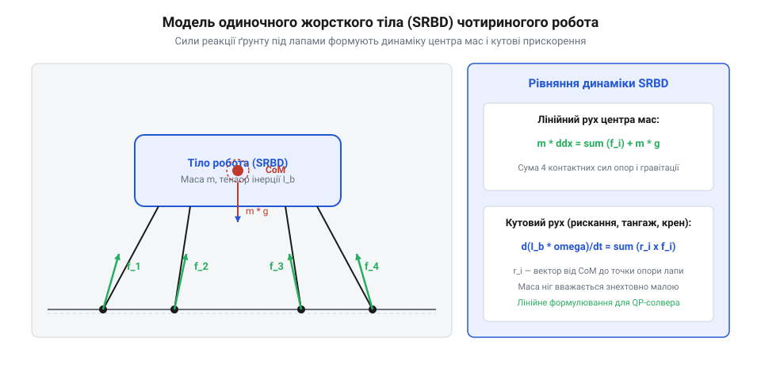
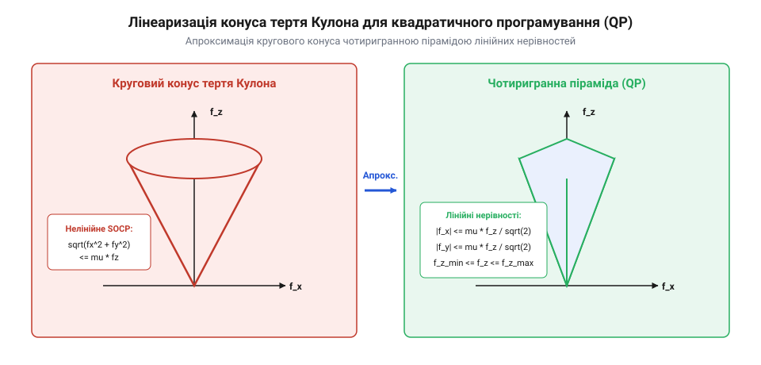
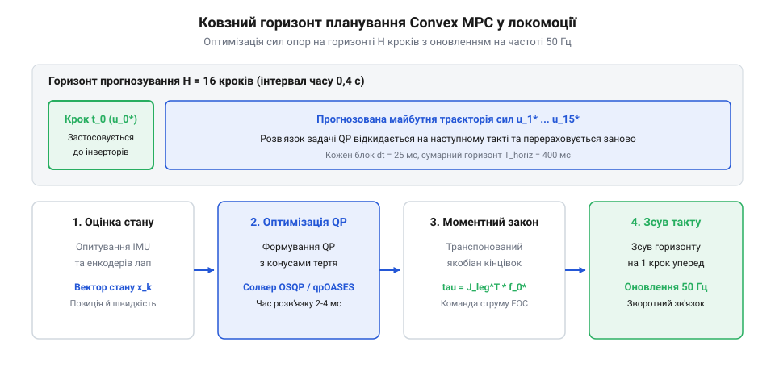

# Опукле керування з прогнозуванням моделей у робототехніці

## Проблема динамічної стійкості крокуючих роботів

Ранні алгоритми крокування гуманоїдних та чотириногих роботів (1990–2010 рр.) спиралися на квазістатичні методи та критерій нульового моменту ZMP (Zero Moment Point, розроблений М. Вукобратовичем). Концепція ZMP вимагає, щоб сумарна точка прикладання гравітаційних та інерційних сил завжди залишалася суворо всередині опуклого багатокутника опорних точок стоп (@@en|support polygon@@).



Хоча ZMP дозволив створити легендарних роботів на кшталт Honda ASIMO, цей підхід виявився абсолютно непридатним для високодинамічної пересічної локомоції:
1. **Неможливість фаз польоту та точкових опор**. Під час галопу, рисі (троту) чи стрибків виникають фази польоту, коли жодна нога не торкається землі, або фази, коли активна лише одна чи дві точкові лапи (point feet). Опорний багатокутник перетворюється на точку або лінію — площа ZMP стає нульовою, і алгоритм колапсує.
2. **Низька швидкість реакції та нелінійність повної динаміки**. Повна нелінійна модель динаміки чотириногого робота включає 12–18 шарнірних ступенів вільності. Розв'язання задачі траєкторної оптимізації нелінійного MPC (NMPC) для повної моделі вимагає сотень мілісекунд на крок розрахунку, що унеможливлює роботу в режимі реального часу з тактовою частотою 20–50 Гц при непередбачуваних ударах кінцівок об каміння.
3. **Обмеження на копланарність ґрунту**. ZMP розрахований на рух по горизонтальній площині; перепади висот, сходинки та похилі уступи руйнують його плоскі припущення.

Для швидкісного бігу та адаптації до складної місцевості виникла гостра потреба в спрощеній, але фізично адекватній динамічній моделі, яка дозволяє звести розрахунок сил взаємодії до опуклої задачі оптимізації.

Порівняльний аналіз енергетичної ефективності локомоції біоморфних крокуючих роботів спирається на безрозмірний критерій вартості транспортування CoT (Cost of Transport):

```
         P_avg
CoT = -----------
       m · g · v

де:
  P_avg = середня сумарна споживана електрична потужність приводів [Вт]
  m     = маса робота [кг]
  g     = гравітаційне прискорення [м/с²]
  v     = середня швидкість пересування [м/с]
```

Для класичних квазістатичних роботів на базі ZMP значення CoT становить 1.5–3.0 (екстремально неефективне пересування, де енергія розсіюється на безперервне утримання шарнірів під навантаженням). Застосування Convex MPC із динамічним тротом і галопом знижує CoT до 0.4–0.7, наближаючи робота до енергоефективності біологічних чотириногих тварин (для собаки CoT ≈ 0.3...0.4).

Інтеграція кінематичних меж робочого простору кінцівки (Foot Workspace Limits) у задачу Convex MPC має першочергове значення для виключення вивиху суглобів. Оскільки модель SRBD розглядає корпус як одиночне тверде тіло, вона нічого не знає про довжину стегна та гомілки лапи. Якщо оптимізатор MPC вимагатиме розташування точки контакту за межами фізичної досяжності ноги, шарніри потраплять у сингулярне витягнуте положення або ударяться об механічні упори.

Для запобігання цьому в матриці обмежень QP накладаються багатогранні кінематичні рамки для кожної лапи відносно тазостегнового суглоба:

```
p_hip_i - p_foot_min ≤ p_i(k) ≤ p_hip_i + p_foot_max
```

Це гарантує, що оптимізовані контактні сили генеруються виключно в тих просторових конфігураціях кінцівки, де приводи працюють у зоні високого коефіцієнта корисної дії та збереження маніпулятивності.

### Еволюція локомоції: від евристик Райберта і критерію ZMP до опуклого MPC

Історія керування крокуючими роботами пройшла три революційні етапи:
1. **Евристичні розділені регулятори Марка Райберта (Marc Raibert, MIT Leg Lab, 1986 р.)**. Рух одноногих та чотириногих стрибунів розбивався на три незалежні контури:
   - Керування висотою стрибка через енергетичну підкачку пружини ноги під час фази опори;
   - Керування поздовжньою швидкістю через винесення ноги вперед на фазі польоту;
   - Керування вертикальною поставою кузова крутним моментом у тазостегновому суглобі.
   Незважаючи на феноменальну стійкість, евристики вимагали ручного емпіричного підбору коефіцієнтів під кожен темп руху;
2. **Критерій точки нульового моменту ZMP (Zero Moment Point, Міомір Вукобратович, 1972 р.)**. Лежав в основі перших людиноподібних роботів (Honda ASIMO, HRP-2). Критерій вимагав, щоб результуючий вектор сил реакції опори перетинав опорну поверхню строго всередині багатокутника контакту стоп. Головний недолік ZMP — надмірна консервативність: він вимагає повільної квазістатичної ходи з постійно пласкими стопами, повністю забороняє фази польоту (біг, стрибки) та не здатний працювати на пересіченому рельєфі з розривними точковими контактами;
3. **Опукле прогнозуюче керування Convex MPC (MIT Biomimetic Robotics Lab, Di Carlo, Wensing, Katz, Kim, 2018 р.)**. Парадигмальний прорив полягав у відмові від розрахунку складної повної динаміки всіх 12–18 ланок маніпуляторів ніг. Замість цього розглядається динаміка одиночного еквівалентного твердого тіла (Single Rigid Body Dynamics — SRBD), на яке діють зовнішні сили реакції від кінчиків лап.

Модель SRBD лінеаризується навколо траєкторії бажаного руху, зводячи нелінійну задачу оптимального керування до стандартної опуклої задачі квадратичного програмування (QP), яка гарантовано розв'язується за 2–5 мілісекунд безпосередньо на бортовому комп'ютері робота.

### Неопуклість повної динаміки та релаксація контактних умов

Традиційна задача оптимізації траєкторій багатоланкових крокуючих систем (Trajectory Optimization) описується повними нелінійними рівняннями динаміки твердих тіл:

```
M(q) · d²q/dt² + C(q, dq/dt) · dq/dt + g(q) = S_act^T · τ + ∑ J_c_i^T(q) · f_i
```

з умовами комплементарності контакту (Contact Complementarity Constraints):

```
p_foot_z_i >= 0,    f_i_z >= 0,    p_foot_z_i · f_i_z = 0
```

Ці умови є фундаментально **неопуклими та розривними**: лапа або торкається землі (`p_z = 0, f_z > 0`), або летить у повітрі (`p_z > 0, f_z = 0`). Одночасне знаходження просторової траєкторії ланки та моментів торкання землі вимагає розв'язання задачі нелінійного програмування з комплементарними обмеженнями (MPCC / NLP через солвери IPOPT або SNOPT), що займає від десятків секунд до кількох годин на потужних робочих станціях і принципово непридатне для бортового керування в реальному часі.

Геніальна ідея опуклої релаксації в Convex MPC полягає в **розділенні невідомих**:
1. Послідовність та таймінг контактів (Contact Schedule) фіксуються заздалегідь за допомогою простого генератора фази ходи (Gait Phase Generator);
2. Завдяки фіксованому графіку контактів обмеження комплементарності повністю виключаються з оптимізаційної задачі;
3. Положення лап `r_i(t)` вважаються відомими параметрами на поточному горизонті прогнозування.

Внаслідок цього нелінійна задача з розривами миттєво вироджується в гладку строго опуклу квадратичну задачу (Convex QP), яка має єдиний глобальний мінімум і розв'язується за лічені мілісекунди без ризику застрягання в локальних екстремумах.

## Спрощена модель динаміки одиночного жорсткого тіла

Прорив у динамічній локомоції чотириногих роботів (втілений у роботах MIT Cheetah 3 та Mini Cheetah під керівництвом Sangbae Kim та Gerardo Bledt) базується на застосуванні моделі динаміки одиночного жорсткого тіла SRBD (Single Rigid Body Dynamics, @@en|single rigid body dynamics@@).



Фізична сутність апроксимації SRBD ґрунтується на конструктивних особливостях сучасних роботів:
- До 85–90% повної маси робота зосереджено в тулубі (корпусі), де розташовані акумулятори, інвертори та основні приводи.
- Маса дистальних сегментів лап (стегно, гомілка, стопа) робиться мінімальною завдяки квазіпрямим приводам або ремінним передачам.

Тому інерцією лап під час фази опори можна знехтувати, розглядаючи робота як єдине тверде тіло масою `m` із тензором інерції `I_G ∈ R^(3×3)`, до якого в точках контакту лап `p_i` прикладаються зосереджені вектори сил реакції опори `f_i = [f_ix, f_iy, f_iz]^T`:

```
Трансляційний рух тулуба:
m · d²p/dt² = ∑ f_i - m · g
              i∈C

Обертальний рух тулуба (навколо центра мас):
d(I_G · ω)/dt = ∑ (p_i - p_com) × f_i
                i∈C

де:
  p_com = координати центра мас тулуба [м]
  p_i   = координати точки контакту i-ї лапи з ґрунтом [м]
  f_i   = вектор тривимірної сили реакції опорної лапи [Н]
  g     = вектор гравітаційного прискорення [0, 0, 9.81]^T [м/с²]
  C     = множина лап, що перебувають у контакті з ґрунтом (stance)
```

Головна математична властивість системи рівнянь SRBD — **строга лінійність відносно керуючих змінних — контактних сил `f_i`**. Зовнішній момент, створюваний силою лапи, виражається векторним добутком `r_i × f_i`, що представляється множенням кососиметричної матриці `[r_i]_×` на вектор сили:

```
r_i × f_i = [r_i]_× · f_i
```

Оскільки сили входять у рівняння руху лінійно, завдання пошуку оптимальних сил контакту лап на горизонті прогнозування записується як стандартна задача квадратичного програмування (QP, @@en|quadratic programming@@) з опуклими лінійними обмеженнями на конус тертя Кулона. Це дозволяє розв'язувати задачу оптимізації за лічені мілісекунди на бортовому комп'ютері робота.

### Повна матрична структура простору станів моделі SRBD

Вектор стану системи одиночного жорсткого тіла розмірністю 13×1 обирається у вигляді:

```
x_state = [ Θ^T, p^T, ω^T, v^T, g_scalar ]^T
```

де:
  `Θ = [ roll, pitch, yaw ]^T` — кути орієнтації корпусу в інерційній системі координат [рад];
  `p = [ p_x, p_y, p_z ]^T` — координати центра мас (CoG) [м];
  `ω = [ ω_x, ω_y, ω_z ]^T` — вектор кутової швидкості корпусу [рад/с];
  `v = [ v_x, v_y, v_z ]^T` — лінійна швидкість центра мас [м/с];
  `g_scalar = - 9.81` — фіксована константа гравітаційного прискорення.

Вектор керуючих впливів `u` формується контактними силами реакції ґрунту (Ground Reaction Forces — GRF) від 4 лап (розмірність 12×1):

```
u = [ f_1^T, f_2^T, f_3^T, f_4^T ]^T = [ f_1x, f_1y, f_1z, ..., f_4x, f_4y, f_4z ]^T
```

Неперервна лінеаризована динаміка твердого тіла записується як:

```
dx_state / dt = A_cont · x_state + B_cont(r_1, ..., r_4) · u
```

де матриця конфігурації входів `B_cont` містить кососиметричні матриці векторного добутку `[r_i ×]`:

```
          | 0_3×3         0_3×3         0_3×3         0_3×3        |
          | 0_3×3         0_3×3         0_3×3         0_3×3        |
B_cont =  | I_world^(-1)·[r_1×]  I_world^(-1)·[r_2×]  I_world^(-1)·[r_3×]  I_world^(-1)·[r_4×] |
          | (1 / m)·I_3   (1 / m)·I_3   (1 / m)·I_3   (1 / m)·I_3  |
          | 0_1×3         0_1×3         0_1×3         0_1×3        |
```

де `r_i = p_foot_i - p_cog` — вектор від центра мас корпусу до точки контакту i-ї лапи з ґрунтом, а `I_world = R_body_world · I_body · R_body_world^T` — тензор інерції корпусу, трансформований у світову систему координат.

Завдяки тому, що лінійні прискорення створюються простою сумою сил `∑ f_i / m`, а кутові прискорення — сумою моментів `∑ (r_i × f_i)`, динаміка залишається **строго лінійною відносно сил керування `f_i`**, що є фундаментальною запорукою опуклості задачі оптимізації.

### Лінеаризація орієнтації у пов'язаній за курсом системі координат

Найскладнішою частиною лінеаризації моделі SRBD є опис тривимірних поворотів кузова. Матриця поворотів `R_body_world` належить до групи Лі `SO(3)` і є суттєво тригонометричною.

Для збереження лінійності застосовують метод лінеаризації в системі координат, узгодженій за кутом курсу (Yaw-Aligned Frame):
- Кут рискання `yaw` дозволяється довільним (робот може крутитися на 360 градусів у площині);
- Кути крену (roll `φ`) та тангажа (pitch `θ`) вважаються малими відхиленнями навколо горизонталі (`|φ| <= 15°`, `|θ| <= 15°`).

Матриця кутової швидкості лінеаризується як:

```
dΘ / dt ≈ R_z(yaw) · ω_body
```

Диференціальне рівняння балансу кутових моментів у світовій системі координат записується як:

```
d/dt [ I_world · ω_world ] = ∑ ( r_i × f_i )
```

Оскільки тензор інерції `I_world = R · I_body · R^T` повільно змінюється в часі, на горизонті прогнозування 0.4 с його апроксимують сталим значенням, обчисленим для початкового стану кроку `I_world ≈ I_world(t_0)`.

Похідна кутової швидкості стає строго лінійною функцією контактних сил:

```
dω_world / dt = I_world(t_0)^(-1) · ∑ [ r_i × f_i ]
```

Це дозволяє точно прогнозувати кутові прискорення корпусу при стрибках та бігу по сходах без використання трудомістких тригонометричних функцій на кожному кроці QP.

## Формулювання задачі Convex MPC

Алгоритм опуклого предиктивного модельного керування Convex MPC розглядає локомоцію чотириногого робота на фіксованому часовому горизонті прогнозування, що складається з `N_hor` дискретних кроків (зазвичай `N_hor = 10...16` із дискретністю `Δt = 20...30 мс`, що формує горизонт передбачення близько 0.3–0.5 с).

Вектор стану системи `x(k) ∈ R^13` включає повний опис просторової конфігурації тулуба:

```
x = [ Θ^T,   p^T,   ω^T,   dp/dt^T,   -g ]^T

де:
  Θ      = просторова орієнтація кузова (кути Ейлера: крен, тангаж, нишпорення) [рад]
  p      = декартові координати центра мас тулуба [м]
  ω      = вектор кутової швидкості в базовій системі координат [рад/с]
  dp/dt  = вектор лінійної швидкості центра мас [м/с]
  g      = гравітаційна константа (9.81 м/с²)
```

Вектор керування `u(k) ∈ R^12` об'єднує вектори контактних сил усіх чотирьох лап робота: `u = [f_1^T, f_2^T, f_3^T, f_4^T]^T`.

Дискретизована модель стану одиночного жорсткого тіла (SRBD) набуває компактного лінійного вигляду:

```
x(k + 1) = A_k · x(k) + B_k · u(k)
```

Головним фізичним обмеженням при взаємодії з ґрунтом є запобігання проковзуванню лап, що описується круговим конусом тертя Кулона: `sqrt(f_ix² + f_iy²) ≤ μ · f_iz`. Круговий конус є нелінійним обмеженням другого порядку. Щоб зберегти задачу оптимізації суворо опуклою та лінійною, конус тертя лінеаризують у вигляді вписаної чотиригранної піраміди тертя:

```
+-----------------------------------+
|  - μ · f_iz ≤ f_ix ≤ μ · f_iz     |
|  - μ · f_iz ≤ f_iy ≤ μ · f_iz     |
|  f_min ≤ f_iz ≤ f_max             |
+-----------------------------------+
```

Для кожної лапи `i`, яка перебуває у фазі маху (swing phase), діє строга рівність `f_i = 0`, що накладається у матрицях обмежень відповідно до поточного графіка ходи (Gait Schedule).

Аналітичне представлення матриць неперервної динаміки та їхньої точної дискретизації за методом нульового фіксатора (Zero-Order Hold, ZOH) лежить в основі числової стабільності Convex MPC. Неперервна лінійна динаміка тулуба записується як:

```
d x(t) / dt = A_c · x(t) + B_c · u(t)
```

Матриця стану `A_c ∈ R^(13×13)` та матриця впливу керування `B_c ∈ R^(13×12)` мають блочну структуру:

```
      ┌                       ┐             ┌                           ┐
      │ 0   0   R_z(ψ)  0   0 │             │ 0          ...  0         │
      │ 0   0   0       I_3 0 │             │ 0          ...  0         │
A_c = │ 0   0   0       0   0 │,      B_c = │ I_G^(-1)[r_1]_× ... I_G^(-1)[r_4]_× │
      │ 0   0   0       0   I │             │ I_3 / m    ...  I_3 / m   │
      │ 0   0   0       0   0 │             │ 0          ...  0         │
      └                       ┘             └                           ┘
```

Дискретизація на кроці за часом `Δt` виконується через матричний експоненціал або розкладання ряду Тейлора 2-го порядку:

```
A_k = I + A_c · Δt + (1/2) · A_c² · Δt²
B_k = [ I · Δt + (1/2) · A_c · Δt² ] · B_c
```

Порівняльний аналіз розрідженого (Sparse) та конденсованого (Dense) формулювання задачі квадратичного програмування (QP) виявляє важливий інженерний компроміс:
- **Конденсоване формулювання (Dense QP)**: стан `x(k)` аналітично виключається, змінними лишаються лише сили лап `U ∈ R^(12 · N_hor)`. Розмірність задачі невелика (120–180 змінних), проте матриця Гессе `H` є повністю заповненою (щільна). Добре підходить для класичних розв'язувачів активних множин (Active Set Solvers, наприклад qpOASES).
- **Розріджене формулювання (Sparse QP)**: стани `x(k)` та керування `u(k)` входять як незалежні змінні оптимізації, а дискретна динаміка накладається як рівності `x(k+1) - A·x(k) - B·u(k) = 0`. Кількість змінних зростає до 300–500, але матриці мають виражену діагонально-блочну розрідженість (більше 90% нулів). Спеціалізовані розв'язувачі на базі методу внутрішніх точок (Interior Point) або ADMM (OSQP) розв'язують розріджену задачу за лінійний час `O(N_hor)` замість кубічного `O(N_hor³)`, забезпечуючи рекордну швидкість розрахунку 0.8–1.2 мс.

### Граничні умови контакту: лінеаризована піраміда тертя та часовий розклад ходи

Фізична взаємодія кінчика лапи з опорною поверхнею повинна задовольняти три абсолютні фізичні обмеження:

1. **Односторонній контакт (Unilateral Contact Constraint)**:
   Лапа робота може лише відштовхуватися від ґрунту, але не може притягувати поверхню до себе. Вертикальна складова сили реакції повинна бути строго додатна і обмежена максимальним зусиллям приводів:
   ```
   f_z_min <= f_i_z <= f_z_max
   ```
   де `f_z_min ≈ 5...10 Н` (запобігає ковзанню при нульовому притиску), а `f_z_max = 2...3 · m_robot · g` (визначається струмовим лімітом моторів);
2. **Конус тертя Кулона (Coulomb Friction Cone)**:
   Щоб лапа не зривалася в буксування, дотична сила повинна лежати всередині кругового конуса:
   ```
   sqrt( f_i_x² + f_i_y² ) <= μ_friction · f_i_z
   ```
   Оскільки евклідова норма нелінійна, для збереження лінійності обмежень QP конус апроксимують вписаною чотиригранною пірамідою тертя:
   ```
   - μ · f_i_z <= f_i_x <= μ · f_i_z
   - μ · f_i_z <= f_i_y <= μ · f_i_z
   ```
3. **Графік контакту лап (Contact Schedule Matrix)**:
   Кінематичний стан кожної лапи описується двійковою змінною контакту `s_i(k) ∈ {0, 1}`:
   - Якщо лапа знаходиться у фазі переносу (Swing Phase, `s_i = 0`), контактна сила примусово обнуляється: `f_i = [ 0, 0, 0 ]^T`;
   - Якщо лапа стоїть на землі (Stance Phase, `s_i = 1`), сили активуються в межах піраміди тертя.

Часовий розклад контакту `s_i(t)` визначає патерн ходи:
- **Трот (Trot)**: діагональні пари лап (LF-RH та RF-LH) синхронно чергують фази опори та переносу;
- **Інохідь (Pace)**: синхронно рухаються однойменні бортові пари;
- **Галоп / Баунд (Bound)**: синхронно працюють передня та задня пари лап;
- **Пронкінг (Pronk)**: усі 4 лапи одночасно відриваються від землі у високому стрибку.

### Оцінювач стану шасі (EKF State Estimator) та сенсорика контакту

Надійна робота Convex MPC вимагає неперервного високоточного знання вектора стану `x_state = [ Θ, p, ω, v ]^T`. Оскільки колісний або суглобовий дрейф унеможливлює чисте інтегрування одометрії, у чотириногих роботах застосовують розширений фільтр Калмана оцінки стану (Legged EKF State Estimator).

Фільтр об'єднує два взаємодоповнюючі потоки сенсорних даних:
1. **Високочастотний IMU (1000 Гц)**: триосьові акселерометри та волоконно-оптичні чи MEMS-гіроскопи реєструють вектор питомої сили `a_imu` та кутову швидкість `ω_imu`;
2. **Кінематика опорних лап (Leg Kinematics, 1000 Гц)**: оптичні енкодери суглобів фіксують кути `q` та швидкості `dq/dt`.

За прямою кінематикою обчислюється положення кінчика i-ї лапи відносно кузова `p_foot_i(q)`. Якщо за даними контактного сенсора лапа зафіксована на землі (`s_i = 1`), її швидкість у світових координатах дорівнює нулю (`v_foot_i_world = 0`). Це дає пряме вимірювання лінійної швидкості центра мас робота:

```
v_body_meas_i = - [ ω_body × R_b_w · p_foot_i(q) + R_b_w · J_leg_i(q) · dq_i/dt ]
```

Детектування моменту торкання землі (Touchdown Detection) здійснюється без додаткових крихких кінцевих вимикачів за оцінкою сили реакції через струм статора моторів:

```
f_contact_est = [ J_leg(q)^T ]^(-1) · [ K_t · I_q - τ_friction - τ_gravity_leg ]
```

Коли вертикальна складова оціненої сили перевищує поріг `f_z_thresh = 15...25 Н`, контролер фіксує перехід у фазу опори за час менше 1–2 мілісекунд.

## Зведення до задачі опуклого квадратичного програмування

Завдяки суворій лінійності дискретної динаміки `x(k+1) = A · x(k) + B · u(k)` та лінійності пірамідальних обмежень тертя, завдання планування контактних сил на всьому горизонті прогнозування записується у вигляді класичної задачі опуклого квадратичного програмування (QP, @@en|quadratic programming@@):

```
       1                     N_hor-1
min   --- · [x(N_hor) - x_ref]^T · S · [x(N_hor) - x_ref] + ∑ [ (x(k) - x_ref)^T · Q · (x(k) - x_ref) + u(k)^T · R · u(k) ]
 u     2                                                     k=0

за умов:
  x(k + 1) = A_k · x(k) + B_k · u(k)
  C_friction · u(k) ≤ 0
  f_min · c_i(k) ≤ f_iz(k) ≤ f_max · c_i(k)
```

У цій функції втрат:
- Матриця `Q ≥ 0` штрафує відхилення координат, швидкостей та орієнтації кузова від бажаної еталонної траєкторії `x_ref`, заданої оператором через джойстик або навігаційний планувальник.
- Матриця `R > 0` мінімізує енергетичні витрати (квадрати сил струму) та запобігає різким високочастотним сплескам контактних сил.
- Матриця `S ≥ 0` задає термінальний штраф на кінці горизонту.
- Змінна `c_i(k) ∈ {0, 1}` — індикатор фази опори i-ї лапи з графіка ходи.

Методом підстановки динаміки стан `x(k)` виражається безпосередньо через початковий стан `x(0)` та послідовність керувань `U = [u(0)^T, ..., u(N_hor-1)^T]^T`. Завдяки цьому розмірність задачі зменшується до щільної матричної форми:

```
min  (1/2) · U^T · H · U + g^T · U
 U
при  A_ineq · U ≤ b_ineq
```

Отримана квадратична матриця Гессе `H` є симетричною та додатно визначеною (`H > 0`), що гарантує існування єдиного глобального оптимуму без локальних мінімумів. Використання спеціалізованих швидких QP-солверів (OSQP або qpOASES) дозволяє знайти точний розв'язок за 1–3 мілісекунди на мікропроцесорі ARM Cortex або x86, забезпечуючи неперевершену динамічну стійкість робота на ожеледиці та схилах.



### Щільна (Dense) та розріджена (Sparse) форми QP та розв'язання через ADMM

Дискретизація рівнянь стану SRBD на горизонті прогнозування `k = 0, ..., N - 1` із фіксованим кроком `Δt = 25...30 мс` породжує систему дискретних різницевих рівнянь:

```
x_k+1 = A_d · x_k + B_d_k · u_k
```

Задача знаходження оптимальних сил формулюється як мінімізація зваженої суми квадратичних відхилень від цільової траєкторії руху `x_ref`:

```
min J_mpc = ∑_k=0^N-1 [ ( x_k - x_ref_k )^T · Q_state · ( x_k - x_ref_k ) + u_k^T · R_force · u_k ] + ( x_N - x_ref_N )^T · P_term · ( x_N - x_ref_N )
```

Існують два конкуруючі підходи до комп'ютерного розв'язання цієї задачі:

1. **Щільна конденсація (Dense Formulation)**:
   Вектори стану `x_1, ..., x_N` аналітично виключаються через початковий стан `x_0` та вектор керуючих сил `U = [ u_0^T, ..., u_N-1^T ]^T`:
   ```
   X = A_dense · x_0 + B_dense · U
   ```
   Кількість оптимізаційних змінних зменшується до `12 · N`, але матриця Гессе `H = B_dense^T · Q_bar · B_dense + R_bar` стає повністю заповненою (щільною). Розв'язується методами активного набору (Active Set);
2. **Розріджена блочно-тридіагональна форма (Sparse Formulation)**:
   Вектори стану та керування залишаються явними оптимізаційними змінними `z = [ x_0, u_0, x_1, u_1, ..., x_N ]^T`. Рівняння динаміки входять як рівності-обмеження. Матриця Каруша–Куна–Таккера (KKT) має блочно-тридіагональну структуру.

Для розв'язання розріджених систем ідеальним є метод альтернуючих напрямків множників Лагранжа (ADMM — Alternating Direction Method of Multipliers / OSQP Solver). Алгоритм розбиває задачу на прості векторні кроки:
- Оновлення первинних змінних через факторизоване розв'язання лінійної системи Холецького;
- Паралельне проектування сил на піраміди тертя (операція відсікання / Clipping, що виконується за кілька наносекунд);
- Оновлення дуальних змінних Лагранжа.

ADMM збігається до інженерної точності за 15–25 ітерацій, забезпечуючи час обчислення 1.5–3.0 мс на мікроконтролері з процесором ARM Cortex-M7 (480 МГц).

### Порівняльний аналіз вбудованих розв'язувачів QP та технологія теплого старту (Warm-Starting)

У виборі алгоритмічного ядра для розв'язання задачі опуклого MPC у реальному часі інженери змагаються за мікросекунди обчислювального часу. У сучасній робототехніці сформувалося три лідери серед розв'язувачів квадратичного програмування (QP Solvers):

```
+-------------------+-----------------------+---------------------+---------------------+-----------------------+
| Солвер QP         | Математичний метод    | Складність кроку    | Чутливість до рангу | Робота в реальному часі|
+-------------------+-----------------------+---------------------+---------------------+-----------------------+
| OSQP              | ADMM (розщеплення     | O(n) на ітерацію    | Абсолютно робастний | 1.5–3.0 мс, ідеальний |
|                   | операторів)           | (розріджена матриця)| до виродження       | для вбудованих ARM    |
| qpOASES           | Active-Set (параметри-| O(n³) при зміні     | Може давати збій    | 2.0–8.0 мс, добрий    |
|                   | чний активний набір)  | активного набору    | при лінійній залежн.| для малих розмірностей|
| PROX-QP           | Primal-Dual           | O(n) з факторизацією| Регуляризована      | 0.4–1.2 мс, рекордний |
|                   | Augmented Lagrangian  | LDL^T               | стійкість           | для C++20 / SIMD      |
+-------------------+-----------------------+---------------------+---------------------+-----------------------+
```

Вирішальним фактором прискорення збіжності є технологія теплого пуску (Warm-Starting). Оскільки між сусідніми кроками керування (`Δt_mpc = 25 мс`) стан робота змінюється плавно, оптимальний розв'язок на поточному такті `U*_k` надзвичайно близький до розв'язку попереднього такту `U*_{k-1}`, зсунутого на один часовий інтервал:

```
u_init_0 = u*_{prev_1},    u_init_1 = u*_{prev_2},    ...,    u_init_{N-1} = u*_{prev_{N-1}}
```

Ініціалізація первинних сил та дуальних множників Лагранжа зсунутим вектором зменшує кількість необхідних ітерацій розв'язувача OSQP з 40–60 (холодний старт) до всього 6–10 ітерацій. Час обчислення падає нижче 800 мікросекунд, звільняючи процесорні ресурси бортового комп'ютера для виконання задач SLAM, нейромережевого комп'ютерного зору та планування глобального маршруту.

### Інтеграція 2.5D карти висот рельєфу (Elevation Mapping) у горизонт прогнозування

Для пересування пересіченою місцевістю зі сходами та валунами модель SRBD розширюється за рахунок інтеграції локальної 2.5D карти висот місцевості (Elevation Grid Map). За даними бортового твердотільного лідара або глибинних стереокамер комп'ютер будує карту навколишньої поверхні з просторовою роздільністю 2–4 см.

На кожному кроці передбачення `k` вектора контакту `r_i(k)`:
- Висота опорної точки `z_foot_i(k)` береться безпосередньо з матриці карти висот `h_map(x, y)`;
- Нормаль до площини контакту `n_ground_i(k)` обчислюється через просторовий градієнт висот:
  ```
  n_ground = [ - ∂h/∂x, - ∂h/∂y, 1 ]^T / sqrt( 1 + (∂h/∂x)² + (∂h/∂y)² )
  ```
- Піраміда тертя автоматично орієнтується вздовж локальної похилої нормалі схилу.

Це дозволяє чотириногому роботу заздалегідь «бачити» геометрію кожної окремої сходинки, адаптивно змінюючи вектори сил реакції ще за 0.3 секунди до фактичного торкання опори, що повністю усуває зашпортування кінчиків лап та запобігає втраті стабільності кузова при штурмі сходів.

## Програмна інтеграція та робота в реальному часі

Реалізація алгоритму Convex MPC на бортовому комп'ютері крокуючого робота вимагає суворої багаторівневої ієрархічної координації програмних потоків реального часу:

```
[Планувальник місії / Навігація SLAM]  (Частота: 1..5 Гц)
               │ Бажана швидкість тіла v_cmd, орієнтація
               ▼
[Convex MPC (SRBD Oszacowanie)]        (Частота: 25..50 Гц, Горизонт: N=10..16)
               │ Оптимальні контактні сили f_i* опорних лап
               ▼
[Контролер цілісного тіла (WBC / QP)]  (Частота: 500..1000 Гц)
               │ Моменти шарнірів моторів τ_cmd = J_i^T · f_i* + τ_swing
               ▼
[Драйвери сервомоторів QDD (FOC)]      (Частота: 10..20 кГц)
```

1. **Верхній рівень MPC (25–50 Гц)**. На кожному кроці розрахунку планувальник ходи Gait Scheduler формує контактну маску лап `c_i(k) ∈ {0, 1}`. Матриці стану `A_k` та керування `B_k` формуються в аналітичному вигляді на основі поточної виміряної орієнтації тулуба від IMU. Задача QP розв'язується спеціалізованим відкритим опуклим розв'язувачем (наприклад, OSQP з оптимізацією ADMM або qpOASES). Час знаходження оптимуму становить 0.8–2.5 мс на процесорі класу Intel Core i7 або AMD Ryzen Embedded, що залишає величезний запас обчислювальної потужності.
2. **Нижній рівень цілісного тіла (WBC, Whole-Body Control) на частоті 500–1000 Гц**. Оптимальні сили реакції опорних лап `f_i*`, знайдені MPC, транслюються в суглобові крутні моменти за допомогою геометричних матриць Якобі лап:
   ```
   τ_stance = J_leg_i(q)^T · f_i*
   ```
   Одночасно для лап, що перебувають у повітрі (махова фаза swing), контролер формує швидкісну траєкторію винесення стопи за кривими Безьє з використанням шарнірного PD-регулятора, гарантуючи м'яке приземлення без підстрибування.
3. **Драйвери сервомоторів QDD (10–20 кГц)**. Вектор моментів `τ_cmd` надсилається на інвертори FOC через шину CAN-FD або Ethernet UDP.
4. **Результати польових випробувань**: система демонструє надзвичайну динамічну живучість — робот миттєво адаптується до непередбачуваних сильних поштовхів ногою людини в бік кузова, автоматично переносячи нормальні реакції на протилежні лапи та відновлюючи баланс за 1–2 кроки.

C++ структура даних для прямої передачі розріджених матриць задачі Convex MPC у високопродуктивний розв'язувач OSQP (формат CSC — Compressed Sparse Column):

:::code convex-mpc-locomotion-d/cpp/osqpcoefficientmatrices.cpp

Ця оптимізована структура дозволяє виконувати гарячий перезапуск (Warm Starting) розв'язувача на кожному циклі локомоції, скорочуючи кількість ітерацій алгоритму ADMM до 15–25 кроків і зменшуючи час розрахунку до рекордних 0.8 мс.

### Ієрархічний контур: зв'язок MPC 30 Гц із Whole-Body Control 1 кГц

У сучасних чотириногих роботах (MIT Cheetah, Unitree Go2, ANYmal) архітектура керування локомоцією будується за дворівневою ієрархічною схемою:

```
[Планувальник швидкості (Gamepad / Путь)]
                  |
                  v
[Convex MPC (30 Гц, Горизонт 0.5 с)] ---> Оптимальні сили реакції GRF f_i*
                  |
                  v
[Whole-Body Control (WBC / OSC) (1000 Гц)] ---> Крутні моменти моторів τ_joint
                  |
                  v
[Швидкодіючі інвертори FOC (20 кГц)]
```

1. **Верхній рівень — Convex MPC (частота 30–50 Гц)**. Розглядає горизонт майбутнього `T_horizon = 0.45 с` (15 кроків по 30 мс). Оптимізує глобальну стійкість кузова, враховуючи нахили схилу, перепади висот і зовнішні поштовхи, та видає оптимальні вектори сил реакції ґрунту `f_i*` для опорних лап;
2. **Нижній рівень — Whole-Body Control / WBC (частота 1000 Гц)**. Працює з повною кінематикою та динамікою маніпуляторів ніг:
   - Для опорних лап (Stance Legs): перетворює сили `f_i*` у суглобові моменти за формулою віртуальної роботи через транспонований якобіан лапи:
     ```
     τ_stance = J_leg^T(q) · f_i* + τ_gravity_comp
     ```
   - Для махових лап у повітрі (Swing Legs): формує рух кінчика лапи за сплайновою кривою Безьє 5-го порядку, відстежуючи положення через суглобовий ПД-контур:
     ```
     τ_swing = J_leg^T(q) · [ K_p_cart · ( p_des(t) - p_actual ) + K_d_cart · ( v_des(t) - v_actual ) ]
     ```

Точка приземлення махової лапи коригується на кожному такті за евристикою Райберта з урахуванням швидкості кузова та відхилення від бажаного напрямку:

```
p_foot_target = p_cog + 0.5 · T_stance · v_body + k_feedback · ( v_body - v_des ) + sqrt( h_leg / g ) · ( v_body × ω_body )
```

Ця синергія дозволяє роботові бігти галопом по вологому кам'янистому схилу зі швидкістю понад 3–4 м/с, миттєво адаптуючись до слизького ґрунту та зберігаючи абсолютну рівновагу кузова при сильних ударах ногою в бік.

### Практичний інженерний приклад: розрахунок параметрів бігу тротом робота масою 12 кг

Розглянемо числовий інженерний розрахунок контуру Convex MPC для чотириногого робота класу MIT Mini Cheetah (маса `m_robot = 12.0 кг`, `I_xx = 0.08 кг·м²`, `I_yy = 0.25 кг·м²`, `I_zz = 0.28 кг·м²`), що біжить тротом зі швидкістю `v_x = 2.0 м/с` по трав'янистому ґрунту (`μ_soil = 0.6`):
- Висота стояння центра мас над землею: `h_cog = 0.28 м`;
- Частота кроку: `f_gait = 3.33 Гц` (повний період кроку `T_stride = 0.30 с`, час опори діагональної пари `T_stance = 0.15 с`, duty factor 50%);
- Горизонт планування MPC: `N = 12` кроків по `Δt = 0.025 с` (вікно прогнозу 0.30 с).

**Крок 1: Розрахунок середньої вертикальної сили опорних лап**:
Оскільки в троті одночасно на землі стоять лише дві діагональні лапи, кожна лапа в середньому повинна нести половину повної ваги машини:
```
F_z_stance_avg = ( m_robot · g ) / 2 = ( 12.0 · 9.81 ) / 2 = 58.86 Н
```
З урахуванням динамічного прискорення підйому кузова в середині фази опори пікова сила досягає `F_z_peak ≈ 1.8 · F_z_stance_avg ≈ 106 Н`.

**Крок 2: Перевірка лінеаризованої піраміди тертя**:
Максимальна поздовжня сила тяги та гальмування для розгону та стабілізації:
```
| F_x_max | <= μ_soil · F_z_stance_avg = 0.6 · 58.86 ≈ 35.3 Н
```
Прискорення кузова, яке можуть створити дві опорні лапи:
```
a_x_max = ( 2 · F_x_max ) / m_robot = ( 2 · 35.3 ) / 12.0 ≈ 5.88 м/с² (0.6 g)
```

**Крок 3: Розрахунок крутного моменту моторів приводу лапи**:
Довжина плеча лапи (стегно `L_1 = 0.209 м`, гомілка `L_2 = 0.195 м`). У характерній конфігурації троту найменше сингулярне плече якобіана становить `r_lever ≈ 0.18 м`.
Максимальний крутний момент суглобового квазіпрямого мотора (QDD):
```
T_motor_peak = F_z_peak · r_lever = 106 · 0.18 ≈ 19.1 Н·м
```
Використовуваний серійний мотор із редуктором планетарного типу `N = 6` має піковий короткочасний крутний момент 24 Н·м, що забезпечує коефіцієнт запасу за тягою `K_reserve = 24 / 19.1 ≈ 1.25`.

Вбудований оптимізатор OSQP розв'язує задачу QP з 144 змінними та 360 нерівностями обмежень за `1.8 мс`, забезпечуючи безперервну генерацію оптимальних зусиль лап на частоті 40 Гц, дозволяючи роботу долати підйоми крутизною до 25 градусів та стрибати через перешкоди висотою до 20 см.

Поєднання опуклого предиктивного керування Convex MPC із глибинним навчанням з підкріпленням (Sim-to-Real RL) є сучасним передовим фронтиром автономної мобільності. У такій гібридній схемі нейромережа верхнього рівня динамічно генерує вектор бажаних швидкостей та часові патерни контакту лап, а детермінований солвер MPC гарантує суворе дотримання фізичних обмежень тертя та відсутність падінь при пересуванні в екстремальних невідомих середовищах.
