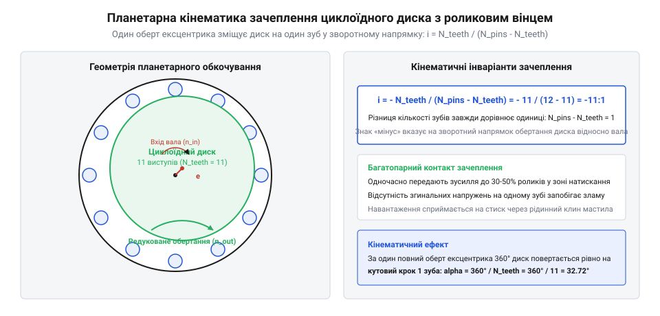
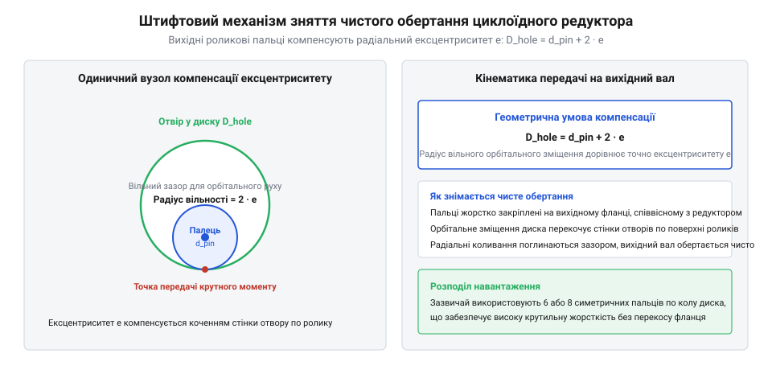
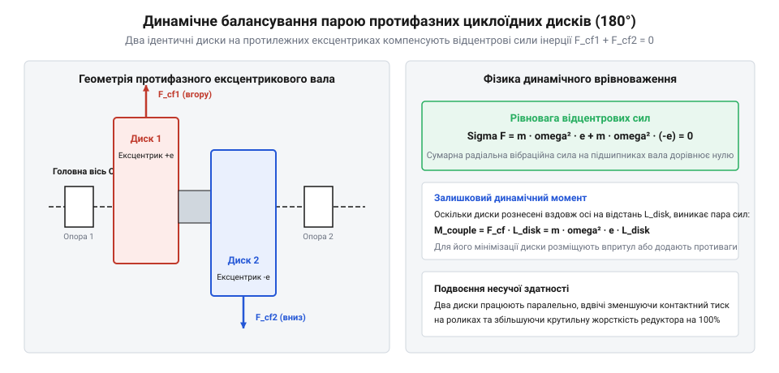
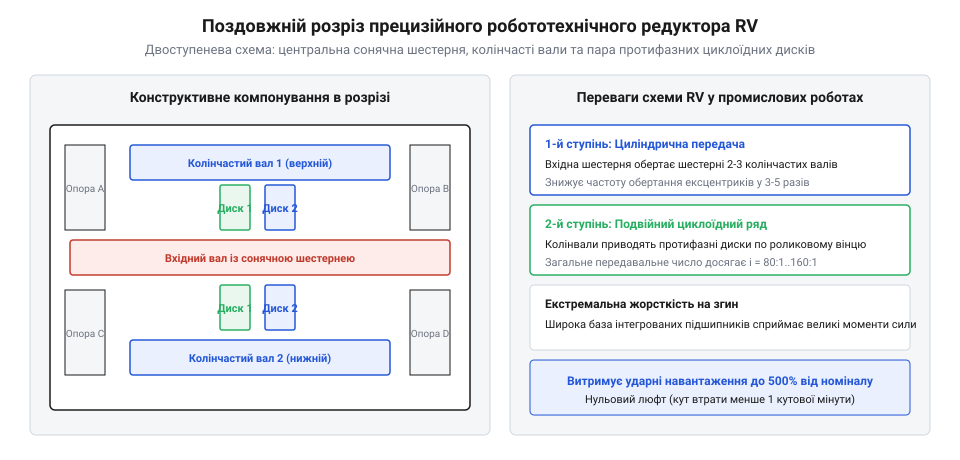

# Циклоїдний редуктор

<preknowlist>
- [Планетарний редуктор](root:hw-motion/planetary-gearbox) — кінематика планетарного ряду, поняття водила та сонячної шестерні
</preknowlist>

## Чому традиційні зубчасті передачі не витримують ударних навантажень у важкій робототехніці

У прецизійному машинобудуванні та важкій робототехніці головним викликом для трансмісії є динамічний удар. Коли рука промислового зварювального робота або маніпулятора екстрено зупиняється на повній швидкості, кінетична енергія масивних ланок створює сплеск крутного моменту, що у 3-5 разів перевищує розрахунковий номінал приводу.

У класичній циліндричній або конічній передачі навантаження передається через контакт зубів. У кожен момент часу в зачепленні перебуває лише одна або дві пари зубів. Сила зосереджується вздовж вузької лінії контакту, створюючи концентрацію згинних напружень біля ніжки зуба:

```
sigma_bend = (F_tangential · h_tooth) / (b · s_root²)
```

де h_tooth — висота зуба, b — ширина вінця, а s_root — товщина зуба біля основи. Якщо піковий імпульс перевищує границю витривалості сталі, зуб викришується або зазнає крихкого злому.

Іншим системним обмеженням є люфт (@@en|backlash@@). Щоб шестерні не заклинювали від нагріву та мали робочий зазор для мастила, між неробочими профілями закладають зазор. На виході багатоступеневого редуктора ці зазори накопичуються, утворюючи мертвий хід інструмента. Тонкостінні вінці, як у статті [хвильова передача](root:hw-motion/harmonic-drive), здатні усунути люфт, проте тонкий метал flexspline є вразливим до проскакування зубів (@@en|tooth ratcheting@@) під час різких поштовхів.

> 🔧 **Навіщо це.**
> У шарнірах важких промислових маніпуляторів та поворотних столах верстатів потрібна трансмісія, яка витримує багаторазові пікові перевантаження до 500% від номіналу, зберігаючи при цьому нульовий кутовий люфт менше однієї кутової мінути.

Пошук механізму, що витримує динамічні удари без руйнування, започаткував [історію винайдення циклоїдного редуктора](root:hw-motion/cycloidal-drive/hist-cycloidal-drive-braren.md). Рішенням став принципово інший підхід: заміна точкового контакту зубів на багатоконтактну взаємодію гладкого криволінійного диска з нерухомими роликовими штифтами.

## Кінематичний принцип циклоїдного редуктора: планетарне обкочування епітрохоїдного диска навколо нерухомого вінця з пальцями

Циклоїдний редуктор (@@en|cycloidal drive@@) спирається на планетарну схему, де профіль ведучого диска окреслено еквідістантою епітрохоїди, а зовнішнім вінцем слугує кільце з нерухомих пальців із роликами кочення. На відміну від звичайної шестерні, циклоїдний диск здійснює складний плоский рух, обкочуючись усередині роликового вінця.

Вхідний вал редуктора має ексцентрикову шийку зі зміщенням осі на величину ексцентриситету e. На цій шийці через прецизійний роликовий підшипник встановлено циклоїдний диск. Під час обертання вхідного вала ексцентрик примушує центр диска описувати коло радіуса e навколо центральної осі корпусу.

Кінематичне правило передачі полягає у різниці кількості хвилеподібних виступів диска z_disk та кількості роликових пальців z_pin у нерухомому вінці корпусу:

```
z_pin = z_disk + 1
```

Оскільки роликів у корпусі рівно на один більше, ніж виступів на диску, за один повний оберт ексцентрика диск не може провернутися на повне коло. Він вимушено просувається рівно на один виступ у напрямку, протилежному до обертання вхідного вала.


*Планетарний рух циклоїдного диска навколо пальцевого вінця: ексцентриситет зміщує центр диска, а кожен оберт вхідного валу повертає диск рівно на один крок зубів у протилежний бік.*

Передавальне число одноступеневого циклоїдного ряду визначається співвідношенням:

```
i = z_disk / (z_pin - z_disk) = z_disk / 1 = z_disk
```

Розглянемо практичний числовий приклад розрахунку приводу робототехнічного суглоба:
- Кількість виступів циклоїдного диска: z_disk = 59.
- Кількість пальців із роликами в корпусі: z_pin = 60.
- Передавальне число:

```
i = 59 / (60 - 59) = 59:1
```

Якщо вхідний високообертовий серводвигун обертається зі швидкістю n_in = 3000 об/хв за годинниковою стрілкою, кутова швидкість обертання циклоїдного диска навколо власної осі становить:

```
n_disk = - n_in / z_disk
       = - 3000 / 59
       ≈ - 50.85 об/хв
```

Знак мінус строго показує, що диск редуковано обертається проти годинникової стрілки — у бік, протилежний обертанню вхідного ексцентрикового вала. При цьому амплітуда поперечних радіальних коливань центру диска залишається строго рівною величині ексцентриситету e (зазвичай від 1.0 до 2.5 мм залежно від габариту редуктора).

> 🔧 **Навіщо це.**
> Класичний [планетарний редуктор](root:hw-motion/planetary-gearbox) для отримання редукції 59:1 чи 100:1 потребує двох або трьох послідовних ступенів із сонячними та коронними шестернями. Циклоїдний механізм забезпечує високе передавальне число в єдиному ступені за мінімальних осьових габаритів.

Форма профілю виступів диска розраховується аналітично, як описано у статті [параметричні рівняння циклоїдного профілю](root:hw-motion/cycloidal-drive/math-cycloidal-profile-geometry.md). Завдяки чистій геометрії обкочування замість тертя ковзання виникає переважно тертя кочення роликів, що забезпечує коефіцієнт корисної дії понад 90% навіть за великих коефіцієнтів редукції.

## Механіка зняття чистого обертання: як пальцево-роликовий механізм відсікає ексцентриситет

Циклоїдний диск, обкочуючись усередині нерухомого вінця, здійснює подвійний рух: він повільно повертається навколо власної осі й одночасно коливається всім тілом з амплітудою ексцентриситету e. Якщо спробувати приєднати вихідний вал безпосередньо до центру диска, вал буде відчувати шалену радіальну вібрацію, яка зруйнує підшипники за кілька хвилин роботи.

Для того щоб передати чисте, відфільтроване від ексцентриситету кутове обертання на вихідний фланець редуктора, Лоренц Брарен розробив витончений штифтово-пальцевий компенсатор (@@en|pin-output mechanism@@).

У тілі циклоїдного диска на точно визначеному ділильному колі виконують серію наскрізних циліндричних отворів діаметром D_hole. На вихідному фланці редуктора закріплено масивні сталеві пальці зі встановленими на них роликами зовнішнього діаметра d_pin. Кількість пальців зазвичай становить від 6 до 12 штук.

Діаметр отворів у диску виконують строго більшим за діаметр роликових пальців рівно на подвійну величину ексцентриситету вхідного вала:

```
D_hole = d_pin + 2 · e
```


*Штифтово-роликовий вихідний механізм: роликові пальці вихідного диска котяться всередині отворів більшого діаметра, передаючи чисте повільне обертання та відсікаючи ексцентриситет e.*

Коли диск коливається навколо центру редуктора, роликові пальці вільно перекочуються по внутрішніх циліндричних стінках отворів. Радіальний рух диска з амплітудою e повністю поглинається вільним зазором між пальцем і отвором. Водночас повільне кутове обертання диска безпосередньо штовхає всі роликові пальці, змушуючи вихідний диск повертатися строго соосно з центральною віссю корпусу.

> 🔧 **Навіщо це.**
> Пальцевий механізм зняття обертання виключає потребу в шарнірах або сильфонних муфтах, перетворюючи планарний механізм на компактний монолітний блок із нульовим люфтом.

Практичні аспекти складання та підбору допусків таких отворів можна побачити у матеріалі [практичне проєктування на 3D-принтері](root:hw-motion/cycloidal-drive/proj-3d-printed-cycloid-drive.md).

## Багатоконтактний контакт і стійкість до перевантажень: розподіл навантаження між роликами

Головна перевага циклоїдного редуктора над евольвентними зубчастими передачами полягає в принципово іншій картині контактних напружень.

В евольвентному зачепленні контакт зубів є опукло-опуклим (або опукло-плоским), через що радіус зведеної кривизни дуже малий. Це спричиняє величезні контактні напруження за Герцом. На противагу цьому, геометрія еквідістанти епітрохоїди забезпечує випукло-увігнутий контакт між пелюсткою диска та роликом. Зведений радіус кривизни стає на порядок більшим, що різко знижує пікові напруження зминання.

Ще важливішим фактором є кількість точок одночасного зачеплення:
- У циліндричному редукторі навантаження несе 1-2 зуби.
- У циклоїдному редукторі в будь-який момент часу в контакті перебуває від 30% до 50% усіх роликів вінця.

```
N_contact ≈ 0.5 · z_pin
```

Якщо редуктор має вінець із 40 роликів, крутний момент одночасно передається через 15-20 роликів. Навантаження плавно розподіляється по дузі зачеплення: ролики, розташовані ближче до лінії дії максимального зусилля, сприймають найбільшу силу, а сусідні плавно підхоплюють спадаюче навантаження.

Нормальна контактна сила F_n на кожен i-й ролик вінця залежить від кута тиску зачеплення psi_i:

```
F_n(psi_i) = F_max · sin(psi_i)
```

де кут тиску psi_i змінюється від нуля на межі виходу із зачеплення до максимального значення на верхівці навантаженого сектора. Завдяки плавній синусоїдальній кривій розподілу сили редуктор працює плавно, без динамічних ударів і сплесків звукового тиску при переході контакту від одного ролика до іншого.

> 🔧 **Навіщо це.**
> Завдяки розподілу сили між десятками загартованих роликів циклоїдний редуктор не боїться раптових ударів і здатний короткочасно витримувати перевантаження до 500% від номінального крутного моменту без поломки зачеплення.

Багатоконтактне навантаження працює виключно на стиск матеріалу, а не на згин біля кореня, як у шестерень. Саме тому в циклоїдних приводах практично відсутнє явище крихкого виламування зубів: граничним станом для них є повільна втомна мікроповзучість металу або піттінг поверхні роликів після багатьох тисяч годин важкої експлуатації.

## Динамічне балансування та дволанцюгова схема з протифазними дисками

Обертання ексцентрикового вала на високій швидкості створює значну відцентрову силу інерції:

```
F_cf = m_disk · e · omega_in²
```

Якщо в редукторі встановлено лише один циклоїдний диск, ця радіальна сила з частотою обертання вхідного вала передається на опорні підшипники та корпус редуктора. За швидкостей 1500–3000 об/хв дисбаланс викликає сильні вібрації та прискорене руйнування вальниць.

Щоб повністю усунути динамічний дисбаланс, у сучасних приводах завжди використовують два ідентичні циклоїдні диски, розвернуті на ексцентриковому валу у протифазі — зі зсувом ексцентриситетів рівно на 180°.


*Схема двох протифазних циклоїдних дисків зі зсувом 180 градусів на ексцентриковому валу для взаємної компенсації радіального дисбалансу.*

Коли перший диск зміщується вгору на величину +e, другий диск дзеркально зміщується вниз на -e. Вектори відцентрових сил F_cf1 та F_cf2 мають однакову амплітуду й протилежний напрямок:

```
F_net = F_cf1 + F_cf2 = 0
```

Радіальні сили взаємно гасяться всередині вала, усуваючи вібрації корпусу. Для компенсації залишкового перекидного динамічного моменту на кінцях вхідного вала встановлюють додаткові противаги.

Крім балансування, спарена конструкція подвоює площу зачеплення: навантаження ділиться між двома дисками порівну, що дозволяє передавати вдвічі більший крутний момент за тих самих зовнішніх габаритів.

> 🔧 **Навіщо це.**
> Дводискова протифазна компоновка є обов'язковим стандартом для будь-якого промислового циклоїдного редуктора: вона усуває вібрації підшипників і подвоює крутильну жорсткість трансмісії.

## Архітектура промислових RV-редукторів: планетарний вхід та перехресні роликопідшипники

У прецизійних шарнірах промислових роботів використовують розвиток циклоїдної схеми — так звані редуктори серії RV (@@en|Rotary Vector reducer@@). Їхня конструкція об'єднує два послідовні ступені: попередній планетарний і вихідний циклоїдний.

Вхідний вал серводвигуна обертає центральну сонячну шестерню. Вона передає рух на дві або три проміжні шестерні, кожна з яких сидить на власному мініатюрному колінчастому валу з двома ексцентриками. Ці колінчасті вали синхронно приводять у рух два циклоїдні диски.


*Поздовжній розріз прецизійного редуктора RV з вхідними сонячними шестернями, двома колінчастими валами та головними опорними підшипниками.*

Переваги схеми RV над простим циклоїдним приводом полягають у наступному:
1. **Розподіл зусилля на ексцентрики:** наявність трьох синхронних колінчастих валів замість одного центрального розподіляє крутний момент і виключає перекоси циклоїдних дисків.
2. **Порожнистий центральний отвір:** центральна частина редуктора залишається вільною, дозволяючи прокласти всередині кабелі живлення, сигнальні шини та пневмолінії руки робота.
3. **Інтеграція підшипників головного фланця:** корпус RV-блока містить вбудовані дворядні радіально-упорні або перехресні роликові підшипники великого діаметра. Вони сприймають колосальні перекидні моменти (до десятків тисяч ньютон-метрів), що виникають від вильоту маніпулятора.

> 🔧 **Навіщо це.**
> Редуктор RV позбавляє конструктора робота потреби ставити масивні зовнішні поворотні підшипники: суглоб маніпулятора монтується безпосередньо на вихідний фланець редуктора.

Огляд моделей та критерії інженерного вибору таких редукторів систематизовано у матеріалі [конструктивні особливості та класи прецизійних RV-редукторів](root:hw-motion/cycloidal-drive/comp-precision-rv-gearbox.md).

## Критерії інженерного розрахунку, вибору та експлуатації циклоїдних приводів

При підборі циклоїдного редуктора для важкого маніпулятора, позиціонера зварювання чи поворотного столу верстата з ЧПК розрахунок ведуть за трьома взаємопов'язаними критеріями: крутильною жорсткістю, гістерезисним кутовим зазором і тепловим режимом за робочим циклом.

### 1. Торсійна жорсткість та кутовий люфт
Торсійна жорсткість C_t (Н·м/arcmin) визначає кут пружного закручування вихідного фланця під дією навантажувального моменту:

```
delta_phi = T_load / C_t
```

У циклоїдних редукторах на кривій навантаження виділяють три зони пружності:
- **Зона нульового моменту:** кутовий люфт (@@en|backlash@@) зазвичай не перевищує 0.5–1 кутової мінути завдяки попередньому натягу пальців.
- **Зона середніх навантажень:** плавне зростання жорсткості за рахунок підключення додаткових роликів у контакт.
- **Номінальна зона:** лінійна максимальна жорсткість монолітного зачеплення.

### 2. Вибір за динамічними кривими момент-швидкість
Каталоги виробників наводять чотири граничні характеристики крутного моменту:
1. Номінальний момент T_nom — розрахований на безперервну роботу протягом 20 000 годин ресурсу.
2. Момент прискорення/гальмування T_acc — допускається під час типових циклів пуску (зазвичай у 2–2.5 рази вищий за T_nom).
3. Піковий момент аварійної зупинки T_shock — граничне ударне навантаження (до 500% від номіналу), яке редуктор витримує до 1000 разів за весь життєвий цикл без пластичних деформацій.

### 3. Мастило та тепловідведення
Через високу кількість точок одночасного зачеплення в циклоїдній передачі на вхідних швидкостях понад 2000 об/хв виділяється значна кількість тепла гідродинамічного перемішування мастила. 

Застосовують спеціалізовані синтетичні напіврідкі мастила класу консистенції NLGI 00 або NLGI 0 з протизадирними присадками (EP-агенти). Періодичність планової заміни мастила становить близько 5 000–8 000 годин або 2 роки експлуатації. Перегрів вузла понад 80 °C призводить до деградації мастильної плівки та прискореного абразивного зносу роликів, тому для високошвидкісних операцій розраховують допустимий робочий коефіцієнт ПВ (тривалість включення).

> 🔧 **Навіщо це.**
> Правильний розрахунок термічного фактора та крутильної жорсткості дозволяє гарантувати повторюваність позиціонування робота в межах сотих часток міліметра протягом багатьох років безперервної роботи в цеху.

Загальні принципи підбору зубчастих передач систематизовано в статті [редуктори](root:hw-motion/gears-transmission), альтернативне рішення для легких маніпуляторів розглядає [хвильовий редуктор](root:hw-motion/harmonic-drive), а ознайомчу версію концепції подає [циклоїдний редуктор](root:hw-motion/cycloidal-speed-reducer).
