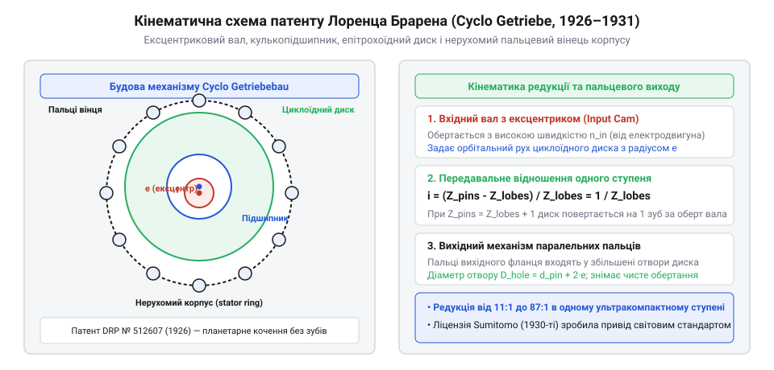
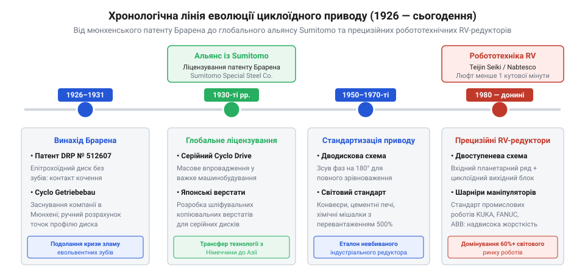

# Циклоїдний редуктор

<preknowlist>
- [Циклоїдний редуктор](root:hw-motion/cycloidal-drive) — загальне уявлення про будову циклоїдної передачі та її переваги перед звичайними шестернями.
</preknowlist>

## Механічна криза 1920-х: злам зубів евольвентних передач та неефективність черв'ячних редукторів

Бурхлива електрифікація промисловості та транспорту у перші десятиліття XX століття поставила перед інженерами-механіками важкий технологічний виклик. Стандартні асинхронні електродвигуни та двигуни постійного струму ефективно працювали на високих частотах обертання ротора — типово від 1000 до 3000 об/хв. Водночас робочі механізми заводських конвеєрів, кранів, мішалок, лебідок та прокатних станів потребували повільного, плавного обертання зі швидкістю 10–60 об/хв за колосального крутного моменту. Виникла гостра потреба в компактних і надійних редукторах із коефіцієнтом зниження швидкості 1:30..1:100 на один механічний агрегат.

Традиційне машинобудування спиралося на два головні інженерні розв'язки, і обидва виявилися цілком непридатними для нових умов:
1. **Багатоступеневі евольвентні циліндричні передачі:** для досягнення редукції 1:50 потрібно було послідовно з'єднувати 3–4 зубчасті ступені. Такий редуктор виходив громіздким, важким, мав високий сумарний люфт і численні проміжні вали з підшипниками. Проте найгіршим було інше: евольвентний зуб працює як консольна балка, навантажена згинальною силою на самому кінчику. Коли важкий конвеєр чи лебідка стикалися з раптовим механічним ударом або заклинюванням, динамічне перевантаження миттєво перевищувало границю витривалості сталі на згин, і зуби шестерень виламувалися з коренем.
2. **Черв'ячні передачі:** вони дозволяли отримати високе передавальне число (1:30..1:60) в одному ступені. Проте зачеплення черв'яка з вінцем колеса базується на неперервному ковзанні витків, через що механічний ККД рідко перевищував 50–60%. Решта 40–50% потужності двигуна безповоротно перетворювалася на тепло. У безперервному промисловому циклі черв'ячні редуктори розжарювалися до 90–110 °C, мастило коксувалося, бронзові вінці коліс катастрофічно зношувалися, а небезпека температурного приварювання вимагала дорогих радіаторів охолодження.

Перші діючі експериментальні зразки редуктора CYCLO, зібрані Лоренцом Брареном у Мюнхені наприкінці 1928 року, мали зовнішній діаметр корпусу лише 210 мм за ширини 115 мм, реалізуючи передавальне число i = 35:1 з ексцентриситетом е = 2.5 мм. При випробуваннях під навантаженням електромотора потужністю 3 кВт на частоті 1440 об/хв прототип розвивав тривалий вихідний крутний момент понад 650 Н·м із виміряним ККД 93.5%, витримуючи ударні динамічні перевантаження до 2800 Н·м без жодних залишкових деформацій.

*Конфлікт трибологічних парадигм 1920-х років: консольний злам евольвентного зуба шестерні під ударним навантаженням проти багатопальцевого стискального розподілу сил у циклоїдному редукторі.*

Промисловість опинилася в глухому куті: звичайні зубчасті редуктори не витримували перевантажень і розсипалися від ударів, а черв'ячні спалювали енергію в тепло й вимагали постійної заміни зношених бронзових коліс. Потрібен був принципово новий тип механічної трансмісії.

## Ідея Лоренца Брарена (1926–1931): епітрохоїдне обкочування та народження концепції CYCLO

Розв'язання цієї кризи запропонував німецький інженер-винахідник Лоренц Брарен (@@de|Lorenz Braren@@). Працюючи в Мюнхені у середині 1920-х років, Брарен поставив фундаментальне питання: чому механічна передача обов'язково повинна спиратися на тонкі виступаючі зубці, які працюють на злам, якщо можна замінити згин чистим контактним стиском?

Брарен звернувся до кінематики циклоїдних кривих, відомих математикам ще з праць Олафа Ремера та Християна Гюйгенса, але ніколи раніше не втілених у промисловому редукторобудуванні в такій конфігурації. Він запропонував відмовитися від обох традиційних шестерень і побудувати передачу на взаємодії двох абсолютно незвичних елементів:
1. Нерухомого кільця, утвореного колом однакових циліндричних сталевих пальців із роликами (вінець зубів-роликів, z_pin);
2. Сталевого диска з плавними хвилеподібними виступами епітрохоїдного профілю (циклоїдний диск, z_disk = z_pin - 1), що встановлений на ексцентриковий вал.

*Принципова кінематична схема з перших німецьких патентів Лоренца Брарена: ексцентриковий приводний вал, кулькопідшипник, епітрохоїдний диск та кільце нерухомих циліндричних пальців із пальцевим знімачем обертання.*

Геніальність винаходу Брарена полягала в трьох взаємопов'язаних ефектах:
- **Багатопарність зачеплення:** на відміну від евольвентної пари, де все зусилля зосереджене в одній лінії контакту (коефіцієнт перекриття 1.2..1.5), у циклоїдному редукторі Брарена одночасно в контакті перебуває від 30% до 50% усіх виступів диска. Ударне навантаження розподіляється між десятками загартованих роликів, що усуває точковий тиск.
- **Чистий стиск і кочення замість згину:** циклоїдний зуб має форму широкого пологого пагорба, основа якого ширша за висоту. Він не може зламатися на згин під дією радіальної сили — метал працює суто на стиск, а ролики забезпечують перекочування з мінімальними втратами (ККД понад 92–95%).
- **Колосальне передавальне число в одному ступені:** за один повний оберт вхідного ексцентрикового вала диск зміщується рівно на один крок відносно пальцевого вінця. Передавальне відношення дорівнювало i = z_disk / (z_pin - z_disk) = z_disk. Зробивши диск із 59 хвилями та кільце з 60 роликів, Брарен отримав редукцію 1:59 у вузлі розміром із каструлю.

Свій винахід Брарен захистив серією патентів у Німеччині та за кордоном у період з 1926 по 1931 роки (зокрема німецький патент DE 482087 та британський GB 314421). Нова трансмісія отримала назву CYCLO (Cyclo-Getriebe), назавжди вписавши ім'я Лоренца Брарена в історію світової мехатроніки.

## Заснування Cyclo Getriebebau в Мюнхені та подолання технологічного бар'єра прецизійної обробки

Отримавши фундаментальні патенти на циклоїдну передачу в 1926–1931 роках, Лоренц Брарен зіткнувся з викликом, який ледь не поховав його винахід: технологічною неможливістю серійного виготовлення. На папері кінематика епітрохоїди виглядала бездоганно, проте тогочасне верстатобудування не знало ні верстатів із числовим програмним керуванням (ЧПК), ні оптичних копіювальних шліфувальних систем.

Епітрохоїдний профіль диска Брарена є складною некруглою трансцендентною кривою. Будь-яке мікроскопічне відхилення профілю канавки на 10–20 мкм призводило або до заклинювання диска між пальцями ексцентрика, або до втрати контакту, коли все навантаження раптово падало лише на один палець замість розрахункових п'ятнадцяти.

Для подолання цього бар'єра Брарен у 1931 році заснував у Мюнхені спеціалізоване підприємство Cyclo Getriebebau Lorenz Braren KG. Брарен власноруч спроектував унікальні механічні верстати-пантографи та планетарні шліфувальні пристрої, в яких рух шліфувального круга задавався прецизійною кулачковою парою з кінематичною схемою самого циклоїдного обкочування. Пантограф мав передавальне плече 10:1, що зменшувало будь-яку похибку майстер-кулачка на порядок. Як матеріал для дисків Брарен обрав хромонікелеву цементовану сталь марки 16MnCr5 та підшипникову високовуглецеву сталь 100Cr6 із подальшим гартуванням до твердості 60–62 HRC. Використовуючи метод зворотного обкатування загартованих сталевих заготовок, Брарен домігся мікронної точності прилягання циклоїдних дисків.

Перші випущені редуктори вразили інженерну спільноту Німеччини: привід розміром утричі меншим за аналогічний триступеневий циліндричний редуктор витримував колосальні 500-відсоткові пікові перевантаження без найменших пошкоджень, демонструючи при цьому вражаючий ККД понад 93%.

## Трансфер технології до Японії: партнерство з Sumitomo та народження глобального промислового стандарту

Незважаючи на технічний тріумф, невелика компанія Брарена в Мюнхені не володіла капіталом і металургійними потужностями для забезпечення глобального ринку. Вирішальний поворот в історії циклоїдного приводу стався завдяки японським інженерам.

У 1930-х роках японська промислова корпорація Sumitomo (Sumitomo Heavy Industries), яка активно модернізувала важке гірниче обладнання, екскаватори та прокатні стани в Азії, шукала надстійкий привід для роботи в умовах екстремальної запиленості та вібрацій. Познайомившись із патентами Брарена, керівництво Sumitomo оцінило стратегічний потенціал розробки.

У 1937 році між Lorenz Braren KG та Sumitomo було укладено історичну ліцензійну угоду про передачу технологій та ексклюзивні права на виробництво і продаж редукторів CYCLO в Японії та країнах Азії. Брарен особисто передав креслення верстатів та технологічні карти термічної обробки дисків японським інженерам.

*Хронологічна лінія еволюції циклоїдного приводу: винахід Лоренца Брарена в Мюнхені (1926–1931), альянс із Sumitomo (1937), масове впровадження у важкій індустрії та розробка високоточних RV-редукторів Teijin Seiki для світової робототехніки.*

У повоєнний період партнерство набуло ще більшого розмаху: Sumitomo вдосконалила леговані сталі для пальців і роликів, довела виробничі допуски до субмікронного рівня й вивела бренд Sumitomo Drive Technologies на позицію світового монополіста циклоїдних приводів важкого класу. Циклоїдні мотор-редуктори Sumitomo стали незамінним стандартом у приводах очисних споруд, металургійних заводів, хімічних реакторів і портових конвеєрів — скрізь, де вихід редуктора з ладу означав би мільйонні збитки від зупинки заводу.

## Еволюція в робототехніку: від важких приводів до прецизійних робототехнічних редукторів RV та розвінчання міфів пріоритету

Трансформація винаходу Лоренца Брарена з важкого промислового редуктора у високоточне серце сучасної робототехніки розпочалася у 1980-х роках. З бурхливим розвитком промислових шестиосьових роботів-маніпуляторів на заводах автомобілебудування виникла гостра потреба в редукторах для головних опорних шарнірів (осі 1, 2 та 3 робота). Традиційні планетарні редуктори мали неприпустимо високий кутовий люфт і деформувалися під вагою важкої руки робота, а хвильові редуктори Гармонік Драйв виявилися надто гнучкими й крихкими для сприйняття екстремальних перекидних моментів важких шарнірів.

Японська компанія Teijin Seiki (яка у 2003 році об'єдналася з Nabco у всесвітньо відому корпорацію Nabtesco) взяла за основу класичну кінематичну схему Брарена і радикально модернізувала її під вимоги прецизійної робототехніки. Так народилася концепція редуктора RV (@@en|Robo-Vektor@@, або RV Series):
1. **Інтеграція вхідного планетарного ступеня:** щоб зменшити частоту обертання ексцентрикового вала та усунути теплове збивання мастила, перед циклоїдними дисками встановили компактну планетарну передачу з центральною сонячною шестернею та трьома сателітами;
2. **Два протифазні диски:** для повного динамічного гасіння відцентрових сил та балансування ротора циклоїдні диски подвоїли й розгорнули на 180°;
3. **Вбудовані перехресні роликопідшипники:** корпус редуктора перетворили на масивну опорну конструкцію, здатну сприймати тисячі ньютон-метрів перекидного моменту безпосередньо вихідним фланцем робота без додаткових опор.

Сьогодні понад 80% усіх промислових роботів у світі — від ліній зварювання KUKA, Fanuc та ABB до маніпуляторів Yaskawa — використовують у своїх базових зчленуваннях циклоїдні RV-редуктори, створені за принципами Лоренца Брарена.

*Хронологічна лінія еволюції циклоїдного приводу: винахід Брарена в Мюнхені (1926–1931), альянс із Sumitomo (1930-ті), повоєнна стандартизація та створення робототехнічних RV-редукторів.*

Історія винаходу Брарена також не уникла спроб переписування та імперських міфів пріоритету:
- **Радянський міф «планетарно-цевочного редуктора»:** у радянській технічній літературі 1960–1980-х років (праці Кудрявцева, Шаннікова та ін.) циклоїдні передачі послідовно іменувалися «планетарно-цевочними передачами» або «редукторами з цевочним зачепленням», при цьому ім'я Лоренца Брарена практично ніколи не згадувалося. Створювалося хибне враження, нібито схема була розроблена радянськими науково-дослідними інститутами машинобудування для військово-промислового комплексу. Насправді всі ці розробки спиралися на ретельне вивчення трофейних німецьких зразків Cyclo-Getriebebau та закуплених через треті країни каталогів Sumitomo.
- **Американський міф «вітчизняного патентування»:** у США через активну діяльність дочірніх структур Sumitomo Drive Technologies та американських інженерних компаній нерідко стверджувалося, що промисловий циклоїдний редуктор є суто американським винаходом повоєнного періоду, оскільки саме в США його стандартизували для важких конвеєрів автопрому.

Історичні архівні дані та патентний реєстр Німеччини (Reichspatentamt) однозначно встановлюють абсолютний пріоритет: автором ідеї, математичної моделі, конструктивної схеми та першої промислової технології виробництва циклоїдного редуктора є саме Лоренц Брарен. Його винахід став одним із найелегантніших тріумфів прикладної математики та точної механіки у XX столітті.
