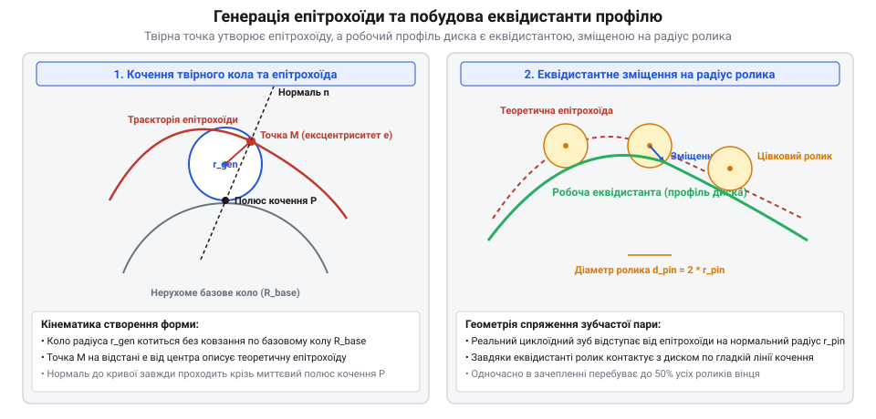
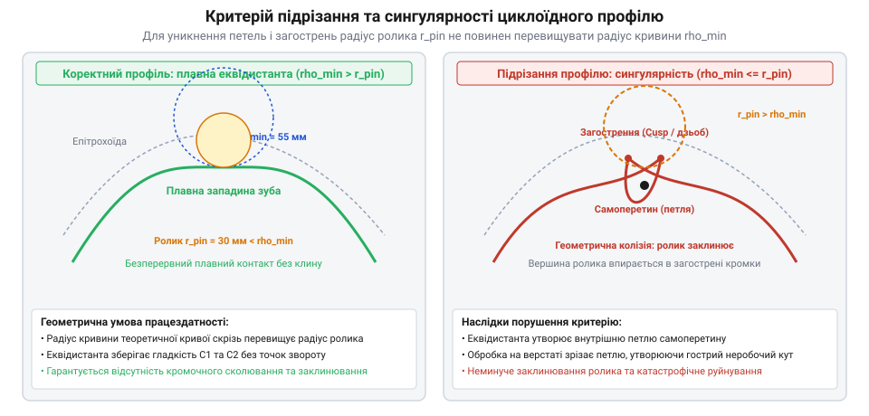

# Циклоїдний редуктор

## Геометричні засади циклоїдного зачеплення та параметричні рівняння скороченої епітрохоїди

Геометрія циклоїдного зачеплення базується на планетарному обкочуванні твірних кіл без ковзання. Розглянемо нерухоме коло радіуса R_b та рухоме твірне коло радіуса R_r, яке котиться по його зовнішній поверхні. Точка, жорстко зв'язана з рухомим колом на відстані e від його центра, описує в просторі скорочену епітрохоїду. У реальному циклоїдному редукторі нерухомий вінець утворений z_p однаковими циліндричними роликами радіуса r_p, рівномірно розташованими на початковому колі радіуса R_p з кутовим кроком delta = 2 · pi / z_p. Диск редуктора має z_c хвилеподібних виступів (зубів), причому z_c = z_p - 1.

Ексцентриковий вал зміщує центр циклоїдного диска на величину ексцентриситету e відносно осі симетрії вінця роликів. Щоб визначити профіль зубів диска, необхідно перейти в систему координат, жорстко зв'язану з диском, де вінець роликів здійснює планетарний рух. Траєкторія руху центрів роликів вінця відносно центра диска описується параметричними рівняннями скороченої епітрохоїди:

x_e(theta) = R_p · cos(theta) - e · cos(z_p · theta)
y_e(theta) = R_p · sin(theta) - e · sin(z_p · theta)

де theta — незалежний параметричний кут повороту ексцентрикового вала (в межах від 0 до 2 · pi), R_p — радіус початкового кола розміщення центрів роликів, e — ексцентриситет привода, а z_p — кількість роликів нерухомого вінця.

Введемо безрозмірний коефіцієнт скорочення епітрохоїди K_1:

K_1 = (e · z_p) / R_p

Цей коефіцієнт є визначальним масштабним параметром зачеплення: він характеризує ступінь хвилястості профілю та безпосередньо впливає на контактні кути між роликом і диском. Для практичних промислових редукторів робочий діапазон K_1 зазвичай становить від 0.5 до 0.85. При K_1 < 0.5 висота зуба стає занадто малою, що знижує навантажувальну здатність, а при K_1 > 0.85 виникає загроза сингулярності форми зуба.

Для прямого чисельного розрахунку траєкторії на промислових контролерах верстатів із ЧПК доцільно подати кінематику в матричному векторному просторі SO(2). Положення ексцентрикового центра диска p_ecc(theta) у глобальній системі координат вінця задається вектором:

p_ecc(theta) = [ -e · sin(theta), e · cos(theta) ]^T

Власна система координат диска обертається відносно корпусу редуктора з кутовою швидкістю omega_disk = -omega_in / z_c. Відповідний оператор повороту задається ортогональною матрицею обертання другого порядку R(theta):

R(theta) = [ [ cos(theta / z_c), -sin(theta / z_c) ], [ sin(theta / z_c), cos(theta / z_c) ] ]

Координати центру k-го нерухомого ролика вінця (де k = 0, 1, ..., z_p - 1) у системі координат корпусу є фіксованими векторами:

r_pin,k = [ R_p · cos(2 · pi · k / z_p), R_p · sin(2 · pi · k / z_p) ]^T

Траєкторія руху k-го ролика у рухомій системі координат циклоїдного диска обчислюється через однорідне матричне перетворення зміщення та обертання:

p_k(theta) = R^T(theta) · (r_pin,k - p_ecc(theta))

Таке матричне формулювання дозволяє контролеру верстата реалізувати контурне фрезерування або шліфування профілю за допомогою апаратного векторного множення (інструкції SIMD/AVX), уникаючи дискретних накопичуваних помилок лінійної інтерполяції кутів.

*Геометрична генерація циклоїдного профілю: траєкторія епітрохоїди центрів пальців та її еквідистантне зміщення на радіус ролика.*

> 🔧 **Навіщо це.**
> Матричний оператор повороту усуває потребу тригонометричного перерахунку кожного мікросегмента траєкторії, дозволяючи генераторам траєкторій ЧПК формувати керуючі кадри G-коду з наносекундною дискретністю в реальному часі.

## Побудова робочого профілю циклоїдного диска як еквідистанти до епітрохоїди

Отримана траєкторія (x_e(theta), y_e(theta)) задає лише лінію руху центрів пальців. Реальний циклоїдний диск безпосередньо взаємодіє з циліндричною поверхнею ролика радіуса r_p. Отже, робочий фізичний контур диска має бути еквідистантною кривою, віддаленою від вихідної епітрохоїди всередину на сталу величину радіуса ролика r_p уздовж вектора нормалі до кривої в кожній точці.

Для обчислення напрямку нормалі диференціюємо рівняння епітрохоїди за параметром theta:

x_e'(theta) = dx_e / dtheta = -R_p · sin(theta) + e · z_p · sin(z_p · theta)
y_e'(theta) = dy_e / dtheta = R_p · cos(theta) - e · z_p · cos(z_p · theta)

Дотичний вектор до траєкторії центрів має вигляд T = (x_e'(theta), y_e'(theta)). Одиничний вектор внутрішньої нормалі N = (n_x, n_y) ортогональний до дотичного вектора і визначається співвідношеннями:

n_x(theta) = -y_e'(theta) / sqrt(x_e'(theta)² + y_e'(theta)²)
n_y(theta) = x_e'(theta) / sqrt(x_e'(theta)² + y_e'(theta)²)

Обчислимо довжину вектора швидкості S(theta) = sqrt(x_e'(theta)² + y_e'(theta)²):

S(theta) = sqrt( (-R_p · sin(theta) + e · z_p · sin(z_p · theta))² + (R_p · cos(theta) - e · z_p · cos(z_p · theta))² )

Розкриваючи квадрати та застосовуючи тригонометричну тотожність sin²(alpha) + cos²(alpha) = 1, маємо:

S(theta) = R_p · sqrt(1 + K_1² - 2 · K_1 · cos(z_c · theta))

де z_c = z_p - 1 — кількість зубів диска. Введемо кут спряження psi(theta), який визначає напрямок вектора тиску ролика на профіль:

cos(psi(theta)) = (cos(theta) - K_1 · cos(z_p · theta)) / sqrt(1 + K_1² - 2 · K_1 · cos(z_c · theta))
sin(psi(theta)) = (sin(theta) - K_1 · sin(z_p · theta)) / sqrt(1 + K_1² - 2 · K_1 · cos(z_c · theta))

Відкладаючи від кожної точки епітрохоїди вектор зміщення довжиною r_p вздовж нормалі, одержуємо остаточні параметричні рівняння контуру циклоїдного зуба:

x_profile(theta) = R_p · cos(theta) - e · cos(z_p · theta) - r_p · sin(psi(theta))
y_profile(theta) = R_p · sin(theta) - e · sin(z_p · theta) + r_p · cos(psi(theta))

Це замкнена гладка планарна крива з z_c періодами. За один повний цикл зміни theta від 0 до 2 · pi кут обкочування охоплює всі виступи диска, забезпечуючи неперервний контакт із пальцевим вінцем редуктора.

> 🔧 **Навіщо це.**
> Пряме аналітичне рівняння еквідистанти позбавляє потреби наближувати профіль дугами кіл чи сплайнами, усуваючи мікронерівності та стрибки прискорень під час високошвидкісного обертання.

## Аналітичні умови відсутності підрізання та критерії самоперетину профілю

Побудова еквідистанти не гарантує автоматичної гладкості робочого профілю. Якщо радіус кривизни вихідної епітрохоїди виявиться меншим за радіус зміщення (радіус ролика r_p), еквідистантна крива утворює петлю самоперетину з гострою сингулярною точкою вертання (@@en|cusp@@). У реальному виробництві верстат зріже цю петлю, що призведе до катастрофічного зрізання верхівки або підрізання ніжки зуба, втрати неперервності зачеплення та ударного заклинювання редуктора.

Для знаходження радіуса кривизни епітрохоїди rho_e(theta) скористаємося диференціальною геометрією плоских кривих:

rho_e(theta) = (x_e'(theta)² + y_e'(theta)²)^(3/2) / (x_e'(theta) · y_e''(theta) - y_e'(theta) · x_e''(theta))

Диференціюючи перші похідні, знаходимо другі похідні за параметром theta:

x_e''(theta) = -R_p · cos(theta) + e · z_p² · cos(z_p · theta)
y_e''(theta) = -R_p · sin(theta) + e · z_p² · sin(z_p · theta)

Підставляючи компоненти у знаменник та розкриваючи добутки векторів, одержуємо:

x_e' · y_e'' - y_e' · x_e'' = R_p² · (1 + z_p · K_1² - (1 + z_p) · K_1 · cos(z_c · theta))

де z_c = z_p - 1, а K_1 = (e · z_p) / R_p. З урахуванням виразу для довжини швидкості S(theta), радіус кривизни епітрохоїди становить:

rho_e(theta) = R_p · (1 + K_1² - 2 · K_1 · cos(z_c · theta))^(3/2) / (1 + z_p · K_1² - (1 + z_p) · K_1 · cos(z_c · theta))

Мінімальне значення радіуса кривизни rho_e,min виникає в зоні максимальної опуклості профілю, коли cos(z_c · theta) = 1:

rho_e,min = R_p · (1 - K_1)³ / (1 + z_p · K_1² - (1 + z_p) · K_1) = R_p · (1 - K_1)² / (1 - z_p · K_1)

Щоб на еквідистанті не виникло самоперетину, радіус ролика r_p мусить бути строго меншим за мінімальний радіус кривизни центроїди:

r_p < rho_e,min

Звідси випливає фундаментальне геометричне обмеження на проектування циклоїдних передач: знаменник (1 - z_p · K_1) мусить бути додатним, тобто:

K_1 < 1 / z_p

Якщо ж конструктор обирає геометричні пропорції з K_1 >= 1 / z_p, у профілі виникають точки перегину та внутрішні петлі, що вимагає штучного зрізання вершин або збільшення діаметра початкового кола пальців.

У серійному виробництві промислових робототехнічних редукторів сімейства RV (від компактних приводів передпліччя RV-20E до потужних редукторів поворотних колон важких зварювальних роботів RV-320E) параметри зачеплення оптимізують для забезпечення запасу до підрізання не менше 1.3..1.6. Нижче наведено параметричний розрахунок граничних геометричних величин для стандартизованого ряду RV-E:

| Типорозмір редуктора | Діаметр вінця 2·R_p, мм | Число пальців z_p | Ексцентриситет e, мм | Коефіцієнт K_1 | rho_e,min, мм | Радіус ролика r_p, мм | Коефіцієнт запасу rho_min / r_p |
|---|---|---|---|---|---|---|---|
| RV-20E (i = 81) | 92.0 | 82 | 0.85 | 0.758 | 4.82 | 3.25 | 1.48 |
| RV-40E (i = 105) | 124.0 | 106 | 0.95 | 0.812 | 5.64 | 3.75 | 1.50 |
| RV-80E (i = 121) | 168.0 | 122 | 1.10 | 0.798 | 7.95 | 5.00 | 1.59 |
| RV-160E (i = 141) | 218.0 | 142 | 1.35 | 0.879 | 9.42 | 6.50 | 1.45 |
| RV-320E (i = 171) | 290.0 | 172 | 1.60 | 0.948 | 13.80 | 9.00 | 1.53 |

Як видно з наведених розрахункових даних, у міру зростання передавального числа i та габариту редуктора коефіцієнт скорочення K_1 наближається до критичної межі, що зумовлює звуження технологічного коридору вибору радіуса пальців. Якщо конструктор спробує необґрунтовано збільшити радіус пальців r_p заради підвищення несучої здатності на зминання, запас безпеки впаде нижче одиниці, спричинивши миттєве заклинювання циклоїдного диска.

*Геометричні межі підрізання профілю: плавний контур циклоїдного зуба за умови r_p < rho_min проти виродження в самоперетинну петлю.*

> 🔧 **Навіщо це.**
> Аналітична перевірка умови r_p < rho_e,min на етапі CAD-моделювання запобігає виготовленню бракованих дисків із підрізаними ніжками зубів, які руйнуються під час перших обертів під навантаженням.

## Кінематика контакту, відносне ковзання та розподіл контактних напружень Герца

На відміну від звичайних зубчастих коліс, де в контакті перебуває 1–2 пари зубів, у циклоїдному редукторі навантаження одночасно передається через половину всіх наявних роликів (теоретично z_p / 2 точок). Для оцінки зносостійкості та контактної міцності необхідно визначити швидкість відносного ковзання та розподіл нормальних сил між роликами.

Миттєвий центр швидкостей (МЦШ) відносного руху диска та пальцевого вінця розташований у точці торкання їхніх центроїд на відстані R_w = R_p · (z_c / z_p) від центра диска. Швидкість відносного ковзання v_slip у точці контакту з кутом тиску psi_i дорівнює:

v_slip,i = omega_in · e · sin(psi_i)

де omega_in — кутова швидкість обертання ексцентрикового вала. Ковзання перетворюється на нуль у точках чистого кочення (де нормаль проходить через МЦШ) і сягає максимуму на перехідних ділянках між зубами.

Під дією зовнішнього вихідного крутного моменту T_out баланс сил описується інтегральною сумою моментів нормальних сил F_n,i:

T_out = sum_{i=1}^{k} (F_n,i · L_arm,i)

де L_arm,i = R_p · sin(psi_i) — плече дії нормальної реакції i-го ролика відносно центра обертання вінця. Вважаючи пружні деформації лінійними, нормальна сила F_n,i розподіляється пропорційно sin(psi_i):

F_n,i = F_n,max · (sin(psi_i) / sin(psi_max))

Підставляючи цей розподіл у рівняння моменту, одержуємо пікову нормальну силу на найбільш навантаженому ролику:

F_n,max = (2 · T_out) / (z_c · R_p · sin(psi_max))

Контакт між циліндричним роликом радіуса r_p та криволінійним зубом диска радіуса кривизни rho_profile на робочій ширині диска b розраховується за класичною формулою контактних напружень Герца для двох циліндрів:

sigma_H = sqrt( (F_n,max / (pi · b)) · ( (1 / r_p + 1 / rho_profile) / ( (1 - nu_1²) / E_1 + (1 - nu_2²) / E_2 ) ) )

де E_1, E_2 — модулі пружності матеріалів диска та роликів (для підшипникової сталі 100Cr6 / ШХ15 E ≈ 2.1 · 10¹¹ Па), а nu_1, nu_2 — коефіцієнти Пуассона (nu ≈ 0.3).

Завдяки конформному (вкладеному) контакту увігнутих ділянок диска з роликами сумарна зведена кривизна є помірною, що дозволяє утримувати пікові контактні тиски sigma_H у безпечних межах 1100–1400 МПа навіть за багаторазових пікових перевантажень сервопривода.

> 🔧 **Навіщо це.**
> Розрахунок контактних тисків за Герцем дає точну товщину диска b та глибину цементації сталі, гарантуючи відсутність пітингу та втомного викришування за мільйони робочих циклів робота.
