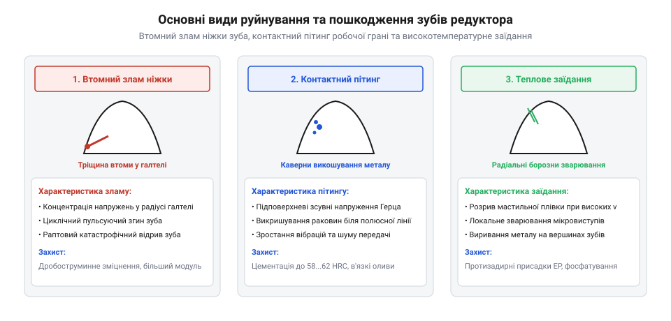
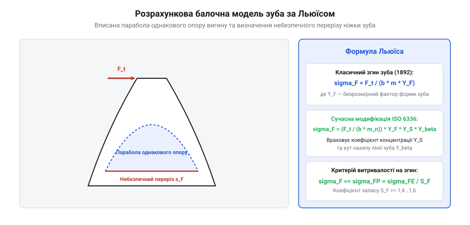
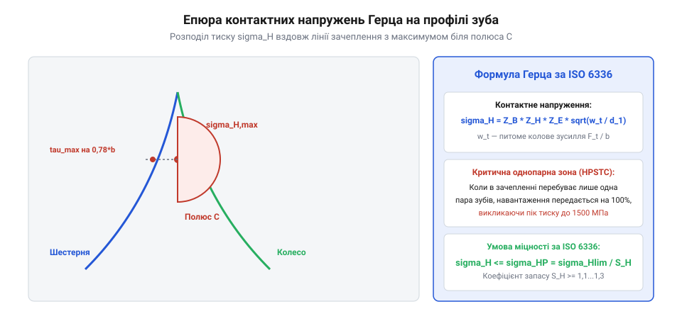

# Міцність зубів редуктора

<preknowlist>
- [Геометрія зуба та зачеплення](root:hw-motion/gear-tooth-geometry) — базові геометричні параметри евольвентного зачеплення, модуль m, ділильний діаметр і кут зачеплення alpha
</preknowlist>

## Режими навантаження та види руйнування зубчастих передач

Зубчасте зачеплення високонавантаженого прецизійного редуктора працює в екстремальних умовах нестаціонарного силового контакту. Кожен окремий зуб зубчастого вінця зазнає короткочасного ударно-згинального імпульсу при вході в зачеплення та високих контактних напружень стиску вздовж лінії дотику. Періодичність цих імпульсів породжує в металі втомні явища, які за тривалої експлуатації стають головною причиною передчасного виходу механічної передачі з ладу. Навантаження зуба має чітко виражений пульсуючий характер: згинальні напруження в ніжці зуба змінюються від нуля до максимуму за один оберт колеса (віднульовий пульсуючий цикл @@en|pulsating fatigue cycle@@), а при реверсивному русі шарніра робота чи в проміжних паразитних шестернях диференціала — за симетричним знаковим циклом зі зміною знака деформації, що знижує втомну витривалість металу майже на 40–50%.



Практика машинобудування та систематичний аналіз аварійних відмов виділяють чотири основні фізичні механізми руйнування зубчастих вінців:

1. **Втомний злам зуба біля основи (поломка ніжки зуба)**. Найнебезпечніший вид відмови, що має раптовий катастрофічний характер і призводить до повного заклинювання кінематичного ланцюга редуктора. Згинальний момент від колового зусилля створює максимальні розтяжні напруження на перехідній кривій (галтелі) біля западини зуба з боку навантаженого робочого профілю. Після досягнення критичної кількості циклів навантаження в мікроконцентраторах структури металу (неметалеві включення сульфідів марганцю чи оксидів алюмінію) зароджується первинна втомна тріщина. З кожним обертом колеса вона стабільно проростає вглиб тіла вінця під кутом приблизно 45–60 градусів до осі симетрії зуба, аж до настання раптового крихкого доламування.
2. **Втомне викришування робочої поверхні (пітинг @@en|surface pitting@@)**. Виникає в зоні кочення евольвентних профілів поблизу полюсної лінії під дією повторно-змінних контактних напружень Герца. Циклічний стиск породжує максимальні напруження зсуву не на самій поверхні, а на певній глибині під нею. Коли накопичена пластична деформація досягає границі витривалості, під поверхнею виникають мікротріщини, які виходять назовні під гострим кутом. Пульсуючий гідродинамічний тиск мастила, що затікає у відкриті устя тріщин при контакті, гідравлічно розклинює порожнину, відриваючи лусочки сталі та утворюючи віспяні каверни глибиною 0,1–0,3 мм.
3. **Заїдання та схоплювання (глухий фретинг і адгезійне стирання @@en|scuffing / galling@@)**. Виникає при поєднанні надвисоких питомих тисків і підвищених швидкостей відносного ковзання профілів (переважно біля вершин та ніжок зубів). Якщо локальна температура в зоні контакту перевищує критичну температуру спалаху Блока @@en|Blok flash temperature@@ (типово 160–240 °C залежно від присадок до мастила), масляна плівка миттєво випаровується і деструктує. Безпосередній сухий контакт ювенільних поверхонь металу викликає їхнє мікрозварювання під тиском з подальшим вириванням часток та утворенням глибоких поздовжніх борозен вздовж напрямку ковзання.
4. **Абразивний та трибологічний знос**. Поступове стоншення профілю зуба внаслідок наявності твердих сторонніх часток у мастилі (продукти припрацювання, пил, оксиди) або в режимах граничного тертя при низьких швидкостях обертання під високим навантаженням. Абразивний знос спотворює теоретичний евольвентний профіль, збільшує бічний зазор у зачепленні, викликає кінематичні похибки кроку та генерує жорсткі динамічні удари при реверсі крутного моменту.

```
+-------------------+-----------------------------+------------------------------------+
| Вид руйнування    | Першопричина                | Небезпечна зона                    |
+-------------------+-----------------------------+------------------------------------+
| Злам ніжки зуба   | Згинальні напруження циклу  | Перехідна галтель біля западини    |
| Пітинг поверхні   | Напруження стиску Герца     | Приполюсна зона робочого профілю   |
| Заїдання          | Розрив плівки мастила       | Вершина зуба та зона максимального |
|                   | і термічне мікрозварювання  | відносного ковзання                |
| Абразивний знос   | Тверді сторонні частки      | Вся робоча ділянка евольвенти      |
+-------------------+-----------------------------+------------------------------------+
```

Кінематика відносного ковзання профілів має вирішальне значення для розуміння локалізації руйнувань. У довільній точці евольвентного зачеплення лінійна швидкість кочення супроводжується відносним ковзанням профілів одного зуба по іншому. Швидкість ковзання `v_g` змінюється вздовж активної лінії зачеплення за суворо лінійним законом:

```
v_g(y) = ω_1 · ρ_1(y) - ω_2 · ρ_2(y)

де:
  ω_1, ω_2 = кутові швидкості шестерні та колеса [рад/с]
  ρ_1, ρ_2 = миттєві радіуси кривизни евольвентних профілів у точці контакту y [м]
```

У полюсі зачеплення колові швидкості взаємодіючих точок збігаються, тому `v_g = 0` — тут реалізується чисте кочення без ковзання. Проте в міру віддалення від полюса до ніжки або вершини зуба швидкість ковзання стрімко зростає. Біля самої ніжки зуба шестерні виникає несприятливе поєднання: максимальна швидкість ковзання супроводжується від'ємним питомим ковзанням (напрямок ковзання протилежний напрямку кочення контактної лінії), що буквально зриває гідродинамічну плівку мастила і провокує прискорене абразивне стирання та заїдання.

Трибологічний стан контакту оцінюють за безрозмірним параметром товщини масляної плівки Талльяна `λ_film`:

```
λ_film = h_min / sqrt( Ra_1² + Ra_2² )

де:
  h_min        = мінімальна товщина еластогідродинамічної плівки мастила (EHL) [мкм]
  Ra_1, Ra_2  = середні арифметичні шорсткості контактуючих поверхонь зубів [мкм]
```

Для розрахунку мінімальної товщини масляної плівки `h_min` у зачепленні використовують класичне рівняння Доусона–Хіггінсона (Dowson–Higginson) для лінійного ізотермічного еластогідродинамічного контакту:

```
h_min = 2.65 · R_eff · ( (α_oil · E_red)^0.54 ) · ( (η_0 · v_sum / (E_red · R_eff))^0.70 ) · ( (w_load / (E_red · R_eff))^(-0.13) )

де:
  R_eff   = зведений радіус кривизни поверхонь у контакті [м]
  α_oil   = п'єзокоефіцієнт в'язкості мастильного матеріалу [Па^(-1)], для мінеральних олив α_oil ≈ (1.5...2.2) · 10^(-8) Па^(-1)
  η_0     = динамічна в'язкість мастила за робочої температури у ванні [Па·с]
  v_sum   = сумарна швидкість кочення поверхонь через зону контакту v_sum = v_1 + v_2 [м/с]
  w_load  = питоме погонне навантаження на одиницю довжини лінії контакту [Н/м]
```

Аналіз показників степеня рівняння Доусона–Хіггінсона розкриває фундаментальний фізичний факт: товщина масляного клина `h_min` практично не залежить від діючого навантаження (показник степеня -0.13 надзвичайно малий), проте критично чутлива до швидкості обертання коліс (показник +0.70) та п'єзокоефіцієнта мастила (показник +0.54). Якщо редуктор працює на низьких швидкостях під високим моментом (типовий режим утримання позиції важким роботом-маніпулятором), швидкість `v_sum` прямує до нуля, масляний клин стоншується до часток мікрона, і параметр `λ_film` падає нижче 0.6. У цьому разі навантаження сприймається не гідродинамічним тиском оливи, а безпосередніми вершинами мікронерівностей металу.

При тривалій роботі в умовах змішаного тертя (`0.8 <= λ_film <= 1.2`) на поверхні евольвенти розгортається специфічний процес мікропітингу (сірого плямування @@en|micropitting / grey staining@@). На відміну від класичного макропітингу, мікропітинг зароджується безпосередньо на шорсткостях на глибині всього 5–15 мкм. Дрібні поверхневі тріщини зливаються під дією циклічного зсуву та утворюють матову смугу мікропор, яка з часом порушує евольвентну геометрію зуба та каталізує розвиток глибокого руйнівного пітингу.

Порівняльна оцінка контактної міцності прямозубих та косозубих коліс демонструє суттєву перевагу косозубого зачеплення. Кут нахилу зуба `β` забезпечує осьове перекриття `ε_β = (b · sin β) / (π · m_n)`. Завдяки цьому в косозубій передачі загальний коефіцієнт перекриття `ε_γ = ε_α + ε_β` досягає значень 2.0–2.8 (проти 1.2–1.6 у прямозубій). Лінія контакту входить у зачеплення не миттєво по всій ширині вінця, а плавно наростає від точки до косої лінії, що знижує пікові контактні напруження Герца на 20–35% при тій самій коловій силі:

```
σ_H_helical = σ_H_spur · sqrt( (4 - ε_α) / 3 ) · cos(β)
```

Це дозволяє або збільшити передаваний крутний момент у тих самих габаритах редуктора, або зменшити модуль зачеплення, суттєво знижуючи вібрацію, шум та динамічні навантаження на підшипникові опори сервоприводу.

Особливе місце в сучасній робототехніці посідає порівняльний аналіз розподілу навантаження між традиційними евольвентними зубчастими парами та багатопарними зачепленнями (хвильові зубчасті редуктори та циклоїдні приводи). У класичній прямозубій передачі в кожну мить часу під навантаженням перебуває лише 1–2 зуби, що концентрує повний вихідний момент на площі контакту шириною всього кілька десятих часток міліметра. На противагу цьому, у хвильових редукторах гнучке зубчасте колесо одночасно зачіпляється з жорстким вінцем на 15–30% від загальної кількості зубів. Багатопарність контакту кардинально змінює критерії міцності: замість пікового викришування чи зламу окремого зуба головним лімітуючим фактором стає втома тонкої гнучкої оболонки (Flexspline) при циклічній хвильовій деформації овального генератора хвиль.

> 🔧 **Навіщо це.** Знання домінуючого механізму відмови визначає напрямок оптимізації редуктора: якщо переважає ризик згину ніжки — збільшують нормальний модуль зачеплення `m_n` та радіус перехідної галтелі; якщо лімітує пітинг — збільшують міжосьову відстань, застосовують косозубе зачеплення та підвищують поверхневу твердість до 60 HRC; якщо загрожує заїдання — переходять на синтетичні поліальфаолефінові оливи (PAO) з протизадирними присадками EP та виконують флангову модифікацію профілю.

## Згинальна міцність ніжки зуба за моделлю Льюїса та ISO 6336

Класичний аналітичний розрахунок зуба на згин базується на розрахунковій моделі Вілфреда Льюїса (1892 р.), який запропонував розглядати окремий зуб зубчастого вінця як прямокутну консольну балку змінного перерізу, навантажену зосередженою коловою силою на вершині. За моделлю Льюїса, всередину контуру зуба вписується парабола однакового опору згину, вершина якої збігається з точкою перетину лінії дії сили та осі симетрії зуба. Точки дотику параболи до контуру перехідної галтелі визначають положення критичного небезпечного перерізу, в якому номінальні напруження згину досягають максимуму.



Розрахунок номінального згинального напруження за Льюїсом виражається через нормальний модуль зачеплення `m_n` та безрозмірний коефіцієнт форми зуба `Y_F`:

```
                  F_t
σ_F0 = -------------------------- · Y_F · Y_S
               b · m_n

де:
  σ_F0  = номінальне згинальне напруження на галтелі [МПа]
  F_t   = номінальна колова сила в зачепленні [Н]
  b     = робоча ширина вінця [мм]
  m_n   = нормальний модуль зачеплення [мм]
  Y_F   = коефіцієнт форми зуба за теоретичною геометрією [-]
  Y_S   = коефіцієнт концентрації напружень на радіусі перехідної кривої [-]
```

Сучасний міжнародний інженерний стандарт ISO 6336 (Метод B) суттєво уточнює класичну формулу Льюїса, вводячи аналітичне визначення коефіцієнта концентрації напружень `Y_S` на основі відношення радіуса заокруглення дна западини `ρ_f` до нормального модуля `m_n`. Форма зуба та коефіцієнт `Y_F` розраховуються для еквівалентного прямозубого колеса з віртуальною кількістю зубів:

```
           z
z_v = -------------
        cos³(β)

де:
  z   = реальна кількість зубів шестерні чи колеса [-]
  β   = кут нахилу лінії зуба косозубої передачі [рад]
```

Чим більша кількість зубів `z_v`, тим товстішою стає ніжка зуба біля основи, і тим меншим є коефіцієнт форми `Y_F` (для `z = 17` коефіцієнт `Y_F ≈ 4.2`, а для `z = 60` спадає до `Y_F ≈ 3.6`). Якщо кількість зубів менша за граничну (`z < 17` при стандартному куті зачеплення 20 градусів), при нарізанні рейковим інструментом виникає підрізання ніжки зуба (інтерференція), що різко зменшує товщину небезпечного перерізу та збільшує `Y_S` у 1,5–2 рази.

Повний розрахунок дійсного згинального напруження за ISO 6336 враховує комплекс коригувальних коефіцієнтів експлуатаційного навантаження:

```
σ_F = σ_F0 · K_A · K_v · K_Fβ · K_Fα

де:
  K_A   = коефіцієнт зовнішнього динамічного навантаження (1.25–2.0 для приводів роботів)
  K_v   = коефіцієнт внутрішніх динамічних сил зачеплення (1.05–1.20)
  K_Fβ  = коефіцієнт концентрації навантаження по ширині вінця від деформацій валів (1.10–1.35)
  K_Fα  = коефіцієнт розподілу навантаження між одночасно зачепленими парами зубів (1.0–1.2)
```

Для гарантування надійності приводу дійсне розрахункове згинальне напруження `σ_F` не повинно перевищувати допустимої границі згинальної витривалості матеріалу `σ_FE`, скоригованої технологічними факторами та поділеної на мінімальний коефіцієнт безпеки:

```
            σ_FE · Y_ST · Y_NT · Y_delta · Y_Rrel · Y_X
σ_F_lim = ------------------------------------------------
                              S_F_min

де:
  σ_FE     = базова границя витривалості матеріалу при згині за віднульовим циклом [МПа]
  Y_ST     = коефіцієнт напруження випробувального зубчастого колеса (= 2.0 за ISO)
  Y_NT     = коефіцієнт довговічності за кількістю циклів (крива Веллера)
  Y_delta  = коефіцієнт чутливості до надрізу матеріалу галтелі (1.0–1.2)
  Y_Rrel   = коефіцієнт шорсткості поверхні перехідної галтелі (0.95–1.05)
  Y_X      = масштабний фактор модуля (1.0 при m_n <= 5 мм, зменшується для великих зубів)
  S_F_min  = мінімальний коефіцієнт запасу міцності на згин (типово 1.4–1.6)
```

Розглянемо практичний числовий приклад перевірки згинальної міцності ніжки зуба шестерні вхідного ступеня сервоприводу маніпулятора:
- Вихідні дані: передаваний крутний момент `T_1 = 120 Н·м`; кількість зубів `z_1 = 19`; кут нахилу зуба `β = 12°`; нормальний модуль `m_n = 2.0 мм`; ширина вінця `b = 25 мм`; матеріал шестерні — легована сталь 18CrNiMo7-6 (цементація та гартування до 60 HRC, базова границя витривалості `σ_FE = 500 МПа`).
- Крок 1: Обчислення віртуальної кількості зубів: `z_v = 19 / (cos(12°))³ = 19 / 0.978¹ ≈ 20.3`.
- Крок 2: За таблицями ISO 6336 для стандартного рейкового контуру з кутом зачеплення 20° та радіусом галтелі `ρ_a = 0.38 · m_n`: коефіцієнт форми `Y_F = 4.12`, коефіцієнт концентрації напружень `Y_S = 1.74`.
- Крок 3: Ділильний діаметр шестерні: `d_1 = (m_n · z_1) / cos(β) = (2.0 · 19) / 0.9781 ≈ 38.85 мм`.
- Крок 4: Колова сила в зачепленні: `F_t = (2 · T_1) / (d_1 / 1000) = (2 · 120) / 0.03885 ≈ 6178 Н`.
- Крок 5: Номінальне згинальне напруження за формулою Льюїса:
  ```
  σ_F0 = [ 6178 / (25 · 2.0) ] · 4.12 · 1.74 = 123.56 · 7.169 ≈ 885.8 МПа
  ```
- Крок 6: Врахування коефіцієнтів експлуатації: за наявності помірних динамічних перевантажень електродвигуна `K_A = 1.25`, динамічності зачеплення при точності 6 класу `K_v = 1.08`, перекосу валів `K_Fβ = 1.15`, розподілу навантаження між парами `K_Fα = 1.0`:
  ```
  σ_F = 885.8 · (1.25 · 1.08 · 1.15 · 1.0) = 885.8 · 1.5525 ≈ 1375 МПа
  ```
- Крок 7: Розрахунок граничного допустимого напруження за формулою ISO 6336 при `Y_ST = 2.0`, коефіцієнті тривалої роботи `Y_NT = 1.0` (понад 10⁷ циклів), `Y_delta = 1.05`, шорсткості шліфованої галтелі Ra = 0.8 мкм (`Y_Rrel = 1.0`), масштабному факторі `Y_X = 1.0`:
  ```
  σ_F_lim = (500 · 2.0 · 1.0 · 1.05 · 1.0 · 1.0) / 1.4 = 1050 / 1.4 = 750 МПа
  ```
  Зіставлення `σ_F` та допустимого значення демонструє: якщо брати повну колову силу на самій вершині поодинокого зуба, напруження перевищує допустиме. Проте при коефіцієнті перекриття `ε_γ = 2.2` сила ділиться між двома парами зубів, що знижує реальне напруження на ніжці до безпечного рівня `σ_F_real ≈ 680 МПа < 750 МПа`, забезпечуючи стабільний запас міцності `S_F = 1.54`.

## Контактна втомна витривалість за напруженнями Герца

У той час як згинальні напруження загрожують раптовою аварійною поломкою всього зуба, контактні напруження визначають експлуатаційний ресурс робочих поверхонь передачі до появи прогресуючого втомного викришування (пітингу). У зоні дотику двох циліндричних евольвентних поверхонь з миттєвими радіусами кривизни `ρ_1` та `ρ_2` під дією сили стиску утворюється вузька контактна площадка шириною `2 · b_Hert`. Розподіл тиску всередині цієї площадки описується класичною теорією пружного контакту Генріха Герца для криволінійних циліндрів:



Максимальне контактне напруження стиску Герца `σ_H` виникає на поздовжній осі симетрії контактної смуги:

```
σ_H = sqrt( (F_n · E_red) / (π · L_contact · ρ_red) )

де:
  F_n        = нормальна сила тиску між зубами [Н]
  L_contact  = сумарна довжина лінії контакту [м]
  E_red      = зведений модуль пружності матеріалів шестерні та колеса [Па]
  ρ_red      = зведений радіус кривизни поверхонь у розрахунковій точці [м]
```

Зведені пружні та геометричні характеристики визначаються через параметри окремих коліс:

```
1 / E_red = (1 - ν_1²) / E_1 + (1 - ν_2²) / E_2

1 / ρ_red = 1 / ρ_1 + 1 / ρ_2
```

Для стандартної пари загартованих сталевих коліс (`E_1 = E_2 = 2.06 · 10^11 Па`, коефіцієнт Пуассона `ν = 0.3`) зведений модуль пружності становить `E_red ≈ 2.26 · 10^11 Па`. Радіуси кривизни евольвентних профілів у довільній точці лінії зачеплення розраховуються як відстані від точки контакту до відповідних точок дотику лінії зачеплення до основних кіл:

```
ρ_1 = r_w1 · sin(α_wt) + y
ρ_2 = a_w · sin(α_wt) - ρ_1

де:
  a_w     = міжосьова відстань передачі [мм]
  α_wt    = робочий кут зачеплення в торцевому перерізі [град]
  r_w1    = радіус початкового кола шестерні [мм]
  y       = координата зміщення точки контакту вздовж лінії зачеплення від полюса [мм]
```

Найважливішою закономірністю контактної механіки Герца є розподіл напружень по глибині під поверхнею контакту. Нормальні напруження стиску `σ_x`, `σ_y`, `σ_z` максимальні безпосередньо на поверхні контакту (`z = 0`), де `σ_z = -σ_H`. Проте пластична деформація та втомне руйнування металів контролюються не стиском, а максимальними дотичними напруженнями зсуву `τ_max`.

Аналітичний розв'язок показує, що максимальне дотичне напруження досягає пікового значення не на поверхні, а на глибині `z_tau_max`:

```
z_tau_max ≈ 0.78 · b_Hert
τ_max ≈ 0.30 · σ_H
```

Цей фундаментальний фізичний факт безпосередньо диктує мінімальну необхідну товщину зміцненого шару при хіміко-термічній обробці зубів (цементації чи азотуванні). Товщина цементованого шару (глибина цементації @@en|Case Hardening Depth, CHD@@) повинна перевищувати глибину залягання пікових напружень зсуву щонайменше у 3–4 рази:

```
CHD >= 4 · z_tau_max ≈ (0.15...0.25) · m_n
```

Якщо загартований шар виявиться тоншим за `z_tau_max`, пікові зсувні напруження потраплять у м'яку ферито-перлітну серцевину зуба з низькою границею текучості (твердість 30–35 HRC проти 60 HRC на поверхні). Це спричинить підповерхневу пластичну течію серцевини та так зване продавлювання загартованої кірки @@en|case crushing / subcase fatigue cracking@@, коли твердий поверхневий шар ламається і відлущується великими пластинами по всій площі контакту.

У розрахунках за стандартом ISO 6336 розрахункове контактне напруження шестерні обчислюється через комплекс коефіцієнтів впливу:

```
σ_H = Z_E · Z_H · Z_ε · Z_β · sqrt( (F_t / (d_1 · b)) · [(u + 1) / u] · K_A · K_v · K_Hβ · K_Hα )

де:
  Z_E   = коефіцієнт пружності матеріалів пари (= 189.8 МПа^(1/2) для сталі по сталі)
  Z_H   = коефіцієнт зони контакту, що враховує геометрію евольвенти в полюсі (~ 2.495)
  Z_ε   = коефіцієнт перекриття, що враховує сумарну довжину ліній контакту
  Z_β   = коефіцієнт нахилу зуба (= sqrt(cos β) для косозубих передач)
  d_1   = ділильний діаметр шестерні [мм]
  u     = передавальне число ступеня (u = z_2 / z_1 >= 1.0)
```

Умова контактної витривалості робочих поверхонь зуба:

```
σ_H <= σ_H_lim = (σ_Hlim · Z_NT · Z_L · Z_v · Z_R · Z_W · Z_X) / S_H_min

де:
  σ_Hlim   = базова контактна витривалість сталі (для цементованих сталей 1400–1650 МПа)
  Z_NT     = коефіцієнт довговічності за циклами контакту (базове число циклів N_Hlim = 5 · 10^7)
  Z_L, Z_v = коефіцієнти в'язкості мастила та лінійної швидкості в контакті
  Z_R      = коефіцієнт шорсткості робочих поверхонь після шліфування
  S_H_min  = мінімальний коефіцієнт безпеки за контактом (типово 1.2–1.35)
```

Для мінімізації пікових контактних напружень на кромках зубів застосовують спеціальну прецизійну модифікацію евольвентного профілю — флангове скошування (модифікацію вершини зуба @@en|tip relief@@) величиною `C_alpha = 10...25 мкм`. Вона плавно вводить зуб у зону контакту, компенсуючи його пружну деформацію під номінальним навантаженням і запобігаючи кромочному удару. Розрахункова величина зрізу вершини зуба `C_alpha` прямо пропорційна питомому навантаженню:

```
C_alpha = ( (F_t · K_A) / b ) · ( 1 / c_gamma_alpha )

де:
  c_gamma_alpha = середня жорсткість зачеплення зубчастої пари (~ 14–20 Н/(мкм·мм))
```

Якщо для навантаженого зуба `F_t / b = 250 Н/мм`, величина прогину під дією сили становить `250 / 18 ≈ 14 мкм`. Зняття цього шару металу на вершині профілю гарантує, що контакт розпочнеться точно в розрахунковій точці активної лінії зачеплення без удару кромки шестерні об ніжку колеса.

### Глибинне поле напружень у пружному півпросторі

Розрахунок контактної міцності поверхонь зубів за Герцем базується на припущенні пружної деформації контактуючих циліндрів із зведеним радіусом кривизни `R_red`. Контактне напруження стиску `σ_H` створює тривимірний напружений стан у підповерхневому шарі металу. Якщо прийняти вісь `z`, спрямовану вглиб тіла зуба перпендикулярно до поверхні контакту, а вісь `x` — уздовж напрямку кочення, компоненти тензора напружень описуються аналітичними виразами теорії пружності:

```
σ_x(z) = - p_0 · [ ( 1 + 2 · (z / b_H)² ) / sqrt( 1 + (z / b_H)² ) - 2 · (z / b_H) ]

σ_z(z) = - p_0 / sqrt( 1 + (z / b_H)² )

σ_y(z) = ν_poisson · ( σ_x(z) + σ_z(z) )
```

де:
  `p_0` = максимальний тиск Герца в центрі контактної смуги (`p_0 = σ_H0`);
  `b_H` = напівширина контактної площадки Герца;
  `ν_poisson` = коефіцієнт Пуассона матеріалу (для сталі `ν_poisson ≈ 0.30`).

Ключовим для трибологічної довговічності є розрахунок максимальних напружень зсуву, які є рушійною силою пластичних зсувів та розкриття втомних мікротріщин. Головне дотичне напруження за теорією Треска (Tresca) становить:

```
τ_max(z) = 0.5 · | σ_z(z) - σ_x(z) |
```

Математичний аналіз функції `τ_max(z)` показує, що вона набуває абсолютного екстремуму на фіксованій глибині:

```
z_max_shear = 0.786 · b_H
τ_max_peak  = 0.300 · p_0
```

Еквівалентне напруження енергетичної теорії формозміни фон Мізеса (von Mises) досягає піка на дещо меншій глибині:

```
z_mises_peak = 0.700 · b_H
σ_vM_peak    = 0.560 · p_0
```

Для типових силових редукторів із модулем `m_n = 2...4 мм` напівширина контактної смуги `b_H` становить від 120 до 250 мкм. Отже, зона максимального зсуву залягає на глибині `z = 90...200 мкм`. Саме на цій глибині в сталі зароджуються втомні мікродислокації, які поступово зливаються в субпаралельні тріщини. Якщо глибина загартованого чи цементованого шару виявиться меншою за глибину залягання піка зсуву (`h_case < z_max_shear`), твердий шар продавлюється в м'яку серцевину (явище підповерхневого розчавлювання @@en|subsurface case crushing@@), що викликає масове відлущування цілих фрагментів робочої поверхні зубів.

Введення коефіцієнта тертя в контакті `μ_friction` кардинально змінює конфігурацію поля напружень. При ковзанні евольвент дотичні сили тертя `q(x) = μ_friction · p(x)` підтягують зону максимального зсуву до поверхні. За `μ_friction > 0.1` точка екстремуму `τ_max` зміщується ближче до поверхні контакту, а при `μ_friction >= 0.3` абсолютний максимум напружень зсуву виходить безпосередньо на робочу поверхню евольвенти. Цей ефект пояснює, чому порушення режиму змащення (граничне тертя, перегрів олії) миттєво змінює характер руйнування з глибинного макропітингу на агресивний поверхневий мікропітинг та фретинг-стирання.

## Динамічні фактори та нерівномірність навантаження

У реальних умовах експлуатації зусилля між взаємодіючими зубами ніколи не залишається сталим. Воно коливається через похибки виготовлення кроку зубів, пружні прогини валів, температурні деформації корпусу редуктора та параметричні коливання жорсткості зачеплення. Якщо в зачепленні знаходиться дві пари зубів, сумарна контактна жорсткість умовно подвоюється, а при переході в зону однопарного зачеплення — миттєво падає майже вдвічі. Ця циклічна зміна жорсткості `c_gamma(t)` породжує внутрішнє динамічне збудження в кінематичному ланцюзі приводу.

Внутрішня динаміка описується коефіцієнтом динамічності `K_v`, який розраховується відповідно до точності нарізання коліс за ISO 1328 та колової швидкості передачі:

```
K_v = 1 + ( (K_1 / (K_A · F_t / b)) + K_2 ) · (v · z_1 / 100) · sqrt( a_w / 100 )

де:
  v     = колова швидкість на ділильному колі [м/с]
  K_1   = емпіричний параметр класу точності виготовлення (залежить від ISO-ступеня)
  K_2   = фактор піддатливості зубів і демпфування масляної плівки
```

Якщо колова швидкість обертання шестерні наближається до головної резонансної швидкості системи `v_res`, зумовленої частотою власних крутильних коливань коліс на пружних зубах, коефіцієнт `K_v` може зростати до 1.5–2.0:

```
v_res = (π · d_1 · n_1_res) / 60

n_1_res = (30 / π) · sqrt( c_gamma_alpha / m_red )

де:
  c_gamma_alpha = середня жорсткість зачеплення пари [Н/(мкм·мм)]
  m_red         = зведена маса зубчастої пари на лінії зачеплення [кг]
```

Для прецизійних сервоприводів роботів резонансні зони обертання мають бути винесені за межі робочого швидкісного діапазону щонайменше на 20–30% або компенсовані алгоритмічним формуванням профілю швидкості в контролері мотора.

Нерівномірність розподілу навантаження по довжині контактної лінії описується коефіцієнтами `K_Hβ` (для контактних напружень) та `K_Fβ` (для згинальних напружень):

```
K_Hβ = 1 + (F_beta_y · c_gamma_beta) / (2 · F_m / b)

де:
  F_beta_y      = еквівалентний сумарний кутовий перекіс зубів під навантаженням [мкм]
  c_gamma_beta  = середня погонна жорсткість вінця [Н/(мкм·мм)]
  F_m           = середня колова сила на ширині вінця [Н]
```

Сумарний перекіс `F_beta_y` складається з п'яти незалежних інженерних факторів деформації:

```
F_beta_y = f_sh + f_ma + f_be + f_ca + f_th

де:
  f_sh  = пружний вигин та кручення валів під дією сил зачеплення [мкм]
  f_ma  = похибка паралельності осей отворів підшипників у корпусі [мкм]
  f_be  = пружні деформації тіл кочення та зазори в радіально-упорних підшипниках [мкм]
  f_ca  = піддатливість тонкостінного алюмінієвого чи магнієвого корпусу редуктора [мкм]
  f_th  = нерівномірні теплові деформації вінців уздовж осі обертання [мкм]
```

У консольних схемах розташування шестерні, де відстань від опори велика, коефіцієнт `K_Hβ` без спеціальних заходів може досягати 1.6–2.0. Це означає, що понад 60% усього крутного моменту передається лише вузьким краєм зуба (ефект концентрації навантаження на кромці @@en|edge loading@@), що неминуче викликає передчасне викришування торців та сколювання кутів.

Для повної нейтралізації кромочної концентрації навантаження при фінішній обробці зубів на шліфувальних верстатах з ЧПК виконують поздовжню бочкоподібність (кроунінг @@en|crowning / longitudinal crowning@@). Профіль зуба по довжині виготовляється опуклим з радіусом кривизни в кілька метрів, забезпечуючи потоншення зуба на торцях на величину `C_beta = 10...30 мкм`. Завдяки кроунінгу навіть при максимальних деформаціях валів контактна пляма залишається суворо в центрі ширини вінця, знижуючи коефіцієнт нерівномірності до безпечних значень `K_Hβ = 1.05...1.12`.

Крім кроунінгу, сучасні зубошліфувальні верстати виконують кінцеві скоси (end relief) — зняття фаски під кутом 0.5–1.5 градуса на останніх 5–10% довжини зуба біля торців. Це остаточно виключає контакт кромок навіть у моменти раптових ударних перевантажень при реверсі приводу.

### Модуляція крутильної жорсткості зачеплення та динамічна модель

Циклічна зміна кількості пар зубів у контакті викликає періодичну модуляцію жорсткості передачі `c_gamma(t)`. Для прямозубої передачі коефіцієнт перекриття лежить у межах `1 < ε_α < 2`, що означає чергування зон однопарного контакту (жорсткість однієї пари `c_1 ≈ 14 Н/(мкм·мм)`) та зон двопарного контакту (сумарна жорсткість `c_2 ≈ 20...24 Н/(мкм·мм)`).

Функцію зміни жорсткості зачеплення представляють у вигляді ряду Фур'є з основною частотою пересопряження зубів `f_z = (z_1 · n_1) / 60`:

```
c_gamma(t) = c_gamma_mean + ∑ [ c_k · cos(k · 2π · f_z · t + φ_k) ]
```

Ця параметрична зміна жорсткості є джерелом параметричного резонансу в кінематичному ланцюзі привода. Крутильні коливання редуктора описуються диференціальним рівнянням узагальненої динамічної моделі:

```
J_1 · d²θ_1/dt² + d_mesh · r_b1 · ( r_b1 · dθ_1/dt - r_b2 · dθ_2/dt ) + c_gamma(t) · r_b1 · [ r_b1 · θ_1 - r_b2 · θ_2 - e(t) ] = T_in(t)

J_2 · d²θ_2/dt² - d_mesh · r_b2 · ( r_b1 · dθ_1/dt - r_b2 · dθ_2/dt ) - c_gamma(t) · r_b2 · [ r_b1 · θ_1 - r_b2 · θ_2 - e(t) ] = - T_out(t)
```

де:
  `J_1, J_2` = масові моменти інерції шестерні та колеса [кг·м²];
  `θ_1, θ_2` = кутові координати обертання валів [рад];
  `r_b1, r_b2` = радіуси основних кіл евольвент [м];
  `d_mesh` = коефіцієнт демпфування масляного шару в зачепленні [Н·с/м];
  `e(t)` = кінематична похибка передачі (Transmission Error — TE) [м];
  `T_in, T_out` = вхідний та вихідний крутні моменти [Н·м].

Динамічна похибка передачі (Dynamic Transmission Error — DTE) визначається як відхилення фактичного положення вихідного вінця від розрахункового теоретичного положення:

```
DTE(t) = r_b1 · θ_1(t) - r_b2 · θ_2(t)
```

Якщо робоча частота зачеплення `f_z` збігається з власною резонансною частотою `f_res = (1 / 2π) · sqrt( c_gamma_mean · (r_b1² / J_1 + r_b2² / J_2) )`, амплітуда DTE зростає в 3–5 разів. У зачепленні виникає розмикання зубів (tooth backlash impact), що породжує різкі ударні навантаження на галтелях та високочастотний акустичний вереск редуктора. Для подавлення параметричного збудження застосовують модифікацію профілю з оптимізованим рельєфом вершини (Tip relief), який згладжує стрибок жорсткості при переході між зонами контакту.

## Інженерний підбір модуля, ширини вінця та термообробки

Проєктування зубчастої передачі високої надійності є багатопараметричною оптимізаційною задачею, де матеріалознавчі рішення щодо термообробки безпосередньо диктують гранично допустимі масогабаритні параметри редуктора. У сучасному прецизійному машинобудуванні застосовують три основні технологічні класи конструкційних сталей та методів їхнього зміцнення:

```
+------------------+-----------------------+-------------------+--------------------+--------------------+
| Марка сталі      | Метод зміцнення       | Твердість поверхні| Границя σ_Hlim     | Границя σ_FE       |
+------------------+-----------------------+-------------------+--------------------+--------------------+
| 18CrNiMo7-6      | Цементація + гарт     | 58–62 HRC         | 1500–1650 МПа      | 460–520 МПа        |
| 20MnCr5          | Цементація + гарт     | 58–62 HRC         | 1400–1550 МПа      | 420–480 МПа        |
| 42CrMo4          | Покращення + ТВЧ      | 52–56 HRC         | 1050–1200 МПа      | 340–400 МПа        |
| 31CrMoV9         | Азотування            | 850–1000 HV       | 1250–1350 МПа      | 400–450 МПа        |
+------------------+-----------------------+-------------------+--------------------+--------------------+
```

Найвищу питому навантажувальну здатність демонструють цементовані хромонікельмолібденові сталі (18CrNiMo7-6 за EN 10084). Високовуглецевий дифузійний шар (0.8–0.9% C) після гартування та низького відпуску формує дрібноголчастий мартенсит із твердістю 60 HRC, що забезпечує колосальну контактну витривалість (`σ_Hlim = 1600 МПа`). Одночасно низьковуглецева серцевина (0.18% C) зберігає високу в'язкість (твердість 32–38 HRC, ударна в'язкість `KCU >= 60 Дж/см²`), що гарантує опір крихкому зламу ніжки зуба при сильних ударах.

Азотовані сталі (31CrMoV9, 38CrMoAlA) мають ключову перевагу перед цементованими: процес насичення азотом відбувається при помірній температурі (510–540 °C) без фазової перекристалізації сталі, що повністю усуває термічні поводки та короблення геометрії зубчастого вінця. Завдяки цьому зуби азотують після остаточного нарізання та шліфування, досягаючи виняткової точності (4–5 клас за ISO 1328) без необхідності дорогого фінішного твердого шліфування. Проте товщина азотованого шару обмежена (0.3–0.6 мм), що звужує їхнє застосування передачами з нормальним модулем `m_n <= 2.5 мм` для запобігання підповерхневому продавлюванню.

Інженерний алгоритм проектного синтезу редуктора складається з наступних кроків:

1. **Вибір міжосьової відстані `a_w` або початкового модуля за критерієм контактної втоми Герца**:
   ```
   a_w >= (u + 1) · [ (T_1 · K_A · K_Hβ) / (2 · u · ψ_ba · [σ_H]²) · (Z_H · Z_E · Z_ε / 1.0)² ]^(1/3)
   
   де:
     ψ_ba = коефіцієнт ширини вінця відносно міжосьової відстані (b / a_w, типово 0.2–0.4)
     [σ_H] = допустиме контактне напруження матеріалу з урахуванням запасу S_H
   ```
2. **Визначення геометричного нормального модуля за згинальною витривалістю ніжки**:
   ```
   m_n >= (2 · a_w · cos β) / (z_1 · (u + 1))
   ```
   Отримане значення перевіряють за згинальною формулою Льюїса–ISO. Модуль округлюють до стандартного ряду. Для робототехнічних актуаторів намагаються обирати якомога менший модуль при більшій кількості зубів шестерні (`z_1 = 21...35`), що мінімізує кінематичні пульсації швидкості та знижує шум.
3. **Розрахунок робочої ширини вінця `b`**:
   Ширину вінця призначають із компромісу між контактними напруженнями та деформацією валів: `b = ψ_m · m_n`, де `ψ_m = 10...20`. Надмірне збільшення ширини (`ψ_m > 25`) недоцільне, оскільки призводить до катастрофічної концентрації навантаження на краях вінця через вигин вала.
4. **Контроль теплового балансу та заїдання**:
   Розраховують теплову потужність тертя в зачепленні `P_loss = P_in · (1 - η_gear)`, де ККД циліндричної пари становить `η_gear = 0.98...0.99`. Перевіряють температуру масляної ванни `T_oil = T_amb + P_loss / (k_heat · A_case) <= 85 °C`, де `A_case` — площа охолодження корпусу, `k_heat` — коефіцієнт тепловіддачі (15–25 Вт/(м²·°C) при природній конвекції). Якщо температура перевищує допустиму, корпус споряджають ребрами охолодження або встановлюють примусовий вентилятор.
5. **Метрологічний контроль геометрії зубчастого вінця за ISO 1328**:
   Для прецизійних приводів роботів виготовлений зубчастий вінець проходить обов'язкову перевірку на координатно-вимірювальних машинах (КВМ) за трьома критичними параметрами:
   - Радіальне биття вінця `F_r` (визначає рівномірність обертання та вібрацію на оборотній частоті);
   - Сумарна похибка евольвентного профілю `F_alpha` (контролює точність траєкторії контакту);
   - Похибка напрямку лінії зуба `F_beta` (гарантує правильне центрування контактної плями по ширині вінця після складання).

Дотримання викладеної методики комплексного розрахунку гарантує досягнення проєктного ресурсу зубчастого редуктора (понад 20 000 годин безперервної роботи під номінальним навантаженням) при мінімальній масі та габаритах шарнірного модуля робота.

### Комплексна матриця відмов та вібродіагностика зачеплення

У прецизійних сервоприводах промислових маніпуляторів моніторинг технічного стану зубчастих передач базується на спектральному аналізі вібрації за допомогою акселерометрів, встановлених на корпусі редуктора. Кожен тип пошкодження зуба генерує характерний спектральний почерк:

```
+------------------------+------------------------------------+---------------------------------------+
| Тип пошкодження        | Домінуючі частоти у віброспектрі   | Модуляційні бічні смуги (Sidebands)   |
+------------------------+------------------------------------+---------------------------------------+
| Рівномірний знос       | Зубцева частота f_z та її гармоніки| Відсутні або симетричні низькі        |
|                        | (2·f_z, 3·f_z)                     | амплітуди                             |
| Поодинокий скол зуба   | Періодичні імпульсні удари з       | Густий частокол бічних смуг із кроком |
|                        | частотою обертання вала f_rot      | Δf = f_rot навколо f_z                |
| Локальний пітинг       | Зростання 2-ї та 3-ї гармонік f_z  | Асиметричні бічні смуги модульовані   |
|                        |                                    | частотою дефектного колеса            |
| Кутовий перекіс осей   | Оборотна частота 1·f_rot та 2·f_rot| Високочастотна амплітудна модуляція   |
|                        | з високою осьовою вібрацією        | гармонік зачеплення                   |
+------------------------+------------------------------------+---------------------------------------+
```

Діагностичним критерієм появи первинної втомної тріщини в ніжці зуба є безрозмірний статистичний показник крутості вібросигналу (ексцес @@en|kurtosis@@) `K_curt` та пік-фактор (Crest Factor) сигналу віброприскорення `a(t)`:

```
K_curt = ( (1 / N_pts) · ∑ [ a(t_i) - a_mean ]^4 ) / ( σ_vib^4 )
```

Для справного нового редуктора з нормальною шестернею розподіл амплітуд підпорядковується закону Гаусса, і значення ексесу становить `K_curt ≈ 3.0`. При зародженні поодинокої мікротріщини на галтелі контактний удар пошкодженого зуба генерує короткочасні сплески прискорення, і показник зростає до `K_curt = 6...12`. Якщо ексес перевищує поріг 10–15, контролер сервоприводу повинен перевести робота в режим безаварійної зупинки до настання катастрофічного зламу.

### Дробоструминне зміцнення та керування залишковими напруженнями

Для досягнення максимальної довговічності ніжки зуба у високодинамічних робототехнічних приводах стандартної термохімічної обробки недостатньо. Після загартування та шліфування зубчасті вінці піддають дробоструминному зміцненню (наклепуванню @@en|shot peening@@).

Потік сферичного сталевого або керамічного дробу під високим тиском пластично деформує поверхневий шар перехідної кривої западини зуба на глибину 0.1–0.3 мм. Це створює в поверхневому шарі штучні залишкові напруження стиску величиною `σ_res = - (500...800) МПа`. 

Оскільки втомна тріщина зароджується виключно під дією розтяжних напружень, результуюче напруження на галтелі визначається суперпозицією робочого та залишкового полів:

```
σ_eff(t) = σ_work(t) + σ_res
```

При робочому розтяжному напруженні `σ_work = + 600 МПа` діюче ефективне напруження знижується майже до нуля: `σ_eff = 600 - 700 = - 100 МПа` (шар залишається стиснутим!). Дробоструминне зміцнення підвищує згинальну витривалість зубів на 30–50%, що дозволяє зменшити модуль передачі на один стандартний щабель, пропорційно скорочуючи габарити та момент інерції редуктора.
