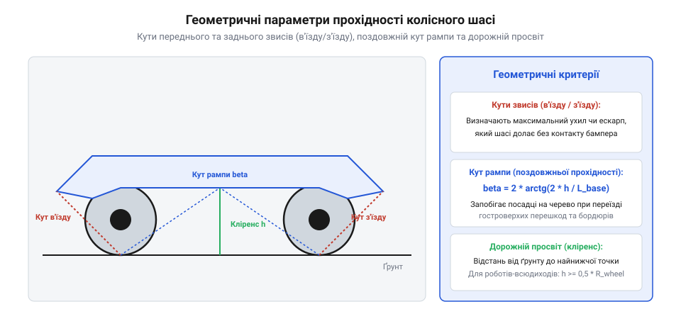
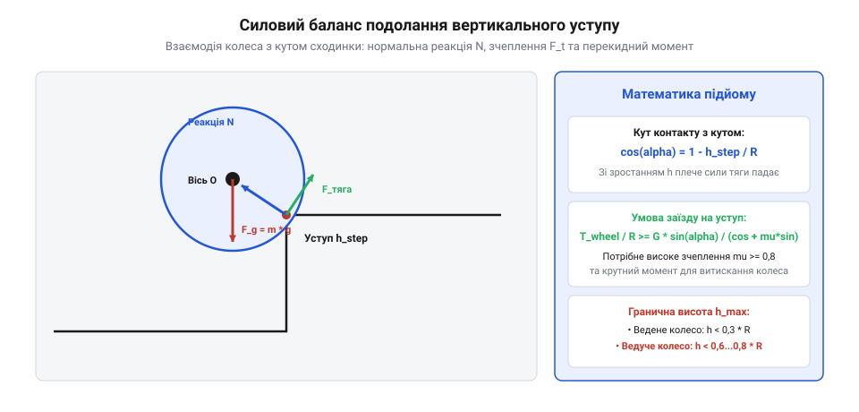
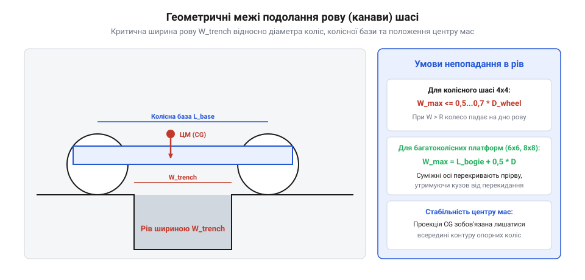

# Геометрична прохідність шасі: подолання сходинок, ровів та кліренс

## Геометричні параметри профільної прохідності мобільного робота

Геометрична прохідність мобільного робота визначає його здатність пересуватися пересіченою місцевістю без контакту корпусу, днища та захисних кожухів із поверхнею ґрунту або перешкодами. Будь-який механічний контакт рами з перешкодою призводить до вивішування рушіїв, різкої втрати сили тяги або механічного пошкодження агрегатів. Геометричні обмеження шасі закладаються на етапі компонування і є абсолютними: потужність двигунів чи крутний момент редукторів не здатні скомпенсувати геометричну посадку шасі «на черевце».



Профільна прохідність колісних та гусеничних шасі описується чотирма ключовими геометричними величинами:

1. **Кут переднього звису (кут в'їзду, @@en|approach angle@@) `α_app`**. Кут між площиною опорної поверхні та дотичною площиною до передніх коліс, що проходить через найнижчу виступаючу точку переднього бампера чи навісного обладнання. Визначає максимальний нахил схилу, канави чи висоту уступу, до якого робот може під'їхати без упору корпусом.
2. **Кут заднього звису (кут з'їзду, @@en|departure angle@@) `α_dep`**. Аналогічний кут між опорною площиною і дотичною до задніх рушіїв через крайні задні точки рами. Запобігає заклинюванню корми при з'їзді з крутих уступів чи виході з ярів.
3. **Поздовжній кут рампи (кут поздовжньої прохідності / перекату, @@en|breakover angle@@) `γ_ramp`**. Двогранний кут між площинами, дотичними до передніх і задніх рушіїв та найнижчої точки днища всередині колісної бази. Визначає максимальну гостроту перегину гребеня пагорба, який платформа долає без контакту днища.
4. **Дорожній просвіт (кліренс, @@en|ground clearance@@) `h_clear`**. Найменша вертикальна відстань від опорної площини до нижньої точки днища, мостів чи підвіски робота.

```
               2 · h_clear
tan(γ_ramp / 2) = -----------
                 L_base

де:
  γ_ramp  = поздовжній кут рампи [рад або градуси]
  h_clear = дорожній просвіт (кліренс) [м]
  L_base  = поздовжня колісна база платформи [м]
```

При зменшенні бази `L_base` або збільшенні кліренсу `h_clear` кут рампи зростає, покращуючи здатність переїзду через колоди та верхівки валів. Якщо робот атакує пагорб із радіусом заокруглення вершини `R_crest`, умова непосадки на днище записується через мінімальний радіус поздовжньої прохідності: `R_crest ≥ L_base² / (8 · h_clear)`.

Особливий інтерес становить залежність поздовжнього кута рампи від наявності проміжної середньої осі у колісних формулах 6×6 та 8×8. У класичній двовісній платформі 4×4 найнижча точка днища розташовується посередині бази `L_base / 2`. У трьохвісному шасі 6×6 середня вісь розбиває базу на два коротших міжосьових інтервали `L_1` та `L_2`. Якщо середня вісь не має достатнього вертикального ходу підвіски, при переїзді гострого гребеня пагорба робот зависає виключно на середніх колесах, втрачаючи контакт крайніх передніх і задніх рушіїв з ґрунтом (ефект балансирних гойдалок). Розрахунковий кут рампи для кожної пари осей обчислюється як:

```
tan(γ_ramp_12 / 2) = 2 · h_clear / L_1
```

Оскільки `L_1 ≈ L_base / 2`, геометричний кут перекату формально зростає майже вдвічі, проте для збереження сили тяги середня підвіска повинна забезпечувати вертикальний артикуляційний хід не менше `±0.5 · h_clear`.

Вплив внутрішнього тиску повітря в шині на взаємодію колеса з уступом змінює жорстку геометрію контакту. При зниженні тиску в еластичній шині низького тиску радіальна деформація протектора притискає гуму до грані сходинки, формуючи конформний охоплюючий контакт. Ефективний радіус колеса дещо зменшується (`R_eff = R_wheel - Δz_def`), проте площа зчеплення зростає в рази. Реакція опори перестає бути точковою і розподіляється по дузі кута:

```
θ_step_eff = arccos | 1 - (h_step - Δz_def) / R_wheel |
```

Шина буквально «обтікає» гострий камінь, збільшуючи локальний коефіцієнт зчеплення `μ` до 1.0–1.2, що дозволяє впевнено штурмувати уступи, які для жорсткого сталевого колеса того самого діаметра були б нездоланними.

### Динамічна зміна кліренсу та кутів звису під дією підвіски

У статичному стані геометричні параметри шасі розраховуються для номінального спорядженого положення кузова на рівній горизонтальній площині. Проте в динаміці руху по нерівностях реальний кліренс `h_clear(t)` та кути звису є неперервно змінними функціями від кинематичних переміщень підвіски, поздовжнього та поперечного крену кузова:

```
h_clear_dyn(t) = h_clear_0 - Δz_pitch(t) - Δz_susp(t) - Δz_tire(t)
```

де:
  `h_clear_0` = номінальний статичний дорожній просвіт [м];
  `Δz_pitch(t)` = просідання носової чи кормової частини рами внаслідок кутового розгойдування (Pitch motion) [м];
  `Δz_susp(t)` = динамічний прогин пружинно-демпферних елементів підвіски під дією інерційних сил [м];
  `Δz_tire(t)` = радіальна пружна деформація шини низького тиску під піковим вертикальним навантаженням [м].

Під час екстреного гальмування перед перешкодою інерційна сила уповільнення `F_in = m_veh · a_brake` створює поздовжній диферент (клювок носом), який стискає передню підвіску:

```
                  m_veh · a_brake · h_cog
Δθ_dive = -------------------------------------------
            K_susp_front · L_front + K_susp_rear · L_rear
```

Для типового колісного робота масою 200 кг при уповільненні `a_brake = 4 м/с²` динамічний кут диференту `Δθ_dive` може досягати 4–6 градусів. Це призводить до миттєвого зменшення кута переднього звису на 30–40% (`α_app_dyn = α_app_0 - Δθ_dive`) та зменшення кліренсу під переднім бампером на 40–70 мм. Якщо в цей момент шасі наближається до крутого насипу чи сходинки, робот врізається бампером або захисною пластиною днища в перешкоду ще до того, як колеса торкнуться її основи.

Аналогічний ефект спостерігається на гребені пагорба: коли передня вісь перетинає верхівку і починає спускатися вниз, а задня продовжує підніматися, поздовжній кут зламу рельєфу накладається на динамічне просідання підвіски в середній частині бази. Небезпека посадки днищем на гребінь (ефект сідла @@en|high-centering / belly grounding@@) описується тривимірною поверхнею безпечного просвіту днища `z_belly(x, y)`:

```
z_belly(x) >= h_clear_0 - ( (x - L_front) / L_base ) · (z_front_susp - z_rear_susp)
```

Щоб запобігти посадці на черевце у високоманеврених польових платформах, застосовують активну гідропневматичну або важільну сервопідвіску зі змінним дорожнім просвітом (Active Ride Height Control), яка перед штурмом валів автоматично піднімає раму на 50–100 мм, збільшуючи поздовжній кут рампи `γ_ramp` на 8–15 градусів.

### Централізоване регулювання тиску в шинах (CTIS) та площа плями контакту

Для важких колісних робототехнічних комплексів критичним фактором подолання перешкод є адаптація плями контакту рушія через централізовану систему регулювання тиску в шинах (Central Tire Inflation System — CTIS). При зниженні надлишкового внутрішнього тиску з 250 кПа (режим твердого асфальту) до 50–70 кПа (режим глибокого піску та снігу) радіальний прогин шини зростає в 2.5–3 рази.

Площа відбитка протектора `A_patch` розширюється за наближеною еліптичною формулою:

```
A_patch ≈ π · a_contact · b_contact ≈ ( W_wheel / P_tire_internal ) · K_carcass
```

де `K_carcass` — коефіцієнт жорсткості корду шини (типово `K_carcass = 1.1...1.3`).

Збільшення площі плями контакту в поздовжньому напрямку трансформує взаємодію колеса з гребенями та сходинками: протектор буквально охоплює нерівність рельєфу, зменшуючи локальний кут атаки перешкоди та знижуючи пікові тиски на ґрунт нижче критичної межі плинності. Одночасно сумарний коефіцієнт зчеплення `μ_traction` на сипучих поверхнях зростає на 40–60%, дозволяючи машині впевнено долати затяжні піщані підйоми з крутизною до 30 градусів, де колеса високого тиску неминуче закопуються за кілька секунд.

## Механіка подолання вертикального уступу

Подолання вертикальної сходинки або стінки — базове випробування для мобільного наземного робота (UGV). Коли переднє колесо упирається в кут вертикального уступу заввишки `h_step`, точка контакту зміщується з нижньої ділянки протектора вперед і вгору. Лінія дії нормальної реакції опори `N_step` проходить через кут сходинки та геометричний центр колеса радіусом `R_wheel`.



Кут між лінією контакту та вертикаллю визначається виключно відношенням висоти уступу до радіуса колеса:

```
            /          h_step  θ_step = arccos | 1 - -------- |
            \         R_wheel  /
```

Силовий баланс у момент відриву колеса від нижньої опорної площини показує критичні умови штурму перешкоди:

```
F_tr · R_wheel · cos(θ_step) + μ_step · N_step · R_wheel ≥ W_wheel · R_wheel · sin(θ_step)

де:
  F_tr    = дотична сила тяги привода колеса [Н]
  N_step  = нормальна реакція в точці контакту з кутом [Н]
  μ_step  = коефіцієнт тертя зчеплення колеса з кромкою сходинки [-]
  W_wheel = вертикальне навантаження на вісь колеса [Н]
```

Звідси випливає фундаментальне геометричне та фрикційне обмеження: якщо висота сходинки перевищує радіус колеса (`h_step ≥ R_wheel`), кут контакту стає `θ_step ≥ 90°`. У цьому положенні нормальна реакція спрямована суворо горизонтально назад або навіть притискає колесо вниз. Обертання колеса вперед намагається заштовхнути робота під сходинку, і подолання стає неможливим без допоміжних важелів-фліпперів чи наїзду під кутом. Навіть при `h_step < R_wheel`, якщо `tan(θ_step) > μ_step`, колесо безпорадно буксує на грані, шліфуючи кут без висхідного підйому. Для надійного штурму сходинки без заклинювання гранична висота уступу традиційного жорсткого шасі зазвичай не перевищує `(0.5...0.7) · R_wheel`.

### Порівняльний аналіз повноприводних та моноприводних схем при штурмі уступу

Механіка взаємодії колеса з вертикальним уступом кардинально відрізняється залежно від того, які саме колеса шасі є ведучими:

1. **Передній привод (FWD)**. Ведуче переднє колесо притискається до кута сходинки і завдяки прикладеному крутному моменту `T_drive` генерує тягове зусилля `F_tr`, спрямоване вгору по дотичній до протектора. Колесо буквально затягує саме себе на сходинку, піднімаючи передню частину рами.
2. **Задній привод (RWD)**. Неприводне переднє колесо упирається в грань уступу як пасивний каток. Задня ведуча вісь штовхає платформу вперед із зусиллям `F_push`. На куті сходинки виникає нормальна реакція `N_step`, яка розкладається на горизонтальну гальмівну силу та вертикальну силу, що намагається підняти колесо. Проте за відсутності крутного моменту на передньому колесі єдиною силою підйому є реакція від зусилля штовхання:
   ```
   F_lift_passive = F_push · cot(θ_step) - μ_step · N_step
   ```
   Якщо кут контакту `θ_step > 45°` (що відповідає висоті сходинки `h_step > 0.3 · R_wheel`), котангенс `cot(θ_step)` падає нижче одиниці, і необхідне зусилля штовхання від задніх коліс стрімко прямує до нескінченності. Задні колеса зриваються в буксування, а переднє пасивне колесо намертво заклинюється на грані уступу.
3. **Повний привод усіх коліс (AWD / 4×4, 6×6)**. Забезпечує оптимальну синергію: передні колеса створюють підйомну дотичну тягу, а задні підтримують постійне штовхальне зусилля вперед, запобігаючи відкату платформи.

### Двоетапна динамічна модель переїзду уступу

Повний процес подолання вертикальної сходинки мобільним роботом складається з двох послідовних кінематичних фаз:

**Фаза 1: Підйом передньої осі на уступ**. У момент первинного торкання грані кінетична енергія поступального руху платформи масою `m_veh` перетворюється на роботу підйому центра мас на висоту `h_step`. Якщо під'їзд здійснюється з початковою швидкістю `v_0`, рівняння збереження енергії з урахуванням втрат на пружний удар шини записується як:

```
0.5 · m_veh · v_0² · (1 - e_impact²) + ∫ (T_drive_f / R_wheel + F_push_r) ds >= m_veh · g · Δh_cog_1
```

де `e_impact` — коефіцієнт відновлення швидкості при ударі протектора об бетон (для гуми `e_impact ≈ 0.3...0.5`). Динамічний наскок дозволяє долати сходинки, висота яких на 20–30% перевищує статичний ліміт зачеплення, проте породжує ударні перевантаження в підшипниках та редукторах до 5–10 g.

**Фаза 2: Підтягування задньої осі**. Після того, як передні колеса виїхали на верхній майданчик сходинки, рама робота нахиляється на кут диференту `θ_pitch = arcsin(h_step / L_base)`. Проекція центра мас зміщується назад, сильно довантажуючи задні колеса. Коли задня вісь упирається в нижній кут сходинки, нормальна сила на передніх колесах `N_front` різко зменшується. Передні ведучі колеса повинні розвинути достатню силу зчеплення на верхній площині, щоб затягти корму робота:

```
μ_front · N_front_top >= W_rear_effective · sin(θ_step_rear) - F_traction_rear
```

Якщо верхній майданчик сходинки слизький (мокрий бетон, лід, бруд із `μ_front < 0.3`), передні колеса починають пробуксовувати на верхній кромці, а задні безпорадно буксують внизу — робот зависає в похилому положенні під кутом `θ_pitch`.

## Стійкість проти перекидання при підйомі

Під час руху робота по похилих поверхнях та подолання крутих насипів критичним фактором безпеки стає статична та динамічна стійкість проти перекидання навколо осей опорних рушіїв. Розподіл нормальних сил реакції опори між передніми `N_f` та задніми `N_r` колесами (або ділянками гусеничного обводу) безпосередньо залежить від кута нахилу схилу `α_slope` та просторового положення центра мас (CoG) машини:

```
            W · [ L_rear · cos(α_slope) - h_cog · sin(α_slope) ]
N_front = --------------------------------------------------------
                                   L_base

            W · [ L_front · cos(α_slope) + h_cog · sin(α_slope) ]
N_rear  = --------------------------------------------------------
                                   L_base

де:
  W        = повна вага мобільного робота [Н]
  L_front  = поздовжня відстань від осі передніх коліс до центра мас [м]
  L_rear   = поздовжня відстань від осі задніх коліс до центра мас [м]
  L_base   = повна поздовжня колісна база (L_base = L_front + L_rear) [м]
  h_cog    = висота центра мас над опорною поверхнею [м]
  α_slope  = кут підйому схилу [рад]
```

Зі збільшенням кута підйому `α_slope` сила реакції передніх опор `N_front` неухильно зменшується через дію перекидаючого моменту гравітаційної сили `W · h_cog · sin(α_slope)`. Критичний статичний кут перекидання назад `α_crit` настає в момент повного відриву передніх рушіїв від ґрунту (`N_front = 0`):

```
                  L_rear
tan(α_crit) = ------------
                  h_cog
```

Якщо кут підйому перевищує `α_crit`, робот неминуче завалюється назад на дах. У реальних умовах перекидання трапляється при значно менших кутах через динамічні чинники: різке прискорення рушіїв породжує інерційний момент `m · a_x · h_cog`, а наїзд задніми колесами на невеликий камінь миттєво довертає кузов. Для запобігання аваріям важкі польові платформи проектують із низьким розташуванням батарейного відсіку (мінімізація `h_cog`) та зміщенням баласту вперед або застосовують активні рухомі противаги.

Динамічна модель перекидання робота при підйомі на крутий схил повинна враховувати не лише статичне положення центра мас, але й кутове прискорення повороту коліс при зриві та відновленні зчеплення. Якщо робот буксує на сипучому ґрунті підйому, а потім ведучі колеса раптово зачіпляються за виступаючий скельний моноліт, реактивний момент обертання коліс `T_traction` прикладається до рами платформи у напрямку перекидання назад:

```
I_pitch · d²θ_pitch/dt² = T_traction_total - W · [ L_rear · cos(α_slope) - h_cog · sin(α_slope) ]

де:
  I_pitch          = поздовжній момент інерції всього робота відносно осі задніх коліс [кг·м²]
  d²θ_pitch/dt²    = кутове прискорення перекидання корпусу назад [рад/с²]
  T_traction_total = сумарний крутний момент на задніх колесах [Н·м]
```

Якщо привід коліс розвиває максимальний пусковий момент, динамічне перекидання може статися навіть на пологому схилі (`α_slope << α_crit`). Тому високошвидкісні бортові контролери оснащуються алгоритмом протидії підніманню носа (Anti-Wheelie Control), який за показами гіроскопа диференту миттєво обмежує крутний момент двигунів при загрозі відриву передньої осі.

Кінематичні умови переїзду ровів гусеничним шасі мають значну перевагу завдяки винесенню переднього напрямного колеса (лінивця) вперед і вгору. Якщо передній лінивець має великий діаметр (`D_idler ≥ 0.5 · H_chassis`) і піднятий над опорною площиною під кутом нахилу передньої гілки `α_front_track = 30...45°`:

```
W_ditch_max_tracked = L_ground_contact + R_idler · [ 1 + sin(α_front_track) ]
```

Коли передня частина гусениці зависає над траншеєю, похила гілка гусениці не провалюється в порожнечу, а плавно ковзає по дальньому краю рову, підтягуючи машину вперед. Гусениця працює як власний самонавідний міст, дозволяючи долати рови, ширина яких сягає до 50–70% від повної довжини корпусу робота.

### Просторовий критерій динамічної стійкості проти перекидання (FASM)

В умовах пересування пересіченою місцевістю робот зазнає одночасного впливу поздовжнього та поперечного нахилів схилу, комбінованих із динамічними прискореннями від нерівностей рельєфу. Для оцінки ризику перекидання використовують узагальнений показник стійкості за силовим кутом (Force-Angle Stability Margin — FASM).

Розглянемо багатокутник опорних точок контакту рушіїв із землею `P_i = [x_i, y_i, z_i]^T` (`i = 1...n`). Кожне ребро між сусідніми опорними точками `P_i` та `P_i+1` утворює потенційну вісь перекидання `p_hat_i`.

Результуючий вектор сил, що діє на центр мас робота, складається з сили ваги та динамічних сил інерції:

```
F_total = m_veh · ( g_vector - a_linear_cog )
```

а результуючий вектор моментів:

```
M_total = - I_body · dω_body/dt - ω_body × (I_body · ω_body)
```

Кут запасу стійкості відносно i-ї осі перекидання `β_margin_i` визначається як кут між вектором результуючої сили `F_total` та нормаллю до площини, що проходить через вісь перекидання та центр мас:

```
β_margin_i = arccos | ( F_total · n_plane_i ) / || F_total || |
```

Якщо `β_margin_i > 0` для всіх осей, шасі зберігає статико-динамічну рівновагу. Якщо кут наближається до нуля (`β_margin_i -> 0`), настає відрив опорних коліс протилежного борту або осі.

### Терамеханічний зрив ґрунту на схилі (Slip-Sinkage)

При подоланні крутих схилів із сипучим або пластичним ґрунтом (сухий пісок, вологий суглинок, сніг) граничний кут підйому обмежується не геометричним перекиданням, а фрикційно-зсувним руйнуванням опорного ґрунтового масиву під рушіями.

Згідно з терамеханічною моделлю Вонга (Wong), дотична сила тяги, що передається від колеса до ґрунту, супроводжується локальним зсувом часток ґрунту. Відносне ковзання колеса (буксування `i_slip`) викликає додаткову осадку рушія внаслідок вигрібання ґрунту з-під плями контакту (буксувальне занурення @@en|slip-sinkage effect@@):

```
z_sink_slip = z_sink_static · ( 1 + c_slip_sink · i_slip )
```

де `c_slip_sink` — безрозмірний коефіцієнт буксувальної осадки (для піску `c_slip_sink ≈ 1.2...2.5`).

Коли кут нахилу схилу `α_slope` перевищує граничний кут внутрішнього тертя ґрунту `φ_soil`, паралельна до схилу складова сили ваги `m · g · sin(α_slope)` перевищує зсувну міцність пласта. Колеса починають буксувати, викликаючи лавиноподібне занурення рушіїв у ґрунт: за лічені секунди глибина колії сягає величини кліренсу `h_clear`, корпус робота лягає днищем на схил, а сила тяги падає до нуля.

## Подолання ровів і канав

Перетин ровів, траншей, тріщин у твердому покритті та розпадин є другим класичним геометричним бар'єром. При спробі переїзду через рів завширшки `W_ditch` передні рушії втрачають опорний контакт, опиняючись у повітрі над прірвою. Робот перетворюється на консольну балку, що спирається на край рову задніми опорними точками.

Граничні умови переїзду рову визначаються двома сценаріями:

1. **Умова вивішування за центром мас (статичний провал передньої осі)**. Щоб передні колеса досягли протилежного берега рову без клевка носом униз, проекція загального центра мас платформи повинна залишатися позаду точки контакту задніх рушіїв із ближнім краєм траншеї до моменту торкання передніми колесами дальньої кромки. Для повноприводного жорсткого колісного шасі гранична ширина рову без скочування становить:
   ```
   W_ditch_max ≈ L_base - L_front = L_rear
   ```
2. **Геометрія клинового застрягання колеса в рові**. Якщо колесо радіусом `R_wheel` провалюється в канаву, ширина якої менша за діаметр (`W_ditch < 2 · R_wheel`), воно спирається на дві гострі кромки стінок траншеї. Кут між нормальними реакціями крайок створює самозаклинюючий ефект «ножиць», виштовхнути колесо з якого вимагає розвинення коефіцієнта зчеплення `μ > 1.2...1.5`, що перевищує можливості звичайних шин.

```
       [Ближній берег]        W_ditch        [Дальній берег]
              |                                     |
              +---------------\           /---------+
                               \         /
                                [Колесо] (заклин між кромками)
```

Багатоколісні схеми 6×6 та 8×8 з незалежною балансирною підвіскою кардинально перевершують чотириколісні платформи: коли перша вісь зависає над ровом, друга та третя осі надійно утримують раму в горизонтальному положенні, дозволяючи переднім колесам безперешкодно лягти на протилежний схил.



### Механіка сколювання кромки рову та призми обвалення ґрунту

Коли колесо робота наближається до краю рову чи траншеї, напружений стан ґрунту кардинально відрізняється від руху по безкраїй рівнині. На краю укосу відсутній бічний підпір ґрунтового масиву, тому несуча здатність ґрунту стрімко знижується.

Під вертикальним навантаженням від колеса `N_wheel` біля кромки траншеї формується ковзна поверхня зсуву — клиноподібна призма обвалення (призма Пастера–Ренкіна @@en|Coulomb failure wedge@@). Зсувні напруження вздовж поверхні ковзання описуються критерієм граничної рівноваги:

```
τ_shear_plane = c_soil + σ_normal_plane · tan(φ_soil)
```

Критична відстань від осі колеса до краю рову `x_edge_crit`, на якій ґрунт витримує навантаження без раптового сколювання стінки, становить:

```
x_edge_crit = z_contact · tan( 45° - φ_soil / 2 ) · [ 1 + (N_wheel / (γ_soil · b_wheel · z_contact²)) ]
```

де:
  `γ_soil` = об'ємна вага ґрунту [Н/м³];
  `b_wheel` = ширина протектора колеса [м];
  `z_contact` = глибина деформації кромки [м].

Якщо колесо під'їжджає ближче ніж `x_edge_crit`, кромка рову миттєво обвалюється під вагою машини, колесо зривається в траншею, а робот зазнає жорсткого удару об протилежну стінку або перевертається на бік.

### Фазові стадії перетину траншеї багатоколісним шасі

Для багатовісних платформ із формулою 6×6 та 8×8 переїзд рову завширшки `W_ditch` розбивається на три чіткі кінематичні фази:

1. **Фаза консольного зависання першої осі**. Перша вісь виходить за межі ближнього берега рову. Опорні реакції повністю сприймаються другою та третьою осями. Щоб платформа не опустила ніс нижче рівня протилежного берега рову, поздовжнє положення центра мас має задовольняти нерівність статики:
   ```
   L_cog_from_rear > W_ditch · [ m_veh / (m_veh - m_front_axle) ]
   ```
2. **Фаза мостового заклинювання (міст між берегами)**. Передня вісь лягає на протилежний берег, у той час як друга вісь зависає над центром рову. У цей момент рама робота працює як триточкова або чотириточкова балка моста. Згинальний момент на рамі досягає абсолютного максимуму:
   ```
   M_frame_bending_max = (W_veh / 4) · W_ditch
   ```
   Якщо жорсткість рами недостатня, пластичний прогин рами призводить до удару акумуляторного відсіку об дно канави.
3. **Фаза виходу кормової осі**. Задня вісь перетинає рів, підтягуючись передніми та проміжними рушіями, що надійно закріпилися на твердій площині.

## Інженерне компонування шасі високої прохідності

Для досягнення екстремальної профільної прохідності в конструкції мобільних наземних роботів (UGV) застосовують комплекс спеціальних інженерних компонувальних рішень, спрямованих на виключення сліпих геометричних зон і розширення діапазону доланих перешкод:

1. **Компонування рушіїв «по кутах периметра» (Zero-overhang chassis)**. Осі крайніх передніх і крайніх задніх коліс виносяться максимально вперед і назад за межі силової рами робота. При цьому бампери, акумуляторні відсіки та сенсорні голови розташовуються суворо всередині колісної бази. Це забезпечує теоретично граничні кути в'їзду та з'їзду `α_app ≈ α_dep ≈ 90°`, дозволяючи роботу упиратися колесами безпосередньо у вертикальну стінку без контакту корпусу.
2. **Формування гладкого V-подібного або лижоподібного днища («черева»)**. Нижня площина шасі закривається суцільними броньованими листами з надвисокомолекулярного поліетилену (UHMW-PE) або титаново-алюмінієвих сплавів без виступаючих головок болтів, кронштейнів підвіски чи карданів. При вивішуванні коліс на гребені пагорба робот не чіпляється за каміння, а ковзає по днищу, як санки, зберігаючи здатність сповзти назад або вперед за рахунок обертання вільних рушіїв.
3. **Шарнірно-зчленовані та адаптивні рами (Articulated / Rocker-Bogie chassis)**. Замість жорсткої рами шасі розділяється на дві або три секції, з'єднані керованими або пасивними шарнірами з торсійними приводами (як у марсоходах NASA Curiosity / Perseverance або дослідницьких роботах-зміях):
   - Пасивна балансирна кінематика типу Rocker-Bogie підтримує постійний нормальний контакт усіх 6 коліс із землею без пружин, піднімаючи корпус над перешкодою вдвічі вище радіуса коліс.
   - Активний поперечний та поздовжній шарнір зчленування секцій дозволяє передній секції «задирати ніс» перед високим уступом, закидаючи колеса на сходинку, після чого задня секція підтягується потужним гідравлічним чи електричним домкратом.
4. **Допоміжні керовані гусеничні важелі (фліппери @@en|flippers@@)**. По бортах основної гусениці встановлюються поворотні важелі з незалежними сервомоторами. Повертаючись на 360°, фліппери збільшують ефективну опорну базу робота, піднімають ніс на висоту сходинки понад `2.0 · R_wheel` і запобігають завалюванню назад при штурмі сходів із кутом підйому до 45°.

```
Схема UGV із фліпперами при штурмі сходів:
     [Фліппер під кутом]                           \___ [Корпус UGV] ___
                                               \ [Задній фліппер-упор]
  ================== Сходинка ==================
```

Інженерний розрахунок сервопривода допоміжних поворотних важелів (фліпперів) базується на найважчому статичному режимі — виважуванні повної маси робота при переході через вертикальний уступ. У критичній точці штурму сходинки основні колеса шасі відриваються від нижньої поверхні, і вся вага машини `W = m · g` спирається виключно на крайку сходинки через кінцеві ролики двох передніх фліпперів довжиною `L_flipper`.

Крутний момент шарніра фліппера `T_flipper` повинен долати плече сили ваги відносно осі обертання важеля:

```
T_flipper_req = K_dyn_flipper · (W / 2) · [ L_flipper · cos(α_flipper) + L_cog_proj ]

де:
  K_dyn_flipper = динамічний коефіцієнт безпеки при упорі в перешкоду (K_dyn ≈ 1.5...1.8) [-]
  W             = повна вага мобільного робота [Н]
  L_flipper     = довжина важеля фліппера від осі шарніра до кінцевого ролика [м]
  α_flipper     = кут нахилу важеля фліппера до горизонту в момент підйому [рад]
  L_cog_proj    = горизонтальна відстань від осі шарніра до проекції центра мас платформи [м]
```

Оскільки довжина фліппера зазвичай становить 0.3–0.5 м, а маса робота 50–100 кг, необхідний крутний момент на осі шарніра сягає 150–400 Н·м. Для забезпечення таких моментів у компактному циліндричному габариті застосовують двоступеневі планетарні редуктори або безлюфтові хвильові передачі (Harmonic Drive) з передавальним числом `N = 80...160` у комбінації з безколекторними синхронними двигунами високого моменту, оснащеними електромагнітними стоянковими гальмами для утримання позиції без споживання струму.

### Математична модель кінематики Rocker-Bogie

Легендарна архітектура підвіски Rocker-Bogie (розроблена NASA для марсоходів Sojourner, Spirit, Opportunity, Curiosity, Perseverance) є золотим стандартом непідресорених пасивних шасі екстремальної геометричної прохідності. Вона забезпечує постійний контакт усіх шести коліс із нерівною опорною поверхнею без використання пружин, що виключає накопичення пружної енергії та усуває розгойдування кузова.

Підвіска складається з двох основних важелів з кожного борту:
- **Коромисло (Rocker)** — великий важіль, шарнірно закріплений на корпусі робота;
- **Візок (Bogie)** — менший важіль, шарнірно з'єднаний із переднім кінцем коромисла. Візок несе два колеса (переднє та середнє), а задній кінець коромисла несе одне заднє колесо.

Обидва бортові коромисла з'єднані між собою через кузов за допомогою поперечного диференціального механізму (диференціальної штанги або конічної передачі). Кут диференту корпусу `θ_body` є суворо середнім арифметичним кутів повороту лівого `θ_rocker_L` та правого `θ_rocker_R` коромисел:

```
θ_body = 0.5 · ( θ_rocker_L + θ_rocker_R )
```

Коли ліве колесо наїжджає на високу кам'яну сходинку заввишки `h_obs`, ліве коромисло піднімається на кут `Δθ_L`. Диференціал змушує праве коромисло повернутися у протилежному напрямку на кут `Δθ_R = - Δθ_L`. Завдяки цьому корпус робота зазнає вдвічі меншого нахилу (`Δθ_body = 0.5 · Δθ_L`), а навантаження на всі 6 коліс залишається квазірівномірним:

```
N_i ≈ W_veh / 6 ± ΔN_geom(h_obs / L_base)
```

Це дозволяє шасі Rocker-Bogie долати перешкоди, висота яких у 1.5–2.0 рази перевищує діаметр коліс (`h_obs <= 2 · R_wheel`), що принципово недосяжно для будь-якої класичної важільної підвіски з пружинами.

### Керування ходою та динамікою UGV з активними фліпперами

Для гусеничних роботів із чотирма незалежними фліпперами (два передніх, два задніх) подолання складних міських урбаністичних бар'єрів (сходи, високі бетонні парапети) реалізується через багатокроковий скінченний автомат ходи (Finite State Machine — FSM):

1. **Фаза зближення (Approach)**. Передні фліппери піднімаються вгору на кут `+45°`, звільняючи передній сектор огляду лідарів та камер.
2. **Фаза захоплення (Grip & Lift)**. При контакті зі сходинкою передні фліппери опускаються на верхній майданчик уступу під кутом `-30°`. Сервомотори шарнірів створюють максимальний крутний момент, піднімаючи ніс робота та переводячи корпус на похилу траєкторію.
3. **Фаза основного заїзду (Track Climb)**. Основні гусениці контактують із ребрами сходинок. Задні фліппери повертаються в положення «хвоста-опори» (`-45°`), збільшуючи ефективну колісну базу в 1.8 раза та запобігаючи завалюванню машини назад при перевищенні кута нахилу сходів у 35 градусів.
4. **Фаза перекату через верхівку (Transition)**. Коли центр мас перетинає верхній уступ, передні фліппери витягуються строго горизонтально вперед (`0°`), запобігаючи різкому удару днища об горизонтальну підлогу сходового майданчика.

```
Скінченний автомат конфігурацій фліпперів:
[Approach] -> [Touch Sensor] -> [Lift Front] -> [Stair Climb (Tail Support)] -> [Top Crest Landing]
```

Автоматизація кутів нахилу фліпперів за даними бортового IMU та глибинних 3D-камер ліквідує людський фактор дистанційного оператора, скорочуючи час подолання перешкод у польових умовах у 3–4 рази.
