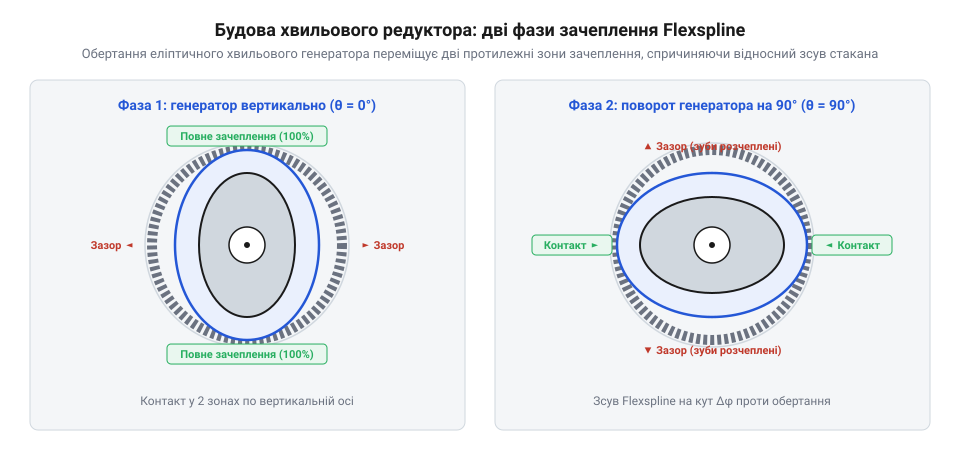
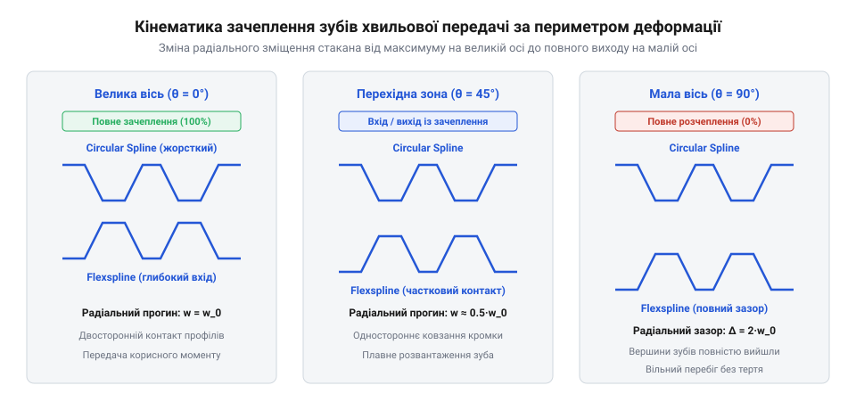
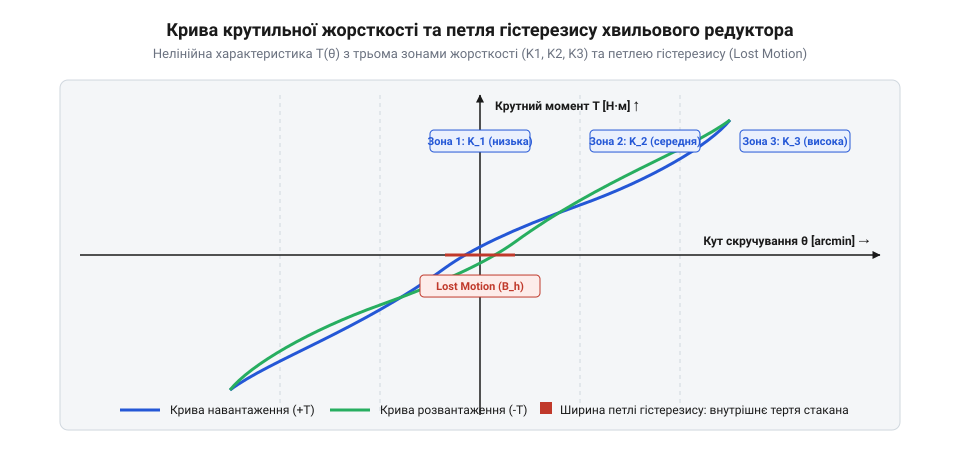
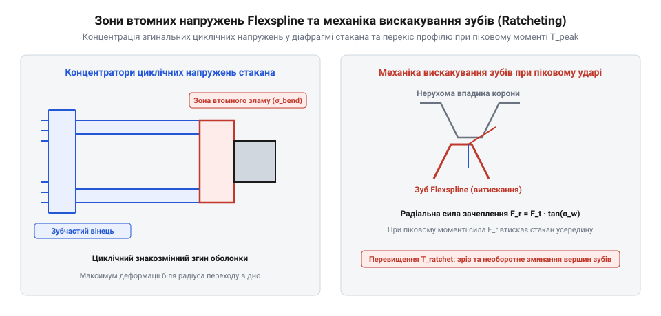

# Хвильова передача

<preknowlist>
- [Редуктори](root:hw-motion/gears-transmission) — передавальне число, момент і поняття кутового люфту
- [Мотор-редуктор](root:hw-motion/gearmotor) — проблеми інтеграції редуктора з прецизійними двигунами
</preknowlist>

## Фізичний принцип хвильової деформації та три базові ланки

У прецизійному машинобудуванні та робототехніці конструктор стикається з фундаментальною суперечністю класичних зубчастих передач. Щоб отримати високе передавальне число (наприклад, 100:1) у звичайному [редукторі](root:hw-motion/gears-transmission), необхідно послідовно з'єднати кілька циліндричних ступенів або використати багатоступеневий [планетарний редуктор](root:hw-motion/planetary-gearbox). Проте кожен новий зубчастий контакт неминуче додає власний бічний зазор. Сумарний мертвий хід (люфт) багатоступеневого редуктора сягає десятків кутових мінут. На кінці півтораметрової руки робота-маніпулятора такий люфт перетворюється на коливання інструмента амплітудою в кілька міліметрів, унеможливлюючи точне зварювання, складання електроніки або хірургічні операції. Вибіркові схеми вибірки люфту пружинами або розрізними шестернями різко збільшують тертя, знос і габарити.

Хвильова передача (Strain Wave Gearing) повністю відкидає концепцію абсолютно жорсткого контакту шестерень. Замість взаємодії двох твердих коліс обертання та редукція реалізуються через неперервну пружну хвилю деформації тонкостінної металевої оболонки.

Механізм складається рівно з трьох співвісних ланок:
1. **Хвильовий генератор (Wave Generator, WG)** — вхідний елемент. Складається з жорсткої профільованої маточини овальної (еліптичної) форми та спеціального тонкостінного кулькопідшипника з гнучкими обоймами. При насадженні підшипника на овал його зовнішнє кільце пружно набуває форми еліпса.
2. **Гнучке колесо (Flexspline, FS)** — тонкостінний склянкоподібний стакан із пружної високолегованої сталі, на відкритому вінці якого нарізано зовнішні зуби. Дно стакана переходить у маточину, яка кріпиться до вихідного вала. Хвильовий генератор вставляється всередину стакана flexspline, пружно деформуючи його циліндричну форму в овал.
3. **Жорстке колесо (Circular Spline, CS)** — масивне жорстке кільце з внутрішніми зубами того ж модуля, зафіксоване в нерухомому корпусі приводу.

При установці овального генератора всередину flexspline стакан розтягується вздовж великої осі еліпса. Зуби гнучкого колеса на вершинах цієї осі повністю входять у зачеплення із зубами нерухомого вінця circular spline на всю робочу висоту. Вздовж малої осі еліпса flexspline стискається досередини, і зуби повністю виходять із контакту з великим радіальним зазором. У проміжних секторах зуби плавно входять і виходять із зачеплення. Конструктивні варіанти виконання — від глибоких чашок до надплоських млинцевих пакетів — розглядає вставка [топології хвильових редукторів](root:hw-motion/harmonic-drive/comp-harmonic-drive-topologies.md).

Щоб зрозуміти кінематику та надійність хвильової передачі, необхідно розглянути фізику деформації гнучкого стакана flexspline як тонкостінної пружної циліндричної оболонки.

У вільному ненавантаженому стані flexspline є ідеальним тонкостінним циліндром з радіусом серединної поверхні R і товщиною стінки h. Коли всередину склянки запресовується хвильовий генератор з еліптичним профілем кулачка, кругла форма поперечного перерізу примусово деформується в овал. Радіальне переміщення точок стінки описується гармонійною залежністю від полярного кута φ:

w(φ) = w_0 · cos(2φ)

де амплітуда радіального прогину w_0 точно дорівнює різниці півосей кулачка і відповідає розрахунковій глибині зачеплення зубів: w_0 = (a - b) / 2 = m (де m — радіальний модуль зубчастого вінця).

Фундаментальною властивістю такої пружної деформації є збереження довжини нейтрального шару оболонки. Нейтральний шар — це геометрична поверхня всередині стінки стакана (приблизно на половині товщини h / 2), волокна якої при чистому згині не зазнають ані розтягування, ані стискання вздовж колової координати. Оскільки метал деформується виключно в межах пружного згину без пластичної течії, периметр нейтрального шару залишається строго постійним:

L_neutral = 2π · R = const

Проте зубчастий вінець нарізаний на зовнішній поверхні стакана, на відстані y від нейтрального шару. При згині циліндричної стінки волокна металу, розташовані зовні від нейтрального шару вздовж великої осі еліпса (де кривина максимальна), зазнають пружного розтягу. Навпаки, волокна вздовж малої осі еліпса зазнають пружного стискання. Внаслідок цього зуби flexspline при обкочуванні хвильового генератора здійснюють не лише радіальне переміщення w(φ), але й мікроскопічне тангенційне зміщення (коловий зсув) v(φ):

v(φ) = - (w_0 / 2) · sin(2φ)

Саме це тангенційне зміщення зовнішніх волокон зумовлює плавний вхід зуба в заглибину жорсткого вінця під час наближення до великої осі генератора.

Згинальні напруження у стінці стакана досягають максимальних значень у вершинах великої та малої осей кулачка. Відповідно до теорії тонких оболонок нормальне напруження згину в зовнішніх волокнах flexspline визначається виразом:

σ_bend = E · h · w_0 / (R^2 · (1 - ν^2))

де E — модуль Юнга сталі, а ν — коефіцієнт Пуассона.

Оскільки це напруження є циклічним і змінює свій знак двічі за один оберт генератора, конструктор змушений шукати компроміс: для мінімізації напружень стінку склянки прагнуть зробити якомога тоншою (h / D ≈ 0.01 ... 0.015), проте надмірно тонка стінка втрачає крутильну жорсткість і може втратити стійкість (зминатися хвилями) під дією високого крутного моменту.

Крім того, вздовж поздовжньої осі стакана деформація розподілена нерівномірно. Біля відкритого торця, де нарізані зуби, радіальний прогин максимальний (w_0), але в міру наближення до глухого дна чашки стакан стає дедалі жорсткішим. Радіальна деформація лінійно спадає до нуля на жорсткому фланці дна, надаючи деформованій склянці просторової форми конічного дзвона. Це просторове скручування стінки створює складний плоский напружений стан, де циклічний згин поєднується зі зсувними напруженнями від передаваного крутного моменту.

Окрему роль відіграє спеціальний підшипник генератора хвиль. На відміну від звичайних радіальних вальниць, його кільця тонкі й гнучкі, тому кульки перекочуються по змінній кривизні бігової доріжки. При кожному оберті сепаратор та кульки підшипника зазнають циклічного прискорення та гальмування при проходженні ділянок з різним радіусом еліпса. Це створює додаткові динамічні мікроудари та вимагає спеціального пластичного мастила з високою стійкістю до мікроковзання.

> 🔧 **Навіщо це.** Завдяки овальній формі генератора зачеплення відбувається одночасно у двох діаметрально протилежних зонах. Радіальні сили притискання зубів спрямовані назустріч одна одній і повністю компенсуються всередині конструкції, позбавляючи вихідні підшипники перекошувальних зусиль.

## Кінематика хвильового зачеплення та виведення передавального числа

Принцип редукції у хвильовій передачі базується не на відношенні радіусів коліс, як у класичній механіці, а на різниці кількості зубів між гнучким і жорстким вінцями.

Оскільки flexspline постійно деформується в овал і входить у зачеплення у двох протилежних зонах, кількість зубів жорсткого кільця Z_cs повинна бути дещо більшою за кількість зубів гнучкого стакана Z_fs. Для симетричного двовузлового генератора ця різниця завжди дорівнює подвоєному числу хвиль деформації, тобто рівно двом зубам:

Z_cs - Z_fs = 2

Коли хвильовий генератор здійснює один повний оберт на 360° за годинниковою стрілкою, велика вісь еліпса пробігає повне коло. Зони повного зачеплення зміщуються слідом за віссю. За час одного повного оберту кожен зуб flexspline встигає увійти в зачеплення, вийти з нього і знову увійти. Проте оскільки на circular spline зубів на два більше, кожен зуб flexspline після повного циклу хвилі опиняється зміщеним відносно жорсткого вінця рівно на 2 кроки назад (проти напрямку обертання генератора).

Математичний опис цього руху через метод відносного руху подає вставка [кінематика хвильового зачеплення та розрахунок напружень](root:hw-motion/harmonic-drive/math-harmonic-drive-kinematics-and-stress.md). При фіксованому circular spline (ω_cs = 0) передавальне число від вхідного генератора до вихідного flexspline виражається строгою формулою:

i = ω_wg / ω_fs = -Z_fs / (Z_cs - Z_fs) = -Z_fs / 2

Знак мінус показує, що вихідний вал повільно обертається у зворотний бік відносно напрямку обертання двигуна.

Якщо, наприклад, гнучкий стакан має Z_fs = 200 зубів, а нерухомий вінець Z_cs = 202 зуби, передавальне число складе:

i = -200 / (202 - 200) = -200 / 2 = -100

Усього в одному єдиному кінематичному ступені довжиною кілька сантиметрів досягається редукція 100:1. Оскільки модуль зубів зазвичай становить від 0.15 до 0.5 мм, а діаметр стакана — від 20 до 100 мм, кількість зубів Z_fs варіюється від 60 до 320. Відповідно, передавальні числа одного ступеня стандартно охоплюють діапазон від 30:1 до 160:1 (у спеціальних виконаннях до 320:1). Жодна інша механічна передача з жорсткими зубами не здатна забезпечити подібної компактності та кратності сповільнення без багаторазового каскадування шестерень.

Щоб збагнути механіку безперервного руху десятків зубів без заклинювання, необхідно простежити кінематику миттєвого центру швидкостей у відносному русі гнучкого та жорсткого вінців.

У класичній зубчастій передачі з жорсткими шестернями миттєвий центр відносного обертання розташований у нерухомому полюсі зачеплення на лінії центрів коліс, а зуби контактують вздовж прямої лінії зачеплення. У хвильовій передачі flexspline зазнає складного комбінованого руху: радіального зміщення від кулачка, тангенційного зсуву нейтрального шару та повільного кутового обертання вихідного вала. Через це положення миттєвого центру швидкостей змінюється для кожного окремого зуба залежно від його положення відносно хвильового генератора.

Траєкторія руху зуба flexspline відносно западини circular spline має вигляд складної просторової петлі з витягнутими вітками. На малій осі генератора зуб перебуває у нижній точці траєкторії, повністю виведений із зачеплення. При наближенні великої осі кулачка зуб піднімається в радіальному напрямку, одночасно зміщуючись по дузі кола, і занурюється у западину нерухомого вінця.

Якби профіль зубів був виконаний за стандартною прямолінійною евольвентою (як у класичних шестернях), нормальне спряження було б неможливим. Через петлеподібну траєкторію вершина евольвентного зуба вдарялася б у бокову грань западини circular spline до моменту досягнення робочої глибини. Це викликало б миттєве заклинювання передачі, сильне тертя та швидке викришування металу на кутах зубів. Звичайна евольвента здатна контактувати лише у вузькій точці на самій вершині еліпса (менше 3-5% загального числа зубів), що зводило б нанівець усі переваги хвильового зачеплення.

Для розв'язання цієї проблеми розроблено спеціальний модифікований S-подібний профіль зубів (континуальний S-криволінійний профіль). Замість прямої лінії чи простої евольвенти робоча бічна поверхня зуба утворюється поєднанням двох спряжених дуг: опуклої ділянки біля вершини та увігнутої ділянки біля ніжки зуба.

При русі зуба flexspline по криволінійній траєкторії його опукла ділянка плавно ковзає по увігнутій ділянці суміжного зуба жорсткого вінця circular spline. Завдяки збігу радіусів кривизни опуклої та увігнутої поверхонь контакт перетворюється з точкового або лінійного на протяжну площинну смугу. 

Перехід на модифікований S-профіль дає три вирішальні інженерні переваги:
1. **Розширення робочої зони контакту:** зуби залишаються в щільному силовому контакті на значній кутовій ділянці (до 20–30° з обох боків від великої осі хвильового генератора), що забезпечує одночасну взаємодію від 15% до 30% зубів редуктора.
2. **Зниження контактних напружень Герца:** розподіл навантаження по пласкій криволінійній смузі запобігає викришуванню робочих поверхонь зубів навіть при пікових динамічних моментах.
3. **Збільшення згинальної міцності ніжки:** увігнута основа S-профілю має широку галтель без гострих кутів, що збільшує допустимий статичний момент передачі майже вдвічі у порівнянні з класичним прямокутним чи евольвентним пазом.

Крім розподілу навантаження, S-подібний профіль радикально змінює швидкість відносного ковзання між сполученими зубами. У класичній зубчастій передачі максимальне ковзання спостерігається на вході та виході з контакту, викликаючи інтенсивний абразивний знос. У хвильовому зачепленні завдяки тому, що миттєвий центр швидкостей переміщується слідом за хвилею деформації, швидкість відносного ковзання профілів мінімізується і наближається до чистого кочення. Коли зуб flexspline проходить фазу повного зачеплення, він майже без тертя перекочується по криволінійній поверхні зуба жорсткого вінця. Це усуває небезпеку схоплювання металу при високих контактних тисках і дозволяє зберегти початкову геометрію зубів протягом десятків тисяч годин роботи.

## Механіка багатозубого контакту, нульовий люфт і кінематична похибка

Головна перевага хвильового редуктора над усіма видами класичних зубчастих передач полягає у фізичній відсутності мертвого ходу — люфту (Zero Backlash).

У звичайних шестернях для запобігання заклинюванню між неробочими гранями зубів обов'язково залишають бічний зазор. При зміні напрямку обертання ведучий зуб мусить пролетіти цей зазор, перш ніж почне штовхати ведений, що створює запізнення та ударний імпульс. У хвильовому редукторі зуби flexspline входять у контакт із зубами circular spline не за рахунок жорсткого повороту шестерень, а завдяки радіальній пружній деформації стакана вздовж великої осі генератора.

Завдяки еліптичному профілю хвильового генератора зуби гнучкого колеса плавно занурюються у западини жорсткого вінця одночасно по обидва боки великої осі. У зоні повного зачеплення в контакті одночасно перебувають від 15% до 30% усієї кількості зубів передачі (наприклад, від 30 до 60 пар зубів одночасно при загальній кількості зубів Z = 200).

Такий масштабний багатозубий контакт приводить до трьох важливих фізичних наслідків:
1. **Відсутність люфту без попереднього натягу:** зуби входять у контакт обома бічними гранями в зоні вершини хвилі, тому при реверсі крутного моменту передача починає рухатися миттєво, без вільного ходу.
2. **Усереднення похибок виготовлення:** локальні мікроскопічні нерівності профілю окремого зуба не призводять до стрибка положення вала, оскільки одночасно взаємодіють десятки зубів. Індивідуальні похибки кроку статистично усереднюються, що дає надзвичайно високу точність позиціювання (< 1 кутової мінути).
3. **Висока несуча здатність на зріз:** щоб зруйнувати передачу статичним моментом, необхідно зрізати не один чи два зуби, а одночасно кілька десятків зубів flexspline.

Проте хвильовий редуктор має характерну **кінематичну похибку (Transmission Error)** — різницю між теоретичним кутом повороту вихідного вала θ_out = θ_in / i та його реальним значенням. Вона викликана не люфтом, а ексцентриситетом кулькопідшипника генератора, неідеальністю овального кулачка та пружною асиметрією стакана. Ця похибка має періодичний хвильовий характер (головна гармоніка кратна подвоєній частоті вхідного вала) і становить від 10 до 40 кутових секунд. У високопрецизійних сервоприводах її компенсують алгоритмічно, про що йдеться у вставці [інженерний алгоритм підбору та розрахунку хвильового приводу](root:hw-motion/harmonic-drive/proj-harmonic-drive-sizing-calculator.md).

Щоб глибше зрозуміти механіку високої плавності та надійності зачеплення, слід детально розглянути розподіл контактних напружень по множині взаємодіючих пар зубів.

У той час як у класичних циліндричних шестернях у контакті перебувають лише одна або дві пари зубів, сприймаючи все передаване навантаження, у хвильовому редукторі навантаження плавно розподіляється по широкій кутовій дузі. У будь-який момент часу від 30 до 60 пар зубів одночасно сприймають рушійний крутний момент. Розподіл погонного навантаження вздовж зони зачеплення не є прямокутним: воно досягає максимуму біля ділянки повної глибини зачеплення і плавно спадає до нульового значення на периферійних ділянках входу та виходу.

Такий розподіл радикально знижує пікові контактні тиски Герца: максимальні напруження на бічних поверхнях зубів flexspline навіть при номінальному крутному моменті рідко перевищують 300–450 МПа (проти 1000–1400 МПа у звичайних косозубих передачах). Це виключає ризик контактно-втомного піттингу і забезпечує плавне кочення металу без утворення втомних раковин протягом усього терміну служби редуктора.

Окремого фізичного аналізу вимагає природа кінематичної похибки передачі (Transmission Error, TE). Ця характеристика вимірюється в динаміці високоточними оптичними енкодерами на вхідному та вихідному валах і визначається відхиленням реального вихідного кута від ідеального кінематичного положення:

TE(θ) = θ_out - (θ_in / i)

Спектральний аналіз кінематичної похибки виявляє чіткий гармонійний склад, у якому домінують дві складові:
1. **Низькочастотна гармоніка з частотою 2 · f_in:** викликана формою овального кулачка, невеликим радіальним биттям підшипника хвильового генератора та пружною анізотропією матеріалу чашки flexspline. Оскільки хвильовий генератор має дві вершини, кожен його оберт породжує два хвилеподібні відхилення вихідного вала амплітудою близько 15–30 кутових секунд.
2. **Високочастотні зубцеві гармоніки з частотою Z_fs · f_out:** пов'язані з індивідуальними похибками виготовлення профілю та кроку зубів. Проте саме тут повною мірою проявляється ефект багатозубого зачеплення: оскільки одночасно контактують десятки зубів, індивідуальні випадкові відхилення окремих зубів інтегруються й усереднюються, тому високочастотні амплітуди коливань на практиці становлять менше 2–4 кутових секунд.

У прецизійних шарнірах роботів та поворотних столах верстатів із ЧПК домінуючу низькочастотну кінематичну похибку 2 · f_in успішно компенсують на рівні цифрового керування. Для цього під час заводського калібрування знімають карту похибки редуктора в функції вхідного кута та записують таблицю компенсації в енергонезалежну пам'ять серводрайвера. Регулятор положення динамічно коригує задану траєкторію вихідного вала, знижуючи результуючу кутову похибку позиціювання до менш ніж 3–5 кутових секунд.

Крім кутового розподілу навантаження вздовж периметра еліпса, важливу роль відіграє осьовий розподіл сил уздовж ширини зубчастого вінця b. Оскільки flexspline закріплений біля дна чашки, під час радіальної деформації відкритий кінець стакана розширюється більше, ніж ділянка ближче до основи. Внаслідок цієї просторової конусності утворюється невеликий кутовий перекіс між зубами гнучкого та жорсткого вінців. Якщо профіль зуба виготовлений строго циліндричним, контактні тиски концентруються на задній кромці зубів з боку дна стакана. Для вирівнювання осьового навантаження зуби flexspline піддають спеціальній поздовжній модифікації (бочкоподібності або поздовжній корекції), що забезпечує рівномірне прилягання по всій контактній ширині зубчастого вінця навіть при максимальному вигині оболонки.

Експериментальні дослідження показують, що кінематична похибка також залежить від величини прикладеного корисного навантаження. Під дією крутного моменту зуби зазнають додаткової контактної пружної деформації, що дещо змінює форму хвилі зачеплення та згладжує початкові геометричні нерівності кулачка. При навантаженні від 40% до 80% від номіналу редуктор демонструє найвищу кутову плавність, тоді як при роботі на холостому ході або з мінімальним моментом кінематична похибка повністю визначається геометричними допусками виготовлення деталей.

> 🔧 **Навіщо це.** Нульовий люфт без притискних пружин дозволяє створювати поворотні шарніри роботів, які не втрачають точності при реверсах і не входять у хаотичний автоколивальний режим у зоні мертвого ходу зворотного зв'язку регулятора положення.

## Крутильна жорсткість, нелінійний гістерезис і динаміка контуру керування

Хоча хвильовий редуктор не має геометричного люфту, він володіє помітною пружною податливістю. Тонкостінний стакан flexspline під дією прикладеного вихідного моменту скручується подібно до торсіонного вала. При побудові високодинамічних приводів саме ця крутильна піддатливість стає головним обмежувальним фактором смуги пропускання сервоконтуру.

Крива крутильної жорсткості хвильового редуктора має виражений нелінійний характер і описується кусочно-лінійною залежністю кута скручування від прикладеного крутного моменту.

Характеристику крутильної деформації традиційно розділяють на три характерні робочі зони:
1. **Зона малих моментів (K_1):** при моментах до 20% від номіналу жорсткість найнижча. У цій зоні деформація визначається переважно вигином тонкої циліндричної частини стакана та вибором мікрозазорів на периферії зони зачеплення.
2. **Перехідна зона (K_2):** при моментах від 20% до 50% номіналу кількість зубів, що щільно контактують обома гранями, зростає, і жорсткість поступово збільшується у 2–3 рази.
3. **Зона високих моментів (K_3):** при навантаженні понад 50% номіналу контакт зубів стабілізується, і передача працює на максимальній пружній жорсткості металу чашки стакана.

Крім того, при циклічному навантаженні вперед-назад крива утворює замкнену **петлю пружного гістерезису**. Ширина цієї петлі при нульовому моменті називається пружним люфтом або втраченим рухом (Lost Motion) і зазвичай не перевищує 0.5–1.5 кутової мінути. Причиною втрат енергії є внутрішнє тертя в матеріалі flexspline при циклічній пружній деформації та мікроковзання в контактних плямах зубів і доріжках кочення гнучкого підшипника.

Для цифрової системи керування шарніром робота така характеристика означає, що власна резонансна частота механічного вузла змінюється залежно від величини моменту навантаження:

f_res = 1 / (2π) · √(K_torsional(T) / J_load)

Коли робот утримує легкий вантаж, жорсткість передачі мінімальна (K_1), і резонанс опускається в область низьких частот (15–30 Гц). Якщо класичний ПІД-регулятор налаштований занадто агресивно, при переході через нульовий момент привід впадає в резонансні крутильні коливання. Щоб забезпечити стійкість і точність, прошивка сервоприводу повинна використовувати адаптивні спостерігачі стану або фільтри режекції (Notch Filters), налаштовані на спектр змінної жорсткості редуктора.

Для точного динамічного моделювання поведінки шарніра маніпулятора кусочно-лінійну характеристику крутильної жорсткості формалізують аналітичним розрахунком кута закручування θ(T).

Залежність кута пружного закручування стакана flexspline від передаваного моменту T ділиться на три ділянки з відповідними кутовими коефіцієнтами жорсткості K_1, K_2 та K_3:
- При малих навантаженнях (0 ≤ |T| ≤ T_1, де граничний момент становить T_1 ≈ 0.2 · T_nom):
  θ(T) = T / K_1
- У перехідній області (T_1 < |T| ≤ T_2, де перехідний момент дорівнює T_2 ≈ 0.5 · T_nom):
  θ(T) = (T_1 / K_1) + (T - T_1) / K_2
- У зоні повного навантаження (|T| > T_2):
  θ(T) = (T_1 / K_1) + (T_2 - T_1) / K_2 + (T - T_2) / K_3

При цьому коефіцієнти жорсткості зростають від початкової до номінальної зони у кілька разів: якщо K_1 зазвичай становить 0.3 · K_nom, то K_2 досягає 0.7 · K_nom, а K_3 відповідає повній жорсткості за каталогом K_nom. Така нелінійність зумовлена тим, що при малих моментах опір закручуванню чинить лише тонка циліндрична частина склянки, а зуби контактують лише вершинами. Зі зростанням моменту пружний вигин притискає дедалі більшу кількість зубів по всій висоті профілю, включаючи в силовий ланцюг масивну основу дна стакана.

Динамічна петля пружного гістерезису утворюється при циклічній зміні напрямку навантаження. Коли момент спадає від +T_max до -T_max, траєкторія розвантаження не збігається з кривою навантаження. Площа замкненої петлі на графіку кут-момент являє собою енергію пружних втрат:

ΔE_diss = ∮ T dθ

Ця розсіяна енергія перетворюється на внутрішнє тепло за рахунок в'язкопружності легованої сталі flexspline та мікрозсувів на доріжках кочення тонкостінного генераторного підшипника.

Ширина петлі при нульовому крутному моменті (T = 0) формує зону втраченого руху Lost Motion: кут вихідного вала запізнюється на кут Δθ_LM (від 0.5 до 1.5 кутових мінут) перш ніж пружні напруження змінять свій знак і передача почне накопичувати пружний момент у протилежному напрямку.

Температурний режим істотно впливає на ширину петлі гістерезису. З підвищенням температури в'язкість внутрішнього мастила падає, що дещо знижує ширину петлі в зоні малих моментів. Проте при нагріванні понад 70 °C модуль пружності сталі дещо знижується, зменшуючи кутову жорсткість K_1 і K_2 на 5–10% та збільшуючи податливість під постійним навантаженням. Навпаки, при низьких температурах (-20 °C) ширина зони Lost Motion може подвоїтися через опір застиглого мастила вільному коченню кульок.

У цифровому сервоприводі петля гістерезису діє як еквівалентний фазовий зсув запізнення між керуючим струмом двигуна та швидкістю навантаження. Якщо регулятор положення робота не враховує цей фазовий зсув, у шарнірі виникає низькочастотний автоколивальний режим (граничний цикл). Для усунення автоколивань у сучасних сервоконтролерах застосовують нелінійні моделі компенсації гістерезису (наприклад, оператор Прандтля-Ішлінського), які динамічно вводять випереджальну поправку за струмом при реверсі швидкості вала. Крім того, при наближенні частоти обертання до власних частот крутильного резонансу сервопривід повинен автоматично застосовувати адаптивні режекційні фільтри (Notch Filters), налаштовані на поточну величину навантажувального моменту для запобігання вібраціям маніпулятора.

## Фізика втомного ресурсу flexspline, перевантаження та експлуатаційні межі

Попри унікальні переваги нульового люфту й компактності, хвильовий редуктор має жорсткі фізичні межі довговічності, які визначаються фізикою циклічної пружної деформації тонкостінного металу.

Головним фактором, що визначає життєвий цикл редуктора, є **втомна міцність гнучкого стакана flexspline**. За кожен оберт хвильового генератора стінка flexspline двічі згинається назовні та повертається назад. При номінальній вхідній швидкості 3000 об/хв метал стакана відчуває 6000 циклів знаковимінного напруження згину щохвилини (360 000 циклів на годину). У зонах переходу від циліндричної стінки до зубчастого вінця та біля дна чашки виникають концентратори напружень.

Якщо амплітуда знакозмінних напружень перевищує межу витривалості сталі, у западинах зубів або на галтелі дна стакана зароджуються мікротріщини, які з часом приводять до раптового кільцевого відриву зубчастого вінця. Тому типовий номінальний ресурс хвильових редукторів розраховується на рівні 5 000–15 000 годин за умови строгого дотримання розрахункового моменту.

Другою критичною загрозою є ударні навантаження та аварійні зупинки. У класичному редукторі короткочасний удар сприймається масивними зубами шестерень. У хвильовому редукторі зуби дрібні (модуль 0.2–0.5 мм). При раптовому зіткненні маніпулятора з перешкодою виникає явище **вискакування зубів (Tooth Ratcheting)**: радіальна складова контактної сили перевищує згинальну жорсткість flexspline, вершина еліпса прогинається всередину, і зуби гнучкого стакана проскакують повз зуби жорсткого вінця з характерним тріском. Один такий випадок призводить до незворотного пластичного деформування вершин зубів, різкого зростання кінематичної похибки та руйнування гнучкого підшипника. Для захисту від ударів шарніри роботів часто доповнюють зовнішніми пружними ланками, перетворюючи вузол на [серійний пружний актуатор (SEA)](root:hw-motion/series-elastic-actuator), або застосовують більш масивний [циклоїдний редуктор](root:hw-motion/cycloidal-speed-reducer).

Експлуатаційний ККД хвильової передачі також значно чутливіший до температури, ніж у звичайних шестерень:
- На вхідних швидкостях понад 4000 об/хв внутрішнє тертя в мастилі та гістерезисні втрати пружного згину стакана генерують інтенсивний нагрів. Температура вузла здатна перевищити 90 °C, що вимагає штучного зниження робочого циклу (derating).
- За низьких температур (-20...-40 °C) стандартні редукторні мастила стають надмірно в'язкими. Деформаційні зусилля на прогин flexspline зростають настільки, що пусковий момент генератора зростає у 5–10 разів, а ККД редуктора падає до 30–40%. Це вимагає застосування спеціалізованих низькотемпературних синтетичних мастил на базі складних ефірів чи силіконів.

Для інженерного обґрунтування ресурсу хвильового приводу виконують втомний розрахунок оболонки flexspline за кривими втомної витривалості сталі (крива Велера).

Оскільки генератор має дві хвилі деформації, метал склянки зазнає двох симетричних циклів знакозмінного згину за кожен повний оберт вхідного вала. Загальна кількість циклів напруження за нормативний термін служби редуктора становить:

N_cycles = 2 · n_in · 60 · L_hours

При номінальній частоті обертання двигуна n_in = 3000 об/хв за термін служби L_hours = 10 000 годин метал стакана flexspline відчуває колосальну кількість циклів деформації:

N_cycles = 2 · 3000 · 60 · 10 000 = 3.6 · 10^9 циклів

Це відповідає області надбагатоциклової втоми (VHCF), де традиційна межа витривалості сталі починає поступово знижуватися через зародження підповерхневих мікротріщин на карбідних або оксидних мікронеоднорідностях металу. Розрахункове еквівалентне напруження в оболонці flexspline визначається поєднанням циклічних згинальних напружень σ_b від генератора та статичних зсувних напружень кручення τ_t від передаваного моменту T за критерієм Гудмана:

σ_eq = √( (σ_b / (1 - (σ_m / σ_u)))^2 + 3 · τ_t^2 )

де σ_m — середнє статичне напруження розтягу, σ_u — границя міцності легованої сталі, а τ_t = T / (2π · R^2 · h) — дотичне напруження кручення тонкої оболонки стакана. Для гарантування довговічності без раптового втомного зламу коефіцієнт запасу міцності за витривалістю s_fatigue = [σ_-1] / σ_eq обирають не менше 1.5–2.0.

Окремим критичним параметром безпеки є аналітичний розрахунок порогу вискакування зубів (Tooth Ratcheting Torque, T_R). Коли на шарнір робота діє раптовий ударний момент перевантаження, контактні сили на зубах генерують потужне радіальне розпираюче зусилля:

F_r = F_t · tan(α)

Якщо ця радіальна сила перевищує критичну згинальну жорсткість циліндричної стінки flexspline, вершина хвилі прогинається всередину між тілами кочення кулькопідшипника генератора, викликаючи явище ratcheting. Теоретичний момент вискакування описується залежністю:

T_R ≈ C_geom · E · (h / R)^3 · m · Z_fs

де C_geom — безрозмірний коефіцієнт геометрії чашки, E — модуль пружності сталі, h — товщина стінки, R — радіус стакана, а m — модуль зубів.

У якісних хвильових редукторах граничний момент ratcheting становить від 250% до 350% від номінального значення. Якщо піковий динамічний момент зіткнення перевищує поріг T_R, зуби flexspline вискакують із зачеплення, спричиняючи незворотне пластичне пошкодження їхніх вершин та руйнування бігових доріжок гнучкого підшипника. Для запобігання цій аварійній ситуації в сучасних роботах встановлюють швидкодіючі електронні обмежувачі моменту в серводрайвері (час реакції менше 1 мс) або застосовують захисні механічні фрикційні муфти.

Для підвищення межі витривалості тонкостінних стаканів flexspline виробники застосовують спеціалізовані металургійні процеси. Застосування вакуумно-дугового переплаву (VAR) дозволяє практично повністю видалити неметалеві включення розміром понад 5–10 мікронів, які стають концентраторами напружень. Робочу циліндричну оболонку та перехідні галтелі піддають фінішному дробоструминному зміцненню (Shot Peening) або прецизійному поліруванню. Дробоструминне оброблення створює у приповерхневому шарі металу глибиною до 50–100 мкм залишкові напруження стискання величиною до -600 ... -800 МПа. Оскільки втомні мікротріщини розвиваються виключно під дією розтягувальних напружень, ці попередні напруження стискання ефективно блокують розкриття мікродефектів, підвищуючи циклічну витривалість оболонки у 2–3 рази.
