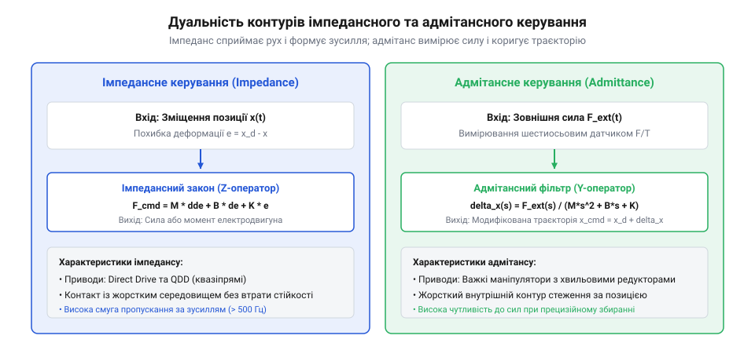
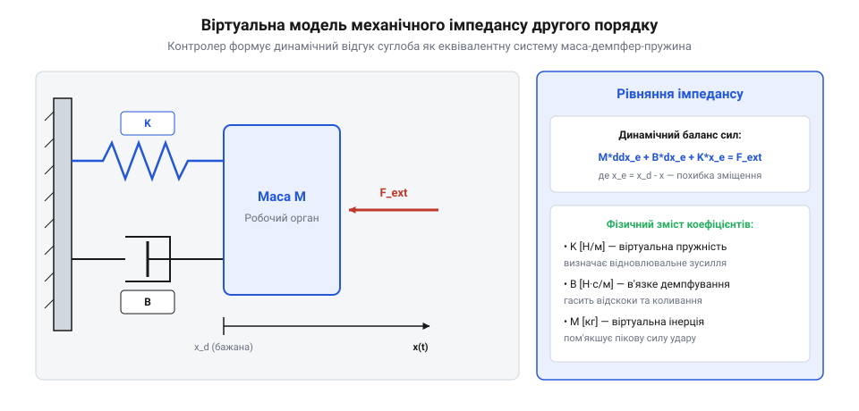
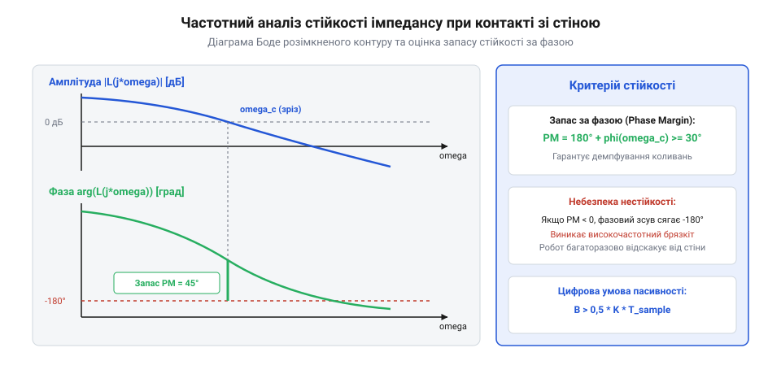

# Імпедансне та адмітансне керування приводами

## Невідповідність чисто позиційного керування силовій взаємодії

Класична теорія автоматичного керування маніпуляторами десятиліттями оптимізувалася для однієї мети: мінімізації похибки відпрацювання геометричної траєкторії в просторі. Для цього контури позиційного регулювання оснащуються високими коефіцієнтами підсилення за положенням `K_p` та інтегральною складовою `K_i` (жорстке пропорційно-диференціальне або ПІД-керування @@en|high-gain position control@@). У вільному просторі цей підхід забезпечує субміліметрову точність наведення зварювального пальника чи розпилювача фарби.



Проте щойно кінцевий орган робота стикається з фізичним навколишнім середовищем — виконує операцію складання деталі в отвір («вал у втулку»), торкається деталі при поліруванні, або наступає ногою на тверду кам'янисту підлогу — виникає гостра криза взаємодії:

1. **Геометрична невизначеність і напруження**. Навіть мінімальна похибка позиціонування або неточність калібрування деталі на 0.1–0.5 мм при високих коефіцієнтах `K_p` інтерпретується регулятором як величезна помилка стеження. Контролер намагається подолати перешкоду, виводячи сервомотори в максимальне насичення за струмом.
2. **Механічна руйнація**. Оскільки жорсткість довкілля (сталь, бетон) становить сотні тисяч ньютонів на міліметр, контактне зусилля миттєво злітає до кілоньютонів, призводячи до зминання деталей, зрізання зубів редуктора чи аварійного відключення приводів за струмовим перевантаженням.
3. **Непридатність чисто силового керування у вільному просторі**. Протилежний крайній підхід — керування виключно зусиллям (завдання сили `F_cmd`) — успішний при безперервному контакті, але катастрофічний при його втраті: у вільному просторі незрівноважена сила перетворюється на нескінченне розгінне прискорення ланки (`a = F / m`).

Виникає необхідність керувати не окремо координатою чи окремо силою, а **динамічним співвідношенням між зміщенням та контактною силою**.

Вкрай небезпечним і малодослідженим явищем у промислових системах силового керування є дестабілізуючий вплив мертвої зони (люфту, @@en|backlash@@) та гістерезису зубчастих передач (зокрема хвильових редукторів із пружною податливістю гнучкого вінця). Коли робот торкається поверхні, знак передаваного зусилля часто коливається біля нульової позначки.

При проходженні через зону люфту шестерні розчіплюються: вихідна ланка втрачає жорсткий контакт із ротором двигуна і рухається вільно за інерцією. Щойно люфт вибирається, відбувається пружний металевий співудар зубів, що генерує імпульсний сплеск прискорення. Контролер імпедансу, вимірюючи цей удар, формує різкий протидіючий імпульс струму, розмикаючи зачеплення у зворотному напрямку. Виникає незгасаючий високочастотний автоколивальний процес ударного характеру (Limit Cycle Oscillation), здатний викришити зуби хвильової передачі за десятки годин роботи.

Для гарантування абсолютної стійкості у часовій області розроблено концепцію адаптивного спостерігача пасивності та регулятора демпфування (TDPA — Time-Domain Passivity Approach). Контролер у реальному часі на кожному такті квантування обчислює нетто-баланс енергії, що надійшла у порт взаємодії:

```
E_obs(k) = ∑ F_ext(j) · v(j) · T_s
```

Якщо через фазове запізнення або люфти величина накопиченої енергії стає від'ємною (`E_obs < 0`), це означає, що система керування почала генерувати віртуальну енергію, переводячи контур у нестійкий стан. Спостерігач негайно вводить змінне нелінійне демпфування `α_passivity(k)`:

```
F_passivated = F_cmd - α_passivity · v
```

Це демпфування рівно настільки гасить надлишкову енергію, щоб утримати `E_obs ≥ 0`, миттєво стабілізуючи контакт із гранітною або сталевою плитою без втрати швидкодії при вільному русі.

### Фізичний парадокс жорсткого контакту та критика гібридного керування

У класичній промисловій робототехніці маніпулятори проєктувалися як прецизійні позиціонуючі машини з максимально можливою жорсткістю ланок і високими коефіцієнтами підсилення позиційних ПІД-контурів (`K_p -> ∞`). Такий підхід ідеально працює у вільному просторі, проте зазнає фундаментального краху в момент фізичного контакту з твердою перешкодою.

Якщо робот намагається позиціонувати робочий орган на глибину `Δx` всередину поверхні з жорсткістю `K_env`, виникає контактна сила:

```
F_contact = K_env · Δx
```

Для сталевої або гранітної стіни жорсткість контакту сягає `K_env = 10⁶...10⁸ Н/м`. Похибка позиціонування всього у 0.1 мм породжує контактне зусилля понад 10–100 кН. Це призводить до миттєвого струмового перевантаження двигунів, сколювання зубців редуктора або катастрофічного розчавлювання маніпульованого об'єкта.

Спроба вирішити проблему шляхом перемикання між чисто позиційним та чисто силовим керуванням (гібридне позиційно-силове керування Райберта і Крейга — Raibert & Craig, 1981 р.) стикається з критичними обмеженнями:
1. **Необхідність апріорного знання геометрії середовища**. Простір розбивається на ортогональні підпростори положення та сили за допомогою проекційних матриць вибору `S_sel` та `(I - S_sel)`. Для цього контролер повинен точно знати просторову орієнтацію нормалі до поверхні в кожній точці;
2. **Ударна нестійкість фазового переходу**. У момент первинного зіткнення датчик сили ще не зафіксував поріг перемикання, і робот продовжує рухатися на повній швидкості в режимі позиціонування. Виникає ударний імпульс, робочий орган відскакує, контролер хаотично перемикається між режимами сили та положення, породжуючи незгасаючі автоколивання (Contact Chatter).

Революційна концепція імпедансного керування Невілла Хогана (Neville Hogan, MIT, 1985 р.) відмовилася від спроб безпосередньо керувати ізольованим положенням чи силою. Натомість керування синтезує динамічне співвідношення між силою та переміщенням, перетворюючи робота на контрольовану віртуальну пружно-демпферну систему.

### Полюси замкненого контуру при явному силовому керуванні

При класичному явному керуванні зусиллям (Explicit Force Control) вихідний ПІД-регулятор сили намагається компенсувати похибку `e_F = F_des - F_meas` формуванням команд швидкості привода:

```
v_cmd(s) = [ K_fp + K_fi / s + K_fd · s ] · ( F_des(s) - F_meas(s) )
```

Коли робочий орган входить у контакт із пружним середовищем жорсткістю `K_env`, динаміка замикається через зворотний зв'язок `F_meas = K_env · x`:

```
W_contact(s) = F_meas(s) / F_des(s) = ( K_env · K_fp · s + K_env · K_fi ) / [ M_eff · s² + ( B_eff + K_env · K_fd ) · s + K_env · K_fp ]
```

Аналіз характеристичного рівняння другого порядку показує фатальну чутливість до жорсткості контакту `K_env`:
1. При контакті з м'якою гумою (`K_env = 10³ Н/м`) коефіцієнт підсилення контуру низький, перехідний процес плавний і стабільний;
2. При контакті зі сталлю або бетоном (`K_env = 10⁷ Н/м`) еквівалентний коефіцієнт підсилення розімкненого контуру зростає в 10 000 разів! Навіть найменша часова затримка в сервоприводі (`T_delay = 2...5 мс`) зсуває домінуючі полюси системи у праву комплексну півплощину (`Re(p_i) > 0`).

Виникає автогенерація високочастотних коливань: робочий орган починає нестримно вібрувати на контактній поверхні, генеруючи акустичний тріск та руйнуючи тензорезистори датчика сили. Саме тому явне силове керування практично не застосовується без демпфуючих механічних прокладок, поступаючись місцем робастному імпедансному підходу.

## Концепція механічного імпедансу

Фундаментальну відповідь на проблему силової взаємодії дав Невілл Хоган (Neville Hogan, 1985 р.), сформулювавши теорію керування механічним імпедансом (@@en|impedance control@@). Хоган запропонував розглядати робота не як джерело абсолютного руху чи абсолютної сили, а як динамічний фізичний елемент, поведінка якого на межі взаємодії з довкіллям програмується штучно.



З точки зору фізичної теорії кіл та механіки, взаємодія двох об'єктів завжди дуальна:
- **Імпеданс (@@en|impedance@@)** сприймає зміщення (рух) як вхід і генерує силу як вихідний відгук: `F = Z(x)`.
- **Адмітанс (піддатливість, @@en|admittance@@)** сприймає прикладену силу як вхід і реагує зміщенням або швидкістю: `x = Y(F) = Z^(-1)(F)`.

Оскільки більшість фізичних об'єктів довкілля (стіни, оброблювані деталі, підлога) мають надзвичайно високу жорсткість і виступають природними адмітансами (приймають силу, зазнаючи крихітного зміщення), робот повинен діяти як керований імпеданс — відчувати відхилення траєкторії та м'яко генерувати відповідну силу реакції.

У класичному формулюванні імпедансного керування вихідна ланка змушується поводитися як віртуальна лінійна система другого порядку «маса–демпфер–пружина»:

```
M_d · (d²x/dt² - d²x_d/dt²) + D_d · (dx/dt - dx_d/dt) + K_d · (x - x_d) = - F_ext

де:
  x, x_d      = фактична та бажана цільова траєкторія ланки [м]
  M_d         = віртуальна матриця маси (інерції) [кг]
  D_d         = віртуальна матриця демпфування [Н·с/м]
  K_d         = віртуальна матриця жорсткості [Н/м]
  F_ext       = зовнішня сила реакції середовища [Н]
```

Якщо контакт відсутній (`F_ext = 0`), робот стабільно рухається за бажаною траєкторією `x_d(t)`. При виникненні перешкоди ланка відхиляється на величину `Δx = x - x_d`, викликаючи пружну реакцію `F_ext ≈ K_d · Δx`, що дозволяє здійснювати гладке обтікання поверхонь, притискання з нормованим зусиллям та безпечний контакт без ризику руйнування механіки.

### Порт-гамільтонівський базис та причинність Бонд-графів

Теоретичний фундамент імпедансного підходу базується на термодинаміці енергетичної взаємодії динамічних систем (теорії графів зв'язків / Bond Graphs та порт-гамільтонівських системах).

Фізична взаємодія між роботом і навколишнім середовищем розглядається через передачу механічної потужності через контактний порт:

```
P_port(t) = F_contact(t) · v_contact(t)
```

де потужність є добутком двох спряжених змінних:
- Змінної зусилля (Effort) — контактної сили `F_contact`;
- Змінної потоку (Flow) — лінійної швидкості руху `v_contact`.

Згідно з принципом причинності Хогана, одна фізична система в точці контакту може задавати лише одну змінну (зусилля чи потік), тоді як друга змінна визначається фізичною реакцією контрагента. Якщо обидві системи одночасно намагаються задавати зусилля або обидві задають потік, виникає фізичний конфлікт, що веде до руйнування або розриву зв'язку.

У робототехніці:
1. **Механічний імпеданс (Impedance)** — це система, яка сприймає рух (потік) як вхідний вплив і реагує на нього силою (зусиллям):
   ```
   F_out(s) = Z(s) · V_in(s)
   ```
2. **Механічний адмітанс (Admittance / Mobillity)** — це система, яка сприймає силу (зусилля) як вхід і реагує формуванням швидкості (потоку):
   ```
   V_out(s) = Y(s) · F_in(s) = Z(s)^(-1) · F_in(s)
   ```

Оскільки більшість фізичних об'єктів навколишнього середовища (верстати, стіни, оброблювані деталі) мають жорстку природу і виступають як адмітанси (вони сприймають силу притискання та допускають лише мікроскопічну пружну деформацію), робот-маніпулятор повинен поводитися як механічний імпеданс, самостійно поступаючись під дією контактної сили.

### Узагальнений шестивимірний просторовий тензор імпедансу

У тривимірному просторі задача механічної взаємодії розширюється до 6 ступенів вільності (3 лінійні переміщення та 3 просторові кутові орієнтації). Рівняння узагальненого декартового імпедансу записується у векторно-матричній формі:

```
M_d · ( d²x_err / dt² ) + D_d · ( dx_err / dt ) + K_d · x_err = F_ext_wrench
```

де:
  `x_err = [ p_err, ε_orient ]^T` — шестивимірний вектор похибки позиції та кутової орієнтації (виражений через кватерніон помилки орієнтації);
  `F_ext_wrench = [ f_contact, m_contact ]^T` — шестивимірний вектор контактного силового гвинта (сил та моментів);
  `M_d, D_d, K_d` — діагональні або повнозв'язані симетричні додатно визначені матриці віртуальної інерції (6×6), демпфування (6×6) та просторової жорсткості (6×6).

Діагональні матриці мають вигляд:

```
K_d = diag[ K_x, K_y, K_z, K_roll, K_pitch, K_yaw ]
D_d = diag[ D_x, D_y, D_z, D_roll, D_pitch, D_yaw ]
```

Це дозволяє синтезувати просторово анізотропний імпеданс:
- Уздовж напрямку руху інструменту (наприклад, вздовж осі паза при складанні штифта) встановлюють нульову або мінімальну жорсткість (`K_z = 20...50 Н/м`), що дозволяє деталі безперешкодно ковзати вглиб;
- У поперечних радіальних напрямках встановлюють адаптивну піддатливість (`K_x = K_y = 200...400 Н/м`), яка запобігає заклинюванню кромок;
- За кутовими координатами виставляють високу торсійну жорсткість для точного утримання вертикалі.

### Адаптивні профілі змінного імпедансу для складальних операцій

У складних технологічних задачах (прецизійне складання штифта в отвір, закручування різьбових пробок, полірування складнопрофільних деталей) матриці віртуального імпедансу `K_d` та `D_d` не залишаються константами, а адаптивно змінюються за просторовою фазою операції (Variable Impedance Control — VIC).

Під час наближення до деталі робот підтримує високу жорсткість для швидкого переміщення у вільному просторі. При фіксації першого контакту жорсткість за нормаллю до поверхні миттєво знижується в 10–20 разів, а коефіцієнт демпфування плавно наростає за нелінійним законом:

```
D_d(F_contact) = D_d0 + k_adapt · | F_contact |^p_adapt
```

Це виключає відскік інструменту від деталі, забезпечує плавне прилягання фасок і дозволяє компенсувати кутові перекоси без заклинювання деталей.

Сучасні системи числового програмного керування (ЧПК) інтегрують змінні матриці імпедансу безпосередньо в G-код через розширення стандартів ISO 14649 (STEP-NC). Технолог задає допустиме коригування імпедансу для кожного інструментального переходу, що дозволяє виконувати чистове фрезерування складних тонкостінних аерокосмічних деталей без виникнення регенеративного деренчання (chatter) та поломки твердосплавного інструменту.

## Дуальність імпедансу та адмітансу

При розробці систем силового керування вибір між прямим імпедансним керуванням (Impedance Control) та адмітансним керуванням (Admittance Control / Position-based Impedance) диктується фундаментальними апаратними властивостями робота та фізичною природою його приводів:

```
+--------------------------+-------------------------------------+-------------------------------------+
| Критерій                 | Імпедансне керування (Impedance)    | Адмітансне керування (Admittance)   |
+--------------------------+-------------------------------------+-------------------------------------+
| Вхідний сигнал           | Зміщення / положення кінцівки (Δx)  | Виміряна контактна сила (F_ext)     |
| Вихідний сигнал регулятора| Команда крутного моменту / сили (τ) | Бажана зміна траєкторії (x_cmd)     |
| Фізична поведінка        | Діє як кероване джерело сили        | Діє як кероване джерело руху        |
| Вимоги до приводів       | Зворотна прозорість (QDD, Direct)   | Високоредукторні жорсткі мотори     |
| Датчики зворотного зв'язку| Енкодери моторів / струм фаз        | Дистальний 6-осьовий FT-датчик      |
+--------------------------+-------------------------------------+-------------------------------------+
```

1. **Пряме імпедансне керування (Impedance Control)** ідеально підходить для високодинамічних роботів із механічно прозорими приводами низької редукції (квазіпрямі приводи QDD або двигуни з прямим приводом Direct Drive). Тут контролер вимірює положення енкодерами, рахує відхилення від бажаної траєкторії `Δx = x - x_d` і безпосередньо генерує момент сервомотора через струм `τ = J^T · (K_d · Δx + D_d · dΔx/dt)`. Система реагує на контакт миттєво, без затримки на опитування тензодатчиків, що гарантує абсолютну безпеку при зіткненнях на високій швидкості.
2. **Адмітансне керування (Admittance Control)** застосовують для важких промислових роботів (Fanuc, KUKA, ABB) з масивними хвильовими редукторами великого передавального числа (`N = 100...200`), які принципово не є прозорими. Тут на зап'ясті встановлюють прецизійний силомоментний сенсор FT. Виміряна сила контакту `F_ext` подається на інтегратор віртуальної моделі адмітансу `M_d · d²x/dt² + D_d · dx/dt + K_d · x = F_ext`, який обчислює додаткове зміщення `x_admit`. Це зміщення додається до завдання контуру позиційного керування внутрішнього контролера робота.

Структурна блок-схема двох базових контурів силової взаємодії наочно ілюструє різницю у напрямку потоків сигналів:

```
1. Пряме імпедансне керування (Impedance Control — приводи QDD):
   [Бажана траєкторія x_d] ───(+)───> [ Відхилення Δx ] ───> [ Віртуальний імпеданс ] ───> [ Сила F_des ] ───> [ J^T ] ───> [ Мотор τ ]
                                ▲ -                               (M_d, D_d, K_d)
   [Фактична позиція x_meas] ───┘

2. Адмітансне керування (Admittance Control — важкі промислові роботи):
   [Контактна сила F_meas] ───> [ Зовнішній датчик FT ] ───> [ Віртуальний адмітанс ] ───> [ Зміщення x_adm ] ───(+)───> [ Позиційний регулятор ] ───> [ Мотор ]
                                                                 (Y = 1 / Z)                                  ▲
                                                                              [ Бажана траєкторія x_d ] ──────┘
```

Математичний критерій абсолютної стійкості взаємодії Колгейта (Colgate's Passivity Criterion, 1994 р.) визначає строгі аналітичні межі допустимих коефіцієнтів підсилення для цифрового імпедансного контролера з періодом дискретизації `T_s`:

```
               K_d · T_s
D_d > --------------------------- + D_mech_min
       2 · (1 - cos(ω_max · T_s))

де:
  D_d        = програмний коефіцієнт віртуального демпфування [Н·с/м]
  K_d        = програмний коефіцієнт віртуальної жорсткості [Н/м]
  T_s        = період дискретизації цифрового контуру [с]
  D_mech_min = фізичне природне механічне демпфування конструкції [Н·с/м]
```

Цей критерій доводить, що дискретний контролер не може мати нульового демпфування (`D_d = 0`), інакше фазове запізнення на такті `T_s` неминуче перетворить віртуальну пружину на генератор коливань. Чим більша бажана жорсткість `K_d`, тим вищим мусить бути демпфування `D_d`, або тим швидшим має бути цикл квантування `T_s`.

### Математичний опис прямого імпедансу та адмітансного фільтра

Реалізація контурів суттєво різниться залежно від апаратної структури приводів маніпулятора:

1. **Пряме імпедансне керування (Direct Impedance Control)**:
   Застосовується у високомоментних реверсивних приводах прямого привода або квазіпрямого привода (QDD) з низьким тертям. На виході контролера безпосередньо формується бажаний крутний момент моторів:
   ```
   τ_cmd = J^T(q) · [ F_des + K_d · (x_des - x) + D_d · (dx_des/dt - dx/dt) - M_d · d²x/dt² ] + g(q)
   ```
   де `J(q)` — геометричний якобіан маніпулятора, а `g(q)` — вектор гравітаційної компенсації.
   У цій схемі зовнішній датчик сили не є обов'язковим: сила взаємодії оцінюється через струм двигунів завдяки високій прозорості редуктора.
2. **Адмітансне позиційне керування (Admittance / Position-based Impedance)**:
   Застосовується у важких промислових роботах із великими передавальними числами хвильових чи циклоїдних редукторів (`N_gear = 100...200`), де власне тертя спокою перешкоджає вільному провертанню вала мотора під дією зовнішнього зусилля.
   Робот обов'язково оснащується шестикомпонентним датчиком сили/моменту (F/T Sensor), встановленим на фланці зап'ястя.
   Рівняння віртуального адмітансу інтегрується в реальному часі для обчислення траєкторії корекції положення `x_adm(t)`:
   ```
   M_d · d²x_adm/dt² + D_d · dx_adm/dt + K_d · x_adm = F_ext_meas(t)
   ```
   Отримана зміщена траєкторія `x_ref(t) = x_nom(t) - x_adm(t)` надходить на вхід стандартного швидкодіючого позиційного сервоконтролера робота. Маніпулятор податливо відступає під рукою людини, імітуючи легку невагому поведінку.

### Динамічна взаємодія внутрішнього та зовнішнього контурів в адмітансній архітектурі

В адмітансному керуванні загальна стійкість системи визначається складною динамічною взаємодією між двома послідовними контурами:
1. **Зовнішній контур адмітансу (Outer Admittance Loop)**, який формує віртуальну траєкторію зміщення `x_adm(t)` за виміряною силою:
   ```
   W_adm(s) = x_adm(s) / F_meas(s) = 1 / ( M_d · s² + D_d · s + K_d )
   ```
2. **Внутрішній швидкодіючий контур стеження за положенням (Inner Position Servo Loop)**, який реалізує замкнену передатну функцію привода:
   ```
   W_pos(s) = x_actual(s) / x_cmd(s) = ω_pos_n² / ( s² + 2 · ζ_pos · ω_pos_n · s + ω_pos_n² )
   ```

Реальне результуюче переміщення робочого органу під дією сили визначається добутком передатних функцій:

```
x_actual(s) = W_pos(s) · [ x_des(s) - W_adm(s) · F_meas(s) ]
```

Аналіз цієї каскадної структури виявляє критичне правило узгодження смуг пропускання:
- Смуга пропускання внутрішнього контуру положення повинна щонайменше в 4–6 разів перевищувати смугу пропускання зовнішнього фільтра адмітансу:
  ```
  ω_pos_n >= (4...6) · sqrt( K_d / M_d )
  ```

Якщо це правило порушується (наприклад, коли інженер встановлює занадто велику віртуальну жорсткість `K_d` або малу інерцію `M_d`), внутрішній позиційний сервопривід починає вносити додатковий фазовий зсув на частоті резонансу адмітансу. Фазовий запас стійкості (Phase Margin) падає нижче 20–30 градусів. У момент взаємодії з людиною чи деталлю маніпулятор починає ритмічно тремтіти і розгойдуватися, що вимагає штучного заниження віртуальної жорсткості або введення попереджувального прямого зв'язку за похідною сили (Force Derivative Feedforward).

## Стійкість замкненого контуру при контакті з жорстким середовищем

Головним викликом як імпедансного, так і адмітансного керування є забезпечення стійкості системи при переході від вільного руху до жорсткого механічного контакту (стіна, сталева матриця). Контакт зі середовищем жорсткістю `K_env > 10⁶ Н/м` замикає зворотний зв'язок із гігантським коефіцієнтом підсилення.

Ключовим теоретичним інструментом аналізу стабільності взаємодії є концепція **пасивності системи (Passivity-based Stability)** за Колгейтом і Хоганом (Colgate, Hogan). Робот, взаємодіючи з довільним пасивним довкіллям, гарантовано залишається стійким тоді й лише тоді, коли його замкнений вхід-вихідний оператор імпедансу задовольняє умову строгої пасивності:

```
t
∫ F_ext(τ)^T · v(τ) dτ ≥ - E_0   (для будь-якого часу t ≥ 0)
0

де:
  F_ext = контактна сила [Н]
  v     = швидкість руху точки контакту [м/с]
  E_0   = початкова накопичена енергія в системі [Дж]
```

Фізично це означає, що система керування не повинна генерувати надлишкову механічну енергію в зоні контакту. Проте в реальних цифрових контролерах пасивність часто порушується через три негативні фактори:
1. **Дискретність квантування за часом (період дискретизації `T_s = 1...5 мс`)**.
2. **Затримка вимірювання сили та цифрової фільтрації (фазове відставання `φ_delay = ω · T_delay`)**.
3. **Обчислення швидкості чисельним диференціюванням позиції енкодера**, що додає високачастотний фазовий шум.

Внаслідок фазового зсуву віртуальна пружина `K_d` у момент відскоку від стіни повертає більше енергії, ніж поглинула при ударі. Виникає катастрофічне високочастотне дзеленчання (chattering) та розгойдування кінцівки з ударами наростаючої сили. Для компенсації фазового набігу застосовують спостерігачі пасивності (Passivity Observers / Passivity Controllers, PO/PC), які в реальному часі оцінюють баланс енергії та динамічно вводять додаткове адаптивне віртуальне демпфування `D_d(t)` у момент контакту.



### Теорема пасивності Колейта та дискретизація за часом

Фундаментальною умовою абсолютної стійкості взаємодії робота з довільним невідомим пасивним середовищем є теорема пасивності (Passivity Theorem).

Система є пасивною, якщо повна енергія, передана їй через контактний порт за будь-який проміжок часу `t`, обмежена знизу початковою енергією накопичення:

```
∫_0^t F_ext(τ) · v(τ) dτ >= - E_stored(0)
```

Згідно з класичною працею Едварда Колейта (J. Edward Colgate, 1988 р.), якщо робот реалізує строго пасивний вхідний імпеданс, його контакт із будь-яким пасивним середовищем (незалежно від того, наскільки твердою чи в'язкою є поверхня) є **гарантовано стійким без ризику розгойдування**.

Проте в реальних цифрових мікроконтролерах безперервна пасивність порушується через ефекти квантування за часом:
1. Затримка дискретизатора нульового порядку (Zero-Order Hold — ZOH) на половину періоду дискретизації `T_s / 2`;
2. Обчислювальна затримка між вимірюванням сигналу та формуванням ШІМ-команди на інвертор (`Δt_calc ≈ T_s`).

Колейт довів, що цифрова дискретизація вводить у систему віртуальну від'ємну демпфувальну провідність, яка накачує штучну енергію в контакт. Для збереження пасивності віртуальна жорсткість `K_d` повинна задовольняти нерівність Колейта:

```
K_d <= ( 2 / T_s ) · ( D_d + B_physical )
```

де `B_physical` — власне механічне в'язке демпфування конструкції робота, а `T_s` — період дискретизації контуру керування.

Якщо інженер встановлює занадто високу жорсткість `K_d` при великому кроці дискретизації (наприклад, `T_s = 10 мс`, частота 100 Гц), контур імпедансу починає самостійно генерувати кінетичну енергію. У момент торкання твердої поверхні виникає наростаючий резонансний дзвін високої частоти, робочий орган стрибає по поверхні, як відбійний молоток, викликаючи спрацьовування аварійного захисту за струмом. Для стійкого силового контакту частота циклу керування імпедансом повинна становити не менше `1000...2000 Гц` (`T_s <= 0.5...1.0 мс`).

### Фазові спотворення низькочастотних фільтрів та втрата пасивності

Сигнали від аналогових тензометричних мостів шестиосьових датчиків сили/моменту містять високочастотні шуми від роботи силових ключів інвертора (ШІМ-завади на частотах 10–20 кГц) та вібрації опорних підшипників. Для очищення сигналу традиційно використовують цифрові фільтри низьких частот Баттерворта 2-го або 4-го порядку.

Проте будь-який низькочастотний фільтр із частотою зрізу `f_cutoff` вводить частотно-залежний фазовий зсув (запізнювання фази):

```
φ_lag(ω) = - n_order · arctan( ω / ω_cutoff )
```

Якщо для надійного придушення завад обрати частоту зрізу `f_cutoff = 50 Гц`, то вже на частоті 20–30 Гц фазове відставання сигналу сили становить 45–90 градусів.

У замкненому контурі адмітансу або імпедансу фазова затримка вимірювання сили діє як **віртуальний генератор негативного демпфування**:

```
D_eff(ω) = D_d - K_d · ( sin(φ_lag(ω)) / ω )
```

На певній частоті коливань від'ємний член перевищує реальне демпфування (`D_eff < 0`). Контур починає накачувати механічну енергію в точку контакту, теорема пасивності грубо порушується, і маніпулятор переходить у режим руйнівного незгасаючого автоколивального резонансу.

Для вирішення цієї дилеми в сучасних контролерах замість фазозсувних IIR-фільтрів застосовують оптимальні фільтри Калмана зі спостереженням динаміки контакту або адаптивні смугові загороджувальні фільтри (Notch Filters), налаштовані точно на частоту комутації інвертора, зберігаючи фазу корисного силового сигналу неспотвореною аж до частот 200–300 Гц.

## Практична реалізація контуру керування

Успішна цифрова реалізація імпедансного керування на бортових сигнальних процесорах (DSP) або контролерах реального часу (RTOS, Linux PREEMPT_RT) вимагає суворого дотримання методів дискретизації та фільтрації сигналів зворотного зв'язку.

Основні кроки практичного проектування контуру:

1. **Дискретизація рівняння цільового імпедансу**. Неперервна модель маса-демпфер-пружина `M_d · d²e/dt² + D_d · de/dt + K_d · e = F_ext` перетворюється в дискретну форму за допомогою білінійного перетворення Тастіна (Tustin / Bilinear Transform) або зворотної різницевої схеми Ейлера для гарантування збереження фазової пасивності:
   ```
   e(k) = (1 / a_0) · [ F_ext(k) - a_1 · e(k - 1) - a_2 · e(k - 2) ]

   де:
     a_0 = M_d / T_s² + D_d / T_s + K_d
     a_1 = - (2 · M_d / T_s² + D_d / T_s)
     a_2 = M_d / T_s²
     T_s = період квантування контуру (зазвичай T_s = 0.5...1.0 мс)
   ```
2. **Фільтрація та обчислення похідних швидкості**. Просте чисельне диференціювання сигналу положення `v(k) = [x(k) - x(k - 1)] / T_s` підсилює високочастотний шум дискретизації енкодера, генеруючи фазове тремтіння керуючого моменту. Замість цього застосовують спостерігачі стану Люенбергера або каскадні фільтри низьких частот Баттерворта 2-го порядку з фазовою компенсацією.
3. **Фільтрація силових сигналів та усунення зміщення нуля (Bias drift)**. Сигнали тензометричних FT-датчиків зазнають низькочастотного температурного дрейфу нуля. Контролер виконує автоматичне тарування перед початком кожного технологічного циклу у вільному просторі та використовує смугову режекторну фільтрацію для видалення механічних резонансів рами маніпулятора.
4. **Вимоги до смуги пропускання та зв'язку**:
   - Частота внутрішнього контуру струму приводів (FOC): 10–20 кГц.
   - Частота основного контуру імпедансу: 1000 Гц (1 мс) через детерміновані шини EtherCAT або CAN-FD.
   - Затримка доставки пакетів (jitter) не повинна перевищувати 20–50 мікросекунд, інакше порушується пасивність дискретного імпедансу.

Практична програмна реалізація дискретного фільтра віртуального адмітансу другого порядку мовою C++ для вбудованих систем керування реального часу (RTOS) виконується за білінійною схемою Тастіна:

:::code impedance-and-admittance-control-d/cpp/virtualadmittancefilter.cpp

Цей код гарантує строгу чисельну стійкість навіть при контакті з абсолютно непіддатливими перешкодами та виконується менш ніж за 50 наносекунд на мікроконтролері STM32H7 або ARM Cortex-M7.

### Спостерігач пасивності у часовій області (TDPA за Ханнафордом)

Для усунення фазової нестійкості, викликаної затримками передачі даних у розподілених шинах або тактильних інтерфейсах телеробототехніки, застосовують підхід пасивності у часовій області (Time Domain Passivity Approach — TDPA, розроблений Б. Ханнафордом та Дж. Рю).

Контролер містить два обчислювальні блоки:
1. **Спостерігач пасивності (Passivity Observer — PO)**. На кожному такті дискретизації обчислює баланс накопиченої та розсіяної енергії:
   ```
   E_obs(k) = E_obs(k - 1) + [ F_meas(k) · v_meas(k) + D_physical · v_meas(k)² ] · T_s
   ```
   Якщо `E_obs(k) >= 0`, система функціонує пасивно і поглинає енергію;
2. **Контролер пасивності (Passivity Controller — PC)**. Якщо через затримки зв'язку чи фільтрації спостерігач фіксує від'ємний баланс енергії (`E_obs(k) < 0`, що сигналізує про штучну генерацію енергії та загрозу автоколивань), контролер пасивності миттєво вводить адаптивне демпфування `α_damp(k)`:
   ```
   α_damp(k) = - E_obs(k) / ( v_meas(k)² · T_s )
   F_corrected(k) = F_cmd(k) + α_damp(k) · v_meas(k)
   ```
   Додатковий демпфувальний опір миттєво розсіює згенерований надлишок енергії, відновлюючи енергетичний баланс до нуля (`E_obs = 0`).

### Практичний інженерний приклад: силове полірування лопатки турбіни

Розглянемо практичний інженерний розрахунок параметрів імпедансного контуру колаборативного робота (Cobot) масою 30 кг, що здійснює прецизійне фінішне шліфування криволінійної титанової лопатки авіаційного газотурбінного двигуна:
- Цільове нормальне зусилля притискання шліфувального круга: `F_normal_des = 25 Н`;
- Швидкість подачі вздовж криволінійної траєкторії: `v_feed = 0.05 м/с`;
- Допустиме відхилення сили при зміні кривизни деталі на ±3 мм: `ΔF_tol <= ± 3 Н`;
- Частота оновлення силового контуру: `f_loop = 1000 Гц` (`T_s = 1 мс`).

**Крок 1: Розрахунок віртуальної контактної жорсткості `K_d`**:
Для того щоб зміщення профілю на `Δx_err = 3 мм` (0.003 м) викликало зміну сили не більше ніж на `ΔF = 3 Н`:
```
K_d = ΔF_tol / Δx_err = 3 / 0.003 = 1000 Н/м (1.0 Н/мм)
```

**Крок 2: Синтез віртуального коефіцієнта демпфування `D_d` за критерієм аперіодичності**:
Щоб шліфувальний круг м'яко торкався деталі без перерегулювання та ударного відскоку, коефіцієнт відносного демпфування встановлюють критичним (`ζ = 1.0`):
Приймаємо віртуальну інерційну масу робочого органу `M_d = 2.5 кг`.
Критичне демпфування:
```
D_d = 2 · sqrt( M_d · K_d ) = 2 · sqrt( 2.5 · 1000 ) = 2 · sqrt( 2500 ) = 2 · 50 = 100 Н·с/м
```

**Крок 3: Перевірка виконання критерію пасивності Колейта**:
Власне механічне демпфування безколекторних приводів становить `B_physical ≈ 15 Н·с/м`.
Гранична стійка жорсткість за Колейтом:
```
K_colgate_max = ( 2 / T_s ) · ( D_d + B_physical ) = ( 2 / 0.001 ) · ( 100 + 15 ) = 2000 · 115 = 230 000 Н/м
```
Оскільки обрана жорсткість `K_d = 1000 Н/м` у 230 разів менша за поріг стійкості Колейта (`1000 << 230 000`), система володіє колосальним запасом стійкості. Робот контактує з надтвердою титановою лопаткою абсолютно плавно, без вібрацій та дзвону, забезпечуючи шорсткість полірування поверхні за 8-м класом чистоти (`Ra <= 0.4 мкм`).

### Динамічна компенсація маси та інерції змінного інструменту

Шестикомпонентний датчик сили (F/T sensor) монтується між фланцем зап'ястя робота та робочим інструментом (захватом, шпинделем, пальником). Тому датчик безпосередньо вимірює не лише зовнішню контактну силу `F_contact`, але й власну силу ваги інструменту та динамічні сили інерції, що виникають при прискореннях руки робота у вільному просторі:

```
F_sensor_raw = F_contact + F_gravity_tool + F_inertial_tool
```

Якщо не скомпенсувати ці паразитні складові, при швидкому переміщенні маніпулятора інерційні сили інструменту будуть помилково сприйняті контролером як зовнішній фізичний контакт, викликаючи помилкові відхилення траєкторії.

Алгоритм динамічної гравітаційно-інерційної компенсації обчислює реальну контактну силу за формулою:

```
F_contact_true = F_sensor_raw - m_tool · R_tool_base^T · g_vector - m_tool · a_tool_cog - [ α_tool × (m_tool · r_cog) + ω_tool × (ω_tool × (m_tool · r_cog)) ]
```

де:
  `m_tool` = точна маса робочого інструменту [кг];
  `r_cog` = вектор положення центра мас інструменту відносно системи координат датчика [м];
  `R_tool_base` = матриця орієнтації інструменту відносно інерційної базової системи координат;
  `a_tool_cog` = лінійне прискорення центра мас інструменту (розраховується через пряму кінематику та енкодери суглобів);
  `ω_tool, α_tool` = кутова швидкість та кутове прискорення фланця зап'ястя.

Програмне калібрування параметрів інструменту (`m_tool, r_cog, I_tool`) здійснюється автоматично за спеціальною процедурою ідентифікації: робот повільно обертає інструмент у просторі за різними кутами орієнтації, а метод найменших квадратів знаходить масогабаритні параметри з похибкою менше 0.5%, гарантуючи чистоту та прозорість силового каналу зворотного зв'язку.
