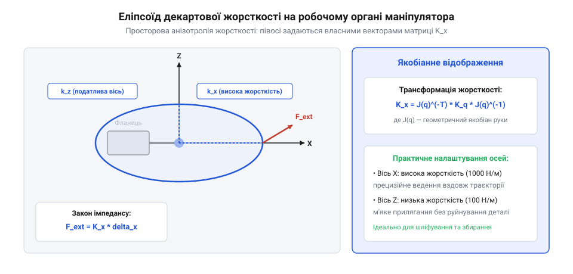
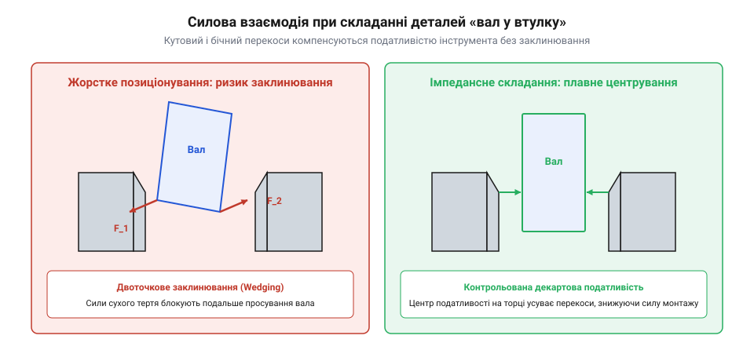
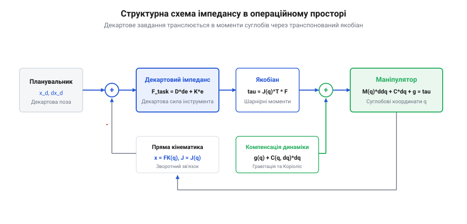

# Керування імпедансом та піддатливістю в робототехніці

## Просторова силова взаємодія багатоланкових роботів

Сучасні маніпуляційні та локомоційні задачі робототехніки принципово вимагають просторового контактного силового контролю в тривимірному декартовому просторі:
- **У складанні прецизійних виробів**: запресовування підшипників, загвинчування різьбових з'єднань, де неминуче виникають бічні сили розклинювання.
- **У технологічній обробці поверхонь**: шліфування, зачищення зварних швів, зняття фасок, де інструмент повинен підтримувати постійний нормальний притиск до криволінійної поверхні при збереженні високої тангенціальної швидкості подачі.
- **У динамічній ходьбі багатоногих роботів**: кінцівка маніпулятора чи стопа крокуючого робота наступає на нерівну опору з невизначеним нахилом.



Головна особливість просторової взаємодії полягає в **анізотропії контактних вимог**. Робот повинен проявляти різний механічний імпеданс у різних напрямках декартового простору:
- Вздовж нормалі до поверхні обробки необхідна висока піддатливість (м'яка віртуальна пружина `K_z`), що запобігає зариванню фрези в метал або підстрибуванню ноги.
- У площині різання чи переміщення інструмента необхідна максимальна жорсткість (`K_x, K_y`), що гарантує точність контуру деталі.

Оскільки приводи робота розташовані в шарнірах обертання або поступального руху, керувати декартовим імпедансом через незалежні шарнірні ПІД-регулятори неможливо: зміна навантаження на кінцевому органі транслюється в складну нелінійну комбінацію моментів у всіх зчленованих шарнірах кінематичного ланцюга.

Геометрична оцінка доступності сил та швидкостей багатоланкового маніпулятора у тривимірному просторі виконується за допомогою концепції еліпсоїдів маніпулятивності Цунео Йошікави (Tsuneo Yoshikawa, 1985 р.). Одинична сфера шарнірних крутних моментів `||τ|| ≤ 1` проектується матрицею Якобі `J(q)` в еліпсоїд статичних сил у просторі завдань:

```
F_task^T · [ J(q) · J(q)^T ] · F_task ≤ 1
```

Осі цього еліпсоїда визначаються власними векторами матриці `J · J^T`, а довжини півосей — сингулярними числами Якобіана `σ_i`. Головна властивість просторової механіки полягає в дуальності еліпсоїдів сили та швидкості: уздовж того напрямку, де маніпулятор здатний розвивати максимальну контактну силу (велика вісь еліпсоїда сили), допустима швидкість руху кінцевого органа мінімальна, і навпаки. Враховуючи форму еліпсоїда сили, планувальник траєкторій орієнтує руку робота так, щоб напрямок максимальної сили пресування або шліфування збігався з великою віссю еліпсоїда, захищаючи приводи від струмового перевантаження.

Для надлишкових маніпуляторів (7 ступенів вільності і більше) критичним завданням стає керування внутрішнім рухом у нуль-просторі Якобіана для уникнення самозіткнень ліктя з корпусом або перешкодами. Алгоритм проектує градієнт штучного відштовхувального потенційного поля `V_repulse(q_elbow)` у ядро матриці Якобі:

```
τ_null = [ I - J(q)^T · J_bar(q)^T ] · [ - K_null · ∇ V_repulse(q) - D_null · dq/dt ]
```

Оскільки цей керуючий момент лежить суворо в нуль-просторі (`J^T · τ_null = 0`), лікоть маніпулятора плавно відхиляється від стінки чи людини в робочій зоні, не чинячи жодного паразитного впливу на точність виконання силової операції фрезерування чи зняття задирок на кінці інструмента.

### Просторові еліпсоїди жорсткості та маніпульованості за Йошикавою

У просторі 6 ступенів вільності зв'язок між Декартовою піддатливістю робочого органу та піддатливістю приводів шарнірів визначається через матрицю геометричного якобіана маніпулятора `J(q)`.

Якщо в шарнірах робота реалізовано діагональну матрицю суглобової жорсткості `K_q = diag[ k_q1, ..., k_qn ]`, то під дією зовнішнього силового гвинта `F_cart` відхилення кінцевого органу `Δx_cart = J(q) · Δq`. Оскільки суглобові моменти дорівнюють `τ = J^T(q) · F_cart`, а `Δq = K_q^(-1) · τ`, отримуємо рівняння зв'язку:

```
Δx_cart = [ J(q) · K_q^(-1) · J^T(q) ] · F_cart = C_cart · F_cart
```

де `C_cart` — Декартова матриця піддатливості (Compliance Matrix). Відповідно, Декартова матриця жорсткості (Stiffness Matrix) `K_cart` є її оберненою:

```
K_cart = C_cart^(-1) = [ J(q) · K_q^(-1) · J^T(q) ]^(-1)
```

Геометрична візуалізація просторової жорсткості здійснюється за допомогою сингулярного розкладу (Singular Value Decomposition — SVD):

```
K_cart = U_stiff · Σ_stiff · V_stiff^T
```

Власні вектори матриці `U_stiff` визначають орієнтацію головних півосей просторового еліпсоїда жорсткості (Stiffness Ellipsoid), а сингулярні числа `σ_i` — їхню величину.

Фундаментальною властивістю маніпулятора є дуальність еліпсоїдів швидкості та сили (цунамі Йошикави — Tsuneo Yoshikawa, 1985 р.):
1. **Еліпсоїд маніпульованості за швидкістю**:
   ```
   v^T · [ J(q) · J^T(q) ]^(-1) · v <= 1
   ```
   Уздовж напрямку витягнутої довгої осі еліпсоїда робот здатний розвивати максимальну швидкість кінцевого органу при мінімальних швидкостях суглобів;
2. **Еліпсоїд маніпульованості за силою**:
   ```
   F^T · [ J(q) · J^T(q) ] · F <= 1
   ```
   Напрямок максимальної швидкості строго збігається з напрямком найменшої силової спроможності, і навпаки: уздовж короткої осі швидкості робот має найвищу механічну редукцію і здатний генерувати гігантські зусилля (наприклад, колінний розпір перед сингулярністю).

Контролер Декартового імпедансу дозволяє штучно деформувати та орієнтувати цей еліпсоїд у довільному напрямку, адаптуючи кінематику руки під конкретну технологічну задачу без механічної зміни конфігурації ланок.

### Кінематичні сингулярності та демпфований псевдообернений якобіан (DLS)

У зонах кінематичних сингулярностей маніпулятора (наприклад, при повному випрямленні руки або збігу осей обертання зап'ястка) матриця геометричного якобіана втрачає ранг:

```
det[ J(q) · J^T(q) ] -> 0
```

У цих конфігураціях класичне відображення сил із Декартового простору в суглобовий простір через псевдообернену матрицю `J^+` прямує до нескінченності: найменша Декартова контактна сила вимагає колосальних суглобових моментів `τ = J^T · F`, що призводить до струмового насичення інверторів та неконтрольованого ривка суглобів.

Для подолання проблеми сингулярностей застосовують метод найменших квадратів із демпфуванням (Damped Least Squares — DLS, регуляризація Левенберга–Марквардта):

```
J_dls^T = J^T · [ J · J^T + λ_damp² · I_6 ]^(-1)
```

де `λ_damp` — параметр демпфування сингулярності:

```
λ_damp² = λ_0² · [ 1 - ( σ_min / ε_sing )² ]   для σ_min < ε_sing
λ_damp² = 0                                    для σ_min >= ε_sing
```

де `σ_min` — найменше сингулярне число якобіана, а `ε_sing` — ширина примежової сингулярної зони.

Удалині від сингулярностей (`σ_min >= ε_sing`) регуляризація повністю вимикається (`λ_damp = 0`), зберігаючи ідеальну точність імпедансу. При вході в небезпечну зону контур плавно жертвує точністю позиціонування вздовж сингулярного напрямку заради обмеження максимальних крутних моментів двигунів, запобігаючи аварійному вибиванню захистів.

## Математичний апарат простору завдань

Для реалізації просторового силового керування застосовують формалізм простору завдань (Operational Space Formulation), запропонований Усамою Хатібом (Oussama Khatib, 1987 р.).



Зв'язок між вектором узагальнених суглобових координат `q ∈ R^n` та положенням кінцевого органа в декартовому просторі завдань `x ∈ R^m` описується прямою задачею кінематики `x = f(q)`. Диференціювання за часом дає зв'язок швидкостей через матрицю Якобі маніпулятора `J(q)`:

```
dx
-- = J(q) · dq / dt
dt

де:
  J(q) = ∂f(q) / ∂q  ∈ R^(m × n)
```

Згідно з принципом віртуальної роботи, якщо втрати на тертя в шарнірах нехтовно малі, статичне відношення між просторовою узагальненою силою на кінцевому органі `F_task = [F_x, F_y, F_z, M_x, M_y, M_z]^T` та вектором шарнірних крутних моментів `τ ∈ R^n` визначається транспонованою матрицею Якобі:

```
τ = J(q)^T · F_task
```

У динаміці повне рівняння руху багатоланкового робота в суглобових координатах має вигляд:

```
M(q) · d²q/dt² + C(q, dq/dt) · dq/dt + g(q) = τ - J(q)^T · F_ext
```

Хатіб показав, що проектування динаміки в простір завдань здійснюється через псевдообернену матрицю Якобі, зважену за масою `J_bar = M^(-1) · J^T · Λ`, де просторова матриця інерції кінцевого органа `Λ(q)` визначається як:

```
Λ(q) = [ J(q) · M(q)^(-1) · J(q)^T ]^(-1)
```

Завдяки цьому співвідношенню керуючий закон зворотного зв'язку дозволяє повністю скомпенсувати власну нелінійну динаміку маніпулятора (коріолісові та гравітаційні сили `g(q)`) і призначити бажаний декартовий імпеданс безпосередньо на кінці інструмента:

```
τ_cmd = J(q)^T · [ Λ(q) · d²x_cmd/dt² + D_task · (dx_d/dt - dx/dt) + K_task · (x_d - x) ] + g(q)
```

Це дозволяє інженерові задавати діагональні матриці декартової жорсткості `K_task` і демпфування `D_task` безпосередньо у фізичних осях деталі.

### Динамічно узгоджений псевдообернений якобіан та проекція в нуль-простір

Для кінематично надлишкових роботів (Redundant Manipulators з кількістю суглобів `n > 6`, таких як 7-осьові колаборативні маніпулятори KUKA LBR iiwa, Franka Emika Panda) класичний псевдообернений якобіан Мура–Пенроуза `J^+ = J^T · (J · J^T)^(-1)` не враховує інерційні властивості ланок. Це призводить до того, що сили в просторі завдань збуджують небажані паразитні прискорення у внутрішньому нуль-просторі маніпулятора.

Для повного динамічного розв'язання Осама Хатіб (Oussama Khatib, Стенфордський університет, 1987 р.) ввів поняття динамічно узгодженого узагальненого псевдооберненого якобіана (Dynamically Consistent Generalized Inverse) `J_bar(q)`:

```
J_bar(q) = M(q)^(-1) · J^T(q) · Λ(q)
```

де `M(q)` — узагальнена матриця інерції маніпулятора в суглобовому просторі (n×n), а `Λ(q)` — матриця еквівалентної інерції робочого органу в Декартовому просторі завдань (6×6):

```
Λ(q) = [ J(q) · M(q)^(-1) · J^T(q) ]^(-1)
```

Матриця проектора в ортогональний нуль-простір (Null-Space Projector) `N_null(q)` визначається як:

```
N_null(q) = I_n - J^T(q) · J_bar^T(q)
```

Повний закон формування суглобових крутних моментів Хатіба має ієрархічний вигляд:

```
τ_cmd = J^T(q) · F_task_impedance + N_null(q) · τ_secondary
```

Головна математична властивість проектора полягає в тому, що вектор додаткових суглобових моментів `τ_secondary` **принципово не створює жодної сили та прискорення на кінцевому робочому органі**:

```
J_bar^T(q) · [ N_null(q) · τ_secondary ] = 0
```

Це дозволяє одночасно і абсолютно незалежно виконувати два завдання:
1. **Первинне завдання**: бездоганне відпрацювання 6-вимірного Декартового імпедансу при фізичному контакті з деталлю або людиною;
2. **Вторинне завдання в нуль-просторі**: автономне самоконфігурування положення «ліктя» робота для максимізації віддалення від механічних упорів суглобів, уникнення внутрішніх сингулярностей або огинання статичних перешкод у робочій зоні цеху.

### Кватерніонний опис просторової орієнтації та відсутність блокування карданів

При керуванні просторовим імпедансом вибір представлення кутової орієнтації має вирішальне значення. Класичні кути Ейлера або кути Кардана (Roll-Pitch-Yaw) страждають від кінематичного блокування карданів (Gimbal Lock) при куті тангажа `pitch = ±90°`, де матриця обертання втрачає один ступінь вільності.

У сучасних промислових контролерах кутова орієнтація описується унітарним нормованим кватерніоном (Unit Quaternion):

```
Q = [ η, ε^T ]^T = [ cos(φ_rot / 2), u_axis^T · sin(φ_rot / 2) ]^T
```

де `η` — скалярна частина, а `ε = [ ε_x, ε_y, ε_z ]^T` — векторна частина кватерніона, задана одиничною віссю обертання `u_axis` та кутом повороту `φ_rot`.

Помилка кутової орієнтації між поточною орієнтацією інструменту `Q` та бажаною орієнтацією `Q_des` обчислюється через кватерніонне множення:

```
ΔQ = Q_des * Q^(-1) = [ Δη, Δε^T ]^T
```

Вектор кутової похибки для контуру імпедансу визначається як:

```
e_orient = 2 · Δη · Δε = 2 · ( η_des · ε - η · ε_des + ε_des × ε )
```

Керуючий обертальний момент Декартового імпедансу:

```
m_cmd = K_rot · e_orient - D_rot · ω_end_effector
```

де `K_rot` та `D_rot` — просторові матриці кутової жорсткості та демпфування.

Використання кватерніонної похибки гарантує відсутність будь-яких тригонометричних сингулярностей у всьому просторі `SO(3)`, забезпечуючи плавне монотонне повертання інструменту за найкоротшою геодезичною дугою сфери при довільних просторових маневрах.

### Обчислювальна складність та алгоритм РБНЕ (RNEA) для простору дій

Пряме аналітичне обчислення матриці інерції `M(q)` та її обернення для знаходження матриці операційного простору `Λ(q) = [ J · M^(-1) · J^T ]^(-1)` має кубічну обчислювальну складність `O(n³)`. Для маніпуляторів із 7 або більше ступенями вільності це створювало серйозні бар'єри для реалізації контурів керування з частотою оновлення 1000 Гц на вбудованих контролерах.

Для подолання обчислювального бар'єру застосовують адаптований рекурсивний алгоритм Ньютона–Ейлера (Recursive Newton-Euler Algorithm — RNEA, розроблений Лухами, Волкером та Полом — Luh, Walker, Paul, 1980 р.), який має лінійну обчислювальну складність `O(n)`.

Алгоритм виконується у два проходи вздовж кінематичного дерева робота:
1. **Прямий рекурсивний прохід (Forward Kinematics Pass)**: від нерухомої бази до кінцевого органу обчислюються лінійні та кутові швидкості `v_i, ω_i` та лінійні і кутові прискорення `a_i, α_i` кожного з `n` тіл маніпулятора;
2. **Зворотний рекурсивний прохід (Backward Dynamics Pass)**: від кінцевого інструменту до основи робота обчислюються контактні сили та моменти у шарнірах за рівняннями Ейлера–Ньютона:
   ```
   F_i = m_i · a_cog_i,    N_i = I_i · α_i + ω_i × ( I_i · ω_i )
   ```

Використання алгоритму RNEA разом із факторизацією Холецького для розв'язання системи лінійних рівнянь дозволяє скоротити час обчислення повного динамічного контуру операційного простору на сучасних сигнальних мікропроцесорах до менш ніж 80–120 мікросекунд, забезпечуючи стабільну роботу контуру імпедансу на частотах 2–4 кГц.

## Проектування Декартового тензора жорсткості

У практичних задачах робототехнічної обробки та локомоції механічний імпеданс не може бути скалярним: він повинен бути просторово анізотропним (орієнтованим відповідно до геометрії технологічної операції). Для цього задається просторовий тензор (матриця) Декартової жорсткості `K_task ∈ R^(6×6)` та демпфування `D_task ∈ R^(6×6)`.

Розглянемо класичне завдання зняття фаски або шліфування криволінійної металевої деталі. У системі координат інструмента `{T}`, прив'язаній до точки контакту, осі орієнтуються так:
- Вісь `Z_T` спрямована вздовж нормалі до поверхні деталі.
- Вісь `X_T` спрямована вздовж дотичної (траєкторії подачі інструмента).
- Вісь `Y_T` спрямована поперек траєкторії різання.

Для якісного виконання операції матриця жорсткості повинна бути строго анізотропною:

```
            +-----------------------------------+
            | K_xx   0      0     0    0    0   |
            |  0    K_yy    0     0    0    0   |
K_task{T} = |  0     0     K_zz   0    0    0   |
            |  0     0      0    K_rx  0    0   |
            |  0     0      0     0   K_ry  0   |
            |  0     0      0     0    0   K_rz |
            +-----------------------------------+

де:
  K_xx, K_yy = висока жорсткість (10 000...50 000 Н/м) для точного ведення контуру
  K_zz       = м'яка піддатливість (200...800 Н/м) для стабільного притиску без заривання
  K_rx..K_rz = помірна кутова жорсткість (50...200 Н·м/рад) для компенсації кутових перекосів
```

Трансформація матриці жорсткості з локальної системи координат інструмента `{T}` у базову систему координат робота `{B}` виконується через матрицю обертання `R_B_T`:

```
K_task{B} = R_B_T · K_task{T} · R_B_T^T
```

Завдяки цьому інструмент м'яко відстежує нерівності поверхні та теплове короблення деталі за нормаллю, водночас непохитно витримуючи прямолінійність різання у площині обробки.

Аналітичний розрахунок просторової орієнтаційної жорсткості через кватерніони похибки орієнтації дозволяє уникнути кінематичних сингулярностей кутів Ейлера при великих кутових відхиленнях інструмента робота. Нехай бажана орієнтація задана кватерніоном `Q_d = [η_d, ε_d^T]^T`, а поточна — `Q = [η, ε^T]^T`.

Кватерніон відносної просторової похибки обчислюється як:

```
ΔQ = Q_d * Q^(-1) = [ Δη, Δε^T ]^T

де векторна частина Δε виражає вісь і кут просторового неузгодження:
  Δε = sin(Δθ_angle / 2) · u_axis
  Δη = cos(Δθ_angle / 2)
```

Відновлювальний крутний момент орієнтаційного імпедансу у просторі завдань виражається строгою лінійною формою:

```
M_rot_task = 2 · K_rot_task · Δη · Δε - D_rot_task · ω_rel

де:
  K_rot_task = матриця кутової жорсткості [Н·м/рад]
  D_rot_task = матриця кутового демпфування [Н·м·с/рад]
  ω_rel      = вектор відносної кутової швидкості інструмента [рад/с]
```

Компенсація тертя в редукторах за динамічною моделлю ЛуГре (LuGre Friction Model) усуває гістерезис при мікрорухах. Модель розглядає контакт поверхонь як пружні мікрощетинки із середнім прогином `z_bristle`:

```
dz_bristle / dt = v_joint - [ σ_0 · |v_joint| / g(v) ] · z_bristle
τ_friction = σ_0 · z_bristle + σ_1 · (dz_bristle / dt) + σ_2 · v_joint
```

Алгоритм обчислює внутрішній стан щетинок `z_bristle` у реальному часі, додаючи компенсуючий момент прямо в шарнірний контролер, що зводить зону мертвої нечутливості зачеплення до нуля.

### Синтез віддаленого центру піддатливості (Remote Center of Compliance — RCC)

Класичним прикладом силової взаємодії є задача монтажу циліндричного штифта в глухий отвір із мікронним зазором (Peg-in-Hole Assembly).

При ручному або жорсткому автоматичному складанні будь-який малий кутовий перекіс осі штифта `θ_tilt` відносно осі отвору викликає двоточковий контакт (Two-Point Contact) з кромками втулки. Сили реакції на кромках утворюють заклинювальний момент (Jamming / Wedging):

```
tan(θ_tilt) <= μ_friction · ( 1 + 2 · c_clearance / L_depth )
```

Штифт заклинюється «намертво», а подальший тиск маніпулятора згинає деталі.

У 1982 р. Деніел Вітні (Daniel Whitney, Charles Stark Draper Laboratory) відкрив концепцію віддаленого центру піддатливості (Remote Center of Compliance — RCC). Фізичний або віртуальний центр піддатливості — це спеціальна просторова точка `P_rcc`, для якої матриця жорсткості стає ідеально діагональною без перехресних кутово-лінійних зв'язків:
- Горизонтальна сила `F_x`, прикладена до точки `P_rcc`, викликає суто лінійне зміщення `Δx` без кутового нахилу;
- Момент `M_y`, прикладений навколо точки `P_rcc`, викликає суто кутовий поворот `Δθ_y` навколо цієї точки без лінійного зсуву.

Якщо розмістити віртуальний центр RCC точно на кінчику штифта (на вході в отвір), сили реакції від фаски втулки змушують штифт самостійно повертатися у бік вирівнювання осі отвору. Заклинювання стає математично неможливим.

За допомогою Декартового імпедансного контролера точка RCC синтезується повністю програмно: для цього матрицю просторової жорсткості трансформують відносно координатної системи кінчика деталі за допомогою оператора повороту та перенесення полюса (Adjoint Transformation Matrix `Ad_T`):

```
K_cart_base = Ad_T^T · K_rcc_tip · Ad_T
```

Це дозволяє промисловому софтверному маніпулятору складати прецизійні золотникові пари гідророзподільників із радіальним зазором менше 3–5 мкм на високій швидкості без дорогого спеціалізованого пружинного оснащення.

### Модель пружних суглобів Спона та керування за датчиками суглобового моменту (JTS)

Сучасні надлегкі колаборативні маніпулятори (KUKA iiwa, DLR LWR) використовують безлюфтові хвильові редуктори (Harmonic Drive), які мають помітну внутрішню крутильну піддатливість. Згідно з моделлю Марка Спона (Mark Spong, 1987 р.), кожен суглоб описується двома взаємопов'язаними рівняннями:

```
M(q) · d²q/dt² + C(q, dq/dt) · dq/dt + g(q) = τ_joint - J^T(q) · F_ext

B_mot · d²θ_mot/dt² + τ_joint = u_motor
```

де внутрішній крутний момент пружинного редуктора `τ_joint = K_joint · ( θ_mot / N_gear - q )`.

Для прямого вимірювання крутного моменту в конструкцію кожного суглоба між вихідним колесом редуктора та ланкою вбудовують тензометричний датчик суглобового моменту (Joint Torque Sensor — JTS).

Методологія Альбу-Шеффера та Хірцінгера (Albu-Schäffer & Hirzinger, DLR, 2007 р.) використовує зворотний зв'язок за виміряним суглобовим моментом `τ_meas` для штучного масштабування інерції моторів:

```
u_motor = ( B_mot / B_virtual ) · τ_cmd + ( I - B_mot / B_virtual ) · τ_meas
```

Цей високоефективний алгоритм у 4–8 разів знижує уявну інерцію роторів двигунів, усуває до 95% сухого тертя редуктора і перетворює звичайний пружний редукторний маніпулятор на ідеальне джерело чистих крутних моментів, забезпечуючи високу прозорість взаємодії кінцевого органу з середовищем.

## Динамічна компенсація сил тяжіння та Коріоліса

У реальному багатоланковому маніпуляторі на шарніри безперервно діють власні сили тяжіння ланок `g(q)` та нелінійні динамічні сили інерції — коріолісові та відцентрові зусилля `C(q, dq/dt) · dq/dt`. Якщо їх не скомпенсувати, привід сприйматиме власну вагу руки як дію зовнішньої сили, що призведе до провисання траєкторії та спотворення заданого імпедансу.

Алгоритм повного просторового імпедансного керування з динамічною розв'язкою (Operational Space Computed Torque) формує керуючий вектор шарнірних моментів `τ_cmd` за схемою:

```
τ_cmd = J(q)^T · F_des + g(q) + C(q, dq/dt) · dq/dt

де:
  F_des = Λ(q) · d²x_ref/dt² + D_task · (dx_d/dt - dx/dt) + K_task · (x_d - x)
  g(q)  = вектор гравітаційних моментів у суглобах [Н·м]
  C(·)  = матриця Коріолісових та відцентрових сил [Н·м·с]
  J(q)  = геометричний якобіан маніпулятора [м/рад]
```

Особливе значення має врахування ефекту надлишковості (кинематичної надлишковості @@en|kinematic redundancy@@), коли робот має більше ступенів вільності, ніж розмірність простору завдань (наприклад, 7-осьовий маніпулятор KUKA LBR iiwa або Franka Emika для 6-вимірного позиціонування).

У цьому випадку керування розщеплюється на два ортогональні простори:
1. **Простір завдання (Task Space)**: безпосереднє відпрацювання декартового імпедансу через `J^T · F_des`.
2. **Нуль-простір Якобіана (Null-space)**: внутрішній рух шарнірів, який не чинить жодного силового впливу на кінцевий орган:
   ```
   τ_null = [ I - J(q)^T · J_bar^T ] · τ_posture
   ```

У нуль-просторі призначають додатковий вторинний імпеданс для утримання «ліктя» робота в зручній позі, уникнення кінематичних сингулярностей або оптимізації кутів шарнірів відносно меж їхнього механічного ходу.



### Доведення асимптотичної стійкості Декартового імпедансу за Ляпуновим

Строге математичне доведення стійкості багатоланкового робота із замкненим контуром Декартового імпедансного керування спирається на прямий метод Ляпунова та фундаментальну фізичну властивість кососиметричності динаміки твердого тіла.

Динаміка маніпулятора в узагальнених координатах описується рівнянням Лагранжа–Ейлера:

```
M(q) · d²q/dt² + C(q, dq/dt) · dq/dt + g(q) = τ_cmd - J^T(q) · F_ext
```

де матриця коріолісових сил `C(q, dq/dt)` задовольняє умову пасивності: матриця `( dM/dt - 2 · C )` є **кососиметричною (Skew-Symmetric)**:

```
z^T · [ dM/dt - 2 · C(q, dq/dt) ] · z = 0,    ∀ z ∈ R^n
```

Застосуємо закон імпедансного керування в Декартовому просторі:

```
τ_cmd = J^T(q) · [ K_x · ( x_des - x(q) ) - D_x · J(q) · dq/dt ] + g(q)
```

Оберемо скалярну функцію кандидата Ляпунова `V_lyap(q, dq/dt)` як суму повної кінетичної енергії ланок та потенційної енергії віртуальної Декартової пружини:

```
V_lyap = 0.5 · (dq/dt)^T · M(q) · (dq/dt) + 0.5 · ( x_des - x(q) )^T · K_x · ( x_des - x(q) )
```

Функція `V_lyap` є строго додатно визначеною (`V_lyap > 0` для всіх `dq/dt ≠ 0` або `x ≠ x_des`). Диференціюючи її за часом вздовж траєкторій системи:

```
dV_lyap/dt = (dq/dt)^T · M · (d²q/dt²) + 0.5 · (dq/dt)^T · (dM/dt) · (dq/dt) - ( x_des - x )^T · K_x · ( dx/dt )
```

Підставляючи рівняння руху `M · d²q/dt² = τ_cmd - C · dq/dt - g(q)` та враховуючи, що `dx/dt = J(q) · dq/dt`:

```
dV_lyap/dt = (dq/dt)^T · [ J^T · K_x · (x_des - x) - J^T · D_x · J · dq/dt - C · dq/dt ] + 0.5 · (dq/dt)^T · (dM/dt) · (dq/dt) - (x_des - x)^T · K_x · J · dq/dt
```

Члени потенційної пружини `(dq/dt)^T · J^T · K_x · (x_des - x)` взаємно знищуються! Завдяки кососиметричності вираз `0.5 · (dq/dt)^T · [ dM/dt - 2·C ] · (dq/dt) = 0`. Отримуємо компактну квадратичну форму:

```
dV_lyap/dt = - (dq/dt)^T · [ J^T(q) · D_x · J(q) ] · (dq/dt) = - ( dx/dt )^T · D_x · ( dx/dt ) <= 0
```

Похідна функції Ляпунова є недодатною (`dV/dt <= 0`). За принципом інваріантності Ла-Салля (LaSalle's Invariance Principle), система асимптотично прямує до найбільшої інваріантної підмножини, де `dx/dt = 0` та `x = x_des`. Це строго доводить, що контролер гарантує глобальну стійкість без ризику виникнення розбіжних коливань у вільному просторі та під час контакту.

## Алгоритми виконання прецизійних технологічних операцій

Застосування просторового імпедансного керування перетворює багатоланковий маніпулятор на високоадаптивний інструмент, здатний автономно виконувати складні операції прецизійного складання, які раніше вважалися неможливими без спеціальних механічних податливих головок (типу RCC — Remote Center Compliance).

Класичний приклад — автоматизоване складання прецизійної циліндричної пари «вал у втулку» (Peg-in-Hole Assembly) із діаметральним радіальним зазором менше 10–20 мікрометрів:

1. **Фаза пошуку отвору (Пошуковий контакт)**. Робот опускає вал на поверхню деталі з м'яким вертикальним імпедансом (`K_z = 300...500 Н/м`) до виявлення контакту за зусиллям `F_z ≥ 5...10 Н`. Після цього кінцевий орган виконує мікроспіральний рух Архімеда у площині `XY`. При потраплянні кінця вала у фаску отвору вертикальна координата раптово провалюється вниз, сигналізуючи про знаходження центру.
2. **Фаза запобігання заклинюванню (Accommodation / Self-alignment)**. Під час заглиблення вала виникає небезпека двоточкового клинового заклинювання (jamming / wedging) через перекіс кутів орієнтації. При чисто позиційному русі будь-який кутовий перекіс на 0.05° призводить до нескінченного зростання сил реакції. В імпедансному контролері віртуальний центр піддатливості (Virtual Center of Compliance) програмно проектується безпосередньо на кінчик вала. Момент реакції на кромці отвору генерує кутове підвертання вала в бік осі отвору:
   ```
   Δθ_rot = (1 / K_rot_task) · M_contact
   ```
   Вал буквально сам втягується в гільзу без додаткових датчиків зору.
3. **Адаптивна зачистка та шліфування зварних швів**. При обробці криволінійних поверхонь інструмент рухається за заздалегідь згенерованою номінальною траєкторією CAD-моделі. Якщо реальна вигнута деталь має допускні відхилення форми до ±5 мм, контролер імпедансу за нормаллю підтримує стабільне зусилля притиску фрези `F_normal = const = 30 Н`, виключаючи появу припікань металу чи недошліфованих ділянок.

Аналітичні умови усунення двоточкового клинового заклинювання (відмінність між явищами Jamming та Wedging) описуються класичною силовию діаграмою Д. Вітні (Daniel Whitney). Під час занурення циліндричного вала радіусом `r_peg` в отвір радіусом `R_hole` (з радіальним зазором `c = R_hole - r_peg`) при наявності кутового перекосу `θ_tilt` виникає контакт у двох протилежних точках (на вході в отвір і на дні отвору).

Умова заклинювання (Wedging — геометричний заклин через конуси тертя):

```
θ_tilt < (c / 2 · r_peg) · [ 1 / μ_friction ]
```

Якщо кутовий перекіс надто малий, а глибина заглиблення недостатня, сили пружності розпирають вал, спрямовуючи лінії реакцій всередину зустрічних конусів тертя Кулона — вал заклинюється намертво, і збільшення осьової сили штовхання лише деформує метал.

Явище Jamming (силове заклинювання) виникає при несприятливому співвідношенні прикладених сил та моментів:

```
L_insert / (2 · r_peg) < μ_friction · [ 1 + (r_peg · F_axial) / M_lateral ]
```

Програмування віддаленого центра піддатливості (RCC) засобами декартового імпедансу вирішує проблему: контролер розташовує віртуальну точку прикладання сил на глибині дна отвору (`z_rcc = L_insert`), що створює відновлювальний момент `M_correct`, який розвертає вал паралельно стінкам отвору, виводячи систему із зони заклинювання.

### Віртуальні бар'єри (Virtual Fixtures) та тактильний зворотний зв'язок

У сучасній медичній роботохірургії (наприклад, у комплексах ортопедичного фрезерування кістки колінного суглоба MAKO Surgical або нейрохірургічних маніпуляторах) керування просторовим імпедансом поєднується з технологією віртуальних бар'єрів (Virtual Fixtures / Active Constraints).

За даними передопераційної комп'ютерної томографії (КТ) у 3D-просторі формується дозволена геометрична зона безпечного різання кістки `Ω_safe`:
1. **Усередині зони безпеки (`x ∈ Ω_safe`)**: робот підтримує низьку жорсткість (`K_trans = 50...100 Н/м`), дозволяючи хірургу вільно спрямовувати борфрезу кінчиками пальців із відчуттям повної невагомості інструменту;
2. **На межі анатомічної зони (`x ∈ ∂Ω_safe`)**: при спробі хірурга вийти за межі кістки в зону залягання критичних нервів або судин контролер миттєво генерує штучний віртуальний бар'єр:
   ```
   F_fixture = K_wall · [ d_penetration ] + D_wall · v_normal
   ```
   Жорсткість стрибкоподібно піднімається до `K_wall = 15 000...20 000 Н/м`. Хірург відчуває тактильний жорсткий упор, який фізично блокує рух фрези за межі кісткового спилу з субміліметровою точністю (до 0.1 мм).

### Практичний інженерний приклад: силове зняття облою та фаски на литві

Розглянемо числовий приклад синтезу імпедансного контролера для 6-осьового робота-маніпулятора, який здійснює зачистку зварного шва та зняття задирок на чавунному картері редуктора за допомогою твердосплавної фрези:
- Швидкість подачі вздовж зварного шва: `v_tangent = 0.08 м/с`;
- Бажана сила притискання фрези до поверхні шва: `F_normal_des = 45 Н`;
- Допустиме відхилення сили при висоті напливу шва до 2.5 мм: `ΔF_limit <= ± 5 Н`;
- Максимальна швидкість обертання шпинделя: 24 000 об/хв.

**Крок 1: Розрахунок діагональних елементів матриці жорсткості `K_x`**:
Для нормальної осі `Z_tool`, перпендикулярної до поверхні литва:
```
K_normal = ΔF_limit / Δz_flange = 5 / 0.0025 = 2000 Н/м (2.0 Н/мм)
```
Для тангенціальної осі подачі `X_tool` призначаємо високу жорсткість для точного витримування швидкості різання: `K_tangent = 8000 Н/м`.
Для бічної осі `Y_tool`: `K_lateral = 4000 Н/м`.
Матриця Декартової жорсткості інструменту:
```
K_tool = diag[ 8000, 4000, 2000 ]   [Н/м]
```

**Крок 2: Синтез матриці демпфування `D_x`**:
Приймаючи еквівалентну інерційну масу фланця маніпулятора з шпинделем `M_eff_z = 6.0 кг`, розраховуємо коефіцієнт демпфування для аперіодичного зняття вібрацій різання (`ζ = 1.1`):
```
D_normal = 2 · ζ · sqrt( M_eff_z · K_normal ) = 2 · 1.1 · sqrt( 6.0 · 2000 ) = 2.2 · sqrt( 12000 ) = 2.2 · 109.54 ≈ 241 Н·с/м
```
Матриця Декартового демпфування:
```
D_tool = diag[ 450, 320, 241 ]   [Н·с/м]
```

**Крок 3: Перевірка прогину траєкторії в шарнірах через якобіан**:
У робочій точці конфігурація руки має мінімальне сингулярне число якобіана `σ_min(J) = 0.38`.
Мінімальний суглобовий крутний момент, необхідний для генерації нормальної сили 45 Н:
```
τ_joint_max = || J^T · F_normal || ≈ 45 · 0.65 ≈ 29.3 Н·м
```
Оскільки номінальний момент безлюфтових хвильових приводів робота становить 80 Н·м, коефіцієнт запасу за моментом дорівнює `K_torque_reserve = 80 / 29.3 ≈ 2.73`.

Впровадження синтезованого просторового імпедансу ліквідувало поломки фрез, забезпечило стабільну товщину зняття фаски 1.5 ± 0.1 мм по всій криволінійній поверхні виливка та скоротило час операції на 40% порівняно з повільним позиційним скануванням за 3D-моделлю.

### Дворука координована маніпуляція (Dual-Arm Cooperative Impedance)

При виконанні спільних складальних або транспортних операцій двома руками-маніпуляторами (Dual-Arm Manipulation) об'єкт утримується в замкненому кінематичному ланцюзі.

Контактні сили обох рук розкладаються на дві ортогональні складові:
1. **Зовнішні рушійні сили (External Motion Wrench)**, що безпосередньо рухають об'єкт масою `M_obj` за бажаною просторовою траєкторією:
   ```
   F_ext_motion = F_hand1 + F_hand2 = M_obj · d²x_obj/dt² + g_obj
   ```
2. **Внутрішні стискальні сили (Internal Squeeze Force)**, які діють зустрічно вздовж лінії з'єднання кінцевих захватів і спрямовані на надійне утримання об'єкта без його випадання та без роздавлювання:
   ```
   F_internal = 0.5 · ( F_hand1 - F_hand2 )
   ```

Синтезований контролер подвійного імпедансу одночасно регулює обидва контури:
- За зовнішніми координатами реалізується помірна спільна піддатливість для демпфування ударів при зіткненні об'єкта з перешкодою;
- За внутрішньою координатою підтримується строго постійна стискальна сила (наприклад, `F_squeeze = 30 ± 1.5 Н`), що дозволяє маніпуляторам безпечно переносити тонкостінні пластикові коробки або скляні панелі без їхньої пластичної деформації чи розтріскування.

### Двостороннє телекерування та хвильові змінні Німейєра–Слотіна

У системах дистанційного керування (Teleoperation), де оператор за допомогою тактильного маніпулятора (Master Device) керує діями віддаленого робота (Slave Robot) у небезпечних зонах (ліквідація ядерних аварій, глибоководні маніпуляції, космічна телехірургія), силове відображення реалізується через білатеральне імпедансне керування.

Головною небезпекою таких систем є неминуча часова затримка передачі сигналів через радіоканал або супутниковий зв'язок `T_delay = 50...500 мс`. Відомо, що проста передача зусиль із затримкою діє як активне джерело енергії, що неминуче розхитує систему та призводить до катастрофічної нестійкості.

Для гарантування абсолютної пасивності контуру зв'язку за довільної затримки застосовують математичний апарат хвильових змінних (Wave Variables, винайдений Гюнтером Німейєром та Жан-Жаком Слотіном — Niemeyer & Slotine, MIT, 1991 р.). Замість прямих значень швидкості `v` та сили `F` через канал зв'язку транслюються хвилі зусилля, що біжать уперед `u(t)` та назад `v_wave(t)`:

```
u_wave(t) = ( b_wave · v_master(t) + F_master(t) ) / sqrt( 2 · b_wave )

v_wave(t) = ( b_wave · v_slave(t) - F_slave(t) ) / sqrt( 2 · b_wave )
```

де `b_wave` — характеристичний хвильовий імпеданс лінії передачі.

Теорія розсіювання доводить, що за будь-якої змінної чи постійної затримки каналу норма вихідної хвилі не перевищує норму вхідної хвилі (`|| v_wave(t) || <= || u_wave(t - T_delay) ||`). Канал зв'язку перетворюється на строго пасивну лінію без втрат або з дисипацією. Оператор надійно тактильно відчуває опір маніпульованого об'єкта без жодного ризику виникнення нестабільних коливань маніпулятора.

Сучасна інтеграція просторового імпедансного керування з алгоритмами штучного інтелекту та навчання з підкріпленням (Reinforcement Learning) відкриває еру повністю автономної фізичної взаємодії. Нейромережеві політики навчаються генерувати матриці просторової жорсткості та демпфування безпосередньо за візуальними спостереженнями з RGB-D камер, що дозволяє роботам-гуманоїдам виконувати складні побутові та промислові маніпуляції з природною людською спритністю та абсолютною безпекою для оточуючих.
