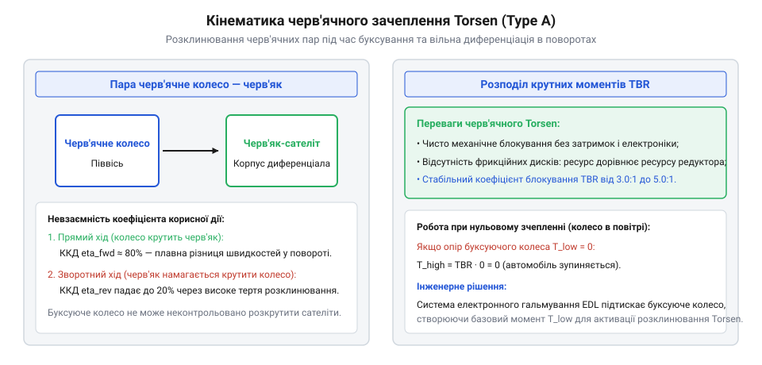

# Механічний диференціал і диференціальні механізми повороту: вільні, блоковані, LSD та схеми Клетрака

<preknowlist>
- [Механічний диференціал](root:hw-motion/mechanical-differential) — кінематика симетричного диференціала та формули кутових швидкостей
</preknowlist>

## Класифікація та призначення диференціалів підвищеного тертя (LSD): чому вільний диференціал втрачає тягу на слизькому ґрунті

Класичний симетричний конічний диференціал має фундаментальну конструктивну властивість: він ділить крутний момент від ведучого водила між півосями строго порівну (50% на 50%). Якщо обидва колеса мають надійне зчеплення з сухою дорогою, це забезпечує вільне проходження поворотів без паразитного проковзування шин. Проте за умов асиметричного зчеплення ця симетричність перетворюється на фатальний недолік.

Крутний момент, який колесо здатне передати на опорну поверхню, обмежений силою тертя між рушієм та ґрунтом:

T_max,i = F_z,i · mu_i · R_wheel

де `F_z,i` — вертикальне навантаження на колесо, `mu_i` — коефіцієнт зчеплення, `R_wheel` — динамічний радіус колеса.

Коли одне з коліс потрапляє на зледенілу ділянку (`mu_ice = 0.08`), граничний момент на ньому падає до мізерного значення `T_slip`. Оскільки вільний диференціал не здатний створити різницю моментів, момент на протилежному колесі, яке стоїть на сухому асфальті (`mu_dry = 0.85`), миттєво обмежується тією ж малою величиною:

T_dry = T_slip

У результаті колесо на льоду розкручується з подвоєною швидкістю, а колесо на твердому ґрунті залишається нерухомим. Сумарна сила тяги колісного шасі падає до критичного мінімуму, машина або мобільний робот повністю втрачає хід.

Диференціал підвищеного тертя (@@en|Limited Slip Differential@@, LSD) створений для подолання цього глухого кута. Внутрішній механізм LSD генерує додатковий внутрішній момент тертя `T_friction`, який дозволяє передавати на колесо з кращим зчепленням суттєво більший крутний момент:

T_high = T_low + 2 · T_friction

За конструктивним принципом обмеження диференціювання розрізняють чотири основні класи LSD:
1. **Дискові фрикційні механізми (Salisbury / ZF)** — використовують стиснення пакетів дисків осьовим розклинюванням сателітів.
2. **Гвинтові та черв'ячні диференціали (Torsen / Quaife)** — використовують високе внутрішнє тертя в косозубих або черв'ячних парах сателітів при виникненні відносної швидкості.
3. **В'язкісні муфти (Viscous LSD)** — блокування здійснюється дилатантною силіконовою рідиною при появі градієнта швидкості між дисками.
4. **Електронно-керовані активні блокування** — диференціали з кулачковими муфтами або соленоїдами, де ступінь блокування регулюється алгоритмом мікроконтролера.

> 🔧 **Навіщо це.**
> Розуміння фізики симетричного падіння моменту на вільному диференціалі є вирішальним при виборі трансмісії повнопривідного польового робота: встановлення LSD дозволяє долати бруд та лід без зупинки шасі й без застосування енергоємного підгальмовування коліс колодками (TCS).

## Дискові фрикційні LSD (Salisbury/ZF): пакети дисків, нажимні конуси розклинювання та попереднє стиснення тарілчастими пружинами

Дисковий диференціал підвищеного тертя типу Солсбері (Salisbury) є класичним еталоном пасивного механічного блокування у важких позашляховиках, спортивних автомобілях та важких мобільних роботах.

Конструкція вузла інтегрується безпосередньо в чашку диференціала. Між зовнішнім корпусом чашки та кожною з півосьових шестерень розташовано багатодисковий фрикційний пакет. Пакет складається з двох типів дисків, що чергуються:
- **Фрикційні диски з зовнішніми шліцами**, зафіксовані в пазах обертової чашки диференціала.
- **Сталеві диски з внутрішніми шліцами**, посаджені на шліци лівої та правої півосей.

Хрестовина або пальці сателітів встановлені не в циліндричні отвори, а спираються на спеціальні нажимні чашки (кулачкові кільця) з V-подібними пазами — рампами (@@en|ramp angles@@).

Коли двигун передає крутний момент `T_in` на чашку диференціала, пальці сателітів під дією колової сили намагаються вийти з вершин V-подібних пазів. Виникає ефект клина: похилі грані рампи створюють потужну осьову розпірну силу `F_axial`, спрямовану вздовж осі півосей:

F_axial = ( T_in / (2 · R_pin) ) · cot(gamma)

де `R_pin` — радіус розташування пальців сателітів, а `gamma` — кут скосу рампи відносно площини обертання.

Осьова сила `F_axial` притискає нажимні конуси до пакетів фрикційних дисків, стискаючи їх із силою нормального тиску. У результаті між чашкою та півосями виникає момент тертя:

T_friction = F_axial · mu_clutch · z_friction · R_eff

де `mu_clutch` — коефіцієнт тертя фрикційних пар (0.08–0.12 у трансмісійній оливі), `z_friction` — кількість робочих поверхонь тертя, `R_eff` — ефективний радіус тертя дисків.

Чим більший крутний момент видає двигун (`T_in`), тим сильніше розклинюються чашки й тим жорсткіше блокується диференціал.

Для забезпечення працездатності механізму у випадку повного вивішування одного з коліс (діагональне вивішування, коли `T_slip = 0` і передаваний вхідний момент прямує до нуля), всередину пакета встановлюють тарілчасті пружини Бельвіля (@@en|Belleville spring washers@@). Вони створюють початковий постійний натяг `F_preload`, що гарантує базовий момент тертя спокою `T_preload`:

T_total_fric = T_preload + T_friction(T_in)

За конфігурацією кутів рамп на розгоні та гальмуванні виділяють три схеми:
1. **1-way LSD**: V-подібний паз має скіс лише з одного боку (кут `gamma` при прискоренні). Блокування спрацьовує виключно під час подачі тяги; при скиданні газу диференціал повністю вільний, що полегшує вхід у поворот.
2. **1.5-way LSD**: має асиметричні кути (наприклад, 35° на прискоренні та 60° на уповільненні). При гальмуванні створюється помірне блокування, яке стабілізує прямолінійне гальмування шасі, не спричиняючи сильної недостатньої повертальності.
3. **2-way LSD**: симетричні скоси (наприклад, 45°/45°). Забезпечує однакове блокування як при прискоренні, так і при гальмуванні двигуном, що затребувано у drift-платформах та важкій всюдихідній техніці.

> 🔧 **Навіщо це.**
> Вибір кута рамп дискового LSD дозволяє точно налаштувати баланс між прохідністю робота на пересіченій місцевості та радіусом розвороту на твердому покритті: завищений кут блокування при гальмуванні перешкоджає маневруванню у вузьких коридорах.

## Гвинтові та черв'ячні блокування (Torsen/Quaife): ефект уповільненого тертя в зачепленні черв'як-колесо та безперервний перерозподіл моменту

Гвинтові та черв'ячні диференціали підвищеного тертя — найвідомішими представниками яких є Torsen (від англійського @@en|Torque Sensing@@) та Quaife (ATB, @@en|Automatic Torque Biasing@@) — кардинально відрізняються від дискових блокувань. У них немає фрикційних дисків, які з часом зношуються і потребують регулювання зазорів; блокування забезпечується виключно внутрішнім тертям у спеціальних зубчастих передачах.

У диференціалах Torsen Type 1 півосьовими елементами є черв'ячні колеса, а сателітами — черв'яки, розташовані перпендикулярно до осі півосей. У системах Quaife та Torsen Type 2/3 застосовуються пари циліндричних косозубих сателітів із перехресними або паралельними осями, розташовані в спеціальних циліндричних кишенях корпусу.

*Схема зачеплення черв'ячних пар Torsen: розклинювання коліс у корпусі при відносній пробуксовці.*

Кінематичний та силовий принцип роботи базується на несиметричній передачі зусилля в черв'ячних та гвинтових парах. Пряма передача моменту від черв'яка до черв'ячного колеса відбувається з відносно високим ККД:

eta_direct = tan(lambda) / tan(lambda + rho)

де `lambda` — кут підйому витка черв'яка, а `rho = arctan(mu_mesh)` — кут тертя в зачепленні.

Проте при спробі колеса провернути черв'як у зворотному напрямку (зворотний рух) ККД різко падає або виникає уповільнене тертя:

eta_reverse = tan(lambda - rho) / tan(lambda)

Коли виникає різниця кутових швидкостей півосей (наприклад, через буксування одного з коліс), косозубі сателіти починають обертатися у своїх гніздах. Під дією значних осьових та радіальних сил зачеплення:
1. Торці сателітів із великою силою притискаються до плаваючих шайб та торцевих стінок корпусу диференціала.
2. Зовнішній діаметр вершин зубів сателітів розпирається і притискається до циліндричних стінок посадкових кишень у сталевому корпусі.

Виникає пропорційний гальмівний момент тертя ковзання в мастильній плівці. Чим вищий крутний момент подається від двигуна, тим сильніше сателіти вклинюються у свої гнізда і тим більший момент перерозподіляється на колесо, що має надійне зчеплення з дорогою.

Головними експлуатаційними перевагами гвинтових диференціалів є:
- **Миттєве та плавне спрацьовування**: відсутні удари, вібрації або ривки під час блокування, оскільки зачеплення шестерень відбувається неперервно.
- **Повна сумісність із антиблокувальною системою гальм (ABS) та ESP**: за відсутності тяги двигуна внутрішнє тертя мізерне, колеса обертаються абсолютно незалежно, не збиваючи роботу колісних датчиків швидкості.
- **Необслуговуваність**: ресурс механізму дорівнює ресурсу всієї коробки передач, оскільки загартовані леговані шестерні практично не мають зносу за умови регулярної заміни трансмісійної оливи.

> 🔧 **Навіщо це.**
> Застосування гвинтового диференціала типу Quaife/Torsen на передній осі повнопривідного робота дозволяє зберегти легке й точне кермування без різких ударів на сервоприводи повороту коліс, водночас гарантуючи впевнений виїзд із глибоких колій.

## Силова характеристика блокування: коефіцієнт TBR (Torque Bias Ratio), в'язкісні муфти та електронно-керовані активні блокування

Ефективність будь-якого диференціала підвищеного тертя кількісно оцінюється безрозмірним параметром — коефіцієнтом перерозподілу крутного моменту (@@en|Torque Bias Ratio@@, TBR):

TBR = T_max / T_min

де `T_max` — крутний момент на колесі з кращим зчепленням (небуксуючому), а `T_min` — крутний момент на буксуючому колесі.

Для відкритого симетричного диференціала `TBR = 1.0` (моменти суворо рівні).
Для стандартних дискових LSD коефіцієнт TBR варіюється від `1.8` до `3.5`.
Для гвинтових систем Torsen TBR типово становить від `2.5` до `5.0` (на спортивних версіях — до `6.0`).

Якщо диференціал має `TBR = 4.0`, це означає, що механізм здатен передати на зачеплене за твердий ґрунт колесо момент, який у 4 рази перевищує момент на слизькому колесі:

T_max = 4 · T_min

Проте тут криється класична інженерна пастка механічних LSD: якщо одне колесо потрапляє на абсолютно гладкий лід або висить у повітрі (`T_min = 0` Н·м), формула дає:

T_max = TBR · 0 = 0

Без зовнішнього опору механічний диференціал не може створити розпірне зусилля, і машина втрачає хід. Для подолання цього недоліку паралельно встановлюють легке пружинне преднатягування або водій злегка притискає робоче гальмо, штучно створюючи опір `T_min`, який диференціал миттєво помножує на величину TBR.

Альтернативною конструкцією є **в'язкісна муфта (Viscous LSD)**. Вона складається з герметичного циліндричного резервуара, заповненого кремнійорганічною силіконовою рідиною з надвисокою в'язкістю (до 100 000 сСт). Всередині чергуються перфоровані диски чашки та півосі. Момент передається за рахунок в'язкого зсуву рідини при появі різниці швидкостей `delta_omega`:

T_viscous = K_visc · (omega_left - omega_right)

При тривалій пробуксовці силіконова рідина розігрівається, різко розширюється і притискає диски напряму (@@en|hump phenomenon@@), жорстко блокуючи міжосьовий диференціал.

Вершиною еволюції є **електронно-керовані активні блокування (E-LSD)**. У них пакет фрикційних дисків стискається зовнішнім електромеханічним кульковим приводом (ball-ramp) або електромагнітним соленоїдом. Мікроконтролер системи стабілізації за мілісекунди змінює ступінь блокування від 0% (повністю вільний для різкого входу в поворот) до 100% (повне жорстке блокування для максимального розгону або подолання важкого бездоріжжя).

> 🔧 **Навіщо це.**
> Знання TBR визначає вибір алгоритмів керування мобільним роботом: на шасі з Torsen (TBR=3.5) для відновлення руху під час діагонального вивішування контролер повинен короткочасно подати імпульс на колісне гальмо буксуючого рушія, щоб ініціювати розклинювання черв'ячного ряду.

## Інженерні критерії вибору LSD: мастильні матеріали з присадками проти зриву (LS additives), тепловий баланс та ресурс дисків

Вибір конкретного типу диференціала підвищеного тертя для мобільного робота чи колісної платформи вимагає врахування експлуатаційних обмежень: ресурсу вузлів, тепловиділення при тривалій роботі та специфічних вимог до змащування.

Найбільш критичними до вибору мастильних матеріалів є **дискові фрикційні LSD**. Під час проходження поворотів, коли пакети дисків проковзують один відносно одного під дією натягу пружин Бельвіля, в зоні тертя може виникати небезпечне явище переривчастого ковзання — автоколивальний ефект «прилипання-зриву» (@@en|stick-slip phenomenon@@). Він супроводжується сильними вібраціями, скреготом та передчасним руйнуванням шліців.

Для усунення stick-slip у трансмісійні оливи (класу API GL-5) додають спеціальні модифікатори тертя — **присадки для обмеженого проковзування (LS additives, Limited Slip additives)**. Ці присадки на базі фосфорорганічних або цинкових сполук змінюють коефіцієнт тертя ковзання `mu` залежно від швидкості:
- Замість спадної характеристики (де тертя спокою вище за тертя руху, що й провокує зрив), вони створюють висхідну характеристику.
- Це забезпечує плавне, безшумне взаємне ковзання фрикційних дисків без ривків трансмісії.

Для гвинтових та черв'ячних систем (Torsen / Quaife) присадки LS зазвичай не потрібні, а в ряді випадків навіть шкідливі: надмірне зниження тертя зменшує коефіцієнт блокування TBR. Для них достатньо стандартної якісної синтетичної оливи GL-5 високої в'язкості (75W-90 або 75W-140) з високою термостабільністю.

**Тепловий баланс та ресурс дисків.**
Під час тривалого буксування в дискових LSD вся потужність тертя перетворюється на тепло:

P_heat = T_friction · (omega_left - omega_right)

Якщо робот тривалий час пробуксовує на підйомі з асиметричним покриттям, температура фрикційного пакета може швидко перевищити 140–160 °C. Це призводить до термічного розкладу оливи, втрати пружності пружинами Бельвіля та вигорання фрикційних накладок. Для важких робототехнічних комплексів передбачають тепловідвідні ребра на корпусі редуктора або примусовий масляний радіатор.

Ресурс фрикційних пакетів дискових LSD зазвичай становить від 30 000 до 80 000 км (або 2000–5000 мотогодин), після чого потрібна заміна дисків та повторне регулювання преднатягу калібрувальними шайбами. На противагу їм черв'ячні диференціали розраховані на весь життєвий цикл механізму без технічного обслуговування.

> 🔧 **Навіщо це.**
> Заливання звичайної оливи без маркування «LSD / LS» у міст із дисковим блокуванням призводить до появи сильного стуку та вібрацій під час кожного розвороту робота вже через 10 годин експлуатації, що вимагає негайного промивання редуктора та заміни мастила.
