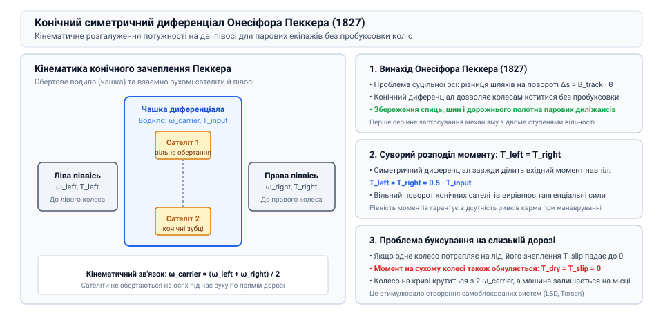
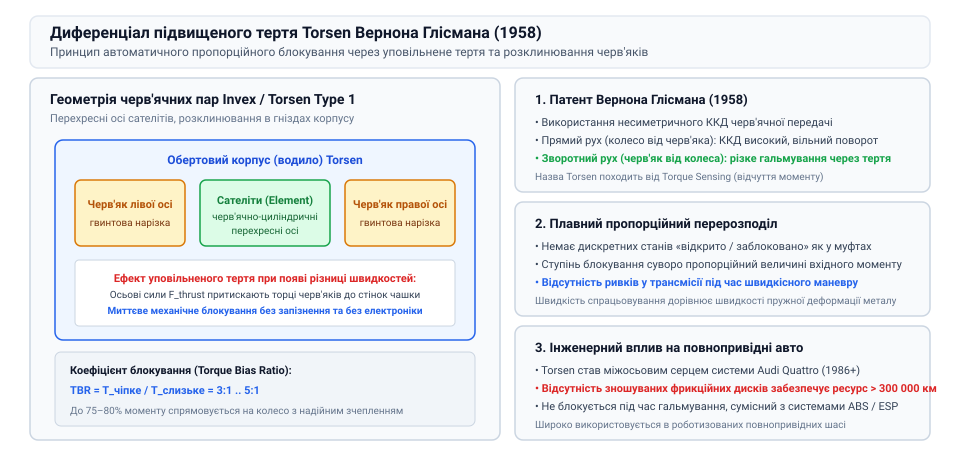
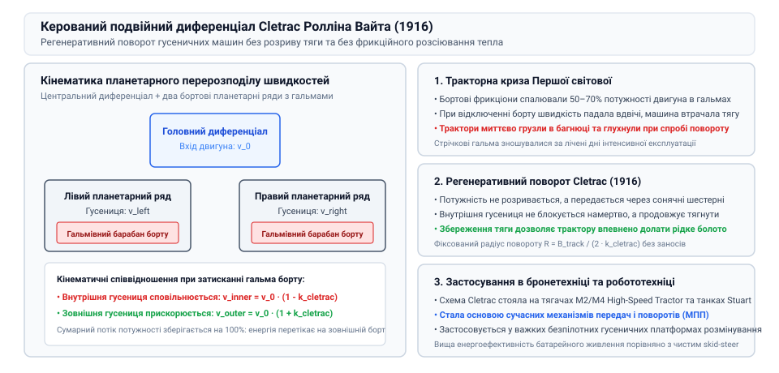

# Механічний диференціал і диференціальні механізми повороту: вільні, блоковані, LSD та схеми Клетрака

## Кінематичний глухий кут раннього транспорту: злам коліс парових диліжансів та винахід конічного диференціала Онесіфором Пеккером (1827)

Початок XIX століття ознаменувався першими спробами створити самохідні сухопутні екіпажі на паровій тязі. Інженери у Франції та Великій Британії будували масивні парові диліжанси, які важили від трьох до шести тонн. Проте перші ж випробування виявили непереборну механічну проблему під час проходження поворотів.

Якщо ведучі колеса повозки жорстко з'єднувалися однією суцільною сталевою віссю, обидва колеса змушені були обертатися з однаковою кутовою швидкістю omega. Однак на повороті радіуса R_turn зовнішнє колесо описує дугу значно більшої довжини, ніж внутрішнє:

s_outer = (R_turn + B_track / 2) · theta_turn
s_inner = (R_turn - B_track / 2) · theta_turn

де B_track — ширина колії, а theta_turn — кут повороту екіпажа. Різниця шляхів delta_s = B_track · theta_turn спричиняла жорстокий кінематичний конфлікт: одне з коліс неминуче пробуксовувало та волочилося по ґрунту або бруківці. Під колосальною вагою парового диліжанса сили зчеплення були настільки великими, що суцільна вісь скручувалася у вузол, дерев'яні спиці коліс розліталися на тріски, а дорожнє полотно буквально роздиралося на шматки.

Спроби приводити тягою лише одне колесо, залишивши друге вільним, робили диліжанс безпорадним: машина втрачала половину тяги, а тягове зусилля з одного боку створювало небезпечний постійний перекидний момент, який викидав повозку в кювет.

Розв'язання цього інженерного парадоксу знайшов французький механік, годинникар і винахідник Онесіфор Пеккер (@@fr|Onésiphore Pecqueur@@). Працюючи в Консерваторії мистецтв і ремесел у Парижі, Пеккер у 1827 році запатентував механізм, якому судилося стати невіддільною частиною всього світового транспорту: конічний симетричний диференціал.

Пеккер запропонував розрізати суцільну ведучу вісь на дві незалежні півосі, закріпивши на їхніх внутрішніх торцях конічні шестерні. Між ними він встановив обертовий корпус (водило або чашку диференціала), на радіальних пальцях якого вільно оберталися малі конічні сателіти, що одночасно перебували в зачепленні з обома півосьовими шестернями. Рушійний момент парової машини передавався на чашку диференціала, а сателіти розподіляли зусилля порівну між колісними осями, дозволяючи їм обертатися з довільною різницею швидкостей без жодного проковзування.

*Кінематична схема оригінального конічного диференціала Онесіфора Пеккера 1827 року для парового воза.*

> 🔧 **Навіщо це.**
> Винахід Пеккера ввів у машинобудування концепцію механічного розгалуження потоку потужності з двома ступенями вільності, що є основою кінематики сучасних мобільних роботів і колісних шасі.

## Епоха автомобілізації та виклик втрати зчеплення: чому вільний диференціал зупиняє машину на кризі та перші кулачкові блокування

З появою автомобілів із двигунами внутрішнього згоряння наприкінці XIX століття (роботи Карла Бенца, Готтліба Даймлера та Еміля Левассора) диференціал Пеккера став абсолютним стандартом ведучих мостів. Автомобіль отримав бездоганну керованість і плавність ходу на сухому твердому асфальті. Проте масовий виїзд машин на реальні ґрунтові, мокрі та засніжені дороги відкрив зворотний, темний бік вільного диференціала.

Вільний симетричний диференціал є суворим дільником крутного моменту навпіл:

T_left = T_right = 0.5 · T_input

Він не здатний спрямувати більше моменту на те колесо, яке має краще зчеплення. Якщо одне з ведучих коліс потрапляє на лід, слизьку багнюку чи зависає в повітрі при діагональному вивішуванні, граничний момент зчеплення цього колеса T_grip,slip падає майже до нуля:

T_max,slip = mu_ice · N_wheel · R_wheel ≈ 0

Оскільки диференціал вирівнює моменти, крутний момент на протилежному колесі, яке стоїть на ідеально сухому бетоні з високим коефіцієнтом тертя, також миттєво обнуляється:

T_dry = T_slip ≈ 0

Автомобіль стає абсолютно нерухомим: колесо на льоду шалено обертається з подвійною швидкістю 2 · omega_carrier, а колесо на твердому ґрунті залишається повністю статичним.

У 1930-х роках інженери розпочали пошук способів боротьби з цим вродженим дефектом. Першим розв'язком стали примусові механічні блокування за допомогою зубчастих муфт, які водій вмикав важелем, жорстко замикаючи півосі між собою. Проте забуте увімкненим блокування на сухому повороті неминуче призводило до аварії або скручування півосі.

Потрібен був механізм, який міг би блокуватися автоматично лише при проковзуванні. Першими успішними конструкціями стали кулачкові та кулько-сухарні самоблоковані диференціали (такі як німецький Cam and Roller диференціал фірми ZF, розроблений інженером Отто Зальманом у 1934 році). У цих вузлах шестерні замінили хвилястими кулачковими доріжками та плаваючими сухарями, які розклинювалися під навантаженням за рахунок високого внутрішнього сухого тертя, запобігаючи односторонньому буксуванню.

> 🔧 **Навіщо це.**
> Розуміння симетричного ділення моментів вільного диференціала позбавляє інженера ілюзії, нібито повнопривідна машина «сама виїде» з льоду без спеціальних механізмів обмеження проковзування.

## Революція Вернона Глісмана: патент 1958 року, ефект уповільненого тертя черв'ячних пар та створення диференціала Torsen

Попри численні спроби створити надійний самоблок у першій половині XX століття, більшість конструкцій спиралися на фрикційні пакети пластин або зубчасті храповики. Вони мали дві критичні вади: швидкий знос фрикційних накладок і раптовий ударний перехід між вільним та заблокованим станами, що на слизькому повороті викликало раптове зривання машини в некерований занос.

Революційний прорив у трибології та кінематиці диференціалів здійснив американський інженер-винахідник Вернон Глісман (@@en|Vernon Gleasman@@). У 1958 році він запатентував концептуально новий механізм, який дістав назву Torsen (від англійського @@en|Torque Sensing@@ — відчуття крутного моменту).

Ідея Глісмана полягала в геніальному використанні властивості черв'ячної передачі: черв'як може легко обертати черв'ячне колесо з високим ККД, але спроба колеса провернути черв'як наштовхується на значний опір сил тертя через малий кут підйому гвинтової лінії (ефект уповільненого тертя або часткового самогальмування).

У диференціалі Torsen півосьові шестерні виконані у вигляді черв'яків із гвинтовою нарізкою, а сателіти в корпусі — у вигляді парних черв'ячних коліс із перехресними осями. Коли автомобіль плавно повертає, різниця швидкостей коліс легко компенсується вільним коченням черв'яків. Проте як тільки одне з коліс починає пробуксовувати і прагне різко прискоритись, сили тиску у витках черв'ячної пари розклинюють сателіти в отворах корпусу диференціала.

Виникає пропорційний гальмівний момент тертя, який перенаправляє крутний момент на колесо з кращим зчепленням. Причому цей перерозподіл відбувається миттєво, суто механічно (зі швидкістю поширення пружної хвилі в металі) і абсолютно плавно, без жодної електроніки чи гідравліки. Коефіцієнт блокування (Torque Bias Ratio, TBR) диференціала Torsen досягав 3:1..5:1, що дозволяло направляти до 75–80% тяги двигуна на чіпке колесо. Винахід Глісмана став технологічною основою легендарної повнопривідної системи Audi Quattro, назавжди змінивши автоспорт і серійне автомобілебудування.

*Схема зачеплення сателітів диференціала Torsen Глісмана: розклинювання черв'ячних пар та баланс крутних моментів.*

> 🔧 **Навіщо це.**
> Диференціал Torsen продемонстрував, як кінематичне тертя механізму можна перетворити з паразитного явища на високоточний пропорційний підсилювач тяги.

## Тракторна криза Першої світової: катастрофічні втрати енергії в бортових фрикціонах гусеничних машин під час поворотів

Паралельно з розвитком колісного автотранспорту в 1910-х роках виникла ще гостріша механічна криза у важкому гусеничному машинобудуванні. Поява перших танків (британських Mark I) та сільськогосподарських гусеничних тракторів вимагала ефективного керування поворотом гусеничного шасі.

Оскільки гусениці не мають поворотних керованих коліс, поворот здійснюється за рахунок різниці лінійних швидкостей лівої та правої гусеничних стрічок (поворот ковзанням, @@en|skid steering@@). Традиційна трансмісія спиралася на бортові фрикціони та стрічкові гальма:
- Щоб повернути гусеничну машину, водій вимикав бортовий фрикціон з одного боку, розриваючи потік потужності від двигуна до внутрішньої гусениці;
- Потім натискав важіль стрічкового гальма, примусово сповільнюючи або повністю заклинюючи внутрішню гусеницю об корпус.

Така схема виявилася надзвичайно марнотратною та катастрофічно неефективною:
1. **Колосальні втрати потужності:** до 50–70% корисної потужності двигуна безповоротно спалювалося в тертя гальмівних стрічок. Масивні гальма розжарювалися до червоного жару, чавунні барабани тріскалися, а накладки стиралися за кілька діб інтенсивних боїв або польових робіт;
2. **Падіння швидкості та застрягання:** при відключенні одного борту вся вага важкої машини лягала на єдину тягову гусеницю. Швидкість машини падала вдвічі, на в'язкому ґрунті тяги одного борту не вистачало, і трактор миттєво заривався в багнюку та глухнув;
3. **Неможливість плавного маневрування:** поворот відбувався ривками, що руйнувало траки та підвіску.

Промисловість гостро потребувала трансмісії, яка могла б змінювати співвідношення швидкостей гусениць без розриву потоку потужності та без перетворення механічної енергії на марне тепло в гальмах.

## Подвійний диференціал Ролліна Вайта (Cletrac, 1916–1920): збереження тяги на обох гусеницях та спадщина в сучасній військовій бронетехніці

Справжню революцію в управлінні гусеничним рушієм здійснив американський інженер і промисловець Роллін Вайт (@@en|Rollin H. White@@), засновник компанії Cleveland Tractor Company (відомої під торговою маркою Cletrac). У період з 1916 по 1920 роки Вайт розробив і запатентував механізм керованого подвійного диференціала (@@en|Cletrac controlled differential steering system@@).

Вайт відмовився від концепції розриву силового потоку бортовими фрикціонами. Замість цього він об'єднав центральний симетричний диференціал із двома додатковими планетарними рядами, сонячні шестерні яких з'єднані з двома окремими гальмівними барабанами керування поворотом.

Кінематика системи Cletrac працює наступним чином:
- При прямолінійному русі обидва гальмівні барабани повністю розімкнені. Двигун обертає корпус центрального диференціала, і обидві гусениці рухаються вперед із строго однаковою швидкістю v_0:

v_left = v_right = v_0

- Під час повороту водій затягує гальмо одного з барабанів (наприклад, внутрішнього борту). Зупинка сонячної шестерні планетарного ряду примусово вмикає редукцію на внутрішню гусеницю, знижуючи її швидкість до фіксованої частки:

v_inner = v_0 · (1 - k_cletrac)

де k_cletrac — кінематичний коефіцієнт планетарного ряду (типово 0.25–0.35). Одночасно, через зв'язок сателітів центрального диференціала, швидкість зовнішньої гусениці дзеркально зростає:

v_outer = v_0 · (1 + k_cletrac)

Головний тріумф винаходу Ролліна Вайта полягав у збереженні 100% тягової потужності двигуна на повороті:
1. **Регенерація потужності:** внутрішня гусениця не блокується намертво, а продовжує штовхати машину вперед, віддаючи частину своєї кінетичної енергії через шестерні диференціала на зовнішню гусеницю (регенеративний поворот);
2. **Неможливість застрягання:** тяга не зникає з жодної з гусениць, тому трактор Cletrac легко повертав на найглибшій ріллі та трясовині, де всі звичайні трактори миттєво в'язнули;
3. **Фіксований радіус повороту:** кожному положенню важеля відповідає чіткий розрахунковий радіус розвороту R_turn = B_track / (2 · k_cletrac), що виключає занесення.

Система Клетрака виявилася настільки надійною та ефективною, що в роки Другої світової війни її масово застосовували на тисячах важких артилерійських тягачів M2/M4 High-Speed Tractor, танках Stuart та бронетранспортерах США. Ідеї Ролліна Вайта заклали фундамент сучасних гідромеханічних механізмів передач і поворотів (МПП) сучасної бронетехніки та важких гусеничних роботів-саперів.

*Кінематична схема керованого подвійного диференціала Cletrac: планетарні передачі та гальмівні барабани бортів.*

> 🔧 **Навіщо це.**
> Принцип Клетрака наочно демонструє перевагу планетарного перерозподілу кінетичної енергії над фрикційним гальмуванням, що є золотим правилом енергоефективності важких автономних платформ.
